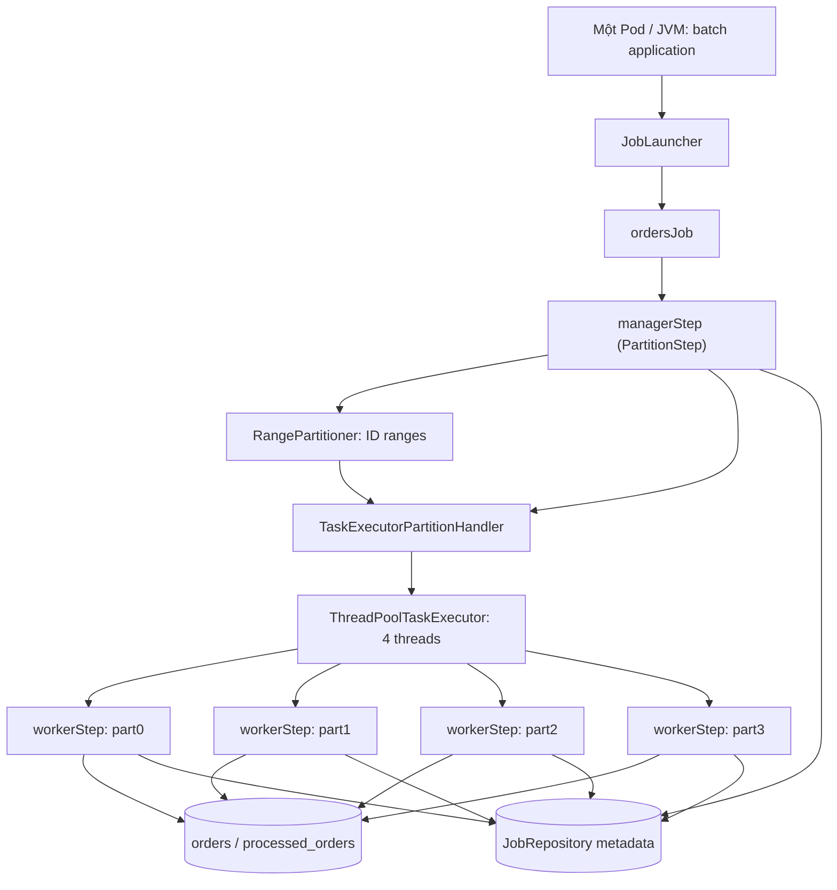

# Triển khai manager và worker cùng một ứng dụng Spring Batch

Khi một batch job phải đọc, biến đổi và ghi hàng triệu bản ghi, chia công việc thành nhiều **partition** giúp tận dụng các luồng CPU, thời gian chờ I/O và tài nguyên cơ sở dữ liệu. Cách triển khai dễ bắt đầu nhất là đặt **manager step** và **worker step** trong cùng một ứng dụng Spring Batch. Manager xác định các partition; worker xử lý từng partition trên các thread do ứng dụng quản lý.

Trong module **SPRING_BATCH_SCALING_OPERATIONS**, lựa chọn triển khai phải gắn với các mục tiêu: đo đúng nút thắt, giữ an toàn luồng, bảo vệ khả năng retry/restart, vận hành job ổn định và chọn mô hình mở rộng theo giới hạn CPU, RAM, kết nối DB và hạ tầng thực tế. Bài này đi sâu vào cấu hình và triển khai **manager và worker cùng một ứng dụng**, từ Java đến container, vận hành, giám sát và phục hồi.

> **Phiên bản minh họa:** Java 17, Spring Batch 5.x, Spring Boot 3.x, PostgreSQL. Các ví dụ thể hiện kiến trúc có thể vận dụng; môi trường sản xuất cần bổ sung bảo mật, migration schema, truy vết và kiểm thử tải. Với Spring Batch/Boot phiên bản khác, hãy đối chiếu API tương ứng.

## 1. "Cùng một ứng dụng" nghĩa là gì?

Trong Spring Batch, **manager** và **worker** là vai trò của các step, không mặc định là hai service độc lập:

- **Manager step** chọn phạm vi và tạo các `StepExecution` con từ `Partitioner`; điều phối thực thi và tổng hợp trạng thái.
- **Worker step** chạy logic `ItemReader → ItemProcessor → ItemWriter` cho dữ liệu trong `ExecutionContext` của một partition.
- **`TaskExecutorPartitionHandler`** giao các worker `StepExecution` cho `TaskExecutor`, thường là một thread pool trong **cùng tiến trình JVM**.
- **`JobRepository`** lưu trạng thái job, manager và worker; cơ sở dữ liệu metadata cần được cấu hình bền vững nếu cần restart.

**Hai cách dùng cụm từ “cùng ứng dụng” cần phân biệt:**

| Cách tổ chức | Nơi manager/worker chạy | Cần middleware? | Khả năng mở rộng |
| --- | --- | --- | --- |
| **Local partitioning**: một ứng dụng đang chạy, một Spring context | Manager và worker trong **cùng JVM**, trên các thread khác nhau | Không | Scale-up trong giới hạn một JVM/pod và hệ thống dữ liệu |
| **Cùng mã nguồn/image nhưng chạy thành các tiến trình khác nhau** | Có thể có 1 manager pod và nhiều worker pod | Có, nếu là **remote partitioning** | Scale-out giữa nhiều JVM/node |

Bài này triển khai hàng đầu tiên. Việc đóng gói chung một file JAR hoặc một Docker image **không tự động biến local partitioning thành remote partitioning**. Muốn worker ở pod khác, cần cơ chế remote partitioning (ví dụ messaging request/reply và worker step nhận execution context), cùng xử lý lỗi mạng và điều phối trạng thái riêng.

### Kiến trúc chạy trong một JVM



Sơ đồ biểu diễn tối đa bốn worker cùng hoạt động; nếu manager tạo tám partition, bốn partition còn lại có thể đợi trong hàng đợi. Mỗi partition có `StepExecution`/`ExecutionContext` riêng, dù mọi thành phần dùng chung `ApplicationContext`.

**Khác với multi-threaded step:** multi-threaded step cho nhiều chunk của một step chạy đồng thời, có thể khiến trạng thái reader/writer dùng chung trở nên khó quản lý. Local partitioning đặt ranh giới dữ liệu và metadata theo từng worker `StepExecution`, thường dễ khoanh vùng lỗi và restart hơn khi nguồn dữ liệu chia rõ ràng. Cũng khác parallel flows, nơi các step khác nhau chạy song song thay vì nhiều partition cùng xử lý một loại công việc.

## 2. Khi nào nên đặt manager và worker chung ứng dụng?

Mô hình này phù hợp nếu dữ liệu có thể tách độc lập theo khoảng ID, ngày, tenant, file hoặc một tập khóa; một JVM còn đủ RAM/CPU, và điểm nghẽn chủ yếu là khả năng chờ I/O hoặc mức song song của truy vấn/ghi. Nó giảm chi phí vận hành so với remote partitioning vì không cần message broker, worker service riêng hay quản lý giao thức truyền partition.

Không nên mặc định tăng số thread là tăng throughput. Nếu PostgreSQL đã bão hòa CPU, IOPS hoặc khóa ghi, worker bổ sung chỉ kéo dài thời gian chờ. Nếu cần chạy trên nhiều máy do giới hạn CPU/RAM hoặc yêu cầu cô lập worker, nên cân nhắc remote partitioning.

| Câu hỏi cần trả lời | Nghiêng về cùng ứng dụng | Dấu hiệu cần xem lại kiến trúc |
| --- | --- | --- |
| Tập dữ liệu chia được thành các phần độc lập? | Có ranh giới partition rõ ràng | Tranh chấp cùng bản ghi, cần thứ tự xử lý toàn cục |
| Một JVM đủ bộ nhớ và CPU? | Có dư địa sau khi đo tải | GC kéo dài, OOM hoặc CPU đã đầy |
| DB chịu được nhiều worker? | Query/index tốt, pool connection đủ | Lock contention, timeout, DB I/O đã bão hòa |
| Cần thêm node xử lý? | Chưa cần, một pod đáp ứng SLA | Cần phân tán nhiều JVM hoặc khu vực tài nguyên |
| Khả năng vận hành? | Ưu tiên ít thành phần, dễ debug | Có sẵn messaging, autoscaling và giám sát phân tán |

## 3. Ví dụ bài toán triển khai

Một job nhận dải ID đơn hàng của **một snapshot đã chốt** từ `JobParameters`, đọc bảng `orders`, sau đó ghi sang `processed_orders`. Mỗi partition được gán một khoảng ID đóng `[fromId, toId]`, không chồng lấp.

Ví dụ dữ liệu ID từ `1` đến `100_000`, cấu hình `gridSize=8` và `poolSize=4`:

- `Partitioner` tạo khoảng 8 partition, mỗi khoảng tối đa 12.500 ID.
- Bốn worker chạy đồng thời, bốn worker còn lại đợi; thực tế số partition phụ thuộc độ rộng dải.
- Worker đọc dữ liệu trong khoảng của mình bằng reader `@StepScope` và ghi bằng SQL có khóa duy nhất.
- `JobRepository` lưu checkpoint và kết quả riêng cho từng worker; khi job restart, metadata dùng để xác định những phần cần chạy lại.

Bảng minh họa cho PostgreSQL:

```sql
CREATE TABLE orders (
    id BIGINT PRIMARY KEY,
    amount NUMERIC(18, 2) NOT NULL
);

CREATE TABLE processed_orders (
    order_id BIGINT PRIMARY KEY,
    amount NUMERIC(18, 2) NOT NULL
);
```

Trong thực tế, phải xác định snapshot đầu vào theo batch window, timestamp chốt hoặc staging table. Việc chỉ chốt `fromId/toId` không bảo đảm dữ liệu bất biến nếu các dòng trong khoảng còn được cập nhật hoặc xóa; quy trình nghiệp vụ cần kiểm soát điều này để restart không đọc một tập dữ liệu khác.

## 4. Cấu hình manager và worker trong cùng Spring Boot application

Mã Java dưới đây thể hiện những thành phần chính. Ứng dụng phải có các dependency tương thích như `spring-boot-starter-batch`, JDBC driver PostgreSQL và `DataSource`/`JobRepository` được Spring Boot cấu hình. Không cần thêm `@EnableBatchProcessing` nếu đang sử dụng cơ chế tự cấu hình Spring Batch của Spring Boot.

### 4.1. Định nghĩa partition, reader, writer, worker và manager

```java
package example.batch;

import java.math.BigDecimal;
import java.util.LinkedHashMap;
import java.util.Map;
import javax.sql.DataSource;

import org.springframework.batch.core.Job;
import org.springframework.batch.core.Step;
import org.springframework.batch.core.configuration.annotation.StepScope;
import org.springframework.batch.core.job.builder.JobBuilder;
import org.springframework.batch.core.partition.PartitionHandler;
import org.springframework.batch.core.partition.support.Partitioner;
import org.springframework.batch.core.partition.support.TaskExecutorPartitionHandler;
import org.springframework.batch.core.repository.JobRepository;
import org.springframework.batch.core.step.builder.StepBuilder;
import org.springframework.batch.item.ExecutionContext;
import org.springframework.batch.item.database.JdbcBatchItemWriter;
import org.springframework.batch.item.database.JdbcCursorItemReader;
import org.springframework.batch.item.database.builder.JdbcBatchItemWriterBuilder;
import org.springframework.batch.item.database.builder.JdbcCursorItemReaderBuilder;
import org.springframework.beans.factory.annotation.Qualifier;
import org.springframework.beans.factory.annotation.Value;
import org.springframework.context.annotation.Bean;
import org.springframework.context.annotation.Configuration;
import org.springframework.core.task.TaskExecutor;
import org.springframework.scheduling.concurrent.ThreadPoolTaskExecutor;
import org.springframework.transaction.PlatformTransactionManager;

@Configuration
public class OrdersBatchConfig {

    record OrderRow(long id, BigDecimal amount) {}

    // Partitioner riêng, tạo khóa partition ổn định trong một batch window.
    // Lớp không final để Spring có thể tạo scoped proxy.
    public static class RangePartitioner implements Partitioner {
        private final long fromId;
        private final long toId;

        public RangePartitioner(Long fromId, Long toId) {
            if (fromId == null || toId == null || fromId > toId) {
                throw new IllegalArgumentException("Invalid job ID range");
            }
            this.fromId = fromId;
            this.toId = toId;
        }

        @Override
        public Map<String, ExecutionContext> partition(int gridSize) {
            if (gridSize < 1) {
                throw new IllegalArgumentException("gridSize must be positive");
            }

            long length = Math.addExact(Math.subtractExact(toId, fromId), 1);
            long width = 1 + (length - 1) / gridSize;
            long start = fromId;
            int index = 0;
            Map<String, ExecutionContext> result = new LinkedHashMap<>();

            while (start <= toId) {
                // Tránh cộng vượt miền long khi tính ranh giới.
                long end = start + Math.min(width - 1, toId - start);
                ExecutionContext context = new ExecutionContext();
                context.putLong("fromId", start);
                context.putLong("toId", end);
                result.put("part" + index++, context);
                if (end == toId) {
                    break;
                }
                start = end + 1;
            }
            return result;
        }
    }

    // Giá trị chốt ở JobParameters để các lần restart dùng cùng range.
    @Bean("ordersPartitioner")
    @StepScope
    public RangePartitioner ordersPartitioner(
            @Value("#{jobParameters['fromId']}") Long fromId,
            @Value("#{jobParameters['toId']}") Long toId) {
        return new RangePartitioner(fromId, toId);
    }

    // Thread pool cục bộ: tối đa bốn worker chạy cùng lúc.
    @Bean("partitionExecutor")
    public ThreadPoolTaskExecutor partitionExecutor() {
        ThreadPoolTaskExecutor executor = new ThreadPoolTaskExecutor();
        executor.setCorePoolSize(4);
        executor.setMaxPoolSize(4);
        executor.setQueueCapacity(8);
        executor.setThreadNamePrefix("orders-part-");
        return executor;
    }

    // Mỗi worker StepExecution được tạo một reader và checkpoint riêng.
    @Bean("ordersReader")
    @StepScope
    public JdbcCursorItemReader<OrderRow> ordersReader(
            DataSource dataSource,
            @Value("#{stepExecutionContext['fromId']}") Long fromId,
            @Value("#{stepExecutionContext['toId']}") Long toId) {
        return new JdbcCursorItemReaderBuilder<OrderRow>()
            .name("ordersReader")
            .dataSource(dataSource)
            .sql("SELECT id, amount FROM orders "
               + "WHERE id BETWEEN ? AND ? ORDER BY id")
            .preparedStatementSetter(ps -> {
                ps.setLong(1, fromId);
                ps.setLong(2, toId);
            })
            .rowMapper((rs, rowNum) ->
                new OrderRow(rs.getLong("id"), rs.getBigDecimal("amount")))
            .saveState(true)
            .build();
    }

    @Bean("ordersWriter")
    public JdbcBatchItemWriter<OrderRow> ordersWriter(DataSource dataSource) {
        return new JdbcBatchItemWriterBuilder<OrderRow>()
            .dataSource(dataSource)
            .sql("INSERT INTO processed_orders (order_id, amount) "
               + "VALUES (?, ?) "
               + "ON CONFLICT (order_id) DO UPDATE "
               + "SET amount = EXCLUDED.amount")
            .itemPreparedStatementSetter((order, ps) -> {
                ps.setLong(1, order.id());
                ps.setBigDecimal(2, order.amount());
            })
            .build();
    }

    @Bean("ordersWorkerStep")
    public Step ordersWorkerStep(
            JobRepository jobRepository,
            PlatformTransactionManager transactionManager,
            @Qualifier("ordersReader")
                JdbcCursorItemReader<OrderRow> reader,
            @Qualifier("ordersWriter")
                JdbcBatchItemWriter<OrderRow> writer) {
        return new StepBuilder("ordersWorkerStep", jobRepository)
            .<OrderRow, OrderRow>chunk(200, transactionManager)
            .reader(reader)
            .writer(writer)
            .build();
    }

    @Bean("ordersPartitionHandler")
    public TaskExecutorPartitionHandler ordersPartitionHandler(
            @Qualifier("ordersWorkerStep") Step worker,
            @Qualifier("partitionExecutor") TaskExecutor executor) {
        TaskExecutorPartitionHandler handler = new TaskExecutorPartitionHandler();
        handler.setStep(worker);
        handler.setTaskExecutor(executor);
        handler.setGridSize(8);
        return handler;
    }

    @Bean("ordersManagerStep")
    public Step ordersManagerStep(
            JobRepository jobRepository,
            @Qualifier("ordersPartitioner") Partitioner partitioner,
            @Qualifier("ordersPartitionHandler") PartitionHandler handler) {
        return new StepBuilder("ordersManagerStep", jobRepository)
            .partitioner("ordersWorkerStep", partitioner)
            .partitionHandler(handler)
            .build();
    }

    @Bean("ordersJob")
    public Job ordersJob(
            JobRepository jobRepository,
            @Qualifier("ordersManagerStep") Step manager) {
        return new JobBuilder("ordersJob", jobRepository)
            .start(manager)
            .build();
    }
}
```

**Những điểm thiết yếu của cấu hình:**

1. `ordersManagerStep` chứa logic điều phối; `ordersWorkerStep` chứa phần đọc/ghi. Cả hai là bean trong cùng ứng dụng.
2. `ordersPartitioner` đọc `JobParameters` của **manager step**, tạo partition có tên và khoảng ID xác định; `@StepScope` cho phép lấy giá trị tham số lúc step được thực thi.
3. `ordersReader` dùng `@StepScope` để không chia sẻ một `JdbcCursorItemReader` có trạng thái cho các worker thread. Mỗi worker nhận `fromId/toId` riêng và checkpoint riêng.
4. `TaskExecutorPartitionHandler` chạy worker trong pool bốn thread; `gridSize=8` gợi ý số partition, **không phải** số thread.
5. `JdbcBatchItemWriter` ở ví dụ không có trạng thái mutable theo từng item sau khi khởi tạo và ghi qua transaction; câu lệnh PostgreSQL `ON CONFLICT` làm kết quả an toàn hơn khi xử lý lại ID. Custom writer có trạng thái phải được đánh giá riêng.
6. Dòng SQL dùng điều kiện `BETWEEN` với hai đầu **bao gồm**; `Partitioner` đặt partition kế tiếp bắt đầu ở `end+1` để tránh trùng ranh giới.

Đây là ví dụ triển khai local partitioning, không phải hệ thống giao tiếp từ xa. Các thành phần Spring Batch sử dụng chung `DataSource`, transaction manager và `JobRepository`; một worker chết do exception có thể làm step/job thất bại, còn việc cả JVM bị dừng đột ngột tác động đến tất cả partition đang chạy.

### 4.2. Khởi chạy đúng một job khi container bắt đầu

Có thể để Spring Boot tự khởi chạy `Job` khi startup trong ứng dụng đơn giản. Tuy nhiên, khi cần kiểm soát **batch window**, tham số restart và mã thoát của container, nên chọn một chiến lược khởi chạy rõ ràng. Ví dụ sau **tắt cơ chế auto-run job** rồi tự gọi `JobLauncher` một lần bằng tham số ổn định:

```java
package example.batch;

import org.springframework.batch.core.BatchStatus;
import org.springframework.batch.core.Job;
import org.springframework.batch.core.JobExecution;
import org.springframework.batch.core.JobParameters;
import org.springframework.batch.core.JobParametersBuilder;
import org.springframework.batch.core.launch.JobLauncher;
import org.springframework.beans.factory.annotation.Qualifier;
import org.springframework.beans.factory.annotation.Value;
import org.springframework.boot.ApplicationArguments;
import org.springframework.boot.ApplicationRunner;
import org.springframework.boot.SpringApplication;
import org.springframework.boot.autoconfigure.SpringBootApplication;
import org.springframework.context.ConfigurableApplicationContext;
import org.springframework.context.annotation.Bean;

@SpringBootApplication
public class OrdersBatchApplication {

    public static void main(String[] args) {
        ConfigurableApplicationContext context =
            SpringApplication.run(OrdersBatchApplication.class, args);
        System.exit(SpringApplication.exit(context));
    }

    @Bean
    ApplicationRunner launchOrders(
            JobLauncher jobLauncher,
            @Qualifier("ordersJob") Job job,
            @Value("${batch.window-id}") String windowId,
            @Value("${batch.from-id}") long fromId,
            @Value("${batch.to-id}") long toId) {
        return (ApplicationArguments args) -> {
            JobParameters params = new JobParametersBuilder()
                .addString("windowId", windowId)
                .addLong("fromId", fromId)
                .addLong("toId", toId)
                .toJobParameters();

            // Ví dụ yêu cầu JobLauncher đồng bộ, chạy xong mới trả kết quả.
            JobExecution result = jobLauncher.run(job, params);
            if (result.getStatus() != BatchStatus.COMPLETED) {
                throw new IllegalStateException(
                    "ordersJob ended with " + result.getStatus());
            }
        };
    }
}
```

Với `JobLauncher` mặc định chạy đồng bộ, `ApplicationRunner` đợi job kết thúc. Sau đó `main` đóng application context và trả mã thoát của quá trình cho Docker/Kubernetes. Khi tùy biến `JobLauncher` thành bất đồng bộ, không thể dùng đoạn runner này nguyên dạng: phải đợi `JobExecution` chuyển sang trạng thái kết thúc và quyết định exit code dựa trên kết quả cuối. Ứng dụng web phục vụ API cũng không nên tự `System.exit` theo cách này.

### 4.3. Thuộc tính triển khai

Ví dụ `application.yml` (giá trị thật lấy từ biến môi trường khi chạy container):

```yaml
spring:
  main:
    web-application-type: none
  batch:
    job:
      enabled: false  # ApplicationRunner chịu trách nhiệm launch job.
    jdbc:
      initialize-schema: never  # Quản lý schema bằng migration riêng.
  datasource:
    url: ${SPRING_DATASOURCE_URL}
    username: ${SPRING_DATASOURCE_USERNAME}
    password: ${SPRING_DATASOURCE_PASSWORD}
    hikari:
      maximum-pool-size: 12
      connection-timeout: 30000

batch:
  window-id: ${BATCH_WINDOW_ID}
  from-id: ${BATCH_FROM_ID}
  to-id: ${BATCH_TO_ID}
```

Tạo schema metadata Spring Batch đúng phiên bản và loại database **trước khi chạy job**, bằng migration/tool quản trị tương ứng. `initialize-schema: never` phù hợp môi trường đã quản lý schema; nếu DB chưa có bảng metadata mà vẫn dùng cấu hình này, startup hoặc job execution sẽ lỗi.

`maximum-pool-size: 12` chỉ là giá trị khởi đầu để đo. Pool bốn worker dùng `JdbcCursorItemReader` có thể giữ các kết nối đọc trong thời gian xử lý, đồng thời transaction ghi và `JobRepository` cũng cần kết nối. Số kết nối thực tế phụ thuộc reader, transaction manager, driver và cấu hình runtime, nên phải đo active/idle/pending connection thay vì áp một công thức cố định.

## 5. Đóng gói và chạy dưới dạng một container batch

Để triển khai cùng JVM, đóng gói thành **một ứng dụng Spring Boot có cả manager step và worker step**. Mỗi lần chạy tạo một process có một `JobLauncher` khởi chạy job và thread pool xử lý các partition.

Dockerfile minh họa khi đã build được file `app.jar`:

```dockerfile
FROM eclipse-temurin:17-jre
WORKDIR /opt/batch
COPY app.jar app.jar
ENTRYPOINT ["java", "-jar", "/opt/batch/app.jar"]
```

Khi build thực tế, pin phiên bản base image, quét dependency, cân nhắc chạy với UID không phải root, cấu hình heap theo memory limit và dùng registry được quản lý. Chỉ copy JAR đã build trong pipeline; ví dụ trên không bao gồm các bước build.

### 5.1. Một Kubernetes Job cho một batch window

Ví dụ manifest Kubernetes **Job** (không phải Deployment web chạy thường trực). Mỗi lần xử lý dữ liệu mới cần một Job name và `BATCH_WINDOW_ID` tương ứng với snapshot. Các lần thử restart **cùng** window cần giữ nguyên toàn bộ tham số nhận diện job:

```yaml
apiVersion: batch/v1
kind: Job
metadata:
  name: orders-batch-20261126
spec:
  backoffLimit: 0
  activeDeadlineSeconds: 7200
  ttlSecondsAfterFinished: 86400
  template:
    spec:
      restartPolicy: Never
      terminationGracePeriodSeconds: 180
      containers:
        - name: orders-batch
          image: registry.example.com/orders-batch:1.0.0
          resources:
            requests:
              cpu: "1000m"
              memory: "1Gi"
            limits:
              cpu: "2000m"
              memory: "2Gi"
          env:
            - name: BATCH_WINDOW_ID
              value: "orders-2026-11-26"
            - name: BATCH_FROM_ID
              value: "1"
            - name: BATCH_TO_ID
              value: "100000"
            - name: SPRING_DATASOURCE_URL
              valueFrom:
                secretKeyRef:
                  name: orders-batch-db
                  key: jdbc-url
            - name: SPRING_DATASOURCE_USERNAME
              valueFrom:
                secretKeyRef:
                  name: orders-batch-db
                  key: username
            - name: SPRING_DATASOURCE_PASSWORD
              valueFrom:
                secretKeyRef:
                  name: orders-batch-db
                  key: password
```

**Điều cần hiểu về manifest:**

- `Job` tạo pod chạy theo lô. Sau khi ứng dụng kết thúc, Kubernetes nhìn vào **process exit code** để xác định thành công/thất bại. `BatchStatus.FAILED` phải dẫn đến exit code khác 0 (runner trong ví dụ ném exception nếu không hoàn thành).
- `backoffLimit: 0` giúp tránh Kubernetes tự khởi động lại một pod mới trong khi chưa xác minh metadata batch sau lỗi. Giá trị này phù hợp demo thận trọng; production có thể dùng retry có kiểm soát khi thiết kế đã đảm bảo an toàn.
- `terminationGracePeriodSeconds` cho ứng dụng cơ hội đóng tài nguyên, nhưng không bảo đảm mọi chunk đang chạy sẽ hoàn tất. Hết grace period, pod có thể bị dừng cưỡng bức.
- `activeDeadlineSeconds` cắt job chạy quá lâu ở cấp Kubernetes; cần cấu hình lớn hơn thời gian batch hợp lệ và hiểu hậu quả của việc cắt ngang transaction.
- Không hard-code mật khẩu DB hoặc token trong YAML; tham chiếu secret và áp dụng quyền truy cập phù hợp.
- Manifest minh họa một **batch window cố định**. Nếu đưa vào `CronJob` chạy hằng ngày, phải sinh window/snapshot và tham số tương ứng cho **từng lịch chạy**; không dùng mã window cố định, vì một job instance đã `COMPLETED` không thể được chạy lại với chính bộ tham số định danh đó.

**Không nên tăng `replicas` của một Deployment để mong tăng số worker local.** Mỗi replica là một JVM riêng và có thể tự khởi chạy manager/job mới; các replica không tự chia sẻ partition trên thread pool với nhau. Muốn scale-out thực sự, triển khai cơ chế remote partitioning hoặc điều phối các job instance độc lập trên các tập dữ liệu không chồng lấp.

## 6. Bố trí tài nguyên: thread, connection, heap và chunk

Với local partitioning, throughput có thể bị chặn bởi một trong nhiều tài nguyên:

| Tài nguyên | Biểu hiện nghẽn | Hướng điều chỉnh |
| --- | --- | --- |
| Thread pool | Hàng đợi partition dài, CPU/DB vẫn rảnh | Tăng số worker vừa phải hoặc giảm overhead per partition |
| JDBC connection pool | Chờ lấy connection, timeout, metadata chậm | Đo số connection/worker, tăng pool trong giới hạn DB hoặc giảm thread |
| CPU | CPU gần 100%, thời gian xử lý item tăng | Tối ưu processor, giảm contention hoặc tăng CPU limit |
| Heap/GC | GC pause tăng, OOM ở chunk/reader | Giảm chunk, giảm cache, đo live set, cấu hình heap hợp lý |
| DB I/O hoặc lock | Query chậm dù tăng worker, deadlock | Index theo khóa partition, batch write, giảm concurrency |
| Partition lệch | Một partition rất lâu; các worker còn lại xong sớm | Chia theo lượng bản ghi/khóa thực tế, không chỉ ID range |
| JobRepository | Ghi metadata/chốt checkpoint chậm | Đảm bảo DB đủ năng lực và số step/commit hợp lý |

Bắt đầu đo với 1, 2, 4 rồi 8 thread trên cùng bộ dữ liệu; giữ cấu hình DB và CPU tương đương để so sánh. Ví dụ khi có 2 CPU vCPU nhưng 4 worker, hiệu quả còn tùy tỷ lệ CPU/I/O. Nếu một partition chủ yếu chờ truy vấn, bốn thread có thể phù hợp; nếu mọi worker tính toán CPU liên tục, tăng đến tám thường không có lợi.

### `gridSize` và `poolSize` không đồng nghĩa

- `gridSize = 8`: mức chia công việc mà manager yêu cầu; `Partitioner` có thể tạo ít hơn nếu nguồn nhỏ.
- `poolSize = 4`: tối đa bốn worker được executor này thực thi đồng thời.
- `queueCapacity = 8`: số công việc có thể xếp hàng trong executor trước khi bị từ chối theo rejection policy.
- `chunkSize = 200`: số item tối đa xử lý mỗi transaction chunk (trừ filter, kết thúc input và các tình huống lỗi).

Tăng `gridSize` quá lớn làm tăng số `StepExecution`, metadata và scheduling overhead. Tăng chunk quá lớn làm tăng thời gian giữ transaction và chi phí xử lý lại khi lỗi. Chọn các tham số theo **thời gian hoàn thành, throughput, DB wait, rollback/retry và độ lệch partition**, không chỉ số lượng thread.

## 7. Thread safety khi manager và worker chia sẻ Spring context

Một ứng dụng Spring thường có nhiều singleton bean; khi chuyển từ một luồng sang nhiều luồng, không phải bean nào cũng tự động thread-safe.

**Nguyên tắc cốt lõi:**

1. Reader có con trỏ/offset và `ItemStream` phải là **instance riêng theo worker `StepExecution`**. Trong ví dụ, `@StepScope` trên `JdbcCursorItemReader` giải quyết vấn đề này; một reader singleton dùng chung cho nhiều worker có thể làm mất hoặc lặp dữ liệu.
2. Processor nếu không có mutable state thường có thể dùng chung. Nếu chứa bộ đếm, buffer hoặc cache biến đổi, phải kiểm tra thread safety hoặc đưa về step scope.
3. Writer singleton chỉ phù hợp nếu chính writer hỗ trợ concurrent invocation. Writer ghi vào DB qua transaction như ví dụ có thể phù hợp sau khi cấu hình xong; writer tự tạo file output dùng chung hay ghi lên một buffer dùng chung cần thiết kế riêng.
4. Không dùng biến `static` để lưu current partition, job parameter hoặc trạng thái chunk.
5. Trong `ExecutionContext`, chỉ lưu dữ liệu serializable/định dạng hỗ trợ và cần thiết; tránh nhét toàn bộ danh sách bản ghi hoặc entity JPA có graph lớn vào metadata.

**Cảnh báo về giao dịch:** Các partition commit theo những transaction riêng, không có một transaction duy nhất cho toàn bộ job. Nếu ba partition đã hoàn thành và partition thứ tư thất bại, dữ liệu đã commit của ba partition vẫn tồn tại. Đó là hành vi đúng của batch processing; hệ thống phải có chiến lược resume/idempotency để xử lý tiếp.

## 8. Job identity, retry, restart và khôi phục sau khi pod chết

### 8.1. Mối quan hệ giữa `JobParameters` và `JobInstance`

Spring Batch dùng **job name + tập identifying `JobParameters`** để xác định một `JobInstance`. Với ví dụ:

```text
Job name  = ordersJob
windowId  = orders-2026-11-26
fromId    = 1
toId      = 100000

=> Cùng một tập giá trị identifying: cùng JobInstance.
=> Thay windowId hoặc fromId/toId: JobInstance khác.
```

Nếu job đã `COMPLETED`, gọi lại với bộ identifying parameters cũ thường ném `JobInstanceAlreadyCompleteException`. Đây là tín hiệu chống chạy lại cùng instance, không mặc định là lỗi cần bypass bằng cách thay ngẫu nhiên `run.id`. Nếu job `FAILED`/`STOPPED` và cho phép restart, khởi chạy với **đúng bộ tham số nhận diện cũ** tạo `JobExecution` mới cho cùng instance, dựa trên metadata trước đó.

Giữ ổn định tên step và tên partition khi restart; nếu bản đồ partition thay đổi, checkpoint và trạng thái worker cũ có thể không còn phù hợp.

### 8.2. Sự cố trong một JVM ảnh hưởng ra sao?

| Tình huống | Kết quả cần dự kiến | Cách khôi phục |
| --- | --- | --- |
| Một worker ném lỗi nghiệp vụ không retry được | Worker `FAILED`; manager/job có thể thất bại | Sửa nguyên nhân, restart cùng JobInstance |
| DB timeout tạm thời | Worker có thể retry nếu cấu hình fault tolerance | Retry có giới hạn; không skip lỗi DB hàng loạt |
| JVM bị OOM hoặc pod nhận `SIGKILL` | Tất cả worker đang chạy biến mất; một số metadata có thể còn `STARTED` | Xác minh process đã dừng, đối chiếu transaction/metadata, recovery có kiểm soát |
| Pod được restart với JobParameters khác | Spring Batch xem là JobInstance mới | Dùng lại identifying parameters nếu mục tiêu là restart |
| Cùng window chạy hai manager song song | Có thể xung đột lần khởi chạy hoặc chồng chéo dữ liệu | Dùng một launcher đã điều phối; kiểm soát job instances và lịch chạy |
| Writer tạo side effect ngoài DB | Retry/restart có thể lặp side effect | Idempotency key, outbox hoặc cơ chế bù |

Spring Batch không thể bảo đảm trạng thái `FAILED` được ghi vào `JobRepository` khi cả tiến trình bị kill đột ngột. Có thể còn `StepExecution` hoặc `JobExecution` ở `STARTED` dù process không tồn tại. **Không tự ý cập nhật bảng BATCH_* bằng SQL để “mở khóa”**; phải xác minh chắc chắn không còn job đang chạy, rồi dùng quy trình vận hành/`JobOperator` phù hợp với phiên bản và metadata thực tế để phục hồi. Trong môi trường nhiều người vận hành, nên ghi lại quyết định và bằng chứng trước khi sửa trạng thái.

### 8.3. Retry và idempotency

Ví dụ writer sử dụng PostgreSQL `ON CONFLICT (order_id) DO UPDATE` để xử lý lại cùng ID mà không tạo thêm dòng output. Điều này giúp các lần rerun an toàn hơn, nhưng chưa bao phủ mọi side effect:

- Gửi email, gọi REST API, tạo tệp hoặc publish event cần idempotency key/outbox riêng.
- Nếu đầu vào thay đổi giữa các lần chạy, upsert có thể tạo **kết quả khác**; cần snapshot đã chốt hoặc version.
- Nếu writer một phần thành công ngoài transaction rồi ném exception, framework không thể rollback hệ thống ngoài.
- Nếu một partition xử lý lại từ checkpoint, phải kiểm chứng không bỏ sót bản ghi và không tạo trùng khi chuyển tiếp.

Điều quan trọng là **khả năng khôi phục từ điểm kiểm tra được đo bằng thử nghiệm**, không suy ra chỉ từ việc bật `saveState(true)`.

## 9. Vận hành và quan sát manager/worker trong cùng ứng dụng

Một process dễ triển khai nhưng không vì thế mà có thể bỏ qua observability. Log mỗi worker nên cho phép truy vết tối thiểu:

```text
jobName=ordersJob
jobExecutionId=<id>
stepName=ordersWorkerStep:part3
stepExecutionId=<id>
partition=part3
range=37501..50000
readCount=...
writeCount=...
skipCount=...
rollbackCount=...
durationMs=...
```

`<id>` trong ví dụ log là ký hiệu placeholder; các giá trị phải lấy từ runtime, không hard-code. Với nhiều partition, tránh log từng item trừ khi cần điều tra và đã kiểm soát dữ liệu nhạy cảm.

| Lớp quan sát | Chỉ số / sự kiện | Mục tiêu |
| --- | --- | --- |
| Job | `BatchStatus`, `ExitStatus`, elapsed time, SLA | Nhận diện thành công, thất bại, quá hạn |
| Manager | Số partition, số completed/failed/running | Biết mức tiến triển và phân phối công việc |
| Worker | `readCount`, `writeCount`, `skipCount`, `rollbackCount`, runtime | Xác định partition lệch hoặc chất lượng dữ liệu kém |
| Executor | Active threads, queue size, rejected tasks | Nhận diện nghẽn scheduling |
| JDBC pool | Active/idle/pending, acquisition time, timeout | Xác định thiếu connection |
| DB | CPU, IOPS, lock wait, slow query, deadlock | Đo nút thắt gốc |
| JVM/Pod | Heap usage, GC pause, CPU throttling, OOM kill | Xác định giới hạn runtime |

Spring Batch có thể tích hợp Micrometer/Actuator tùy dependency và cấu hình; tên metric thực tế khác theo phiên bản. Nếu dùng external scraping, chọn cách thu thập phù hợp với **batch pod ngắn hạn** (ví dụ xuất metric sang backend sau khi kết thúc) để không mất số liệu khi pod biến mất.

### Tình huống cảnh báo cần có

- Job thất bại hoặc vượt SLA; một partition chạy lâu bất thường.
- `TaskRejectedException` do executor đầy; connection pool timeout.
- `skipCount` hoặc `rollbackCount` tăng mạnh so với baseline.
- JobRepository không truy cập được; lỗi commit/checkpoint.
- Nhiều launcher cùng chạy một batch window.
- Pod bị OOMKill, deadline exceeded hoặc bị dừng trước khi hoàn tất.

## 10. Quy trình triển khai an toàn

Đây là chuỗi thao tác tiêu biểu để đưa local partitioning vào môi trường chạy thực tế:

1. **Chốt dữ liệu đầu vào:** định nghĩa batch window, danh sách/range khóa bất biến và tiêu chí không chồng lấp; kiểm tra SQL dùng index theo khóa partition.
2. **Chuẩn bị hạ tầng:** tạo bảng metadata Spring Batch đúng version, bảng input/output, DB role ít quyền nhất; cấu hình connection pool và secret.
3. **Đóng gói một artifact:** build JAR, tạo image chứa cả manager/worker; xác định một launcher cho một logical window và exit code của container.
4. **Thiết lập giới hạn:** `gridSize`, thread pool, chunk size, CPU/memory, timeout và lịch triển khai từ baseline đã đo.
5. **Kiểm tra trên dữ liệu nhỏ:** dữ liệu rỗng, dải ID ít hơn `gridSize`, thiếu ID, lỗi ở ranh giới giữa hai partition.
6. **Kiểm thử lỗi và restart:** lỗi worker giữa chunk, DB timeout, hủy pod có kiểm soát; kiểm tra metadata và output sau phục hồi.
7. **Quan sát khi tăng tải:** theo dõi throughput, partition chậm nhất, CPU/GC, số kết nối JDBC, lock wait và log status cho từng `StepExecution`.
8. **Chỉ tăng concurrency nếu có lợi:** đánh giá tỷ lệ tăng tốc trên dữ liệu đại diện, giảm thread nếu DB/CPU đạt giới hạn trước.
9. **Tổ chức vận hành:** quy định người chịu trách nhiệm restart, reprocess, đối soát và xử lý job stuck; không tự động xóa metadata để chạy lại.

## 11. Bài tập thực hành

### Bài 1 — Chạy hai cấu hình trong cùng ứng dụng

Nạp 100.000 đơn hàng và chạy một batch window trên môi trường thử nghiệm, so sánh:

| Cấu hình | `gridSize` | Pool threads | Chunk size |
| --- | ---: | ---: | ---: |
| A — baseline | 1 | 1 | 200 |
| B — local partitioning | 8 | 4 | 200 |
| C — nhiều partition nhỏ | 16 | 4 | 200 |
| D — nhiều thread hơn | 16 | 8 | 200 |

Thay batch window ID giữa các lần chạy thí nghiệm hoặc dùng bản sao dữ liệu/output độc lập; không vô tình tạo các JobInstance mới cùng ghi vào bảng production. Đo runtime, throughput, p95 thời gian chunk nếu có, connection usage, DB CPU và partition chậm nhất. Giải thích vì sao cấu hình D có thể chậm hơn B.

### Bài 2 — Restart giữa chừng

Tạo lỗi có chủ ý trong một worker sau vài chunk. Kiểm tra trạng thái manager, worker `StepExecution`, bảng `processed_orders`; sau đó dùng **cùng identifying `JobParameters`** restart. Kiểm chứng các partition đã hoàn thành được quyết định theo metadata, số dòng output không nhân đôi và checkpoint phù hợp. Thử thêm tình huống pod bị kill để tìm hiểu sự khác biệt giữa exception thông thường và sự cố tiến trình.

### Bài 3 — Từ một pod đến nhiều pod

Vẽ hai phương án:

- **Phương án A:** một batch pod có 4 worker thread, `TaskExecutorPartitionHandler`.
- **Phương án B:** một manager pod gửi partition qua message broker tới 4 worker pod.

So sánh khi DB là nút thắt, lúc một worker mất kết nối, nhu cầu retry, chi phí hạ tầng và khả năng scale-out. Chỉ chọn phương án B khi có bằng chứng giới hạn một JVM hoặc yêu cầu phân tán rõ ràng.

## 12. Checklist trước khi vận hành

- [ ] Có một cơ chế launch job duy nhất và `JobParameters` nhận diện batch window rõ ràng.
- [ ] Manager/worker dùng chung cấu hình `JobRepository` bền vững và bảng metadata đúng phiên bản.
- [ ] Dữ liệu partition không chồng lấp, các khóa và ranh giới ổn định khi restart.
- [ ] Reader có state được tạo cho từng worker; processor/writer/listener dùng chung đã được kiểm tra thread safety.
- [ ] Tất cả thao tác ghi đều rollback được hoặc có cơ chế idempotency phù hợp.
- [ ] Thread pool, connection pool, CPU, heap và DB được đo trên dữ liệu đại diện.
- [ ] Container kết thúc với exit code phản ánh kết quả job, không vô tình chạy mãi như web service.
- [ ] Có log/metrics ở cấp job, manager và từng worker; có cảnh báo khi job thất bại hoặc vượt SLA.
- [ ] Đã thử restart khi worker lỗi, khi JVM bị dừng và khi dữ liệu có partition lệch.
- [ ] Có quy trình can thiệp khi metadata còn trạng thái đang chạy sau crash và kiểm soát lần chạy trùng.

**Kết luận:** Đặt manager và worker cùng một ứng dụng là mô hình local partitioning giúp tăng năng lực xử lý với ít thành phần vận hành. `TaskExecutorPartitionHandler` phân phối các partition lên thread pool của JVM, trong khi `JobRepository` giữ metadata phục hồi. Thành công của triển khai phụ thuộc vào ranh giới dữ liệu, an toàn trạng thái theo `StepExecution`, giới hạn tài nguyên đo được và quy trình retry/restart. Khi một JVM không còn đáp ứng SLA và nút thắt đã được xác định, khi đó mới có cơ sở chuyển sang kiến trúc phân tán.
