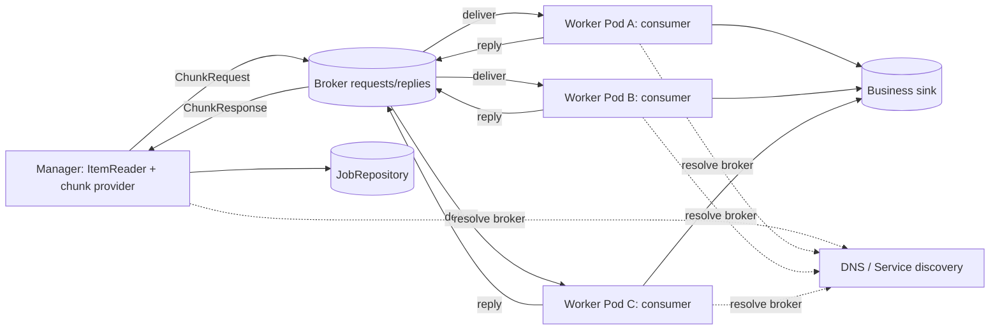
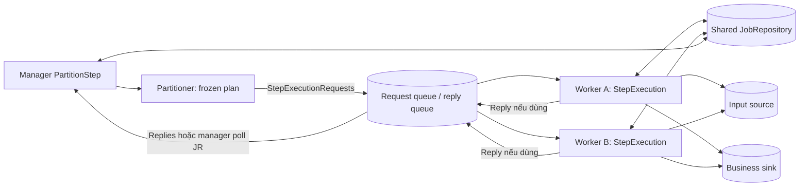
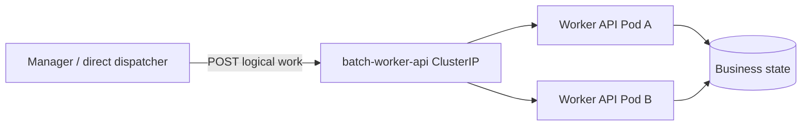

# Service discovery cho remote worker

## 1. Vấn đề triển khai: worker thay IP sau mỗi lần scale

Một job Spring Batch chạy ban đêm, quản lý 32 logical partitions và gửi việc cho tám worker trên Kubernetes. Khi lưu lượng tăng, số worker được nâng lên 16; một node gặp sự cố, các Pod khác được tạo lại với IP mới. Manager vẫn giữ danh sách `10.42.1.10, 10.42.1.11...` từ ngày hôm trước nên tiếp tục gửi request tới địa chỉ không còn tồn tại. Job không hoàn tất, mặc dù trong cluster đã có những worker khỏe mạnh.

Lỗi gốc không phải do `Partitioner`: đây là lỗi **định vị dịch vụ/worker khi deployment thay đổi**.

**Service discovery** giúp một thành phần tìm endpoint phù hợp của **dịch vụ logic**, thay vì phụ thuộc địa chỉ IP của một Pod hoặc host cụ thể. Nhưng khi triển khai **Spring Batch remote chunking/remote partitioning qua broker**, cần phân biệt rõ hai trường hợp:

1. **Broker-mediated (phổ biến):** manager publish yêu cầu tới broker; worker chủ động kết nối broker và nhận việc. Manager **không phải** tra cứu IP từng worker. Discovery chủ yếu dùng để tìm **broker, JobRepository, source/sink và các endpoint phụ trợ**.
2. **Direct worker RPC (kiến trúc tùy biến):** manager gọi trực tiếp HTTP/gRPC tới worker. Lúc đó manager cần **Service discovery/LoadBalancer/registry** cho worker, và phải có giao thức ownership, retry, fencing, idempotency riêng.

Bài **“Service discovery cho remote worker”** thuộc chương **Triển khai** của module **SPRING_BATCH_SCALING_OPERATIONS**. Mục tiêu module là mở rộng Spring Batch cho workload dữ liệu lớn qua multi-threaded step, parallel steps, partitioning và các mô hình phân tán, đồng thời đo nút thắt, bảo đảm thread safety, retry/restart và vận hành job theo tài nguyên thực tế.

> **Nguyên tắc:** *discovery giải quyết “gọi dịch vụ ở đâu”, không tự giải quyết “ai được quyền xử lý logical partition, đã commit chưa, có thể retry hay không”.* Với giao tiếp qua broker, hãy để worker **pull/consume** từ điểm trung gian ổn định; đừng tạo danh sách IP worker trên manager khi giao thức không cần.

### Mục tiêu học tập

Sau bài, bạn có thể:

1. Phân biệt **service discovery**, **routing**, **load balancing**, **work scheduling**, **lease/fencing** và **restartability**.
2. Vẽ được topology discovery của remote chunking, remote partitioning và direct RPC.
3. Thiết kế DNS/Service/EndpointSlice trên Kubernetes đúng với **worker outbound consumer**.
4. Hiểu lúc nào dùng `ClusterIP`, `headless Service`, `Spring Cloud DiscoveryClient`, Eureka/Consul hoặc broker cluster endpoints.
5. Triển khai worker Pods không hardcode IP, có probes, graceful shutdown và secret/network policy phù hợp.
6. Kiểm soát DNS cache, connection recovery, broker advertised endpoints, readiness và autoscaling.
7. Kiểm thử rolling update, scale-out, node failure, mất broker và khôi phục không trùng/mất business records.
8. Thiết lập metrics/runbook chứng minh worker được phát hiện đúng, thực thi đúng partition và đạt SLA.

## 2. Sáu khái niệm không được đánh đồng

| Khái niệm | Câu hỏi trả lời | Không tự bảo đảm |
| --- | --- | --- |
| **Service discovery** | Endpoint nào đại diện dịch vụ logic? | Worker có rảnh hay job được xử lý |
| **Name resolution** | Tên DNS trả IP/record gì? | TCP còn sống hoặc dịch vụ healthy |
| **Load balancing** | Kết nối/request tới instance nào? | Một partition chỉ được thực thi một lần |
| **Work scheduling/dispatch** | Partition/chunk nào giao cho ai, khi nào? | Sink đã commit |
| **Ownership/lease/fencing** | Worker generation nào được quyền ghi? | Source manifest bất biến nếu không quản lý |
| **Checkpoint/idempotency** | Có thể resume/replay không làm sai kết quả? | Tự tìm endpoint mới khi node bị xóa |

Ví dụ: DNS `batch-worker.svc.cluster.local` trả một IP Service ổn định, nhưng **worker chưa subscribe queue** thì không ai xử lý chunk. Ngược lại, có 20 consumer khỏe mạnh trong broker mà **không có Service cho worker Pods**, job vẫn có thể chạy tốt nếu broker có endpoint hợp lệ.

### 2.1. Hai loại identity

```text
Service identity:
  rabbitmq-client.batch-platform.svc.cluster.local

Process/worker identity:
  Pod UID / worker generation / consumer tag / instance ID

Business work identity:
  (jobInstanceId, partitionName, manifestId)
  hoặc (businessBatchId, chunkId/eventId)
```

Service identity ổn định khi Pods thay đổi. **Worker identity không ổn định** sau restart. **Business work identity phải ổn định qua retry/restart** nếu muốn checkpoint/idempotency đúng. Đừng dùng Pod IP hoặc container ID làm partition ID nghiệp vụ.

### 2.2. Discovery không phải health check

Một instance nằm trong registry **có thể vừa chết**, một DNS record **có thể còn cache**, và một Pod `Ready` **có thể không xử lý được business work** vì broker credentials sai hoặc connection pool bị bão hòa. Hãy đánh giá ba lớp:

- **Known:** endpoint hiện có trong DNS/registry.
- **Reachable/ready:** client có thể tạo đường truyền và thành phần nhận việc hoạt động.
- **Productive:** worker thực sự hoàn tất transaction, gửi kết quả và tăng unique committed throughput.

Một hệ thống có 12 Pods `Running` nhưng `consumerCount=0` không thể coi là 12 remote workers đang hoạt động.

## 3. Kiến trúc mặc định: discovery thông qua broker

### 3.1. Remote chunking



Trong Spring Batch **remote chunking**, manager sở hữu `ItemReader`, đóng gói item thành các chunk requests, gửi qua middleware; các worker nhận chunk, xử lý và ghi dữ liệu, rồi trả reply. Tài liệu Spring Batch mô tả worker như **message listeners**, không phải một nhóm HTTP servers mà manager bắt buộc gọi trực tiếp.

Nếu dùng broker queue kiểu competing consumers:

- Worker mới chỉ cần **kết nối broker và subscribe đúng queue**.
- Worker cũ chết/được scale-in: broker/client recovery và redelivery chịu trách nhiệm về transport theo protocol.
- Manager không phải cập nhật danh sách Pod IP.
- Load distribution phụ thuộc consumer concurrency, prefetch, worker speed và broker behavior; **không** chỉ phụ thuộc Kubernetes Service.
- Durable queue và ACK/reply semantics là hợp đồng riêng; discovery không thay thế chúng.

### 3.2. Remote partitioning



Trong **remote partitioning**, manager tạo logical partitions và `StepExecutions`, còn worker chạy step đầy đủ (reader/processor/writer). Tùy cấu hình Spring Batch Integration, manager dùng **reply aggregation** hoặc **poll JobRepository** để tổng hợp kết quả. Worker thường cần khả năng truy cập **cùng JobRepository/JobExplorer** với manager, ngoài broker và business source/sink.

| Remote chunking | Remote partitioning |
| --- | --- |
| Manager đọc item và gửi payload chunks | Manager tạo partition contexts, worker tự đọc |
| Worker nhận item data qua broker | Worker nhận StepExecution request/context |
| Manager cần reply correlation cho chunk result | Manager theo dõi worker StepExecution, có thể dùng replies hoặc polling |
| Broker có thể chứa dữ liệu nghiệp vụ nhạy cảm | Broker/context cũng có thể chứa input references nhạy cảm |
| Discovery tìm broker và sink | Discovery tìm broker, shared JobRepository, source và sink |
| Không cần manager gọi HTTP tới từng Pod | Cũng không cần nếu dispatch qua broker |

**Đừng nhầm remote partitioning với một REST API chọn Pod trực tiếp**. Một custom `PartitionHandler` dùng HTTP có thể làm như vậy, nhưng đó là thiết kế tự xây; không phải yêu cầu mặc định của Spring Batch.

### 3.3. Local partitioning và parallel steps

Local `TaskExecutorPartitionHandler` dùng threads trong cùng JVM nên **không cần service discovery giữa manager và worker**. Nhưng DB, NFS, object storage và external API vẫn là dịch vụ qua mạng. Parallel steps cũng tương tự. Chỉ có worker remote/distributed mới cần giải quyết endpoint/tín hiệu sức khỏe giữa các tiến trình.

## 4. Bắt đầu bằng bảng endpoint, không bắt đầu bằng một registry

Trước khi lựa chọn Consul/Eureka/Kubernetes Service, lập danh sách những nơi mỗi process cần kết nối:

| Thành phần | Manager cần | Worker cần | Cơ chế discovery hợp lý |
| --- | --- | --- | --- |
| Broker request/reply | Có | Có | Kubernetes Service DNS hoặc broker/client endpoints |
| JobRepository DB | Có | Remote partitioning thường có; remote chunking tùy topology | Stable DB hostname/proxy/service, credentials riêng |
| Source DB/file/object | Manager trong chunking; worker trong partitioning | Theo vai trò | Stable source endpoint/version |
| Business sink DB/API | Tùy topology | Thường có | Service DNS/API gateway + TLS |
| Metrics/OTel collector | Có | Có | Stable telemetry Service |
| Worker API HTTP/gRPC | Chỉ **custom direct RPC** | Chạy server nếu có | Service DNS + load balancer hoặc discovery client |
| Kubernetes API | Không cần cho broker-mediated discovery | Không cần nếu dùng Service DNS | Chỉ dùng khi có API-based watcher/controller |
| Scheduler/lease store | Nếu multi-manager/ownership | Nếu có lease/fencing | Stable registry/DB + transaction |

**Một URL ổn định cho broker thường giá trị hơn một “worker registry” do ứng dụng tự duy trì**. Khi dùng Kubernetes, DNS Service đã giải quyết phần lớn nhu cầu tìm service endpoints.

### 4.1. Phân biệt control plane và data plane

- **Control plane:** Kubernetes API/EndpointSlices, Service Registry, scheduler, scaling controller, lease/leader election.
- **Data plane:** AMQP/JMS/Kafka/TCP connections, DB transactions, HTTP calls, business replies.
- **Application state:** JobRepository, partition manifest, business idempotency ledger.

Nếu Kubernetes API tạm không truy cập được nhưng DNS và broker connections cũ còn hoạt động, workers **có thể vẫn xử lý**. Nếu DNS trả tên đúng nhưng broker thực sự ngừng nhận kết nối, discovery **không đảm bảo productivity**. Nếu broker khỏe nhưng JobRepository mất kết nối, partition workers có thể không checkpoint/complete đúng.

## 5. Kubernetes Service discovery: DNS, ClusterIP và headless

### 5.1. ClusterIP Service

Kubernetes `Service` kiểu `ClusterIP` có tên DNS ổn định trong cluster, ví dụ:

```text
rabbitmq-client.batch-platform.svc.cluster.local
metrics-collector.observability.svc.cluster.local
business-db-proxy.data.svc.cluster.local
```

Đây là **ví dụ tên**, không phải tài nguyên đã tồn tại. `cluster.local` là cluster domain thường gặp; cluster thật có thể cấu hình miền khác.

```text
Pod worker            Service DNS                Pod/backend
  AMQP client  ---> rabbitmq-client.batch-platform.svc.cluster.local
       |                 (ClusterIP)  --------> RabbitMQ node/endpoints
```

Client không cần biết IP RabbitMQ node từng giờ. Tuy nhiên:

- DNS resolve tên Service thường trả **ClusterIP**, không trả danh sách consumer Pods.
- Một TCP connection đang mở **không tự chuyển sang backend khác** khi endpoint thay đổi. Client cần phát hiện lỗi và reconnect.
- Service load balancing chọn endpoint cho traffic/kết nối theo cơ chế dataplane; không điều phối logical partitions.
- Readiness của backend ảnh hưởng endpoint eligibility, nhưng **không chứng minh business delivery đã hoàn tất**.

### 5.2. Headless Service

Khi `clusterIP: None`, DNS có thể trả **các Pod endpoint IPs** thay vì một ClusterIP ảo. Điều này hữu ích cho StatefulSet peer discovery, một số cluster-aware protocols hoặc **custom direct routing**.

```yaml
apiVersion: v1
kind: Service
metadata:
  name: batch-worker-headless
  namespace: batch-platform
spec:
  clusterIP: None
  selector:
    app: batch-worker
  ports:
    - name: http
      port: 8080
      targetPort: 8080
```

**Chỉ sử dụng ví dụ này khi worker thực sự mở HTTP port 8080 và direct-discovery protocol cần Pod addresses.** Trong mô hình **remote chunking qua broker**, tạo headless worker Service không khiến Spring Batch tự phân phối chunks tới các Pod. Mỗi worker vẫn phải subscribe request queue.

Với headless Service, việc client chọn Pod, TTL, health, retry, session affinity và routing policy **không được Kubernetes proxy làm thay** như Service ClusterIP. Nếu cần identity ổn định của broker node trong StatefulSet, tách **headless peer discovery Service** và **client-facing Service** theo cách vận hành broker, không bắt client batch gọi bừa địa chỉ peer nội bộ.

### 5.3. EndpointSlices và readiness

Kubernetes dùng `EndpointSlice` để quản lý tập endpoints gắn với Service. Các conditions gồm `ready`, `serving`, `terminating`. Trong đa số trường hợp, Service routing bỏ qua Pod chưa ready hoặc đang terminating; có ngoại lệ tùy cơ chế proxy và cấu hình, đặc biệt khi tất cả endpoints đều terminating.

**Không tự sửa EndpointSlice do controller quản lý** để “làm worker available”. Đối với direct HTTP Service, kiểm tra selector, Pod readiness và EndpointSlices giúp chẩn đoán tại sao không có endpoint. Đối với broker-mediated consumer, **worker Pod readiness không quyết định broker có giao message hay không** nếu listener vẫn active và outbound connection vẫn chạy.

### 5.4. Không dùng Pod IP làm danh tính dài hạn

```text
Không nên:
WORKER_A_URL=http://10.244.1.37:8080
WORKER_B_URL=http://10.244.2.91:8080

Nên cho direct RPC:
WORKER_SERVICE_URL=http://batch-worker-api.batch-platform.svc.cluster.local:8080

Nên cho broker-mediated:
BROKER_HOST=rabbitmq-client.batch-platform.svc.cluster.local
```

Pod IP là đặc tính **runtime ephemeral**. Một Pod bị thay mới sẽ có UID/IP mới; hardcode trong `JobParameters`, `ExecutionContext` hoặc manager config làm lỗi restart/rollout.

## 6. Deployment mẫu: worker chủ động kết nối broker

Ví dụ **Kubernetes Deployment** cho một worker Spring Boot sử dụng RabbitMQ qua AMQP, có HTTP Actuator ở port riêng để kubelet probe. Đây là mẫu **minh họa cấu hình**; giả định namespace `batch-platform`, Service `rabbitmq-client` có AMQPS/TLS trên port 5671, repository DB có hostname riêng và các Secrets đã được tạo an toàn.

```yaml
apiVersion: apps/v1
kind: Deployment
metadata:
  name: batch-worker
  namespace: batch-platform
spec:
  replicas: 4
  strategy:
    type: RollingUpdate
    rollingUpdate:
      maxSurge: 1
      maxUnavailable: 0
  selector:
    matchLabels:
      app: batch-worker
  template:
    metadata:
      labels:
        app: batch-worker
        component: worker
    spec:
      terminationGracePeriodSeconds: 120
      containers:
        - name: worker
          image: registry.example.invalid/spring-batch-worker:1.0.0
          imagePullPolicy: IfNotPresent
          ports:
            - name: management
              containerPort: 8081
          env:
            - name: MANAGEMENT_SERVER_PORT
              value: "8081"
            - name: MANAGEMENT_ENDPOINT_HEALTH_PROBES_ENABLED
              value: "true"
            - name: SPRING_RABBITMQ_HOST
              value: "rabbitmq-client.batch-platform.svc.cluster.local"
            - name: SPRING_RABBITMQ_PORT
              value: "5671"
            - name: SPRING_RABBITMQ_SSL_ENABLED
              value: "true"
            - name: SPRING_RABBITMQ_USERNAME
              valueFrom:
                secretKeyRef:
                  name: worker-broker-auth
                  key: username
            - name: SPRING_RABBITMQ_PASSWORD
              valueFrom:
                secretKeyRef:
                  name: worker-broker-auth
                  key: password
            - name: SPRING_DATASOURCE_URL
              value: "jdbc:postgresql://jobrepo-db.batch-platform.svc.cluster.local:5432/batchmeta"
            - name: SPRING_DATASOURCE_USERNAME
              valueFrom:
                secretKeyRef:
                  name: worker-job-repository-auth
                  key: username
            - name: SPRING_DATASOURCE_PASSWORD
              valueFrom:
                secretKeyRef:
                  name: worker-job-repository-auth
                  key: password
          startupProbe:
            httpGet:
              path: /actuator/health/liveness
              port: management
            periodSeconds: 5
            failureThreshold: 24
          readinessProbe:
            httpGet:
              path: /actuator/health/readiness
              port: management
            periodSeconds: 5
            failureThreshold: 2
          livenessProbe:
            httpGet:
              path: /actuator/health/liveness
              port: management
            periodSeconds: 10
            failureThreshold: 3
          resources:
            requests:
              cpu: "500m"
              memory: 768Mi
            limits:
              cpu: "2"
              memory: 2Gi
```

### 6.1. Những điều mẫu **không** tự làm

1. **Không có worker Service:** vì worker chỉ là AMQP consumer, manager không cần HTTP gọi worker. Cổng management dành cho probe, chưa phải business dispatch API.
2. **Không tự đăng ký queue:** ứng dụng phải cấu hình RabbitMQ listener, message converter, request/reply channels và Spring Batch Integration tương thích.
3. **Không tạo Secrets:** `worker-broker-auth` và `worker-job-repository-auth` phải được provision theo chính sách. Tránh commit credentials vào manifest.
4. **Không cấu hình trust chain đầy đủ:** AMQPS cần broker có TLS và certificate phù hợp tên DNS, truststore/CA trên JVM. `ssl.enabled=true` một mình chưa chứng minh chain/hostname verification đã đúng.
5. **Không cấu hình business DataSource:** `SPRING_DATASOURCE_URL` là ví dụ metadata repository. Reader/writer có thể cần source/sink DataSources riêng với pool/resource budget riêng.
6. **Không tự giới hạn tải toàn cluster:** có bốn Pods không có nghĩa DB cho phép bốn nhân concurrency của mọi Pod.
7. **Không tự drain broker consumer:** `terminationGracePeriodSeconds` chỉ cho thời gian trước khi Pod bị kill; app phải xử lý SIGTERM và listener shutdown đúng protocol.
8. **Không tự bảo vệ dữ liệu trùng:** consumer redelivery có thể xảy ra khi Pod chết, mất reply hoặc network partition.

Mẫu giả định worker có **web server + Spring Boot Actuator** cho HTTP probes. Nếu app chạy `spring.main.web-application-type=none`, không thể dùng các HTTP probes ở trên nếu không cung cấp endpoint khác; có thể dùng `exec`/gRPC probe hoặc đổi cấu hình. Không được triển khai một probe không tồn tại rồi để Pod restart liên tục.

### 6.2. Có cần khai báo Service cho worker không?

- **Không cần** để worker consume broker queue theo hướng outbound.
- **Có thể cần** cho custom worker HTTP/gRPC API hoặc monitoring scrape nếu stack yêu cầu Service.
- **Không đủ** nếu manager vẫn cần xác nhận partition ownership và business completion.
- Nếu đặt Service chỉ để scrape metrics, phải kiểm soát network/RBAC và **không** vô tình expose endpoint quản trị thành public LoadBalancer.

## 7. Spring Boot readiness/liveness: biết Pod khỏe chưa đủ

Spring Boot Actuator hỗ trợ health groups `/actuator/health/liveness` và `/actuator/health/readiness`. Khi chạy trên Kubernetes, chúng phản ánh `ApplicationAvailability` theo cấu hình. Nhưng **readiness của HTTP service** và **readiness làm AMQP consumer** không tự giống nhau.

### 7.1. Ba trạng thái worker cần tách

```text
Process alive?             -> JVM/HTTP health đang chạy
Transport connected?       -> RabbitMQ client + listener containers đang subscribe
Accept new business work?  -> chưa draining, còn capacity, business dependencies ổn
```

Một Pod `Ready=true` trong Kubernetes có thể chưa có listener đã subscribe; một Pod `Ready=false` có thể **vẫn tiếp tục consume message** vì broker không dùng EndpointSlice để route deliveries.

**Vì vậy:** nếu chính sách là “unready = không nhận work”, phải **kết nối readiness lifecycle với start/stop/pause các broker listener containers** hoặc cơ chế admission riêng. Chỉ đổi Kubernetes Pod condition không thực thi điều đó.

### 7.2. Liveness không nên phụ thuộc mù quáng DB/broker

Nếu broker outage, làm **liveness fail ở mọi worker** có thể gây rolling restart storm và tăng recovery time. Spring Boot khuyến cáo không đưa health của external shared dependencies vào liveness theo cách tạo cascading failures.

Phân biệt:

- **Liveness:** process có rơi vào trạng thái không thể phục hồi nội bộ không?
- **Readiness:** instance có nên nhận **lưu lượng theo cơ chế áp dụng** ở thời điểm hiện tại không?
- **Consumer health:** listener connected, count, unacked/prefetch, processing throughput.
- **Business readiness:** source/sink/job repository có phù hợp để xử lý item không?
- **Drain state:** instance đã ngừng nhận việc mới nhưng đang hoàn tất in-flight work.

Probe trên management port riêng cũng có thể pass trong khi business listener lỗi. Cần metric/health custom cho listener nếu muốn phản ánh đúng năng lực tiêu thụ, nhưng tránh đưa mọi temporary broker outage vào liveness.

### 7.3. Startup probe và cold start

Worker Java có thể cần tải class, khởi tạo connection pool, kiểm tra schema và subscribe queue. `startupProbe` cho khoảng khởi động để liveness không kill quá sớm. Tuy nhiên **kubelet thấy startup completed không nghĩa consumer ready** nếu probe chỉ kiểm tra HTTP.

Nên log/metric các mốc:

```text
t_application_started
t_repository_connected
t_broker_connected
t_listener_subscribed
t_first_request_received
t_first_business_commit
```

Từ đó đo **time-to-ready-consume** chứ không chỉ thời điểm Pod báo Running.

## 8. Spring AMQP/RabbitMQ: broker discovery khác worker discovery

### 8.1. Đường kết nối ổn định

```text
Manager/Worker:
  rabbitmq-client.batch-platform.svc.cluster.local:5671

RabbitMQ operator/cluster:
  node addresses, quorum replicas, inter-node communication
```

Broker cluster có thể có Service cho **client traffic**, trong khi các node dùng headless Service để **peer discovery**. Đừng nhầm địa chỉ inter-node Erlang distribution hoặc headless peer endpoint với endpoint dành cho Spring Batch AMQP client.

RabbitMQ clients thường gắn với **một broker node cho mỗi connection**. Khi node chết, cần cơ chế **connection recovery/reconnect sang node khác** theo Spring AMQP/client configuration và network routing. Một Service DNS ổn định **không cứu** một TCP connection đã chết nếu client không reconnect.

### 8.2. Heartbeat và reconnection

RabbitMQ heartbeat giúp phát hiện một số half-open TCP connections nhanh hơn TCP keepalive mặc định. Quá thấp có thể tạo false positives lúc GC pauses hoặc network jitter; quá cao làm redelivery/recovery trễ. Chọn theo latency SLO, proxy idle timeouts và benchmark thực.

Khi reconnect cần xác minh:

1. Client resolve endpoint theo chính sách hiện tại.
2. TLS handshake/hostname/certificates hợp lệ.
3. Authentication/vhost/permissions đúng.
4. Queue, exchange, binding tồn tại hoặc được khôi phục.
5. Consumer thật sự **resubscribe**; không chỉ connection báo OPEN.
6. Messages chưa ACK được xử lý theo broker redelivery semantics.
7. Manager reply consumers/correlation cũng được khôi phục.

### 8.3. Quorum/durability là bài toán khác

Worker tìm được broker Service không có nghĩa broker còn **quorum** hoặc durable queue đang writable. Service discovery không thay được thiết kế HA, durability, publisher confirm, consumer ACK và retention.

Đừng gọi một message `ACKed` là đã được DB commit trừ khi ứng dụng định nghĩa điểm ACK đúng và đã kiểm thử. Khi lost reply sau commit, phải có idempotent writer.

## 9. Kafka: bootstrap DNS chưa đủ nếu advertised listeners sai

Trong một topology dùng Kafka, client bắt đầu từ `bootstrap.servers`, rồi nhận **metadata về broker endpoints** và kết nối tới các địa chỉ broker đã quảng bá.

```text
BOOTSTRAP DNS:
  kafka-bootstrap.batch-platform.svc.cluster.local:9093

Metadata broker endpoints (ví dụ):
  broker-0.kafka-headless.batch-platform.svc.cluster.local:9093
  broker-1.kafka-headless.batch-platform.svc.cluster.local:9093
  broker-2.kafka-headless.batch-platform.svc.cluster.local:9093
```

Các tên là **minh họa**, yêu cầu Kafka deployment được cấu hình đúng `advertised.listeners` và TLS. Nếu bootstrap hợp lệ nhưng metadata quảng bá `localhost`, IP node không routable hoặc hostname external-only, worker sẽ **không truy cập được brokers**.

Cần kiểm tra:

- `bootstrap.servers` là seed endpoints hợp lệ, không phải danh sách worker.
- `advertised.listeners` của từng broker reachable từ **namespace/network zone của worker**.
- Port/`security.protocol`, SASL/TLS trust/hostname verification khớp.
- Worker consumer group membership và partition assignment thay đổi khi scale.
- Khi rebalance, records có thể replay nếu offset/DB commit không atomic.
- Kafka offset giữ thứ tự **trong một topic-partition**, không bảo đảm thứ tự business giữa nhiều partitions.

**Đừng coi “discovery báo có N workers” là “có thể xử lý N partitions Kafka cùng lúc”**. Số active consumer tasks hữu ích còn bị giới hạn bởi partition assignment và downstream throughput.

## 10. Khi nào cần discovery trực tiếp tới worker?

Có các lý do thực tế để một hệ thống **tự xây** worker RPC:

- Worker cung cấp HTTP/gRPC operation mà manager cần gọi trực tiếp.
- Mỗi worker sở hữu một resource/partition cố định và cần được định vị theo owner.
- Có stateful worker/shard affinity, hoặc phối hợp từ service mesh.
- Hệ thống legacy không dùng broker, đã có coordinator/dispatcher riêng.
- Một control-plane endpoint cần lệnh drain/health/diagnostics có phân quyền.

Trong trường hợp này, service discovery mới là **tuyến chính manager → worker**. Nhưng phải tự giải quyết:

- Chọn instance từ danh sách có thể cũ.
- Claim logical partition nguyên tử.
- Giới hạn in-flight work, retry/backoff và timeout.
- Xử lý outcome mơ hồ khi worker commit rồi HTTP response mất.
- Fence stale worker generation khi Pod bị thay.
- Không dựa vào routing ngẫu nhiên của Kubernetes Service để giữ affinity per partition.

### 10.1. ClusterIP cho stateless HTTP RPC



Service sẽ chuyển traffic tới endpoints phù hợp, **không tự biết worker nào đã claim partition**. Nếu RPC retry sang Pod khác, có thể hai workers cùng chạy một logical work; phải dùng DB claim/lease/fencing và idempotency.

### 10.2. DiscoveryClient với Spring Cloud

Spring Cloud Commons có `DiscoveryClient` và nhiều backend như Eureka/Consul; với Kubernetes có thể dùng DNS/Service mà **không cần** triển khai một registry thứ hai.

Ví dụ mã chỉ làm **tra cứu candidate URIs**, không dispatch:

```java
import java.net.URI;
import java.util.List;

import org.springframework.cloud.client.ServiceInstance;
import org.springframework.cloud.client.discovery.DiscoveryClient;
import org.springframework.stereotype.Component;

@Component
public final class WorkerEndpointDirectory {

    private final DiscoveryClient discoveryClient;

    public WorkerEndpointDirectory(DiscoveryClient discoveryClient) {
        this.discoveryClient = discoveryClient;
    }

    public List<URI> currentCandidates() {
        return discoveryClient.getInstances("batch-worker-api")
                .stream()
                .map(ServiceInstance::getUri)
                .toList();
    }
}
```

Cần implementation `DiscoveryClient` tương thích trên classpath và registry/k8s discovery setup. Mã trên **không**:

- Tự lọc đúng business-ready/healthy instance ở mọi registry.
- Đặt timeout, circuit breaker, auth/TLS hay client retries.
- Chọn leader/owner của partition.
- Persist việc đã dispatch.
- Bảo đảm request idempotent.
- Thực hiện network call.

Khi chỉ có Kubernetes Service DNS, một `RestClient`/HTTP client trỏ tới **logical service URL** có thể đơn giản hơn. Không vì có `DiscoveryClient` mà buộc mọi worker register trực tiếp nếu messaging topology không cần.

### 10.3. Khi nào dùng Eureka/Consul?

| Môi trường | Lựa chọn thường phù hợp | Cân nhắc |
| --- | --- | --- |
| Kubernetes, worker consume broker | K8s Service DNS cho broker/DB, không worker registry | Ít thành phần vận hành |
| Kubernetes, HTTP/gRPC worker service | K8s Service/EndpointSlice, gateway/service mesh nếu có | Readiness/connection reuse |
| Nhiều VM/on-prem, direct RPC | Consul/Eureka/registry hiện có | Health TTL, registration/deregistration |
| Cross-region/multi-cluster | DNS/Gateway/registry có topology-aware routing | Network partition, latency, DR và auth |
| Stateful shard worker | Registry + explicit shard ownership/fencing | Discovery không thay consensus/lease |
| JMS/AMQP broker-mediated | Broker endpoints/durable queues | Không cần Pod listing |

Một registry có thể trả **stale instances** do TTL hoặc propagation delay. Thiết kế client phải chịu được `connection refused`, `404 owner moved`, timeout và instance thay đổi giữa lúc lookup và call. **Không lưu registry response thành một danh sách IP lâu dài**.

## 11. Ownership, lease và fencing: tầng mà DNS không thể thay

Đây là phần quan trọng nhất nếu **direct RPC** hoặc một remote worker có thể bị tách mạng sau khi đã claim partition.

### 11.1. Tình huống stale worker

```text
t0: Worker A claim partition-001, lease đến t=60
t1: A bị network partition, vẫn đang tính toán và giữ process
t2: Coordinator không thấy A, lease hết hạn
t3: Worker B claim partition-001 và bắt đầu ghi
t4: Mạng A hồi; A tiếp tục ghi vì tưởng vẫn là owner
```

**Discovery “A không còn Ready” không dừng được A**. Ngay cả lease timeout cũng không ngăn A phát lệnh ghi sau khi hết lease. Muốn bảo đảm ownership, có thể cần **fencing token** tăng đơn điệu được **sink/commit boundary kiểm tra**.

### 11.2. Mẫu claim/lease (thiết kế)

```text
logical_work_key = (jobInstanceId, partitionName, manifestId)

Atomic CLAIM:
  nếu work chưa owned hoặc lease cũ hết hạn hợp lệ:
    increment fencingToken
    set ownerGeneration, leaseUntil, status=CLAIMED
    trả fencingToken mới cho worker

WRITE:
  worker gửi fencingToken cùng logical work key
  sink/side-effect authority từ chối token cũ
  business operation ID vẫn idempotent

COMPLETE:
  chỉ owner token hợp lệ được commit logical completion
  đối soát StepExecution + business sink + request result
```

Đây là **pseudocode protocol cho một custom dispatcher**, không phải API Spring Batch mặc định. Triển khai phải có atomicity, clock/time handling, quyền truy cập và failure tests. Fencing tại lease store **chưa đủ** nếu sink không kiểm tra token và vẫn nhận write cũ.

### 11.3. JobRepository và partition identity

Với remote partitioning Spring Batch:

- `JobInstance` dựa trên job name + identifying parameters.
- `StepExecution` và `ExecutionContext` mô tả work partition.
- `partitionName → frozen input mapping` phải ổn định qua restart.
- Worker generation/Pod IP không được dùng làm identifying parameter để “phân biệt lần chạy”.
- Metadata framework hữu ích cho restart, nhưng không tự tạo atomic transaction với mọi DB/API/broker.
- Các completed partitions thường không được chạy lại khi restart theo cấu hình mặc định; vẫn cần đối soát external effects.

**Không đổi `gridSize`/ranges/names của JobInstance đang restart** chỉ vì có thêm Pod sau autoscale. Thay đổi số worker **capacity** có thể hợp lệ; đổi **logical work mapping** là một thay đổi khác.

## 12. Rolling update: lúc worker biến mất phải làm gì?

Kubernetes Deployment tạo và xóa Pods khi rollout hoặc scale-in. Các mốc có thể là:

```text
1. Có quyết định terminate Pod
2. EndpointSlice đánh dấu terminating; inbound Service traffic giảm/đổi
3. Kubelet thực hiện preStop nếu có, rồi gửi SIGTERM
4. Ứng dụng ngừng nhận work mới theo protocol
5. In-flight chunk/StepExecution hoàn tất hoặc dừng/rollback an toàn
6. ACK/reply/checkpoint/sink state được reconcile
7. Pod thoát trước khi grace period hết, hoặc bị SIGKILL
```

Trình tự cụ thể có thể bị thay đổi bởi sự cố node, probe, network partition và graceful shutdown behavior của runtime. **Không bảo đảm mọi Pod đều kịp chạy preStop/SIGTERM**, ví dụ node chết đột ngột.

### 12.1. Readiness false không có nghĩa broker ngừng delivery

Với worker AMQP consumer, Kubernetes **không** tự đóng broker listener khi Pod unready. Quy trình drain ứng dụng cần:

1. Đánh dấu instance đang **draining**, không nhận thêm work theo policy.
2. Ngừng/pause listener container hoặc giới hạn intake; xác minh broker không tiếp tục giao requests mới.
3. Chờ in-flight chunks/partitions hoàn tất trong timeout hữu hạn.
4. Flush required replies/checkpoint; nếu chưa xong, bảo đảm retry/redelivery an toàn.
5. Đóng broker/DB connections và thoát.
6. Nếu vượt timeout, chấp nhận worker có thể bị kill; restart/idempotency sẽ bảo vệ correctness.

**Đừng ACK message trước khi business commit chỉ để rollout “mượt”.** Nếu worker đã commit nhưng reply mất, retry/reconciliation vẫn cần thiết.

### 12.2. Vai trò của terminationGracePeriodSeconds

`terminationGracePeriodSeconds: 120` chỉ đặt budget thời gian cho shutdown ở Kubernetes; nó **không cấu hình JVM/AMQP listener tự chờ đúng 120 giây**. Cần đo:

```text
P99 chunk processing + DB commit
+ reply/ACK/network flush budget
+ JVM close / metrics flush
<= termination grace period (có headroom)
```

Nếu một partition chạy 20 phút và không hỗ trợ checkpoint giữa chừng, 120 giây không đủ để hoàn tất; cần quy trình stop/restart an toàn, hoặc chọn kiến trúc work unit nhỏ hơn.

### 12.3. RollingUpdate và tương thích message schema

Trong rollout, worker version `v1` và `v2` có thể **cùng consume một queue**. Nếu `v2` gửi schema message mới mà `v1` không đọc được, hoặc writer thay đổi semantics, có thể dẫn tới poison messages, retry storm và data corruption.

Kiểm tra **backward/forward compatibility** của request/reply DTO, serializers, database migrations và JobRepository schema. Khi không thể hỗ trợ hỗn hợp versions, dùng versioned queues/workflows, quiescence hoặc deploy theo giai đoạn; không dựa vào `maxUnavailable=0` để khắc phục incompatibility.

## 13. Autoscaling: worker count tăng nhưng ai nhận việc?

Scaling một consumer Deployment từ 4 lên 12 Pods:

```text
HPA/KEDA -> Kubernetes tạo Pods
          -> JVM startup + broker connect
          -> listener subscribe
          -> broker có thêm consumers
          -> work được phân phối theo queue/consumer policy
```

Manager **không phải refresh danh sách worker IP** trong broker-mediated topology. Nhưng scale-out chỉ giúp nếu:

- Có enough pending work và consumer subscription đúng.
- Broker/DB/API vẫn có headroom.
- Per-worker prefetch/chunk concurrency không vượt limits.
- Queue topology và worker permissions không chặn subscription.
- Network/service discovery/connectivity hoạt động.
- Worker startup không chậm hơn tuổi backlog/SLA.

### 13.1. HPA, KEDA và queue metrics

HPA có thể dựa trên CPU/custom metrics; **KEDA RabbitMQ scaler** có thể scale theo queue length/message rate tùy phiên bản/configuration.

Tuy nhiên:

| Tín hiệu | Điều nó biết | Điều không biết |
| --- | --- | --- |
| `queue_depth` | Số messages ready/pending theo backend | Work đang unacked hoặc DB commit |
| `oldest_message_age` | Thời gian chờ lâu nhất | Partition cost nếu một message là file khổng lồ |
| `consumer_count` | Số consumers được broker biết | Mỗi consumer thực sự hữu ích/không stalled |
| `pod_ready_count` | Số Pods được Kubernetes báo ready | Broker subscriptions đang active |
| `completed_items/s` | Output thành công | Cost/loss nếu nghiệp vụ còn bước publish khác |
| `db_pool_pending` | Áp lực lấy DB connection | Source lag và skew |
| `retry/redelivery rate` | Lỗi transport/process | Không đồng nghĩa unique throughput |

**Không scale theo queue length duy nhất** khi business sink đã bão hòa. Càng nhiều consumers có thể tạo nhiều DB connections, locks, timeout và retry hơn.

### 13.2. Scale-to-zero phải được thiết kế

Nếu không có consumers:

- Request queue phải **durable** và có retention phù hợp.
- Manager reply/timeout contract phải chịu được cold start delay.
- KEDA/Autoscaler phải có access tới queue metrics để scale từ 0.
- Sau scale-up, worker phải subscribe đúng queue, không coi Pod Running là ready.
- Message TTL không được hết trước khi worker sẵn sàng.
- External work identity vẫn giữ nguyên qua worker generations.

Nếu worker có nhiệm vụ **poll JobRepository** thay vì consume queue hoặc cần giữ lease, scale-to-zero có thể làm job không được phục hồi nếu không có controller nào đánh thức workers. Không áp cùng quy tắc cho mọi remote model.

## 14. Broker discovery trong nhiều AZ/region

### 14.1. Connection endpoint list so với một Service

Hai cách thường gặp:

1. **Client Service DNS**: một endpoint logic, kết nối TCP được load balance tới broker nodes theo topology.
2. **Danh sách broker hostnames**: client library lựa chọn/reconnect tới node khác theo config.

Chọn theo broker operator, protocol và network topology thực tế. Một `rabbitmq-client` ClusterIP **không tự đảm bảo** broker quorum/queue availability; ngược lại, một danh sách hostnames có thể cần DNS TTL handling và TLS SANs từng node.

### 14.2. DNS cache

DNS trả địa chỉ tại **thời điểm resolve**. JVM, OS, DNS library, client connection pool có thể cache kết quả theo chính sách khác nhau. Khi broker IP thay đổi:

- Client đang giữ TCP connection cũ sẽ không tự reconnect chỉ vì DNS đã đổi.
- DNS TTL thấp không giải quyết connection half-open nếu không có heartbeat/timeout.
- DNS negative caching có thể làm lỗi resolve kéo dài thêm sau khi record được khôi phục.
- Tránh hardcode JVM DNS TTL một cách tùy tiện; kiểm tra JDK/security policy và library behavior.
- Test việc failover **sau reconnect thật**, không chỉ `nslookup` thấy bản ghi mới.

### 14.3. Cross-namespace và cross-cluster

`Service` DNS có namespace. Tên ngắn `rabbitmq-client` chỉ resolve hợp lý khi client cùng namespace/search path phù hợp; dùng FQDN rõ trong triển khai đa namespace. **Kubernetes cluster DNS không mặc định khám phá dịch vụ ở cluster khác**; multi-cluster cần gateway, mesh hoặc global discovery được thiết kế, với auth và timeout riêng.

Đừng đưa JobRepository cùng một database qua multi-region replica **không nhất quán** rồi kỳ vọng StepExecution checkpoint chính xác chỉ nhờ discovery. Shared metadata cần một nguồn sự thật nhất quán theo yêu cầu framework.

## 15. Bảo mật service discovery và worker routing

### 15.1. DNS không phải authentication

Resolve `rabbitmq-client.batch-platform.svc.cluster.local` được một IP không chứng minh endpoint đáng tin. Broker/client cần:

- TLS/mTLS hoặc cơ chế auth tương đương theo kiến trúc.
- Chứng chỉ khớp hostname/SAN, trust chain hợp lệ.
- Credential từ secret store/Workload Identity, không hardcode vào JobParameters, manifests hoặc logs.
- Phân quyền broker **vhost/queue/exchange/topic** theo manager/worker roles.
- ACL/NetworkPolicy egress chỉ cho phép các đích cần thiết.
- Rotation/expiry của credentials không làm worker mất hết kết nối mà không có recovery path.

### 15.2. RBAC cho Kubernetes discovery

Nếu ứng dụng chỉ dùng **Service DNS**, không cần cho Pod service account quyền `list/watch pods`, `endpointslices` hoặc `secrets`.

Nếu custom discovery controller dùng Kubernetes API, cấp **Role** nhỏ nhất chỉ trong namespace cần thiết, với resources/verbs phù hợp; không cấp `cluster-admin` chỉ để tra worker addresses.

### 15.3. NetworkPolicy phải theo data flow thật

Worker dùng broker-mediated transport thường cần **egress** đến broker/JobRepository/source/sink/collector/DNS; không cần mở inbound port business từ mọi namespace.

| Luồng | Ví dụ port | Nguyên tắc |
| --- | --- | --- |
| Worker → RabbitMQ TLS | TCP 5671 | Cho phép đúng namespace/Service backend theo CNI |
| Worker → JobRepository | TCP 5432 hoặc proxy port | DB credentials tối thiểu, TLS |
| Worker → Source/Sink API | TCP 443 | Allowlist host/network policy khả thi |
| Worker → Cluster DNS | UDP/TCP 53 | Không vô tình chặn DNS |
| Kubelet → health port | HTTP/TCP 8081 | Kiểm tra probe trong NetworkPolicy/CNI |
| Collector scrape/traces | Theo exporter | Chỉ các destinations đã phê duyệt |

Đừng copy một `NetworkPolicy` chỉ mở TCP 5671 rồi ngạc nhiên vì worker không resolve DNS hoặc không checkpoint được. Với một số CNI, NetworkPolicy hoạt động theo Pod labels/IP/CIDR; chọn Service DNS không có nghĩa có thể viết rule theo FQDN trong core Kubernetes NetworkPolicy.

### 15.4. Không đưa business ID vào Service name

`batch-worker-customer-08765` hoặc `worker-tenant-bankA` có thể làm lộ thông tin qua DNS/metrics/logs và tạo nhiều Services/EndpointSlices. Ưu tiên service identity theo **role và môi trường**, còn business work ID ở manifest/registry có phân quyền. Bảo đảm multi-tenant isolation bằng auth/ownership, không bằng tên Service khó đoán.

## 16. Discovery thành công nhưng worker vẫn có thể xử lý trùng

Một ví dụ:

```text
t0  manager tạo StepExecution partition-0009
t1  broker giao request tới worker A
t2  A commit database rows
t3  A mất mạng trước ACK/reply
t4  broker redeliver hoặc manager re-drive
t5  worker B nhận cùng logical work
t6  B tìm thấy idempotency ledger, no-op duplicate
t7  manager reconcile và hoàn tất
```

Service discovery có thể luôn hoạt động đúng trong cả quá trình. **Duplicate vẫn xảy ra** do transaction boundaries. Vì vậy phải có:

- Immutable `manifestId`/`snapshotId` và `partitionName` qua restart.
- Stable business event/record IDs.
- Unique constraint/ledger/idempotent UPSERT theo business contract.
- Retry/backoff bounded, không sinh JobInstance mới mỗi network attempt.
- Reconciliation source vs sink, kể cả external API side effects.
- Worker fencing nếu stale generations có thể cùng ghi.

**Không đặt Pod IP, Kubernetes Pod UID hoặc consumer tag làm business idempotency key**. Các giá trị đó đổi qua retry, vô hiệu hóa dedup.

## 17. Java: phân biệt discovery metadata với business dispatch

Ở các ứng dụng custom direct worker API, `DiscoveryClient` chỉ cung cấp instance list. Một dispatcher có thể dùng quy trình sau:

```text
dispatch(manifestId, partitionName):
    1. Read immutable partition plan.
    2. Atomically claim logical partition with fencing token.
    3. Resolve candidate workers via Service DNS/DiscoveryClient.
    4. Filter with bounded health/capacity policy.
    5. Send authenticated RPC with stable logical work ID + token.
    6. On timeout: status UNKNOWN, do not assume not committed.
    7. Query durable outcome/ledger, then retry when safe.
    8. On worker death: expire lease, fence stale token, reassign.
    9. Reconcile StepExecution + business sink before success.
```

**Đây là pseudocode ứng dụng tùy biến**, không phải `PartitionHandler` built-in. Nếu không có yêu cầu HTTP/gRPC cụ thể, sử dụng **broker-mediated remote partitioning** thường giảm công sức duy trì registry/ownership trực tiếp.

### 17.1. Handler phải giữ stable identity

Một `StepExecutionRequest` trong remote partitioning thường mang định danh job/step thực thi và tên worker step. Đừng replace chúng bằng IP hoặc HTTP session ID; worker cần dùng đúng step metadata của JobRepository.

Khi một worker nhận lại request đã xử lý do transport retry, nó phải đối chiếu repository/ledger và chính sách concurrency thay vì khởi tạo một `JobInstance` mới. Message handling phải có error channel và timeout policy, không nuốt exception rồi trả success giả.

### 17.2. Discovery cache cần TTL và invalidation policy

Nếu tự cache `DiscoveryClient.getInstances()`:

- Chỉ giữ **candidates** trong TTL hữu hạn hoặc có push-based refresh.
- Evict instance trên failure theo policy, nhưng không remove vĩnh viễn vì network partition tạm.
- Tránh stampede: nhiều managers cùng reload registry khi lỗi.
- Tránh stale clients: HTTP keep-alive/connection pools có lifecycle riêng.
- Validate identity/certificate sau reconnect.
- Không dùng một kết quả registry rỗng để xóa JobRepository logical partitions.

## 18. Readiness, consumer subscriptions và telemetry kiểm chứng

### 18.1. Ba đếm số lượng khác nhau

```text
Kubernetes ready replicas:          12
RabbitMQ active consumers:          10
Workers completing useful business:  7

=> Không thể báo "12 active workers" chỉ từ Deployment status.
```

Ba số khác nhau do startup delay, listener lỗi, broker permissions, unacked chunks chậm, partition skew hoặc sink DB saturation.

### 18.2. Metric đề xuất

| Metric đề xuất | Ý nghĩa |
| --- | --- |
| `worker_pods_desired` / `worker_pods_ready` | Deployment desired/readiness |
| `broker_connected_clients` | Transport connectivity |
| `worker_listener_subscriptions` | Consumers thực sự subscribe |
| `consumer_unacked_messages` | In-flight deliveries |
| `queue_depth` / `queue_oldest_age_seconds` | Backlog & SLA |
| `partition_requests_dispatched_total` | Manager gửi logical work |
| `partition_step_completed_total` | Hoàn thành worker StepExecutions |
| `chunk_replies_missing_total` | Reply/correlation lỗi |
| `business_committed_records_per_second` | Throughput nghiệp vụ thực |
| `worker_reconnect_total` | Frequency reconnect |
| `dns_resolution_failures_total` | Discovery/name resolution issues |
| `worker_drain_duration_seconds` | Graceful shutdown |
| `stale_worker_fencing_reject_total` | Token cũ bị ngăn |
| `job_repository_update_errors_total` | Metadata errors |
| `reconciliation_mismatch_total` | Sai dữ liệu/corruption |
| `time_to_first_commit_after_scale_out` | Khả năng mở rộng thực |

**Tên metrics là đề xuất**, không nhất thiết mặc định Spring Batch/Micrometer/Kubernetes/RabbitMQ đã có đúng tên. Gắn tags có cardinality thấp (`environment, job_type, worker_role, outcome`), không dùng `recordId`, `customerId` hoặc `Pod UID` theo từng item làm metric labels.

### 18.3. Traces và logs phục vụ điều tra

Một structured log an toàn:

```json
{
  "event": "remote_worker_subscribed",
  "environment": "production",
  "service_role": "batch_worker",
  "logical_request_queue": "batch.partition.requests",
  "broker_service": "rabbitmq-client",
  "worker_generation_ref": "internal-opaque-id",
  "consumer_state": "active",
  "subscription_count": 1
}
```

Không log broker password, payload chunk, full `ExecutionContext`, raw tenant/customer ID hoặc SQL bind values. Với một request cụ thể, trace/correlation ID nên là tham chiếu cho audit có quyền, **không** thay thế business operation ID.

## 19. Checklist debug: “manager không tìm thấy remote worker”

Trước tiên xác định manager có **thực sự gọi worker** hay đang publish broker.

### 19.1. Nếu remote chunking/partitioning qua broker

```text
1. Manager có kết nối được broker endpoint không?
2. Broker có request queue/exchange/bindings đúng không?
3. Request publish được confirm/persist theo contract không?
4. Worker Pods có khởi động và resolve broker hostname không?
5. Worker có TLS/auth/vhost/queue permissions đúng không?
6. Broker hiển thị consumer count > 0 không?
7. Worker subscribed đúng queue và message converter/version chứ?
8. Delivery có tăng? Unacked có bị giữ lâu không?
9. Worker có kết nối JobRepository/source/sink cần thiết không?
10. Replies/correlation được đưa về đúng manager không?
11. JobRepository có worker StepExecutions/attempts/status gì?
12. Business sink đã commit thực tế bao nhiêu records?
```

**Nếu consumer count = 0**, tăng `gridSize` hoặc thêm partitions không giúp. **Nếu consumer count đủ nhưng throughput bằng 0**, cần xem listener errors, DB pool/transactions, input locks, retry storm hoặc broker unacked saturation.

### 19.2. Lệnh Kubernetes chỉ đọc, dùng có chọn lọc

```bash
# Chỉ ví dụ chẩn đoán ở namespace đã được phép.
kubectl -n batch-platform get deployments batch-worker
kubectl -n batch-platform get pods -l app=batch-worker -o wide
kubectl -n batch-platform get svc rabbitmq-client
kubectl -n batch-platform get endpointslices \
  -l kubernetes.io/service-name=rabbitmq-client

# Kiểm tra DNS từ một test/debug Pod được phép (nếu có).
# Không mặc định mọi worker image đều có nslookup hoặc shell.
nslookup rabbitmq-client.batch-platform.svc.cluster.local

# Quan sát rollout và logs đã sanitize:
kubectl -n batch-platform rollout status deployment/batch-worker
kubectl -n batch-platform logs deployment/batch-worker \
  --all-containers=true --tail=100
```

Đây là những lệnh **chẩn đoán**, không phải bằng chứng broker đã commit. Không copy `kubectl exec` vào một production namespace không được phép; kiểm tra RBAC và đừng in env/Secrets khi cần debug DNS.

### 19.3. Nếu direct RPC

Kiểm tra:

1. Service selector có đúng labels của worker Pods?
2. HTTP/gRPC port và `targetPort` có khớp?
3. EndpointSlices có Ready endpoints hay đang terminating?
4. Pods có thật sự cung cấp HTTP/gRPC API và health check?
5. DNS resolution, TLS SAN, network policy và mTLS mesh có đúng?
6. Manager có cache IP/connection quá lâu?
7. Retry có stable idempotency key, request timeout có ambiguous outcome?
8. Ownership/fencing có ngăn đồng thời hai workers cùng partition?
9. Registry watcher có cập nhật theo scale-out/in?
10. Business result có được đối soát sau lost response?

## 20. Failure matrix cho service discovery

| ID | Kịch bản | Quan sát kỳ vọng | Điều cần bảo vệ |
| --- | --- | --- | --- |
| D01 | Worker Pod chết và được tạo IP mới | Broker consumer count hồi lại, workload tiếp tục | Redelivery/idempotency |
| D02 | Scale-out 2→8 workers | Subscriptions tăng; throughput chỉ tăng nếu có headroom | DB quota/backpressure |
| D03 | Scale-in khi chunk đang commit | Drain/ACK đúng hoặc retry no-op | Không double side effect |
| D04 | CoreDNS tạm lỗi | Existing TCP có thể chạy, new connection bị ảnh hưởng | Bounded reconnect |
| D05 | DNS record thay đổi | Client reconnect và resolve lại | Không giữ stale Pod IP vô hạn |
| D06 | RabbitMQ client Service sai selector | Kết nối lỗi, alert rõ | Không fake worker success |
| D07 | Worker subscribe sai queue | Pods Ready nhưng consumerCount=0 ở queue đúng | Readiness/consumer telemetry |
| D08 | Credentials/vhost sai | Auth/permission errors rõ ràng | Không log secrets |
| D09 | TLS hostname/SAN mismatch | Connection fail-closed | Không tắt certificate checks |
| D10 | Một broker node chết | Client recovery sang endpoint hợp lệ | Durable requests/replies |
| D11 | Broker mất quorum | Broker endpoint có thể resolve nhưng writes không tiến | Alert/safe pause |
| D12 | JobRepository unreachable | Worker không checkpoint đúng | Safe restart |
| D13 | Reply path bị chặn sau DB commit | Manager timeout; sink vẫn đúng | Reconcile/idempotency |
| D14 | Worker cũ sống lại sau lease expiry | Token cũ bị fence | Không concurrent writes |
| D15 | RollingUpdate có v1/v2 worker | Messages được xử lý theo schema contract | Không poison/double process |
| D16 | Kubernetes API unreachable | Broker-mediated workers có thể vẫn dùng existing links | Không phụ thuộc registry không cần thiết |
| D17 | Direct RPC Service trả Pod chưa sẵn sàng | Request timeout/5xx nhưng retry bounded | Ownership và no duplicate |
| D18 | Headless DNS trả nhiều IPs | Client cập nhật endpoints đúng | Không chọn stale pod |
| D19 | NetworkPolicy chặn DNS egress | Resolve failure rõ, không retry storm | Config/test isolation |
| D20 | NetworkPolicy chặn DB nhưng không chặn broker | Consumers nhận việc rồi fail write | Backpressure/idempotency |
| D21 | KEDA scale-to-zero | Queue durable, restore trước TTL | Không mất work |
| D22 | Kafka bootstrap OK nhưng advertised unreachable | Metadata connect lỗi rõ | Đúng broker names |
| D23 | Manager crash/restart | Cùng JobInstance/manifest | Không nhân công việc |
| D24 | Remote partitioning worker crash | StepExecutions/restart đúng mapping | Không sửa repository bừa |
| D25 | Multi-cluster DNS failover | Bounded failover và auth | Không đọc stale metadata |
| D26 | Metrics collector network outage | Business processing có thể vẫn tiến | Không suy “no metrics = no work” |

### 20.1. Tại sao phải tiêm lỗi ở cả DNS và connection?

Nếu bạn sửa DNS rồi quan sát worker vẫn xử lý, có thể đó chỉ là **TCP connection cũ còn sống**. Test phải bao gồm:

- Tạo connection mới sau DNS change.
- Kill broker node/worker Pod để bắt buộc reconnect.
- Kiểm tra resolver caching behavior và TLS verification sau reconnect.
- Xác minh queue subscriptions phục hồi.
- Đối soát DB outcome, không chỉ connection status.

**Không dùng mỗi `nslookup` để kết luận client Java sẽ tự reconnect đúng**.

## 21. Integration test theo mô hình có broker

Một test staging tối thiểu:

```text
Arrange:
  manifest = immutable-fixture-v1
  expected business IDs = 100.000
  workers = 2
  request/reply queues = dedicated test queues
  JobRepository + business sink = dedicated test DB/schema

Act:
  launch one JobInstance
  wait until at least one chunk/partition is in-flight
  scale workers 2 -> 6
  terminate one worker before reply (controlled fault)
  replace worker with new Pod IP
  temporarily block one broker connection
  restore network
  restart same JobInstance only if needed

Assert:
  broker consumer subscriptions recover
  every expected logical partition completed
  unique committed IDs == expected IDs
  unexpected duplicate business effects == 0
  no stale writer can corrupt output
  manager reply correlation/repository status consistent
  queue oldest age returns below SLA
  no credential/payload leak in logs
```

**Đây là test contract**, không phải test đã chạy. Phải dùng controlled event barriers/hook khi muốn chắc chắn fault xảy ra **sau DB commit trước ACK/reply**; `Thread.sleep` đoán thời điểm là flaky.

### 21.1. Đừng xóa JobRepository để “reset” test restart

Nếu trước restart bạn xóa `BATCH_STEP_EXECUTION` hoặc cấp identifying `run.id` mới, bạn không còn kiểm chứng restart của cùng JobInstance. Giữ metadata để framework biết partitions nào đã `COMPLETED` và partitions nào cần retry. Dùng data fixture/namespace riêng cho mỗi test suite để tránh đụng job thật.

### 21.2. Coverage theo manifest

```text
expectedPartitions = set(manifest.partitionNames)
completedPartitions = set(successful worker StepExecutions
                           across same JobInstance, under policy)
coverage = intersection(expectedPartitions, completedPartitions)
```

Nếu worker Pod chết, vẫn phải có coverage đầy đủ sau restart. Đếm messages acknowledged hoặc số Pods Ready không thay được expected-vs-completed partition coverage và **business sink reconciliation**.

## 22. Benchmark discovery và recovery dưới tải lớn

Một dashboard đẹp khi idle không chứng minh hệ thống phục hồi tốt dưới burst.

| Chỉ số | Định nghĩa đúng |
| --- | --- |
| **Discovery latency** | Từ khi endpoint mới xuất hiện đến khi client biết/route được |
| **Time-to-consume** | Từ Pod start đến khi broker listener có thể xử lý work |
| **Time-to-first-commit** | Từ scale-out tới business commit đầu tiên |
| **Reconnect latency** | Từ transport failure tới connection/subscription khỏe |
| **Recovery RTO** | Từ mốc lỗi/restore đã định nghĩa tới service đạt trạng thái mục tiêu |
| **Backlog drain time** | Đến khi queue/snapshot work được xử lý xong và reconcile |
| **Committed throughput** | Unique business records/s, không phải messages published |
| **Retry amplification** | Attempt count / unique work count |
| **Completion skew** | Max/median partition duration với nhóm so sánh được |
| **Stale-owner rejection** | Số lệnh ghi từ worker token cũ bị từ chối |

### 22.1. Benchmark minh họa

Giả định 20 triệu records, immutable manifest 80 partitions, broker khỏe:

| Workers | Time-to-consume sau scale | Job runtime | Nhận xét |
| ---: | ---: | ---: | --- |
| 2 | 12 s | 140 phút | Thiếu capacity |
| 4 | 14 s | 76 phút | Còn headroom |
| 8 | 18 s | 43 phút | Hiệu quả |
| 16 | 31 s | 36 phút | DB gần bão hòa |
| 32 | 48 s | 40 phút | Connection contention |
| 8 sau broker reconnect | 21 s | 48 phút | Có retry/backlog recovery |

**Tất cả số liệu là giả định để đọc xu hướng**, không phải benchmark của Spring Batch. Tăng worker từ 16→32 làm runtime xấu đi có thể do DB locks/pool, network, JobRepository hoặc broker overhead; không kết luận service discovery lỗi nếu connections ổn.

### 22.2. Vì sao P95 connect latency khác Job SLA?

Worker có thể connect tới broker trong 30 ms nhưng chờ 10 phút mới nhận partition vì queue fair scheduling, DB quota, hot key hoặc manager không publish. Bổ sung **dispatch-to-worker-start, worker-duration, reply-latency và makespan** để tìm nút thắt thật.

## 23. Case study: Kubernetes scale-out và “worker lost”

Một công ty logistics xử lý 60 triệu events qua remote partitioning trong 64 logical partitions, Kubernetes manager và workers dùng RabbitMQ, shared PostgreSQL JobRepository.

### 23.1. Thiết kế ban đầu

- Manager giữ danh sách Pod IP trong một ConfigMap, chọn worker theo round-robin.
- K8s Deployment thay worker Pod khi rolling update, danh sách cũ không được làm mới.
- Worker log `READY` khi HTTP server đã mở nhưng RabbitMQ listener chưa subscribe.
- Partition name chứa `tenantId` và bị thay đổi khi worker scale.
- Khi request timeout, manager tạo JobInstance mới thay vì restart cùng instance.
- Worker cũ nhận lại mạng, tiếp tục ghi khi partition đã được giao worker khác.
- Output được đối soát theo tổng row count nhưng không kiểm tra duplicate external side effects.

### 23.2. Thiết kế cải thiện

1. Bỏ direct Pod IP trong manager nếu không có lý do RPC.
2. Manager publish `StepExecutionRequest` tới **request queue broker**; workers chủ động subscribe.
3. Cấu hình stable broker Service DNS và client recovery/heartbeat.
4. Worker Pods dùng Deployment với startup/readiness/liveness được kiểm thử; **consumer readiness được giám sát riêng**.
5. Input manifest bất biến; partition name và bounds ổn định qua restart.
6. Giữ cùng JobRepository cho remote partitioning, đúng DB permissions và transaction policy.
7. Dùng unique business keys/idempotent writer và worker fencing khi topology yêu cầu.
8. Rolling deploy bảo đảm drain listener và message schema compatibility v1/v2.
9. Autoscaling theo queue age/lag cùng DB headroom, không chỉ số Pods.
10. Sau mỗi restart, đối soát expected logical partitions và business output.
11. Dùng logs theo trace IDs/step IDs an toàn, không in credential/raw payload.
12. Chạy fault tests: Pod IP đổi, broker reconnect, reply lost và worker generation stale.

### 23.3. Thế nào mới là cải thiện?

- Manager không còn phụ thuộc IP worker Pods.
- Worker mới tự subscribe được queue và tạo **committed throughput** sau scale.
- Broker delivery/replies/JobRepository tương thích qua Pod replacement.
- Không có missing hoặc unexpected duplicate business effects.
- Không thay logical partition mapping khi chỉ muốn tăng capacity.
- RTO và backlog drain đạt SLA trong các lần rolling update, node failure và outage.
- Không tăng worker vô hạn khi DB/JobRepository đã bão hòa.

## 24. Runbook triển khai và khắc phục sự cố

### Bước 1 — Xác nhận transport

Hệ thống là **broker-mediated** hay **direct HTTP/gRPC**? Nếu broker-mediated, đừng đi tìm Worker Service trước; tập trung vào broker endpoints, request/reply queues và consumer subscriptions.

### Bước 2 — Kiểm tra namespace/DNS

Resolve tên broker từ **worker network context**, xác nhận port, selector, endpoints và TLS SAN. Xác minh app không còn hardcode Pod IP hoặc cấu hình môi trường cũ.

### Bước 3 — Xác minh credentials và listener

Broker auth/vhost/permissions, consumer count, queue bindings và message converter có đúng không? Worker Pods Ready nhưng consumerCount=0 là dấu hiệu cần xử lý.

### Bước 4 — Đối chiếu DB/source/sink

Worker remote partitioning cần JobRepository/JobExplorer phù hợp. Source/sink endpoints có reachable, tài nguyên còn capacity và database checkpoint hoạt động không?

### Bước 5 — Kiểm tra graceful shutdown

Trong rollout, listener có dừng intake và hoàn tất/dừng in-flight có kiểm soát không? `terminationGracePeriodSeconds` đủ không? Broker redelivery xảy ra bao nhiêu lần?

### Bước 6 — Xác minh ownership

Logical partition IDs/manifest có bất biến không? Có stale worker cũ cùng ghi với worker mới không? Fencing/ledger có chặn sai trạng thái không?

### Bước 7 — Khôi phục đúng JobInstance

Dùng procedure được hỗ trợ cho trạng thái JobExecution/StepExecution thất bại/stale, không sửa `BATCH_*` tùy tiện và không tăng `run.id` để giả restart.

### Bước 8 — Đối soát kết quả

Expected manifest IDs, completed logical partitions, unique sink records/totals, external side effects và publish marker phải khớp. Queue empty hoặc Pods Ready **không đủ** để báo thành công.

### Bước 9 — Đo và cập nhật SLO

Ghi reconnect latency, time-to-consume, backlog drain, reply timeout, failed attempts, worker desired/ready/active và DB saturation. Điều chỉnh pool/timeout/alerts từ benchmark.

## 25. Những hiểu lầm thường gặp

| Nhận định | Thực tế |
| --- | --- |
| “Remote worker luôn phải expose HTTP Service.” | Broker consumers có thể chỉ cần kết nối outbound. |
| “Manager cần danh sách IP từng worker để partition.” | Không trong broker-mediated Spring Batch Integration. |
| “DiscoveryClient tự phân phối partition đúng.” | Nó chỉ cho endpoints; cần scheduling/ownership. |
| “Pod Ready nghĩa đã subscribe broker.” | Readiness HTTP và consumer health khác nhau. |
| “Pod unready sẽ ngừng consume RabbitMQ.” | Kubernetes readiness không tự stop outbound listener. |
| “ClusterIP Service giữ nguyên TCP khi backend chết.” | Client phải phát hiện lỗi và reconnect. |
| “Headless Service tự load balance mọi HTTP calls.” | Client chọn Pod endpoints; không có Service proxy LB. |
| “EndpointSlice cho biết worker đã commit.” | EndpointSlice mô tả endpoint/conditions, không biết DB transaction. |
| “Kubernetes API bắt buộc cho service discovery.” | DNS Service thường đủ; không cần app list/watch Pods. |
| “Eureka/Consul bắt buộc cho mọi Kubernetes worker.” | Không nếu đã có DNS và broker-mediated routing. |
| “Broker hostname đúng là queue luôn available.” | Quorum/durability/permissions là các vấn đề riêng. |
| “Kafka bootstrap OK là chắc metadata broker routable.” | Phải đúng `advertised.listeners`. |
| “Heartbeat thấp nhất luôn tốt.” | Quá thấp có thể gây false positives/reconnect storm. |
| “Scale-out là thêm Pod, throughput chắc chắn tăng.” | Cần subscription, work độc lập và downstream headroom. |
| “Service discovery bảo đảm exactly-once.” | Retry/redelivery và external commits vẫn có thể duplicate. |
| “Lease timeout tự chặn worker cũ ghi dữ liệu.” | Cần fencing enforced tại sink/authority. |
| “Pod IP nên là partition name để dễ debug.” | IP thay đổi, phá stable logical identity. |
| “Tăng `gridSize` tự tạo thêm workers.” | `gridSize` là hint cho partitioning, không phải autoscaler. |
| “Khi restart có thể chia lại ranges vì IP đã đổi.” | Checkpoint gắn với partition identity/input; phải giữ manifest. |
| “Một liveness probe thất bại khi broker down là tốt.” | Có thể gây restart storm và cascading failure. |
| “Một management port khỏe chứng minh business listener khỏe.” | Có thể app đang không consume. |
| “maxUnavailable=0 bảo đảm không mất message.” | Rollout availability khác delivery/commit durability. |
| “Scale-to-zero không ảnh hưởng reply timeout.” | Cold-start time có thể vượt SLA/TTL. |
| “DNS TTL thấp tự làm client dùng IP mới ngay.” | Existing TCP/pool/cache còn tác động. |
| “Queue rỗng nghĩa job đã xong.” | Có thể còn unacked, lost reply, unfinished partitions. |
| “Đã thêm worker Service nên không cần retry.” | Network/DB/Pod failures vẫn xảy ra. |

## 26. Câu hỏi tự kiểm tra

**Câu 1.** Spring Batch remote chunking dùng RabbitMQ competing consumers. Manager có cần biết địa chỉ IP của từng worker Pod không?

*Gợi ý:* Không. Manager publish tới broker, workers consume từ queue; discovery cần cho broker và các dependency endpoints.

**Câu 2.** Worker Pod báo `Ready=true` nhưng broker queue có `consumerCount=0`. Có nên scale thêm partitions ngay?

*Gợi ý:* Không. Phải kiểm tra listener subscriptions, auth, bindings, transport và message converter trước.

**Câu 3.** K8s Service trả ClusterIP ổn định. Vì sao worker vẫn cần reconnect khi RabbitMQ node chết?

*Gợi ý:* Một TCP connection cũ không tự chuyển backend; heartbeat/connection recovery phải tạo lại connection hợp lệ.

**Câu 4.** Khi nào worker cần một `ClusterIP` hoặc headless Service riêng?

*Gợi ý:* Khi có inbound API/peer discovery/metrics requirement thực sự. Không cần chỉ để outbound consume broker.

**Câu 5.** Một worker cũ bị network partition, lease hết hạn, worker mới claim lại partition. Vì sao cần fencing token?

*Gợi ý:* Worker cũ có thể sống lại và tiếp tục ghi; sink phải từ chối token cũ, lease registry một mình không đủ.

**Câu 6.** Kafka `bootstrap.servers` resolve thành công nhưng consumer báo không kết nối được broker khác. Nên kiểm tra gì?

*Gợi ý:* `advertised.listeners` của từng broker, DNS/ports/network policy và TLS/SASL.

**Câu 7.** Scale worker 4→16 Pods, queue depth không giảm và DB pending connections tăng. Discovery có phải chắc chắn sai?

*Gợi ý:* Không. Có thể DB bão hòa; đo unique committed throughput, consumer count và downstream latency.

**Câu 8.** Sau rollout, worker bị kill sau DB COMMIT nhưng trước ACK. Broker giao lại request. Cơ chế nào bảo vệ?

*Gợi ý:* Stable business ID, ledger/idempotent writer, reconciliation và đúng restart/fencing policy.

**Câu 9.** Trong remote partitioning, đổi `partition-0003` từ file A sang file B khi restart có hợp lệ không?

*Gợi ý:* Không. Cùng JobInstance/partition mapping phải giữ input bất biến; tăng worker capacity khác chia lại dữ liệu.

**Câu 10.** Lệnh `kubectl get endpointslices` thấy Pod ready. Có đủ để tuyên bố business output đã publish đúng không?

*Gợi ý:* Không. Cần StepExecution/JobRepository, business sink reconciliation và publish marker.

## 27. Checklist production

- [ ] Đã phân biệt broker-mediated và direct worker RPC trước khi chọn discovery.
- [ ] Có sơ đồ manager, worker, broker, JobRepository, source, sink và reply channels.
- [ ] Broker/client endpoint là service hostname ổn định; không hardcode Pod IP.
- [ ] Không tạo worker HTTP Service chỉ vì remote chunking/partitioning qua queue.
- [ ] Nếu direct RPC, có Service/DiscoveryClient thực sự cần thiết và timeout/ownership policy.
- [ ] Kiểm tra namespace/FQDN/cluster domain và DNS cache behavior.
- [ ] ClusterIP/headless Service được chọn đúng theo broker/client/peer requirements.
- [ ] Service selectors, EndpointSlices, ports và Pod readiness đã được kiểm tra.
- [ ] Không coi readiness HTTP là consumer subscribed; có telemetry listener riêng.
- [ ] Worker broker subscriptions được xác minh khi startup, reconnect, rollout và scale.
- [ ] Readiness lifecycle kết hợp pause/stop listener nếu cần chặn intake.
- [ ] Liveness không phụ thuộc mù quáng external broker/DB outage.
- [ ] Graceful termination có drain, timeout, ACK/reply và checkpoint policy.
- [ ] Có strategy cho node crash/kill -9 khi graceful cleanup không chạy.
- [ ] RollingUpdate version compatibility cho message DTO, DB schema và JobRepository.
- [ ] RabbitMQ heartbeat/connection recovery/topology recovery được test.
- [ ] Kafka bootstrap và mọi advertised broker endpoints reachable nếu dùng Kafka.
- [ ] TLS/hostname/certificate/credentials/vhost được quản lý đúng và không log secret.
- [ ] NetworkPolicy cho DNS, broker, JobRepository, source/sink và telemetry đầy đủ.
- [ ] Kubernetes ServiceAccount không có quyền list/watch Pods/Secrets khi không cần.
- [ ] Autoscaling dựa backlog/lag **cùng downstream headroom**, không chỉ Pod count.
- [ ] Scale-to-zero có durable work và cold-start/TTL/reply SLA phù hợp nếu bật.
- [ ] Source snapshot, partition names và mapping ổn định qua restart.
- [ ] Business idempotency keys độc lập worker IP/Pod UID/attempt number.
- [ ] Custom direct dispatcher có atomic claim, durable outcome và fencing enforced.
- [ ] Manager high availability không tạo hai JobInstances xử lý cùng snapshot ngoài policy.
- [ ] Đã test lost reply sau commit, worker replacement, stale generation và duplicate delivery.
- [ ] Đã test DNS failures/records thay đổi, broker node outage và reconnect mới.
- [ ] Có metrics desired/ready Pods, consumer count, unacked, queue age, committed throughput.
- [ ] Dashboard tách “discovered” khỏi “productive” workers.
- [ ] Có runbook stale `STARTED` và supported restart; không sửa trực tiếp `BATCH_*`.
- [ ] Business manifest coverage và sink unique records/totals phải được đối soát trước publish.
- [ ] Benchmark scale-out dưới cùng snapshot và có kiểm tra regression/failure rate.

## Tài liệu tham khảo

- [Spring Batch — Scaling and Parallel Processing](https://docs.spring.io/spring-batch/reference/scalability.html): remote chunking, partitioning, `PartitionHandler` và worker responsibilities.
- [Spring Batch Integration — Externalizing Execution](https://docs.spring.io/spring-batch/reference/spring-batch-integration/externalizing-execution.html): manager/worker channels, request/reply, remote partitioning reply aggregation và JobRepository polling.
- [Spring Batch 6.0 — Scaling and Remote Step](https://docs.spring.io/spring-batch/reference/6.0/scalability.html): các hình thức scaling và remote step execution.
- [Spring Batch — Configuring a Step for Restart](https://docs.spring.io/spring-batch/reference/step/chunk-oriented-processing/restart.html): checkpoint/`ExecutionContext` và restart.
- [Spring Batch — Domain Language of Batch](https://docs.spring.io/spring-batch/reference/domain.html): `JobInstance`, `JobExecution`, `StepExecution`.
- [Kubernetes — Service](https://kubernetes.io/docs/concepts/services-networking/service/): ClusterIP, headless, DNS và Service discovery.
- [Kubernetes — DNS for Services and Pods](https://kubernetes.io/docs/concepts/services-networking/dns-pod-service/): FQDN, A/AAAA/SRV records và Pod DNS.
- [Kubernetes — EndpointSlices](https://kubernetes.io/docs/concepts/services-networking/endpoint-slices/): `ready`, `serving` và `terminating` conditions.
- [Kubernetes — Pod Lifecycle](https://kubernetes.io/docs/concepts/workloads/pods/pod-lifecycle/): readiness, Pod termination và grace period.
- [Kubernetes — Deployments](https://kubernetes.io/docs/concepts/workloads/controllers/deployment/): rolling updates, `maxSurge` và `maxUnavailable`.
- [Kubernetes — Network Policies](https://kubernetes.io/docs/concepts/services-networking/network-policies/): ingress/egress controls.
- [Spring Boot — Actuator Endpoints/Kubernetes Probes](https://docs.spring.io/spring-boot/reference/actuator/endpoints.html): readiness/liveness, `ApplicationAvailability`, caveats của external dependencies.
- [Spring Cloud Commons — DiscoveryClient](https://docs.spring.io/spring-cloud-commons/reference/spring-cloud-commons/common-abstractions.html): `DiscoveryClient`, `ServiceInstance` và registration.
- [RabbitMQ — Networking](https://www.rabbitmq.com/docs/networking): DNS/TCP client connectivity.
- [RabbitMQ — Heartbeats](https://www.rabbitmq.com/docs/heartbeats): heartbeat negotiation và dead TCP detection.
- [RabbitMQ — Clustering](https://www.rabbitmq.com/docs/clustering): endpoints/failover và cluster connection considerations.
- [RabbitMQ — Consumer Acknowledgements and Publisher Confirms](https://www.rabbitmq.com/docs/confirms): transport ACK/confirm và data safety.
- [Apache Kafka — Broker Configuration](https://kafka.apache.org/documentation/#brokerconfigs): `advertised.listeners` và client connectivity.
- [Apache Kafka — Consumer Configuration](https://kafka.apache.org/documentation/#consumerconfigs): consumer group assignment/rebalance.
- [KEDA — RabbitMQ Queue Scaler](https://keda.sh/docs/latest/scalers/rabbitmq-queue/): queue-based worker autoscaling, version-specific modes.

**Điểm cần nhớ:** **Service discovery cho remote worker không đồng nghĩa bắt manager luôn biết địa chỉ từng worker**. Trong Spring Batch dùng **remote chunking/remote partitioning qua broker**, worker chủ động consume từ middleware và manager chỉ cần các endpoint dịch vụ ổn định. Kubernetes DNS/Service, broker discovery, readiness và reconnect xử lý **vị trí/kết nối**; **JobRepository, manifest bất biến, lease/fencing khi cần, idempotent writer và business reconciliation** xử lý **quyền sở hữu, retry/restart và tính đúng dữ liệu**. Một deployment chỉ được xem là sẵn sàng khi worker mới thật sự subscribe, hoàn thành business work và phục hồi an toàn sau scale/rollout/outage.
