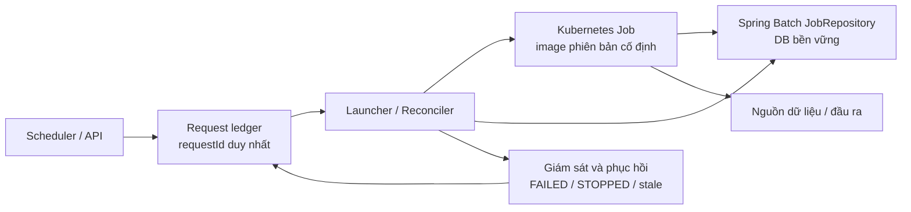
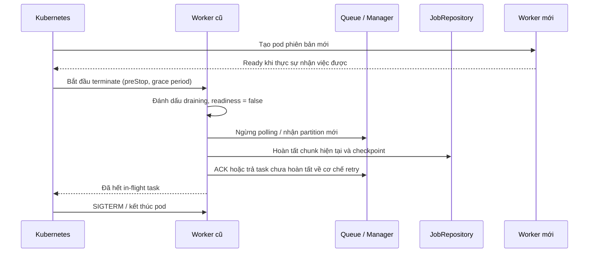

# Rolling deployment không làm mất job trong Spring Batch

## 1. Bài toán và mục tiêu

**Rolling deployment** đưa phiên bản ứng dụng mới vào hoạt động theo từng nhóm instance, đồng thời loại bỏ dần phiên bản cũ. Với API không giữ trạng thái, thường chỉ cần kiểm soát readiness, số replica và thời gian xử lý request. Với **Spring Batch**, một lần thực thi có thể chạy hàng giờ, ghi hàng triệu bản ghi, chứa nhiều chunk đang xử lý hoặc phân tán công việc sang nhiều worker. Nếu hệ thống tắt pod giữa chừng mà không có chiến lược, một phần dữ liệu có thể bị xử lý trùng, một yêu cầu chạy job có thể bị bỏ quên hoặc metadata có thể ghi rằng job vẫn đang chạy dù process đã chết.

Trong module **SPRING_BATCH_SCALING_OPERATIONS** (mở rộng Spring Batch cho workload dữ liệu lớn bằng multi-threaded step, parallel steps, partitioning và xử lý phân tán), triển khai an toàn phải xét cả **vòng đời job, transaction, checkpoint, restart, tính an toàn đa luồng và tài nguyên hạ tầng**. Rolling deployment thành công không đơn thuần là tất cả pod mới đạt trạng thái Ready; cần chứng minh các lần chạy đã được tiếp nhận đều có kết quả cuối cùng hoặc có quy trình khôi phục rõ ràng.

Xét hệ thống đối soát 15 triệu giao dịch mỗi đêm. Job gồm `read -> transform -> write`, commit mỗi 1.000 bản ghi và chia 16 partition. Lúc triển khai phiên bản mới, 10 partition đã hoàn thành, 5 partition đang chạy, 1 partition chờ worker. Nếu hạ worker cũ ngay, cần trả lời được:

- Yêu cầu đối soát có còn được lưu bền vững để chạy tiếp không?
- Chunk đã commit có bị ghi lại khi job/partition được restart không?
- Ai chứng minh worker cũ đã dừng trước khi worker mới nhận cùng partition?
- Phiên bản mới có đọc được `ExecutionContext` và dữ liệu trung gian của phiên bản cũ không?
- Nếu không thể restart ngay, hệ thống phát hiện và xử lý lần chạy mắc kẹt như thế nào?

**Tiêu chí thành công**: không mất *yêu cầu thực thi* đã được chấp nhận; trạng thái job có thể quan sát và đối soát; dữ liệu đầu ra không thiếu, không phát sinh tác dụng phụ trùng lặp ngoài chính sách nghiệp vụ; mọi lần chạy bị gián đoạn đều có đường phục hồi được kiểm chứng. Spring Batch không tự bảo đảm *exactly-once* cho mọi hệ thống ngoài database, vì vậy cần thiết kế idempotency ở ranh giới ghi dữ liệu.

## 2. Phân biệt ba lớp trạng thái

| Lớp | Thành phần | Điều được bảo đảm | Điều **không** được bảo đảm |
| --- | --- | --- | --- |
| Điều phối Kubernetes | `Deployment`, `Pod`, `Job`, `CronJob`, readiness, termination | Tạo/hủy pod theo cấu hình và theo dõi trạng thái container | Không biết chunk đã commit hay job có thể restart an toàn |
| Điều phối Spring Batch | `JobRepository`, `JobExecution`, `StepExecution`, `ExecutionContext` | Lưu metadata, trạng thái và checkpoint khi được cấu hình với kho lưu trữ bền vững | Không tự khởi chạy lại mọi execution khi pod bị kill |
| Nghiệp vụ và tích hợp | Request ledger, hàng đợi, transaction, idempotency key, dữ liệu đích | Theo thiết kế có thể chống mất yêu cầu và chống ghi trùng | Không có bảo đảm nếu chỉ dựa vào trạng thái pod hoặc ACK in-memory |

Ví dụ, Kubernetes báo pod `Terminated` không có nghĩa `JobExecution` đã thành `STOPPED`. Khi process chết đột ngột, bản ghi Spring Batch có thể còn `STARTED` hoặc `STOPPING`. Ngược lại, pod `Ready` cũng không bảo đảm nó đã ngừng lấy việc mới trong lúc drain.

Trong Spring Batch:

- **`JobInstance`** được định danh bởi tên job và tập **identifying `JobParameters`**. Gửi lại cùng định danh là yêu cầu xử lý lại/restart *cùng logical run*, tùy trạng thái và khả năng restart.
- **`JobExecution`** là một lần thử thực thi của `JobInstance`. Một instance có thể có nhiều execution do restart.
- **`StepExecution`** lưu tiến độ và trạng thái của step; **`ExecutionContext`** lưu checkpoint như vị trí đọc hoặc khóa partition, nếu reader/writer hỗ trợ và đã cấu hình lưu trạng thái.
- **`COMPLETED`** thường không được chạy lại với cùng identifying parameters; **`FAILED`/`STOPPED`** có thể restart khi job và step cho phép. **`ABANDONED`** không nên được xem là trạng thái chờ tự chạy lại.

Do đó, “không mất job” phải được kiểm tra ở mức **request → JobInstance → JobExecution → đầu ra**, không chỉ ở mức Deployment.

## 3. Chọn mô hình triển khai theo tuổi thọ job

| Mô hình | Phù hợp với | Cách rolling deployment an toàn |
| --- | --- | --- |
| **Một Kubernetes `Job` cho mỗi lần chạy Spring Batch** | Job dài, tài nguyên lớn, có thời điểm bắt đầu/kết thúc | Launcher/controller triển khai phiên bản mới cho **lần chạy mới**; pod của những Kubernetes Job đang chạy giữ phiên bản đã khởi tạo cho đến khi kết thúc. Lưu `requestId`, image version/digest và metadata thực thi. |
| **Deployment của worker tiêu thụ hàng đợi** | Remote chunking, remote partitioning, worker nhận task liên tục | Worker cũ **ngừng nhận công việc mới**, drain các task đang xử lý, sau đó mới bị loại. Task chưa ACK cần được giao lại an toàn, có khóa sở hữu và idempotency. |
| **Ứng dụng vừa phục vụ API vừa trực tiếp chạy job** | Job ngắn, ít instance | Có cơ chế admission/drain riêng cho batch, giới hạn thời gian dừng đủ dài và khôi phục sau sự cố. Với job dài, nên tách launcher/API và execution khỏi vòng đời replica API. |

Mô hình thường dễ kiểm soát nhất với job kéo dài hàng giờ là **tách control plane khỏi execution plane**: service/controller nhận yêu cầu và lưu bền vững; mỗi job chạy trong một Kubernetes Job độc lập; phiên bản service mới không làm dừng Kubernetes Job cũ.



Với kiến trúc này, rolling update chỉ thay các replica của **launcher/reconciler**; các Kubernetes Job đã tạo tiếp tục chạy. Cần giữ lại job pod, quyền truy cập JobRepository, secret, cấu hình và phiên bản schema mà chúng đang dùng. Không xóa pod đang chạy bằng cơ chế cleanup của phiên bản mới.

## 4. Bảo toàn danh tính job và yêu cầu khởi chạy

Một yêu cầu đến từ API, scheduler hay message consumer cần một **`requestId` ổn định**. Lưu request đó trong database/hàng đợi bền vững trước khi xác nhận đã tiếp nhận. Request ledger có thể có các trạng thái `ACCEPTED`, `CLAIMED`, `RUNNING`, `RETRY_REQUIRED`, `COMPLETED`, `FAILED_PERMANENTLY`; các chuyển trạng thái phải có cách kiểm soát cạnh tranh và audit.

Không tạo `run.id` mới mỗi lần launcher nhận lại cùng request khi retry: cách đó có thể sinh `JobInstance` mới và xử lý lại toàn bộ dữ liệu. Ví dụ tạo `JobParameters` cho một request:

```java
JobParameters parameters = new JobParametersBuilder()
    .addString("requestId", requestId, true)      // identifying, giữ nguyên khi retry
    .addString("sourceUri", sourceUri, false)      // không tham gia định danh
    .toJobParameters();

JobExecution execution = jobLauncher.run(reconciliationJob, parameters);
```

Đoạn mã minh họa bước launch; cấu hình `JobLauncher`, `JobRepository` và khai báo job phải được thiết lập ở ứng dụng thực tế. `sourceUri` và dữ liệu nguồn cần được đóng băng theo request hoặc kiểm tra bất biến qua mọi lần retry; đặt tham số ở dạng non-identifying **không** làm dữ liệu nguồn tự bất biến.

`JobLauncher.run(...)` không phải cơ chế loại trừ trùng lặp cho toàn bộ nghiệp vụ. Tùy trạng thái, cùng bộ identifying parameters có thể nhận lỗi instance đã hoàn tất, execution đang chạy, hoặc tạo execution mới để restart. Caller cần xử lý các trường hợp đó bằng cách tra `JobExplorer`/`JobRepository`, kiểm soát hai launcher cạnh tranh và đối chiếu request ledger. Không tự động biến mọi ngoại lệ thành yêu cầu chạy với ID khác.

Các quy tắc tối thiểu:

1. `requestId` có **unique constraint** ở kho nhận yêu cầu; tiêu thụ lặp một message vẫn quy về một logical run.
2. Lưu `jobName`, identifying parameters, image version/digest, thời điểm nhận, execution ID và trạng thái cuối để truy vết.
3. Không ACK một message chỉ vì đã đọc vào RAM. ACK sau điểm chuyển giao bền vững được thiết kế rõ ràng; reconciler phải có thể tiếp tục nếu launcher chết ngay sau khi tạo Kubernetes Job.
4. Sử dụng **shared persistent JobRepository** (database được bảo vệ và backup) cho các tiến trình có tham gia điều phối cùng một job; không dùng repository in-memory cho bài toán cần restart.
5. Với job ghi sang hệ thống ngoài transaction của Spring Batch, dùng khóa nghiệp vụ duy nhất, UPSERT, deduplication key hoặc outbox để các lần thử lại không gây tác dụng phụ trùng.

Ví dụ nghiệp vụ: mỗi giao dịch kết quả có khóa `(reconciliation_date, transaction_id)`. Writer thực hiện UPSERT theo khóa này, hoặc bảo đảm quy tắc phát hiện trùng phù hợp. Nếu worker chết **sau khi hệ thống đích đã nhận ghi nhưng trước khi checkpoint được lưu**, cùng item có thể xuất hiện lại ở lần restart. Việc lưu `readCount` hay `writeCount` trong Batch metadata không tự giải quyết trường hợp này.

## 5. Drain đúng cách trước khi thay replica

Với worker trong Kubernetes `Deployment`, lifecycle mong muốn là:



Các bước này cần được **cài đặt ở ứng dụng**; Kubernetes không tự hiểu JobExecution đang chạy. Một endpoint readiness chỉ cho biết pod có được đưa vào đường đi của traffic/service hay không, còn consumer lấy message trực tiếp từ queue có thể vẫn tiếp tục nhận task khi readiness đã false.

Một triển khai drain nên làm theo thứ tự:

1. **Đóng cửa nhận mới**: đặt cờ `draining` trong ứng dụng; từ chối request launch mới, dừng listener/poller/partition dispatcher nhận công việc mới và trả readiness `false`.
2. **Xử lý việc đang giữ**: ưu tiên hoàn tất chunk rồi commit và cập nhật checkpoint. Với job dài không thể chờ đến hết job, có thể chủ động yêu cầu dừng có kiểm soát và để hệ thống phục hồi sau đó.
3. **Giữ quyền sở hữu tới khi an toàn**: task có lease/claim phải được gia hạn khi thực sự đang chạy, rồi ACK sau commit hoặc release/requeue theo protocol. Không để worker cũ và worker mới đồng thời ghi cùng partition vì timeout lease quá ngắn.
4. **Đóng ứng dụng**: chỉ kết thúc process khi không còn tác vụ in-flight hoặc đã ghi trạng thái phục hồi an toàn. Khi hết termination grace period, kubelet vẫn có thể cưỡng bức kill; vì vậy luôn cần phương án crash recovery.

Ví dụ một phần manifest dành cho **worker có sẵn cơ chế drain**:

```yaml
apiVersion: apps/v1
kind: Deployment
metadata:
  name: reconciliation-worker
spec:
  replicas: 3
  strategy:
    type: RollingUpdate
    rollingUpdate:
      maxSurge: 1
      maxUnavailable: 0
  selector:
    matchLabels:
      app: reconciliation-worker
  template:
    metadata:
      labels:
        app: reconciliation-worker
    spec:
      terminationGracePeriodSeconds: 900
      containers:
        - name: worker
          image: registry.example.com/reconciliation-worker:1.8.0
          readinessProbe:
            httpGet:
              path: /internal/ready
              port: 8080
            periodSeconds: 5
          lifecycle:
            preStop:
              exec:
                command: ["/app/drain-and-wait"]
```

`/internal/ready` và `/app/drain-and-wait` là **thành phần phải tự hiện thực**, không phải endpoint/script có sẵn của Spring Batch. Script cần yêu cầu ứng dụng ngừng nhận mới, chờ việc in-flight đến điểm an toàn rồi thoát; được đóng gói sẵn trong image. `preStop` chạy **trong** ngân sách `terminationGracePeriodSeconds`, nên phải chừa thời gian cho tiến trình nhận SIGTERM và đóng tài nguyên. Chọn 900 giây ở ví dụ không có nghĩa phù hợp cho mọi job; cần dựa trên thời gian chunk/task thực tế và mục tiêu vận hành.

`maxUnavailable: 0` giúp duy trì số replica sẵn sàng trong quá trình rollout, nhưng **không bảo đảm** chunk hay toàn bộ batch job không bị cắt ngang. `server.shutdown=graceful` của Spring Boot chủ yếu xử lý vòng đời web server; không thay thế logic dừng nhận task và checkpoint của batch. Không dùng một lệnh `sleep` cố định như bằng chứng rằng job đã drain xong.

## 6. Với job dài: cố định phiên bản cho từng Kubernetes Job

Thay vì để một `Deployment` thường xuyên thay pod đang tính toán vài giờ, launcher có thể tạo Kubernetes `Job` riêng cho mỗi logical run:

```yaml
apiVersion: batch/v1
kind: Job
metadata:
  name: reconcile-20261126-r42
  labels:
    app: reconciliation
    request-id: r42
spec:
  backoffLimit: 0
  template:
    spec:
      restartPolicy: Never
      terminationGracePeriodSeconds: 600
      containers:
        - name: runner
          image: registry.example.com/reconciliation-runner:1.8.0
          env:
            - name: BATCH_REQUEST_ID
              value: "r42"
            - name: BATCH_DATE
              value: "2026-11-26"
```

Ứng dụng runner cần đọc biến môi trường, tạo identifying `JobParameters` ổn định và chạy đúng Spring Batch job. `backoffLimit: 0` là **lựa chọn minh họa khi retry được quản lý bởi reconciler**; nếu không có reconciler thì cấu hình này chỉ khiến Kubernetes Job lỗi kết thúc mà không tự phục hồi. Có thể chọn retry pod của Kubernetes khi đã chứng minh được khả năng xử lý stale execution, loại trừ chạy song song và idempotency; không mặc định Kubernetes retry tương đương Spring Batch restart.

Khi triển khai launcher phiên bản 1.9.0, job `reconcile-20261126-r42` đang chạy bằng image 1.8.0 **không bị thay thế bởi rolling update của launcher**. Launcher mới chỉ tạo image 1.9.0 cho request mới. Trên production nên lưu và ưu tiên **image digest** để xác định chính xác binary; version tag có thể bị ghi đè trong registry.

Đừng nhầm hai loại `Job`: **Kubernetes Job** quản lý pod hoàn tất một nhiệm vụ; **Spring Batch Job** quản lý nghiệp vụ, step, execution và checkpoint. Kubernetes Job ở trạng thái `Failed` vẫn cần đối chiếu với Spring Batch JobRepository, và ngược lại.

Nếu dùng Kubernetes `CronJob`, `concurrencyPolicy: Forbid` chỉ tránh overlap những Kubernetes Job thuộc **cùng CronJob**. Khi lần trước chưa kết thúc, lịch tiếp theo có thể bị bỏ qua; cấu hình đó không phải hàng đợi bền vững cho mọi lượt lịch, cũng không chặn nguồn launch khác. Lịch chạy quan trọng nên ghi mỗi lượt dự kiến vào request ledger để reconciler tìm và xử lý lịch còn thiếu.

## 7. Stop, restart và xử lý execution mắc kẹt

Spring Batch có khái niệm **dừng có kiểm soát** khác với kill process:

| Tình huống | Diễn biến thường gặp | Phản ứng hợp lý |
| --- | --- | --- |
| Operator yêu cầu dừng qua `JobOperator.stop(executionId)` | Tín hiệu dừng được ghi nhận; execution có thể chuyển `STOPPING` rồi `STOPPED` khi job/step kiểm tra và đi đến điểm dừng | Chờ/quan sát trạng thái cuối; restart **cùng JobInstance** nếu tương thích |
| Pod bị `SIGKILL`, node mất hoặc process crash | Không có cơ hội hoàn tất lifecycle; metadata có thể vẫn `STARTED`/`STOPPING` | Xác nhận không còn process/partition owner sống, đối chiếu output, reconcile stale execution, sau đó mới restart |
| Job báo `FAILED` sau khi transaction rollback | Chunk chưa commit thường có thể được thử lại từ checkpoint trước đó, tùy reader/writer | Kiểm tra khả năng restart và idempotency trước khi gửi yêu cầu retry |
| Job báo `COMPLETED` nhưng caller mất phản hồi | Caller có thể gửi lại cùng `requestId` | Trả kết quả đã lưu; không tạo `run.id` mới để thực thi lại |
| Execution `UNKNOWN` hoặc trạng thái không khớp dữ liệu thực tế | Metadata không đủ để xác định an toàn | Cách ly để điều tra và đối soát; không tự động chạy chồng lên execution cũ |

`JobOperator.stop(...)` là **yêu cầu dừng**, không đồng nghĩa ngắt tức thì mọi I/O. Việc kiểm tra tín hiệu dừng phụ thuộc step implementation, và code blocking hoặc task executor không hỗ trợ dừng có thể kéo dài thời gian. `JobOperator.restart(executionId)` chỉ thực hiện được khi điều kiện restart thỏa mãn; không nên gọi mù quáng trên một execution còn `STARTED`. Với job đang chạy ở pod khác, cần xác minh cơ chế điều khiển có thể truyền tới execution thực tế; thao tác metadata không tự tiêu diệt process từ xa.

Reconciler phục hồi nên thực hiện theo thứ tự logic:

```text
for each accepted request not yet terminal:
    read request ledger, Kubernetes Job/Pod state and Spring Batch executions
    if an owner is alive:
        observe; do not launch an overlapping execution
    else if execution is COMPLETED:
        verify/publish outcome; mark request completed
    else if execution is FAILED or STOPPED and restart is safe:
        acquire a durable recovery claim; restart same JobInstance
    else if metadata looks STARTED/STOPPING but no owner is alive:
        quarantine; verify lease expiry, process death and committed output
        perform audited, version-appropriate stale-execution recovery
        restart only after the previous owner is conclusively fenced out
    else:
        alert an operator for manual reconciliation
```

**Không cập nhật trực tiếp bảng `BATCH_JOB_EXECUTION` để chuyển `STARTED` thành `FAILED` như một “mẹo” phổ quát.** Việc sửa metadata sai có thể khiến cùng một logical run chạy đồng thời hoặc checkpoint lệch với dữ liệu. Quy trình sửa stale execution phải dựa trên phiên bản Spring Batch, API/công cụ vận hành được hỗ trợ, tình trạng thực tế của worker và dấu vết audit.

Một `JobInstance` chỉ restart đúng khi các step được thiết kế restartable: reader lưu state chuẩn xác, xử lý dữ liệu đầu vào ổn định, writer idempotent, transaction boundary rõ ràng; không dùng dữ liệu cache in-memory làm checkpoint duy nhất.

## 8. Tương thích khi hai phiên bản cùng chạy

Trong một cửa sổ rolling deployment, phiên bản cũ và mới có thể cùng đọc/ghi JobRepository, dữ liệu nguồn, hàng đợi và kết quả. Vì vậy cần:

- **Schema theo hướng expand → migrate → contract**: thêm cấu trúc tương thích trước, triển khai code đọc được cả hai dạng, chuyển dữ liệu có kiểm soát rồi mới bỏ field/cột cũ sau khi không còn execution phụ thuộc.
- **ExecutionContext ổn định**: giữ key, kiểu dữ liệu và cơ chế serialization mà một execution đang chạy hoặc cần restart có thể đọc. Đổi tên key lưu checkpoint hay đổi DTO serialized trong lúc còn job cũ có thể làm restart thất bại.
- **Thông điệp có version**: remote worker phải hiểu message do manager cũ gửi, hoặc router/queue tách theo protocol version. Không triển khai manager chỉ biết version mới khi còn task cũ chưa xử lý.
- **Cấu hình step và partition có kiểm soát**: thay `gridSize`, chiến lược phân chia key, câu truy vấn phân trang hay mapping partition giữa chừng có thể làm chồng lấn hoặc bỏ sót dữ liệu. Giữ bộ partition/restart strategy tương thích cho JobInstance cũ.
- **Giữ image cũ đủ lâu**: nếu restart bằng binary mới không chứng minh được tương thích, chạy lại bằng image/digest cũ hoặc hoàn tất các job cũ trước khi chuyển.
- **Rollback tương thích**: ứng dụng cũ phải đọc được schema và message còn tồn tại sau rollout; không rollback code rồi kỳ vọng rollback database phá hủy dữ liệu là an toàn.

Đặc biệt, **JobRepository schema migration** phải tương thích với các process Spring Batch đang hoạt động. Không chạy DDL breaking change hoặc nâng version framework với metadata không tương thích trong khi còn job cũ chạy.

## 9. Lưu ý riêng cho các kiểu scaling

### Multi-threaded step và parallel steps

`ItemReader`/`ItemWriter` dùng chung có thể không thread-safe. Khi drain, phải ngừng submit thêm task rồi chờ các task đã nhận hoàn tất hoặc checkpoint đúng cách. Không được tự kết luận rằng executor đã ngừng nhận mới tức là tất cả transaction đã commit. Kiểm tra isolation, transaction scope và trường hợp callback ghi dữ liệu ngoài transaction.

### Local/remote partitioning

Manager và worker cần thống nhất **partition identity**, trạng thái `StepExecution` và ownership. Một partition chết giữa chừng có thể được chạy lại; writer phải chịu được retry từ checkpoint. Đừng phân công lại partition chỉ dựa trên heartbeat mất một nhịp: worker cũ có thể vẫn đang ghi dữ liệu. Dùng lease/fencing token hoặc cơ chế khóa bền vững; chỉ giao lại khi owner cũ bị loại trừ chắc chắn.

### Remote chunking

Đối với yêu cầu chunk gửi qua broker, cần xác định khi nào message được ACK, khi nào kết quả được lưu và giao thức xử lý reply trùng/muộn. Durable queue giúp message tồn tại sau khi consumer chết, nhưng không tự tạo exactly-once cho hệ thống đích. Khi thay worker, bảo đảm manager không coi chunk đã hoàn tất chỉ vì gửi message thành công; phải có xác nhận xử lý và đối chiếu metadata theo giao thức. Có thể phải giữ version cũ của serializer/routing cho đến khi hàng đợi cũ đã được xử lý hết.

### Shared resource và giới hạn tải

`maxSurge: 1` có thể làm tổng số worker tăng tạm thời. Khi nhiều worker cũ và mới đồng thời hoạt động, tổng connection pool, thread pool và số partition thực thi có thể vượt khả năng DB hoặc broker. Cần tính **đỉnh kết nối trong rollout** và giới hạn concurrency ở manager/queue, thay vì chỉ nhìn số replica mong muốn.

## 10. Kịch bản rollout thực tế

Giả sử đang có 4 job đối soát, mỗi job gồm 16 partition, thời gian chạy 2 giờ. Muốn triển khai phiên bản 1.9.0, có thể dùng quy trình:

1. **Trước rollout**: chốt danh sách `requestId`, `JobInstance`, execution đang chạy, partition owner, phiên bản image và checkpoint; kiểm tra còn đủ dung lượng JobRepository, DB pool và queue. Xác nhận schema/message của 1.8.0 và 1.9.0 có thể cùng tồn tại.
2. **Đưa vào phiên bản mới cho lần chạy mới**: cập nhật launcher/reconciler theo rolling update; vẫn giữ các Kubernetes Job 1.8.0. Nếu worker hoạt động trong Deployment, đưa replica cũ sang chế độ drain từng đợt.
3. **Theo dõi trong lúc giao thoa**: không chuyển giao partition còn owner sống; đo số task in-flight, execution `STARTED`/`STOPPING`, queue lag, lỗi writer và timeout. Nếu cần, giảm rate launch để tránh DB pool quá tải.
4. **Sau rollout**: đối chiếu mỗi request với một kết quả cuối hoặc trạng thái retry có owner; kiểm tra đủ 16 partition, số bản ghi theo nghiệp vụ và khóa trùng. Reconciler tìm request chưa terminal nhưng không còn process để khôi phục có kiểm soát.
5. **Dọn dẹp sau khi an toàn**: chỉ loại bỏ image/protocol/schema cũ sau khi không còn job cần restart bằng phiên bản đó và đã hết message tồn đọng.

Nếu 1 partition vẫn chạy dưới 1.8.0 mà nhà vận hành định xóa toàn bộ job pod cũ cho “sạch rollout”, quy trình phải **dừng**: pod đó thuộc execution đang hoạt động, không thuộc vòng đời Deployment launcher mới.

## 11. Kiểm chứng bằng fault injection và tiêu chí chấp nhận

Mọi chiến lược rolling deployment cần được thử trong staging với khối lượng và độ trễ tương tự production. Các test có giá trị cao:

| Thử nghiệm | Hành động | Điều phải xác nhận |
| --- | --- | --- |
| Drain tại ranh giới chunk | Rollout lúc writer đang commit | Không nhận task mới sau drain; chunk hoàn thành hoặc rollback; restart không tạo bản ghi trùng |
| Pod chết đột ngột | Kill một pod đang chạy, không cho preStop hoàn tất | Request vẫn tồn tại; stale execution được phát hiện; không có hai owner cùng ghi |
| Partition owner mất kết nối | Ngắt worker khỏi manager/broker trong lúc ghi | Lease/fencing chặn overlap; partition được phục hồi mà không thiếu item |
| Mất ACK / reply trễ | Giữ message hoặc reply qua thời điểm rollout | Không ACK sớm làm mất chunk; nhận lại message/reply không nhân đôi kết quả |
| Launch lặp | Gửi cùng `requestId` nhiều lần vào hai replica launcher | Chỉ một logical JobInstance và một chủ thể thực thi được quyền chạy |
| Đổi phiên bản giữa job | Chạy job cũ rồi cập nhật code/schema/serializer | Các execution cũ hoàn tất hoặc restart với phiên bản tương thích |
| Tài nguyên căng | Rollout với worker cũ + worker mới cùng tiêu thụ | DB connection, heap, thread, queue lag và timeout vẫn nằm trong ngưỡng đã đặt |

Các **invariant** nên được kiểm tra tự động bằng dữ liệu nghiệp vụ và metadata:

- Mọi `requestId` đã được ACK là `ACCEPTED` đều tra được một bản ghi bền vững và cuối cùng có trạng thái terminal hoặc cảnh báo/phương án retry.
- Không có hai owner đang hợp lệ cùng xử lý một partition không cho phép song song.
- Số item đầu ra duy nhất bằng kỳ vọng nghiệp vụ; không có gap hay side effect trùng ngoài mức cho phép.
- Không tồn tại execution `STARTED`/`STOPPING` quá ngưỡng mà không có pod/worker tương ứng **và** không có cảnh báo/reconciliation.
- Sau khi rollout kết thúc, không còn request bị kẹt trong trạng thái chỉ tồn tại ở bộ nhớ launcher.

Theo dõi các metric hữu ích: số request được nhận nhưng chưa launch, số execution theo `BatchStatus`, thời gian `STOPPING`, số stale execution, restart attempt, queue lag, partition in-flight, chunk retry/rollback, duplicate-key rejection, tốc độ xử lý và số kết nối DB. Thiết lập ngưỡng dựa trên baseline thực tế, không dùng một timeout cố định cho mọi job.

## 12. Những lỗi thiết kế dễ gặp

| Cách làm | Vì sao nguy hiểm | Điều chỉnh |
| --- | --- | --- |
| Chỉ đặt `maxUnavailable: 0` | Duy trì số pod Ready nhưng Kubernetes vẫn terminate pod cũ đang chạy job | Bổ sung drain, checkpoint và crash recovery, hoặc tách từng job thành Kubernetes Job riêng |
| Chỉ bật graceful shutdown của web server | Không tự dừng consumer, partition executor và tác vụ batch | Đóng admission của batch và chờ in-flight riêng |
| Tự tăng `run.id` khi nhận lại request | Sinh JobInstance mới, có thể xử lý lặp toàn bộ dữ liệu | Dùng identifying parameters ổn định cho logical request |
| Trả ACK queue ngay khi bắt đầu xử lý | Worker chết sau ACK có thể khiến việc không còn dấu vết | ACK sau chuyển giao bền vững/commit theo giao thức, có reconciler |
| Tự sửa metadata `STARTED` thành `FAILED` rồi chạy lại | Process cũ có thể vẫn sống hoặc checkpoint không phản ánh đầu ra | Fencing owner, đối soát và thao tác recovery có audit |
| Deploy code làm thay đổi ExecutionContext đột ngột | Execution cũ không thể restart bằng code mới | Version hóa và giữ backward compatibility hoặc pin binary |
| Chỉ test rollout khi queue trống | Bỏ sót rủi ro chính ở chunk, partition và retry | Fault injection khi đang xử lý dữ liệu thật của staging |

## 13. Checklist trước khi cho phép rolling deployment

- [ ] Mỗi yêu cầu chạy job có `requestId` ổn định, lưu bền vững và có deduplication.
- [ ] JobRepository nằm trên storage bền vững, có backup và quan sát được execution.
- [ ] Reader/writer, partitioning và tác dụng phụ ngoài DB đã được kiểm tra restart/idempotency.
- [ ] Đã chọn rõ mô hình: job pod cố định theo lần chạy hoặc worker Deployment có admission/drain.
- [ ] Thời gian `terminationGracePeriodSeconds` được tính từ chunk/task thực tế; còn kế hoạch cho SIGKILL/node crash.
- [ ] Có cơ chế ngăn hai execution/owner đồng thời xử lý cùng logical work khi recovery.
- [ ] Schema, `ExecutionContext`, serializer, message protocol và image rollback tương thích xuyên phiên bản.
- [ ] Đã thử launch trùng, kill pod, mất ACK, worker timeout và rolling update khi tải cao.
- [ ] Có dashboard/cảnh báo cho request chưa hoàn tất, stale execution, duplicate, queue lag và sức tải DB.
- [ ] Có runbook ghi rõ người hoặc controller nào xác minh, dừng, restart và đối soát dữ liệu sau sự cố.

**Kết luận thực hành:** rolling deployment an toàn cho Spring Batch là bài toán giữ bền vững *yêu cầu*, *quyền sở hữu công việc* và *khả năng phục hồi từ checkpoint*. Kubernetes quản lý vòng đời pod; Spring Batch quản lý execution; tính đầy đủ và duy nhất của dữ liệu phải được kiểm chứng bằng các ràng buộc nghiệp vụ. Khi ba lớp này được phối hợp, triển khai phiên bản mới có thể diễn ra trong lúc job dài vẫn chạy mà không làm biến mất logical run hay tạo ra tác dụng phụ không kiểm soát.
