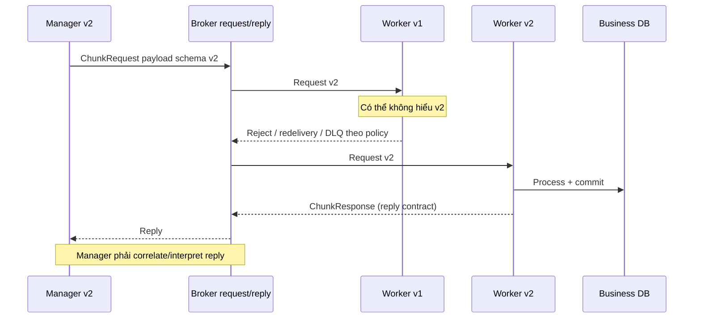
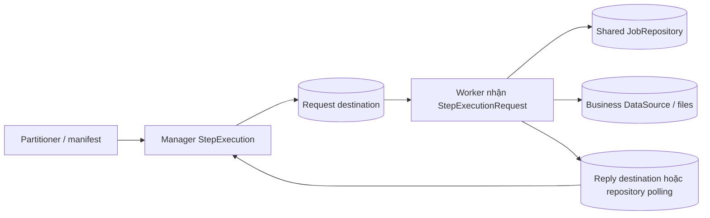
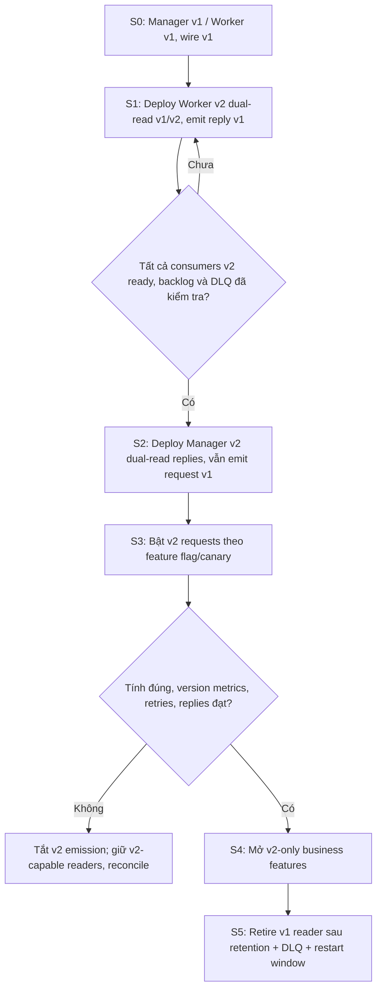
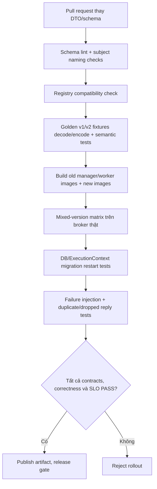

# Version hóa schema message khi triển khai Spring Batch phân tán

## 1. Tại sao phải version hóa message?

Một hệ thống Spring Batch xử lý hàng chục triệu đơn hàng qua **remote chunking**: manager đọc input, gửi `ChunkRequest` qua JMS, nhiều worker nhận và ghi kết quả rồi gửi `ChunkResponse`. Đội phát triển bổ sung trường `currency` vào DTO của item và triển khai worker mới trước. Worker mới đọc được message cũ, nhưng khi manager mới bắt đầu phát message chứa trường mới, một số worker cũ vẫn còn chạy và không hiểu payload. Request bị reject/redeliver, queue dài lên, manager timeout. Có request đã **commit database** nhưng reply không được giải mã; restart gửi lại chúng, khiến nguy cơ ghi trùng tăng.

Một lỗi triển khai nhỏ ở **schema message** có thể biến thành sự cố **retry, checkpoint và tính đúng dữ liệu**. Đó là lý do việc đặt version không chỉ là thêm một trường `schemaVersion`: phải thiết kế **compatibility contract, consumer/producer rollout order, xử lý message cũ đang tồn tại trong broker, phân loại lỗi và khả năng rollback**.

Bài thuộc chương **Triển khai** của module `SPRING_BATCH_SCALING_OPERATIONS`. Module tập trung mở rộng Spring Batch cho dữ liệu lớn bằng **multi-threaded step, parallel steps, partitioning và các mô hình xử lý phân tán**, đo bottleneck, bảo đảm thread safety, retry/restart và vận hành theo tài nguyên thực tế. Trong kiến trúc phân tán, manager và workers được deploy độc lập, nên **version hóa giao thức** là điều kiện để scale/rollout mà không làm mất công việc.

### Mục tiêu học tập

Sau bài này, bạn có thể:

1. Phân biệt **wire format**, **message envelope**, **payload schema**, **business semantics** và **Spring Batch restart metadata**.
2. Giải thích `ChunkRequest`/`ChunkResponse` của remote chunking khác `StepExecutionRequest` của remote partitioning.
3. Chọn **schema version** và chính sách backward/forward/full compatibility phù hợp cửa sổ mixed versions.
4. Thiết kế message envelope có type, version, correlation, logical request identity và khả năng audit.
5. Viết Java 17/Jackson codec giải mã v1/v2 về một mô hình nội bộ, kiểm tra lỗi và không làm mất idempotency.
6. Xây **golden contract tests**, ma trận manager/worker old/new và test redelivery/restart.
7. Lập kế hoạch rolling deployment/rollback, xử lý DLQ, broker retention, schema registry và quan sát theo version.
8. Phân biệt schema migration với **database schema migration** và `ExecutionContext`/`JobRepository` migration.

> **Phiên bản tham chiếu:** Spring Batch **5.2.x**, Spring Integration tương thích Spring Framework 6.x, Spring Boot 3.x, Java 17+, Jackson 2.x và ví dụ JMS. Spring Batch 6 và Boot 4 có thể thay API/cơ chế serialization; đối chiếu đúng phiên bản đang vận hành. Những DTO/envelope bên dưới là **giao thức ứng dụng tự thiết kế**, không phải field bắt buộc do Spring Batch tự thêm.

## 2. Các message thực sự xuất hiện ở đâu?

### 2.1. Remote chunking: request và reply đều có contract



Remote chunking trong Spring Batch Integration có các kiểu như `ChunkRequest<T>` và `ChunkResponse`, cùng builder manager/worker và channels do ứng dụng nối tới middleware. `ChunkRequest` mang thông tin chunk cần xử lý; `ChunkResponse` tổng hợp kết quả dạng contribution. Manager dựa vào reply để biết tình trạng những chunks đã giao.

**Điểm dễ quên:** thay schema của **request** mà không quản lý **reply** có thể khiến worker v2 commit thành công nhưng manager v1 không hiểu reply. Khi đó manager có thể nhìn job như đang thất bại dù business side effects đã xảy ra.

### 2.2. Remote partitioning: giao metadata để worker tự đọc



Remote partitioning có `StepExecutionRequest` và `StepExecutionRequestHandler` trong Spring Batch Integration. Worker truy xuất `StepExecution`/`ExecutionContext` liên quan từ repository theo cấu hình, rồi tự đọc/xử lý phần dữ liệu đã được giao. Manager có thể lấy kết quả qua **reply aggregation hoặc polling JobRepository** tùy topology.

Điều này tạo ít nhất hai loại compatibility khác nhau:

- **Dispatch message**: phiên bản của payload giao step/partition.
- **Persisted checkpoint**: kiểu/keys/value của `ExecutionContext` đã được viết bởi version trước và cần đọc lại khi restart.

Thay dispatch schema không tự migrate `ExecutionContext`. Ngược lại, worker mới đọc được request không bảo đảm đọc được context/DTO đã persist của attempt cũ.

### 2.3. Multi-threaded step và parallel steps có cần message schema?

Một multi-threaded step hoặc parallel flow chạy nội bộ **cùng process** không mặc nhiên gửi message qua middleware. Với chúng, schema message chỉ xuất hiện nếu ứng dụng chủ động dùng Kafka/JMS/AMQP, đưa task qua external queue hoặc trao đổi serialized dữ liệu. Đừng thêm schema registry chỉ vì có nhiều threads.

### 2.4. Định nghĩa “message schema” trong bài

```text
Application business data
  └─ Item DTO / partition command / result
       └─ Message payload schema (JSON/Avro/Protobuf...)
            └─ Protocol envelope + transport headers
                 └─ Transport representation (JMS TextMessage/BytesMessage,
                    AMQP message, Kafka record, ...)
                      └─ Broker persistence / redelivery
```

**Không nhầm message schema với DB table schema**. Thay column trong PostgreSQL bằng Flyway/Liquibase không tự làm consumer hiểu JSON v2. Và thay JSON v2 cũng không tự bảo đảm writer SQL mới tương thích DB cũ trong rolling deploy.

## 3. Năm hợp đồng phải quản lý độc lập

| Hợp đồng | Ví dụ | Rủi ro khi đổi không có kế hoạch |
| --- | --- | --- |
| **Wire/codec** | JSON UTF-8, Avro binary, Protobuf wire | Worker không decode được bytes hoặc Content-Type |
| **Envelope/protocol** | `type`, `schemaVersion`, `requestId`, `correlationId` | Reply bị thất lạc, không match request hoặc duplicate |
| **Payload shape** | `orderId`, `amountMinor`, `currency` | Missing required fields, sai type/rename |
| **Business semantics** | `amountMinor` tính bằng cent, rounding, sequence | Decode thành công nhưng trừ tiền sai |
| **Restart/persistence** | `ExecutionContext`, JobParameters, business ledger | Restart khác plan, mất checkpoint hoặc double effect |

Chọn version riêng theo nhu cầu:

- `protocolVersion` cho **quy tắc envelope/correlation/routing**, chỉ tăng khi contract giao thức thay đổi.
- `schemaVersion` hoặc schema ID cho **payload của một message type**.
- `businessContractVersion` nếu cần phân biệt ý nghĩa nghiệp vụ (ví dụ schema giữ kiểu `long` nhưng đổi đơn vị tiền).
- `deploymentVersion` để truy vết binary/commit/feature flag, **không dùng thay cho schema ID**.

Không bắt buộc phải có bốn số độc lập trên mọi message. Thiết kế nhỏ có thể dùng `type + schemaVersion` và một protocol major chung; **điều quan trọng là version có semantics cụ thể**, được kiểm thử thay vì tăng bừa theo Git release.

### 3.1. Vì sao đổi tên trường tưởng vô hại vẫn nguy hiểm?

Ví dụ producer cũ gửi:

```json
{"orderId":"O-1001","amountMinor":1999}
```

Producer mới đổi sang:

```json
{"orderId":"O-1001","amount":19.99}
```

Một worker cũ có thể bỏ qua `amount` và mặc định `amountMinor=0`. Message **được decode thành công** nhưng nghiệp vụ sai. Đây là **breaking semantic change** (tên và đơn vị), không phải chỉ vấn đề serializer có chấp nhận unknown fields.

Giải pháp có thể là giữ `amountMinor` cùng một thời gian chuyển đổi, dùng một contract mới `v2` có migration adapter rõ ràng, hoặc tạo message type mới nếu ý nghĩa đã thay đổi căn bản.

### 3.2. Trường bắt buộc không được biến mất âm thầm

`@JsonIgnoreProperties(ignoreUnknown=true)` cho phép worker mới/cũ bỏ qua trường mà nó không biết. Điều này có thể giúp **forward tolerance** cho trường bổ sung, nhưng **không thay thế**:

- Validate `orderId`/`operationId` có mặt và không blank.
- Validate kiểu số, range, precision và unit.
- Validate `currency`, timezone, ordering và identity.
- Validate yêu cầu đối với trường mới có ý nghĩa nghiệp vụ.

Một consumer “đọc được JSON” chưa có nghĩa “xử lý đúng business contract”.

## 4. Backward, forward và full compatibility: phải nói rõ chiều

Giả sử có producer và consumer v1/v2, ký hiệu `R_v(x)` là consumer phiên bản `v` giải mã và xử lý đúng message được producer phiên bản `x` tạo ra.

| Loại | Điều cần đúng | Ý nghĩa triển khai |
| --- | --- | --- |
| **Backward** | `R_v2(v1)` | Consumer mới đọc được **dữ liệu cũ**; thường nâng consumer trước |
| **Forward** | `R_v1(v2)` | Consumer cũ đọc được **dữ liệu mới**; hữu ích khi producer nâng trước |
| **Full** | Cả `R_v2(v1)` và `R_v1(v2)` | Cho phép mixed versions theo cả hai hướng nếu semantic contract cũng đúng |
| **Transitive** | So với **mọi** phiên bản được hỗ trợ, không chỉ v gần nhất | Quan trọng với long retention, DLQ, replay lịch sử |
| **None** | Không có bảo đảm tương thích | Cần cutover có kiểm soát hoặc channel/type mới |

Trong Confluent Schema Registry, các mode tên `BACKWARD`, `FORWARD`, `FULL` và biến thể `_TRANSITIVE` có semantics như trên; **giá trị mặc định thường là `BACKWARD`, không phải `BACKWARD_TRANSITIVE`**. Các quy tắc cụ thể tùy **Avro/Protobuf/JSON Schema** và cách registry định nghĩa subject.

**Cảnh báo:** compatibility của schema registry chỉ kiểm tra **khả năng biểu diễn/đọc dữ liệu theo schema**, không kiểm chứng business invariants, converter cấu hình sai, thứ tự nâng phiên bản thực tế hay DB side effects. Phải có contract tests thực thi.

### 4.1. Ma trận producer/consumer trong rolling deployment

| Producer | Consumer | Cần chứng minh |
| --- | --- | --- |
| Manager v1 | Worker v1 | Baseline hiện tại |
| Manager v1 | Worker v2 | Backward: v2 đọc request v1 |
| Manager v2 | Worker v1 | Forward: v1 đọc request v2 |
| Manager v2 | Worker v2 | Target steady state |
| Worker v1 | Manager v2 (reply) | Manager v2 đọc response v1 |
| Worker v2 | Manager v1 (reply) | Manager v1 đọc response v2 |

Tương thích **không đối xứng**. Ngay cả khi manager v2 có thể gửi request tới worker v1, response do worker v1 phát cũng phải được manager v2 hiểu. Nếu dùng remote partitioning và không có reply channel (manager polling repository), thay thế row reply bằng **bài test worker v1/v2 có thể cập nhật metadata mà manager hiểu**.

### 4.2. “Cho phép thêm optional field” phải kiểm chứng theo format

Với JSON, worker cũ có thể:

- Ignore unknown field (forward tolerance).
- Reject unknown field theo `FAIL_ON_UNKNOWN_PROPERTIES`.
- Không báo lỗi decode, nhưng business validation từ chối vì field mới thay đổi invariant.

Với Avro, **reader/writer schema resolution** có quy tắc về field defaults, aliases và numeric promotion. Với Protobuf, field numbers/type/oneof có các ràng buộc riêng, không giống JSON name-based mapping.

Vì vậy, không có quy tắc chung “thêm field luôn backward/forward compatible”. Hãy **đóng băng chính xác encoding, deserializer và schema policy** trong CI.

### 4.3. Backward-compatible không đồng nghĩa rollback-compatible

Một rollout **worker-first** có thể hoàn toàn hợp lệ nếu worker v2 đọc được v1. Nhưng sau khi manager v2 bắt đầu phát message v2, rollback worker về v1 sẽ yêu cầu **v1 đọc v2**; backward compatibility **không bảo đảm điều đó**.

Nếu dự kiến rollback nhanh bằng cách redeploy v1, cần một trong các chiến lược:

1. Giữ producer phát v1 trong suốt giai đoạn worker v2 rollout và một cửa sổ rollback.
2. Đảm bảo cả hai chiều tương thích thực sự (**full compatibility**) và đã test.
3. Dùng **dual-read**, tách destination/version hoặc **quiesce/drain** tất cả in-flight v2 trước khi rollback consumer.

Không tuyên bố rollback an toàn chỉ vì schema registry báo `BACKWARD_COMPATIBLE`.

## 5. Thiết kế envelope versioned: type, identity và correlation

Một message ứng dụng nên có phần **envelope ít thay đổi** và phần **payload có schema version**. Ví dụ sau mô tả một **envelope tự xây**, không phải format mặc định của Spring Batch `ChunkRequest`:

```json
{
  "messageType": "order.normalize.request",
  "protocolVersion": 1,
  "schemaVersion": 2,
  "requestId": "job-901-step-301-chunk-42",
  "jobExecutionId": 901,
  "stepExecutionId": 301,
  "chunkSequence": 42,
  "payload": {
    "operations": [
      {
        "operationId": "order-event-10001",
        "orderId": "O-1001",
        "amountMinor": 1999,
        "currency": "USD"
      }
    ]
  }
}
```

### 5.1. Ý nghĩa từng trường

| Trường | Vai trò | Yêu cầu |
| --- | --- | --- |
| `messageType` | Route/validate request, reply, event | Không tái sử dụng tên cho một meaning hoàn toàn khác |
| `protocolVersion` | Quy tắc envelope, correlation, ACK/reply | Kiểm tra trước payload |
| `schemaVersion` | Phiên bản payload theo `messageType` | Giá trị trong supported range hoặc registry ID |
| `requestId` | Định danh logical request qua retry/redelivery | Ổn định trong những lần gửi lại **cùng logical request** |
| `jobExecutionId` | Attempt JobExecution của manager | Có thể thay khi JobInstance restart |
| `stepExecutionId` | StepExecution attempt context | Không phải business operation key |
| `chunkSequence` | Sequence do manager dùng cho chunk request | Correlate đúng request/reply; không đồng nhất ordering nghiệp vụ |
| `payload.operations` | Danh sách domain operations | Validate schema + semantic + size |

Các field `jobExecutionId`, `stepExecutionId`, `chunkSequence` ở đây là **giá trị hợp đồng ví dụ**. Khi tích hợp với Spring Batch thực tế, phải sử dụng đúng dữ liệu và semantics do `ChunkRequest`/`StepContribution` cung cấp, **không tự bịa sequence rồi thay protocol nội bộ của framework**.

### 5.2. Correlation ID và idempotency key phục vụ hai việc khác nhau

- `requestId`: ghép một logical request với reply; trong retransmission nên ổn định để xử lý duplicate correlation.
- `businessOperationId`: nhận diện **một hiệu ứng nghiệp vụ** (ví dụ `order-event-10001`), tồn tại xuyên các JobExecutions/chunks nếu cùng event được replay.
- `JMSMessageID`: ID của **delivery/message instance theo provider**, có thể khác sau khi gửi lại và **không thay thế** business ID.
- `traceId`: theo dõi logs/spans, không dùng làm khóa DB dedup.

Một chunk có thể có nhiều operations; **không lấy `requestId` duy nhất làm idempotency cho từng item** nếu chunk split/rebalance có thể thay thành viên. Việc chống ghi trùng thường phải dựa vào **businessOperationId** cùng một unique ledger và business write trong transaction.

### 5.3. Các header nào đặt ở middleware?

Trong JMS có thể dùng `JMSCorrelationID`, `JMSReplyTo` và properties hỗ trợ primitive/string để truyền protocol/schema version; JSON `payload` có thể chứa envelope mirror. Với Kafka có message headers, với AMQP có properties/headers.

Quy tắc:

1. Xác định **một nguồn version authoritative** hoặc kiểm tra body/header khớp nhau.
2. Không tin header do producer ngoài vùng trust gửi mà không validation.
3. Nếu routing cần đọc version **trước deserialize body**, đặt version/content-type trong header đủ đơn giản để đọc và chuẩn hóa.
4. Header IDs và body IDs phải **nhất quán**, không chỉ parse một bên rồi ghi business từ bên kia.
5. Đảm bảo broker adapter/message converter **không làm rơi** custom header qua đường request/reply.

**Không xây JSON envelope chỉ để gắn version nếu middleware thực tế đã dùng schema registry ID ở binary payload**; khi đó schema ID/content type có thể là đủ, với protocol/correlation fields vẫn được kiểm tra.

### 5.4. Chặn payload nguy hiểm trước khi deserialize

Ở tầng transport, validate:

- `contentType` nằm trong allowlist (`application/json`, Avro/Protobuf đã thỏa thuận).
- `messageType` nằm trong nhóm request/reply đúng destination.
- `protocolVersion` trong khoảng được hỗ trợ.
- Payload size, số items/chunk, nesting depth và string lengths có giới hạn.
- Schema registry ID phải tồn tại và thuộc subject/type hợp lệ.
- Authenticated producer identity/tenant scope nếu cần.

Nếu version không hỗ trợ, phân loại **non-retryable protocol mismatch** và quarantine/DLQ theo policy **thay vì deserialize nhiều lần rồi redeliver vô hạn**. Tránh việc auto-ACK request sai trước khi ghi nhận lỗi/đưa vào cơ chế xử lý có thể audit.

## 6. Ví dụ tiến hóa message v1 → v2: thêm currency mà không đổi đơn vị

Giả sử domain v1 **chỉ hỗ trợ giao dịch USD** và mọi `amountMinor` đã là **cents**, không phải số tiền ở đơn vị dollar. v2 bổ sung `currency` để mở rộng trong tương lai.

### 6.1. Payload v1

```json
{
  "messageType": "order.normalize.request",
  "protocolVersion": 1,
  "schemaVersion": 1,
  "requestId": "job-901-step-301-chunk-42",
  "jobExecutionId": 901,
  "stepExecutionId": 301,
  "chunkSequence": 42,
  "payload": {
    "operations": [
      {
        "operationId": "order-event-10001",
        "orderId": "O-1001",
        "amountMinor": 1999
      }
    ]
  }
}
```

### 6.2. Payload v2

```json
{
  "messageType": "order.normalize.request",
  "protocolVersion": 1,
  "schemaVersion": 2,
  "requestId": "job-901-step-301-chunk-42",
  "jobExecutionId": 901,
  "stepExecutionId": 301,
  "chunkSequence": 42,
  "payload": {
    "operations": [
      {
        "operationId": "order-event-10001",
        "orderId": "O-1001",
        "amountMinor": 1999,
        "currency": "USD"
      }
    ]
  }
}
```

**Quan trọng:** không được mặc định v1 currency=USD nếu nguồn cũ có thể chứa nhiều currencies. Chỉ được nâng cấp v1→canonical v2 bằng default `"USD"` khi contract v1 được kiểm chứng **100% là USD**. Nếu v1 không thể xác định currency, phải **lookup từ nguồn chân lý** hoặc quarantine, không gán bừa.

### 6.3. Quy tắc deploy business behavior

Một worker v2 đọc v1 có thể map `currency=USD` theo contract, nên **backward handling** an toàn cho dữ liệu v1 được kiểm chứng. Nhưng worker v1 gặp v2 `currency=JPY`:

- Nếu bỏ qua `currency`, nó có thể xử lý ¥1999 như $19.99: **sai nghiệp vụ**.
- Vì vậy việc thêm optional field **không đủ** làm rollout forward safe.
- Trong cửa sổ còn worker v1, chỉ producer phát subset mà worker v1 **được chứng minh** xử lý đúng, hoặc route v2-unique features tới destination/group đã nâng cấp hết.

**Mở rộng khả năng xử lý đa tiền tệ** là một feature flag/contract mới, phải có barrier triển khai riêng; không bật cùng thời điểm bắt đầu phát field mới khi mixed consumers chưa sẵn sàng.

## 7. Java 17: nhận nhiều schema versions, chuẩn hóa về một internal model

Mẫu dưới cố tình tách **wire DTO** khỏi **canonical business DTO**. Consumer không để JSON v1/v2 chảy thẳng vào `ItemWriter`; nó giải mã, validate và chuyển về một kiểu nội bộ duy nhất.

### 7.1. DTO và envelope

```java
// WireContracts.java — ví dụ ứng dụng, Jackson 2.x / Java 17
package example.batch.deploy.contract;

import com.fasterxml.jackson.databind.JsonNode;
import java.util.List;

public final class WireContracts {
    private WireContracts() {}

    public record Envelope(
            String messageType,
            int protocolVersion,
            int schemaVersion,
            String requestId,
            long jobExecutionId,
            long stepExecutionId,
            long chunkSequence,
            JsonNode payload) {}

    public record BatchV1(List<OrderV1> operations) {}
    public record BatchV2(List<OrderV2> operations) {}

    public record OrderV1(
            String operationId, String orderId, long amountMinor) {}

    public record OrderV2(
            String operationId, String orderId,
            long amountMinor, String currency) {}

    public record CanonicalOrder(
            String operationId, String orderId,
            long amountMinor, String currency) {}

    public record DecodedRequest(
            String requestId, long jobExecutionId,
            long stepExecutionId, long chunkSequence,
            List<CanonicalOrder> operations) {}
}
```

Các record dùng Jackson 2.x từ Spring Boot 3.x, nhưng **phải kiểm tra module/version Jackson** trong dự án, nhất là khi thay sang Java time types hoặc immutable collections. `Envelope` chứa `JsonNode` để chọn DTO **theo schemaVersion có kiểm soát**, tránh cast chung `Map<String,Object>` rồi suy types từ runtime.

### 7.2. Decoder explicit v1/v2 và semantic validation

```java
// VersionedOrderDecoder.java
package example.batch.deploy.contract;

import com.fasterxml.jackson.core.JsonProcessingException;
import com.fasterxml.jackson.databind.DeserializationFeature;
import com.fasterxml.jackson.databind.ObjectMapper;
import java.util.ArrayList;
import java.util.HashSet;
import java.util.List;
import java.util.Set;
import java.util.regex.Pattern;
import static example.batch.deploy.contract.WireContracts.*;

public final class VersionedOrderDecoder {
    private static final String TYPE = "order.normalize.request";
    private static final Pattern OPERATION_ID =
            Pattern.compile("[A-Za-z0-9][A-Za-z0-9._:-]{0,119}");
    private final ObjectMapper mapper;

    public VersionedOrderDecoder(ObjectMapper sharedMapper) {
        // Copy để strictness của transport không sửa behavior
        // mapper đang dùng ở những API khác trong ứng dụng.
        this.mapper = sharedMapper.copy()
                .enable(DeserializationFeature.FAIL_ON_UNKNOWN_PROPERTIES);
    }

    public DecodedRequest decode(byte[] bytes) {
        if (bytes == null || bytes.length == 0 ||
                bytes.length > 2_000_000) {
            throw new UnsupportedPayloadException(
                    "Invalid transport payload size");
        }
        final Envelope env;
        try {
            env = mapper.readValue(bytes, Envelope.class);
        } catch (JsonProcessingException e) {
            throw new UnsupportedPayloadException(
                    "Malformed envelope", e);
        }

        if (!TYPE.equals(env.messageType()) ||
                env.protocolVersion() != 1 ||
                env.schemaVersion() < 1 ||
                env.schemaVersion() > 2 ||
                env.payload() == null || env.payload().isNull()) {
            throw new UnsupportedPayloadException(
                    "Unsupported message type/protocol/schema");
        }
        requireId(env.requestId(), "requestId");
        if (env.jobExecutionId() <= 0 ||
                env.stepExecutionId() <= 0 ||
                env.chunkSequence() < 0) {
            throw new UnsupportedPayloadException(
                    "Invalid Batch execution identity");
        }

        final List<CanonicalOrder> normalized = new ArrayList<>();
        try {
            switch (env.schemaVersion()) {
                case 1 -> {
                    BatchV1 old =
                            mapper.treeToValue(env.payload(), BatchV1.class);
                    if (old == null || old.operations() == null) {
                        throw new UnsupportedPayloadException(
                                "Missing operations");
                    }
                    for (OrderV1 item : old.operations()) {
                        if (item == null) {
                            throw new UnsupportedPayloadException(
                                    "Null operation");
                        }
                        // Hợp đồng v1 đã xác nhận là USD-only.
                        normalized.add(new CanonicalOrder(
                                item.operationId(), item.orderId(),
                                item.amountMinor(), "USD"));
                    }
                }
                case 2 -> {
                    BatchV2 current =
                            mapper.treeToValue(env.payload(), BatchV2.class);
                    if (current == null || current.operations() == null) {
                        throw new UnsupportedPayloadException(
                                "Missing operations");
                    }
                    for (OrderV2 item : current.operations()) {
                        if (item == null) {
                            throw new UnsupportedPayloadException(
                                    "Null operation");
                        }
                        normalized.add(new CanonicalOrder(
                                item.operationId(), item.orderId(),
                                item.amountMinor(), item.currency()));
                    }
                }
                default -> throw new UnsupportedPayloadException(
                        "Unknown schema version");
            }
        } catch (JsonProcessingException ex) {
            throw new UnsupportedPayloadException(
                    "Invalid payload schema", ex);
        }
        if (normalized.isEmpty() || normalized.size() > 1_000) {
            throw new UnsupportedPayloadException(
                    "Invalid chunk operation count");
        }

        Set<String> seen = new HashSet<>();
        for (CanonicalOrder item : normalized) {
            requireId(item.operationId(), "operationId");
            requireId(item.orderId(), "orderId");
            if (item.amountMinor() < 0 ||
                    item.currency() == null ||
                    !Set.of("USD", "EUR").contains(item.currency())) {
                throw new UnsupportedPayloadException(
                        "Invalid amount/currency");
            }
            if (!seen.add(item.operationId())) {
                throw new UnsupportedPayloadException(
                        "Repeated operationId in one chunk");
            }
        }
        return new DecodedRequest(
                env.requestId(), env.jobExecutionId(),
                env.stepExecutionId(), env.chunkSequence(),
                List.copyOf(normalized));
    }

    private static void requireId(String value, String name) {
        if (value == null || !OPERATION_ID.matcher(value).matches()) {
            throw new UnsupportedPayloadException("Invalid " + name);
        }
    }
}
```

Exception phân loại lỗi contract:

```java
// UnsupportedPayloadException.java
package example.batch.deploy.contract;

public final class UnsupportedPayloadException
        extends RuntimeException {
    public UnsupportedPayloadException(String message) {
        super(message);
    }
    public UnsupportedPayloadException(
            String message, Throwable cause) {
        super(message, cause);
    }
}
```

**Phạm vi ví dụ:** đây là business envelope codec cho **một message type ứng dụng**, **không phải thay thế tự động** cho serializer `ChunkRequest/ChunkResponse` của Spring Batch Integration. Muốn dùng trong remote chunking thật, adapter phải chuyển đổi **hai chiều** giữa transport payload và framework message type sao cho `stepExecutionId`, sequence/contribution và correlation được giữ đúng. Không chỉ gắn `VersionedOrderDecoder` trước `RemoteChunkingWorkerBuilder` rồi mặc định builder nhận `DecodedRequest`.

### 7.3. Các giới hạn thiết kế trong snippet

- `amountMinor >= 0` giả định operations là **positive order charge**; refund/adjustment phải có contract type riêng hoặc invariant khác.
- `USD/EUR` là allowlist minh họa; v1 mặc định USD chỉ khi source là USD-only.
- JSON numbers ngoài Java `long` range và kiểu sai phải bị reject; hợp đồng currency minor units phải version hóa nếu mở rộng JPY/crypto.
- `jobExecutionId/stepExecutionId/chunkSequence` lấy từ contract đã xác thực và đối chiếu với `JobRepository`/manager context, không tin blind từ bên ngoài.
- Byte-length limit **trước parsing** không thay thế parser depth/CPU/heap bounds của môi trường production.
- `FAIL_ON_UNKNOWN_PROPERTIES` ở decoder cho phép **validate đúng version đã biết**; nó **không** tạo forward compatibility cho worker cũ khi producer phát trường mới. Nếu cần worker v1 đọc v2, phải test/thiết kế worker v1 cụ thể hoặc route an toàn.
- Với schema mang `null` vào trường primitive `long`, Jackson có thể dùng default 0 tùy cấu hình. Production cần thêm `FAIL_ON_NULL_FOR_PRIMITIVES`, `FAIL_ON_MISSING_CREATOR_PROPERTIES` khi thích hợp, hoặc model wrapper types để phân biệt thiếu trường với giá trị 0.

### 7.4. Phía producer: encode theo version đã phê duyệt

```java
// Fragment dùng ObjectMapper và các record ở trên
import com.fasterxml.jackson.databind.ObjectMapper;
import java.util.List;
import static example.batch.deploy.contract.WireContracts.*;

byte[] encodeV1(ObjectMapper mapper, String requestId,
                long jobExecutionId, long stepExecutionId,
                long chunkSequence, List<OrderV1> items)
        throws Exception {
    Envelope envelope = new Envelope(
            "order.normalize.request", 1, 1, requestId,
            jobExecutionId, stepExecutionId, chunkSequence,
            mapper.valueToTree(new BatchV1(items)));
    return mapper.writeValueAsBytes(envelope);
}
```

Producer **không được đổi schema version của một payload v1 bằng cách sửa header thành 2**. Version là một **lời cam kết shape và semantics**, phải trùng với bytes được encode. Nếu code mới vẫn hỗ trợ emit v1 trong rollout, tính năng v2-only (EUR, field mới bắt buộc) phải được **gating** đến khi tất cả consumers phù hợp.

## 8. Tích hợp với Spring Integration/JMS: convert đúng ở transport boundary

**Có hai cách triển khai khác nhau**, cần chọn minh bạch:

1. **Giữ Spring Batch Integration protocol nguyên bản**, chỉ version hóa những **item DTOs** được serializer của `ChunkRequest<T>` mang qua middleware và đảm bảo serializer đọc được các phiên bản hỗ trợ.
2. **Tạo versioned envelope/bridge custom** ở trước/sau integration flow, chuyển transport message ↔ framework `ChunkRequest/ChunkResponse`/`StepExecutionRequest` đúng các fields. Cách này linh hoạt nhưng tốn chi phí kiểm thử và có nguy cơ làm sai correlation/restart semantics.

**Không được tưởng `RemoteChunkingWorkerBuilder` sẽ tự nhận `Envelope` hay `DecodedRequest` bên trên.** Builder mong đợi message types của Spring Batch ở ranh giới adapter; nếu converter trả về DTO không đúng thì có thể cast/handler error trước khi business writer chạy.

### 8.1. JMS `MappingJackson2MessageConverter` với type alias ổn định

Spring Framework có `MappingJackson2MessageConverter` để map JSON ↔ Java object trong JMS. Một cấu hình **cho destination chứa custom envelope**:

```java
// CustomEnvelopeJmsConfig.java
package example.batch.deploy.transport;

import com.fasterxml.jackson.databind.ObjectMapper;
import java.util.Map;
import org.springframework.context.annotation.Bean;
import org.springframework.context.annotation.Configuration;
import org.springframework.jms.support.converter.MappingJackson2MessageConverter;
import org.springframework.jms.support.converter.MessageType;
import example.batch.deploy.contract.WireContracts.Envelope;

@Configuration
public class CustomEnvelopeJmsConfig {

    @Bean("customEnvelopeMessageConverter")
    MappingJackson2MessageConverter customEnvelopeMessageConverter(
            ObjectMapper mapper) {
        MappingJackson2MessageConverter converter =
                new MappingJackson2MessageConverter();
        converter.setObjectMapper(mapper);
        converter.setTargetType(MessageType.TEXT);
        converter.setTypeIdPropertyName("_type");
        converter.setTypeIdMappings(Map.of(
                "order-normalize-envelope", Envelope.class));
        return converter;
    }
}
```

**Chỉ dùng converter này ở JMS adapter/template/handler thực sự nhận custom envelope**. Cần wire converter cho **cả producer và consumer** đúng destination, không chỉ tạo `@Bean` rồi nghĩ Spring Integration/Batch sẽ tự chọn bean ấy. Kiểm tra `MessageConverter` đang được adapter sử dụng (Spring JMS và Spring Integration có conversion layers khác nhau).

`_type="order-normalize-envelope"` là **stable type alias**, không phải `schemaVersion`. Version payload nằm trong envelope; đổi Java package/class name không nên làm wire type ID đổi theo.

**Rào an toàn:** `MappingJackson2MessageConverter` cũng hỗ trợ các trường hợp dùng raw Java class name nếu không có mapping phù hợp. Với nguồn không tin cậy, cần **allowlist type ID/message types trước deserialization**, không cho phép type resolution tự do từ header. Không bật Jackson default typing nguy hiểm hoặc deserialize Java objects tùy ý từ untrusted broker.

### 8.2. Tích hợp đúng `ChunkRequest`/`ChunkResponse`

Đối với remote chunking theo builder Spring Batch 5.2:

```text
Manager ItemReader → RemoteChunkingManagerStep
  → Spring Batch ChunkRequest<T>
  → outbound Spring Integration flow
  → [Transport codec encode with compatibility contract]
  → Broker
  → [Transport codec decode & validate]
  → Spring Batch ChunkRequest<T>
  → RemoteChunkingWorkerBuilder / ChunkProcessor
  → Spring Batch ChunkResponse
  → [Versioned reply codec if chosen]
  → Broker reply
  → [Decode to ChunkResponse]
  → Manager input channel
```

Bridge phải giữ **request sequence, step contribution, failure status, execution identifiers và reply correlation** theo đúng kiểu/semantics của framework. Có thể chọn cách an toàn hơn: không wrap `ChunkRequest` mà dùng **serializer/converter đã version hóa business items** trong `ChunkRequest<T>` và giữ framework message type. Dù chọn cách nào, phải thử request/reply round-trip bằng integration test trên middleware thật.

### 8.3. Transport header của JMS

Một ứng dụng có thể thêm properties:

```text
JMSCorrelationID = job-901-step-301-chunk-42
_type            = order-normalize-envelope
protocolVersion  = 1
payloadSchema    = 2
JMSReplyTo       = configured reply destination
```

JMS headers/properties phải được set bằng APIs/adapter tương ứng. Ví dụ trên **minh họa dữ liệu**, không phải cấu hình Spring có thể copy thẳng vào properties file.

Nếu JSON body nói `schemaVersion=1` nhưng JMS property `payloadSchema=2`, **reject/audit mismatch**; không chọn một giá trị tùy tiện. Với Spring Integration header mapper, xác minh custom headers được map qua JMS, đặc biệt khi đổi adapter, broker vendor hoặc message converter.

### 8.4. Không dùng Java native serialization làm schema strategy

`ObjectMessage` chứa serialized Java object hoặc default Java serialization có thể buộc manager/worker phụ thuộc **Java class name, serialVersionUID, classpath và object graph**. Một deploy đổi package, record/field hoặc dependencies có thể tạo `ClassNotFoundException`/`InvalidClassException` hoặc tệ hơn là rủi ro deserialize object không tin cậy.

Với thông điệp đi qua hệ thống không đồng nhất/long-lived queue, ưu tiên schema serialization có quy tắc rõ (JSON/Avro/Protobuf) và **type allowlist**, không coi `serialVersionUID` là compatibility policy. Nếu bắt buộc dùng Java serialization ở hệ nội bộ, giới hạn trusted packages, broker ACL, classpath/version window và có test mixed versions cực kỳ chặt.

## 9. Schema Registry: Avro, Protobuf và JSON Schema

Một **Schema Registry** quản lý schema IDs/versions và kiểm tra compatibility theo subject/rules. Nó không tự động được bật chỉ vì Spring Batch có remote chunking hoặc vì producer dùng JSON.

### 9.1. Subject/schema identity

Một namespace có thể là:

```text
batch.order.normalize.request-value
batch.order.normalize.reply-value
batch.partition.dispatch-value
```

Với Kafka, subject naming có các chiến lược (topic name, record name, kết hợp topic/record). Với JMS/AMQP, có thể tích hợp registry tùy biến và ghi `schemaId`/fingerprint vào body/header. Quan trọng là **request và reply không vô tình dùng chung schema subject không tương thích**.

Không dùng tên generic `batch-message` cho mọi payload nếu việc đăng ký một loại message mới có thể phá compatibility của toàn bộ subject.

### 9.2. Avro — thay đổi add field có default theo contract

Phiên bản v1:

```json
{
  "type": "record",
  "name": "OrderOperation",
  "namespace": "example.batch.wire",
  "fields": [
    {"name": "operationId", "type": "string"},
    {"name": "orderId", "type": "string"},
    {"name": "amountMinor", "type": "long"}
  ]
}
```

Phiên bản v2:

```json
{
  "type": "record",
  "name": "OrderOperation",
  "namespace": "example.batch.wire",
  "fields": [
    {"name": "operationId", "type": "string"},
    {"name": "orderId", "type": "string"},
    {"name": "amountMinor", "type": "long"},
    {"name": "currency", "type": "string", "default": "USD"}
  ]
}
```

Nếu dữ liệu v1 **thực sự luôn là USD**, Avro reader v2 có thể dùng default `USD` khi đọc Avro data cũ **thiếu field**. Reader v1 có thể bỏ qua field do writer v2 thêm theo quy tắc schema resolution, nhưng **business worker v1 không nên xử lý EUR** nếu logic chỉ biết USD.

**Cần phân biệt:** Avro field default được dùng khi **reader schema có field nhưng writer schema không có**; Avro không phải JSON form có thể tự thiếu bất kỳ field mà vẫn hợp lệ. Reader/writer schema resolution và schema IDs phải được converter hỗ trợ đúng. Rename cần xét `aliases`, và alias support có thể phụ thuộc implementation; không tự coi rename là safe khi chưa test.

### 9.3. Protobuf — field number là wire contract

```proto
syntax = "proto3";
package example.batch.wire;

message OrderOperation {
  string operation_id = 1;
  string order_id = 2;
  int64 amount_minor = 3;
  string currency = 4;
}
```

Protobuf trên wire nhận diện field chủ yếu qua **field number**, nên không được đổi `3` từ `amount_minor` sang `amount_micros` nhưng giữ number 3 và coi là cùng ý nghĩa. Nếu xóa field, **reserve number/name** để tránh dùng lại sai.

`proto3` scalar fields có default value khi không hiện diện, có thể làm mất phân biệt “không gửi amount” với “amount=0” nếu không dùng `optional`/wrapper và presence APIs theo phiên bản. Cần validate business required fields riêng, nhất là số tiền, currency và sequence.

### 9.4. JSON Schema — unknown fields và null semantics

Một JSON Schema có:

```json
{
  "$schema": "https://json-schema.org/draft/2020-12/schema",
  "type": "object",
  "required": ["operationId", "orderId", "amountMinor"],
  "properties": {
    "operationId": {"type": "string", "minLength": 1},
    "orderId": {"type": "string", "minLength": 1},
    "amountMinor": {"type": "integer", "minimum": 0},
    "currency": {"type": "string", "enum": ["USD", "EUR"]}
  },
  "additionalProperties": false
}
```

Khi `additionalProperties=false`, producer v2 thêm trường chưa biết có thể bị validator v1 từ chối: forward compatibility không tự có. Ngược lại, `additionalProperties=true` có thể cho qua trường có ý nghĩa mới mà worker v1 sẽ **bỏ qua sai nghiệp vụ**. JSON Schema validation + business validation phải phối hợp.

Schema Registry compatibility rules cho JSON Schema có thể khác Avro/Protobuf tùy provider/compatibilityPolicy, không lấy nguyên bảng Avro áp lên mọi registry.

### 9.5. Transitive compatibility và retention

Nếu DLQ giữ message v1 trong 90 ngày, còn code trải qua v1→v2→v3 trong tháng đó, **chỉ tương thích v3 với v2** chưa bảo đảm v3 đọc được v1. Cần:

- `BACKWARD_TRANSITIVE` hoặc `FULL_TRANSITIVE` khi hợp với schema format/policy.
- Golden fixtures v1/v2/v3 và thực thi replay tests.
- Thống kê version thực tế **còn trong broker/DLQ/archives** trước khi bỏ decoder.
- Một **retirement window** rõ ràng cho schema cũ; không xóa registry schema/ID đang được data cũ tham chiếu.

Đừng tự nâng compatibility mode lên FULL_TRANSITIVE rồi xem là đủ: thay đổi currency semantics, DB schema và reply contract vẫn cần kiểm thử.

## 10. Quản lý version cho reply và error message

Nếu worker hiểu request v2, nó vẫn có thể gửi reply mà manager v1 không hiểu:

```text
Request:  order.normalize.request v2
Reply:    order.normalize.reply v1/v2
Error:    order.normalize.error v1/v2
Status:   standard Spring Batch ChunkResponse fields/context
```

Nên có **contract riêng cho success reply, failure reply và control messages**. Không bỏ qua error response trong compatibility tests chỉ vì happy-path response giải mã được.

### 10.1. Reply envelope minh họa

```json
{
  "messageType": "order.normalize.reply",
  "protocolVersion": 1,
  "schemaVersion": 1,
  "requestId": "job-901-step-301-chunk-42",
  "status": "SUCCEEDED",
  "processedOperationCount": 1,
  "errorCode": null
}
```

`status` ở đây là **ứng dụng tự thiết kế**, không phải thay thế `BatchStatus`, `ExitStatus` hay `ChunkResponse` của framework. Nếu có lỗi, response nên có **errorCode có ý nghĩa/cho phép retry**, không yêu cầu serialize nguyên Java `Throwable`/stack trace qua broker.

### 10.2. Những invariant không được thay khi nâng schema

- Reply phải correlate đúng **logical request/chunk sequence**.
- Không báo success khi DB chưa commit hoặc business effect thất bại mà không có policy rõ.
- Duplicate reply phải được nhận biết; không cộng `StepContribution` hai lần.
- Request timeout **không chứng minh worker chưa commit**.
- Manager không được hoàn tất chunk/job dựa vào response của JobExecution/StepExecution khác.
- Cần giữ đúng semantics skip/retry/filter/rollback counters nếu đang dùng Spring Batch response.

### 10.3. Compatibility với error code

Thêm `errorCode="CURRENCY_NOT_SUPPORTED"` trong v2 có thể phá manager v1 nếu manager dùng enum strict và crash khi thấy giá trị lạ. Hãy version hóa **enum và unknown behavior**:

- Manager có thể ánh xạ unknown error về một **terminal non-retryable safe failure** và giữ raw code để audit.
- Không mặc định unknown errors **retry vô hạn**.
- Không chuyển mọi unknown error thành success/no-op.
- Test success + mỗi nhóm lỗi (validation, transient DB, permanent schema mismatch, timeout).

## 11. Quy trình rolling deployment an toàn với mixed manager/worker versions

Không thể nâng manager và hàng chục worker JVM **nguyên tử trong một thời điểm**. Kubernetes rolling update, blue/green và autoscaling tạo ra cửa sổ có **old/new replicas**. Producer nào gửi tới destination chung phải biết **mọi consumer có thể nhận** message của nó.

### 11.1. Mô hình trạng thái rollout



Đây là **một lộ trình cho contract v1→v2 có backward support**, không phải thứ tự duy nhất cho mọi compatibility mode. Quan trọng là mỗi trạng thái đều có **một ma trận compatibility đã được test**, có thể xác minh bằng metric/log/broker inventory.

### 11.2. Chi tiết từng pha

| Pha | Worker nhận | Manager gửi | Reply | Điều kiện chuyển tiếp |
| --- | --- | --- | --- | --- |
| **S0** | v1 | v1 | v1 | Baseline đang ổn định |
| **S1** | v1 **và v2** ở binary mới; worker cũ còn tồn tại trong rollout | v1 | **Reply v1** để manager cũ đọc | Zero worker v1 đang consume queue + smoke/contract PASS |
| **S2** | v1/v2 | **v1** trong lúc deploy manager v2 | v1, manager v2 đã hỗ trợ v1/v2 | Manager v2 ổn định; không có manager v1 nhận reply mới |
| **S3** | v1/v2 | Canary v2 rồi mở rộng | Theo contract được chốt (có thể v1) | Không schema mismatch, không tăng DLQ/timeout |
| **S4** | v1/v2 (nếu còn hỗ trợ) | v2, bật feature v2-only như EUR | Reply schema mới sau khi mọi manager hiểu | Đã hết đường rollback thẳng về worker/manager v1 |
| **S5** | Có thể bỏ v1 theo retirement policy | v2 | v2 | Không còn v1 tại queue, DLQ, archive, restart window |

S1 có **cả worker v1 và v2 cùng tồn tại**, nhưng manager **vẫn gửi v1** để old worker không gặp v2. S3 chỉ bật sau khi **tất cả consumer endpoints của destination** đã có binary giải mã v2 — không chỉ `Deployment rollout succeeded` một lần nhưng một stale pod/consumer độc lập vẫn subscribe.

### 11.3. Rollback cần xét message đã phát

Sau S3 có thể còn:

```text
request queue:  v2 message chưa dispatch
worker buffer:  v2 request đã prefetch
reply queue:    v2 response chưa manager nhận
DLQ:            v2 request bị quarantine
manager state:  correlation cho request v2 pending
```

Nếu rollback worker từ v2 về v1 trong khi một v2 request vẫn còn, worker v1 có thể crash/deserialization-fail. **Rollback binary không thể xóa lịch sử bytes đã được publish.**

Lựa chọn an toàn:

1. **Tắt v2 emission**, giữ **worker v2 dual-read** đến khi v2 in-flight drain/reconcile.
2. Route v2-only messages vào **destination v2** với consumer group cố định, còn v1 destination không đọc v2.
3. Nếu bắt buộc revert binary, **quiesce producers, drain/park toàn bộ v2 messages**, xác nhận DB effects và manager correlation, rồi rollback; có kế hoạch replay hợp lệ.

Đừng “đổi status Spring Batch thành FAILED rồi gửi lại tất cả” để thoát rollback; request v2 có thể đã commit business DB trước khi reply thất lạc.

### 11.4. Feature flag phải được version-control

Gợi ý cấu hình ứng dụng (không phải property mặc định Spring Batch):

```yaml
app:
  batch:
    message-contract:
      supported-protocol-versions: [1]
      accepted-request-schema-versions: [1, 2]
      emit-request-schema-version: 1
      accepted-reply-schema-versions: [1, 2]
      emit-reply-schema-version: 1
      enable-non-usd-orders: false
```

Worker và manager có thể dùng các subset khác nhau. **In dữ liệu config hiệu lực** lúc startup/JobExecution, không ghi nhận một giá trị trong Helm nhưng container thực tế đang dùng biến môi trường override khác.

Nếu config đổi giữa JobExecution đang chạy, có thể một run phát cả v1 và v2. Điều này **chỉ an toàn khi được thiết kế rõ**, version cùng logical request không bị đổi giữa retries, manager giữ được correlation và tất cả workers đọc được. Thường nên **chốt emission version theo JobExecution/manifest hoặc rollout barrier**, tránh flip giữa một chunk.

### 11.5. Trường hợp breaking change: destination mới

Khi đổi meaning/shape không thể dual-read an toàn (ví dụ `amountMinor` từ cents sang micros hoặc đổi mô hình reply), chọn **versioned message type hoặc destination**:

```text
batch.order.normalize.v1.requests  → WorkerV1
batch.order.normalize.v2.requests  → WorkerV2

batch.order.normalize.v1.replies   → ManagerV1
batch.order.normalize.v2.replies   → ManagerV2
```

Manager/scheduler route theo **plan version của run**, không để messages v1 và v2 của cùng operation cạnh tranh ghi state mà không có idempotency/ownership. Có thể vận hành song song hai versions đến khi v1 drain rồi retire.

Nếu rollback chỉ còn v2 jobs đã dùng semantics mới, không thể đơn giản phát lại v2 vào queue v1; cần **explicit migration/compensation** hoặc giữ runtime v2 để hoàn tất.

## 12. Message đang bay, broker retention và DLQ khi nâng schema

Định nghĩa “queue đã hết” là phần khó của một cutover.

### 12.1. Ready = 0 không có nghĩa không còn v1

| Nơi message có thể tồn tại | Có được tính vào ready queue không? | Ý nghĩa |
| --- | --- | --- |
| Broker **ready** | Thường có | Chưa giao cho consumer |
| Broker **dispatched/unacked** | Thường không | Worker đang nhận nhưng có thể chưa commit |
| Consumer prefetch buffer | Thường không | Message nằm trong client, chưa handler entry |
| Delayed/scheduled delivery | Phụ thuộc broker | Có thể trở lại ready sau TTL/delay |
| Retry queue/topic | Khác destination | Có message đang backoff |
| DLQ/quarantine | Khác destination | Có message cũ cần thủ công replay |
| Reply queue/channel | Khác request queue | Manager có thể chưa xác nhận request |
| Durable archive/object store | Không | Có thể replay sau nhiều tuần |
| Pending correlation state | Không phải broker message | Manager đang đợi response đã/đang tồn tại |

**Khi quyết định ngừng đọc v1**, phải kiểm tra **toàn bộ nguồn replay** trong thời hạn hỗ trợ. Nếu còn một record v1 trong DLQ, xóa decoder v1 sẽ biến reprocessing thành poison-message storm.

### 12.2. Cách điều phối quiesce và drain

Một đợt cutover có ranh giới rõ:

1. Pause **new admissions** từ manager cho run/destination liên quan; đừng kill business transaction đang commit.
2. Ghi watermark/manifest của các request đã accepted.
3. Chờ broker **ready + unacked + prefetch/in-flight** về trạng thái đã đối soát.
4. Đợi replies được manager xử lý, hoặc phân loại unknown outcomes để reconcile.
5. Đối chiếu input logical operation IDs với business ledger và skip/compensation policy.
6. Park/quarantine messages không thể decode ở một storage có version metadata và ACL.
7. Chỉ sau đó mới thay routing/retire workers hoặc bỏ schema support.

Một broker metric bằng 0 trong một scrape **không đủ** kết luận drain xong. Cần một thời gian ổn định, đối chiếu producer offsets/manager outstanding và worker state.

### 12.3. TTL, visibility timeout và poison messages

Nếu message v2 bị worker v1 reject, middleware có thể redeliver nhiều lần:

```text
v2 request → worker v1 → deserialize fail
          → rollback/NACK → broker redeliver
          → worker v1 → deserialize fail ...
```

Phải phân biệt:

- **Permanent incompatibility:** unsupported version/type, invalid required fields; chuyển quarantine/DLQ **có audit** sau policy.
- **Transient failure:** DB/network timeout; retry có **bounded attempts và backoff/jitter**.
- **Unknown commit outcome:** network đứt sau DB commit; cần **idempotent replay/reconciliation**.

**Không ACK một message chưa xử lý thành công rồi bỏ đi** chỉ để giảm queue depth. Nếu non-retryable error, đảm bảo việc đưa vào DLQ/quarantine có durable acknowledgement/transaction semantics phù hợp với broker; ghi đủ operation IDs và lý do để repair.

### 12.4. Replay cũ không đồng nghĩa rerun JobInstance mới

Một request v1 từ JobExecution cũ có thể về sau khi manager đã restart JobInstance và tạo JobExecution mới. Trước khi xử lý:

- Xác minh attempt/scope của request còn được phép.
- Không tự ghi `ExecutionContext` của attempt khác.
- Nếu business operations đã commit, no-op idempotent và báo cáo kết quả theo contract.
- Không tạo identifying `runTimestamp` mới cho job chỉ để thử lại message.
- Quản lý stale responses/correlation để không cộng contribution của attempt cũ vào attempt mới.

## 13. Schema evolution không thay thế transaction/idempotency

Thành công khi deserialize **không chứng minh business transaction đã commit**. Trong remote chunking, tồn tại các mốc độc lập: broker delivery/ACK, worker DB transaction, reply publish và manager checkpoint. Không có một transaction ACID duy nhất bao trùm tất cả nếu không chủ động thiết kế XA/JTA và khả năng hỗ trợ của các tài nguyên.

### 13.1. Ma trận crash windows

| Sự kiện | DB business effect | Broker/reply | Hành vi cần thiết |
| --- | --- | --- | --- |
| Schema không hỗ trợ, trước xử lý | Chưa có | Message còn/được quarantine | Không commit giả, không retry vô hạn |
| Crash trước DB commit | Rollback nếu cùng TX | Có thể redeliver | Replay cùng operation ID |
| DB commit rồi crash trước request ACK | **Đã commit** | Broker có thể redeliver | Writer phát hiện duplicate, no-op |
| DB commit rồi reply thất lạc | **Đã commit** | Manager timeout/không account | Reconcile trước replay; idempotency |
| Manager checkpoint trước, business DB mất WAL do async failover | Business effect **có thể mất** | Manager nghĩ đã hoàn tất | Manifest-to-ledger reconciliation và repair |
| v1 request được retry bằng envelope v2 khác grouping | Unknown nếu chưa kiểm tra | Có thể đổi request correlation | Giữ **business operation IDs** ổn định, đừng double effect |

Schema change **không được đổi logical operation identity**. Nếu v2 tính ID từ `(tenantId,orderId,currency)` còn v1 dùng `(tenantId,orderId)`, cùng event sau replay có thể nhận **hai ledger keys khác nhau**. Đây là breaking idempotency contract dù JSON decode được.

### 13.2. PostgreSQL ledger cùng transaction với business write

Schema minh họa:

```sql
CREATE TABLE applied_order_operation (
    tenant_id BIGINT NOT NULL,
    operation_id VARCHAR(120) NOT NULL,
    canonical_payload_hash VARCHAR(128) NOT NULL,
    applied_at TIMESTAMPTZ NOT NULL DEFAULT CURRENT_TIMESTAMP,
    PRIMARY KEY (tenant_id, operation_id)
);

CREATE TABLE normalized_order (
    tenant_id BIGINT NOT NULL,
    order_id VARCHAR(120) NOT NULL,
    amount_minor BIGINT NOT NULL,
    currency CHAR(3) NOT NULL,
    last_operation_id VARCHAR(120) NOT NULL,
    PRIMARY KEY (tenant_id, order_id)
);
```

Pseudo-transaction cho từng logical operation trong **chunk transaction**:

```text
BEGIN DB transaction (same DataSource/transaction manager)

For each canonical operation:
    INSERT applied_order_operation(tenantId, operationId, canonicalHash)
      ON CONFLICT DO NOTHING

    If inserted:
        apply normalized_order business write using same transaction
    Else:
        load existing canonicalHash
        if hash differs: FAIL/AUDIT payload mismatch
        else: NO-OP duplicate

COMMIT once per configured chunk
```

`canonicalHash` phải dựa trên **nghĩa nghiệp vụ chuẩn hóa** (currency/amount/IDs), không chỉ raw JSON bytes: v1 không có field `currency` và v2 có `"USD"` nhưng cùng logical operation có thể giống nhau. Định nghĩa canonical encoding và hash algorithm **có version ổn định**, kiểm thử cross-language, không dùng Java `Object.hashCode()`.

Nếu `normalized_order` cập nhật balance kiểu `balance=balance+delta`, marker unique **phải được kiểm tra trước side effect**, và cả marker lẫn business update phải rollback/commit cùng transaction. Nếu write của business nằm ở external API, local PostgreSQL marker **không tự đưa API vào DB transaction**; dùng downstream idempotency key/outbox/compensation.

### 13.3. Version của payload không quyết định transaction boundary

`chunkSize=100` điều khiển số items/chunk transaction ở worker/step tùy kiến trúc; `schemaVersion=2` điều khiển kiểu payload. Đừng đặt `schemaVersion=2` rồi thay `ChunkRequest` splitting/commit protocol mà không tăng `protocolVersion`/test restart.

Nếu phiên bản mới mở thêm external side effect trong processor, đó là **thay đổi transaction semantics**, có thể khiến replay sau crash không idempotent dù payload vẫn schema v1. Version review phải xét **behavior change**, không chỉ DTO diff.

## 14. `ExecutionContext`/`JobRepository` và schema message: hai migration khác nhau

Spring Batch `ExecutionContext` chứa checkpoint và các giá trị do reader/partitioner đặt. `JobRepository` persist nó bằng `ExecutionContextSerializer` được cấu hình; việc đổi serializer, Java class, key naming hay value type có thể phá restart.

### 14.1. Ví dụ breaking checkpoint change

Worker v1 lưu:

```text
ExecutionContext:
  input.snapshot = orders-v5
  partition.minId = 1
  partition.maxId = 10000
  reader.current.count = 5000
```

Worker v2 tự đổi sang:

```text
ExecutionContext:
  inputManifestVersion = orders-v6
  range = {"from":1,"to":10000}
  cursor = "offset-5000"
```

Nhưng manager đang restart **JobInstance đã chạy bằng v1**. Dù dispatch message v2 giải mã được, worker v2 có thể không hiểu checkpoint v1, hoặc đổi input snapshot/source order làm đọc trùng/bỏ sót.

Quy trình riêng cho context:

1. Thống kê các `JobInstance` chưa hoàn tất và context keys/serializer phiên bản đang lưu.
2. Duy trì reader **hỗ trợ context cũ** hoặc có migration one-time đã kiểm chứng.
3. Giữ `Partitioner` names, scope ranges, snapshot và identifying params ổn định qua restart.
4. Test restart **từ DB metadata thật của v1**, không chỉ tạo JobInstance mới với binary v2.
5. Không chỉnh `BATCH_STEP_EXECUTION_CONTEXT` bằng SQL tùy tiện để “nâng schema”.

**Các key ở ví dụ là tùy biến**, không phải naming chuẩn bắt buộc của mọi `ItemReader`. Spring Batch có cả `DefaultExecutionContextSerializer` và các lựa chọn khác; cấu hình serializer thực tế phải được biết khi rolling deploy.

### 14.2. Thay schema DB cũng là một migration khác

Một worker v2 có thể cần cột `currency` trong business DB. Nếu cột này mới được thêm và worker v1 vẫn chạy:

- DB migration nên theo hướng **expand–migrate–contract**.
- **Expand:** thêm cột/constraints theo cách worker v1 vẫn ghi được.
- **Migrate:** backfill và validate dữ liệu, nâng workers/manager theo protocol plan.
- **Contract:** chỉ bỏ cột/đổi constraints cũ sau khi old binary/rollback window kết thúc.

Nếu v2 thêm `NOT NULL currency` mà không có default/backfill cho rows cũ, worker v1 insert sẽ fail dù message v1 decode tốt. **Tương thích message chỉ là một ô trong ma trận triển khai**.

### 14.3. Message schema và JobParameters identity

Đưa `schemaVersion` vào JobParameters dạng **identifying** có thể tạo JobInstance mới khi nâng version, khiến một restart biến thành run từ đầu. Chỉ thay JobInstance identity khi nghiệp vụ chủ động tạo **logical run mới**, với manifest/input/output riêng.

Đối với cùng run đang restart, ghi version hiệu lực trong log/read model hoặc **non-identifying metadata** phù hợp, đồng thời giữ đủ tính nhất quán để decode/replay. Đừng thay identifying params ngẫu nhiên rồi kết luận framework restart an toàn.

## 15. Golden fixtures và Java JUnit 5 contract tests

**Schema Registry check** và **unit test JSON decoder** phục vụ hai mục đích khác nhau. Registry phát hiện một số schema-breaking changes, còn contract tests phải chứng minh **mã consumer thực tế** đọc được bytes cũ/mới và tạo ra cùng **nghĩa nghiệp vụ**.

### 15.1. Golden fixtures không được sinh lại từ code mới

Giữ một tập bytes có **nguồn gốc và version đã khóa**:

```text
request_v1_usd.json          → canonical amountMinor=1999,currency=USD
request_v2_usd.json          → canonical amountMinor=1999,currency=USD
request_v2_eur.json          → canonical amountMinor=1999,currency=EUR
request_v3_unsupported.json  → non-retryable schema mismatch
request_v2_missing_id.json   → contract validation failure
request_v2_wrong_type.json   → malformed payload
reply_v1_success.json        → old/new manager correlation
reply_v2_error.json          → error code compatibility
request_v1_from_dlq.json     → can replay under approved v2 runtime
```

Các tên trên mô tả **bộ fixture đề xuất**, không phải các tệp cần tạo trong bước này. Trong project thực, lưu chúng ở một test resource versioned và **không ghi đè fixture v1 bằng output serializer v2**. Nếu fixture và implementation được thay đồng thời theo cùng bug, test sẽ vẫn xanh dù không còn tương thích với bytes đã ở broker.

### 15.2. JUnit test cho decoder v1/v2

```java
// VersionedOrderDecoderTest.java
package example.batch.deploy.contract;

import com.fasterxml.jackson.databind.ObjectMapper;
import java.nio.charset.StandardCharsets;
import org.junit.jupiter.api.Test;
import static org.junit.jupiter.api.Assertions.*;

class VersionedOrderDecoderTest {
    private final VersionedOrderDecoder decoder =
            new VersionedOrderDecoder(new ObjectMapper());

    @Test
    void readsV1UsingTheDocumentedUsdOnlyContract() {
        String oldWire = """
            {
              "messageType": "order.normalize.request",
              "protocolVersion": 1,
              "schemaVersion": 1,
              "requestId": "job-901-step-301-chunk-42",
              "jobExecutionId": 901,
              "stepExecutionId": 301,
              "chunkSequence": 42,
              "payload": {
                "operations": [
                  {
                    "operationId": "order-event-10001",
                    "orderId": "O-1001",
                    "amountMinor": 1999
                  }
                ]
              }
            }
            """;

        var decoded = decoder.decode(
                oldWire.getBytes(StandardCharsets.UTF_8));
        assertEquals("job-901-step-301-chunk-42",
                decoded.requestId());
        assertEquals(42, decoded.chunkSequence());
        assertEquals(1, decoded.operations().size());
        assertEquals("USD", decoded.operations().get(0).currency());
        assertEquals(1999L,
                decoded.operations().get(0).amountMinor());
    }

    @Test
    void readsV2CurrencyWithoutChangingMinorUnits() {
        String newWire = """
            {
              "messageType": "order.normalize.request",
              "protocolVersion": 1,
              "schemaVersion": 2,
              "requestId": "job-901-step-301-chunk-43",
              "jobExecutionId": 901,
              "stepExecutionId": 301,
              "chunkSequence": 43,
              "payload": {
                "operations": [
                  {
                    "operationId": "order-event-10002",
                    "orderId": "O-1002",
                    "amountMinor": 1999,
                    "currency": "EUR"
                  }
                ]
              }
            }
            """;

        var decoded = decoder.decode(
                newWire.getBytes(StandardCharsets.UTF_8));
        assertEquals("EUR", decoded.operations().get(0).currency());
        assertEquals(1999L,
                decoded.operations().get(0).amountMinor());
    }

    @Test
    void rejectsUnknownSchemaInsteadOfDefaultingToV1() {
        String unknown = """
            {
              "messageType": "order.normalize.request",
              "protocolVersion": 1,
              "schemaVersion": 3,
              "requestId": "job-901-step-301-chunk-44",
              "jobExecutionId": 901,
              "stepExecutionId": 301,
              "chunkSequence": 44,
              "payload": {"operations":[]}
            }
            """;

        assertThrows(UnsupportedPayloadException.class,
                () -> decoder.decode(
                        unknown.getBytes(StandardCharsets.UTF_8)));
    }

    @Test
    void rejectsV2WithoutAValidCurrency() {
        String invalid = """
            {
              "messageType": "order.normalize.request",
              "protocolVersion": 1,
              "schemaVersion": 2,
              "requestId": "job-901-step-301-chunk-45",
              "jobExecutionId": 901,
              "stepExecutionId": 301,
              "chunkSequence": 45,
              "payload": {
                "operations": [
                  {
                    "operationId": "order-event-10003",
                    "orderId": "O-1003",
                    "amountMinor": 500,
                    "currency": null
                  }
                ]
              }
            }
            """;

        assertThrows(UnsupportedPayloadException.class,
                () -> decoder.decode(
                        invalid.getBytes(StandardCharsets.UTF_8)));
    }
}
```

Trong decoder ở mục 7, currency bị kiểm tra `null` trước khi gọi `Set.of(...).contains(...)`, tránh `NullPointerException` và bảo đảm lỗi được phân loại là `UnsupportedPayloadException`.

**Đây là unit contract tests** cho business DTO. Chúng **không** chứng minh `RemoteChunkingWorkerBuilder` sẽ nhận đúng `ChunkRequest`; phần integration test phải kiểm tra converter/adapter, reply correlation và transaction thực tế.

### 15.3. Test strictness và malformed inputs

Thêm cases:

| Input | Kỳ vọng |
| --- | --- |
| Empty/oversized JSON bytes | Reject trước/đúng lúc parse, không OOM |
| `schemaVersion` = 0, -1, 999 | Reject version không hỗ trợ |
| `protocolVersion` không được hỗ trợ | Reject/route protocol khác |
| Field `amountMinor` kiểu string/float | Reject theo policy, không coerce lặng lẽ |
| `amountMinor` thiếu hoặc `null` | Reject (cần cấu hình Jackson presence check chặt) |
| Duplicate JSON property names | Reject nếu bật strict duplicate detection |
| Empty `requestId`/`operationId` | Reject |
| Hai entries cùng `operationId` trong chunk | Reject hoặc dedup theo policy có audit; không double effect |
| v2 missing `currency` | Reject nếu v2 contract yêu cầu |
| v1 có field `currency=EUR` trái contract | Reject, không âm thầm coi USD |
| v1 fixture từ DLQ cũ | Decoder v2 vẫn đọc được trong retention window |
| Message type là reply gửi nhầm request queue | Reject/routing error |

Jackson version cụ thể chi phối default coercion và feature names. Test phải chạy với **exact ObjectMapper config và library versions** trong deploy artifact, không chỉ mapper mặc định trong một isolated test.

## 16. Ma trận integration tests cho rollout và restart

### 16.1. Consumer/producers ở hai phiên bản thực sự

Một unit test gọi **cùng code v2** để viết v1 rồi đọc v1 không đủ kiểm tra worker v1. CI cần có **artifact/container v1 bất biến**:

| Test ID | Producer binary | Consumer binary | Payload/reply | Kỳ vọng |
| --- | --- | --- | --- | --- |
| M1 | manager v1 | worker v1 | request v1, reply v1 | Baseline PASS |
| M2 | manager v1 | worker v2 | request v1, reply v1 | Backward PASS |
| M3 | manager v2 emit v1 | worker v1 | request v1, reply v1 | Có thể fallback |
| M4 | manager v2 emit v2 | worker v2 | request v2, reply v1/v2 đã cấu hình | Target PASS |
| M5 | manager v2 emit v2 | worker v1 | request v2 | **Reject/không định tuyến tới worker v1** |
| M6 | manager v1 | worker v2 emit reply v2 | reply v2 | Chỉ PASS nếu manager v1 thật sự forward compatible |
| M7 | manager v2 | worker v1 reply v1 | reply v1 | Reply backward PASS |
| M8 | manager v2 | worker v2 | schema v3 unknown | Quarantine, không poison retry |
| M9 | manager v2 | worker v2 | stale v1 from DLQ | Decode + business idempotency |
| M10 | manager v2 restart | worker v2 | request v1 từ attempt cũ | Không ghi double effect, không cộng reply sai |

**PASS** là cả **wire decode, correlation, business effect, transaction và JobRepository semantics**. Nếu M5 có thể nhận đúng v2 do worker v1 vốn đã có forward compatibility, cập nhật kỳ vọng theo test thực; đừng mặc định fail nếu version cũ có ý thức đọc unknown fields. Trong ví dụ currency EUR, v1 **không được phép xử lý** dù parser có thể bỏ qua field.

### 16.2. Test trên broker thật

Với JMS (hoặc AMQP/Kafka adapter tương ứng):

1. Dùng broker staging/Testcontainers đúng version/protocol và mode persistence như production.
2. Gửi **golden bytes** từ binary v1 tới binary v2, kiểm tra header type IDs và correlation.
3. Ngắt kết nối consumer khi request đã dispatch nhưng chưa ACK; kiểm tra redelivery.
4. Gửi reply success/error ở cả hai versions, kiểm tra manager xử lý.
5. Thay converter/codec giữa runs, không reset broker queue để đánh giá retention messages.
6. Inject worker crash **trước** và **sau** business commit; xác minh unique ledger.
7. Khởi động v2 với `JobRepository` còn context/checkpoint từ v1 và restart đúng JobInstance.
8. Thử rollback binary v1 **khi broker còn v2 request**, xác minh rollout gate từ chối hoặc có safe drain.
9. Test DLQ replay qua khoảng retention đã cam kết.

**Không dùng H2/in-memory broker duy nhất** rồi kết luận hỗ trợ quorum failover, persistent redelivery hay distributed transactional semantics như production.

### 16.3. Contract CI pipeline mẫu



**Đừng chỉ test schema registry compatibility rồi deploy**. Lỗi trong `JMS MessageConverter`, body/header mismatch, default currency sai, DLQ cũ, `ExecutionContextSerializer` hoặc reply handler sẽ lọt qua một test schema thuần túy.

### 16.4. Các bất biến cần đối soát sau test

Đối với input snapshot có tập operation IDs `E`:

\[
\mathrm{Missing} = E - \mathrm{Committed}
\]

\[
\mathrm{Unexpected} = \mathrm{Committed} - E
\]

Với job không cho skip, cả hai tập phải **rỗng** sau khi hệ thống drain/recover. Bên cạnh đó, không có **side effect lặp** cho một operation ID, kể cả khi broker deliveries hoặc StepExecution attempts lớn hơn một.

Nếu có skip hợp lệ, tách `ApprovedSkipped` khỏi `E` trước khi đối soát. Tránh coi “dead-lettered because schema unsupported” là skip hợp lệ nếu business requirement vẫn yêu cầu xử lý operation đó.

## 17. Observability của schema rollout

Một triển khai mixed versions cần nhìn thấy **schema đang được phát và tiêu thụ thật**, không chỉ version của container.

### 17.1. Metrics đề xuất

| Metric (tên ứng dụng) | Loại | Điều cảnh báo |
| --- | --- | --- |
| `batch.message.decode.total` | Counter theo `type, schemaVersion, outcome` | Lỗi decode tăng theo version |
| `batch.message.encode.total` | Counter theo version emit | Producer vẫn đang gửi v1/v2 như kế hoạch? |
| `batch.message.schema.unsupported.total` | Counter | Worker nhận schema version ngoài support window |
| `batch.message.protocol.mismatch.total` | Counter | Header/body version/type không khớp |
| `batch.message.business.validation.failure.total` | Counter theo reason code | Decode được nhưng meaning sai |
| `batch.message.redelivered.total` | Counter | Poison loop hoặc retry tăng |
| `batch.message.quarantine.total` | Counter | Unsupported v2/dữ liệu lỗi đi DLQ |
| `batch.message.reply.unmatched.total` | Counter | Correlation failure/old replies |
| `batch.message.duplicate.suppressed.total` | Counter | Replay sau commit đang được xử lý đúng |
| `batch.message.payload.bytes` | Distribution summary/histogram | Version mới làm chunk to bất thường |
| `batch.message.decode.duration` | Timer | Codec/schema registry chậm/GC |
| `batch.message.consumer.lag.age` | Gauge/Timer theo semantics broker | Backlog cũ chưa được đọc |
| `batch.reconciliation.missing.operations` | Gauge | Metadata success nhưng ledger thiếu effects |

Đây là **metric do ứng dụng bổ sung**, không phải `spring.batch.*` tự phát ra. Chọn tags có cardinality thấp: `messageType` (allowlist), `schemaVersion` (số version đã biết), `outcome`, `consumerGroup`. Không tag `requestId`, `operationId`, `JMSMessageID` hoặc `JobExecutionId` vào every time series.

### 17.2. Ví dụ Micrometer counter tại decoder boundary

```java
// Fragment trong transport adapter, khi đã xác định allowed label:
registry.counter(
        "batch.message.decode",
        "type", "order.normalize.request",
        "schema_version", "2",
        "outcome", "success")
    .increment();

registry.counter(
        "batch.message.schema.unsupported",
        "type", "order.normalize.request")
    .increment();
```

**Không lấy `schemaVersion` trực tiếp từ input chưa validate** để tạo metric label: attacker/poison messages có thể gửi hàng triệu giá trị và làm nổ cardinality. Gom unknown vào nhãn cố định `"unsupported"`, lưu version thực trong logs có giới hạn và không ghi PII.

### 17.3. Dashboard rollout

Nên có các panel đặt cạnh nhau:

```text
Manager emit schema v1/v2 (% theo thời gian)
Worker accepted/decoded schema v1/v2 (% theo consumer)
Decode failure by reason and version band
Request ready + in-flight + DLQ age by destination
Reply unmatched/correlation timeout
Business committed unique IDs/s
Duplicate suppressed and retries
Worker image versions actually connected to broker
Oldest v1 message/last observation
```

Một dashboard `worker v1 count=0` chưa đủ retire v1 decoder nếu vẫn có v1 messages trong DLQ/archives hoặc JobInstance v1 còn có thể restart. Cần **trạng thái lifecycle của dữ liệu**, không chỉ pods đang chạy.

### 17.4. Alert khi canary

Policy ví dụ:

- **Critical:** unsupported schema được một production worker nhận từ route đáng lẽ đã tương thích; pause v2 emission, kiểm tra consumer pool.
- **Critical:** business reconciliation missing/duplicate effects hoặc mismatch operation identity.
- **Warning:** tăng DLQ/retry bất thường sau schema rollout, reply correlation timeout tăng.
- **Warning:** 1% messages trên queue còn v1 quá thời hạn retire dự kiến, cần kiểm tra retention/replay.
- **Warning:** codec p99/heap/GC tăng mạnh với v2 payload lớn; xem giới hạn chunk/message.

Threshold phải xét baseline và SLO thực, tránh tự rollback chỉ dựa vào một điểm sample khi broker metrics đang stale.

## 18. Security và giới hạn tài nguyên của versioned messages

Schema version giúp compatibility, **không tự biến message thành trusted input**.

### 18.1. Những rủi ro cần chặn

| Rủi ro | Ví dụ | Biện pháp |
| --- | --- | --- |
| Untrusted type resolution | JMS property nêu một Java class lạ | Allowlist type aliases, không dynamic class loading |
| Gadget deserialization | `ObjectMessage` Java serialization | Tránh untrusted native serialization; giới hạn trusted inputs |
| Oversized/deep payload | JSON nested quá sâu hoặc chunk hàng triệu items | Byte/depth/item count limits trước và trong parse |
| Zip/decompression bomb | Payload nén nhỏ nhưng giải nén cực lớn | Giới hạn **decompressed** bytes và CPU |
| Schema Registry outage | Worker không lấy được schema ID | Bounded local cache, timeout, không silently assume v1 |
| Registry spoofing/tampering | Schema ID chưa đúng subject | TLS/authz, subject allowlist, schema fingerprint verify |
| Poison retry storm | Unsupported version bị NACK vô hạn | Permanent-vs-transient error classification, DLQ |
| PII trong DLQ | Body chứa tài khoản/đơn hàng | Encryption/ACL/retention/redaction |
| Type/contract downgrade | Producer bị ép dùng schema cũ thiếu field an toàn | Version policy, tenant feature guard, deployment approvals |
| Nonce/ID spoofing | RequestId bị reuse cho payload khác | Payload hash/equality check và idempotency ledger |

### 18.2. Validate identity và ownership

Đối với `StepExecutionRequest`/`ChunkRequest`:

- Chỉ consumer group/worker đúng namespace/tenant nhận destination được phép.
- Verify `jobExecutionId/stepExecutionId` thuộc job/step có thể thực thi, đối chiếu `JobRepository` hoặc quyền điều phối.
- Kiểm tra partition bounds/file URI/tenant scope trước đọc/ghi.
- Không dùng payload tự khai `workerId` làm bằng chứng duy nhất rằng worker có quyền sở hữu.
- Khi failover có hai worker cùng scope, cần **fencing/lease epoch hoặc transactional operation key** ở resource, không chỉ tin header timestamp.

### 18.3. Hiệu năng của schema evolution

Một payload v2 thêm field lớn/nested list có thể tăng:

\[
\mathrm{SerializedBytes} \approx
\sum_i \mathrm{EncodedItemBytes}_i +
\mathrm{HeadersAndFraming}
\]

Từ đó tăng serialize CPU, bandwidth, broker storage, consumer heap, request–reply latency và kích thước chunk replay sau crash. Khi canary, đo **p95/p99 bytes**, request latency, worker memory/GC và broker max message size. Một schema tương thích vẫn có thể **không vận hành được** vì resource exhaustion.

## 19. Vận hành Kubernetes/rolling deployment với message schemas

Kubernetes `Deployment` chỉ kiểm soát **Pods/replicas/readiness**, không hiểu mọi message trên broker hoặc `JobRepository`. Một rollout khỏe ở tầng Kubernetes có thể vẫn **không tương thích message**.

### 19.1. Pre-deploy checks

Trước khi áp dụng image mới:

1. Inventory **manager/worker image versions**, số consumers đang subscribe, release feature flags và allowed schema versions.
2. Xác nhận **Schema Registry checks và mixed-version contract matrix** đã pass với cùng library/codec versions.
3. Xác minh DB migration tương thích cả old/new writers.
4. Xác minh JobInstances chưa hoàn tất có `ExecutionContext`/reader state mà binary mới đọc được.
5. Kiểm tra broker ready/unacked/prefetch/retry/DLQ và retention, không chỉ số messages mới nhất.
6. Chuẩn bị khả năng pause manager admission nếu canary làm schema mismatch tăng.
7. Bảo đảm image digest, release manifest, schema fingerprint và production config version được ghi nhận.

### 19.2. Readiness không chỉ là HTTP health 200

Một worker pod có thể trả `/actuator/health=UP` nhưng:

- Chưa kết nối broker hoặc chưa subscribe destination.
- Không truy cập được schema registry/không có schema cached cần thiết.
- Có binary v1 nhưng production producer đã phát v2.
- Business DB chưa có cột mới, nên mọi message v2 sẽ fail.
- Listener không còn capacity nhưng readiness vẫn healthy.

Readiness cho rollout nên phản ánh **khả năng phục vụ tối thiểu đúng contract** và dependency thiết yếu. Tuy nhiên, không biến **broker backlog cao** thành readiness DOWN một cách tự động khiến Kubernetes ngắt hết consumers và tạo vòng lặp. Một condition cần logic rõ và không được làm mất in-flight work.

### 19.3. Graceful shutdown khi còn message in-flight

Khi rolling update worker:

```text
Pod receives SIGTERM
  → Stop admitting new messages/listener receives (per framework/broker config)
  → Let current chunk complete or rollback in its transaction
  → Persist checkpoint / commit business DB
  → Complete reply/ACK according to transport policy
  → Release consumer connections
  → Exit within terminationGracePeriodSeconds
```

Đây là **mục tiêu thiết kế shutdown**, không bảo đảm mặc định mọi JMS container thực thi y hệt thứ tự trên. Spring listener lifecycle, producer connection draining, transaction length và broker redelivery policy cần được cấu hình/test.

Nếu một chunk mất 2 phút nhưng `terminationGracePeriodSeconds=30`, Kubernetes có thể kill worker ở giữa transaction, tạo replay. Điều đó không nhất thiết sai nếu writer idempotent và delivery durable, nhưng phải có RTO/retry budget.

Không dùng `preStop sleep 120` làm chứng cứ đã drain xong; một message có thể đang prefetched/unacked và timeout/reply chưa hoàn tất.

### 19.4. Rolling update và replica skew

Ví dụ 8 workers:

```text
S1 rollout target worker-v2
time T1: 6 × v1, 2 × v2
time T2: 2 × v1, 6 × v2
time T3: 0 × v1, 8 × v2

Manager emission remains schema v1 until T3 + probe checks.
```

`maxSurge` và `maxUnavailable` ảnh hưởng capacity/queue backlog nhưng **không làm mọi pods đổi version nguyên tử**. Nếu v1 workers vẫn subscribe cùng queue khi manager bắt đầu gửi v2, broker có thể phân phối message v2 tới v1 bất kỳ lúc nào.

Một canary trên destination riêng hoặc consistent routing cho phép thử v2 **không làm ô nhiễm queue v1**. Chỉ khi đã chứng minh mọi consumers của destination chung có khả năng decode v2 mới bật emission rộng.

### 19.5. Manager leader và JobRepository ownership

Khi manager cũng deploy rolling, có thể xuất hiện **hai manager pods** cùng cố launch một JobInstance. JobRepository có các cơ chế trạng thái và khóa để ngăn một số concurrent launches, nhưng vẫn phải có orchestration/fencing hợp lệ:

- Không tạo JobInstance mới bằng identifying timestamp mỗi lần pod start.
- Không để manager v1/v2 đồng thời phát chunk requests của cùng logical job khi chưa có coordination.
- Stable request IDs và `JobExecutionId` phải gắn đúng run; old replies không được cộng vào new manager state.
- Một rollback manager không được thay contract reply khi còn worker v2 đang gửi response v2.

**Rolling deployment của code và restart của một Spring Batch job là hai lifecycle khác nhau.** Cần có kế hoạch cho cả hai.

## 20. Sáu case studies về schema migration trong production

### 20.1. Case A — Manager v2 gửi sớm, worker v1 trở thành poison consumer

```text
8 workers: 4 v1 + 4 v2
Manager: schemaVersion=2, payload contains currency=EUR
Broker: competing consumers for one request queue
```

Triệu chứng:

- Một số chunks hoàn thành vì vào worker v2.
- Một số chunks thất bại/requeue liên tục trên worker v1.
- `request queue ready` và `redeliveredCount` dao động, manager reply timeout.
- JobRepository có `STARTED/FAILED`, DB đã commit một phần chunks.

**Khắc phục:** tắt v2 emission, giữ v2 workers dual-read, chờ drain/cô lập v2 requests, xác minh business ledger; không xóa queue. Sau đó chỉ bật v2 khi tất cả consumers hỗ trợ hoặc route v2 vào destination riêng.

### 20.2. Case B — Registry báo compatible nhưng số tiền sai

v1 có `amountMinor=1000` (cents USD). v2 thêm field `currency=JPY`, old worker bỏ qua field mới và coi 1000 là cents USD. Registry có thể đánh giá thay đổi field shape là compatible, nhưng kết quả **sai business semantics**.

**Khắc phục:** policy doanh nghiệp yêu cầu một adapter biết currency, unit và phép rounding; worker v1 **không được nhận** message JPY. Gắn v2 feature flag vào readiness/routing của consumer group hoặc versioned destination, thêm golden tests USD/EUR/JPY với expected normalized result.

### 20.3. Case C — Worker v2 thành công, manager v1 không decode reply

Request v1 được worker v2 đọc và ghi thành công. Worker v2 đổi reply field `status` từ string thành nested object; manager v1 fail decode. Broker request đã ACK, nhưng manager **không thấy contribution hợp lệ**, job timeout.

**Khắc phục:** reply v1 emission giữ cho tới khi manager v1 đã được thay thế, hoặc manager v1 phải được chứng minh forward-compatible trước. Reconcile applied operations và manager pending replies, không chạy lại không idempotent.

### 20.4. Case D — V1 request ở DLQ sống lâu hơn decoder

Sau ba release, team bỏ code parse v1 vì production dashboard chỉ thấy schema v3. Một message v1 từ DLQ 60 ngày trước được operator replay. Worker v3 ném `UnsupportedPayloadException`, redelivery loop và backlog mới xuất hiện.

**Khắc phục:** thiết lập retirement policy dựa trên **tuổi dữ liệu của tất cả queues/DLQ/archives**, không chỉ active producer. Nếu cần retire v1, có một **offline migration/replay adapter** được kiểm thử và lưu giữ lâu hơn retention.

### 20.5. Case E — Message v2 decode được nhưng `ExecutionContext` v1 không

Remote partitioning được rollout: dispatch message v2 đi vào worker v2 bình thường, nhưng JobInstance cũ có reader checkpoint keys v1. Worker v2 reset cursor về 0 vì không thấy key mới, ghi lại 5 triệu items.

**Khắc phục:** giữ reader restart compatibility cho keys v1, hoặc migration có review/test với DB repository thật; business ledger ngăn double effects. Không tạo JobInstance mới để bỏ qua context trừ khi đó là một logical run mới được chấp nhận.

### 20.6. Case F — Binary rollback khi v2 đã có trong broker

Manager mới phát 10.000 v2 requests; deploy rollback worker về v1 vì hiệu năng mới kém. Broker ready còn 2.000 v2 requests, unacked 400, DLQ 10. Workers v1 nhận không được, queue bị poison.

**Khắc phục:** chỉ rollback **emission flag** trước, giữ **dual-read worker v2** hoặc park v2 messages trong migration destination rồi drain. Nếu v2 đã tạo side effects mới/DB cột mới, có thể cần roll-forward sửa lỗi thay vì rollback cả binary/DB.

### 20.7. Học từ những case này

| Tình huống | Schema compatibility đủ không? | Bằng chứng còn thiếu |
| --- | --- | --- |
| Manager v2 ↔ worker v1 | Không | Mixed binary routing + business validation |
| Worker v2 ↔ manager v1 replies | Không | Reply contract + correlation |
| v1 archived message sau nhiều release | Không | Transitive/retention/replay tests |
| v2 worker trên old JobInstance | Không | `ExecutionContext`/JobRepository restart test |
| Rollback worker sau v2 emission | Không | Drain + business ledger + old binary capability |
| DB schema expand/contract | Không | Old/new SQL writer migration tests |

Một release chỉ “schema registry compatible” chưa được coi là production-ready cho workload phân tán có retry/restart.

## 21. Runbook khi schema mismatch xảy ra giữa deployment

Một lỗi schema trong hệ message-driven có thể xảy ra **sau khi một phần dữ liệu đã commit**. Vì vậy runbook phải phân biệt **khôi phục giao thức** với **khôi phục nghiệp vụ**.

### Pha A — Đóng băng nguồn lỗi, không xóa bằng chứng

1. Xác định phạm vi: `jobName`, `JobInstanceId`, `JobExecutionId`, destination, `messageType`, `protocolVersion`, `schemaVersion`.
2. Kiểm tra manager và worker image digests/config versions **đang thực sự chạy**, không chỉ Git tag của release.
3. Nếu manager đang emit schema không được tất cả consumers hỗ trợ, **pause v2 emission/giảm new admissions** theo feature flag; không kill ngay những workers còn đang commit.
4. Bảo vệ queues/DLQs khỏi purge tự động trong lúc điều tra.
5. Thu sample headers/body **đã redacted**, correlation IDs, worker logs và registry subjects/schema IDs.
6. Kiểm tra broker ready, unacked, prefetched, delayed, retry queues, reply queue và manager pending correlations.

### Pha B — Xác định loại lỗi

| Dấu hiệu | Phân loại | Ưu tiên xử lý |
| --- | --- | --- |
| Unknown `schemaVersion` ở worker v1 | Permanent protocol mismatch | Worker dual-read hoặc route v2 riêng, không retry vòng lặp |
| JSON parse/type error | Invalid wire schema/codec | So header/body, codec/registry và bytes thật |
| Decode được nhưng currency/amount sai | **Semantic mismatch** | Dừng business effects, reconcile/compensate |
| DB column missing sau rollout | Database migration mismatch | Expand schema DB tương thích old/new |
| Worker v2 không load `ExecutionContext` | Restart schema mismatch | Reader/context migration, giữ JobInstance identity |
| Worker commit rồi manager timeout reply | Correlation/reply mismatch | Ledger/reply audit trước replay |
| Registry timeout nhưng cached schema available | Transient dependency error | Bounded retries/cache policy; không default v1 lặng lẽ |
| DLQ chứa message cũ chưa có decoder | Retention/retirement error | Restore legacy decoder hoặc offline migrator |

Nếu không biết DB đã commit chưa, đánh dấu **outcome UNKNOWN** và đối soát bằng operation ID; không suy từ `JobExecution=FAILED` rằng tất cả business effects đều rollback.

### Pha C — Bảo toàn dữ liệu và quyền xử lý

1. Kiểm tra old owner/worker còn đang chạy, lease/epoch và resource-level fencing nếu cùng partition scope có thể bị giao lại.
2. Xác minh business ledger, source manifest, skip/compensation policy và các external side effects.
3. Đưa message sai protocol vào quarantine/DLQ có **durable acknowledgement** và đầy đủ provenance; không lặp NACK vô hạn.
4. Nếu payload lỗi do gửi nhầm currency, **không đổi field value bằng tay** để worker cũ tiếp tục; cần quyết định nghiệp vụ/migration có audit.
5. Khi business effect đã được commit, mọi replay phải đi qua idempotency guard, không được xóa marker chỉ để “chạy lại cho đủ”.

### Pha D — Chọn một đường phục hồi

| Lựa chọn | Khi nào phù hợp | Điều phải kiểm tra |
| --- | --- | --- |
| **Roll forward adapter/worker** | v2 messages đã tồn tại, old runtime không đọc được | Consumer đọc v1/v2, reply compatible, DB migration sẵn sàng |
| **Rollback emission flag** | Producer mới gây lỗi, chưa/đã có ít v2 | Giữ dual-read cho v2 đã phát; drain/reconcile |
| **Versioned destination cutover** | Breaking semantics, consumer pools phải tách | Routing, no duplicate ownership, replies |
| **Quiesce + drain + rollback binary** | V2 còn trong queue nhưng muốn chạy lại v1 | Zero unacked/prefetch/v2 replay source và business ledger consistent |
| **Offline re-encode/migrate DLQ** | Legacy messages lâu ngày, decoder đã retired | Content signatures, invariant preservation, idempotency |
| **Compensation/repair** | Worker sai đã commit dữ liệu sai | Business-approved corrections, audit, không blind replay |

Không có “rollback mọi trường hợp” an toàn. Nếu v2 đã thay đổi business semantics và ghi dữ liệu đúng theo v2, roll back v1 có thể **không còn hợp lệ**. Khi đó phải **roll forward với adapter sửa lỗi** hoặc compensation có kiểm soát.

### Pha E — Resume và xác minh sau phục hồi

1. Chạy contract smoke test v1/v2 qua **cùng ingress/egress thực tế** đang dùng.
2. Bật lại admission có giới hạn và theo dõi decode failures, retries, DLQ, pending reply, worker CPU/DB và queue age.
3. Xác minh manager account `ChunkResponse` đúng JobExecution/StepExecution và request sequence.
4. Đối soát `expected operation IDs` so với ledger/business output; không có missing hay duplicate effects ngoài policy.
5. Xác minh các JobInstances lỗi restart từ checkpoint/plan **cũ** được hỗ trợ.
6. Ghi postmortem: bản schema, registry compatibility mode, CI test lọt, rollout order, thời gian từ lỗi đến phát hiện và việc không tương thích ở tầng nào.

### 21.1. Dấu hiệu “đã phục hồi” thật

```text
No unsupported schema hitting wrong consumer groups
No unbounded redelivery / unexpected DLQ increase
All accepted logical requests have an accounted outcome
No stale old-worker owner can commit into new run scope
Business operations reconciled against immutable manifest
Current JobInstances finish or have documented approved skips
Old schema retirement policy updated with real DLQ retention
```

**QueueDepth=0** không phải điều kiện hoàn tất độc lập: có thể còn unacked/prefetched/reply pending và outcomes cần reconciliation.

## 22. Những anti-pattern khi version hóa schema message

| Anti-pattern | Vì sao nguy hiểm | Cách làm phù hợp |
| --- | --- | --- |
| **Không có schema version vì “JSON flexible”** | Producer đổi field, consumer silent default | Stable envelope/type + contract tests |
| **Dùng Java package/class name làm wire type ID** | Refactor package làm old messages không đọc được | Synthetic stable type alias/schema ID |
| **Dùng `serialVersionUID` làm version policy** | Không bảo đảm semantic/codec compatibility, deserialize risk | Explicit schema + allowlisted codecs |
| **Chỉ version request, quên reply/error** | Worker commit nhưng manager không decode response | Test request + reply + failure paths |
| **Chỉ chạy unit test trên code mới** | Không chứng minh old consumer binary đọc new data | Golden fixtures + mixed-version binary matrix |
| **Đồng nhất backward với forward compatibility** | Rollback worker cũ sau khi gửi v2 sẽ fail | Test hai chiều hoặc giữ dual-read/drain |
| **Chỉ kiểm tra schema trước đó, bỏ mọi version cũ** | DLQ giữ v1 trong khi v3 chỉ test v2 | Transitive checks + retention inventory |
| **Auto-default missing amount/currency về 0/USD** | Decode success nhưng kết quả nghiệp vụ sai | Business invariants, documented default only |
| **Đổi đơn vị cents→dollars nhưng giữ cùng field/type** | Writer xử lý sai tiền dù schema pass | Breaking semantic contract/migration |
| **Đổi algorithm tạo operation ID trong v2** | Replay cùng effect có ledger key khác → double write | Stable businessOperationId/hashing contract |
| **Bỏ qua unknown message types và ACK success** | Mất việc không có audit | Quarantine/DLQ và reconcile |
| **Retry vô hạn unsupported version** | Poison queue starvation và resource exhaustion | Non-retryable mismatch + bounded DLQ |
| **Xóa DLQ khi thay schema** | Mất dữ liệu, che regression | Durable retention + approved replay |
| **Ready queue bằng 0 nên xóa decoder v1** | Unacked/prefetched/archived v1 vẫn tồn tại | Full lifecycle/retirement check |
| **Rollback worker v1 sau khi v2 đã phát** | In-flight v2 thành poison request | Keep dual-read/park v2/drain |
| **Thêm required column DB đồng thời nâng schema** | Old worker không ghi được | Expand–migrate–contract |
| **Đổi `ExecutionContext` keys khi restart** | Reader mất checkpoint, replay/gap | Backward context reader/migration tests |
| **Đổi identifying `JobParameters` để vượt lỗi restart** | Tạo JobInstance mới, dễ ghi trùng | Giữ run identity, khôi phục metadata đúng |
| **Cho worker v1 bỏ qua unknown currency** | V1 xử lý JPY/EUR sai | Semantic feature gate hoặc dedicated routing |
| **Tin `@JsonIgnoreProperties(ignoreUnknown=true)` bảo đảm compatible** | Unknown field có thể đổi meaning | Validate domain invariants và old binary behavior |
| **Giữ Java default typing trên untrusted broker** | Rủi ro class resolution/deserialization | Type allowlist, bounded formats |
| **Coi Schema Registry là nguồn chân lý business** | Registry chỉ biết shape/compatibility rules | Contract tests + ledger reconciliation |
| **Tag messageId/requestId vào Prometheus** | Cardinality explosion | Low-cardinality labels + traces/logs |
| **Thay code reader/DB schema/protocol cùng lúc** | Không biết regression từ lớp nào | Rollout nhiều pha với versioned gates |
| **Thay emit version giữa một request retry** | Mất correlation/identity, payload semantics khác | Stable logical request and operation ID |
| **Không kiểm soát message size sau schema tăng field** | Broker reject, GC/OOM, latency spike | Bytes/limits/p99 tests |
| **Nhìn job `COMPLETED`, bỏ reconciliation** | Missing/duplicate business operations vẫn có thể tồn tại | Compare manifest→ledger và external effects |

## 23. Checklist production trước khi deploy schema message mới

- [ ] Xác định đúng mode Spring Batch: remote chunking, remote partitioning hoặc một custom broker pipeline.
- [ ] Có bản đồ đầy đủ **request, reply, error, control messages** và destinations.
- [ ] Phân biệt wire type, envelope/protocol version, payload schema và business contract version.
- [ ] `messageType` và schema IDs/aliases ổn định, không phụ thuộc Java package name.
- [ ] Có namespace/subject naming tách biệt cho request, reply và partition dispatch phù hợp.
- [ ] Có explicit supported versions và emission version per producer/consumer.
- [ ] Có golden bytes v1/v2 và contract tests với **old/new binaries**, không sinh lại tất cả fixtures từ serializer mới.
- [ ] Schema Registry compatibility mode phù hợp và biết rõ **backward/forward/full/transitive** semantics.
- [ ] Nếu retention/DLQ dài, có transitive test hoặc offline migration path cho phiên bản cũ.
- [ ] Reader/decoder kiểm tra missing/null/unknown fields, numeric precision, currency/unit, enum và identity.
- [ ] Không dùng generic Java native deserialization với untrusted data, có type allowlist và ACL.
- [ ] Validate max serialized/decompressed bytes, number of items, nesting depth và payload shape.
- [ ] Có semantic tests cho default currency/units, sequencing, rounding và operation identity.
- [ ] Request ID/correlation giữ ổn định theo logical request, businessOperationId bền qua retry/rechunk.
- [ ] Reply v1/v2, success/error/control paths đều có tests, không chỉ request happy path.
- [ ] `ChunkRequest/ChunkResponse` và `StepExecutionRequest` được convert **đúng framework types** tại builder boundary.
- [ ] Mọi Spring Integration/JMS adapter đã được wire đúng message converter và header mapper.
- [ ] Broker delivery/ACK/durability semantics được xác minh khi schema mismatch và crash.
- [ ] Unsupported version được quarantine/DLQ có audit; DB transient được retry bounded; unknown commit cần reconcile.
- [ ] Writer dùng idempotency ledger/unique operation key cùng transaction với business writes khi có thể.
- [ ] Có manifest-to-ledger reconciliation và kiểm tra external side effects nếu không dùng DB-local TX.
- [ ] `JobRepository` schema và `ExecutionContextSerializer`/reader checkpoint tương thích restart từ v1.
- [ ] Giữ `Partitioner` names, input snapshot và identifying JobParameters của JobInstance đang restart.
- [ ] Database migration dùng expand–migrate–contract, worker old/new cùng hoạt động trong rollout.
- [ ] Thứ tự rollout **consumer-first** (khi backward compatibility) và ma trận request/reply đều được xác nhận.
- [ ] Producer vẫn emit v1 đến khi không còn consumer v1 trên shared destination.
- [ ] Feature v2-only được gate riêng và có phương án revert emission mà không mất v2 in-flight.
- [ ] Nếu breaking change, có versioned destination/type và cách migrate outstanding requests.
- [ ] Trước rollback binary, kiểm tra **ready, unacked, prefetch, scheduled, retry, DLQ, reply pending, archives**.
- [ ] Có shutdown/drain và termination grace period tương thích với chunk transaction duration.
- [ ] Readiness của worker có kiểm tra dependency/contract thiết yếu mà không biến backlog thành crash loop.
- [ ] Manager rolling deploy không tạo concurrent uncontrolled JobExecutions/owners cùng scope.
- [ ] Metrics theo schemaVersion, decode failures, DLQ, redelivery, unmatched replies, queue age và payload p99.
- [ ] Tags metrics có cardinality thấp; trace IDs/operation IDs chỉ ở logs/traces có retention/RBAC.
- [ ] Canary có alerts và rollback/roll-forward plan được diễn tập với những messages v2 còn in-flight.
- [ ] Đã chạy failure injection trước/sau DB commit, lost reply, broker failover và worker stale owner.
- [ ] Có kiểm thử restart JobInstance cũ từ `ExecutionContext` v1 thật.
- [ ] Có kế hoạch retirement decoder dựa trên **thời gian tồn tại dữ liệu**, không chỉ deployment versions.
- [ ] Kết thúc test/rollout có đối soát tất cả logical operations, không có missing/duplicate không được phép.

## 24. Tổng kết

**Version hóa schema message** là một phần của kiến trúc triển khai Spring Batch phân tán, không chỉ là thêm một field vào JSON. Khi manager và worker có thể chạy khác version, phải quản lý **wire format, envelope, payload schema, business semantics, request/reply correlation và persisted restart context** như các hợp đồng độc lập.

Hướng triển khai an toàn phổ biến là **consumer dual-read trước, producer phát version cũ cho đến khi toàn bộ consumers đã sẵn sàng, sau đó mới bật emission mới theo canary**, còn rollback luôn phải xét **messages đã phát** trong broker/DLQ và những DB effects đã commit. Với breaking change, dùng **destination/type mới hoặc migration có điều phối**, không ép old consumer hiểu payload mà nó không được thiết kế để xử lý.

Trên hết, **schema compatible chưa chắc transaction/restart compatible**. Một payload v2 giải mã thành công vẫn có thể xử lý sai currency, double-write khi retry, mất checkpoint khi đổi `ExecutionContext` hoặc làm manager v1 không hiểu reply. Chỉ công bố rollout thành công sau khi **mixed-version tests, failure injection, JobRepository restart tests và business manifest-to-ledger reconciliation** đều đạt.

### Tài liệu tham khảo chính thức

- [Spring Batch 5.2 — Scaling and Parallel Processing](https://docs.spring.io/spring-batch/reference/5.2/scalability.html) — remote chunking, partitioning, worker execution và restart.
- [Spring Batch 5.2 — Spring Batch Integration](https://docs.spring.io/spring-batch/reference/5.2/spring-batch-integration/sub-elements.html) — các builder manager/worker, Spring Integration channels, replies.
- [Spring Batch 5.2 — `ChunkRequest`/`ChunkResponse` APIs](https://docs.spring.io/spring-batch/docs/5.2.x/api/org/springframework/batch/integration/chunk/package-summary.html) — framework chunk message types.
- [Spring Batch 5.2 — `StepExecutionRequest` API](https://docs.spring.io/spring-batch/docs/5.2.2/api/org/springframework/batch/integration/partition/package-summary.html) — partition request và handler.
- [Spring Batch 5.2 — `ExecutionContextSerializer`](https://docs.spring.io/spring-batch/docs/current/api/org/springframework/batch/core/repository/ExecutionContextSerializer.html) — persisted checkpoint serialization.
- [Spring Batch 5.2 — Metadata Schema](https://docs.spring.io/spring-batch/reference/5.2/schema-appendix.html) — `JobRepository` và các bảng context/execution.
- [Spring Framework 6.2 — JMS `MappingJackson2MessageConverter` API](https://docs.spring.io/spring-framework/docs/6.2.15/javadoc-api/org/springframework/jms/support/converter/MappingJackson2MessageConverter.html) — type ID mappings, text/bytes JSON conversion.
- [Spring Integration — JMS Support](https://docs.spring.io/spring-integration/reference/jms.html) — inbound/outbound adapters và headers.
- [Jakarta Messaging 3.1 — Specification](https://jakarta.ee/specifications/messaging/3.1/jakarta-messaging-spec-3.1.html) — `JMSCorrelationID`, delivery/ACK và redelivery.
- [Confluent Schema Registry — Schema Evolution and Compatibility](https://docs.confluent.io/platform/current/schema-registry/fundamentals/schema-evolution.html) — backward/forward/full và transitive modes theo Avro/Protobuf/JSON Schema.
- [Apache Avro — Specification](https://avro.apache.org/docs/1.12.0/specification/) — reader/writer schema resolution, field defaults và aliases.
- [Protocol Buffers — Updating a Message Type](https://protobuf.dev/programming-guides/proto3/#updating) — field numbers, wire compatibility và reserved fields.
- [JSON Schema — Object / Additional Properties](https://json-schema.org/understanding-json-schema/reference/object#additionalproperties) — strict/lenient JSON schema evolution.
- [Micrometer — Counters and Timers](https://docs.micrometer.io/micrometer/reference/concepts/counters.html) — metrics cho decode failure, retries, saturation.
- [Spring Boot 3.4 — Metrics and Observability](https://docs.spring.io/spring-boot/3.4/reference/actuator/metrics.html) — Actuator/Micrometer telemetry trong deployment.
