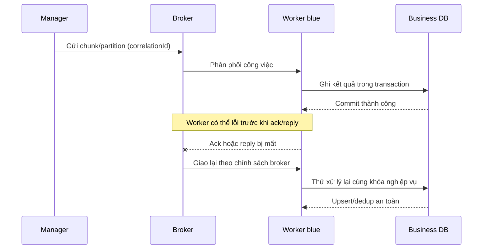
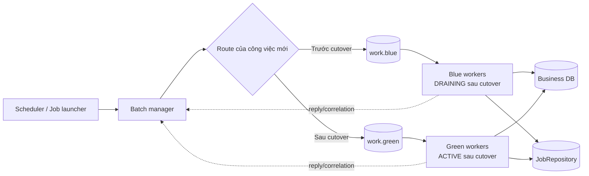

# Blue-green cho batch worker

> **Chương:** Triển khai  
> **Phạm vi:** Spring Batch Scaling Operations — mở rộng xử lý dữ liệu lớn bằng multi-threaded step, parallel steps, partitioning, remote chunking và mô hình phân tán; chú trọng thread safety, khả năng retry/restart, đo nút thắt và vận hành an toàn.

## Mục tiêu học tập

Sau bài này, bạn có thể:

1. Giải thích **blue-green deployment** giải quyết vấn đề gì khi triển khai *batch worker*, và vì sao chuyển đổi worker phức tạp hơn chuyển đổi HTTP server.
2. Phân biệt cách cắt chuyển cho job đơn tiến trình, multi-threaded step, remote chunking và remote partitioning.
3. Thiết kế quy trình **đưa bản green lên → ngừng nhận việc mới ở blue → xử lý nốt việc đang chạy → chuyển luồng việc → quan sát → thu hồi blue**.
4. Xác định điều kiện bảo toàn `JobRepository`, `ExecutionContext`, transaction, message acknowledgment, retry/restart và tính idempotent.
5. Xây dựng tiêu chí go/no-go và rollback dựa trên dữ liệu vận hành, thay vì chỉ dựa vào trạng thái pod `Ready`.

## 1. Blue-green có nghĩa gì đối với batch worker?

Blue-green là cách duy trì đồng thời **hai bản triển khai** của một thành phần:

- **Blue:** phiên bản đang phục vụ workload sản xuất.
- **Green:** phiên bản mới đã triển khai, được kiểm tra và sẵn sàng tiếp quản.

Khi green đủ điều kiện, hệ thống chuyển việc mới sang green. Blue được giữ lại trong một khoảng thời gian để hoàn tất việc đang xử lý hoặc phục vụ rollback. Mục tiêu là hạn chế gián đoạn, làm rõ ranh giới phiên bản và giảm thời gian phục hồi khi phát hiện lỗi.

Với web server, ranh giới thường là HTTP request. Với batch, một đơn vị công việc có thể tồn tại từ vài giây đến nhiều giờ và trải qua **chunk transaction, checkpoint, partition, message, job execution**. Một pod khỏe mạnh không bảo đảm rằng công việc cũ đã hoàn tất, cũng không bảo đảm mọi record đã được ghi đúng một lần.

Ví dụ: job nhập 20 triệu giao dịch chia thành 80 partition. Blue đang xử lý 15 partition và có một partition vừa ghi dữ liệu nghiệp vụ nhưng chưa gửi được thông báo hoàn thành. Nếu triển khai green rồi xóa ngay blue, partition đó có thể bị chạy lại. Khi writer không idempotent, hệ thống có nguy cơ sinh bản ghi trùng, dù green chạy bình thường.

**Quy tắc trọng tâm:** chuyển phiên bản nhận **việc mới** và xử lý **việc đang chạy** là hai quyết định khác nhau.

### Các thành phần cần phân biệt

| Thành phần | Trách nhiệm | Điều cần bảo toàn khi triển khai |
|---|---|---|
| **Job launcher / scheduler** | Khởi chạy `Job` với `JobParameters` | Không khởi chạy nhầm job trùng hoặc bỏ lỡ lịch |
| **Manager** (khi xử lý phân tán) | Phân công partition hoặc gửi chunk request | Routing, correlation, trạng thái phân công và phản hồi |
| **Worker** | Nhận và thực thi một đơn vị xử lý | In-flight work, acknowledgment, transaction và khả năng retry |
| **JobRepository** | Lưu `JobInstance`, `JobExecution`, `StepExecution`, `ExecutionContext` | Tính nhất quán, khả năng tương thích schema và restart |
| **Broker / queue** (nếu có) | Chuyển request và reply | Độ bền message, consumer ownership, redelivery và ordering cần thiết |
| **Kho dữ liệu nghiệp vụ** | Chứa kết quả của reader/processor/writer | Ràng buộc duy nhất, idempotency và tính toàn vẹn |

Không đồng nhất màu triển khai với trạng thái Spring Batch: blue/green là **phiên bản ứng dụng**; `STARTED`, `COMPLETED`, `FAILED`, `STOPPED` là **trạng thái thực thi** trong metadata.

## 2. Phân loại workload trước khi chọn phương án cắt chuyển

Tên gọi “batch worker” có thể chỉ những tiến trình rất khác nhau. Cách triển khai an toàn phụ thuộc vào **ai giữ trạng thái** và **ai gửi việc**.

| Mô hình Spring Batch | Vị trí xử lý | Điểm cắt chuyển an toàn được ưu tiên | Rủi ro điển hình |
|---|---|---|---|
| Job một tiến trình | Reader/processor/writer trong cùng process | Giữa **hai JobExecution**; để job blue hoàn tất rồi chuyển lần chạy kế tiếp sang green | Hủy process giữa chunk, checkpoint chưa được lưu |
| Multi-threaded step | Nhiều luồng trong một process | Sau khi step/job blue kết thúc hoặc dừng có kiểm soát | Reader/writer không thread-safe, transaction ở các thread khác nhau |
| Parallel steps | Nhiều step đồng thời trong một job | Sau khi các step đang chạy đạt trạng thái cuối hợp lệ | Một nhánh hoàn tất trong khi nhánh khác còn chạy |
| **Remote chunking** | Manager đọc dữ liệu, gửi chunk đến worker xử lý/ghi | Ngừng manager gửi chunk mới cho blue; drain tất cả chunk và reply còn treo, sau đó route sang green | Message redelivery, mất reply, ghi trùng |
| **Remote partitioning** | Manager chia partition; worker thực thi step của từng partition | Gắn phiên bản worker theo **lứa partition / JobExecution**; hoàn tất partition cũ trước khi điều hướng mới | Partition được chạy lại, metadata/correlation lệch phiên bản |

Với remote chunking hoặc remote partitioning, khả năng scale ngang không tự cung cấp **quy tắc định tuyến theo phiên bản**. Phải thiết kế routing và cơ chế drain ở tầng manager, listener hoặc hạ tầng messaging.

### Trường hợp nên ưu tiên chuyển giữa hai lần chạy job

Nếu job ngắn, có lịch rõ ràng và không cần chuyển khi đang chạy, đây thường là cách đơn giản nhất: blue kết thúc `JobExecution` hiện tại, scheduler chuyển sang green cho **lần khởi chạy tiếp theo**. Lúc này không cần trộn worker khác phiên bản trong cùng một job.

Nếu job kéo dài hàng giờ và SLA buộc phải triển khai giữa đợt xử lý, cần bổ sung cơ chế drain, affinity theo job/partition, retry và xử lý message còn treo. Blue-green khi đó là một **giao thức vận hành**, không chỉ là thay `image tag`.

## 3. Những bất biến bắt buộc giữ đúng

Một thiết kế khả thi nên chứng minh được các bất biến dưới đây.

**Bất biến 1 — Một đơn vị công việc có thể được nhận lại nhưng không được làm sai dữ liệu.** Broker thường có cơ chế giao lại khi worker lỗi hoặc chưa xác nhận message. Tính đúng đắn cần dựa vào idempotent writer, unique constraint, upsert hoặc bảng dedup có transaction phù hợp; không dựa vào lời hứa “message được gửi đúng một lần”.

**Bất biến 2 — Checkpoint và kết quả nghiệp vụ phải có quan hệ rõ ràng.** Spring Batch lưu trạng thái vào `JobRepository`, còn kết quả có thể nằm ở một database hay dịch vụ khác. Nếu hai thao tác không thuộc cùng transaction, phải xác định hậu quả khi một bên commit còn bên kia thất bại. Có thể dùng outbox/inbox, khóa định danh nghiệp vụ và quy trình reconciliation.

**Bất biến 3 — Không chạy hai bộ phát việc độc lập cho cùng logic job một cách vô ý.** Một `JobInstance` được định danh bằng `jobName` cộng các `JobParameters` được đánh dấu *identifying*. Không tùy tiện thêm `run.id` hoặc đổi parameter chỉ để vượt qua lỗi trùng job; như vậy có thể vô tình tạo instance mới và xử lý lại toàn bộ dữ liệu.

**Bất biến 4 — Mỗi request/reply phải được liên kết đúng execution.** Giữ được `jobExecutionId`, `stepExecutionId`, partition name, correlation ID và phiên bản giao thức. Trong remote partitioning, worker phải cập nhật đúng step execution đã được manager phân phối.

**Bất biến 5 — Green phải hiểu dữ liệu và message có thể còn lại từ blue.** Thay đổi schema, serializer, kiểu dữ liệu trong `ExecutionContext`, tên `Step`, cấu trúc dữ liệu partition hoặc tên queue đều có thể làm restart lỗi. Hai phiên bản phải tương thích trong suốt thời gian tồn tại song song, hoặc phải cách ly workload theo phiên bản.

**Bất biến 6 — Có bằng chứng blue đã hết việc trước khi thu hồi.** `Ready=false` hay `replicas=0` đơn lẻ không đủ. Cần biết listener đã ngừng lấy message mới, in-flight count đã về 0, transaction đã kết thúc, trạng thái partition/reply đã được ghi nhận và không còn message chưa phân loại.

### Ranh giới transaction khi có broker



Sơ đồ cho thấy *kết quả đã commit* không đồng nghĩa *broker đã nhận ack/reply*. Không thể suy ra exactly-once chỉ từ Spring Batch hoặc từ một lượt triển khai blue-green. Cần đặt idempotency tại nơi ghi kết quả và đối soát thực tế.

## 4. Hai kiến trúc chuyển luồng thường dùng

### Phương án A — Queue hoặc route riêng cho từng màu



Manager chỉ gửi **work item mới** vào route đã chọn; blue vẫn được giữ để hoàn thành queue cũ. Phải tính cả **reply route**: manager đang chạy phải nhận được phản hồi từ cả hai phiên bản trong giai đoạn drain. Tên queue trong sơ đồ là ví dụ, không phải tên queue mặc định do Spring Batch tự tạo.

Ưu điểm là có ranh giới rõ ràng, thuận tiện đo queue depth và rollback đối với work item chưa bắt đầu. Đổi lại, ứng dụng cần triển khai cấu hình routing, quy tắc ownership và giám sát hai queue.

### Phương án B — Chung queue, bật/tắt việc nhận mới tại consumer

Các worker cùng nghe `work.requests`, nhưng bản blue phải **ngừng poll/listen** và xử lý hết in-flight trước khi green nhận. Trình tự chuyển quyền phải được điều phối; nếu chạy hai version đồng thời trên cùng queue, broker có thể phân phối ngẫu nhiên message cho cả hai version.

Phương án này chỉ hợp lý khi giao thức và dữ liệu **tương thích xuyên phiên bản** hoặc khi cơ chế consumer ownership được kiểm soát chặt. Một số broker hoặc listener container có chức năng `pause`/stop, nhưng cách dừng và xử lý message đã prefetch khác nhau theo adapter. Cần kiểm tra hành vi thực của broker đang dùng.

**Lưu ý với Kubernetes:** đổi selector của `Service` chỉ thay đổi lưu lượng đi qua Service. Nó **không tự dừng một RabbitMQ/Kafka consumer** đang kết nối trực tiếp tới broker. Với worker kiểu kéo message, phải ngắt listener hoặc chuyển subscription/queue bằng chính cơ chế ứng dụng/broker.

## 5. Kiểm tra tính tương thích trước khi tạo green

Không nên đưa green nhận production work nếu chưa trả lời được những câu hỏi sau.

| Vùng kiểm tra | Câu hỏi cần chứng minh | Biện pháp điển hình |
|---|---|---|
| **JobRepository** | Blue và green có đọc/ghi được schema metadata hiện có không? | Migration dạng expand → dùng song song → contract sau |
| **Job/step identity** | Tên job, tên step và identifying parameters có thay đổi không? | Giữ ổn định định danh trong cùng vòng đời restart |
| **ExecutionContext** | Dữ liệu checkpoint serialize từ blue có được green đọc khi restart không? | Định dạng ổn định, migration hoặc giữ restart trên blue |
| **Message contract** | Message/reply có đổi field, serializer, content type không? | Version hóa payload, giữ backward compatibility hoặc route riêng |
| **Business schema** | Green ghi dữ liệu có làm blue rollback/retry thất bại không? | Dual-compatible DB schema, tránh xóa cột quá sớm |
| **Writer semantics** | Khi redelivery, writer có cập nhật trùng bản ghi không? | Business key, unique constraint, upsert, dedup |
| **Hạ tầng** | Đủ CPU, memory, connection pool, broker consumers cho hai màu không? | Capacity planning theo số worker/partition thực tế |
| **Security** | Green có đúng secret, network policy, quyền DB/broker không? | Startup, connection và permission smoke test |
| **Observability** | Có lọc được log/metric theo `release`, `job`, `step` không? | Nhãn `release=blue/green`, correlation ID |

Nếu green làm đổi `ItemReader` hoặc `ItemProcessor` theo cách thay đổi ý nghĩa dữ liệu, **không nên chạy lẫn hai phiên bản trong cùng một JobExecution**. Giữ blue xử lý xong execution cũ và cấp một cohort dữ liệu độc lập cho green.

### Contract tối thiểu của một work item

Ví dụ payload minh họa cho **remote partitioning**; field thực tế phụ thuộc message converter và cách tích hợp mà dự án chọn:

```json
{
  "protocolVersion": 2,
  "releaseRoute": "green",
  "jobExecutionId": 8204,
  "stepExecutionId": 10591,
  "partitionName": "partition-17",
  "correlationId": "job-8204-partition-17-attempt-1",
  "attempt": 1,
  "businessIdempotencyKey": "settlement:2026-11-26:segment-17"
}
```

Không nên dùng mỗi `releaseRoute` làm khóa chống trùng: chạy lại cùng partition trên phiên bản khác vẫn là **cùng đơn vị nghiệp vụ**. Khóa idempotency phải gắn với dữ liệu hoặc operation được phép thực thi một lần về mặt logic.

## 6. Runbook blue-green an toàn

### Pha 0 — Chọn ranh giới cutover

Xác định trước điểm mà hệ thống sẽ **ngừng giao việc mới** cho blue:

- Theo **JobExecution** (an toàn và dễ giải thích nhất cho scheduled job).
- Theo **nhóm partition** có version affinity (khi manager kiểm soát được route).
- Theo **chunk dispatch boundary**, chỉ khi manager và hai nhóm worker cùng hiểu protocol và kiểm soát được reply.

Đặt tiêu chí hoàn thành rõ ràng: số work item đã dispatch, đã ack, đã reply, đã commit và đang in-flight phải được đối chiếu; không chỉ nhìn queue depth.

### Pha 1 — Preflight và triển khai green ở chế độ chưa nhận production work

1. Ghi lại release ID, job đang chạy, `JobExecution`/`StepExecution` hoạt động, độ sâu queue, consumer count và throughput hiện tại.
2. Xác nhận schema/database/message contract tương thích, cấu hình retry/skip, resource limits, thread pool, `gridSize`, JDBC connection pool và broker prefetch.
3. Deploy green với queue/route riêng hoặc listener **disabled**. Với worker không nghe request HTTP, health probe chỉ xác nhận ứng dụng khỏe, không chứng minh đã được phép tiêu thụ message.
4. Smoke test bằng workload nhỏ **cách ly với production**: một execution giả lập, message có correlation ID, ghi/rollback/retry, đo kết quả business.
5. Xác nhận green không tự chạy `Job` khi khởi động nếu vai trò của nó chỉ là remote worker. Nếu dùng Spring Boot tự động launch jobs, cấu hình rõ `spring.batch.job.enabled=false` ở worker và để scheduler/manager sở hữu việc khởi chạy.

### Pha 2 — Quiesce blue

“Quiesce” nghĩa là ngừng nhận công việc mới mà **không ngắt vô điều kiện công việc đang chạy**.

Với route riêng, manager thay `activeRoute=blue` thành `green` **tại ranh giới đã xác định**; giữ consumer blue tiếp tục xử lý queue blue đến khi hết. Với queue chung, tạm ngừng cấp mới cho blue qua cơ chế stop/pause listener được thiết kế và kiểm tra trước; không đổi queue chung giữa hai version nếu payload không tương thích.

Đối với job đơn tiến trình hoặc multi-threaded, vô hiệu hóa lịch chạy mới ở blue, để `JobExecution` hiện tại hoàn thành. Nếu buộc phải dừng giữa chừng, sử dụng khả năng stop/restart có kiểm soát của Spring Batch và chỉ coi là an toàn khi reader/writer/checkpoint hỗ trợ restart chính xác. Không xem SIGTERM là một thao tác rollback dữ liệu.

### Pha 3 — Drain in-flight

Đợi công việc blue đã nhận hoàn tất:

- Không còn chunk/partition đang `STARTED` mà không có lý do hợp lệ.
- Các transaction ghi dữ liệu đã commit/rollback; ack/reply tương ứng đã được xử lý.
- Các message unacked, pending reply và dead-letter đã được phân loại.
- `JobRepository` phản ánh trạng thái StepExecution/JobExecution phù hợp.

Với **remote partitioning**, kiểm tra trạng thái từng partition, kể cả partition lỗi cần retry. Với **remote chunking**, kiểm tra cả request lẫn reply, vì worker có thể ghi thành công trước khi manager nhận reply.

Khi hết thời hạn drain, **không được suy luận “hết timeout là thành công”**. Ghi nhận execution/message chưa xong, quyết định giữ blue lâu hơn, fail deployment hoặc khởi động quy trình retry/reconciliation đã kiểm thử.

### Pha 4 — Kích hoạt green có kiểm soát

Chuyển manager/scheduler hoặc queue routing sang green, rồi cho green bắt đầu nhận cohort mới. Có thể tăng từ một ít worker lên số replica mục tiêu nếu cơ chế phân phối workload cho phép; đo throughput, lỗi và data consistency trước khi tăng tải.

Trong môi trường remote partitioning, **manager và worker phải đồng ý** về step name, partition payload, repository và reply channel. Không chỉ thay container image của worker rồi giả định manager cũ luôn tương thích.

### Pha 5 — Xác nhận dữ liệu và thu hồi blue

Quan sát ít nhất một chu kỳ workload đại diện. Đối chiếu input count, output count, skip/retry count, kết quả business, số partition completed/failed và backlog broker. Sau đó mới scale blue về 0 hoặc gỡ release blue khi không còn execution cần phiên bản đó để restart.

Lưu lịch sử release → `JobExecution` → partition/chunk route để phân tích sự cố. Nếu cần thời gian rollback dài, tiếp tục giữ image/config blue và schema tương thích với blue.

## 7. Cấu hình triển khai minh họa trên Kubernetes

Ví dụ sau sử dụng **hai Deployment và hai queue logic** cho remote worker. `BATCH_WORK_QUEUE` là biến cấu hình **do ứng dụng tự định nghĩa và ánh xạ vào listener**; Spring Batch không tự cung cấp tên property này.

```yaml
apiVersion: apps/v1
kind: Deployment
metadata:
  name: settlement-worker-blue
spec:
  replicas: 3
  selector:
    matchLabels: {app: settlement-worker, release: blue}
  template:
    metadata:
      labels: {app: settlement-worker, release: blue}
    spec:
      terminationGracePeriodSeconds: 300
      containers:
        - name: worker
          image: registry.example/settlement-worker:1.4.2
          env:
            - name: SPRING_BATCH_JOB_ENABLED
              value: "false"
            - name: BATCH_WORK_QUEUE
              value: settlement.work.blue
            - name: RELEASE_ID
              value: blue
          resources:
            requests: {cpu: "500m", memory: "768Mi"}
            limits: {memory: "1536Mi"}
---
apiVersion: apps/v1
kind: Deployment
metadata:
  name: settlement-worker-green
spec:
  replicas: 3
  selector:
    matchLabels: {app: settlement-worker, release: green}
  template:
    metadata:
      labels: {app: settlement-worker, release: green}
    spec:
      terminationGracePeriodSeconds: 300
      containers:
        - name: worker
          image: registry.example/settlement-worker:1.5.0
          env:
            - name: SPRING_BATCH_JOB_ENABLED
              value: "false"
            - name: BATCH_WORK_QUEUE
              value: settlement.work.green
            - name: RELEASE_ID
              value: green
          resources:
            requests: {cpu: "500m", memory: "768Mi"}
            limits: {memory: "1536Mi"}
```

Trong ví dụ, green có thể khởi chạy và kiểm tra kết nối mà không nhận production work, **nếu manager vẫn chỉ dispatch vào `settlement.work.blue`**. Khi cutover, manager ngừng phát lệnh mới vào blue và định tuyến lệnh mới vào green; blue vẫn được giữ sống để drain. Để cấu hình có tác dụng, cần tự viết/định cấu hình consumer tương ứng và triển khai chuyển route một cách nhất quán.

**Không sao chép nguyên các con số** `replicas=3`, `terminationGracePeriodSeconds=300`, CPU/memory vào production mà chưa đo. Thời gian xử lý partition dài hơn 300 giây có thể khiến Kubernetes cưỡng bức dừng container; lúc đó cơ chế retry/restart phải tiếp nhận phần việc chưa hoàn tất.

### Ví dụ routing logic ở manager

Đây là **pseudocode**, không phải API Spring Batch có sẵn:

```java
void dispatch(WorkItem item) {
    // Chốt route tại thời điểm phân công work item.
    // Với JobExecution cần version affinity, lấy route đã gắn cho execution.
    String route = executionRouteStore.routeOf(item.jobExecutionId());
    String destination = switch (route) {
        case "blue" -> "settlement.work.blue";
        case "green" -> "settlement.work.green";
        default -> throw new IllegalStateException("Unknown route: " + route);
    };
    brokerPublisher.send(destination, item);
}
```

`executionRouteStore` phải có tính bền vững và chính sách chuyển đổi rõ ràng. Nếu cho phép dispatch route thay đổi giữa các chunk của một `JobExecution`, phải chứng minh được cả hai worker tương thích về business logic, checkpoint và reply. Nếu không, **khóa route theo JobExecution** là lựa chọn dễ kiểm soát hơn.

### Graceful shutdown cần sự phối hợp của ứng dụng

Khi nhận tín hiệu dừng, listener phải ngừng nhận message mới, xử lý và xác nhận những message in-flight theo chính sách broker, rồi mới thoát. Nếu một message không thể hoàn tất trước grace period, nó có thể được giao lại; writer phải chịu được redelivery.

`preStop`, readiness probe, `terminationGracePeriodSeconds` và Spring context shutdown giúp vận hành có trật tự, nhưng **không thay thế** quy trình drain và đối soát. Với Kafka cần hiểu consumer group, rebalance, offset commit; với RabbitMQ cần hiểu manual ack, prefetch và requeue. Không mặc định hai broker có cùng ngữ nghĩa.

## 8. Retry, restart và rollback trong Spring Batch

### Retry tại worker khác với restart toàn Job

- **Retry:** thử lại thao tác thất bại theo chính sách, ví dụ lỗi mạng tạm thời trong một partition hoặc chunk. Phải tránh retry vô hạn với lỗi dữ liệu không thể phục hồi.
- **Restart:** tiếp tục xử lý một `JobInstance` thất bại/đã dừng từ checkpoint hợp lệ bằng một `JobExecution` mới. Job/step phải được thiết kế restartable và metadata còn đầy đủ.
- **Redelivery:** broker gửi lại message chưa được ack; đây không mặc nhiên là Spring Batch restart và có thể xảy ra sau khi business transaction đã commit.
- **Rollback triển khai:** ngừng nhận việc mới ở green rồi quay route sang blue. Thao tác này **không tự hoàn tác** dữ liệu green đã ghi và cũng không phục hồi memory state từ pod đã chết.

Các thao tác Spring Batch như `JobOperator.stop(...)` và `JobOperator.restart(...)` phải được dùng theo trạng thái thực tế và cấu hình job; lệnh stop có thể là bất đồng bộ, không nên coi việc gửi lệnh là bằng chứng job đã `STOPPED`.

### Bốn tình huống cần thiết kế từ trước

| Tình huống | Rủi ro | Cách xử lý |
|---|---|---|
| Blue chết **trước** khi business transaction commit | Work item còn dang dở | Rollback transaction, redelivery hoặc restart từ checkpoint |
| Blue commit DB nhưng chết **trước** ack/reply | Ghi dữ liệu lần thứ hai | Writer idempotent và đối soát message |
| Green ghi theo schema mới, sau đó phải rollback về blue | Blue không đọc/ghi được schema mới | Expand/contract migration, kiểm thử tương thích hai chiều |
| Job green bị lỗi một nửa | Partition hoàn thành xen kẽ partition thất bại | Kiểm tra StepExecution, chỉ restart phần có thể chạy lại; không đổi job parameters tùy tiện |

Một phần rollback có thể đòi hỏi **roll-forward** hoặc hotfix green nếu dữ liệu đã được green biến đổi theo cách blue không hiểu. Vì thế, “rollback trong một cú click” chỉ đúng khi đã chứng minh được khả năng tương thích cả code, database và metadata.

### Ví dụ idempotent writer

Giả sử partition xử lý giao dịch đã có `transaction_id` duy nhất. Một phương án ghi kết quả trong PostgreSQL:

```sql
CREATE TABLE settlement_result (
    transaction_id VARCHAR(64) PRIMARY KEY,
    amount NUMERIC(18, 2) NOT NULL,
    processed_at TIMESTAMPTZ NOT NULL
);

INSERT INTO settlement_result (transaction_id, amount, processed_at)
VALUES (:transaction_id, :amount, CURRENT_TIMESTAMP)
ON CONFLICT (transaction_id)
DO UPDATE SET amount = EXCLUDED.amount;
```

Với nghiệp vụ cho phép cập nhật cùng transaction ID như trên, redelivery không tạo thêm dòng. Tuy nhiên, `DO UPDATE` **không tự bảo đảm** side effect gửi email, gọi API hay chuyển tiền không lặp lại; các side effect đó cần idempotency key riêng, outbox hoặc cơ chế dedup phía nhận. Cũng phải xác định liệu cập nhật amount có hợp lệ về mặt nghiệp vụ; nếu không, dùng điều kiện bất biến hoặc báo lỗi xung đột.

## 9. Đo và quyết định go/no-go bằng số liệu

Blue-green nên đi cùng **baseline trước cutover** và so sánh **sau cutover** trên workload tương đương. Thời gian chạy job dài/ngắn chịu ảnh hưởng của số record, độ lệch kích thước partition, I/O, contention và tài nguyên DB; so sánh đơn thuần “job hôm qua vs hôm nay” có thể gây hiểu nhầm.

| Chỉ báo | Nơi lấy dữ liệu | Tín hiệu cần chú ý |
|---|---|---|
| `JobExecution`/ `StepExecution` theo status | Spring Batch metadata | Số execution `STARTED` bất thường sau drain, tăng `FAILED` |
| Read/write/filter/skip/retry counts | Batch metrics/metadata | Chênh lệch record, tăng retry/skip so với baseline |
| In-flight requests, pending replies | Manager/worker instrumentation | Không về 0 ở blue; reply không khớp correlation |
| Queue lag, unacked, DLQ | Broker metrics | Backlog tăng dù consumer green đang chạy |
| Throughput records/s và p95 chunk/partition latency | App metrics/tracing | Green xử lý chậm, partition skew |
| CPU, heap, GC, thread pool, JDBC pool | Runtime/Kubernetes/DB | Saturation, wait time tăng, số connection vượt ngưỡng |
| Duplicate key, reconciliation mismatch | Business DB/đối soát | Output trùng/mất hoặc sai tổng tiền, tổng record |
| Version/release của execution | Log/metric có nhãn release | Khó xác định job nào thuộc blue/green |

Ví dụ ngưỡng **minh họa**, cần thay bằng SLO đã đo của hệ thống: không tăng `FAILED` và DLQ, tổng tiền đầu ra khớp đầu vào, blue in-flight về 0, throughput green đạt ít nhất 90% baseline trên cùng dataset class, và p95 partition latency không vượt 1,5 lần baseline trong cửa sổ quan sát quy định.

### Công thức đối soát cơ bản

Tùy nghiệp vụ, có thể kiểm tra:

```text
Số item đầu vào đủ điều kiện
  = số item đã ghi thành công
  + số item bị filter hợp lệ
  + số item bị skip được phê duyệt

Tổng tiền nguồn theo kỳ xử lý
  = tổng tiền kết quả theo cùng khóa/kỳ
```

Các công thức chỉ đúng khi định nghĩa rõ record có thể fan-out/fan-in, business rule lọc và quan hệ một-nhiều. Với remote partitioning, còn cần kiểm tra **phủ đủ dải partition**, không có overlap hoặc khoảng trống ngoài thiết kế.

## 10. Ví dụ thực tế: chuyển worker xử lý settlement

Hệ thống xử lý dữ liệu settlement mỗi đêm, khoảng **12 triệu giao dịch**, dùng remote partitioning với 64 partition. Blue `v1.4` đang xử lý ngày D; green `v1.5` bổ sung bộ quy tắc kiểm tra dữ liệu và metric.

### Quyết định kiến trúc

1. **Giữ toàn bộ 64 partition của execution ngày D ở blue.** Các partition đã khởi chạy có thể cần restart bằng cùng semantics và `ExecutionContext`.
2. **Deploy green song song** nhưng chỉ smoke test trên dữ liệu biệt lập; green không nhận partition ngày D.
3. Manager chuyển phiên bản mặc định cho **JobExecution ngày D+1** sau khi xác minh blue đã kết thúc, hoặc chỉ khi có tuyến dữ liệu độc lập và business rule cho phép xử lý song song.
4. Các execution được ghi nhãn `release` để dễ truy vết. Nếu ngày D thất bại và phải restart, tiếp tục route sang blue hoặc dùng quy trình migrate đã kiểm chứng.
5. Sau khi kết quả ngày D+1 ở green được đối soát (count, tổng tiền, skip/retry, latency), giữ hoặc thu hồi blue theo nhu cầu restart/rollback.

Ví dụ này ưu tiên **affinity theo JobExecution** vì an toàn hơn việc phát 32 partition sang blue và 32 partition sang green trong cùng một execution. Hai phiên bản chỉ nên phối hợp trong cùng execution nếu thực sự cần và đã chứng minh giao thức cùng logic dữ liệu tương thích.

### Khi có lỗi lúc cutover

Giả sử green đột ngột gây `DuplicateKeyException` cho 5 partition. Không cần xóa metadata, tạo `run.id` mới hay khởi chạy lại toàn bộ 12 triệu dòng. Đầu tiên ngừng dispatch partition mới tới green, kiểm tra uniqueness/retry và trạng thái của 5 `StepExecution`, rồi quyết định restart cùng JobInstance hoặc sửa lỗi và tiếp tục theo cơ chế đã thiết kế. Nếu cần rollback app, phải chắc chắn blue đọc được schema và checkpoint do green để lại.

## 11. Những lỗi triển khai thường gặp

| Cách làm sai | Vì sao nguy hiểm | Cách sửa |
|---|---|---|
| Đổi Kubernetes Service selector và tin rằng consumer đã chuyển | Consumer chủ động kéo từ broker, không phụ thuộc HTTP Service | Điều phối listener/queue/route |
| Scale blue về 0 ngay sau khi green Ready | Blue có thể còn transaction và message in-flight | Quiesce, drain, kiểm chứng rồi mới scale |
| Cả hai scheduler cùng chạy job theo lịch | Có thể chạy trùng hoặc tranh chấp tài nguyên dù metadata chặn một số trường hợp | Chỉ định một chủ sở hữu lịch và cơ chế leader/fencing phù hợp |
| Đổi tên step/partition trong bản green không kiểm tra restart | Metadata cũ không còn khớp execution mới | Giữ identity ổn định hoặc thiết kế migration |
| Dùng job parameter mới để chạy lại lỗi | Tạo JobInstance khác và có thể xử lý trùng | Restart cùng instance theo cơ chế Batch |
| Tin queue depth = 0 nghĩa là hết việc | Message có thể unacked, đang xử lý hoặc chờ reply | Quan sát in-flight, pending reply, status |
| Bỏ qua schema DB sau khi deploy green | Blue không còn tương thích khi rollback | Expand/contract và kiểm tra backward compatibility |
| Tăng replicas mà không đo database/broker | Hết connection, lock contention, tăng retry | Tune dựa trên throughput, pool và partition skew |
| Chỉ kiểm tra thành công về mặt hệ thống | Dữ liệu vẫn có thể thiếu/trùng | Business reconciliation, unique key và báo cáo chênh lệch |

## 12. Checklist thực thi

Trước khi cấp quyền cho green nhận dữ liệu thật, hãy xác nhận:

- [ ] Đã xác định loại workload, ranh giới cutover và ownership của scheduler/manager.
- [ ] Đã đo baseline: throughput, latency, retry/skip, in-flight, queue depth và tài nguyên.
- [ ] Green tương thích với JobRepository, ExecutionContext, message contract và business DB trong khoảng chạy song song.
- [ ] Có cách ngừng **nhận việc mới** ở blue và vẫn hoàn thành **việc đang chạy**.
- [ ] Có cơ chế idempotency, redelivery handling và reconciliation.
- [ ] Có version affinity nếu một JobExecution không được trộn logic giữa hai release.
- [ ] Đã thử restart của job/partition và hành vi khi worker chết sau commit nhưng trước ack.
- [ ] Có metric/log theo `release`, `jobExecutionId`, `stepExecutionId`, correlation ID.
- [ ] Đã xác định giới hạn drain, ngưỡng go/no-go và phương án khi hết drain timeout.
- [ ] Đã thử rollback với schema mới, cả khi green đã xử lý được một phần dữ liệu.
- [ ] Chỉ thu hồi blue sau khi in-flight, reply và trạng thái execution đã đối soát.

## 13. Câu hỏi tự kiểm tra

**Câu 1.** Green đã `Ready`, queue blue có depth bằng 0. Có thể xóa blue ngay không?

**Gợi ý:** Chưa đủ bằng chứng. Có thể vẫn còn message unacked, prefetch, chunk đang xử lý, reply đang bay hoặc step execution chưa kết thúc. Cần đối chiếu broker, worker, manager và JobRepository.

**Câu 2.** Hai version có thể cùng tiêu thụ từ một queue được không?

**Gợi ý:** Về kỹ thuật có thể, nhưng chỉ an toàn khi protocol, serializer, business semantics và checkpoint tương thích; khi không tương thích cần route riêng và quy tắc ownership.

**Câu 3.** Sau khi worker commit business DB, kết nối broker rơi trước ack. Bản green nhận lại message cần làm gì?

**Gợi ý:** Dùng cùng business idempotency key để phát hiện/ghi lại an toàn, gửi ack/reply theo cơ chế phù hợp, đối soát transaction và metadata; không giả định “chưa ack” đồng nghĩa “chưa ghi”.

**Câu 4.** Rollback blue có đồng nghĩa đảo ngược những dòng green đã ghi?

**Gợi ý:** Không. Rollback triển khai đổi phiên bản thực thi cho công việc tiếp theo. Hoàn nguyên dữ liệu là một bài toán nghiệp vụ và transaction riêng.

## Tóm tắt kiến thức

Blue-green cho Spring Batch worker chỉ đáng tin cậy khi hệ thống kiểm soát được **dispatch mới, công việc in-flight, checkpoint, retry/redelivery và độ tương thích dữ liệu**. Đối với job có state, phương án mặc định dễ kiểm chứng nhất là giữ worker theo phiên bản trong suốt một `JobExecution`, chuyển execution kế tiếp sang green, và chỉ thu hồi blue sau khi đã đối soát cả trạng thái Batch lẫn kết quả nghiệp vụ. Khi buộc phải chuyển giữa execution, cần thiết kế thêm routing, drain, idempotency và rollback cho từng kiểu remote chunking hoặc remote partitioning.
