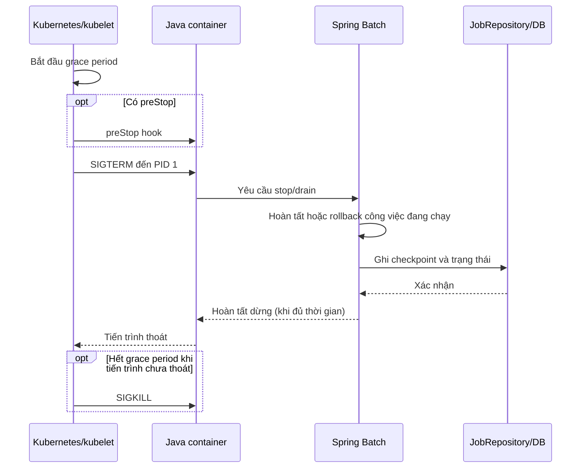
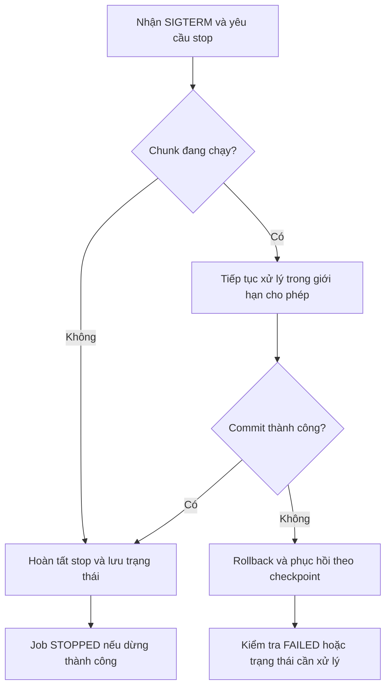

# Shutdown graceful trong container khi triển khai Spring Batch

Một Spring Batch Job có thể chạy hàng phút hoặc hàng giờ để xử lý hàng triệu bản ghi. Nếu container bị dừng đúng lúc đang ghi dữ liệu, việc khởi động lại không chỉ là vấn đề chạy lại ứng dụng: hệ thống phải xác định chunk nào đã commit, trạng thái nào đã lưu trong `JobRepository` và liệu tác vụ mới có ghi trùng hay bỏ sót dữ liệu không. Bởi vậy, **graceful shutdown** là một phần của thiết kế xử lý dữ liệu an toàn, đặc biệt khi mở rộng bằng multi-threaded steps, parallel steps, partitioning và worker phân tán.

Trong module **SPRING_BATCH_SCALING_OPERATIONS**, thuộc chương **Triển khai**, bài học này hướng dẫn cách phối hợp vòng đời container với cơ chế stop/restart của Spring Batch, lựa chọn thời gian chờ hợp lý và kiểm tra khả năng phục hồi bằng tình huống thực tế.

## 1. Graceful shutdown có nghĩa là gì?

Graceful shutdown là quá trình nhận tín hiệu dừng, **ngừng nhận thêm công việc**, cho các công việc đang xử lý hoàn tất tại điểm an toàn, lưu trạng thái cần thiết và thoát tiến trình trong khoảng thời gian cho phép.

Với Spring Batch, một lần dừng an toàn thường cần:

1. Dừng nhận thêm partition, chunk hoặc message mới từ nguồn công việc.
2. Yêu cầu những `JobExecution`/`StepExecution` đang chạy chuyển sang trạng thái dừng theo cơ chế của Spring Batch.
3. Để transaction đang thực hiện hoàn tất hoặc rollback đúng cách; ghi nhận checkpoint cho dữ liệu đã commit.
4. Quan sát trạng thái cuối trong `JobRepository`, log và metrics.
5. Đóng tài nguyên trước khi container hết thời gian chờ; nếu cần tiếp tục, restart có kiểm soát dựa trên metadata bền vững.

**Không đồng nhất graceful shutdown với `Thread.interrupt()` hay việc đóng JVM.** Tín hiệu dừng tiến trình là khởi đầu của quy trình, còn kết quả an toàn phụ thuộc vào logic Spring Batch, transaction, reader/writer và tài nguyên bên ngoài.

| Kịch bản | Hệ quả thường gặp | Có bảo đảm graceful không? |
|---|---|---|
| Kubernetes gửi `SIGTERM` và cho thời gian chờ | Ứng dụng có cơ hội dừng có kiểm soát | Có thể, nếu ứng dụng xử lý shutdown và còn đủ thời gian |
| Người vận hành yêu cầu `JobOperator.stop(executionId)` | Spring Batch nhận yêu cầu stop; Job dừng ở điểm phù hợp | Có thể, nếu logic Step/Tasklet phản hồi yêu cầu |
| Container bị `SIGKILL` sau khi hết grace period | Tiến trình bị kết thúc lập tức | Không |
| Container bị OOMKilled | Tiến trình có thể bị kết thúc mà không chạy callback shutdown | Không |
| Node mất nguồn hoặc runtime gặp lỗi nặng | Tiến trình ngừng đột ngột | Không |
| Job đã chạy xong bình thường | Job kết thúc với trạng thái hoàn tất theo logic nghiệp vụ | Không phải tình huống shutdown giữa chừng |

Thiết kế tốt phải **chịu được cả dừng graceful lẫn dừng đột ngột**. Graceful shutdown làm giảm số công việc phải phục hồi, nhưng không thể thay thế thiết kế restart-safe.

## 2. Điều gì xảy ra khi Kubernetes dừng Pod?

Khi một Pod bị xóa, scale down, eviction theo cách cho phép grace period hoặc được thay thế trong quá trình rollout, kubelet thường thực hiện chuỗi hành động:

1. Pod bước vào quá trình kết thúc; grace-period countdown bắt đầu.
2. Nếu container có lifecycle hook `preStop`, kubelet chạy hook đó trong khoảng thời gian grace period.
3. Container runtime gửi tín hiệu kết thúc, thường là `SIGTERM`, đến tiến trình chính của container.
4. Ứng dụng có thời gian đóng hoặc hoàn tất tác vụ; khi hết thời gian chờ, runtime có thể cưỡng bức kết thúc bằng `SIGKILL`.



Thời gian trong `preStop` **được tính vào cùng ngân sách grace period**. Một hook chỉ `sleep 60` trong Pod có `terminationGracePeriodSeconds: 60` có thể tiêu hết thời gian cần cho Spring Batch hoàn tất chunk. Không dùng `preStop` như một phép trì hoãn vô điều kiện.

### PID 1 và tín hiệu của JVM

Trong container, tín hiệu thường đến **PID 1**. Nếu entrypoint là shell script khởi chạy `java` như tiến trình con mà không chuyển tiếp tín hiệu, JVM có thể không nhận `SIGTERM` đúng lúc.

Ưu tiên cách khởi chạy Java trực tiếp:

```dockerfile
FROM eclipse-temurin:21-jre
WORKDIR /app
COPY target/batch-app.jar /app/batch-app.jar
ENTRYPOINT ["java", "-jar", "/app/batch-app.jar"]
```

Nếu cần shell wrapper, hãy chuyển quyền điều khiển bằng `exec`:

```sh
#!/bin/sh
set -eu
exec java -jar /app/batch-app.jar
```

Khi dùng Spring Boot, shutdown hook của ứng dụng thường đóng `ApplicationContext` khi JVM nhận tín hiệu kết thúc bình thường. Đây là điểm thích hợp để **yêu cầu Spring Batch dừng**. Tuy nhiên, việc đóng context hay bật graceful shutdown của web server **không tự động bảo đảm** rằng một Step đang xử lý dữ liệu đã checkpoint xong.

## 3. Phân biệt graceful shutdown của Spring Boot và stop của Spring Batch

Ba cơ chế sau giải quyết những việc khác nhau:

| Cơ chế | Vai trò | Giới hạn |
|---|---|---|
| Kubernetes `terminationGracePeriodSeconds` | Cho tiến trình một khoảng thời gian trước khi cưỡng bức kết thúc | Không biết chunk đang chạy đến đâu |
| Spring Boot `server.shutdown=graceful` | Cho web server ngừng nhận request mới và hoàn tất request hiện có | Không thay thế giao thức dừng của Job/Step |
| Spring Batch `JobOperator.stop(executionId)` | Yêu cầu một JobExecution đang chạy dừng lại | Là yêu cầu **bất đồng bộ**; không có nghĩa Job đã `STOPPED` khi phương thức trả về |

Một số điều cần nhớ:

- Khi được yêu cầu stop, Spring Batch ghi nhận ý định dừng và các Step hợp tác với cơ chế stop ở điểm kiểm tra phù hợp. Trong chunk-oriented processing, việc dừng thường có thể diễn ra **sau khi chunk đang chạy hoàn tất**; thời điểm cụ thể phụ thuộc reader, processor, writer và kiểu Step.
- Tasklet chạy một vòng lặp dài, gọi API không có timeout hoặc bị kẹt I/O có thể không phản hồi stop trong grace period. Logic Tasklet dài cần chủ động kiểm tra tín hiệu dừng hoặc chia công việc thành các đơn vị có checkpoint.
- `stop()` không tương đương `kill()`, không hoàn tác những commit đã hoàn thành, và không đảm bảo giao dịch ngoài database chính tự rollback.
- Trạng thái trung gian có thể là `STOPPING` trước khi Job kết thúc thành `STOPPED`. Nếu tiến trình bị giết quá sớm, trạng thái trong repository có thể vẫn là `STARTED`/`STOPPING` hoặc chưa phản ánh đúng trạng thái hệ thống.

Trong môi trường web có kết hợp API quản trị Job, `server.shutdown=graceful` có thể hữu ích, nhưng vẫn cần thiết kế riêng để ngừng nhận công việc batch và phối hợp với JobRepository.

## 4. Cấu hình Kubernetes Job có grace period

Ví dụ một Kubernetes Job thực thi workload dữ liệu hữu hạn:

```yaml
apiVersion: batch/v1
kind: Job
metadata:
  name: order-import-20261126
  namespace: batch
spec:
  backoffLimit: 1
  template:
    metadata:
      labels:
        app: order-import
    spec:
      restartPolicy: Never
      terminationGracePeriodSeconds: 120
      containers:
        - name: worker
          image: registry.example.com/data/order-import:1.0.0
          command: ["java", "-jar", "/app/order-import.jar"]
          env:
            - name: SPRING_PROFILES_ACTIVE
              value: "production"
          resources:
            requests:
              cpu: "500m"
              memory: "1Gi"
            limits:
              memory: "2Gi"
```

Trong ví dụ, Kubernetes cho container một khoảng chờ danh nghĩa **120 giây** khi Pod bị kết thúc theo quy trình thông thường. Giá trị này không phải một lệnh yêu cầu Spring Batch dừng: ứng dụng vẫn cần xử lý sự kiện shutdown và phối hợp với JobRepository.

`backoffLimit: 1` điều chỉnh cơ chế retry của **Kubernetes Job controller**. Nó không tương đương `retryLimit` của Spring Batch, cũng không tự thực hiện restart đúng ngữ nghĩa của `JobInstance`. Nếu Pod mới được tạo nhưng tham số Job thay đổi tùy tiện, hệ thống có thể chạy một instance mới thay vì tiếp tục execution cũ.

**Lưu ý cực kỳ quan trọng:** Nếu Spring Batch đã dừng với `BatchStatus.STOPPED` nhưng tiến trình Java lại trả exit code `0`, Kubernetes có thể coi Pod/Job là **thành công**, mặc dù dữ liệu chưa được xử lý hết. Ngược lại, exit code khác `0` có thể khiến Job controller tạo Pod để retry. Cần có cơ chế ánh xạ kết quả Batch sang exit code và chiến lược restart phù hợp với loại workload; kiểm thử hành vi này trước khi triển khai.

### Chọn `terminationGracePeriodSeconds` dựa trên số đo

Một công thức suy nghĩ thực tế:

```text
T_grace >= T_phát_hiện
         + T_dừng_nhận_việc
         + T_chunk_đang_chạy_tệ_nhất_hợp_lý
         + T_commit_và_checkpoint
         + T_đóng_tài_nguyên
         + T_dự_phòng
```

Ví dụ với số đo đại diện:

| Thành phần | Ngân sách giả định |
|---|---:|
| Nhận tín hiệu và ngừng nhận việc mới | 5 giây |
| Hoàn tất chunk đang chạy, bao gồm I/O | 50 giây |
| Commit và ghi checkpoint | 10 giây |
| Đóng tài nguyên/logging | 10 giây |
| Dự phòng cho jitter và preStop (nếu có) | 25 giây |
| **Tổng tối thiểu để cân nhắc** | **100 giây** |

Có thể thử `terminationGracePeriodSeconds: 120`, dành khoảng **80–90 giây** cho logic drain trong ứng dụng và phần còn lại cho đóng context, log và biến động. Các con số chỉ có giá trị minh họa; phải đo p95/p99 của chunk, timeout giao tiếp database/API và thời gian stop khi chạy nhiều worker.

Đặt grace period quá ngắn dễ dẫn đến SIGKILL giữa transaction; quá dài có thể làm Pod cũ tồn tại lâu, giữ kết nối hay lock và làm chậm rollout. Một HTTP request có timeout dài hơn grace period hoặc một chunk không có giới hạn thời gian là dấu hiệu cần sửa kiến trúc xử lý.

## 5. Ví dụ phối hợp shutdown với `JobOperator.stop`

Đoạn code sau minh họa cách nhận `ContextClosedEvent` của Spring, gửi yêu cầu stop đến các execution của **một Job đã biết tên** và chờ tối đa 75 giây để quan sát trạng thái cuối. Mục tiêu là chỉ ra vị trí tích hợp; dự án thực tế cần gắn với cơ chế quản lý JobExecution, logging và exit code của chính ứng dụng.

```java
import java.util.List;
import java.util.concurrent.TimeUnit;
import java.util.logging.Level;
import java.util.logging.Logger;

import org.springframework.batch.core.JobExecution;
import org.springframework.batch.core.explore.JobExplorer;
import org.springframework.batch.core.launch.JobOperator;
import org.springframework.context.event.ContextClosedEvent;
import org.springframework.context.event.EventListener;
import org.springframework.stereotype.Component;

@Component
public class BatchShutdownCoordinator {
    private static final Logger LOG =
            Logger.getLogger(BatchShutdownCoordinator.class.getName());
    private static final String JOB_NAME = "orderImportJob";

    private final JobExplorer jobExplorer;
    private final JobOperator jobOperator;

    public BatchShutdownCoordinator(
            JobExplorer jobExplorer, JobOperator jobOperator) {
        this.jobExplorer = jobExplorer;
        this.jobOperator = jobOperator;
    }

    @EventListener(ContextClosedEvent.class)
    public void onContextClosed() {
        List<Long> ids;
        try {
            ids = jobExplorer.findRunningJobExecutions(JOB_NAME).stream()
                    .map(JobExecution::getId)
                    .toList();
        } catch (Exception ex) {
            LOG.log(Level.SEVERE, "Cannot read running executions", ex);
            return;
        }

        for (Long id : ids) {
            try {
                jobOperator.stop(id); // Gửi yêu cầu, chưa phải đã dừng xong
            } catch (Exception ex) {
                LOG.log(Level.WARNING, "Cannot stop execution " + id, ex);
            }
        }

        long deadline = System.nanoTime() + TimeUnit.SECONDS.toNanos(75);
        while (System.nanoTime() < deadline) {
            boolean stillRunning = false;
            for (Long id : ids) {
                JobExecution current = jobExplorer.getJobExecution(id);
                if (current != null && current.isRunning()) {
                    stillRunning = true;
                    break;
                }
            }
            if (!stillRunning) {
                LOG.info("Batch executions have stopped");
                return;
            }
            try {
                Thread.sleep(250);
            } catch (InterruptedException ex) {
                Thread.currentThread().interrupt();
                return;
            }
        }
        LOG.warning("Shutdown drain deadline reached; recovery may be needed");
    }
}
```

Để ví dụ hoạt động đúng ý định:

- `orderImportJob` phải là đúng tên Job trong `JobRepository`, và `JobOperator`/`JobExplorer` phải được cấu hình để truy cập chung metadata bền vững.
- Ví dụ giả định **một Pod sở hữu Job duy nhất mang tên này**. Trong hệ thống nhiều Pod dùng chung `JobRepository`, `findRunningJobExecutions(JOB_NAME)` có thể trả về cả execution thuộc Pod khác; phải theo dõi **ID execution thực sự do tiến trình hiện tại sở hữu** trước khi gửi stop, tránh vô tình dừng công việc của Pod khác.
- Listener chạy khi context đóng theo shutdown thông thường; nó **không chạy được** khi tiến trình bị `SIGKILL`, bị OOMKilled hoặc node mất nguồn.
- Thời gian đợi 75 giây phải **ngắn hơn** ngân sách `terminationGracePeriodSeconds` để còn thời gian đóng tài nguyên. Listener có thể phát hiện thất bại, nhưng không đảm bảo toàn bộ hệ thống đã dừng trước SIGKILL.
- Nếu Job có execution phân tán trên nhiều worker, chỉ stop manager chưa chắc đã drain mọi worker. Worker cần giao thức ngừng nhận việc, hoàn tất hoặc rollback in-flight và báo lại trạng thái.
- Việc chờ trạng thái phải có timeout; không nên chờ vô hạn trong shutdown hook.
- Ví dụ không tự điều phối exit code và không điều khiển riêng pool/queue của worker. Phải bổ sung theo kiến trúc triển khai cụ thể.

Với hệ thống lớn, có thể dùng component quản lý lifecycle riêng (chẳng hạn `SmartLifecycle`) để điều phối thứ tự dừng scheduler/consumer, Batch Job và hạ tầng dữ liệu. Nếu dùng Spring Boot, `spring.lifecycle.timeout-per-shutdown-phase` điều chỉnh thời gian chờ của các phase lifecycle nhưng **không tự nới** grace period của Kubernetes hoặc làm mọi Step dừng ngay lập tức.

## 6. Điểm an toàn của chunk, transaction và checkpoint

Trong chunk-oriented processing, một chunk thường được đọc, xử lý, ghi và commit trong một transaction. Sau khi commit thành công, Spring Batch cập nhật metadata/`ExecutionContext` theo cơ chế Step và các `ItemStream` tham gia. Khi yêu cầu stop đến giữa chunk, mục tiêu là cho chunk hiện tại kết thúc an toàn rồi ghi nhận trạng thái; khi crash xảy ra, transaction chưa commit thường được rollback nếu tài nguyên giao dịch hỗ trợ.



Phải phân biệt **transaction commit** và **side effect ngoài transaction**:

| Hành động | Điều kiện khi bị dừng | Cách thiết kế an toàn |
|---|---|---|
| Ghi vào DB dưới transaction phù hợp | Chưa commit thường có thể rollback | Dùng transaction manager đúng; không ghi vượt phạm vi commit |
| Gọi HTTP API tạo đơn hàng | API có thể hoàn tất dù DB metadata chưa commit | Dùng idempotency key và cơ chế đối soát |
| Publish message lên broker | Message có thể được gửi trước khi checkpoint hoàn tất | Dùng outbox hoặc cơ chế giao nhận/ack phù hợp |
| Ghi file tạm | File có thể còn dang dở sau crash | Ghi file tạm theo tên riêng rồi publish bằng thao tác chuyển trạng thái có kiểm soát |
| Đọc theo cursor không lưu vị trí | Restart có thể đọc lại từ đầu hoặc bỏ sót | `ItemStream`/checkpoint, keyset hoặc partition idempotent |

Với multi-threaded step, trạng thái reader và vị trí checkpoint có thể khó tương ứng với thứ tự thực thi của các thread. Không mặc định rằng chỉ cần bật `saveState=true` là restart an toàn khi nhiều thread cùng đọc. Thiết kế phù hợp thường cần phân vùng dữ liệu độc lập, reader thread-safe và writer chống trùng.

### Tasklet dài và thao tác có thể bị kẹt

Một Tasklet tự viết có vòng `while` kéo dài hoặc một lệnh I/O chặn vô hạn sẽ làm yêu cầu stop phản hồi chậm. Cần chia tác vụ thành đơn vị ngắn, có timeout, rồi trả điều khiển cho Spring Batch kiểm tra tín hiệu dừng giữa các lần lặp:

```java
@Override
public RepeatStatus execute(
        StepContribution contribution, ChunkContext chunkContext) {
    processOneBoundedUnit(); // Có timeout, không giữ kết nối vô hạn
    return RepeatStatus.CONTINUABLE;
}
```

Đây là phác thảo phần thân một `Tasklet` (các import, bean và transaction configuration được lược bỏ). `CONTINUABLE` yêu cầu framework gọi lại ở lượt tiếp theo; mỗi lượt cần đủ ngắn để cơ chế stop có cơ hội được kiểm tra. Khi triển khai, logic dừng phải thống nhất với Spring Batch framework; không được trả `FINISHED` rồi tự đánh dấu `COMPLETED` chỉ vì có yêu cầu stop. Ưu tiên đưa tác vụ dài thành các lần gọi có thời hạn, cập nhật state và cho framework quản lý trạng thái Step.

## 7. Khác biệt giữa các mô hình scaling

Graceful shutdown phải phản ánh cách xử lý song song mà hệ thống sử dụng.

| Mô hình | Công việc cần drain | Rủi ro thường gặp |
|---|---|---|
| Single-threaded step | Chunk hoặc Tasklet đang chạy | Chunk quá lâu, DB timeout vượt grace period |
| Multi-threaded step | Nhiều chunk đồng thời trong một JVM | Worker thread vẫn đang ghi khi context bắt đầu đóng; reader/writer không thread-safe |
| Parallel steps | Nhiều StepExecution trong cùng Job | Một Step dừng sớm, Step còn lại đang giữ transaction/lock |
| Local partitioning | Nhiều worker step trong cùng Pod | Các partition chưa kịp cập nhật metadata trước khi Pod chết |
| Remote partitioning | Manager và worker nằm ở các Pod khác nhau | Manager dừng trước khi nhận kết quả; worker tiếp tục xử lý hoặc mất phản hồi |
| Remote chunking | Message broker và consumer nắm các chunk | Message được ack trước khi commit, gửi trùng hoặc bỏ sót chunk khi consumer chết |

Với worker phân tán, một quy trình hợp lý là:

1. Chuyển worker sang trạng thái **draining** và dừng nhận nhiệm vụ mới (từ scheduler, partition manager hoặc message consumer).
2. Cho số nhiệm vụ đang xử lý hoàn tất theo transaction hoặc rollback an toàn.
3. Xác nhận kết quả và checkpoint đúng giao thức broker/JobRepository.
4. Trả lại nhiệm vụ chưa hoàn tất để worker khác xử lý nếu mô hình có cơ chế redelivery.
5. Cho Pod thoát, đồng thời manager duy trì trạng thái điều phối nhất quán.

Đối với broker, thời điểm ack, commit và khả năng phát lại phụ thuộc Kafka, RabbitMQ, JMS hoặc công nghệ thực tế. Không thể tuyên bố exactly-once end-to-end chỉ dựa trên việc stop consumer trước khi exit. Chống ghi trùng ở writer/DB vẫn cần thiết.

Trong mọi mô hình, **shutdown giữa chừng không được tự tạo ra công việc trùng**. Phạm vi partition, định danh JobInstance, cách lưu checkpoint và quy tắc retry phải nhất quán khi số Pod thay đổi.

## 8. Restart sau khi dừng graceful hoặc crash

Spring Batch dùng `JobRepository` lưu thông tin `JobInstance`, `JobExecution`, `StepExecution` và `ExecutionContext`. Đây là nền tảng để xác định công việc đã commit, phát hiện run chưa kết thúc và tiếp tục ở điểm có thể khôi phục.

Một số trạng thái cần phân biệt:

- **`COMPLETED`:** Job/Step đã hoàn thành theo logic tương ứng. Thông thường không restart cùng `JobInstance` đã hoàn tất.
- **`STOPPING`:** Yêu cầu dừng đã được ghi nhận nhưng tiến trình vẫn có thể còn xử lý.
- **`STOPPED`:** Dừng theo cơ chế Spring Batch đã hoàn tất và metadata được cập nhật.
- **`FAILED`:** Lần thực thi thất bại; có thể restart nếu Job restartable, state phù hợp và lỗi đã được xử lý.
- **`STARTED` còn sót sau crash:** Cần xác nhận tiến trình cũ thực sự không còn chạy. Metadata có thể chưa được cập nhật do kết thúc đột ngột, không được tự ý chạy song song một JobInstance trùng và ghi dữ liệu trùng.
- **`UNKNOWN`:** Trạng thái không đủ chắc chắn; cần điều tra trước khi quyết định restart.

Nguyên tắc khôi phục:

1. Dùng repository bền vững và truy cập được bởi tiến trình mới; tránh dựa vào database in-memory trong Pod nếu yêu cầu restart.
2. Đảm bảo **JobParameters định danh** được bảo toàn để biết đang restart JobInstance nào. Tạo `run.id` mới thường sinh instance mới, không tự động resume instance bị dừng.
3. Khi một execution ở trạng thái cho phép restart, có thể dùng `JobOperator.restart(executionId)` hoặc cơ chế launcher tương ứng, sau khi xác nhận điều kiện an toàn.
4. Khi Job metadata vẫn mang trạng thái running vì crash, không tự sửa SQL trực tiếp như một thao tác chuẩn. Phải xác minh Pod/worker cũ đã dừng, transaction và side effect đã rõ, rồi áp dụng quy trình recovery đã được kiểm thử.
5. Thiết kế writer idempotent và phát hiện bản ghi đã xử lý, vì ngay cả hệ thống có checkpoint tốt vẫn có cửa sổ lỗi giữa side effect và metadata commit.

### Kubernetes thành công không đồng nghĩa Batch đã thành công

Kubernetes đánh giá trạng thái container theo exit code và Job controller. Spring Batch đánh giá logic nghiệp vụ bằng `BatchStatus`/`ExitStatus`. Hai hệ thống có thể bất đồng nếu ứng dụng chỉ thoát Java mà không phản ánh status Batch.

Ví dụ một Pod nhận SIGTERM, gửi stop thành công, Spring Batch chuyển sang `STOPPED` và Java exit 0. Job controller có thể đánh dấu Pod succeeded, khiến pipeline nghĩ toàn bộ dữ liệu đã hoàn tất. Điều này cần được giải quyết ở tầng **exit-code mapping và orchestration**: quyết định rõ trường hợp stop do rollout, hủy có chủ đích hay lỗi phải trả mã nào và retry theo quy tắc nào. Không nên chữa bằng cách cho Kubernetes retry vô hạn.

## 9. Quan sát và xử lý sự cố

Khi kiểm tra một lần shutdown, cần xem **ba nguồn thông tin** cùng lúc: trạng thái Pod/container, log ứng dụng và metadata Spring Batch.

```bash
kubectl get pod -n batch -l app=order-import -o wide
kubectl describe pod -n batch <pod-name>
kubectl logs -n batch <pod-name> -c worker --timestamps
kubectl get job -n batch order-import-20261126 -o yaml
```

Trong môi trường kiểm thử có thể dùng `kubectl delete pod -n batch <pod-name>` để tạo tình huống Pod bị dừng và quan sát hành vi. Với Kubernetes Job, controller có thể tạo Pod thay thế theo chính sách retry; chỉ làm thử nghiệm này trên môi trường và dữ liệu dùng để kiểm thử.

Những tín hiệu nên đo:

- Thời gian từ nhận SIGTERM đến khi ngừng nhận việc, thời gian drain, thời gian Spring Batch chuyển từ `STOPPING` sang `STOPPED`.
- Số chunk/partition đang xử lý khi dừng; thời gian transaction dài nhất, số rollback, retry và lỗi I/O.
- Status của JobExecution/StepExecution trước và sau shutdown; thay đổi ExecutionContext và số item read/write/commit.
- Số message in-flight, unacked hoặc redelivered ở broker; độ trễ checkpoint.
- Pod termination reason, exit code, OOMKilled, số lần retry của Kubernetes Job và sự kiện grace period.
- Sau restart: tổng số bản ghi đầu ra, số bản ghi trùng, số bản ghi bị thiếu và thời gian hoàn tất.

| Hiện tượng | Cần kiểm tra | Cách khắc phục điển hình |
|---|---|---|
| Pod bị kill trước khi Job dừng | Grace period không đủ; `preStop` quá dài; chunk/I/O không có timeout | Đo thời gian drain, tối ưu chunk, đặt timeout và tăng grace period có cơ sở |
| SIGTERM không xuất hiện trong log JVM | PID 1 là shell wrapper, tín hiệu không đến Java, shutdown hook không chạy | Khởi chạy Java trực tiếp hoặc dùng `exec` trong entrypoint |
| `JobOperator.stop()` đã trả về nhưng Job vẫn chạy | Stop là bất đồng bộ; Step dài hoặc đang kẹt I/O | Theo dõi trạng thái thực, chia Tasklet nhỏ hơn và giới hạn thời gian I/O |
| Spring Batch `STOPPED` nhưng Kubernetes Job `Complete` | Tiến trình thoát mã 0 dù chưa xử lý hết dữ liệu | Thiết kế ánh xạ Batch status sang exit code và orchestration |
| Retry đọc lại hoặc ghi trùng dữ liệu | Checkpoint không bền vững, side effect ngoài transaction, JobParameters thay đổi | Idempotency, outbox, checkpoint, giữ định danh JobInstance ổn định |
| Metadata `STARTED` sau khi Pod đã mất | Bị kill đột ngột trước lúc cập nhật repository | Kiểm tra không có execution cũ, đối soát dữ liệu và thực hiện recovery có kiểm soát |
| Remote worker còn xử lý sau khi manager dừng | Thiếu giao thức drain hoặc timeout điều phối phân tán | Dừng nhận task, đồng bộ trạng thái partition và cơ chế redelivery an toàn |

Không nên coi việc không thấy exception trong log là bằng chứng shutdown đã thành công. Khi Pod bị SIGKILL/OOMKill, log cuối có thể chưa flush; chỉ có đối chiếu JobRepository và kết quả dữ liệu mới chứng minh được khả năng phục hồi.

## 10. Thực hành kiểm thử graceful shutdown

**Bài toán:** Một Job nhập 5 triệu đơn hàng, xử lý theo chunk 500 bản ghi, có thể triển khai dưới dạng một Pod hoặc chia remote partition. Mỗi chunk mất 3–12 giây; ở cuối Job có một số chunk chậm hơn do truy vấn database và gọi API.

### Thiết lập

Tạo dữ liệu thử có khóa định danh ổn định; writer ghi theo khóa duy nhất hoặc có cơ chế idempotent. Dùng `JobRepository` bền vững và log đầy đủ số item đã commit. Cấu hình graceful shutdown 120 giây và giới hạn thời gian I/O sao cho chuỗi xử lý đang chạy có khả năng kết thúc trong khoảng chờ.

### Kịch bản kiểm thử

1. **Dừng giữa chunk:** Chạy Job, gửi SIGTERM khi writer đang làm việc, xem transaction hoàn thành hay rollback và trạng thái Job/Step sau dừng.
2. **Dừng giữa nhiều worker:** Khởi chạy nhiều partition, cho một Pod worker kết thúc trong khi các Pod khác vẫn chạy. Kiểm tra task chưa hoàn tất được quản lý lại đúng giao thức.
3. **Grace period ngắn:** Trên môi trường thử nghiệm, cấu hình thời gian chờ nhỏ hơn thời gian xử lý một chunk và quan sát trường hợp bị SIGKILL.
4. **Restart:** Khôi phục execution theo đúng JobInstance sau khi đã xác nhận worker cũ dừng; so sánh dữ liệu đích với tập kỳ vọng.
5. **I/O treo:** Mô phỏng DB/API chậm vượt ngưỡng thông thường; kiểm tra timeout và bounded drain.
6. **Đánh giá kết quả:** Đo thời gian drain, exit code, trạng thái repository và số bản ghi được ghi đúng một lần theo quy tắc nghiệp vụ.

Ví dụ tiêu chí kiểm thử có thể áp dụng:

| Tiêu chí | Kết quả mong đợi |
|---|---|
| Graceful stop trong 120 giây | Không còn tác vụ in-flight sau khi tiến trình thoát; metadata trạng thái rõ ràng |
| Giao dịch đang commit | Không có dữ liệu bán phần ngoài phạm vi đã thiết kế |
| Bị SIGKILL ở điểm bất kỳ | Quy trình recovery có thể nhận diện và xử lý an toàn, không dựa vào shutdown hook |
| Restart cùng JobInstance | Không ghi trùng đơn hàng và không thiếu bản ghi |
| Worker phân tán dừng | Partition chưa hoàn tất được điều phối lại đúng quy tắc |
| Kubernetes Job kết thúc | Trạng thái Kubernetes phù hợp với trạng thái xử lý dữ liệu thực tế |

## 11. Checklist trước production

1. Xác nhận tín hiệu `SIGTERM` đến JVM PID 1 và shutdown hook được bật trong cách khởi chạy thật.
2. Xác định nơi dừng nhận công việc mới và nơi gửi `JobOperator.stop` cho các execution đang chạy.
3. Tính grace period từ chunk/transaction/I/O timeout và chừa thời gian đóng tài nguyên; không để `preStop` chiếm hết ngân sách.
4. Kiểm tra mọi Step/Tasklet có điểm kiểm tra dừng phù hợp; tránh I/O hoặc vòng lặp chặn vô hạn.
5. Dùng JobRepository bền vững và ExecutionContext đúng; bảo toàn JobParameters định danh khi restart.
6. Xác minh reader/writer thread safety, tính idempotent và redelivery/ack của các worker phân tán.
7. Kiểm thử cả graceful stop, SIGKILL và OOMKill vì không tình huống nào bảo đảm callback luôn chạy.
8. Ánh xạ BatchStatus sang exit code và kiểm tra cách Kubernetes Job controller retry, báo thành công hoặc báo lỗi.
9. Theo dõi Pod termination, Batch status, checkpoint và dữ liệu đầu ra bằng cùng hệ thống quan sát.
10. Viết runbook phục hồi khi metadata còn `STARTED`/`UNKNOWN` sau crash; không tự sửa trạng thái khi chưa loại trừ worker cũ còn sống.

Graceful shutdown chỉ thật sự thành công khi **kết quả dữ liệu có thể kiểm chứng và công việc chưa hoàn tất có thể tiếp tục an toàn**. Với Spring Batch chạy trong container, cần xem việc xử lý SIGTERM, transaction boundary, JobRepository, retry/restart và lifecycle của worker như một quy trình vận hành thống nhất.
