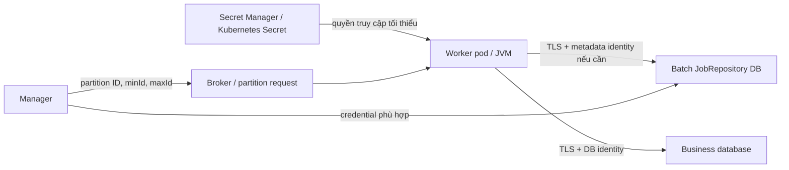

# Credential của database worker trong Spring Batch: cấp quyền, phân phối và xoay vòng an toàn

## 1. Vì sao credential của worker trở thành vấn đề khi mở rộng batch?

Trong module **SPRING_BATCH_SCALING_OPERATIONS**, ta học cách tăng năng lực xử lý dữ liệu lớn bằng multi-threaded step, parallel steps, partitioning, remote partitioning và remote chunking. Khi chỉ có một tiến trình chạy job, thông tin kết nối database thường được cấu hình tại một nơi. Khi chuyển sang **nhiều worker JVM hoặc container**, cùng một credential có thể được sao chép đến hàng chục pod, sử dụng cho hàng trăm connection và tồn tại ở nhiều môi trường thực thi khác nhau.

Giả sử hệ thống mỗi đêm đối soát 30 triệu đơn hàng. Manager chia dữ liệu thành 24 partition và phân phối cho 6 worker pod. Mỗi worker mở các kết nối tới database nghiệp vụ, một số mô hình còn cần kết nối tới database chứa metadata của Spring Batch. Nếu tất cả worker đều nhận tài khoản quản trị cơ sở dữ liệu, một pod bị xâm nhập có thể ảnh hưởng tới toàn bộ dữ liệu và lịch sử chạy job.

**Credential của database worker** là thông tin dùng để chứng minh danh tính khi worker mở kết nối tới database: username/password, token truy cập có thời hạn hoặc chứng chỉ client tùy cơ chế xác thực. Chủ đề bài học không chỉ là “đặt password ở đâu”, mà là thiết kế **ai được truy cập DB nào, được làm gì, nhận credential bằng cách nào, sử dụng trong bao lâu và xử lý ra sao khi credential hết hạn hoặc bị lộ**.

Sau bài này, bạn cần có khả năng:

- Vẽ được luồng kết nối database cho một kiến trúc Spring Batch có nhiều worker.
- Phân biệt quyền truy cập **business database** và **JobRepository metadata database**.
- Cấp quyền tối thiểu theo thao tác thực tế của reader, processor, writer và job orchestration.
- Đưa secret vào runtime mà không ghi nó trong mã nguồn, job parameters, `ExecutionContext`, message hay log.
- Thiết kế TLS, connection pool, credential rotation và recovery khi worker đang xử lý partition.
- Kiểm thử quyền truy cập, rò rỉ credential và lỗi xác thực mà không gây mất hoặc lặp dữ liệu nghiệp vụ.

## 2. Xác định chính xác worker cần truy cập database nào

Không phải mọi mô hình scaling đều có cùng topology. Trước khi tạo user/password, hãy xác định **đơn vị thực thi** và vị trí thực sự mở kết nối.

| Mô hình | Nơi chạy reader và writer | Vị trí sử dụng DB credential | Rủi ro cần chú ý |
|---|---|---|---|
| **Multi-threaded Step** | Nhiều thread trong cùng process | Thường cùng `DataSource`/connection pool, nhiều connection đồng thời | Reader/writer thread safety, pool exhaustion; credential chung bị dùng ở nhiều thread |
| **Parallel Steps** | Nhiều step chạy song song, có thể cùng JVM | Mỗi step kết nối tới nguồn/đích theo chức năng | Không cấp quyền ghi cho step chỉ đọc |
| **Local partitioning** | Nhiều partition chạy trong một process | Worker step dùng các connection riêng, thường từ một pool | Không nhầm instance reader riêng với credential riêng |
| **Remote partitioning** | Worker process thực thi một **worker Step** hoàn chỉnh | Worker thường cần business DB và có thể cần **JobRepository dùng chung** theo cách triển khai | Credential rải trên nhiều host; phân quyền business và metadata |
| **Remote chunking** | Manager thường đọc, worker nhận chunk để xử lý/ghi | Manager cần credential nguồn; worker cần credential đích nếu nó ghi DB | Tránh cấp quyền đọc toàn bộ nguồn cho worker chỉ nhận chunk; database metadata do bên nào sở hữu phụ thuộc thiết kế |

Trong một cấu hình **remote partitioning điển hình** của Spring Batch, manager và worker phối hợp thông qua metadata `JobExecution`/`StepExecution`. Worker có thể cần kết nối tới cùng `JobRepository` bền vững để cập nhật tiến độ và checkpoint. Đừng mặc định rằng worker chỉ cần tài khoản DB nghiệp vụ; cũng đừng mặc định mọi worker của mọi mô hình đều cần quyền ghi toàn bộ metadata.

Trong **remote chunking**, phần đọc thường nằm ở manager, còn processor/writer nằm ở worker. Nếu worker chỉ thao tác trên message và một dịch vụ HTTP, có thể nó **không cần database credential nào**. Cấp secret theo nhu cầu thực tế của thành phần, không theo tên “worker”.

### Bốn nhóm danh tính không nên dùng lẫn

1. **Business DB identity:** tài khoản đọc/ghi bảng nghiệp vụ đúng chức năng, ví dụ `orders_worker_rw`.
2. **Batch metadata DB identity:** tài khoản phục vụ `JobRepository`; có quyền cần thiết trên bảng và sequence metadata Spring Batch.
3. **Broker identity:** xác thực với Kafka, RabbitMQ hoặc hệ thống message khác; không phải password database.
4. **Workload identity:** danh tính pod/service account hoặc IAM principal để lấy secret/token; không đồng nghĩa một database user nếu chưa cấu hình ánh xạ xác thực phù hợp.

Nếu business DB và metadata DB nằm trong cùng một server, điều đó **không bắt buộc** chúng phải dùng chung username/password. Tách tài khoản giúp giảm phạm vi tác động khi một loại credential bị lộ và làm rõ audit trail.

## 3. Mô hình đe dọa: credential dễ bị lộ ở đâu?

Hãy xem đường đi của credential từ kho bí mật đến JDBC driver:



Đường từ manager đến worker chỉ nên mang **tham số công việc**, chẳng hạn partition ID, dải khóa, tên file hoặc correlation ID. Không đưa password đi cùng message.

| Bề mặt | Ví dụ lộ lọt | Cách giảm rủi ro |
|---|---|---|
| Git repository / image | Password hard-code trong `application.yml`, Dockerfile, script | Lưu cấu hình không bí mật trong Git; nhận secret lúc runtime |
| Biến môi trường / process | Debug dump, lệnh kiểm tra process, diagnostic bundle | Hạn chế quyền truy cập host/container; cân nhắc mount secret file hoặc identity-based auth |
| Job parameters | `dbPassword` được truyền làm parameter và lưu vào bảng metadata | Không dùng `JobParameters` để vận chuyển secret |
| `ExecutionContext` | Ghi password vào context để mỗi partition “nhận riêng” | Context chỉ chứa khóa dữ liệu và trạng thái restart không nhạy cảm |
| Message broker | Request partition/chunk chứa JDBC URL kèm password | Message chỉ chứa ID và mô tả công việc; worker tự nhận secret từ nguồn tin cậy |
| Application log / tracing | Log cấu hình datasource, connection URL có credential, SQL parameter | Redact secret, tránh log raw payload và cấu hình nhạy cảm |
| Spring Actuator / diagnostic endpoint | Truy cập không kiểm soát vào `/env`, `/configprops`, heap dump | Giới hạn endpoint, xác thực, phân quyền và kiểm soát quyền debug |
| Database | Một role có quyền superuser hoặc DDL không cần thiết | Least privilege, tách role ứng dụng và role migration |
| Network | Kết nối DB plaintext hoặc không xác minh chứng chỉ server | Bật TLS và xác minh danh tính máy chủ |

**Kubernetes Secret không tự động là “an toàn tuyệt đối”.** Trường `data` được mã hóa **base64 để biểu diễn**, không phải mã hóa bảo mật. Muốn bảo vệ secret cần kết hợp RBAC, quản lý quyền đọc Secret, mã hóa dữ liệu lưu trữ theo khả năng cluster, secret manager/KMS, hạn chế quyền lên node và chính sách log/backup.

## 4. Nguyên tắc least privilege cho database worker

Một worker chỉ nên sở hữu quyền cần thiết để hoàn thành **step được giao**, trong phạm vi schema, bảng và thao tác phù hợp.

Ví dụ hệ thống đối soát đơn hàng:

- Reader đọc `id`, `status`, `amount` từ bảng `business.orders`.
- Processor tính toán trạng thái mới trong bộ nhớ.
- Writer chỉ cập nhật cột `processing_status` theo `id`.
- Worker **không** tạo bảng, sửa schema, xóa lịch sử đơn hàng hoặc đọc bảng `customer_payment_card`.

Với PostgreSQL, một DBA có thể cấp quyền cho role **đã được tạo và quản lý thông qua quy trình cấp danh tính riêng**:

```sql
-- Chạy bằng vai trò quản trị quyền phù hợp, không chạy
-- từ job hoặc tài khoản worker production.

GRANT CONNECT ON DATABASE commerce TO orders_batch_worker;
GRANT USAGE ON SCHEMA business TO orders_batch_worker;

GRANT SELECT (id, status, amount, processing_status)
ON TABLE business.orders TO orders_batch_worker;

GRANT UPDATE (processing_status)
ON TABLE business.orders TO orders_batch_worker;
```

Những quyền này phù hợp cho một reader đọc các cột trên và writer chạy câu lệnh dạng:

```sql
UPDATE business.orders
SET processing_status = ?
WHERE id = ?;
```

Đây là **ví dụ cấp quyền theo cột** trong PostgreSQL, không phải bộ `GRANT` phổ quát cho tất cả driver và kiểu SQL. Nếu thực tế writer dùng `INSERT`, `DELETE`, sequence, stored procedure hoặc bảng outbox, phải kiểm kê và cấp thêm **đúng quyền cần thiết**. Nếu có row-level security, view, function hoặc schema khác, cần kiểm tra quyền thực thi và chính sách dữ liệu tương ứng.

### Tách quyền chạy job và quyền migration

Không cấp `CREATE TABLE`, `ALTER`, `DROP` hoặc quyền quản trị DB cho tài khoản worker chỉ để thuận tiện khi triển khai lần đầu. Việc tạo schema/tables Spring Batch và migration bằng Flyway/Liquibase nên dùng **danh tính migration riêng**, được thực hiện trong giai đoạn triển khai có kiểm soát.

Tài khoản chạy `JobRepository` lại cần một nhóm quyền khác để thực hiện đọc/ghi metadata và quản lý sequence theo DB vendor, Spring Batch version và cấu hình repository. Tài khoản chỉ đọc metadata không đủ cho worker phải cập nhật `StepExecution`. Hãy kiểm tra các câu SQL repository thực tế và giới hạn quyền trong schema metadata, thay vì dùng tài khoản superuser hoặc tái sử dụng tài khoản migration.

### Chọn phạm vi identity hợp lý

| Phạm vi credential | Khi nào phù hợp | Trade-off |
|---|---|---|
| Một role cho toàn ứng dụng | Mô hình đơn giản, cùng quyền nghiệp vụ | Rò rỉ một nơi có thể ảnh hưởng tất cả worker |
| Role riêng cho manager và worker | Reader ở manager, writer ở worker; quyền khác nhau | Quản lý nhiều identity nhưng giảm quyền thừa |
| Role riêng theo nhóm worker / service | Nhiều pipeline có bộ bảng khác nhau | Audit và containment tốt hơn; tăng số role cần quản lý |
| Identity theo tenant hoặc workload nhạy cảm | Có yêu cầu cách ly dữ liệu/khách hàng mạnh | Cần mapping và thiết kế connection pool rõ ràng |
| Token/cert ngắn hạn theo workload identity | Hạ tầng hỗ trợ DB IAM/mTLS | Cần tích hợp token refresh, pool lifecycle và xử lý hết hạn |

Không tạo password riêng cho **mỗi partition** chỉ vì mỗi partition có một `StepExecution`. `@StepScope` có mục tiêu cô lập trạng thái reader/writer và late-binding tham số như `minId`, `maxId`; nó **không phải ranh giới bảo mật** cho credential. Có thể dùng một `DataSource` thread-safe với connection pool dùng chung trong một worker process, trong khi các reader `@StepScope` vẫn có instance riêng cho từng partition.

## 5. Cấp secret cho Spring Boot worker tại runtime

Một lựa chọn thực tế với Spring Boot 3.x, Java 17 và Spring Batch 5.x là dùng Spring Boot **config tree** để đọc secret từ file được mount vào container. Ví dụ giả định ứng dụng dùng một datasource nghiệp vụ mặc định; nếu có datasource metadata riêng, cần cấu hình thêm và kết nối `JobRepository` tới datasource tương ứng.

### 5.1. Cấu hình trong repository chỉ chứa giá trị không nhạy cảm

```yaml
# application.yml: được lưu trong Git
spring:
  config:
    import: "configtree:/run/secrets/worker-db/"
  datasource:
    url: "jdbc:postgresql://db.internal:5432/commerce?sslmode=verify-full&sslrootcert=/run/trust/pg-ca.pem"
    driver-class-name: org.postgresql.Driver
    hikari:
      maximum-pool-size: 8
      connection-timeout: 30000
      validation-timeout: 5000
```

Thư mục `/run/secrets/worker-db/` chứa hai file với tên chính xác:

```text
/run/secrets/worker-db/
├── spring.datasource.username
└── spring.datasource.password
```

Spring Boot config tree ánh xạ tên file thành property. Nội dung hai file do hệ thống quản lý secret cung cấp tại runtime; **không tạo file có password thật trong source repository**. Với `import` bắt buộc như trên, ứng dụng sẽ báo lỗi cấu hình khi thư mục không tồn tại, giúp phát hiện triển khai thiếu secret sớm. Trong môi trường dev không có mount, có thể dùng một profile cấu hình khác với tài khoản thử nghiệm dành riêng cho local.

URL JDBC trên minh họa driver PostgreSQL: `sslmode=verify-full` yêu cầu kết nối TLS và xác minh hostname chứng chỉ; `sslrootcert` chỉ tới CA tin cậy đã được cung cấp cho container. Tham số và cách quản lý truststore **khác nhau theo database vendor/driver**, nên phải kiểm tra driver thật thay vì giả định thêm `ssl=true` là đủ.

### 5.2. Mount secret vào worker pod

Một manifest Deployment minh họa phần cấp secret:

```yaml
apiVersion: apps/v1
kind: Deployment
metadata:
  name: orders-batch-worker
spec:
  replicas: 4
  selector:
    matchLabels:
      app: orders-batch-worker
  template:
    metadata:
      labels:
        app: orders-batch-worker
    spec:
      serviceAccountName: orders-batch-worker
      containers:
        - name: worker
          image: registry.example.com/orders-batch-worker:1.0.0
          volumeMounts:
            - name: worker-db-credential
              mountPath: /run/secrets/worker-db
              readOnly: true
            - name: postgres-ca
              mountPath: /run/trust
              readOnly: true
      volumes:
        - name: worker-db-credential
          secret:
            secretName: orders-batch-worker-db
        - name: postgres-ca
          configMap:
            name: orders-postgres-ca
```

Điều kiện để ví dụ chạy được:

- Secret `orders-batch-worker-db` phải **đã tồn tại** trong đúng namespace và có hai key `spring.datasource.username`, `spring.datasource.password`. Việc tạo secret phải đi qua hệ thống quản lý secret/triển khai được kiểm soát; không commit manifest chứa giá trị mật khẩu.
- ConfigMap `orders-postgres-ca` phải có file `pg-ca.pem` là CA được tin cậy của database đích, được quản lý/phê duyệt theo hạ tầng.
- Kubernetes service account `orders-batch-worker` được tạo với quyền đúng nhu cầu; nó **không tự động** trở thành một DB user.
- Pod còn cần các cấu hình networking, tài nguyên, policy và image pull tương ứng môi trường thực tế.

**Không nhầm việc mount secret với hot reload.** Kubernetes có thể cập nhật nội dung Secret volume theo cơ chế đồng bộ của nó, nhưng ứng dụng Spring Boot và connection pool thông thường **không tự động đọc lại password mới rồi thay credential cho tất cả connection**. Rotation cần một quy trình chủ động được mô tả ở phần sau.

### Khi dùng environment variables

Spring Boot cũng hỗ trợ `SPRING_DATASOURCE_USERNAME` và `SPRING_DATASOURCE_PASSWORD`, có thể cung cấp từ `secretKeyRef`. Cách này đơn giản nhưng biến môi trường thường được chụp tại lúc container khởi tạo; thay đổi Secret **không tự cập nhật env var của process đang chạy**. Chúng cũng có thể xuất hiện trong môi trường debug hoặc diagnostic tùy quyền truy cập. Cân nhắc file mount hoặc workload identity nếu yêu cầu kiểm soát chặt hơn, nhưng vẫn phải giới hạn quyền đọc file và kiểm soát dump process.

### Khi dùng secret manager hoặc database IAM

Các nền tảng như Vault hoặc dịch vụ quản lý bí mật trên cloud có thể hỗ trợ **dynamic DB credentials** hoặc token truy cập ngắn hạn. Khi đó worker cần một danh tính workload để xin credential, và driver/DataSource phải biết cách lấy hoặc đổi token **khi tạo connection mới**.

Một token DB có TTL 15 phút được nạp một lần vào property rồi để pool tạo connection suốt 10 giờ **không phải thiết kế rotation đúng**. Hãy kiểm tra cơ chế làm mới token, thời hạn connection, cách hủy connection cũ, lease/revoke và lỗi xác thực theo từng nhà cung cấp.

## 6. Không truyền secret qua JobParameters, ExecutionContext và message

Trong Spring Batch, `JobParameters` và `ExecutionContext` phục vụ định danh, restart và lưu trạng thái thực thi. Những dữ liệu này có thể được ghi vào bảng metadata, hiển thị qua công cụ quản trị, truy vấn khi khắc phục sự cố hoặc đi vào log.

**Sai: truyền password làm tham số job hoặc partition**

```java
// Không làm như sau:
new JobParametersBuilder()
        .addString("dbPassword", password)
        .toJobParameters();

ExecutionContext context = new ExecutionContext();
context.putString("minId", "1000");
context.putString("dbPassword", password); // Không lưu secret!
```

**Đúng: chỉ truyền tham số dữ liệu của partition; DataSource lấy secret từ cấu hình runtime**

```java
ExecutionContext context = new ExecutionContext();
context.putLong("minId", 1000L);
context.putLong("maxId", 1999L);
context.putString("partitionKey", "range-001");

// Reader của partition nhận minId/maxId qua Step Scope;
// JDBC DataSource được inject bằng cơ chế cấu hình ứng dụng.
```

Một reader minh họa (Spring Batch 5.x) sử dụng connection pool do ứng dụng quản lý:

```java
import javax.sql.DataSource;

import org.springframework.batch.core.configuration.annotation.StepScope;
import org.springframework.batch.item.database.JdbcCursorItemReader;
import org.springframework.batch.item.database.builder.JdbcCursorItemReaderBuilder;
import org.springframework.beans.factory.annotation.Value;
import org.springframework.context.annotation.Bean;

@Bean
@StepScope
JdbcCursorItemReader<Long> partitionReader(
        DataSource businessDataSource,
        @Value("#{stepExecutionContext['minId']}") Long minId,
        @Value("#{stepExecutionContext['maxId']}") Long maxId) {

    return new JdbcCursorItemReaderBuilder<Long>()
            .name("partitionReader")
            .dataSource(businessDataSource)
            .sql("""
                SELECT id
                  FROM business.orders
                 WHERE id BETWEEN ? AND ?
                 ORDER BY id
                """)
            .preparedStatementSetter(ps -> {
                ps.setLong(1, minId);
                ps.setLong(2, maxId);
            })
            .rowMapper((rs, rowNum) -> rs.getLong("id"))
            .saveState(true)
            .build();
}
```

Phương thức `@Bean` trên là **đoạn trích đặt bên trong class `@Configuration`**; ứng dụng hoàn chỉnh phải khai báo bean `businessDataSource` và bảo đảm Spring inject đúng datasource, nhất là khi metadata DB dùng datasource riêng. Reader `@StepScope` có instance riêng theo `StepExecution`; secret không nằm trong `ExecutionContext` và datasource pool không phải bị tạo mới cho mỗi partition.

Đối với remote partitioning, message điều phối nên chứa **partition identifier / step execution identifier và tham số công việc**, không chứa JDBC URL nhúng password hay cấu hình connection bí mật. Mỗi worker tự lấy credential hợp lệ từ secret provider đã cấu hình.

## 7. Bảo vệ kết nối DB bằng TLS và phân vùng mạng

Ngay cả khi mật khẩu được lưu đúng chỗ, hệ thống vẫn có nguy cơ bị nghe lén hoặc kết nối tới máy chủ giả mạo nếu JDBC không xác minh danh tính server.

Một thiết kế tốt cần các lớp:

1. **TLS trên kết nối JDBC:** bật mã hóa theo driver, xác minh CA và hostname máy chủ. Tránh chế độ chỉ “encrypt” nhưng bỏ xác minh danh tính nếu policy yêu cầu chống MITM.
2. **Trusted CA có quản lý:** CA/cert được mount hoặc cấp từ truststore được kiểm soát; có kế hoạch thay chứng chỉ trước khi hết hạn.
3. **Network policy/firewall:** chỉ worker service cần thiết được đi tới port DB; không công khai DB trực tiếp ra Internet để “giảm độ phức tạp” scaling.
4. **Danh tính workload:** pod/service account chỉ có quyền truy cập kho bí mật của pipeline tương ứng.
5. **Mã hóa và phân quyền ở tầng dữ liệu:** nếu đa tenant hoặc dữ liệu nhạy cảm, có thể cần row-level security, view, data masking hoặc mã hóa cột theo yêu cầu.

TLS **không thay thế** quyền DB. Một worker dùng superuser qua TLS vẫn có quyền quá lớn. Ngược lại, role least-privilege gửi password qua đường truyền không đáng tin cậy vẫn có nguy cơ mất credential.

## 8. Connection pool, concurrency và blast radius

Trong partitioning, tăng `gridSize`, tăng số replica và tăng kích thước pool là **ba tham số khác nhau**. Ví dụ:

- 6 worker pod.
- Mỗi pod có `HikariCP.maximumPoolSize = 8`.
- Chỉ riêng business datasource đã có **trần cấu hình 48 connection** từ các worker, chưa kể manager, metadata datasource, ứng dụng khác và connection quản trị.

Công thức lập ngân sách sơ bộ:

```text
connection_budget ≈ worker_replicas × max_pool_size_per_worker
                  + manager_connections
                  + metadata_connections
                  + other_clients
                  + operational_headroom
```

Đây là **trần dự kiến**, không phải khẳng định 48 connection luôn được mở cùng lúc. Một pod có nhiều datasource tạo ra nhiều pool và phải tính riêng. Pool quá nhỏ gây đợi connection và kéo dài chunk; quá lớn làm DB nghẽn hoặc đẩy lỗi xác thực/timeout tăng hàng loạt.

Từ góc độ bảo mật, một password chung cho 50 pod tăng **blast radius** nếu secret bị lộ. Việc mở rộng cũng làm tăng số session cần audit/revoke khi xảy ra sự cố. Cân nhắc tách identity theo pipeline, dịch vụ hoặc môi trường, đồng thời đặt hạn mức session và quyền từ phía DB phù hợp.

**Một DataSource pool thread-safe có thể được chia sẻ giữa các partition**, nhưng reader giữ cursor/trạng thái cần được tạo theo `StepExecution` khi thích hợp. `@StepScope` không làm password “tự cô lập” cho mỗi thread, và tạo pool mới cho từng chunk/partition thường gây tốn kết nối, giảm throughput.

### Tránh credential trong từng câu SQL hoặc exception

Hãy dùng prepared statement/JDBC parameter binding để xử lý dữ liệu, tránh nối `minId`/`maxId` hoặc payload trực tiếp vào SQL string. Chống SQL injection là vấn đề độc lập với nơi cất password, nhưng đặc biệt quan trọng nếu một job chạy bằng role có quyền ghi lớn.

Tránh log `SQLException` theo cách kéo theo full connection properties, nguyên giá trị secret hoặc toàn bộ payload nhạy cảm. Có thể log error code, SQLState, loại lỗi, `jobExecutionId`, `stepExecutionId`, `partitionName` và correlation ID mà không log password.

## 9. Credential rotation khi job dài hàng giờ

Đổi password/token trong lúc một job đang chạy có thể khiến **connection mới** bị từ chối. Một số database vẫn cho phép session đã xác thực tồn tại sau khi mật khẩu đổi; connection pool vì vậy có thể vừa còn session cũ hoạt động, vừa thất bại khi mở session mới. Hành vi chính xác phụ thuộc DB vendor và hình thức xác thực.

Không nên coi rotation là thao tác “cập nhật Secret và xong”. Một quy trình cho worker batch cần phối hợp **DB, secret provider, pool, orchestrator và Spring Batch restart**.

### Quy trình rotation có kiểm soát

1. **Chuẩn bị credential mới:** cấp một role/secret version mới có đúng quyền cần thiết. Nếu hệ thống cho phép, dùng **hai danh tính song song** trong thời gian chuyển đổi để tránh phá connection của worker đang chạy.
2. **Kiểm chứng credential mới:** mở connection thử, xác minh TLS, quyền đọc/ghi được yêu cầu và xác nhận không có quyền DDL/quản trị không cần thiết.
3. **Cập nhật secret provider:** quản lý version và quyền phân phối; không sao chép password mới vào CI log hoặc message.
4. **Chuyển worker sang credential mới:** rolling restart hoặc cơ chế refresh DataSource đã được chứng minh hoạt động. Với batch dài, ưu tiên drain/hoàn thành partition tại điểm an toàn trước khi thay process nếu có thể.
5. **Theo dõi quá trình chuyển đổi:** auth failures, pool acquisitions, transaction rollback, `StepExecution` bị gián đoạn, message in-flight và các partition được gán lại.
6. **Thu hồi credential cũ:** chỉ khi đã xác minh worker cũ không còn cần nó; kiểm tra cả session còn sống, pool cũ và quy tắc thu hồi của DB.
7. **Đối soát công việc:** restart/replay các phần lỗi dựa trên metadata, checkpoint và idempotency; xác nhận không thiếu và không trùng kết quả.

Nếu không có khả năng duy trì hai credential đồng thời, nên chọn một **cửa sổ bảo trì** hoặc cơ chế drain rõ ràng. Việc thay trực tiếp password của cùng một role không bảo đảm mọi connection trong pool cập nhật đồng bộ. Nếu dùng token ngắn hạn, cần thiết kế cách **tạo token mới cho lần mở connection mới**, không chỉ thay một file trên disk.

### Worker bị kill giữa lúc rotation

Một pod có thể chết giữa chunk sau khi credential cũ bị thu hồi. Spring Batch có thể để lại `StepExecution` ở trạng thái `STARTED` nếu process không kịp cập nhật repository. Orchestrator khởi chạy pod mới với password mới **không tự động sửa trạng thái Batch hoặc quyết định partition nào phải chạy lại**.

Cần quy trình failover nhất quán:

- Xác định chính xác worker/partition/chunk bị ảnh hưởng.
- Xác minh worker cũ không còn xử lý hoặc đã bị **fencing** trước khi giao lại partition.
- Kiểm tra trạng thái `JobRepository`, checkpoint và dữ liệu nghiệp vụ đã commit.
- Restart/requeue bằng cơ chế phù hợp với local/remote partitioning hoặc remote chunking.
- Writer phải có business key, unique constraint, upsert, outbox hoặc idempotency key thích hợp để chịu replay.

Nên thử rotation với một job mẫu dài nhiều chunk **trước khi** áp dụng chính sách credential TTL ngắn cho production.

## 10. Retry lỗi xác thực: tránh vòng lặp gây nghẽn

Không phải lỗi mở connection nào cũng nên retry giống nhau. Phân loại lỗi giúp hệ thống hồi phục mà không tự làm quá tải DB.

| Lỗi | Khả năng nguyên nhân | Cách xử lý |
|---|---|---|
| Invalid username/password | Secret sai version, role bị thu hồi, token hết hạn | Kiểm tra credential source và rotation; **không retry vô hạn** với cùng giá trị |
| Permission denied cho bảng/cột | Quyền DB thiếu hoặc schema thay đổi | Sửa chính sách `GRANT`/migration, không coi là lỗi mạng thoáng qua |
| TLS handshake / hostname verification failed | CA sai, cert hết hạn, hostname không khớp | Kiểm tra chứng chỉ và trust chain; không tắt validation để “chạy tiếp” |
| Connection refused / network timeout | Network policy, DB down, DNS, connection limit | Retry có giới hạn và backoff/jitter; quan sát sức khỏe DB |
| Connection pool timeout | Quá nhiều partition, lock/transaction dài, pool quá nhỏ | Đo số connection hoạt động, wait time và throughput; điều chỉnh concurrency |
| Session bị đóng giữa chunk | DB failover, credential/token lifecycle, đứt mạng | Transaction có thể rollback; xử lý chunk theo chính sách retry/restart và idempotency |
| JobRepository connection failure | Metadata không ghi được, trạng thái step chưa chắc đã cập nhật | Ưu tiên bảo toàn metadata, điều tra trạng thái execution trước khi tiếp tục |

Spring Batch có retry/skip cho các lỗi phù hợp, nhưng **process crash, credential sai lâu dài hoặc thiếu quyền không được sửa bởi việc tăng `retryLimit`**. Retry liên tục với một password sai có thể gây lock tài khoản, bão connection và kéo dài thời gian phục hồi.

Dùng retry với backoff, circuit breaking hoặc dừng job theo phân loại lỗi; số lần retry và timeout phải cân đối với quy mô partition và SLA. Khi credential mới được cấp sau lỗi, cần xác định **connection pool đã nhận version mới chưa**, thay vì chỉ thấy file secret trên pod đã thay đổi.

## 11. Không để lộ credential khi quan sát và vận hành job

Một môi trường batch có thể có dashboard, log collector, APM, Spring Actuator, heap dump và công cụ điều hành job. Những công cụ này giúp đo nút thắt và khôi phục lỗi, nhưng cũng là đường truy cập tới secret nếu không kiểm soát.

**Nên log** những thông tin phục vụ vận hành:

```text
jobExecutionId=1742
stepExecutionId=8821
partitionName=orders-range-07
workerId=worker-3
datasourceAlias=orders-business-db
dbErrorClass=AUTHENTICATION_FAILURE
sqlState=28P01
retryAttempt=0
```

Ví dụ trên dùng mã lỗi PostgreSQL minh họa và **không ghi** hostname nhạy cảm, password, connection URL có userinfo hoặc token. Để log hữu ích, hệ thống có thể ghi loại nguồn dữ liệu và mã lỗi nhưng phải có chiến lược scrub trước khi log được xuất ra môi trường chung.

**Không nên log**:

- `spring.datasource.password`, raw Spring `Environment`, secret file contents.
- JDBC URL chứa `user`/`password`/token trong query parameters.
- Raw job parameters khi chúng có thể mang dữ liệu nhạy cảm; tốt hơn là ngăn secret đi vào từ đầu.
- Authorization headers, cloud access token, client private key.
- Heap dump hoặc diagnostic bundle không có phân quyền và quy trình xử lý dữ liệu nhạy cảm.

Các endpoint như `/actuator/env` và `/actuator/configprops` có thể có cơ chế che giấu nhạy cảm tùy phiên bản/cấu hình, nhưng **không dựa hoàn toàn vào mặc định này**. Hãy giới hạn exposure, kiểm tra sanitizer, bảo vệ endpoint quản trị và xác thực bằng tài khoản riêng. Cần có chính sách bảo vệ quyền tải heap dump hoặc chụp process.

## 12. Nếu credential bị lộ: playbook phản ứng sự cố

Giả sử log collector vô tình nhận được JDBC password của 12 worker. Đổi password là cần thiết nhưng chưa đủ, vì có thể đã có connection trái phép hoặc một job đang xử lý giữa chunk.

### Bước 1: Giới hạn phạm vi truy cập

Xác định role nào bị lộ, cấp quyền gì, được sử dụng bởi những deployment/namespace nào và tồn tại trong bao lâu. Hạn chế truy cập vào nơi chứa secret bị rò rỉ; loại bỏ log/bundle bị lộ theo quy trình lưu trữ và bảo toàn chứng cứ tương ứng.

### Bước 2: Cô lập nguy cơ

Theo chính sách ứng cứu, vô hiệu hóa hoặc thu hồi credential, chặn nguồn truy cập nghi vấn và cấp credential thay thế tối thiểu. **Chú ý**: thay password hoặc vô hiệu hóa login chưa chắc chấm dứt những session đã xác thực đang hoạt động. DBA có thể cần xử lý session theo cơ chế của DB sau khi đánh giá tác động đến job.

### Bước 3: Khôi phục worker an toàn

Đưa credential mới qua secret manager và cập nhật worker theo quy trình rotation. Điều phối dừng/drain worker cũ hoặc áp dụng fencing trước khi phân lại công việc. Xác minh metadata `JobRepository` không còn execution mồ côi đang được cho là chạy và đối soát các chunk đã commit.

### Bước 4: Kiểm tra khả năng truy cập trái phép

Đối chiếu audit log DB, số lượng kết nối, nguồn IP/identity, thao tác DDL/DML bất thường, quyền role và các thay đổi dữ liệu nhạy cảm. Nếu credential có quyền quá rộng, phải xem xét toàn bộ bảng/schema mà role có thể truy cập.

### Bước 5: Ngăn tái diễn

Sửa nguyên nhân gốc (log raw config, quyền debug, secret trong Git, RBAC quá rộng), bật cơ chế phát hiện secret trong pipeline phù hợp và kiểm tra lại quyền truy cập. Không chỉ “xóa password khỏi log” sau khi credential đã bị phát tán; phải giả định giá trị cũ đã không còn đáng tin cậy.

## 13. Kiểm thử tích hợp và các tình huống bắt buộc

Đừng chỉ kiểm tra rằng Spring Boot khởi động thành công. Một worker có thể kết nối được nhưng thiếu quyền ghi chunk, hoặc kết nối thành công qua TLS không xác minh danh tính server. Cần kiểm thử cả **cấp quyền, tăng tải, rotation và khôi phục**.

| Kịch bản | Cách kiểm tra | Kỳ vọng |
|---|---|---|
| Secret không được mount | Khởi chạy pod thiếu volume cấu hình | Startup thất bại rõ ràng, không fallback sang tài khoản mặc định có quyền lớn |
| Credential sai | Dùng test secret không hợp lệ | Báo lỗi xác thực, retry có giới hạn, log không lộ password |
| Thiếu quyền | Dùng role test chỉ SELECT trong khi writer cần UPDATE | Lỗi `permission denied` rõ ràng; không tự nâng quyền |
| TLS sai CA/hostname | Trỏ worker staging tới endpoint test không khớp chứng chỉ | Connection bị từ chối; không tự bỏ xác minh TLS |
| Nhiều partition song song | Tăng `gridSize`/replica với dataset thử nghiệm | Không vượt ngân sách connection; không có rò rỉ connection khi chunk kết thúc |
| Rotation giữa job | Đổi secret khi worker đang xử lý nhiều chunk | Worker nhận credential mới qua cơ chế thiết kế; không mất dữ liệu hoặc lặp kết quả |
| DB failover | Cắt một kết nối hoặc chuyển DB primary trong staging | Connection pool khôi phục đúng, chunk rollback/retry và checkpoint nhất quán |
| Worker crash | Dừng cưỡng bức worker sau commit nhưng trước khi reply | Recovery kiểm tra metadata và không tạo side effect trùng |
| Secret xuất hiện trong job parameters | Chạy kiểm tra tự động trên payload job/config | Không có credential trong `JobRepository`, queue hoặc log |
| Pod bị xâm nhập (mô phỏng quyền) | Thử truy cập tài nguyên DB/schema ngoài chức năng | Role không có quyền ngoài danh sách đã phê duyệt |

Với test rotation và worker crash, dùng **DB và broker staging**, dataset có khóa nghiệp vụ ổn định và có thể kiểm đếm. Đối soát cuối cùng phải kiểm tra số bản ghi hợp lệ, số key duy nhất, outbox chưa phát, message redelivery và trạng thái từng partition.

## 14. Checklist triển khai trước production

- [ ] Đã lập bảng manager/worker/step nào cần business DB, metadata DB và broker chưa?
- [ ] Đã tách danh tính business, metadata, migration và quản trị theo nhu cầu thực tế chưa?
- [ ] Role worker chỉ có quyền trên schema, bảng, cột và thao tác cần thiết chưa?
- [ ] Có cơ chế quản lý secret ở runtime, không hard-code trong Git, image hay script chưa?
- [ ] `JobParameters`, `ExecutionContext`, partition request và chunk message đều không chứa secret chưa?
- [ ] JDBC TLS có xác minh CA và hostname; CA được phân phối an toàn chưa?
- [ ] Kubernetes RBAC, service account, pod/file permission và network policy đã giới hạn phạm vi truy cập chưa?
- [ ] Connection budget tính theo replica, pool, manager và các datasource khác có phù hợp tài nguyên DB không?
- [ ] Có kế hoạch đổi credential mà không tạo ra worker chạy trùng hoặc làm hỏng checkpoint không?
- [ ] Lỗi auth/permission/TLS được phân loại, có backoff và cảnh báo, tránh retry vô hạn chưa?
- [ ] Log, Actuator, tracing, heap dump và diagnostic bundle được kiểm tra nguy cơ lộ secret chưa?
- [ ] Đã thử credential sai, thiếu quyền, rotation giữa job, DB failover và worker crash chưa?
- [ ] Có quy trình thu hồi session, phục hồi partition và đối soát dữ liệu nếu secret bị lộ chưa?

## 15. Tổng kết

Credential của database worker là một **quyền truy cập sống cùng kiến trúc mở rộng Spring Batch**. Khi tăng số thread, partition hoặc worker pod, ta phải quyết định đúng **thành phần nào thật sự cần kết nối**, cấp **ít quyền nhất**, đưa credential từ **nguồn bí mật đáng tin cậy vào runtime**, bảo vệ kết nối bằng TLS và kiểm soát vòng đời connection pool.

`@StepScope` cô lập trạng thái của từng partition nhưng không thay việc quản lý secret; `JobRepository` lưu checkpoint nhưng không phải chỗ cất password; broker chuyển thông điệp công việc nhưng không nên chuyển credential. Muốn xoay vòng hoặc thu hồi secret mà vẫn duy trì tính đúng đắn của job lớn, cần kết hợp credential rotation với **failover, restart, idempotency, kiểm soát đồng thời và đối soát dữ liệu**. Đây là nền tảng để tăng throughput mà không đánh đổi khả năng bảo vệ dữ liệu và phục hồi khi worker gặp sự cố.
