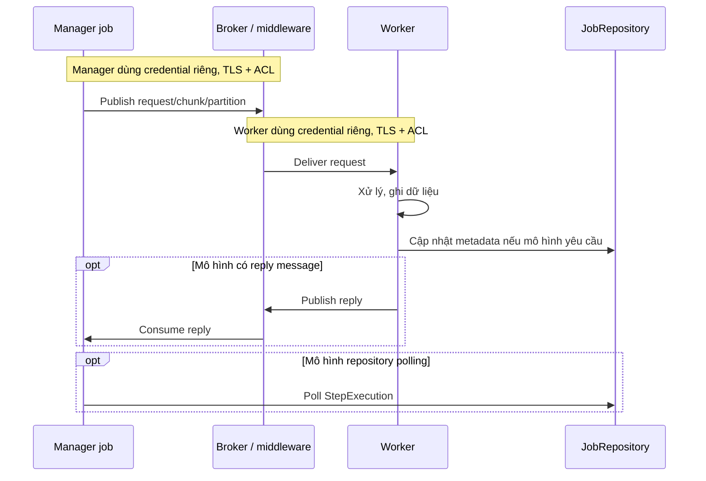

# Credential middleware và broker

## 1. Tổng quan: vì sao cần credential khi scale Spring Batch?

Trong Spring Batch, một `multi-threaded step` hoặc `parallel steps` có thể chạy hoàn toàn trong cùng JVM, không cần message broker. Nhưng khi chuyển sang **remote chunking**, **remote partitioning** hoặc một số cách triển khai **remote step execution**, manager và worker phải trao đổi yêu cầu xử lý qua middleware như RabbitMQ, Apache Kafka hoặc JMS.

**Credential middleware/broker** là thông tin chứng minh danh tính ứng dụng khi kết nối broker: username/password, chứng chỉ client, token hoặc cơ chế SASL. Sau khi xác thực, broker cần kiểm tra **quyền** của danh tính đó trên queue, exchange, topic, consumer group hay virtual host. Kết nối còn cần TLS để hạn chế nghe lén và xác minh broker.

Ba khái niệm khác nhau:

| Khái niệm | Trả lời câu hỏi | Ví dụ |
| --- | --- | --- |
| Authentication | Tiến trình này là ai? | RabbitMQ user/password, Kafka SASL/SCRAM, mTLS |
| Authorization | Nó được làm gì ở đâu? | Publish exchange, consume queue, read topic/group |
| TLS | Nó đang nói chuyện với endpoint đúng và dữ liệu có được bảo vệ trên đường truyền? | CA/trust store, hostname verification |

> **Phạm vi:** Bài này tập trung credential broker trong kiến trúc Spring Batch xử lý workload lớn. Credential cho `JobRepository` hoặc database nghiệp vụ là một hệ thống quyền **riêng**. Có quyền dùng broker không đồng nghĩa có quyền đọc/ghi metadata batch.

Sau bài học, bạn có thể thiết kế danh tính manager/worker, cấu hình Spring Boot kết nối broker, phân quyền tối thiểu, luân chuyển secret và chẩn đoán lỗi auth ảnh hưởng tới retry/restart và throughput.

## 2. Luồng manager–worker và các điểm cần kiểm soát



Không phải mô hình nào cũng có reply queue:

| Mô hình scaling | Broker cần không? | Quyền cần phân tích |
| --- | --- | --- |
| Single-threaded/multi-threaded step trong JVM | Không bắt buộc | Không phát sinh broker credential chỉ vì dùng `TaskExecutor` |
| Parallel steps trong JVM | Không bắt buộc | Không phát sinh kết nối mới theo mô hình |
| Remote chunking | Thường có middleware | Manager gửi chunk và nhận kết quả; worker nhận chunk và gửi kết quả |
| Remote partitioning | Có transport giữa manager/worker | Request; reply nếu aggregation qua message, hoặc repository polling |
| Remote step execution | Tùy triển khai/version | Gửi yêu cầu và theo dõi trạng thái; không giả định mọi mô hình đều có reply queue |

Một lỗi phổ biến: manager **gửi request thành công**, worker xử lý xong, nhưng manager thiếu quyền **consume reply** nên job chờ timeout. Vì vậy phải kiểm tra **hai chiều** message nếu cấu hình dùng replies.

Ngoài ra, message có thể chứa ID đơn hàng, danh sách item, thông tin phân vùng hoặc dữ liệu nhạy cảm. TLS chỉ bảo vệ trên đường truyền; broker và consumer đã được cấp quyền vẫn có thể đọc nội dung. Quản lý payload, retention, dead-letter queue (DLQ) và audit là một phần của bảo vệ dữ liệu.

## 3. Nguyên tắc service account và least privilege

Giả sử ứng dụng dùng RabbitMQ với:

- Request exchange `batch.requests`; request queue `batch.requests.q`.
- Reply exchange `batch.replies`; reply queue `batch.replies.q`.
- Vhost production `batch-prod`.

Tạo các danh tính riêng theo **vai trò** và **môi trường**:

| Service account | Publish | Consume | Cấu hình topology |
| --- | --- | --- | --- |
| `batch-manager-prod` | Exchange `batch.requests` | Queue `batch.replies.q` (nếu dùng reply) | Không, nếu đã provision |
| `batch-worker-prod` | Exchange `batch.replies` (nếu dùng reply) | Queue `batch.requests.q` | Không, nếu đã provision |
| `batch-topology-admin` | Chỉ khi cần setup | Chỉ khi cần setup | Khai báo exchange/queue/binding đúng phạm vi |

Vì sao tách danh tính? Khi secret của worker bị lộ, người dùng nó không mặc nhiên được publish request giả dưới quyền manager. Có thể thu hồi account worker độc lập, audit theo vai trò và rotation từng nhóm pod.

**Không dùng** tài khoản administrator hoặc `guest/guest` cho production; không chia sẻ một secret giữa nhiều ứng dụng không liên quan. Đặc biệt, tạo hai username khác nhau nhưng đều cấp toàn quyền `.*` không đạt least privilege.

## 4. Quyền RabbitMQ: vhost, exchange, queue

RabbitMQ áp quyền theo vhost với ba loại chính: `configure`, `write`, `read`. Với AMQP 0-9-1, publish thường cần `write` trên **exchange**; consume cần `read` trên **queue**. Khai báo, xóa exchange/queue và tạo binding có những điều kiện quyền riêng. Ngoài resource permission còn có thể có topic permission theo routing key.

Với topology đã được provision bởi hạ tầng và runtime chỉ publish/consume, ta có thể giới hạn như sau:

| Runtime identity | Configure | Write | Read |
| --- | --- | --- | --- |
| Manager | Không | `batch.requests` | `batch.replies.q` |
| Worker | Không | `batch.replies` | `batch.requests.q` |

Ví dụ lệnh dành cho **operator của broker** (chỉ áp dụng đúng topology minh họa):

```bash
rabbitmqctl set_permissions -p batch-prod batch-manager-prod \
  '^$' '^batch\.requests$' '^batch\.replies\.q$'

rabbitmqctl set_permissions -p batch-prod batch-worker-prod \
  '^$' '^batch\.replies$' '^batch\.requests\.q$'
```

Thứ tự ba regex là **configure → write → read**. `^$` không khớp tên resource thông thường. Biểu thức có `^` và `$` nhằm chỉ khớp đúng tên, tránh cấp quyền sang resource khác. Nếu không có reply messages (ví dụ manager poll `JobRepository`), hãy bỏ quyền reply không cần thiết.

**Lưu ý về tự khởi tạo topology:** `RabbitAdmin` hoặc Spring AMQP có thể khai báo queue, exchange hay binding lúc startup. Nếu chỉ cấp quyền runtime ở bảng, thao tác khai báo sẽ bị từ chối. Cách bền vững là cho hệ thống triển khai provision topology bằng danh tính riêng rồi để manager/worker chỉ publish/consume; nếu bắt buộc runtime tự tạo resource, phải cấp chính xác quyền tương ứng.

## 5. Ví dụ cấu hình RabbitMQ trong Spring Boot

Đây là **mẫu property của Spring Boot 3.x** cho kết nối RabbitMQ, không phải một ứng dụng remote chunking có thể chạy ngay khi chưa cấu hình Spring Integration adapters và broker topology.

### 5.1. Manager

```yaml
spring:
  rabbitmq:
    addresses: ${BATCH_AMQP_ADDRESSES}
    virtual-host: ${BATCH_AMQP_VHOST}
    username: ${BATCH_MANAGER_AMQP_USERNAME}
    password: ${BATCH_MANAGER_AMQP_PASSWORD}
    ssl:
      enabled: true
      validate-server-certificate: true
      verify-hostname: true
```

### 5.2. Worker

```yaml
spring:
  rabbitmq:
    addresses: ${BATCH_AMQP_ADDRESSES}
    virtual-host: ${BATCH_AMQP_VHOST}
    username: ${BATCH_WORKER_AMQP_USERNAME}
    password: ${BATCH_WORKER_AMQP_PASSWORD}
    ssl:
      enabled: true
      validate-server-certificate: true
      verify-hostname: true
```

`BATCH_AMQP_ADDRESSES` trỏ tới endpoint TLS phù hợp, ví dụ `amqps://mq-batch.internal.example:5671`. Nếu tổ chức dùng CA nội bộ, ứng dụng cần trust store hoặc SSL bundle tương thích. Nếu broker dùng mTLS, phải bổ sung chứng chỉ client/key store và quản lý hạn dùng.

Không giải quyết lỗi kết nối bằng cách tắt `validate-server-certificate` hoặc `verify-hostname`. Cần sửa CA chain, SAN trong chứng chỉ, hostname và endpoint cho đúng.

Spring Boot placeholder `${BATCH_MANAGER_AMQP_PASSWORD}` giữ secret ngoài source code; secret thật phải được inject ở runtime từ hệ thống quản lý bí mật. Không hard-code password trong `application.yml` hay thử login production bằng tài khoản quản trị.

## 6. Kafka: SASL_SSL và quyền topic/consumer group

Kafka không có virtual host/exchange/queue theo mô hình RabbitMQ. Broker có thể dùng SASL/SCRAM qua TLS, ví dụ `SASL_SSL` + `SCRAM-SHA-512`. Cấu hình Spring Boot client tham khảo:

```yaml
spring:
  kafka:
    bootstrap-servers: ${BATCH_KAFKA_BOOTSTRAP_SERVERS}
    properties:
      security.protocol: SASL_SSL
      sasl.mechanism: SCRAM-SHA-512
      sasl.jaas.config: >
        org.apache.kafka.common.security.scram.ScramLoginModule required
        username="${BATCH_KAFKA_USERNAME}"
        password="${BATCH_KAFKA_PASSWORD}";
```

Đây là mẫu **kết nối**, còn Kafka producer/consumer và Spring Integration flow cần khai báo riêng. Kafka cluster của tổ chức có thể chọn OAuth, mTLS hoặc cơ chế khác; cần đối chiếu listener, client version và trust store với hạ tầng thực tế.

| Client | Topic ACL cần xét | Consumer group cần xét |
| --- | --- | --- |
| Manager gửi request | `WRITE` topic `batch.work.requests`, quyền metadata client cần | Không cần group chỉ để publish |
| Worker nhận request | `READ` topic `batch.work.requests` | `READ` group `batch-worker-group` |
| Worker gửi reply (nếu có) | `WRITE` topic `batch.work.replies` | Không cần group chỉ để publish |
| Manager nhận reply (nếu có) | `READ` topic `batch.work.replies` | `READ` group `batch-manager-replies` |

Tùy Kafka ACL provider và loại client, có thể cần thêm `DESCRIBE` hoặc quyền cho idempotent producer. Kiểm thử **thao tác thực tế** của ứng dụng, không chỉ một lệnh login. Kafka group partition assignment và rebalance cũng ảnh hưởng tiến độ xử lý, redelivery/replay, ordering và throughput.

**Chú ý:** `sasl.jaas.config` trở thành chuỗi có chứa password sau khi Spring giải quyết placeholder. Không dump Spring Environment hoặc Kafka client properties ra log; sanitize các lỗi cấu hình.

## 7. Lưu giữ và cung cấp secret

| Nơi cung cấp | Cách dùng phù hợp | Rủi ro |
| --- | --- | --- |
| Vault/cloud secret manager | Policy đọc theo service identity, audit và rotation | Quyền đọc secret rộng, refresh không hoạt động |
| Kubernetes Secret | Mount file hoặc `secretKeyRef` cho pod đúng namespace | RBAC, quyền pod, encryption at rest, secret lộ qua debug |
| Environment variables do deployment inject | Bind vào Spring placeholder | Process inspection, dump env và log |
| File chỉ đọc được mount | Cấp CA/trust store, certificate, key | Quyền file, rotation, stale data |
| `application.yml` trong Git | Chỉ chứa tên biến và cấu hình không nhạy cảm | Không được chứa secret thật |

Ví dụ trích đoạn `Deployment` Kubernetes tham chiếu một secret **đã tồn tại**:

```yaml
env:
  - name: BATCH_MANAGER_AMQP_USERNAME
    valueFrom:
      secretKeyRef:
        name: batch-manager-broker-credential
        key: username
  - name: BATCH_MANAGER_AMQP_PASSWORD
    valueFrom:
      secretKeyRef:
        name: batch-manager-broker-credential
        key: password
```

Worker dùng secret riêng, chỉ được mount đúng vào workload của worker.

**Tuyệt đối không lưu credential** trong `JobParameters`, `ExecutionContext`, payload chunk/partition, reply, DLQ, tracing, `MDC`, log lỗi, metrics labels hoặc script deploy. Spring Batch có thể persist `ExecutionContext`/`JobParameters` trong `JobRepository`; nếu đưa token vào đó, token có thể bị lưu lại và đọc bởi các bên có quyền với metadata.

Env var cũng **không tự động an toàn**: giới hạn quyền xem pod, secret, diagnostics và error report; thử với dữ liệu giả để xác nhận log/trace đã redact.

## 8. Xoay credential khi batch đang chạy

Một job xử lý hàng triệu bản ghi có thể chạy vài giờ. Đổi mật khẩu broker trong lúc manager/worker còn kết nối cần được kiểm soát:

1. **Tạo credential mới** với ACL tối thiểu, kiểm thử TLS và publish/consume đủ hai chiều.
2. **Cho phép giai đoạn chồng lấp** cũ/mới nếu broker hỗ trợ; nếu không thể đổi password cùng account mà không làm lỗi reconnect, tạo account mới có quyền tương đương để chuyển dần.
3. **Phân phối secret** qua secret manager và rolling deployment. Nhớ rằng pod dùng env vars thường phải restart để nhận giá trị mới.
4. **Theo dõi** reconnect errors, auth deny, queue depth/Kafka lag, số consumer, job timeout và trạng thái trong `JobRepository`.
5. **Thu hồi secret cũ** sau khi không còn tiến trình dùng; kiểm tra log/audit và cập nhật runbook.

Với client certificate hoặc CA rotation, kiểm tra trust chain, hostname, certificate expiry và cơ chế load lại key store. Với token ngắn hạn, cần refresh trước hạn và thử khi secret provider/network tạm lỗi.

Một kết nối đang mở không nhất thiết nhận credential mới ngay khi secret store cập nhật. Phải kiểm thử hành vi restart/reconnect của phiên bản thư viện đang chạy.

## 9. Security, throughput và retry/restart liên quan ra sao?

| Hiện tượng | Tác động | Cách xử lý |
| --- | --- | --- |
| Mỗi chunk mở TLS connection mới | Handshake nhiều, CPU cao, throughput giảm | Tái sử dụng client/connection, giới hạn pool |
| Tất cả worker dùng một secret chung bị revoke | Hàng loạt worker ngừng reconnect | Tách theo vai trò, thiết kế rollout rotation |
| Thiếu quyền reply | Manager chờ dù worker đã xử lý | Kiểm tra request/reply ACL và correlation |
| Mật khẩu sai nhưng retry vô hạn | Bão log, broker quá tải | Phân loại lỗi cấu hình/quyền với lỗi network tạm thời |
| Token hết hạn giữa job | Consumer dừng, backlog tăng | Token refresh và alert |
| Broker redeliver sau ngắt kết nối | Một chunk/partition có thể chạy lại | Unique key, idempotency, transaction phù hợp |
| Message chứa secret bị đưa vào DLQ | Secret nằm trong message store lâu | Không gửi secret vào message, giới hạn retention và quyền đọc DLQ |

Credential và TLS **không bảo đảm exactly-once**. Worker có thể đã commit side effect vào database nhưng bị ngắt kết nối trước reply/ack; broker sau đó redeliver. Cần idempotency key, upsert/unique constraint, giới hạn retry, kiểm tra `StepExecution` và thiết kế restart từ metadata đáng tin cậy.

Khi scale 5 lên 30 worker, đo cùng lúc throughput item/s, publish latency, consumer lag, broker connections/channels, CPU/heap, DB connection pool, transaction locks và auth errors. Nếu database là nút thắt, tăng worker sẽ không tự giúp job nhanh hơn.

## 10. Chẩn đoán sự cố credential/broker

| Dấu hiệu | Khả năng cần kiểm tra | Hướng xử lý |
| --- | --- | --- |
| Startup không kết nối được broker | DNS/port/firewall, user/password, vhost | Kiểm tra endpoint và log đã masking secret |
| TLS handshake fail | CA chưa tin, certificate hết hạn, hostname/SAN không khớp | Sửa trust store/chứng chỉ/hostname; không tắt verification |
| Login được nhưng publish thất bại | Thiếu `write` exchange/topic | Kiểm tra resource ACL cho đúng danh tính runtime |
| Worker không nhận request | Thiếu `read` queue/topic/group; listener sai resource | Đối chiếu queue/topic, group ID và ACL |
| Manager timeout khi chờ reply | Thiếu ACL reply, routing/binding sai, correlation header mất | Kiểm tra adapter/header và repository polling nếu dùng |
| Chỉ vài pod lỗi sau rotation | Pod chưa reload, reconnect bằng secret cũ | Kiểm tra rollout, credential version và connection state |
| Dữ liệu ghi lặp khi broker hồi phục | Redelivery, replay offset, thiếu idempotency | Kiểm tra ack/offset, transaction, unique key và đối soát |

Quy trình xử lý:

1. Xác định rõ **mô hình** remote chunking, remote partitioning hay remote step và có reply channel không.
2. Kiểm tra TLS, endpoint, identity và ACL theo từng hướng publish/consume; chỉ ghi **tên account**, không ghi secret.
3. Kiểm tra trạng thái queues/topics, redelivery, DLQ, backlog/lag, correlation ID và `JobRepository`.
4. Sửa lỗi cấu hình hay ACL thay vì retry vô hạn; lỗi kết nối tạm thời có thể cần backoff.
5. Chạy job thử nhỏ rồi xác minh dữ liệu **duy nhất** ở sink trước khi tăng tải.

## 11. Tình huống thực tế: mở rộng xử lý hóa đơn

Một hệ thống remote chunking dùng manager gửi 200.000 chunk qua RabbitMQ cho 10 worker. Để tăng lên 30 worker nhưng vẫn vận hành được:

1. Cấu hình service accounts manager và worker riêng, TLS xác minh CA/hostname và ACL theo resource.
2. Dùng identity khác để provision request/reply exchange/queue, runtime không có quyền xóa/tạo tùy ý.
3. Lưu credential trong secret manager; không đẩy token vào `JobParameters`, `ExecutionContext` hay message.
4. Benchmark độ trễ publish/consume, connection/channel count, prefetch, số consumer, DB locks và throughput.
5. Chủ động ngắt một worker sau khi ghi dữ liệu để xem message có redeliver và sink có chống ghi trùng hay không.
6. Thử xoay secret bằng rolling deployment khi job đang xử lý; quan sát reconnect, lag và completion.
7. Chọn concurrency thỏa mục tiêu thời gian cùng với tính đúng của dữ liệu và khả năng khôi phục.

Nếu 30 worker khiến database hết connection, đó là điểm cần tối ưu trước khi tăng thêm worker hoặc cấp tài nguyên broker.

## 12. Tự kiểm tra hiểu bài

**Câu 1.** Vì sao manager publish thành công không có nghĩa remote chunking đã đủ quyền?

*Đáp án:* Mô hình còn có reply. Worker cần gửi reply và manager cần consume reply; thiếu ACL ở chiều này có thể làm job timeout.

**Câu 2.** Đã bật TLS nhưng tất cả worker vẫn dùng account quản trị. Có đạt least privilege không?

*Đáp án:* Chưa. TLS bảo vệ đường truyền; ACL và phân tách danh tính mới hạn chế quyền truy cập tài nguyên.

**Câu 3.** Vì sao không nên đặt broker password trong `ExecutionContext`?

*Đáp án:* Context có thể được persist trong `JobRepository`, tồn tại lâu, lộ qua backup hoặc hệ thống theo dõi metadata.

**Câu 4.** Sau reconnect, broker giao lại một chunk đã commit. Credential mới có ngăn ghi trùng không?

*Đáp án:* Không. Cần idempotency, khóa nghiệp vụ/unique constraint, transaction và restart strategy đáng tin.

## 13. Checklist trước khi production

- [ ] Có sơ đồ luồng request, reply (nếu có), repository và danh tính ở từng đầu kết nối.
- [ ] Manager/worker có account riêng và ACL tối thiểu theo môi trường/resource.
- [ ] Topology được provision bởi account phù hợp; runtime không có quyền quản trị thừa.
- [ ] TLS được bật, xác minh server certificate/hostname và trust material.
- [ ] Secret được inject an toàn; không có trong Git, image, log, DLQ, payload hoặc metadata batch.
- [ ] Có rotation/reconnect strategy và kiểm thử rolling deployment trong lúc job chạy.
- [ ] Theo dõi authentication/authorization failure, connection churn, backlog/lag và job timeout.
- [ ] Đã thử worker crash, broker reconnect, redelivery, retry/restart và idempotent sink.
- [ ] Số worker được quyết định dựa trên throughput, CPU, DB pool, network và giới hạn broker.

## Tài liệu tham khảo

- [Spring Batch — Scaling and Parallel Processing](https://docs.spring.io/spring-batch/reference/scalability.html): tổng quan các phương án scale và remote chunking.
- [Spring Batch Integration — Externalizing Batch Process Execution](https://docs.spring.io/spring-batch/reference/spring-batch-integration/externalizing-execution.html): remote chunking/partitioning và middleware.
- [Spring Boot 3.5 — Common Application Properties](https://docs.spring.io/spring-boot/3.5/appendix/application-properties/index.html): các thuộc tính RabbitMQ/Kafka/TLS.
- [RabbitMQ — Authentication, Authorisation, Access Control](https://www.rabbitmq.com/docs/access-control): resource ACL, vhost và quyền publish/consume.
- [RabbitMQ — TLS Support](https://www.rabbitmq.com/docs/ssl): cấu hình và kiểm tra chứng chỉ.
- [Apache Kafka — SASL Authentication](https://kafka.apache.org/44/security/authentication-using-sasl/): SCRAM và SASL_SSL.

**Ghi nhớ:** credential broker là một phần của hợp đồng vận hành hệ thống Spring Batch phân tán. Chỉ khi **xác thực đúng danh tính, cấp đúng quyền, bảo vệ đường truyền, quản lý secret và khôi phục an toàn khi gặp lỗi** thì việc tăng concurrency hoặc số worker mới thực sự bền vững.
