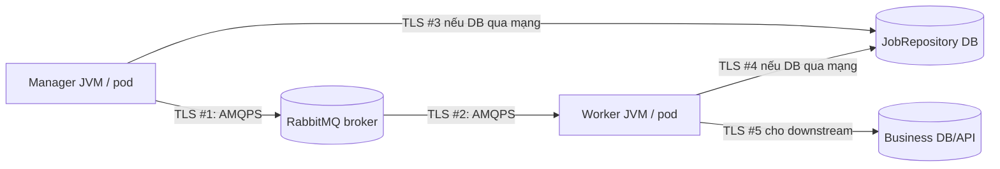
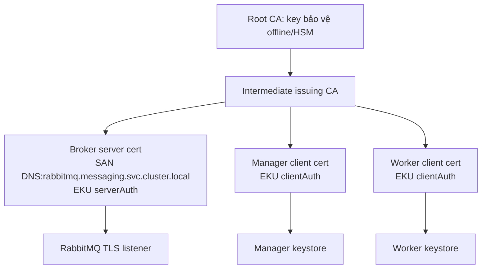
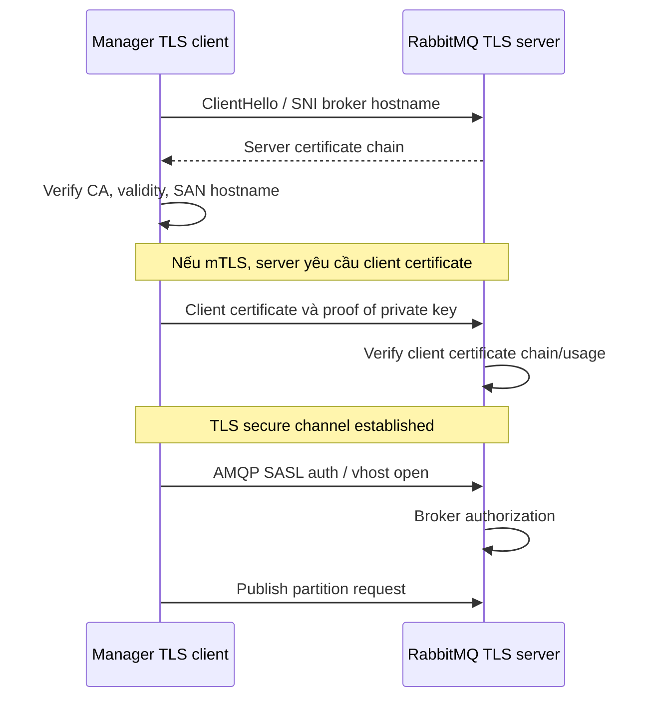
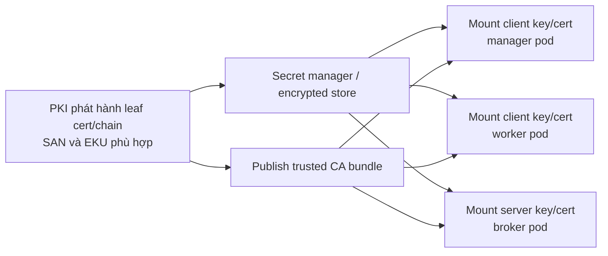
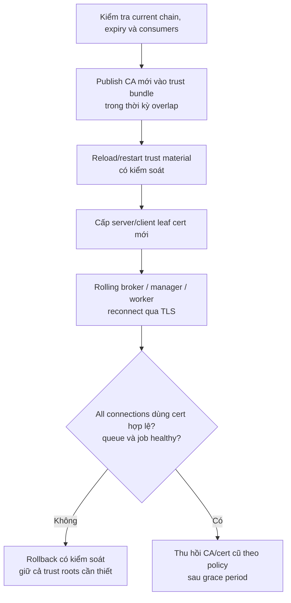
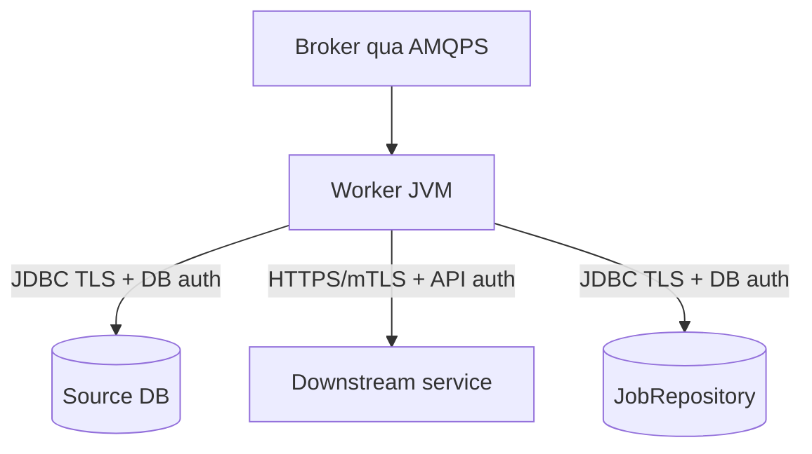
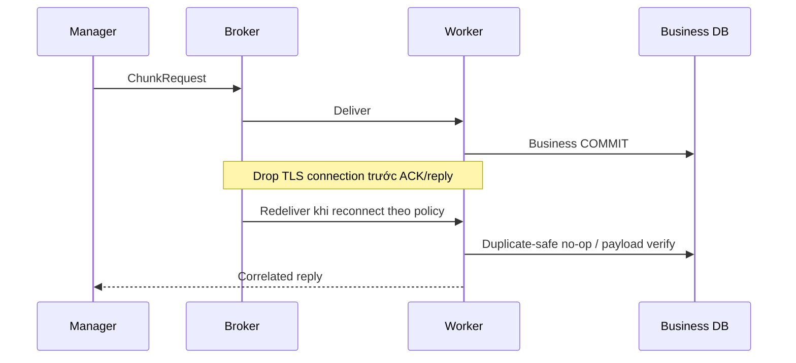

# TLS giữa manager và worker trong Spring Batch Scaling Operations

> **Chương:** Bảo mật  
> **Chủ đề:** TLS giữa manager và worker  
> **Bối cảnh:** Spring Batch **5.2.x**, Java 17, Spring Boot **3.4.x**, Spring Integration/Spring AMQP và RabbitMQ để minh họa.  
> **Mục tiêu:** Thiết kế và kiểm thử TLS/mTLS cho **remote partitioning** và **remote chunking**, bảo đảm xác thực endpoint, bảo mật đường truyền, phân quyền message, certificate rotation, retry/restart an toàn và vận hành khi nhiều JVM/worker pods.

## 1. Vì sao cần TLS khi scale Spring Batch?

Trong single-JVM job, reader, processor và writer trao đổi bằng Java calls. Khi chạy **manager** và **workers** trên nhiều JVM/pods, các yêu cầu thực thi, chunk dữ liệu và phản hồi đi qua network hoặc middleware.

Một số thông tin có thể xuất hiện trên kênh liên lạc:

- `JobExecutionId`, `StepExecutionId`, step/partition name, correlation ID.
- `ExecutionContext` chứa file URI, ranges, source version, business date.
- Với remote chunking, `ChunkRequest` có thể chứa **serialized business items**, kể cả PII.
- Reply, error details, counters, trạng thái xử lý và metadata điều phối.

Nếu kẻ tấn công có thể quan sát hoặc chèn sửa traffic, rủi ro bao gồm tiết lộ dữ liệu và giả mạo/tái phát các message có tác dụng nghiệp vụ. **TLS bảo vệ đường truyền**, nhưng không thay thế broker ACL, authorization hoặc writer idempotent.

Các mục tiêu an ninh:

| Mục tiêu | TLS cung cấp | Còn phải làm |
| --- | --- | --- |
| Confidentiality | Mã hóa bytes trên một network hop | Bảo vệ broker disk, log, DB, backups |
| Integrity | Kiểm tra dữ liệu bị sửa trên hop | Message schema/business validation |
| Server authentication | Client kiểm tra certificate chain và hostname | Tin đúng CA và DNS SAN |
| Client authentication | mTLS khi server yêu cầu client cert | Mapping identity tới quyền |
| Authorization | **Không** cấp quyền queue hay business operations | RabbitMQ vhost/queue ACL, API RBAC |
| Exactly-once business effect | **Không** | Idempotency, transaction, replay/reconciliation |

**Nguyên tắc:** TLS là **điều kiện cần** cho traffic phân tán nhạy cảm, **không phải chứng nhận mọi business message đều đáng tin**.

## 2. “Giữa manager và worker” thường có hai kết nối TLS

Spring Batch 5.2 hỗ trợ remote partitioning/remote chunking qua middleware do Spring Integration và transport adapters cấu hình. Với RabbitMQ, manager thường **không tạo TLS socket trực tiếp tới worker**.



- **TLS #1:** Manager là TLS client; RabbitMQ là TLS server.
- **TLS #2:** Worker là một TLS client khác; RabbitMQ tiếp tục là server.
- **Broker có thể giải mã và lưu message**, nên hai TLS sessions này là **hop-by-hop**, không phải end-to-end encryption của payload từ manager đến worker.
- TLS của JDBC, HTTP, admin API và broker inter-node traffic cần được xem xét **riêng**.
- Nếu ứng dụng dùng direct HTTP/gRPC manager→worker, TLS ở kênh direct đó có kiến trúc khác, không dùng AMQPS config để bảo vệ HTTP.

### TLS termination proxy thay đổi trust boundary

Nếu load balancer/sidecar terminate TLS rồi dùng plaintext đến broker, traffic **không còn được TLS bảo vệ sau proxy**. Chọn TLS passthrough hoặc re-encryption đến broker khi cần, và ghi lại ai verify client certificate. Không giả định broker có thể kiểm tra client cert nếu đã terminate TLS ở proxy.

## 3. Remote partitioning và remote chunking có dữ liệu khác nhau

| Đặc tính | Remote partitioning | Remote chunking |
| --- | --- | --- |
| Request | Worker `StepExecution` / partition context | Chunk items từ manager |
| Worker | Có thể đọc input riêng theo partition | Processor/writer của chunk |
| Sensitive payload | URI, file/range, tenant, execution metadata | Serialized business items, PII |
| Reply | Worker state qua message hoặc JobRepository polling | Chunk response / correlation |
| Primary risk | Worker giả nhận partition, ghi vào sai scope | Đọc trộm payload hoặc injected/replayed chunks |
| TLS cần ở đâu? | Mỗi connection manager/worker ↔ middleware | Mỗi connection manager/worker ↔ middleware |
| Chống duplicate delivery? | **Không do TLS** | **Không do TLS** |

Với **JobRepository polling** thay reply messages, manager vẫn phải gửi requests và workers vẫn phải truy cập repository. Vì vậy TLS cho broker/DB không tự biến mất.

## 4. Phân biệt TLS, mTLS, xác thực broker và phân quyền

- **TLS server verification:** Java client tin certificate chain và so SAN với hostname thực tế của broker.
- **mTLS:** Server cũng yêu cầu client trình certificate và xác minh chain/usage của client.
- **AMQP SASL authentication:** Broker xác thực user qua username/password hoặc cơ chế khác.
- **RabbitMQ EXTERNAL:** Plugin cho phép sử dụng X.509 client certificate làm AMQP identity, nếu **server plugin + client mechanism** đều cấu hình.
- **Authorization:** Broker xác minh principal được phép configure, publish hoặc consume tài nguyên nào.
- **Application validation:** Worker xác minh message type, stepName, IDs, tenant, partition/file identity và retry sequence.

**mTLS không tự tạo RabbitMQ user.** Có thể dùng mTLS để xác minh certificate **và** vẫn dùng SASL username/password ở tầng AMQP. Nếu muốn **certificate-based user authentication**, cần bật `rabbitmq-auth-mechanism-ssl` và client `EXTERNAL`; xem [RabbitMQ — Access Control](https://www.rabbitmq.com/docs/access-control).

Không dùng tài khoản `guest/guest` hoặc admin toàn vhost cho các worker production.

## 5. PKI: Certificate nào cấp cho broker và workers?

Một sơ đồ certificate có thể là:



Checklist khi phát hành:

1. **Server cert** có SAN tương ứng hostname mà client dùng (ví dụ `rabbitmq.messaging.svc.cluster.local`). Không chỉ đặt CN.
2. **Client cert** có `clientAuth` khi broker yêu cầu mTLS; mỗi role/workload identity có key riêng.
3. **Trust anchors**: Manager/worker tin đúng CA cấp server cert; broker tin CA cấp client cert. Không trust mọi CA vô hạn.
4. **Validity/clock**: `notBefore`/`notAfter` hợp lệ, hosts đồng bộ thời gian, cảnh báo expiry.
5. **Certificate chain**: Leaf + intermediate được gửi đầy đủ; private root không được copy lung tung.
6. **Key usage/EKU**: Server/client được dùng đúng mục đích; crypto algorithms đáp ứng chính sách tổ chức.
7. **Revocation/short-lived cert**: Có kế hoạch thu hồi danh tính và đóng các sessions hiện hữu khi sự cố.
8. **Separation of environments**: Không chia sẻ prod private keys, truststores, CA admin với dev/test.
9. **Certificate version** được kiểm soát để có thể xoay vòng và rollback đúng.

### Keystore khác truststore

| Khái niệm | Chứa gì? | Ai dùng? |
| --- | --- | --- |
| `client-keystore.p12` | Client private key + leaf cert + chain | Manager hoặc worker |
| `truststore.p12` | CA/trusted cert để verify broker | Manager/worker |
| `broker-server.key` | Broker private key | Chỉ broker |
| `broker-server-chain.pem` | Broker cert + intermediates | Broker gửi cho TLS clients |
| `client-ca.pem` | CA để broker verify client cert | Broker |
| `SSLContext` | Key/trust managers dùng handshake | Java TLS stack |

Private key không được đặt trong Git, JAR/container image, `ExecutionContext` hoặc JobParameters. Password bảo vệ keystore cũng phải cấp phát an toàn; không hardcode trong repository.

## 6. TLS handshake và hostname verification



Sơ đồ khái quát, không đại diện chính xác từng TLS 1.2/1.3 handshake message.

**Phải bật cả peer trust verification và hostname verification.** Một certificate do CA nội bộ tin cậy cấp nhưng có SAN `other-service.internal` **không** được chấp nhận khi kết nối `rabbitmq.messaging.svc.cluster.local`.

`TLSv1.3` được ưu tiên khi các thư viện/JDK/broker hỗ trợ; `TLSv1.2` có thể được phép theo enterprise policy. Không bật TLSv1.0/1.1 hay cipher suites lỗi thời để tránh sửa chứng chỉ.

## 7. RabbitMQ TLS listener và yêu cầu mTLS

Ví dụ `rabbitmq.conf` khi **tất cả** client đã chuyển sang TLS:

```properties
# RabbitMQ server config, KHÔNG phải Spring Boot application.yml
listeners.tcp = none
listeners.ssl.default = 5671

ssl_options.cacertfile = /etc/rabbitmq/tls/client-ca.pem
ssl_options.certfile = /etc/rabbitmq/tls/broker-server-chain.pem
ssl_options.keyfile = /etc/rabbitmq/tls/broker-server.key

ssl_options.verify = verify_peer
ssl_options.fail_if_no_peer_cert = true
```

Theo [RabbitMQ — TLS Support](https://www.rabbitmq.com/docs/ssl), `verify_peer` yêu cầu server verify client chain, còn `fail_if_no_peer_cert=true` từ chối kết nối không có certificate. Nếu chỉ cấu hình cổng TLS nhưng không yêu cầu certificate thì **chỉ có TLS với server authentication**, chưa phải mTLS.

**Lưu ý vận hành:**

- Không đóng `listeners.tcp` trước khi kiểm tra mọi clients/health probes/sidecars còn phụ thuộc plaintext.
- File private key phải readable bởi broker process nhưng **không** world-readable; kiểm tra file permissions.
- Broker server cert cần đúng SAN; `cacertfile` dành cho client CA, không phải server leaf cert.
- Nếu issuer có intermediates, kiểm tra chain verification và `ssl_options.depth` theo CA hierarchy.
- RabbitMQ management HTTPS, inter-node links, Shovel/Federation có cấu hình TLS riêng.
- Nếu TLS terminate tại ingress/proxy, cần xác định lại phần `verify_peer`/client identity được xử lý ở đâu.

## 8. Spring Boot 3.4: TLS/mTLS cấu hình tại AMQP client

**Spring Batch không có núm `spring.batch.tls.enabled` áp cho mọi worker.** Cấu hình TLS thực hiện ở transport adapter/`ConnectionFactory`.

Manager `application.yml` ví dụ:

```yaml
spring:
  rabbitmq:
    host: rabbitmq.messaging.svc.cluster.local
    port: 5671
    virtual-host: batch-prod
    username: ${RABBITMQ_MANAGER_USER}
    password: ${RABBITMQ_MANAGER_PASSWORD}
    ssl:
      enabled: true
      validate-server-certificate: true
      verify-hostname: true
      key-store: file:/etc/batch/tls/manager-client.p12
      key-store-type: PKCS12
      key-store-password: ${MANAGER_TLS_KEYSTORE_PASSWORD}
      trust-store: file:/etc/batch/tls/broker-trust.p12
      trust-store-type: PKCS12
      trust-store-password: ${BROKER_TLS_TRUSTSTORE_PASSWORD}
```

Worker với identity riêng:

```yaml
spring:
  rabbitmq:
    host: rabbitmq.messaging.svc.cluster.local
    port: 5671
    virtual-host: batch-prod
    username: ${RABBITMQ_WORKER_USER}
    password: ${RABBITMQ_WORKER_PASSWORD}
    ssl:
      enabled: true
      validate-server-certificate: true
      verify-hostname: true
      key-store: file:/etc/batch/tls/worker-client.p12
      key-store-type: PKCS12
      key-store-password: ${WORKER_TLS_KEYSTORE_PASSWORD}
      trust-store: file:/etc/batch/tls/broker-trust.p12
      trust-store-type: PKCS12
      trust-store-password: ${BROKER_TLS_TRUSTSTORE_PASSWORD}
```

- Host phải khớp certificate SAN, không dùng IP khi cert chỉ cấp DNS SAN.
- `key-store` chứa **client** key/cert cho mTLS; `trust-store` chứa CA tin broker.
- `validate-server-certificate` và `verify-hostname` phải giữ `true`.
- Username/password vẫn cần nếu dùng **AMQP SASL PLAIN** sau mTLS; muốn EXTERNAL phải cấu hình client/server khác.
- Mọi password được hiển thị dưới dạng **placeholder environment variable**; không đưa secret thật vào source control, build artifact hoặc actuator env endpoint công khai.
- Ưu tiên secret manager và mount file có quyền đọc hạn chế; môi trường biến cũng có rủi ro bị quan sát bởi bên có quyền process/pod.
- Nếu tự tạo Spring AMQP `ConnectionFactory` thay vì dùng auto-config, đảm bảo nó sử dụng `SSLContext`/hostname verification phù hợp.

Đối chiếu [Spring Boot 3.4 — Application Properties](https://docs.spring.io/spring-boot/3.4/appendix/application-properties/index.html).

## 9. Spring Integration: TLS nằm ở transport, không nằm trong StepBuilder

Ví dụ **remote partitioning manager** trên Spring Batch 5.2:

```java
package com.example.batch.security;

import org.springframework.batch.core.Step;
import org.springframework.batch.core.partition.support.Partitioner;
import org.springframework.batch.core.repository.JobRepository;
import org.springframework.batch.integration.partition.RemotePartitioningManagerStepBuilder;
import org.springframework.beans.factory.annotation.Qualifier;
import org.springframework.context.annotation.Bean;
import org.springframework.context.annotation.Configuration;
import org.springframework.messaging.MessageChannel;

@Configuration(proxyBeanMethods = false)
public class SecureRemotePartitionManager {

    @Bean
    Step managerStep(
            JobRepository jobRepository,
            @Qualifier("filePartitioner") Partitioner partitioner,
            @Qualifier("outgoingRequests") MessageChannel requests,
            @Qualifier("incomingReplies") MessageChannel replies) {

        return new RemotePartitioningManagerStepBuilder(
                    "managerStep", jobRepository)
                .partitioner("workerStep", partitioner)
                .gridSize(8)
                .outputChannel(requests)
                .inputChannel(replies)
                .build();
    }
}
```

**Đây là skeleton để thấy đúng security boundary, chưa chạy độc lập:**

- Chưa có `filePartitioner`, `outgoingRequests`/`incomingReplies`, AMQP adapters/queue names, Job, worker step, JobRepository, datasource và test setup.
- Spring Integration flow phải nối `MessageChannel` với AMQP adapters dùng **`CachingConnectionFactory` đã cấu hình TLS**; không để một custom factory khác mặc định plaintext.
- Worker cũng có **inbound/outbound channels** và transport connection riêng đến RabbitMQ. Khi dùng repository polling thay replies, manager có thể không cần reply channel nhưng vẫn cần bảo vệ JDBC connections.
- `gridSize` và `partitioner` quyết định cách chia việc, **không liên quan tới xác thực TLS**.
- `StepExecutionRequestHandler` thực hiện worker step theo contract; cần bảo vệ message origin, stepName allowlist và JobRepository identity.
- Broker giải mã/định tuyến message: TLS không thay message-level signature hoặc encryption nếu threat model cần bí mật trước cả broker.

```text
Batch manager builder
    → Spring Integration output channel
    → AMQP adapter / TLS-enabled ConnectionFactory
    → RabbitMQ (TLS hop #1)
    → AMQP consumer / TLS-enabled ConnectionFactory (hop #2)
    → Spring Integration input channel
    → Batch worker step / StepExecutionRequestHandler
```

## 10. Broker authorization: Đừng cấp wildcard toàn quyền

Topology ví dụ:

```text
vhost: batch-prod
request exchange/queue: batch.partition.requests / batch.partition.request.q
reply exchange/queue:   batch.partition.replies  / batch.partition.reply.q

manager principal:
    publish requests, consume replies

worker principal:
    consume requests, publish replies

provisioner principal:
    declare exchanges/queues/bindings/DLQ
```

| Principal | Request resources | Reply resources | Configure |
| --- | --- | --- | --- |
| Manager | Publish | Consume | Không, nếu topology pre-provisioned |
| Worker | Consume | Publish | Không |
| Provisioner | Theo deployment | Theo deployment | Có, audit riêng |
| Ứng dụng ngoài | Denied | Denied | Denied |

RabbitMQ thực thi permissions theo **exchange/queue/vhost và operation cụ thể**. Một adapter tự khai báo queue khi startup có thể cần quyền `configure`, nên chọn **pre-provision** hoặc ACL hẹp có kiểm thử. Không lấy bảng roles này làm các giá trị regex `set_permissions` chính xác cho mọi topology.

**mTLS certificate không tự cho phép publish mọi queue.** Nếu nhiều tenants, cần tách vhost/authorization, không chỉ tin một header `tenantId` tự khai báo.

### Message validation ở worker

Sau khi TLS/broker auth thành công, worker vẫn cần:

- Message type/schema/version và size limit.
- `jobName`/`stepName` thuộc allowlist cho role.
- `JobExecutionId`/`StepExecutionId` có tồn tại trong trusted JobRepository và còn hợp lệ không.
- Partition/file/range gắn đúng immutable manifest đã được phê duyệt.
- Tenant và source ID nằm trong phạm vi worker được phép.
- Retry/duplicate/stale requests được xử lý bằng business idempotency/ownership.
- Không deserialise tùy ý Java object từ nguồn không tin cậy; dùng allowlisted formats/types.

**Có thể bị phân quyền đúng ở broker nhưng thực hiện hành động sai ở worker nếu payload không được kiểm chứng.**


## 11. Tạo và phân phối truststore/keystore đúng cách

Trong production, certificate/private key nên được cấp bởi enterprise PKI, Vault PKI, cert-manager hoặc giải pháp quản lý khóa được duyệt. **Không** tự tạo private key production trong quá trình build Docker image hay khi job bắt đầu nếu chưa có chính sách quản lý lifecycle.

Một chuỗi cấp phát chuẩn:



**Quy trình vận hành:**

1. Tạo key pair ở môi trường được quản lý, dùng algorithm/size theo security baseline.
2. Yêu cầu certificate chứa SAN và EKU phù hợp; kiểm tra Subject, Issuer, expiry, serial, chain.
3. Cấp **client identities khác nhau** cho manager và worker; nếu chung broker CA, vẫn tách quyền AMQP user/vhost.
4. Cấp broker server cert có SAN cho **DNS thực dùng** khi kết nối.
5. Đóng gói keystore/truststore PKCS12 nếu JVM/Boot configuration yêu cầu.
6. Phân phối qua secret mount có file permissions phù hợp container UID/GID, không copy vào immutable image.
7. Không dùng cùng mật khẩu cố định ở tất cả clusters; secrets nên có rotation/audit.
8. Khi revoke/rotate cert, update broker trust và client trust theo rollout protocol, không gây outage hàng loạt.
9. Kiểm tra chain/hostname bằng một TLS client độc lập trước khi giao application team.

### Kiểm tra truststore bằng keytool

Ví dụ lệnh **chỉ đọc** (chạy trong môi trường quản trị đã được cấp quyền):

```bash
# Password lấy từ biến môi trường đã thiết lập an toàn.
# Không in password ra shell history/log.
keytool -list -v \
  -keystore /etc/batch/tls/broker-trust.p12 \
  -storetype PKCS12 \
  -storepass:env BROKER_TLS_TRUSTSTORE_PASSWORD
```

Kiểm tra alias, issuer, validity, fingerprints và chain. Nếu cần import CA mới, **xác minh fingerprint qua kênh tin cậy trước**, không blindly `-noprompt` import file tải từ nguồn chưa xác thực.

### Không đưa private key vào log

Tránh in:

- `openssl pkey -text` vào CI logs.
- Env dump chứa `*_PASSWORD`.
- Toàn bộ Spring `Environment` hoặc actuator env/configprops không được bảo vệ.
- PEM private key hoặc `.p12` dưới dạng base64 trong các bài hướng dẫn/chat/incident tickets.
- Private key trong `StepExecutionContext`/batch metadata.

Certificate public có thể được kiểm tra fingerprint/expiry với quyền phù hợp, nhưng **private key không phải dữ liệu debug**.

## 12. Java SSL bundles và lựa chọn cấu hình trong Spring Boot

Spring Boot 3.4 cung cấp **named SSL bundles** qua `spring.ssl.bundle`. Có thể dùng bundles khi nhiều clients cần tái sử dụng key/trust material, nhưng mỗi integration phải hỗ trợ tham chiếu bundle.

Ví dụ cấu hình **thay thế** phần `rabbitmq.ssl.key-store/trust-store` trực tiếp ở phần 8:

```yaml
spring:
  ssl:
    bundle:
      jks:
        manager-broker:
          keystore:
            location: file:/etc/batch/tls/manager-client.p12
            type: PKCS12
            password: ${MANAGER_TLS_KEYSTORE_PASSWORD}
          truststore:
            location: file:/etc/batch/tls/broker-trust.p12
            type: PKCS12
            password: ${BROKER_TLS_TRUSTSTORE_PASSWORD}
  rabbitmq:
    host: rabbitmq.messaging.svc.cluster.local
    port: 5671
    username: ${RABBITMQ_MANAGER_USER}
    password: ${RABBITMQ_MANAGER_PASSWORD}
    ssl:
      enabled: true
      bundle: manager-broker
      validate-server-certificate: true
      verify-hostname: true
```

**Đây là lựa chọn thay thế, không ghép tùy tiện cùng lúc nhiều nguồn SSL config.** Tên field `spring.rabbitmq.ssl.bundle` và `spring.ssl.bundle.jks` được Spring Boot 3.4 hỗ trợ; nếu ứng dụng tạo ConnectionFactory thủ công hoặc dùng Spring Boot khác, phải đối chiếu auto-configuration thật.

Tham khảo [Spring Boot 3.4 — SSL Bundles](https://docs.spring.io/spring-boot/3.4/reference/features/ssl.html).

### Không có “SSL bundle chung cho mọi thứ” mặc định

RabbitMQ, JDBC, Kafka, HTTP client và server connector có thể dùng những SSL contexts khác nhau. Một bundle gắn cho RabbitMQ **không tự cấu hình TLS cho JobRepository PostgreSQL** hoặc RestClient gọi downstream.

Nếu nhiều service dùng cùng broker CA, có thể chia sẻ trust anchors nhưng **không nên chia sẻ private key** giữa roles chỉ để giảm số file.

## 13. Container/Kubernetes: Mount secrets thay vì bake vào image

Một Pod manifest minh họa cách mount **certificates đã được provision sẵn**:

```yaml
apiVersion: apps/v1
kind: Deployment
metadata:
  name: batch-worker
spec:
  replicas: 3
  selector:
    matchLabels:
      app: batch-worker
  template:
    metadata:
      labels:
        app: batch-worker
    spec:
      automountServiceAccountToken: false
      containers:
        - name: worker
          image: example.invalid/batch-worker:versioned-digest
          volumeMounts:
            - name: broker-tls
              mountPath: /etc/batch/tls
              readOnly: true
          env:
            - name: SPRING_RABBITMQ_HOST
              value: rabbitmq.messaging.svc.cluster.local
            - name: WORKER_TLS_KEYSTORE_PASSWORD
              valueFrom:
                secretKeyRef:
                  name: batch-worker-tls-password
                  key: password
      volumes:
        - name: broker-tls
          secret:
            secretName: batch-worker-tls
            defaultMode: 0440
```

**Lưu ý trước khi sử dụng:**

- `batch-worker-tls` và `batch-worker-tls-password` là tên giả định; phải tạo qua secret management được duyệt.
- `image: example.invalid/...` là placeholder, không phải image có sẵn. Trong production, pin image digest và kiểm soát supply chain.
- `defaultMode: 0440` chỉ hữu ích khi UID/GID của container có quyền đọc đúng file; cần xác minh `securityContext`/`fsGroup`, không đổi permission thành `0777`.
- Secret dưới dạng environment variable vẫn có nguy cơ lộ qua process inspection/diagnostics đối với người có quyền; có thể mount passphrase file và dùng secret integration phù hợp nếu yêu cầu cao hơn.
- Không đưa file cert hoặc password vào ConfigMap công khai; không ghi base64 Secret values vào Git mà không có encryption/workflow phê duyệt.
- `automountServiceAccountToken: false` phù hợp nếu worker không cần Kubernetes API; nếu cần, cấp ServiceAccount/RBAC tối thiểu thay vì mặc định cluster-wide.
- Mỗi manager/worker cần mounts riêng theo certificate role. Mẫu này minh họa **worker**.
- Phải kiểm tra logic reload TLS material khi secret volume thay đổi; **file rotation không đồng nghĩa connection pool đã dùng cert mới**.
- NetworkPolicy nên giới hạn worker egress tới broker/DB/monitoring cần thiết, manager egress tương ứng; TLS và network isolation bổ trợ nhau.

### Điều gì xảy ra khi Pod bị rescheduled?

Pod mới cần mount chính xác secrets phiên bản hợp lệ và kết nối AMQPS trước khi nhận partition/chunk request. Nếu TLS handshake fail, worker nên **fail readiness/không consume**, chứ không lặng lẽ fallback sang `amqp://...:5672`.

## 14. Certificate rotation không gián đoạn job lớn

Remote Spring Batch có thể chạy vài giờ hoặc nhiều ngày; certificate sẽ hết hạn và connections có thể reconnect khi broker/network bị gián đoạn. **Chỉ thay file key trên volume không bảo đảm Java SSLContext/ConnectionFactory sẽ tự nạp lại**.

### Quy trình rotation có giai đoạn



Thực hiện **từng bước**:

1. Inventory: broker endpoints, server cert, client identities, job windows và các kết nối persistent.
2. Phát hành trust bundle chứa **CA hiện tại và CA mới** trước khi đổi leaf cert (nếu đang đổi CA).
3. Triển khai trust bundle cho cả manager và worker; kiểm tra thực sự được nạp vào SSL contexts.
4. Cấp leaf cert mới cho broker/server có SAN tương đương; client certs mới cho manager/worker.
5. Rolling restart/reconnect theo capacity budgets; giám sát consumers, outstanding chunks/partitions và business DB writes.
6. Thực hiện negative tests: cert cũ khi đã hết hiệu lực/phân quyền bị revoke phải fail trong phạm vi chính sách.
7. Chỉ loại CA cũ sau khi xác nhận không còn components phụ thuộc.

**Quan trọng:** Kết nối TLS đã thiết lập có thể tiếp tục sử dụng phiên hiện tại cho tới khi disconnect/rekey theo implementation; revoke/rotate certificate không phải công tắc kill ngay mọi active session. Khi cần chặn client bị xâm phạm, phải kết hợp disable principal, close broker connections, rotate secrets và revoke cert.

### Tránh đồng loạt kill mọi workers

Trong remote partitioning, kill cùng lúc tất cả worker pods có thể để lại jobs `STARTED` và in-flight StepExecutions không có reply. Cần drain, lease/fencing, restart policy và idempotent writers. TLS rotation là một sự kiện vận hành, **không phải lý do bỏ qua checkpoint/reconciliation**.

## 15. TLS hoạt động nhưng broker vẫn có thể giữ plaintext

TLS bảo vệ bytes trên network hop. Broker có thể:

- Nhận message và lưu dữ liệu trên disk/quorum queue.
- Ghi thông tin header, routing key, exception hoặc một phần payload vào logs/traces.
- Xuất message qua management API hoặc admin tools.
- Có backups chứa queue contents.
- Chuyển tiếp tới another broker/cluster qua Federation/Shovel có transport security riêng.

Vì vậy đối với dữ liệu nhạy cảm:

- Giảm payload ở message: remote partitioning gửi **resource IDs/version** thay vì raw secrets/path credentials.
- Không truyền password/JWT/cloud access key qua `ExecutionContext`, header hay `JobParameters`.
- Với remote chunking, chỉ gửi những fields thật sự cần worker xử lý, tránh object serialization quá rộng.
- Cấu hình broker encryption-at-rest, volume permissions, backup retention và access audit theo risk assessment.
- Giới hạn TTL/DLQ/retention của message và quyền truy cập management.
- Nếu bắt buộc broker **không được biết nội dung**, cần **application-level encryption** có key management riêng; TLS giữa client và broker không đáp ứng mục tiêu đó.

### “Bật TLS” không phải “đã tuân thủ data classification”

Nếu source chứa PII/tài chính, đánh giá data classification, data minimization, tenancy, log redaction và incident response cùng với TLS. Không dùng `ChunkRequest` để gửi cả một object có private key hoặc DB connection string.

## 16. TLS ảnh hưởng tới retry, restart và remote delivery thế nào?

Khi một TCP/TLS connection bị mất:

```text
t0  Manager publish ChunkRequest #42
t1  Worker nhận request qua AMQPS
t2  Worker commit business DB
t3  TLS connection reset trước ACK/reply tới manager
t4  Broker có thể redeliver theo queue/ack policy
t5  Worker khác xử lý lại request #42
```

**TLS bảo đảm confidentiality/integrity của mỗi connection, không bảo đảm exactly-once delivery.** Một lỗi handshake/reconnect sau commit có thể biến thành duplicate delivery.

| Mốc lỗi | Dấu hiệu | Hành động an toàn |
| --- | --- | --- |
| Trước broker accept publish | Client biết publish fail hoặc outcome không rõ | Publisher confirm/reconcile trước retry |
| Broker đã nhận, client mất confirm | Publish outcome không rõ | Stable message/business key, dedup |
| Worker nhận, chưa business commit | Message requeue theo transport contract | Retry/rollback và validation |
| Sau business commit, trước ACK | Message redeliver | Idempotent writer, same business event key |
| Manager mất reply | Execution không rõ terminal | Repository/worker reconciliation, correlation |
| Mất TLS khi rotate cert | Consumer disconnect/reconnect | Bounded backoff, liveness/heartbeat, no plaintext fallback |

**Không dùng `jobExecutionId` một mình làm business idempotency key**: restart tạo JobExecution mới; cùng business event phải vẫn được nhận diện là một event. Đừng coi `retryLimit(3)` của Batch Step là giới hạn toàn bộ broker redeliver hoặc số TLS reconnection attempts.

### Cần phân biệt ba lớp retry

- **Transport retry/reconnect:** Cố thiết lập lại TLS/AMQP connection.
- **Broker redelivery:** Giao lại message chưa ACK; có thể tăng số physical processing attempts.
- **Spring Batch retry/restart:** Re-execute item/chunk/step theo policy và JobRepository.

Ba lớp có phạm vi khác nhau và có thể cộng dồn tải. Theo dõi attempt counts riêng, không dùng một counter “retry_total” mơ hồ.

## 17. TLS handshake và connection pooling: Tuning hiệu năng

TLS có overhead khi handshake, xử lý crypto và certificate verification. Tuy vậy, với workload Batch lớn, **bottleneck thường là I/O/DB/processor/queue**, không nên tự quy kết mọi giảm throughput cho TLS.

Các điểm cần đo:

| Chỉ số | Ý nghĩa khi thay TLS |
| --- | --- |
| AMQP connection establishment p95 | TLS handshake và broker authentication |
| TLS handshake failure/retry rate | Cert/CA/protocol/clock mismatch |
| Active AMQP connections/channels | Connection churn hoặc pooling sai |
| Message round-trip latency | Transport + queue + worker processing |
| Manager pending replies | Broker congestion, worker chậm/lost reply |
| Worker CPU và GC | Crypto + serialization + workload |
| Broker CPU/socket stats | TLS và routing throughput |
| DB goodput/lock waits | Có bị bottleneck khác lấn át? |
| Redelivery/duplicate no-ops | Mất connection trong lúc commit/ACK |
| End-to-end job elapsed | SLO thực tế, không chỉ handshake time |

### Tránh tạo một TLS connection cho mỗi item

Nếu mỗi item/chunk tự mở `new ConnectionFactory / new connection`, số handshakes và resource usage sẽ lớn. Spring AMQP `CachingConnectionFactory` giúp tái sử dụng kết nối/channels theo contract; cần cấu hình pooling và lifecycle đúng.

**Không giữ TLS session vô hạn để né rotation.** Connection pooling phải đi kèm certificate rotation/reload protocol và test reconnect. Mỗi thay đổi timeout, heartbeat hoặc reconnect backoff nên được kiểm thử với broker under load.

### TLS và connection churn trong nhiều partitions

Một remote partition worker xử lý nhiều partitions qua **một số kết nối AMQP lâu dài**. Tăng `gridSize` từ 8 lên 64 thường làm tăng request/response volume, **không nhất thiết tạo 64 TLS handshakes** nếu connection factory được cache đúng. Nếu thấy handshake count tỷ lệ với item count, kiểm tra xem application đang tạo connection per request sai hay không.

## 18. Kết nối JDBC/HTTP cũng phải bảo vệ: Không chỉ AMQP

Ví dụ remote worker đọc nguồn qua JDBC và ghi vào downstream API:



AMQPS tới broker **không bảo vệ**:

- JDBC connection trực tiếp tới PostgreSQL/Oracle/MySQL.
- HTTP/gRPC call từ worker tới enrichment/payment service.
- Object storage GET/PUT từ worker.
- Inter-node traffic trong RabbitMQ cluster.
- Kubernetes control-plane API hoặc metrics endpoints.

Cấu hình TLS cho từng driver/protocol theo hướng dẫn của chính hệ đó, kiểm tra hostname/CA/auth, không chỉ bật một flag `ssl=true` mà chưa xác minh certificate policy.

### Phân quyền DB

Manager và worker có thể cần truy cập chung `JobRepository` nhưng **không nên mặc định có quyền DDL/superuser**. Tách migration/admin role và runtime SQL roles nếu tổ chức hỗ trợ. Khi workers có dữ liệu nhiều tenant, partition ownership và business authorization vẫn cần kiểm tra trong ứng dụng; TLS của JDBC không thay row-level policy.

## 19. Giám sát an ninh mà không lộ dữ liệu mật

Một structured log về TLS/broker cần đủ correlation để điều tra, nhưng không tiết lộ key/certificate PEM:

```text
event=AMQP_TLS_CONNECTED
role=worker brokerHost=rabbitmq.messaging.svc.cluster.local
protocol=TLSv1.3 cipherFamily=approved
connectionRole=consumer
certExpiresInDays=23
outcome=SUCCESS

event=AMQP_TLS_HANDSHAKE_FAILED
role=manager brokerHost=rabbitmq.messaging.svc.cluster.local
reason=HOSTNAME_MISMATCH
outcome=REJECTED

event=AMQP_AUTHORIZATION_DENIED
role=worker vhost=batch-prod operation=publish
resourceClass=unexpected_exchange
outcome=DENIED
```

Đây là **schema log minh họa**, không phải log mặc định của Spring Batch, Spring AMQP hay RabbitMQ. Việc thu thập TLS negotiated protocol/cipher/cert expiry có thể cần listener/instrumentation cụ thể; không tự bịa trường nếu không có nguồn đo.

Metrics hữu ích:

- `amqp_tls_handshake_fail_total` theo role/reason.
- `amqp_tls_connection_active` theo role/broker class.
- `tls_certificate_days_to_expiry` theo **stable workload role**, không label serial/cert fingerprint.
- `amqp_reconnect_attempt_total` và `amqp_auth_failure_total`.
- `broker_permission_denied_total`.
- `batch_remote_request_inflight`, `batch_remote_reply_timeout_total`.
- `batch_remote_redelivery_total`.
- `batch_business_duplicate_noop_total` và reconciliation mismatch.
- `batch_job_failed_total` do transport-related failures (khi đã phân loại đúng).

**Không log:** private key, keystore password, raw authorization header, raw serialized business payload, toàn bộ `ExecutionContext` chứa credentials, hay thông điệp TLS debug ở mức tiết lộ secrets trong production.

### Metric labels

Dùng `jobName`, `role`, `outcome`, `brokerCluster` nếu cardinality ổn định. Không gắn `JobExecutionId`, `StepExecutionId`, `fileId`, `certificate serial`, `messageId` vào Prometheus labels của hàng triệu messages. Chi tiết nằm trong structured logs/traces có retention/access controls.


## 20. Kiểm thử handshake bằng OpenSSL và phân tách lỗi

Trước khi chạy JobExecution thật, kiểm tra broker TLS listener từ **cùng network namespace** hoặc từ một client test có trust material tương đương. Chỉ chạy các bài kiểm tra này trên môi trường được ủy quyền; không copy private key production về máy cá nhân để debug.

Ví dụ **Linux shell** khi broker yêu cầu mTLS, dùng test PEM client key đã được provision an toàn:

```bash
openssl s_client \
  -connect rabbitmq.messaging.svc.cluster.local:5671 \
  -servername rabbitmq.messaging.svc.cluster.local \
  -verify_hostname rabbitmq.messaging.svc.cluster.local \
  -verify_return_error \
  -CAfile /secure/test-ca/broker-ca.pem \
  -cert /secure/test-client/manager-client.pem \
  -key /secure/test-client/manager-client.key \
  -brief < /dev/null
```

- `-servername` gửi SNI; `-verify_hostname` kiểm tra server identity khớp SAN.
- `-CAfile` phải chứa CA hợp lệ của broker, không là chứng chỉ vừa tải từ nguồn chưa kiểm chứng.
- `-cert` và `-key` chỉ là client identity test được cấp đúng quyền khi broker đòi mTLS.
- `-brief` cần OpenSSL có hỗ trợ; điều chỉnh theo version thực tế.
- Handshake thành công **không chứng minh** AMQP login/vhost ACL/queue publish/consume thành công.
- Không bật `-debug` hoặc TLS key logging ở production khi chưa kiểm soát lộ lọt dữ liệu.

Nếu ứng dụng dùng PKCS12, không cần xuất **private key production** ra PEM chỉ để debug; có thể dùng test client identity và log/trace đã được phê duyệt.

### Kiểm tra certificate metadata mà không đọc private key

```bash
openssl x509 \
  -in /secure/test-ca/broker-server.pem \
  -noout -subject -issuer -dates -ext subjectAltName
```

Những thuộc tính cần xem: issuer/chain, SAN, validity, serial/fingerprint và EKU. Nếu file không đúng định dạng hoặc permission sai, sửa provisioning, **không sửa bằng cách tắt certificate validation**.

### Phân biệt các lỗi

| Lỗi | Nguyên nhân thường gặp | Bước xác minh |
| --- | --- | --- |
| `PKIX path building failed` | Truststore thiếu đúng CA/intermediate | Client truststore và broker chain |
| `No subject alternative DNS name matching` | Hostname không khớp SAN | DNS/SNI/SAN; cấp lại cert |
| `certificate_unknown` | Một peer không tin cert được trình | Kiểm tra cả client và broker logs |
| `bad_certificate` | Cert sai issuer/EKU/format | Chain, key usage, issuance |
| `handshake_failure` | Protocol, cipher, client cert hoặc CA mismatch | Compare supported TLS configurations |
| `unknown_ca` | CA chưa được trust ở một phía | Xác định phía từ chối |
| `connection refused` | Broker listener/port/network sai | Service/DNS/firewall/network policy |
| Handshake OK, login denied | AMQP SASL/EXTERNAL user sai | Broker auth logs và principal |
| Login OK, publish denied | Vhost/queue/exchange permissions | Broker ACL/bindings |
| Chỉ fail sau cert rotation | SSLContext cũ, trust bundle chưa reload | Certificate được client/broker sử dụng thực |
| Manager STOPPING sau disconnect | Reply/ACK outcome chưa rõ | JobRepository/worker/business reconciliation |

Đừng tự quy mọi `SSLHandshakeException` thành lỗi expired cert. Phải biết lỗi nằm ở **TCP, TLS, SASL, ACL, message handling hay business transaction**.

## 21. Negative tests: Từ chối cấu hình hoặc danh tính sai

Kiểm thử TLS/mTLS phải có **cả positive và negative tests**. Một ứng dụng kết nối đúng certificate thành công chưa chứng minh nó sẽ từ chối endpoint giả.

| Case | Fault injection | Expected outcome |
| --- | --- | --- |
| A | Broker cert đúng CA/SAN và client cert hợp lệ | TLS handshake SUCCESS |
| B | Server cert CA lạ | Handshake FAIL |
| C | Server cert đúng CA nhưng SAN sai | Hostname verification FAIL |
| D | Expired/not-yet-valid server cert | Handshake FAIL |
| E | Client thiếu certificate, broker yêu cầu mTLS | Handshake FAIL |
| F | Client cert do CA không được broker trust ký | Handshake FAIL |
| G | Client cert có key usage/EKU sai | Reject theo TLS stack/security policy |
| H | TLS protocols/ciphers không có giao nhau | Handshake FAIL |
| I | TLS đúng, AMQP SASL password sai | AMQP auth FAIL |
| J | mTLS đúng, account thiếu queue permission | Publish/consume DENIED |
| K | Worker dùng principal manager nhưng không có worker ACL | Consume request DENIED |
| L | TLS listener tắt, plaintext listener còn mở | Application FAIL, không fallback |
| M | Thêm CA-B vào trust bundle | New cert từ CA-B được chấp nhận |
| N | Loại CA-A sau cutover | New handshakes bằng cert CA-A bị reject |
| O | Kết nối bằng IP nhưng certificate chỉ có DNS SAN | Hostname verification FAIL |
| P | Pod không mount đúng keystore/truststore | Startup/connect FAIL |
| Q | Request có stepName/tenant sai dù broker auth OK | Application validation FAIL |
| R | TLS connection drop sau DB COMMIT | Redelivery không có duplicate business effect |

**Không** chạy test trong production bằng cách disable hostname/cert verification. Thử trong môi trường isolation và ghi nhận expected failure.

### Xác minh có thực sự yêu cầu mTLS

Nếu client không gửi `-cert/-key` vẫn kết nối được vào endpoint được tuyên bố “mTLS required”, cần kiểm tra:

1. Có đang vào đúng hostname/port/listener?
2. RabbitMQ `ssl_options.verify` và `fail_if_no_peer_cert` đã được nạp?
3. Proxy có terminate TLS và che client identity không?
4. Application có chuyển sang cổng plaintext khác không?
5. AMQP server log có bằng chứng certificate peer verification không?

TLS encryption **không** đồng nghĩa server đã xác thực client bằng certificate.

## 22. Integration test: TLS và kết quả Batch phải cùng đúng

Một end-to-end test với **remote partitioning** có thể có contract:

```text
Given:
  Immutable manifest M
  Một manager và ít nhất hai worker JVMs/pods
  RabbitMQ AMQPS listener, mTLS và broker ACL
  Trusted JobRepository
  Business writer idempotent theo event key

When:
  Manager launch một JobInstance với manifest M
  Manager publish StepExecutionRequest qua TLS session #1
  Worker consume qua TLS session #2
  Worker chạy đúng StepExecution/partition range và COMMIT
  Manager nhận reply hoặc poll JobRepository

Then:
  Mỗi partition đúng input range/version
  All eligible business keys xuất hiện đúng một lần
  No missing/duplicate/altered effects
  Job/Step terminal statuses khớp thực tế
  Both network hops verify CA/SAN/client policy
  No fallback AMQP plaintext
```

Remote chunking tương tự nhưng phải xác minh serialized items, chunk reply correlation, broker ACK và lost reply. Test `openssl s_client` đơn lẻ **không thay thế** end-to-end Batch test.

### Inject lỗi sau COMMIT, trước ACK



Test assertions:

- Event không được áp dụng lại sau replay nếu đã commit.
- Cùng business key nhưng payload khác phải tạo conflict/fail, không bị `ON CONFLICT DO NOTHING` che đi.
- JobRepository không bị ép `COMPLETED` khi reply chưa rõ hoặc worker còn in-flight.
- Worker chỉ thực thi StepExecution/partition hợp lệ trong JobRepository/manifest.
- Reconnect sau rotation dùng đúng certificate/CA/trust policy mới.
- Không tạo JobInstance mới bằng random `run.id` chỉ để lách failed/restarted execution.

Với tests có worker threads/JVM khác, một `@Transactional` trên JUnit method **không tự bao phủ** transactions của workers. Setup input phải commit trước khi launch; assertions chạy sau terminal/reconciliation.

## 23. Direct manager-worker HTTPS/mTLS: Không phải AMQPS

Nếu ứng dụng xây **custom HTTP/gRPC remote invocation**, worker có thể là TLS server và manager là TLS client. Đây là kiến trúc khác broker-mediated AMQP, nên phải có TLS của cả client lẫn server.

Ví dụ Spring Boot **worker HTTP server**:

```yaml
server:
  port: 8443
  ssl:
    enabled: true
    key-store: file:/etc/batch/tls/worker-server.p12
    key-store-type: PKCS12
    key-store-password: ${WORKER_SERVER_KEYSTORE_PASSWORD}
    trust-store: file:/etc/batch/tls/manager-client-ca.p12
    trust-store-type: PKCS12
    trust-store-password: ${MANAGER_CA_TRUSTSTORE_PASSWORD}
    client-auth: need
```

**Đây chỉ là ví dụ HTTPS transport server; Spring Batch không tự sinh endpoint HTTP remote step từ YAML này.** Manager phải có SSLContext/client cert và hostname verification; ứng dụng cần API authentication/authorization, step allowlists, replay protection và business validation.

Điều kiện tối thiểu:

1. Worker server certificate có SAN khớp DNS service.
2. Manager thực hiện server trust + hostname verification.
3. `client-auth: need` yêu cầu manager client certificate tại TLS handshake.
4. Worker API chỉ cho phép principal có quyền với JobExecution/StepExecution/tenant đó.
5. Có schema/version, correlation ID, request timeouts và idempotent retries.
6. Nếu có ingress/mesh proxy, hiểu đúng trust termination/bypass.
7. Port 8443 là ví dụ; không mở management endpoints cùng quyền với API worker.

## 24. JMS, Kafka và service mesh: Transport-specific TLS

Spring Batch remote integration không chỉ có RabbitMQ.

| Transport | TLS nằm ở đâu? | Cần bảo vệ |
| --- | --- | --- |
| RabbitMQ AMQP | RabbitMQ `ConnectionFactory` và broker TLS listener | CA/SAN, mTLS/SASL, vhost/queue/exchange ACL |
| JMS/Artemis | Vendor-specific `ConnectionFactory` và broker SSL transport | Destinations, credentials, trust chain |
| Kafka | Kafka `security.protocol`/`ssl.*` và listeners | Broker identity, keystore/truststore, topic ACL |
| HTTP/gRPC | Client SSLContext và worker HTTPS server | Client/server cert, per-method RBAC |
| Service mesh | Sidecar mTLS policy và workload identity | Enforcement mode, no bypass, identity propagation |

Đối với Kafka, không dùng `spring.rabbitmq.ssl.*`; một Kafka client có thể dùng `security.protocol=SSL` hoặc `SASL_SSL` với truststore/keystore tương ứng. Với JMS, TLS config là vendor-dependent; không có một property `spring.jms.tls.enabled` chung cho mọi JMS broker.

### Service mesh có đủ không?

Mesh `STRICT mTLS` có thể bảo vệ sidecar-to-sidecar, nhưng cần xác minh application→sidecar, sidecar→broker, broker admin API/JDBC và các đường bypass. Mesh cũng **không thay thế** broker ACL hay business message validation.

Nếu broker là service bên ngoài mesh hoặc TLS terminate tại load balancer, phải bảo vệ chặng tiếp theo theo threat model. Certificate rotation của mesh và của application AMQPS có thể là **hai lifecycle khác nhau**.

## 25. Runbook khi manager/worker không kết nối qua TLS

Một trình tự điều tra an toàn:

1. Xác định manager, worker hay cả hai đang lỗi và loại flow (remote partitioning/chunking).
2. Kiểm tra DNS, service discovery, port 5671, network policies, broker listeners.
3. Xác minh certificate chain/issuer/expiry/SAN/EKU, keystore/private key và mount permissions.
4. Xác minh configuration thực đang chạy: đúng env/profile, `ssl.enabled`, verify cert và hostname.
5. Dùng một TLS client độc lập để tách TCP/TLS errors.
6. Khi handshake OK, kiểm tra SASL/EXTERNAL user, virtual host và broker permissions.
7. Xem Spring Integration channel/adapter có dùng đúng TLS ConnectionFactory hay không.
8. Nếu mới rotate cert, kiểm tra SSLContext cache, sessions cũ và new handshakes.
9. Kiểm tra JobRepository, StepExecutions, worker heartbeats và broker in-flight/unacked/replies.
10. Đối soát business DB effects nếu đã có COMMIT nhưng ACK/reply mất.
11. Chọn reconnect, drain, restart, rollback cert/CA hoặc failover theo policy; tránh làm phát lại dữ liệu thiếu idempotency.
12. Bổ sung expiry alerts/negative tests và cập nhật runbook.

| Triệu chứng | Nguyên nhân phổ biến | **Không nên làm** |
| --- | --- | --- |
| PKIX error | CA/chain thiếu | Trust-all manager |
| Hostname mismatch | SAN sai | `verify-hostname: false` |
| Broker bad_certificate | Client cert thiếu/sai EKU/issuer | Tắt `fail_if_no_peer_cert` cho production |
| TLS OK nhưng auth fail | SASL user/EXTERNAL mismatch | Dùng `guest` |
| Auth OK nhưng publish deny | Vhost/ACL sai | Cấp wildcard admin |
| Chỉ worker fail | Keystore/trust config khác manager | Copy private key manager sang worker |
| Rotation xong nhưng cert cũ còn dùng | SSLContext/cache chưa reload | Xóa metadata Batch |
| Job STARTED dù process chết | In-flight/metadata stale | Ép `BATCH_JOB_EXECUTION.STATUS=COMPLETED` |
| Broker redelivery tăng | Lost ACK sau DB COMMIT | Retry với business ID mới |
| CPU spike sau TLS rollout | Handshake churn hoặc crypto contention | Tắt TLS trước khi profiling |

Khi job gần hard deadline, TLS reset có thể làm `STOPPING` kéo dài. **`JobOperator.stop()` accepted không chứng minh remote workers đã dừng**. Kiểm tra broker in-flight và business effects, rồi recovery có kiểm soát.

## 26. Bài thực hành và fault injection

**Bài A — Threat-model.** Vẽ manager→broker→worker và metadata/business DB; đánh dấu tất cả TLS hops, plaintext tại broker, những nơi cần at-rest encryption.

**Bài B — Server-auth TLS.** Chạy test broker TLS, client verify CA/SAN; chưa yêu cầu client cert để thấy khác biệt với mTLS.

**Bài C — Enforce mTLS.** Bật `verify_peer` và `fail_if_no_peer_cert=true`; client không có cert phải bị từ chối.

**Bài D — SAN mismatch.** Server cert cho DNS A, client kết nối DNS B; giữ hostname verification và quan sát fail.

**Bài E — Wrong CA.** Dùng truststore không có issuer của broker; verify handshake fail, rồi sửa CA/chain.

**Bài F — Missing private key.** Chỉ mount public client cert; TLS client-auth thất bại, không copy key role khác.

**Bài G — Expiry.** Dùng expired/not-yet-valid test cert; kiểm tra cảnh báo trước hạn và TLS handshake failure.

**Bài H — Intermediate chain.** Broker thiếu intermediate certificate; sửa chain và kiểm tra verify result.

**Bài I — EKU.** Dùng client cert không có `clientAuth` khi policy yêu cầu, verify rejection phù hợp TLS stack.

**Bài J — TLS protocol mismatch.** Client/broker không hỗ trợ chung phiên TLS; fail-closed rồi thống nhất phiên bản được duyệt.

**Bài K — Plaintext fallback.** Tắt TLS port nhưng giữ plaintext test port; application phải fail, không downgrade tự động.

**Bài L — Separate identities.** Cấp client cert/AMQP user riêng cho manager và worker; xác minh audit log phân biệt đúng.

**Bài M — EXTERNAL mechanism.** Cấu hình test broker plugin `rabbitmq-auth-mechanism-ssl` và client SASL EXTERNAL; đối chiếu mTLS+password.

**Bài N — Least privilege.** Worker được consume request/publish reply nhưng không publish exchange lạ; phải DENY.

**Bài O — Forged step.** Gửi request tên Step không trong allowlist từ principal có quyền publish; application vẫn reject.

**Bài P — Invalid partition.** Message dùng ID/manifest của job khác; worker đối chiếu JobRepository/manifest và refuse.

**Bài Q — File permission.** Pod non-root đọc đúng PKCS12 mount, user khác không đọc được; không dùng `chmod 777`.

**Bài R — Dual-trust rotation.** Thêm CA mới, rotate broker cert, rolling reconnect rồi loại CA cũ; đo handshake failures.

**Bài S — SSLContext cache.** Thay mounted cert file mà không reload; quan sát connections mới có thể dùng material cũ, sau đó áp reload protocol.

**Bài T — Lost ACK.** Worker commit event E rồi TLS drop trước ACK; broker redeliver, output chỉ có một business effect.

**Bài U — Duplicate chunk request.** Replay cùng chunk qua AMQPS; event ledger không nhân đôi, payload conflict báo fail.

**Bài V — Broker permission revoke.** TLS vẫn OK nhưng user bị revoke quyền publish; AMQP operation DENIED.

**Bài W — JobRepository TLS.** Cấu hình JDBC TLS độc lập; test CA/SAN sai ở DB, không suy AMQPS bảo vệ JDBC.

**Bài X — Worker restart.** Kill worker sau receipt trước reply, Pod mới mount cert hợp lệ, recover và đối soát StepExecution/business effects.

**Bài Y — Telemetry.** Dashboard theo role: handshake fails, cert expiry, reconnects, unacked, reply timeout và quality guardrails.

**Bài Z — End-to-end acceptance.** Chạy manager + 2 workers + broker TLS/mTLS cô lập; kiểm chứng cả hai TLS hops, ACL, invalid cert rejection, replay và source→target equivalence.

### Bằng chứng của mỗi bài

Ghi test environment/version, endpoint, TLS policy, **cert fingerprint/expiry (không private key)**, principal/role, expected handshake/authz verdict, Job/Step IDs, input snapshot, message ack/reply outcome và business reconciliation. Không đưa passwords, PEM keys hoặc PII vào báo cáo.

## 27. Checklist production và tài liệu tham khảo

### Checklist nghiệm thu

- [ ] Liệt kê được **mọi network hop** manager→broker→worker và JDBC/downstream.
- [ ] Broker cert SAN khớp đúng DNS; manager/worker verify chain + hostname.
- [ ] Nếu bắt buộc mTLS, broker bật `verify_peer` và `fail_if_no_peer_cert=true`.
- [ ] Client keys/certificates tách biệt theo role/workload, không commit Git/image.
- [ ] Keystore/truststore đúng loại, đúng CA/chain; **không trust-all**.
- [ ] TLSv1.3 hoặc TLSv1.2 theo security baseline; không rollback giao thức yếu.
- [ ] AMQP SASL hay EXTERNAL cấu hình rõ; không nhầm certificate handshake với user authorization.
- [ ] Broker vhost/queue/exchange ACL tối thiểu, không dùng guest/admin chung.
- [ ] Worker validate StepExecution identity, tenant, manifest, payload schema và idempotency.
- [ ] Không dùng unsafe deserialization hoặc arbitrary file paths từ message.
- [ ] Không đưa secrets/PII vào JobParameters, ExecutionContext, headers, error logs.
- [ ] Broker disk, DLQ, backups và management API được bảo vệ theo classification.
- [ ] Secret mounts chỉ đọc, filesystem permission đúng container UID/GID.
- [ ] Certificate expiry alerts, dual-trust rotation và controlled reconnect được kiểm thử.
- [ ] Không fallback plaintext khi TLS handshake fail.
- [ ] Có quan sát handshake, AMQP auth/ACL, reconnection, in-flight requests/replies.
- [ ] Negative tests wrong CA/SAN/expired/missing client cert và unauthorized queue PASS.
- [ ] Crash sau DB COMMIT trước ACK không tạo duplicate effect.
- [ ] Broker redelivery, Batch retry/restart và TLS reconnect có counters riêng.
- [ ] Có runbook, owner PKI/broker/application/on-call và controlled rollback.
- [ ] Không sửa trực tiếp Spring Batch metadata để giả vờ hoàn tất khi mất TLS.

### Tài liệu tham khảo chính thức

- [Spring Batch 5.2 — Scaling and Parallel Processing](https://docs.spring.io/spring-batch/reference/5.2/scalability.html)
- [Spring Batch 5.2 — Spring Batch Integration](https://docs.spring.io/spring-batch/reference/5.2/spring-batch-integration.html)
- [Spring Batch 5.2.3 — RemotePartitioningManagerStepBuilder Javadoc](https://www.springframework.org/spring-batch/docs/5.2.3/api/org/springframework/batch/integration/partition/RemotePartitioningManagerStepBuilder.html)
- [Spring Batch 5.2.3 — RemotePartitioningWorkerStepBuilder Javadoc](https://www.springframework.org/spring-batch/docs/5.2.3/api/org/springframework/batch/integration/partition/RemotePartitioningWorkerStepBuilder.html)
- [Spring Batch 5.2 — Configuring a JobRepository](https://docs.spring.io/spring-batch/reference/5.2/job/configuring-repository.html)
- [Spring Batch 5.2 — Configuring a Step for Restart](https://docs.spring.io/spring-batch/reference/5.2/step/chunk-oriented-processing/restart.html)
- [Spring Boot 3.4 — Common Application Properties](https://docs.spring.io/spring-boot/3.4/appendix/application-properties/index.html)
- [Spring Boot 3.4 — SSL Bundles](https://docs.spring.io/spring-boot/3.4/reference/features/ssl.html)
- [Spring AMQP — Connections](https://docs.spring.io/spring-amqp/reference/amqp/connections.html)
- [RabbitMQ — TLS Support and mTLS](https://www.rabbitmq.com/docs/ssl)
- [RabbitMQ — Authentication, Authorisation, Access Control](https://www.rabbitmq.com/docs/access-control)
- [RabbitMQ — Troubleshooting TLS-enabled Connections](https://www.rabbitmq.com/docs/troubleshooting-ssl)
- [Kubernetes — Secrets](https://kubernetes.io/docs/concepts/configuration/secret/)
- [Kubernetes — Network Policies](https://kubernetes.io/docs/concepts/services-networking/network-policies/)
- [Java 17 — SSLContext](https://docs.oracle.com/en/java/javase/17/docs/api/java.base/javax/net/ssl/SSLContext.html)
- [Java 17 — KeyStore](https://docs.oracle.com/en/java/javase/17/docs/api/java.base/java/security/KeyStore.html)
- [OpenSSL — s_client](https://docs.openssl.org/3.0/man1/openssl-s_client/)

> **Phạm vi phiên bản:** Các cấu hình Spring Boot minh họa theo **3.4.x**, các builder Spring Batch theo **5.2.x**, RabbitMQ config theo tài liệu server. Những Java/YAML/shell snippets **không phải một project có thể chạy độc lập**: cần PKI/CA, secrets, broker vhost/users/ACL, AMQP adapters, worker Step, DB và integration tests. Không tự suy Spring Batch 6/Spring Boot 4 có APIs giống hệt. Ví dụ hostname/path/metrics đều là giả định, không có password/certificate thật hoặc benchmark production trong bài.

**Ghi nhớ:** Với mô hình Spring Batch **manager → middleware → worker**, cần TLS cho **cả hai network hops**; broker có thể nhìn thấy payload sau khi decrypt. Manager và worker đều phải verify broker CA/SAN, mTLS bổ sung client certificate, còn SASL/EXTERNAL và broker ACL quyết định **ai được publish/consume**. Certificate rotation, TLS reconnect và mất ACK/reply có thể gây replay dù kết nối mã hóa hoàn hảo, nên phải kết hợp **idempotent business writer, trusted JobRepository, bounded retries và restart có đối soát**. Không khắc phục sự cố TLS bằng cách tắt verification hoặc cấp quyền toàn bộ broker cho workers.
