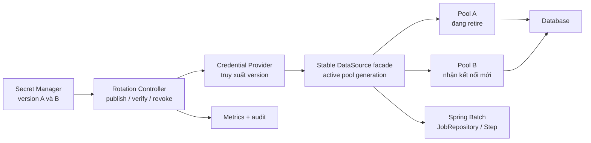

# Secret rotation không dừng Job trong Spring Batch

## 1. Vấn đề: một batch job có thể sống lâu hơn mật khẩu

**Secret rotation** là quá trình thay thế thông tin xác thực cũ bằng thông tin mới, phân phối bản mới tới ứng dụng, xác minh hoạt động và thu hồi bản cũ. Các secret thường gặp trong Spring Batch gồm mật khẩu database của `JobRepository`, mật khẩu database nghiệp vụ, thông tin xác thực broker dùng cho remote chunking/partitioning, API key, chứng chỉ TLS và token truy cập object storage.

Trong module **SPRING_BATCH_SCALING_OPERATIONS**, Spring Batch có thể xử lý workload lớn qua **multi-threaded step**, **parallel steps**, **partitioning** hoặc nhiều worker phân tán. Một job có thể kéo dài 4–8 giờ, trong khi secret được xoay mỗi vài giờ hoặc phải thay ngay khi phát hiện nguy cơ lộ. Nếu credential cũ hết hạn giữa bước ghi hoặc giữa lần cập nhật `StepExecution`, job có thể lỗi, mất khả năng cập nhật checkpoint, retry liên tục hoặc kẹt ở `STARTED`.

Ví dụ: job đối soát chạy 6 giờ, chia 12 partition, commit mỗi 500 giao dịch. Sau giờ thứ ba, DB đổi mật khẩu. Các connection hiện hữu có thể còn dùng được hoặc bị ngắt tùy hệ quản trị, proxy và chính sách bảo mật; connection mới từ pool có mật khẩu cũ sẽ không đăng nhập được khi mật khẩu cũ đã bị vô hiệu. Nếu code chỉ đọc secret khi ứng dụng khởi động, lỗi có thể xuất hiện muộn lúc pool cần mở connection mới, dù trước đó job vẫn tiến triển.

Mục tiêu của bài học **“Secret rotation không dừng Job”** là giữ cho những lần thực thi đang hoạt động tiếp tục xử lý qua quá trình thay credential thông thường, đồng thời luôn có cơ chế dừng/khôi phục có kiểm soát khi bắt buộc thu hồi secret khẩn cấp. Phải bảo vệ cả tính sẵn sàng và dữ liệu:

- Không thất lạc yêu cầu chạy job đã được chấp nhận; trạng thái trong `JobRepository` vẫn tra cứu được.
- Không để mật khẩu cũ bị thu hồi khi worker còn cần tạo kết nối bằng nó.
- Không tạo hai worker đồng thời xử lý một partition chỉ vì mất kết nối rồi retry.
- Không ghi trùng dữ liệu khi transaction hoặc reply từ hệ thống ngoài bị gián đoạn.
- Không lưu bí mật vào `JobParameters`, `ExecutionContext`, log hoặc metric.

**Giới hạn quan trọng:** không có cấu hình Spring Batch hay Kubernetes nào tự bảo đảm zero downtime khi provider chỉ cho phép một credential hợp lệ và lập tức thu hồi credential cũ. Với tình huống này, phải chọn một trong các cơ chế tương đương: hỗ trợ hai credential song song, cấp lại token trong runtime, dùng identity/credential broker có cơ chế gia hạn, hoặc chấp nhận dừng tại checkpoint rồi restart. Rotation khi secret đã lộ cũng có thể ưu tiên thu hồi ngay hơn tính liên tục.

## 2. Secret có nhiều vòng đời khác nhau

Không đồng nhất ba khái niệm sau:

| Khái niệm | Ví dụ | Ảnh hưởng khi rotate |
| --- | --- | --- |
| **Secret material** | Password, bearer token, private key | Giá trị phải được cung cấp lại và hủy/thu hồi sau khi chuyển đổi |
| **Phiên xác thực/kết nối** | JDBC connection, broker connection, HTTP client session | Có thể dùng credential lúc mở phiên hoặc xác thực lại định kỳ; không được giả định hành vi như nhau giữa các provider |
| **Tác vụ nghiệp vụ** | `JobExecution`, transaction chunk, partition ownership | Phải hoàn thành, checkpoint hoặc retry idempotent độc lập với việc thay credential |

Ví dụ pool JDBC có 20 connection đang hoạt động. Thay password trong Secret Manager **không** làm pool tự biết bản mới. Nếu pool vẫn giữ credential cũ, các connection mới có thể thất bại ngay khi backend không nhận mật khẩu cũ. Một vài connection cũ còn sống không chứng minh toàn bộ job an toàn qua lần rotate.

Kiểm kê tối thiểu trước khi thiết kế:

| Thành phần | Secret sử dụng | Nơi giữ bản đang dùng | Điểm có thể nạp lại |
| --- | --- | --- | --- |
| Spring Batch `JobRepository` | Credential DB metadata | `DataSource` / connection pool | Mở connection cho lần cập nhật execution, checkpoint, metadata |
| `ItemReader` / `ItemWriter` JDBC | Credential DB nguồn/đích | Pool, `StepScope` bean hoặc client riêng | Thường tại transaction/chunk hoặc lần borrow connection mới |
| Remote chunking/partitioning | Broker username/password, TLS cert | Producer, consumer, listener container | Khi client tái kết nối hoặc được khởi tạo lại an toàn |
| HTTP/object storage | Token hoặc access key | HTTP client/SDK, token provider | Trước request mới; có thể cần retry nếu token hết hạn |
| Kubernetes workload | Secret từ environment, mounted file, CSI | Biến môi trường hoặc file trong pod | Phụ thuộc cơ chế phân phối và khả năng reload của ứng dụng |

Ưu tiên **workload identity** hoặc token ngắn hạn có cơ chế refresh chính thức nếu provider hỗ trợ. Dù chọn cách nào, cần đo thời gian tồn tại của credential, hành vi phiên đã mở và khoảng chờ thu hồi.

## 3. Kiến trúc khuyến nghị: rotation theo phiên bản và có thời gian giao thoa

Một rotation thông thường an toàn có hai credential cùng hợp lệ trong thời gian chuyển tiếp:



Các trạng thái có ý nghĩa vận hành:

```text
A ACTIVE
    |
    | tạo B nhưng A vẫn hợp lệ
    v
B CANDIDATE  -> kiểm tra đăng nhập + quyền thực tế + health
    |
    | chuyển kết nối mới sang B
    v
B ACTIVE / A DRAINING
    |
    | không còn connection/consumer của A, đã hết cửa sổ rollback
    v
A REVOKED / B ACTIVE
```

Đừng chuyển thẳng từ “cập nhật giá trị trong vault” sang “thu hồi credential cũ”. Để **thay đổi có thể quay lại**, controller chỉ công bố B là active khi thử nghiệm B đạt; A vẫn dùng được để rollback trong giai đoạn theo dõi. Thu hồi A sau khi mọi ứng dụng và worker đã xác nhận chuyển đổi, kể cả worker ở node mất kết nối tạm thời.

Nếu cần đổi cả username và password, hai principal `batch_login_a`/`batch_login_b` có cùng nhóm quyền tối thiểu là phương án dễ tạo vùng giao thoa. Nếu DB chỉ cho cập nhật password tại một account duy nhất, **đừng giả định** có thể giữ đồng thời A và B: cần kiểm tra tính năng auth của DB/proxy và thiết kế thay thế trước khi cam kết rotation không gián đoạn.

## 4. Các chiến lược rotation và điều kiện chọn

| Chiến lược | Cách hoạt động | Thích hợp | Rủi ro cần kiểm soát |
| --- | --- | --- | --- |
| **Hai user / hai credential hợp lệ** | Cấp B, chuyển pool/client sang B, chờ A drain rồi thu hồi A | JDBC, broker hoặc provider hỗ trợ nhiều identity | Quản lý quyền tương đương và thời gian giao thoa |
| **Credential provider tự refresh** | SDK lấy token mới trước khi hết hạn và áp dụng cho request/kết nối mới | Cloud IAM, OAuth, cloud database proxy | TTL, đồng hồ lệch, cache và khả năng refresh khi mạng lỗi |
| **Hai thế hệ pool/client** | Tạo pool B, kiểm tra, chuyển borrow mới, giữ A cho transaction in-flight | JobRepository, reader/writer JDBC | Không đóng A khi transaction đang dùng; tốn thêm connection tạm thời |
| **Reload cấu hình client tại runtime** | Client được hỗ trợ tạo lại authentication context và reconnect | Broker, HTTP client | In-flight message, ACK/reply, re-subscribe và ordering |
| **Chờ job cũ kết thúc rồi chuyển sang image/secret mới** | Pin phiên bản secret cho các execution đã chạy, job mới dùng B | Kubernetes Job độc lập, runtime không hỗ trợ reload | Tuổi thọ A phải vượt thời gian job cũ + khả năng restart; có thể không đáp ứng hạn thu hồi |
| **Checkpoint và restart có kiểm soát** | Dừng ở điểm an toàn, cập nhật credential rồi restart cùng `JobInstance` | Provider không hỗ trợ overlap hoặc runtime không thể hot-swap | Có khoảng gián đoạn; phải kiểm thử idempotency và `ExecutionContext` |

Chọn chiến lược theo **khả năng của hệ thống xác thực và vòng đời job**, không chỉ theo thư viện quản lý secret. Rotation không dừng job có thể là *zero job restart* với pool chuyển thế hệ; trường hợp khác là *không mất logical job* dù execution tạm dừng và restart.

## 5. Kubernetes Secret được cập nhật như thế nào?

Kubernetes có hai cách đưa Secret vào container thường gặp:

1. **Environment variable** (`env`, `envFrom`): được thiết lập khi container bắt đầu; khi Secret object thay đổi, biến môi trường trong process đang chạy **không tự cập nhật**. `rollout restart` tạo pod mới nhưng có thể làm job dài trong Deployment bị dừng.
2. **Projected Secret volume**: nội dung file được kubelet cập nhật **sau một độ trễ**, phụ thuộc đồng bộ/cache. Ứng dụng phải đọc lại hoặc watch phiên bản file; Spring/Hikari không tự nạp password mới chỉ vì file đổi. Mount một key bằng `subPath` không nhận các cập nhật Secret theo cơ chế project volume thông thường.

Ví dụ sử dụng Secret volume cho worker **đã có code hỗ trợ reload**:

```yaml
apiVersion: apps/v1
kind: Deployment
metadata:
  name: batch-worker
spec:
  replicas: 3
  selector:
    matchLabels:
      app: batch-worker
  template:
    metadata:
      labels:
        app: batch-worker
    spec:
      containers:
        - name: worker
          image: example.invalid/batch-worker:1.4.0
          volumeMounts:
            - name: db-credential
              mountPath: /var/run/credentials/batch
              readOnly: true
      volumes:
        - name: db-credential
          secret:
            secretName: batch-db-active
            defaultMode: 0400
```

Ví dụ này chỉ minh họa **cách mount**; `batch-db-active` phải được tạo và phân phối qua quy trình bí mật thích hợp. Khi secret file thay đổi, ứng dụng còn phải xác nhận cấu hình mới, tạo client/pool B và drain client/pool A. Không nhúng mật khẩu trực tiếp vào manifest hoặc image; không in giá trị secret khi log thay đổi phiên bản. Giá trị Secret dạng base64 trong manifest **không phải là mã hóa**; cần RBAC tối thiểu, mã hóa secret khi lưu trữ phù hợp với cluster và cơ chế audit.

Với Secrets Store CSI Driver hoặc hệ thống external secret sync, phải phân biệt **thời điểm secret ở backend thay đổi**, **thời điểm file/Secret object được cập nhật** và **thời điểm process thật sự sử dụng credential mới**. Các hệ thống này có thể có chu kỳ đồng bộ và hành vi rollout riêng; không mặc định file update đồng nghĩa driver JDBC hoặc Kafka đã reload.

## 6. Rotation database: bảo vệ cả `JobRepository` và dữ liệu nghiệp vụ

Trong Spring Batch, `JobRepository` ghi `JobExecution`, `StepExecution` và `ExecutionContext` để hỗ trợ restart. Nếu credential DB của repository bị thu hồi trong lúc job vẫn ghi dữ liệu, chunk có thể commit dữ liệu nghiệp vụ nhưng không cập nhật checkpoint như mong đợi, tùy transaction boundary. Lần restart vì vậy có thể đọc lại một phần công việc.

**Luồng chuyển pool an toàn:**

1. Lấy B từ secret provider qua kết nối có xác thực; giữ `version` và metadata hạn dùng, không lưu password vào log.
2. Tạo **pool B mới** với cấu hình quyền hạn tương đương A.
3. Thử mở kết nối bằng B và kiểm tra cả quyền đọc/ghi cần thiết trên schema metadata/đích, không chỉ chạy `SELECT 1`.
4. Chuyển các **lần borrow connection mới** sang pool B qua một facade `DataSource` ổn định mà các Spring bean sử dụng.
5. Để transaction đã bắt đầu bằng pool A hoàn tất/rollback và trả connection; không đóng pool A khi còn connection được mượn.
6. Khi không còn tác vụ dùng A và B đã ổn định, đóng A rồi mới thu hồi credential A theo chính sách.

Một bản mô tả thuật toán (pseudocode, **không** phải class có thể copy thẳng vào production):

```java
void rotate(CredentialVersion next) {
    // CredentialVersion chứa version/secret lấy từ provider bảo mật.
    PoolGeneration candidate = createPool(next);

    try {
        verifyConnectivity(candidate);
        verifyBatchMetadataPermissions(candidate);
        verifyBusinessPermissionsIfApplicable(candidate);
    } catch (Exception failure) {
        candidate.closeWhenIdle();
        alertRotationFailed(next.version());
        return; // giữ pool A làm active, A chưa bị thu hồi
    }

    PoolGeneration old = activePool.getAndSet(candidate);
    old.stopAcceptingNewBorrows(); // phải đồng bộ với bộ định tuyến
    retireAfterAllLeasesReturn(old); // không đóng connection đang dùng
    reportActiveVersion(candidate.version());
}
```

Trong code thực tế, `activePool` phải được bao bởi một `DataSource` ổn định và cơ chế **lease/ref-count hoặc draining**. Các bước chọn generation, đánh dấu `retiring` và mượn connection phải được đồng bộ để không có thread lấy nhầm pool cũ đang đóng. `Connection.close()` của caller cần trả connection và giải phóng lease; close pool chỉ khi lease bằng 0 và không còn borrow mới. Phải xử lý cả connection timeout, exception và rollback. Một phép `getAndSet` độc lập **chưa đủ** giải quyết tất cả race condition.

Ví dụ phần cấu hình tạo pool JDBC theo từng credential version:

```java
HikariDataSource buildPool(CredentialVersion credential) {
    HikariConfig config = new HikariConfig();
    config.setJdbcUrl("jdbc:postgresql://batch-db:5432/batch");
    config.setUsername(credential.username());
    config.setPassword(credential.password());
    config.setPoolName("batch-meta-" + credential.version());
    config.setMaximumPoolSize(12);
    config.setMinimumIdle(1);
    config.setConnectionTimeout(5_000);
    config.setMaxLifetime(30 * 60_000L);
    return new HikariDataSource(config);
}
```

Đây là ví dụ minh họa *khởi tạo* một Hikari pool; `CredentialVersion` và controller rotation là các abstraction của ứng dụng, không có sẵn trong Spring Batch. Pool B được kiểm thử trước khi publish; các giá trị timeout và pool size chỉ là điểm khởi đầu cần đo theo workload. Không giả định thay `spring.datasource.password` hoặc gọi refresh configuration là Hikari đã chuyển hết connection sang credential mới.

Nếu `JobRepository` và reader/writer dùng **hai DataSource khác nhau**, phải rotate **cả hai** với lịch và quyền độc lập. Nếu chúng dùng chung DB, cũng không nên đổi pool rồi làm hỏng transaction đang active. Spring Batch có thể giữ kết nối qua `TransactionManager`; stable facade phải tương thích với cách Spring quản lý connection-bound transactions. Với transaction phân tán, phải xem thêm ranh giới commit giữa metadata và hệ thống nghiệp vụ.

### Ranh giới chunk, checkpoint và idempotency

Rotation tốt nhất xảy ra ở **ranh giới borrow connection/chunk**. Một chunk đã bắt đầu nên dùng phiên giao dịch nhất quán tới khi commit hoặc rollback; chunk tiếp theo có thể mượn connection từ pool B. Không ép thay credential trong một transaction còn mở.

Một trường hợp cần thử: writer ghi thành công lên API ngoài, sau đó repository mất connection trước khi lưu checkpoint. Khi restart, item có thể được đọc lại. Khóa nghiệp vụ duy nhất, UPSERT, idempotency key hoặc transactional outbox giúp bảo vệ kết quả; **rotation không thay thế nguyên tắc restart-safe** của Spring Batch.

Không ghi password/token vào `ExecutionContext` hoặc `JobParameters` để “giúp restart”: metadata có thể được lưu lâu dài, truy vấn khi vận hành hoặc xuất log. Lưu tham chiếu như `sourceObjectId`, `credentialProfileId` (không nhạy cảm) và lấy credential hiện hành khi execution cần truy cập lại hệ thống.

## 7. Remote partitioning và remote chunking khi secret đổi

Scaling phân tán làm rotation phức tạp hơn vì **manager và từng worker** có vòng đời, connection pool và secret cache riêng. Không đủ khi chỉ xác nhận một replica đã dùng B.

### Remote partitioning

- Manager và worker có thể sử dụng broker credential và database credential khác nhau; cần lập ma trận ai dùng secret nào.
- Mỗi partition gắn với `StepExecution`, claim/lease và dữ liệu đầu ra. Worker mất kết nối do credential hết hạn có thể khiến manager nghĩ partition đã chết dù worker vẫn đang xử lý.
- Chỉ giao lại partition khi đã **fence** owner cũ hoặc chắc chắn worker cũ không thể tiếp tục ghi. Lease timeout một mình có thể thiếu nếu worker bị network partition nhưng vẫn kết nối DB.
- Khi restart partition, dữ liệu nguồn phải ổn định, checkpoint đọc được bằng credential mới và writer phải idempotent.

### Remote chunking

- Producer/consumer cần luồng thay đổi authentication context hoặc khởi tạo kết nối mới **mà không làm mất message chưa ACK**.
- Dùng queue bền vững và message ID duy nhất; chỉ ACK theo giao thức xử lý an toàn, có cơ chế retry/replay.
- Phải phân biệt **message đã gửi**, **worker đã commit** và **manager đã nhận reply**. Broker reconnect trong lúc rotate có thể tạo reply trễ hoặc message lặp; cần deduplication.
- Kiểm thử version B cho các loại message đang tồn tại; rotation secret không được đồng thời âm thầm thay serializer hoặc định danh partition.

### Multi-threaded step và parallel steps

Một executor có thể có hàng chục chunk mượn connection đồng thời. Vì vậy thời gian drain pool A phụ thuộc **chunk chậm nhất còn mở**, không chỉ `maxLifetime` của pool. `maxLifetime` không cưỡng chế dừng mọi connection đang được mượn; đừng dùng nó làm đồng hồ đảm bảo đã hết transaction A.

Việc tạo pool B cũng làm tổng số connection DB tăng tạm thời. Ví dụ: 8 worker, mỗi worker pool A tối đa 12 connection và pool B tối đa 12 connection; đỉnh lý thuyết trong thời gian giao thoa là **192 connection** nếu cả hai pool có thể mở tối đa. Cần tính giới hạn DB/proxy, giảm pool size khi chuyển đổi hoặc stagger theo nhóm worker, và quan sát tình trạng pool thực tế.

## 8. Token ngắn hạn và dynamic credentials

Với token hoặc lease có TTL, chỉ thay Secret object theo chu kỳ chưa đủ. Chương trình chạy 7 giờ dùng token 1 giờ cần **refresh chủ động**.

Một credential provider nên có các đặc tính:

- Lưu `expiresAt`, `version` và trạng thái refresh; lên lịch refresh trước hạn có biên an toàn cho clock skew, retry và mạng chậm.
- Có **single-flight refresh**: nhiều thread đồng thời cần token mới không đồng loạt gọi provider và gây stampede.
- Không trả credential đã hết hạn cho kết nối mới; có đường xử lý lỗi tạm thời khi secret provider không sẵn sàng.
- Chỉ retry lỗi authentication theo phân loại phù hợp; không retry vô hạn mọi `401`, `403`, `SQLInvalidAuthorizationSpecException` vì có thể là thay đổi quyền hoặc cấu hình sai.
- Phân biệt **gia hạn lease hiện tại** với **cấp secret mới**; API và giới hạn provider có thể khác nhau.

Ví dụ timeline giả định:

```text
10:00  Token A hợp lệ, hết hạn 11:00
10:35  Credential provider yêu cầu B
10:36  B được kiểm tra, client dùng B cho request mới
10:40  Transaction/request đang dùng A đã hoàn tất
10:45  Xác nhận không có phiên A cần dùng nữa
11:00  A hết hạn theo provider; job vẫn sử dụng B
```

Timeline chỉ đạt mục tiêu khi hệ thống đích thực sự chấp nhận B trước khi A hết hạn và không có luồng giữ A quá hạn. Token có thể bị thu hồi bất ngờ, API trả lỗi quyền hoặc provider mất mạng; cần circuit breaker và policy retry phù hợp để không gây bão request.

**Workload identity** giúp tránh quản lý mật khẩu tĩnh trong pod nhưng không xóa hết bài toán rotation: STS/OIDC token vẫn có TTL, SDK/client vẫn phải refresh và phiên kết nối vẫn có vòng đời. Kiểm thử bằng token TTL thấp trong staging để phát hiện cache cứng ở từng worker.

## 9. Thiết kế cửa sổ giao thoa và thời điểm thu hồi

Đặt:

- `T_publish`: thời gian secret B xuất hiện ở provider và đến các pod.
- `T_apply`: thời gian app kiểm tra B và chuyển mọi client cần thiết.
- `T_drain`: thời gian transaction, chunk, message và connection đang dùng A hoàn tất.
- `T_observe`: thời gian theo dõi xác nhận không còn owner A và đủ khả năng rollback.
- `T_margin`: biên cho độ trễ mạng, clock skew và lỗi tạm thời.

Điều kiện thiết kế cơ bản:

\[
T_{\text{overlap}} > T_{\text{publish}} + T_{\text{apply}}
               + T_{\text{drain}} + T_{\text{observe}} + T_{\text{margin}}
\]

Đây là **ngân sách kỹ thuật cần đo**, không phải bảo đảm từ nền tảng. `T_drain` phải dựa trên p99/p999 của chunk và request, kể cả worker chậm, transaction treo hoặc xử lý backpressure. Nếu không thể giới hạn `T_drain`, rotation phải có cơ chế **chặn connection A mới**, fencing, timeout/rollback rõ ràng, hoặc dừng execution tại checkpoint trước hạn thu hồi.

Ví dụ nếu propagate mất tối đa 2 phút, xác minh/chuyển 1 phút, drain 7 phút, theo dõi 3 phút và margin 5 phút, một cửa sổ 10 phút là không đủ; ngân sách cần **lớn hơn 18 phút**. Kết quả kiểm thử phải đo từ lần worker chậm nhất, không chỉ từ launcher.

Không lấy `terminationGracePeriodSeconds` của Kubernetes làm `T_overlap`: một pod có thể chạy lâu hơn nhiều thời gian grace; còn thời gian grace chỉ áp dụng khi pod đang terminate.

## 10. Quy trình rotation từng bước không dừng job

Giả sử job đối soát 20 triệu giao dịch, chạy trong Kubernetes với 1 manager và 6 worker. DB hỗ trợ hai tài khoản login A/B có cùng quyền nghiệp vụ tối thiểu; Secret Manager phát hành phiên bản và audit các lần truy cập. Mỗi worker giữ connection pool riêng.

### Giai đoạn A — Chuẩn bị

1. Kiểm kê mọi client sử dụng credential A: `JobRepository`, reader, writer, manager, worker, broker và các lệnh vận hành.
2. Xác nhận permission của B, thời điểm hết hạn A và khả năng rollback. Giữ schema/`ExecutionContext`/message protocol ổn định; rotation secret không phải lúc thay cấu trúc job.
3. Xác định nhóm worker cần chuyển, giới hạn pool và độ dài chunk tối đa. Thiết lập số liệu `activeCredentialVersion`, connection A in-flight, auth failure và stale execution.
4. Cấp **B song song**; không hủy A khi chưa có bằng chứng mọi consumer có thể dùng B.

### Giai đoạn B — Chuyển đổi có quan sát

5. Cập nhật secret provider, theo dõi bản B đến từng replica; xác minh từng ứng dụng đã **thật sự áp dụng B**, không chỉ đọc file version mới.
6. Dùng canary worker/launcher hoặc một nhóm nhỏ để mở kết nối mới bằng B; kiểm tra quyền ghi metadata và transaction trên DB tương ứng.
7. Chuyển các lượt borrow kết nối mới sang B. Theo dõi chunk đang chạy trên A; không terminate worker chỉ để kích hoạt reload.
8. Stagger nhóm worker còn lại để không làm bùng connection pool. Với broker, reconnect có kiểm soát và giám sát ACK/reply/queue lag.

### Giai đoạn C — Xác minh và thu hồi

9. Xác nhận tất cả replica đã dùng B; pool A không còn borrowed connection; số chunk/partition và output vẫn khớp. Xử lý worker mất liên lạc như một trường hợp chưa hoàn tất, không mặc định đã chuyển.
10. Giữ A trong cửa sổ quan sát/rollback theo chính sách; khi có chứng cứ không còn phụ thuộc, thu hồi A và giám sát authentication failure sau revoke.
11. Ghi audit gồm `rotationId`, secret reference/version (không có giá trị), danh sách workload, thời điểm apply/drain/revoke, trạng thái kết quả và người/hệ thống phê duyệt.

**Nếu B lỗi trước lúc thu hồi A:** giữ A active hoặc chuyển borrow mới quay lại A, đóng B sau khi in-flight đã drain; khắc phục permission/config rồi thử lại. **Nếu A đã bị thu hồi:** không tự rollback sang A; phải xử lý sự cố với B hoặc cấp credential mới C. **Nếu phát hiện A đã lộ:** áp dụng quy trình ứng phó sự cố, có thể revoke ngay và chấp nhận checkpoint/restart để giảm thời gian credential bị lạm dụng.

## 11. Tình huống lỗi và phục hồi

| Sự cố | Triệu chứng | Hướng xử lý |
| --- | --- | --- |
| Secret backend đã đổi nhưng worker còn đọc env var | Job hoạt động tới khi pool mở connection mới rồi báo lỗi login | Chuyển sang provider/runtime reload, hoặc thiết kế job pod pin credential còn hợp lệ trong thời gian đủ dài |
| Mounted file đã thay, pool JDBC vẫn dùng password cũ | Log authentication failure khi mở connection | Kiểm tra cơ chế nạp lại pool/client và thực tế active version; không chỉ kiểm tra file |
| Candidate B có quyền đăng nhập nhưng không được ghi metadata | `JobRepository` lỗi trong khi query `SELECT 1` vẫn thành công | Thử quyền thực tế trước khi activate, kiểm soát grant đồng nhất |
| Revoke A quá sớm | Worker chậm không thể mở connection, execution `STARTED` có thể treo | Tạm dừng revoke, giữ overlap đủ dài; nếu đã revoke, khôi phục theo checkpoint và fencing |
| Worker chết giữa chunk khi broker xác thực lại | Message chưa ACK, reply lặp hoặc mất kết nối manager | Durable message, deduplication, đối soát StepExecution và retry an toàn |
| Pool A đóng khi transaction đang dùng | Lỗi I/O/rollback đột ngột | Lease/ref-count, drain và chỉ đóng khi không còn borrowed connection |
| Secret Manager tạm thời không sẵn sàng | Refresh token thất bại trước hạn | Retry có backoff/jitter, cache bản đang còn hợp lệ theo policy, alert trước khi hết hạn |
| Rollout làm cả pool A và B tăng tải | DB cạn connection, tăng timeout | Giới hạn tổng connection và stagger/canary chuyển đổi |
| Metadata `STARTED` sau crash | Không thể restart trực tiếp khi job vẫn được xem là running | Xác minh owner cũ đã chết/fenced, đối soát dữ liệu và thực hiện stale-execution recovery có audit |

Khi Spring Batch restart sau gián đoạn, phải dùng **cùng identifying `JobParameters`** cho cùng logical job nếu framework và thiết kế cho phép. Tự tạo `run.id` mới để vượt lỗi `STARTED` có thể chạy lại dữ liệu từ đầu. Đặc biệt với remote partitioning, phải xác minh không còn owner cũ trước khi chuyển quyền xử lý partition.

`JobOperator.stop(...)` là yêu cầu dừng hợp tác, không đảm bảo một tiến trình bị ngắt lập tức. Trong sự cố secret đã mất hiệu lực, cập nhật credential có thể không đủ để job đang lỗi tự phục hồi; một số execution cần được đánh giá, sửa trạng thái theo runbook hỗ trợ và restart kiểm soát. Không sửa trực tiếp bảng metadata để ép mọi `STARTED` thành `FAILED`.

## 12. Metric, cảnh báo và kiểm thử

### Quan sát không rò rỉ secret

Các metric/audit nên dùng tên dịch vụ, **credential version đã được phân loại là metadata không nhạy cảm**, phase của rotation và số lượng connection; tránh username nếu username cũng bị coi là thông tin nhạy cảm trong môi trường cụ thể.

| Tín hiệu | Mục đích |
| --- | --- |
| `secret_rotation_phase` và `last_successful_rotation` | Biết rotation đang chờ, đang chuyển, đã hoàn thành hay thất bại |
| `credential_seconds_until_expiry` | Cảnh báo khi thời gian còn lại nhỏ hơn ngân sách refresh + drain |
| `credential_version_applied` theo workload | Tìm worker chưa áp dụng bản mới |
| `pool_borrowed_connections` theo generation | Xác định pool cũ đã drain chưa |
| `db_auth_failures_total`, `broker_auth_failures_total` | Phát hiện credential sai hoặc revoke sớm |
| `batch_job_execution` theo `BatchStatus`, chunk retry/rollback | Phát hiện job chuyển sang `FAILED`/`STOPPING` hoặc rollback tăng sau rotation |
| `partition_owner_count`, queue lag, duplicate-reply | Phát hiện bất thường khi remote workers reconnect |

Tránh đưa secret, access token, JWT, request header `Authorization`, JDBC URL chứa password hay toàn bộ `CredentialVersion.toString()` vào log/tracing. Phân quyền dashboard/audit và đặt giới hạn cardinality cho label, không dùng mỗi `requestId` làm label metric có cardinality không giới hạn.

### Fault injection trong staging

| Test | Cách tạo tình huống | Tiêu chí pass |
| --- | --- | --- |
| Rotate giữa chunk | Chạy writer chậm rồi publish B | Chunk hoàn thành/rollback hợp lệ; chunk mới dùng B, không thiếu/trùng output |
| Candidate B sai quyền | Cấp B thiếu quyền cập nhật schema Batch | Validation phát hiện trước activation; A còn hoạt động |
| Worker giữ A lâu | Cố tình làm 1 transaction kéo dài | Pool A chưa bị đóng hoặc revoke đến khi policy xử lý an toàn |
| Secret propagation chậm | Chặn cập nhật secret tại một replica | Controller không báo hoàn tất và không thu hồi A vội |
| Mất kết nối broker | Ngắt broker khi worker đang gửi ACK/reply | Chunk/partition được đối soát; không mất message hoặc side effect trùng |
| Secret provider down | Ngắt mạng với provider trước refresh | Retry và cảnh báo trước expiry; job không bị treo âm thầm |
| Kill pod trong rotation | `SIGKILL` worker không thực hiện graceful shutdown | Request/partition có thể phục hồi bằng checkpoint, chỉ một owner được ghi |
| Cao điểm tài nguyên | Chuyển pool song song lúc đầy tải | Không vượt DB connection budget; timeout và throughput ở ngưỡng cho phép |
| Revoke A sau xác nhận | Chủ động loại bỏ A | Mọi đường kết nối mới đều dùng B, không tăng auth failure |

Để khẳng định **“không dừng Job”**, kiểm tra liên tục thông qua `JobExecution` và dữ liệu đầu ra: không có execution đang khỏe mạnh bị bắt dừng chỉ do rotation, không có gap/duplicate trong kết quả, và thời gian `FAILED`/`STOPPING` không tăng bất thường. `readiness=UP` hoặc file Secret đã đổi chỉ là tín hiệu phụ.

## 13. Checklist vận hành trước khi rotate

- [ ] Xác định đầy đủ secret của `JobRepository`, nguồn/đích, broker, object storage và worker phân tán.
- [ ] Provider hỗ trợ overlap A/B, refresh token tại runtime hoặc phương án checkpoint/restart được chấp nhận.
- [ ] Secret mới được thử **cả quyền thật** và transaction cần thiết trước khi làm active.
- [ ] Có đường cập nhật credential cho từng connection pool/client; biết rõ env, mounted file, CSI và secret cache hoạt động thế nào.
- [ ] `DataSource` facade cùng `TransactionManager` được kiểm thử chuyển generation mà không đóng connection đang borrowed.
- [ ] Thời gian overlap được tính từ propagation, apply, chunk/transaction chậm nhất, quan sát và biên lỗi.
- [ ] Tổng số connection khi có hai pool không vượt giới hạn DB; rollout theo canary/nhóm nếu cần.
- [ ] Worker remote có cơ chế ACK, retry, idempotency, lease/fencing và đối soát reply trễ.
- [ ] Secret không xuất hiện trong `JobParameters`, `ExecutionContext`, Git, manifest tĩnh, log, trace và metric.
- [ ] Có cảnh báo cho hết hạn gần, worker chưa apply B, auth failure và `JobExecution` không tiến triển.
- [ ] Đã thử rollback **trước** revoke, quy trình phục hồi **sau** revoke và trường hợp thu hồi khẩn cấp.
- [ ] Chỉ revoke A khi mọi consumer quan trọng đã chuyển và có bằng chứng không còn phụ thuộc.

## 14. Kết luận

Muốn xoay secret mà **Spring Batch Job vẫn tiếp tục chạy**, cần tách **vòng đời credential** khỏi **vòng đời transaction, chunk, step và job**. Cốt lõi là cấp credential mới với khoảng giao thoa đủ dài, xác minh quyền truy cập, chuyển việc mượn kết nối mới sang client/pool mới, drain tác vụ cũ rồi mới thu hồi secret cũ. Với workload multi-threaded và phân tán, phải thực hiện điều này tại **mọi worker**, kiểm soát ownership, ACK/retry và nguồn dữ liệu restartable.

Secret rotation thành công chỉ khi vừa **đóng được cửa sổ sử dụng secret cũ** vừa **giữ đúng các bất biến dữ liệu của job**. Cần kiểm chứng bằng fault injection, metadata Spring Batch và số liệu nghiệp vụ; một thay đổi thành công trong Secret Manager chưa đủ để kết luận job được bảo toàn.
