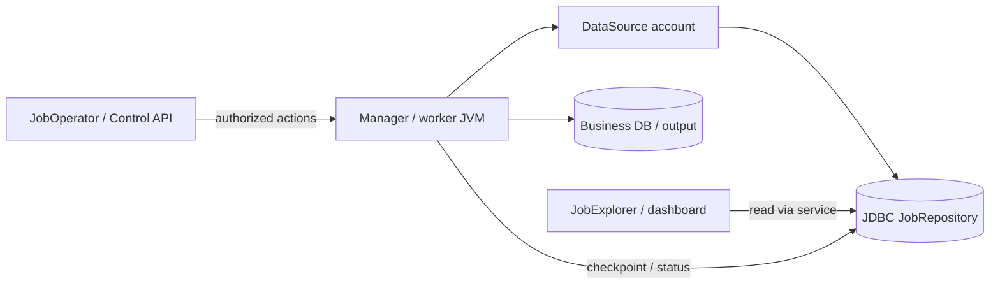
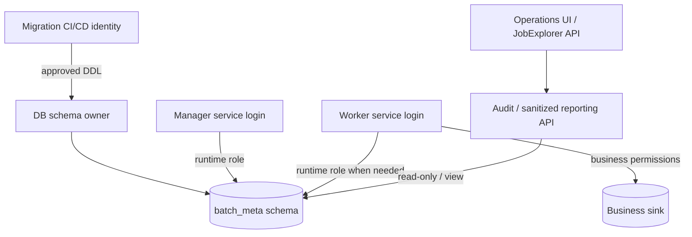
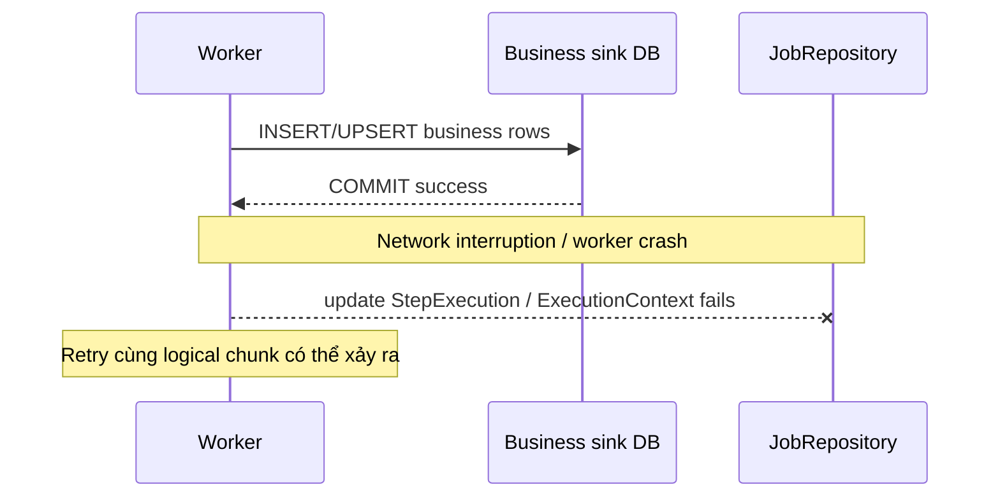
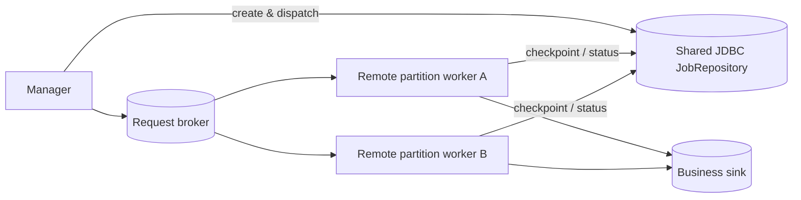

# Phân quyền JobRepository

## 1. Tình huống: một quyền database sai có thể phá cả batch

Một doanh nghiệp chạy Spring Batch xử lý 50 triệu giao dịch mỗi đêm bằng **remote partitioning**. Manager tạo `JobExecution`, chia 80 partitions; nhiều worker Pods kết nối tới cùng **JDBC JobRepository** để cập nhật trạng thái, checkpoint và lỗi. Một nhóm vận hành cần xem tiến độ, nên được cấp tài khoản PostgreSQL có quyền `SELECT, INSERT, UPDATE, DELETE` trên toàn bộ database. Sau đó một công cụ hỗ trợ vô tình cập nhật `BATCH_STEP_EXECUTION.STATUS` từ `STARTED` thành `COMPLETED` để “gỡ kẹt” một partition.

Dashboard chuyển màu xanh, nhưng worker thực tế chưa ghi đủ business records. Lần restart sau đọc metadata đã bị sửa và có thể bỏ qua work cần thiết. Vấn đề không còn là bảo mật đơn thuần: **quyền sửa metadata quá rộng đã làm hỏng restartability và tính đúng dữ liệu**.

Một tình huống khác: chỉ cấp `SELECT` cho worker remote partitioning vì nghĩ “worker chỉ thực hiện tính toán”. Worker đọc source, commit business sink nhưng không thể `UPDATE BATCH_STEP_EXECUTION` hoặc lưu `ExecutionContext`. JobRepository bị từ chối ghi; manager không xác định được kết quả, replay có thể xảy ra.

**Phân quyền JobRepository** nghĩa là kiểm soát **ai có thể kết nối, đọc, tạo, cập nhật, vận hành, xuất hoặc xóa metadata Spring Batch** ở cả tầng database lẫn tầng API. Các quyền này ảnh hưởng trực tiếp đến:

- `JobInstance` và `JobExecution` được tạo đúng, không chạy trùng;
- `StepExecution`/`ExecutionContext` phản ánh checkpoint và restart;
- manager/worker phân tán cập nhật metadata nhất quán;
- nhân viên vận hành chỉ được xem/điều khiển đúng jobs;
- dữ liệu nhạy cảm trong `JobParameters`/error context không bị lộ;
- schema migration, cleanup, backup và incident recovery được thực hiện có kiểm soát.

Bài thuộc chương **Bảo mật**, module **SPRING_BATCH_SCALING_OPERATIONS**. Module tập trung mở rộng Spring Batch bằng multi-threaded step, parallel steps, partitioning và xử lý phân tán, đồng thời đo bottleneck, bảo đảm thread safety, retry/restart và vận hành job phù hợp tài nguyên thực tế. Phân quyền đúng là nền tảng để vừa **scale an toàn** vừa giữ **khả năng phục hồi**.

> **Nguyên tắc trung tâm:** phân biệt **quyền SQL của service account** với **quyền nghiệp vụ của người gọi API**. JDBC `JobRepository` mặc định không phải hệ thống RBAC cho từng người dùng/tenant; nó tin cậy DataSource đã cấu hình. Đừng dùng tài khoản DB có quyền DDL/superuser cho runtime, và đừng mở `JobOperator` hay các bảng `BATCH_*` trực tiếp cho mọi người vận hành.

### Mục tiêu học tập

Sau bài này, bạn có thể:

1. Mô tả dữ liệu và mức nhạy cảm của `JobRepository`, `JobExplorer`, `JobOperator`.
2. Thiết kế vai trò database **schema owner/migration**, **batch runtime**, **read-only observer**, **cleanup** và **break-glass**.
3. Cấu hình **PostgreSQL GRANT/REVOKE cho schema, tables và sequences**, không nhầm quyền `USAGE` schema với `USAGE` sequence.
4. Cấu hình Spring Batch 5.x JDBC repository dùng DataSource/quyền riêng và `tablePrefix` trỏ đúng schema.
5. Biết khi nào **remote partitioning worker** cần quyền ghi metadata, trong khi **remote chunking worker** có thể không cần repository trực tiếp tùy topology.
6. Dùng Spring Security bảo vệ API `start`, `stop`, `restart` và truy vấn metadata theo phạm vi công việc.
7. Chặn lộ `JobParameters`, `ExecutionContext`, `EXIT_MESSAGE`, logs, backup và dashboard.
8. Kiểm thử positive/negative permissions, restart, failover, rolling update, connection pool và incident recovery.

## 2. JobRepository thực sự chứa những gì?

Trong **Spring Batch JDBC JobRepository**, framework lưu metadata của các job/step, phiên thực thi, tham số và state cần thiết cho restart. Bảng cơ bản thường có tiền tố `BATCH_`; có thể đặt prefix/schema khác theo cấu hình.

| Bảng/đối tượng | Nội dung | Vì sao cần bảo vệ? |
| --- | --- | --- |
| `BATCH_JOB_INSTANCE` | `JOB_NAME`, `JOB_KEY`, identity của logical job | Sửa/xóa làm sai định danh và restart |
| `BATCH_JOB_EXECUTION` | Status, thời gian, `EXIT_MESSAGE`, version | Có thể che failure hoặc giả success |
| `BATCH_JOB_EXECUTION_PARAMS` | Tên, kiểu, **giá trị JobParameters** | Dễ chứa IDs, đường dẫn, thậm chí secrets nếu app thiết kế sai |
| `BATCH_STEP_EXECUTION` | `STEP_NAME`, counters, checkpoint status, optimistic-lock `VERSION` | Quyết định step/partition nào cần chạy lại |
| `BATCH_JOB_EXECUTION_CONTEXT` | Serialized job-level `ExecutionContext` | Có thể chứa snapshot ID, cursor, dữ liệu nhạy cảm |
| `BATCH_STEP_EXECUTION_CONTEXT` | Serialized step-level `ExecutionContext` | Ảnh hưởng trực tiếp reader restart |
| Sequence/ID generator | Cấp khóa cho JobInstance, JobExecution, StepExecution | Thiếu quyền sẽ fail tạo execution |

### 2.1. Metadata không phải “dữ liệu công khai”

Ngay cả khi không lưu bản ghi nghiệp vụ đầy đủ, `BATCH_JOB_EXECUTION_PARAMS.PARAMETER_VALUE` có thể chứa:

```text
manifestId      = internal-finance-snapshot-2026-11
customerId      = ACCT-0042                 # không nên dùng raw ID nếu nhạy cảm
sourceFile      = /private/customer-X/payments.csv
apiToken        = ...                       # TUYỆT ĐỐI không lưu
```

`BATCH_STEP_EXECUTION.EXIT_MESSAGE` có thể chứa một phần stack trace, SQL error, đường dẫn file hoặc payload validation. Serialized `ExecutionContext` có thể chứa các khóa checkpoint do lập trình viên tự thêm. Vì vậy **`SELECT` trên toàn bộ `BATCH_*` không nhất thiết là quyền “xem trạng thái đơn thuần”**.

### 2.2. JobRepository dùng optimistic locking, không dùng authorization

Các hàng như `BATCH_JOB_EXECUTION` và `BATCH_STEP_EXECUTION` có `VERSION`; Spring Batch cập nhật với **optimistic locking** để phát hiện thay đổi đồng thời không tương thích. Cơ chế này bảo vệ một phần tính nhất quán khi nhiều worker/manager cập nhật metadata, nhưng **không biết SQL connection thuộc nhân viên nào hoặc tenant nào**.

```text
Optimistic locking:
  "Hai cập nhật cùng version có xung đột không?"

Authorization:
  "Chủ thể này có được phép đọc/sửa job này không?"

Hai câu hỏi hoàn toàn khác nhau.
```

Đừng coi `VERSION` hoặc constraint database là hàng rào chống người có quyền `UPDATE` trực tiếp vào mọi hàng metadata.

### 2.3. Nguồn sự thật có nhiều lớp



JobRepository là **nguồn sự thật về Spring Batch lifecycle**, còn business database là nguồn sự thật về **side effect đã commit**. Một `COMPLETED` bị ghi giả vào metadata không làm business sink đầy đủ. Một DB COMMIT thành công nhưng checkpoint metadata thất bại cũng không có nghĩa job đã an toàn restart.

## 3. Mô hình đe dọa: mất quyền, thừa quyền và nội gián

| Tình huống | Hậu quả | Kiểm soát cốt lõi |
| --- | --- | --- |
| Service worker dùng DB superuser | Một bug có thể drop schema, xóa bảng | Runtime role không có `CREATE`/`DROP`/owner |
| Analyst được `UPDATE BATCH_STEP_EXECUTION` | Giả completion, phá restart | Chỉ read-only sanitized view/API |
| API `restart` không có authorization | Người khác rerun data, tốn tài nguyên/duplicate | AuthN + AuthZ theo job/tenant/scope |
| Worker thiếu `USAGE` sequence | `permission denied for sequence` khi tạo ID | GRANT sequence phù hợp version |
| Mất `SELECT` trên context table | `JobExplorer`/restart load state thất bại | Đủ quyền cần thiết, test lifecycle |
| `JobParameters` chứa password | Exfiltration qua SQL backup/dashboard | Data minimization + secrets manager |
| Shared DB login của nhiều services | Khó audit/rotate và định phạm vi | Unique login identity, role groups |
| `DELETE/TRUNCATE` được mở cho runtime | Xóa audit/restart history | Cleanup role riêng, approval |
| DDL auto-init khi boot production | Runtime tạo/sửa bảng ngoài kiểm soát | Migration riêng và schema-init disabled |
| Manager/worker dùng repo khác | Worker completed nhưng manager không thấy | Cùng metadata store/namespace theo topology |
| Dashboard truy trực tiếp context/raw params | PII, tenant ID, error payload bị lộ | Sanitized DTO/view + RBAC |
| Mạng/DB credential bị lộ | Truy cập/chỉnh metadata từ nơi không tin cậy | TLS, NetworkPolicy, rotation, least privilege |
| Hai managers cùng launch cùng logical snapshot | Race, execution conflict/replay | Job identity, scheduler ownership, audit |
| Backup/replica mở rộng quyền | Metadata lộ ngoài production | Encryption, RBAC, retention cho bản sao |

**Threat model cần bao gồm cả khả năng truy cập SQL trực tiếp lẫn API gián tiếp.** Một `@PreAuthorize` ở REST controller không ngăn kẻ có DB credential chạy `UPDATE` trên repository; ngược lại, GRANT chỉ biết service account nên không phân biệt hai nhân viên dùng cùng API.

## 4. Hai tầng phân quyền phải áp dụng đồng thời

### 4.1. Tầng database: “process được phép làm gì với metadata?”

Database grants xác định kết nối JDBC nào được `SELECT`, `INSERT`, `UPDATE`, cấp sequence, và ai có quyền DDL hoặc cleanup.

Ví dụ:

```text
batch_schema_owner / migration:
  CREATE/ALTER/DROP theo change process, không dùng cho JVM thường ngày

batch_runtime:
  USAGE schema
  SELECT/INSERT/UPDATE metadata tables
  USAGE necessary sequences
  KHÔNG DELETE/TRUNCATE/CREATE/ALTER/DROP

batch_observer:
  SELECT (chỉ dành cho người/service đã được phép thấy raw metadata)
  KHÔNG UPDATE/INSERT/DELETE

batch_dashboard:
  chỉ SELECT sanitized view, hoặc không có SQL access
  truy qua API đã authorize

batch_cleanup:
  quyền DELETE có kiểm soát, chỉ chạy maintenance
```

Các quyền **phải được điều chỉnh theo database vendor, Spring Batch version, DAO và cấu hình thực tế**. Đây là baseline PostgreSQL/JDBC, không phải danh sách bắt buộc giống nhau ở mọi sản phẩm JobRepository.

### 4.2. Tầng ứng dụng: “người dùng được phép vận hành job nào?”

| Quyền nghiệp vụ | Ví dụ thao tác | Không nên mặc định kèm |
| --- | --- | --- |
| `BATCH_VIEW` | Xem trạng thái/counters đã lọc | Xem serialized ExecutionContext |
| `BATCH_LAUNCH` | Chạy job được cấp quyền | Chạy mọi job với tham số tùy ý |
| `BATCH_STOP` | Yêu cầu dừng execution đúng scope | Kill DB/session hoặc phá metadata |
| `BATCH_RESTART` | Restart failed execution được phép | Tạo JobInstance mới ngoài scope |
| `BATCH_RECOVER` | Xử lý trạng thái stale theo runbook | Sửa `BATCH_*` tùy tiện |
| `BATCH_ADMIN` | Quản lý cấu hình vận hành theo policy | DB superuser hoặc quyền xem toàn PII |
| `BATCH_AUDIT` | Xem audit trail theo quyền | Xem tất cả secrets/raw payload |
| `BATCH_SCHEMA_MIGRATE` | Thực hiện migration có approval | Quyền runtime lâu dài |

Một người có `BATCH_RESTART` trong **job A** không nhất thiết được restart job B của tenant khác. **Execution ID không phải chứng chỉ quyền truy cập**; phải tra trusted job/tenant ownership trước khi thực hiện command.

## 5. Kiến trúc vai trò tách biệt



### 5.1. Vai trò và danh tính không giống nhau

Với PostgreSQL, có thể cấp **group roles không LOGIN**:

```text
batch_runtime   (NOLOGIN) = tập quyền DML cần thiết
batch_observer  (NOLOGIN) = tập quyền đọc có kiểm soát

manager_svc_login  -> member of batch_runtime
worker_svc_login   -> member of batch_runtime (nếu worker dùng JobRepository)
ops_api_login      -> member of batch_observer (nếu cần raw JobExplorer)
```

**Mỗi process có login riêng** để audit/rotate tốt hơn, dù có thể kế thừa một tập quyền runtime giống nhau. Không chia sẻ cùng một credential DBA giữa CI/CD, manager, workers và dashboard.

### 5.2. Chọn phạm vi theo môi trường

- Development: schema/test database riêng, dữ liệu synthetic.
- Staging: schema riêng, roles gần production, kiểm thử denial/recovery.
- Production: quyền tối thiểu, provisioning/migration riêng, audit.
- Multi-tenant: cân nhắc **tách repository theo trust boundary** nếu yêu cầu cô lập metadata cao; chỉ đặt `tenantId` vào JobParameters không tạo DB isolation.
- Disaster recovery: read replica/backup có quyền và consistency rõ; **writer JobRepository** cần endpoint có khả năng ghi và nhất quán theo yêu cầu framework.

## 6. PostgreSQL: tách schema JobRepository

Một phương án khả thi là đặt toàn bộ metadata trong schema riêng `batch_meta` bên trong database `batchdb`.

```text
database: batchdb
schema:   batch_meta

batch_meta.batch_job_instance
batch_meta.batch_job_execution
batch_meta.batch_job_execution_params
batch_meta.batch_step_execution
batch_meta.batch_job_execution_context
batch_meta.batch_step_execution_context
batch_meta.batch_job_seq                    # ví dụ Spring Batch 5.2
batch_meta.batch_job_execution_seq
batch_meta.batch_step_execution_seq
```

PostgreSQL gấp tên identifier **không đặt dấu ngoặc kép** về chữ thường; vì vậy DDL `CREATE TABLE BATCH_JOB_EXECUTION` thường tạo tên catalog `batch_job_execution`. Đừng trộn object có tên **được quote chữ hoa** với object không quote mà chưa kiểm tra schema thật.

### 6.1. Vì sao schema riêng giúp giảm quyền?

- Có thể `GRANT ON ALL TABLES IN SCHEMA batch_meta` nếu schema chỉ chứa Batch metadata.
- Runtime không cần quyền DDL trong `public` hay business schema.
- Dễ đặt `tablePrefix="batch_meta.BATCH_"` để ứng dụng truy đúng bảng.
- Dễ phân quyền backup/monitoring và schema migration.
- Giảm rủi ro do `search_path` trỏ tới schema do role khác có thể `CREATE` object.

**Không coi schema riêng là ranh giới bảo mật tuyệt đối giữa tenants nếu tất cả dùng cùng SQL role có SELECT mọi bảng.** Quyền phải tiếp tục được giới hạn theo login và truy cập API.

### 6.2. Khởi tạo schema bằng migration identity

Ví dụ DBA đã tạo `batch_schema_owner` với `NOLOGIN` và migration pipeline có quyền vận hành theo quy trình riêng:

```sql
-- Chạy bởi principal có quyền tạo schema và gán owner.
-- CHỈ minh họa, không dùng runtime service account.
CREATE SCHEMA batch_meta AUTHORIZATION batch_schema_owner;

-- Migration service triển khai schema-postgresql.sql đúng phiên bản
-- Spring Batch trong schema batch_meta, ví dụ bằng:
--   SET ROLE batch_schema_owner;
--   SET search_path TO batch_meta;
--   [execute reviewed schema-postgresql.sql using migration tool]
--   RESET ROLE;
--
-- Không copy [execute ...] như một SQL statement thực.
```

**Quan trọng:** lệnh trên **không tự sinh các bảng Spring Batch**. Phải chạy **DDL chính thức của đúng Spring Batch version/vendor**, có kiểm soát migration, check constraints và indexes. Không cho JVM production tự quyết định khi nào drop/create metadata.

### 6.3. Version 5.2 và 6.1: tên sequence có thể khác

| Nguồn tham khảo | Sequence định danh JobInstance | Khác |
| --- | --- | --- |
| Spring Batch 5.2 schema appendix | `BATCH_JOB_SEQ` | `BATCH_JOB_EXECUTION_SEQ`, `BATCH_STEP_EXECUTION_SEQ` |
| Spring Batch 6.1 schema appendix | `BATCH_JOB_INSTANCE_SEQ` | `BATCH_JOB_EXECUTION_SEQ`, `BATCH_STEP_EXECUTION_SEQ` |

**Không đoán tên sequence theo thói quen.** Đọc metadata schema/migration **của artifact Spring Batch thực tế** và kiểm tra catalog DB. Nếu migrate 5→6, schema/DAO/sequence mapping phải nhất quán; `GRANT` trên sequence không tồn tại không khắc phục lỗi thiếu migration.

## 7. PostgreSQL: quyền runtime và observer

**Giả định của ví dụ:** schema `batch_meta` **chỉ chứa Spring Batch metadata**, các bảng và sequences đã tồn tại do migration. Các roles `batch_runtime` và `batch_observer` là group roles đã được tạo trước. Chạy GRANT/REVOKE bằng owner/DBA có quyền tương ứng; **không** chạy bằng service account. Đây là template để review, không phải script áp dụng mù quáng vào shared database.

### 7.1. Quyền schema, tables, sequences là ba lớp khác nhau

```sql
-- 1. Chặn truy cập thừa qua PUBLIC trên schema riêng:
REVOKE ALL ON SCHEMA batch_meta FROM PUBLIC;
REVOKE ALL ON ALL TABLES IN SCHEMA batch_meta FROM PUBLIC;
REVOKE ALL ON ALL SEQUENCES IN SCHEMA batch_meta FROM PUBLIC;

-- 2. Cho runtime/observer nhìn thấy object names trong schema:
GRANT USAGE ON SCHEMA batch_meta
    TO batch_runtime, batch_observer;

-- 3. Runtime DML: đọc, tạo và cập nhật metadata;
--    không cấp DELETE, TRUNCATE, TRIGGER, CREATE hay quyền owner.
GRANT SELECT, INSERT, UPDATE
    ON ALL TABLES IN SCHEMA batch_meta
    TO batch_runtime;

-- 4. Cấp nextval() cho runtime trên các sequences đã tạo.
GRANT USAGE
    ON ALL SEQUENCES IN SCHEMA batch_meta
    TO batch_runtime;

-- 5. Observer kỹ thuật đọc metadata thô.
--    Chỉ dùng cho principal đã được phép thấy JobParameters/Context!
GRANT SELECT
    ON ALL TABLES IN SCHEMA batch_meta
    TO batch_observer;
```

**Phân tích từng nhóm:**

- `USAGE ON SCHEMA` cho phép tham chiếu object trong schema; **không cấp quyền SELECT table**.
- `SELECT, INSERT, UPDATE ON TABLE` cho phép thao tác metadata nhưng không cấp quyền thay cấu trúc table.
- `USAGE ON SEQUENCE` trên PostgreSQL cho phép gọi `nextval()` theo quyền tương ứng, phục vụ cấp ID; nó **khác** `USAGE ON SCHEMA`.
- `USAGE ON SEQUENCES` ở đây **không cấp cho observer**, vì dashboard thường không cần cấp ID mới.
- `REVOKE ... FROM PUBLIC` không lấy đi quyền owner/superuser hoặc quyền đã cấp qua role khác. Muốn least privilege phải **audit mọi đường kế thừa quyền**.
- `ON ALL TABLES/SEQUENCES IN SCHEMA` chỉ ảnh hưởng **objects hiện có**; DDL tạo object mới cần được cấp quyền sau migration hoặc quản lý default privileges.
- Trong schema có thêm business/audit tables, **không** dùng `ALL TABLES`; liệt kê riêng đúng sáu bảng metadata.

### 7.2. Quyền cần cho runtime không nhất thiết có DELETE

Spring Batch JDBC repository thông thường tạo và cập nhật metadata để phục vụ lifecycle. **Xóa lịch sử/cắt retention** nên là công việc riêng có approval, backup và kiểm tra JobInstance không còn cần restart.

Vì vậy role runtime nên thử trước với:

```text
SELECT + INSERT + UPDATE trên metadata
USAGE trên schema và ID sequences
KHÔNG DELETE / TRUNCATE / CREATE / DROP
```

Nếu custom DAO hoặc vendor schema cần quyền khác, phải thu thập bằng chứng từ integration test rồi cấp **đúng object/operation**, không chữa lỗi bằng `GRANT ALL PRIVILEGES ON DATABASE`.

### 7.3. Không cấp mọi quyền chỉ vì worker bị `permission denied`

Một lỗi thường gặp:

```text
ERROR: permission denied for sequence batch_job_seq
```

Cách xử lý đúng: xác minh role runtime, schema và đúng ID generator của phiên bản, rồi grant `USAGE` cho **sequence cần thiết**. Cách sai: đổi JDBC user thành `postgres`/superuser hoặc cấp `GRANT ALL ON DATABASE`.

Tương tự, nếu worker remote partitioning thiếu `UPDATE` trên `BATCH_STEP_EXECUTION`, phải xử lý quyền metadata tối thiểu và topology, **không** thêm `ALTER TABLE`/`DROP TABLE`.

### 7.4. Grant theo đúng nhóm login

```sql
-- Login roles phải đã được provision với credential/identity an toàn
-- bởi platform. Không tạo password literal trong script.
GRANT batch_runtime TO batch_manager_login;
GRANT batch_runtime TO batch_worker_login;
GRANT batch_observer TO batch_ops_api_login;
```

PostgreSQL role membership/inheritance có thay đổi chi tiết giữa versions; xác minh runtime login thực sự **kế thừa quyền** hoặc chuyển role đúng cách. Không cấp `batch_schema_owner` cho runtime.

**Tách login giúp audit:** có thể biết thao tác đến từ manager, worker hoặc Ops API. Nếu tất cả login cùng nằm trong `batch_runtime` thì **SQL privileges vẫn như nhau**; muốn hạn chế worker không launch job bằng quyền SQL đơn thuần, cần kiến trúc tách capability và application authorization hoặc custom database API được thiết kế riêng.

## 8. Kiểm tra grants: đừng dựa vào suy đoán

Một nhóm vận hành nên có **permission inventory** tại thời điểm deployment và sau schema migration.

### 8.1. Query kiểm chứng quyền

```sql
-- Chạy bằng quyền có thể truy vấn pg_catalog.
SELECT
    has_schema_privilege(
        'batch_manager_login', 'batch_meta', 'USAGE')
        AS manager_schema_usage,
    has_table_privilege(
        'batch_manager_login',
        'batch_meta.batch_job_execution',
        'SELECT')
        AS manager_can_read_execution,
    has_table_privilege(
        'batch_manager_login',
        'batch_meta.batch_job_execution',
        'INSERT')
        AS manager_can_insert_execution,
    has_table_privilege(
        'batch_manager_login',
        'batch_meta.batch_job_execution',
        'UPDATE')
        AS manager_can_update_execution,
    has_table_privilege(
        'batch_manager_login',
        'batch_meta.batch_job_execution',
        'DELETE')
        AS manager_can_delete_execution,
    has_table_privilege(
        'batch_ops_api_login',
        'batch_meta.batch_step_execution_context',
        'UPDATE')
        AS observer_can_change_context;
```

Kỳ vọng theo baseline: runtime có schema/SELECT/INSERT/UPDATE; không DELETE; observer không UPDATE context. Đây là **kiểm tra metadata quyền**, không phải integration test chạy job thật.

### 8.2. Kiểm tra sequences đúng phiên bản

```sql
SELECT
    schemaname,
    sequencename
FROM pg_catalog.pg_sequences
WHERE schemaname = 'batch_meta'
ORDER BY sequencename;
```

Sau khi xác định tên thật (ví dụ `batch_job_seq` ở Spring Batch 5.2):

```sql
SELECT has_sequence_privilege(
    'batch_manager_login',
    'batch_meta.batch_job_seq',
    'USAGE'
) AS manager_can_nextval;
```

**Nếu tên sequence khác phiên bản**, query này cần đổi đúng tên; không thay sequence name trong Spring Batch tùy tiện rồi bỏ qua migration/compatibility. `pg_sequences` không nhất thiết cho thấy giá trị sequence hiện tại nếu thiếu quyền; chỉ cần tên là đủ để kiểm tra grants.

### 8.3. Negative tests trong database tạm

Chạy bằng **đúng principal runtime** ở staging/test DB:

```text
Allowed:
  SELECT execution metadata
  INSERT/UPDATE thông qua JobRepository API
  nextval() qua ID generation khi launch job

Denied:
  DELETE FROM batch_meta.batch_job_execution ...
  TRUNCATE batch_meta.batch_step_execution
  ALTER TABLE batch_meta.batch_step_execution ...
  DROP TABLE batch_meta.batch_job_instance
  CREATE TABLE batch_meta.arbitrary_table ...
```

**Không thực hiện các câu destructive SQL này trên production** chỉ để thử permission. Test bằng isolated database và role thực tế; riêng `DELETE` phải được gói rollback và test fixture an toàn. PostgreSQL object owner/superuser có quyền đặc biệt nên kết quả thử bằng DBA account không chứng minh quyền runtime.

## 9. DDL/migration và runtime phải là hai vòng đời khác nhau

### 9.1. Không để JVM tự nâng quyền để “tạo bảng nếu thiếu”

Một deployment thường gặp:

```yaml
spring:
  batch:
    jdbc:
      initialize-schema: never
```

Đây là **ví dụ Spring Boot property** để tránh tự khởi tạo schema ở ứng dụng production (tùy Boot auto-configuration/version). Migration tool (Flyway/Liquibase/DBA pipeline) tạo/upgrade `BATCH_*` theo artifact version.

**Lưu ý:** khi bạn dùng `@EnableBatchProcessing` hoặc tự tạo DataSource/JobRepository, auto-configuration của Spring Boot có thể backing off; phải kiểm tra thực tế bean/config đang kích hoạt. `initialize-schema: never` **không** tự ngăn một init script custom khác đã được ứng dụng bật.

### 9.2. Chu trình migration an toàn

1. Ghi lại Spring Batch/Boot/JDBC driver version, metadata schema version và prefix.
2. Chuẩn bị DDL từ đúng artifact hoặc migration đã được review.
3. Backup metadata theo runbook, xác định job đang chạy và downtime/compatibility.
4. Quiesce/pause new job launches khi migration không online-safe.
5. Chạy migration bằng **dedicated migration identity**, không dùng manager runtime.
6. Kiểm tra tables/sequences/indexes/constraints và update grants cho objects mới.
7. Chạy smoke test `start → step update → fail/restart → complete` bằng runtime identity.
8. Xác minh `JobExplorer` có thể đọc context và `JobOperator` điều khiển đúng quyền.
9. Đo `JobRepository` lock contention, SQL latency và connection pool dưới tải phân tán.
10. Chỉ cho phép rollout workers khi version metadata/message DTO tương thích.

**Không thu hồi quyền runtime giữa lúc job đang checkpoint** mà không có maintenance plan. Một `permission denied` giữa chunk có thể để business sink và metadata không đồng bộ, gây replay khi restart.

### 9.3. Object mới sau migration không tự thừa hưởng GRANT cũ

PostgreSQL `GRANT ON ALL TABLES IN SCHEMA` tác động lên **các bảng tồn tại tại thời điểm grant**. DDL tạo bảng/sequence mới sau đó có thể cần `ALTER DEFAULT PRIVILEGES` **cho đúng role tạo object**, hoặc reapply grants có kiểm soát.

Đừng viết một lệnh `ALTER DEFAULT PRIVILEGES` chung rồi tưởng mọi migration identity đều được bao phủ: default privileges phụ thuộc role tạo object, schema và quyền thực tế. CI nên **kiểm tra grants sau mỗi migration**.

### 9.4. Chỉ cleanup khi đã hiểu retention/restart

Xóa `BATCH_*` có thể làm mất:

- checkpoint để restart một failed JobInstance;
- chứng cứ execution đã chạy để ngăn duplicate launch;
- lịch sử sự cố/audit vận hành;
- khả năng đối chiếu với business sink.

Cleanup phải có **retention policy, backup, thứ tự khóa ngoại và phê duyệt**, chạy bằng role riêng chỉ khi job đã đạt điều kiện archive. Không cấp `DELETE` cho tất cả workers để họ “tự cleanup”.

## 10. Spring Batch 5.x: cấu hình JobRepository DataSource riêng

Trong Spring Batch **5.2.x**, có thể sử dụng `@EnableBatchProcessing` để chỉ định DataSource/transaction manager của repository và prefix cho bảng.

### 10.1. Java configuration minh họa

```java
import javax.sql.DataSource;

import com.zaxxer.hikari.HikariDataSource;
import org.springframework.batch.core.configuration.annotation.EnableBatchProcessing;
import org.springframework.boot.context.properties.ConfigurationProperties;
import org.springframework.context.annotation.Bean;
import org.springframework.context.annotation.Configuration;
import org.springframework.beans.factory.annotation.Qualifier;
import org.springframework.jdbc.support.JdbcTransactionManager;
import org.springframework.transaction.PlatformTransactionManager;

@Configuration
@EnableBatchProcessing(
    dataSourceRef = "batchDataSource",
    transactionManagerRef = "batchTransactionManager",
    tablePrefix = "batch_meta.BATCH_"
)
public class BatchRepositoryConfiguration {

    @Bean(name = "batchDataSource")
    @ConfigurationProperties(prefix = "app.batch.datasource")
    HikariDataSource batchDataSource() {
        return new HikariDataSource();
    }

    @Bean(name = "batchTransactionManager")
    PlatformTransactionManager batchTransactionManager(
            @Qualifier("batchDataSource") DataSource dataSource) {
        return new JdbcTransactionManager(dataSource);
    }
}
```

Đây là cấu hình **cho Spring Batch 5.2 + Spring Boot/Hikari ở môi trường có đúng dependencies**. Trong Spring Batch 6.x, `@EnableJdbcJobRepository` là cơ chế cấu hình JDBC cụ thể; không copy nguyên API ví dụ 5.2 sang 6.x mà không đối chiếu. Nếu đã extends `DefaultBatchConfiguration` thì không dùng chồng `@EnableBatchProcessing`; chọn một phương thức cấu hình.

### 10.2. Property layout tránh secrets trong source

```yaml
app:
  batch:
    datasource:
      jdbc-url: jdbc:postgresql://jobrepo-db.batch-platform.svc.cluster.local:5432/batchdb?sslmode=verify-full
      username: batch_manager_login
      maximum-pool-size: 8

spring:
  batch:
    jdbc:
      initialize-schema: never
```

Runtime secret `app.batch.datasource.password` được inject từ **Secret Manager/Kubernetes Secret/Workload Identity** theo cơ chế hạ tầng; không ghi password thật trong YAML hoặc `JobParameters`. URL trên là **địa chỉ minh họa**, chưa có CA/truststore/hostname hoàn chỉnh cho mọi môi trường.

**Tại sao `tablePrefix = "batch_meta.BATCH_"`?** Framework xây tên bảng từ prefix + tên logic, ví dụ `batch_meta.BATCH_STEP_EXECUTION`. Schema `batch_meta` phải thực sự chứa các bảng đúng tên, sequences đúng version, và runtime login có `USAGE` schema cùng DML grants.

### 10.3. Những bẫy cấu hình thường gặp

- Cấu hình một `DataSource` cho business DB nhưng `JobRepository` lại tự dùng default `dataSource` khác.
- Spring Boot/JDBC connection ở môi trường này dùng role khác môi trường test.
- `JobExplorer` trỏ schema/prefix khác `JobRepository`, khiến monitoring/restart sai.
- Worker remote dùng primary metadata DB khác manager hoặc chỉ trỏ read replica.
- DBA chạy DDL dưới schema `public` trong khi code dùng `batch_meta.BATCH_`.
- `BATCH_JOB_SEQ`/`BATCH_JOB_INSTANCE_SEQ` sai tên so với version hiện hành.
- Hikari pool connections của mọi workers nhân lên vượt `max_connections`.
- `sslmode=verify-full` bị thay bằng `disable` để “sửa lỗi” truststore.
- Property binding Hikari `jdbc-url` bị nhầm với `url` trong custom DataSource.
- Runtime identity có quyền DDL do DB migration setup tạm thời bị để nguyên.

## 11. Tách business DataSource khỏi metadata DataSource

Trong một job ETL, có thể cần:

```text
metadataDb:
  account = batch_manager_login / batch_worker_login
  schema  = batch_meta
  purpose = JobRepository lifecycle/checkpoint

sourceDb:
  account = batch_source_reader
  rights  = SELECT snapshot/read-only

sinkDb:
  account = batch_sink_writer
  rights  = đúng tables/procedures cần write
  purpose = idempotent business effect
```

Một tài khoản `batch_runtime` có quyền `INSERT/UPDATE BATCH_*` **không nên** mặc nhiên có quyền `UPDATE payment_transactions`. Ngược lại business writer không cần quyền sửa `BATCH_STEP_EXECUTION` nếu framework dùng một metadata connection riêng.

### 11.1. Transaction boundaries không tự hợp nhất



Tách DataSources giúp least privilege, nhưng **không tự tạo một distributed atomic transaction**. Khi business sink đã COMMIT mà metadata chưa update, restart có thể replay. Cần **idempotent writer/ledger**, stable IDs và reconciliation.

### 11.2. Không dùng quyền DB để “đảm bảo exactly-once”

Một role chỉ có `INSERT/UPDATE` trên metadata không ngăn worker ghi trùng business rows nếu sink không có unique key/version logic. Bảo mật DB và idempotency phục vụ hai mục tiêu độc lập.

## 12. Remote partitioning: worker thường phải ghi JobRepository

Trong remote partitioning Spring Batch Integration, manager tạo partition `StepExecution`; worker thực thi step tương ứng, cập nhật trạng thái và `ExecutionContext` vào JobRepository theo topology.



Nếu worker có thể cập nhật `StepExecution`, cấp ID/context tùy flow, thực tế thường cần **metadata runtime rights**, không chỉ `SELECT`. Điều kiện cụ thể phụ thuộc worker execution implementation và database vendor.

### 12.1. Có thể cấp worker quyền SELECT trên repository và không UPDATE không?

**Không theo mặc định đối với worker trực tiếp chạy một Step dùng JDBC JobRepository.** Bảo vệ đúng thường là:

1. Dùng **distinct worker login** với group role runtime đủ DML tối thiểu.
2. Mạng chỉ cho worker kết nối repository từ namespace/workload identity được phép.
3. Không expose SQL credentials tới end users.
4. Giữ quyền **JobOperator điều khiển job** chỉ ở manager/control service API.
5. Dùng audit/alert nếu worker identity thực hiện thao tác SQL bất thường.
6. Nếu cần DB-level hạn chế cập nhật **đúng StepExecution của worker**, phải thiết kế thêm stored procedures/RLS/custom DAO và **integration test toàn bộ restart/concurrency semantics**; stock JDBC JobRepository không tự sinh row-level ACL cho từng worker.

**Không đơn giản áp RLS theo `tenantId` vào bảng framework** khi truy vấn DAO không truyền tenant scope; có thể làm các SQL SELECT/UPDATE metadata bị ẩn và phá lifecycle.

### 12.2. Shared JobRepository phải nhất quán

- Manager/remote partition workers cần thấy cùng logical metadata DB/schema.
- Metadata writes không được route vào replica read-only.
- `JobExplorer` của manager không nên chỉ đọc replica lagging rồi coi status là chưa có.
- `StepExecution.VERSION` có optimistic locking nhưng không thay thế ownership/fencing bên ngoài.
- Nếu worker cũ vẫn sống sau lease timeout và worker mới chạy cùng partition, cần quiescence/fencing/business sink guard.

### 12.3. Phân quyền SQL không quyết định work scheduling

Việc worker có quyền ghi `BATCH_STEP_EXECUTION` không có nghĩa nó được quyền xử lý mọi partition. Manager/transport handler phải xác thực request, mapping `JobInstanceId + StepExecutionId + workerStepName` và không cho client tùy ý sửa StepExecution của job khác. **Broker credential/ACL** và **message validation** là lớp bổ sung.

## 13. Remote chunking: quyền repository của worker tùy topology

Trong remote chunking, manager `ItemReader` đóng gói `ChunkRequest` gửi qua broker; worker `ItemProcessor/ItemWriter` và trả `ChunkResponse`. Ở mô hình thông thường, **manager** quản lý `StepExecution`/checkpoint, còn worker **không cần trực tiếp sửa JobRepository** chỉ để xử lý chunk.

| Thành phần | Metadata access điển hình | Cần kiểm tra |
| --- | --- | --- |
| Remote chunking manager | Read/write JobRepository, StepExecution/JobExecution | DML và sequence grant |
| Remote chunking worker | Có thể **không có** JobRepository connection | Worker's writer transaction/transport protocol |
| Remote partitioning manager | Read/write metadata & create partitions | Repository primary, JobExplorer |
| Remote partitioning worker | Read/write StepExecution/ExecutionContext theo model | DML, prefix, connection pool |
| Read-only dashboard | JobExplorer/sanitized API | Không có raw edit |
| Control plane | JobOperator operations theo RBAC | Chỉ job scope được cấp |

**Không cấp batch_runtime cho remote chunking worker chỉ vì tên “worker”.** Xem kiến trúc thật. Nếu worker còn chạy một Job/Step riêng, có `JobRepository` bean được sử dụng, hoặc custom ack state trong repository, cần cấp quyền tương ứng sau khi test.

### 13.1. Broker ACL cũng là permission boundary

Với remote chunking qua RabbitMQ/Kafka/JMS, worker cần quyền broker **consume đúng request**, **publish đúng reply**, và permissions phù hợp tới DLQ/retry khi áp dụng. Không dùng broker admin credential cho workers. Nhưng broker ACL **không bảo vệ** metadata DB nếu worker vẫn có JDBC credential quá rộng.

## 14. JobExplorer: read-only không có nghĩa được lộ mọi field

Spring Batch `JobExplorer` được thiết kế để đọc metadata như JobInstances, JobExecutions và StepExecutions. Nó không cung cấp tính năng mutate lifecycle giống `JobRepository`; tuy nhiên nó có thể **đọc toàn bộ JobParameters/ExecutionContext/exit descriptions**.

### 14.1. Ba cách cung cấp dữ liệu giám sát

| Cách | Ưu điểm | Rủi ro/giới hạn |
| --- | --- | --- |
| Raw SQL account `SELECT BATCH_*` | Điều tra sâu, ít code | Lộ context/params/stack trace |
| `JobExplorer` trong Operations service | API framework ổn định hơn SQL thủ công | Trả domain object nguyên vẹn dễ lộ dữ liệu |
| **Sanitized reporting API/view** | Allowlist đúng fields, dễ RBAC | Cần code và test security riêng |

**Khuyến nghị cho dashboard rộng:** không cho truy toàn bảng `BATCH_*` và không serialize trực tiếp `JobExecution`/`ExecutionContext` vào JSON response. Tạo **DTO chỉ chứa fields an toàn**.

### 14.2. Ví dụ DTO trạng thái an toàn

```java
record JobExecutionSummary(
        long executionId,
        String jobType,
        String status,
        Instant startedAt,
        Instant endedAt,
        long processedCount) {}
```

DTO chỉ là ví dụ. `jobType` nên là tên allowlisted; nếu `jobName` chứa tenant/customer ID, không trả nguyên nó. `processedCount` là counter kỹ thuật, không đương nhiên bằng unique business records sau retries.

Tránh trả:

- `JobParameters.toString()` và toàn bộ identifying/non-identifying parameter values;
- `ExecutionContext` serialized map;
- `EXIT_MESSAGE` chưa sanitize;
- raw file paths/tenant IDs/credential references;
- toàn bộ `StepExecution` domain graph hoặc custom attributes do user nhập.

### 14.3. Reporting view nếu cần SQL riêng

Giả sử DBA tạo thêm **schema báo cáo riêng** `batch_reporting` và một view do principal có đủ `SELECT` underlying metadata quản lý:

```sql
-- Chạy qua migration/DBA theo policy, không chạy bằng dashboard role.
CREATE SCHEMA batch_reporting AUTHORIZATION batch_schema_owner;

CREATE VIEW batch_reporting.job_execution_summary AS
SELECT
    ji.JOB_NAME,
    je.JOB_EXECUTION_ID,
    je.STATUS,
    je.START_TIME,
    je.END_TIME
FROM batch_meta.BATCH_JOB_EXECUTION je
JOIN batch_meta.BATCH_JOB_INSTANCE ji
  ON ji.JOB_INSTANCE_ID = je.JOB_INSTANCE_ID;

-- Dashboard chỉ được tham chiếu view và schema reporting:
GRANT USAGE ON SCHEMA batch_reporting TO batch_dashboard;
GRANT SELECT
    ON batch_reporting.job_execution_summary TO batch_dashboard;
```

**Điều kiện của ví dụ:** `batch_schema_owner` sở hữu view và có quyền đọc hai bảng underlying. `batch_dashboard` **không có** grant trên `batch_meta`. PostgreSQL view thông thường sử dụng quyền của view owner khi truy underlying tables; security invoker view và RLS có semantics khác theo version/config.

**View này chưa lọc theo tenant** và vẫn hiển thị job name có thể nhạy cảm! Với multi-tenant, cần thêm trusted ownership mapping và row filtering hoặc cung cấp **API có authorization theo principal**, không chỉ một view tổng hợp dùng chung.

## 15. JobOperator: ai được start/stop/restart?

`JobOperator` phối hợp với `JobRepository`, `JobExplorer`, `JobLauncher` và job registry để hỗ trợ thao tác vận hành như `start`, `stop`, `restart` và truy vấn. **Framework không tự quyết định người dùng nào được phép gọi mỗi thao tác cho mỗi job**. Phải dựng security boundary trong control-plane application.

### 15.1. Nguyên tắc API

- Authentication: xác định user/service caller hợp lệ.
- Authorization: kiểm tra **hành động + job type + tenant/owner scope + environment**.
- Validation: chỉ nhận job names và parameter keys thuộc allowlist; không nhận class/script/SQL tùy ý.
- Rate limit/admission: tránh user launch hàng trăm job cùng lúc.
- Idempotency: chống nhấn nút launch/restart hai lần.
- Audit: ai thao tác, trên execution nào, kết quả và lý do.
- Response: không trả `JobParameters`/serialized contexts/raw error nếu chưa được phép.
- Network: control API không expose công khai theo mặc định, cần TLS.
- Async propagation: không giả định thread worker tự kế thừa Spring Security context của HTTP caller.

### 15.2. Spring Security method security

Spring Security hỗ trợ `@EnableMethodSecurity` và `@PreAuthorize`. Ví dụ Spring Batch **5.x** (cần các dependencies và imports tương ứng):

```java
@Configuration
@EnableMethodSecurity
class BatchControlSecurityConfiguration {
    // Authentication/HTTP SecurityFilterChain được cấu hình riêng.
}

@Service
public class SafeBatchOperations {

    private final JobExplorer jobExplorer;
    private final JobOperator jobOperator;
    private final BatchAccessPolicy accessPolicy;

    public SafeBatchOperations(
            JobExplorer jobExplorer,
            JobOperator jobOperator,
            BatchAccessPolicy accessPolicy) {
        this.jobExplorer = jobExplorer;
        this.jobOperator = jobOperator;
        this.accessPolicy = accessPolicy;
    }

    @PreAuthorize("hasAuthority('BATCH_RESTART')")
    public Long restart(long executionId) throws Exception {

        JobExecution existing = jobExplorer.getJobExecution(executionId);
        if (existing == null) {
            throw new IllegalArgumentException("Execution unavailable");
        }

        String jobName = existing.getJobInstance().getJobName();

        // Cần scope authorization ngoài authority BATCH_RESTART.
        Authentication caller = SecurityContextHolder
                .getContext().getAuthentication();
        accessPolicy.requireRestartAccess(caller, jobName, executionId);

        // JobOperator sẽ kiểm tra điều kiện restart của framework.
        return jobOperator.restart(executionId);
    }
}
```

Trong ví dụ, `BatchAccessPolicy` là **interface/bean ứng dụng tự triển khai**, không phải class Spring Batch. Nó phải tra mapping người dùng → job/tenant/scope từ **trusted policy store**, không tin một `tenantId` do client tự gửi. Lỗi unauthorized nên trả response không làm lộ sự tồn tại của job ngoài scope theo policy.

**Giới hạn security:** `@PreAuthorize` hoạt động khi method được gọi qua Spring proxy đúng cách. **Self-invocation** trong cùng object hoặc lời gọi trực tiếp ngoài Spring container có thể không đi qua interceptor. Bảo vệ ở API ingress và service boundary; không chỉ đặt annotation lên một method mà mọi caller có thể bypass.

### 15.3. Không tự mở quyền thông qua JobOperator raw

```text
Anti-pattern:
GET  /jobs/{executionId} -> serialize JobExecution nguyên vẹn
POST /jobs/{executionId}/restart -> jobOperator.restart(id)
                               (không authenticate/authorize)
POST /jobs/start?jobName=...&params=... -> tự do chọn mọi job
```

Điều đúng hơn:

```text
Authenticated caller
  -> xác minh role và resource scope
  -> validate jobName/allowed parameters
  -> qua command service có audit và idempotency
  -> JobOperator/JobLauncher
  -> trả sanitized response
```

**Đừng dùng một secret URL hoặc execution ID khó đoán như cơ chế authorization**. Execution IDs thường tăng/tra được; quyền phải được kiểm tra tại server.

### 15.4. Stop không phải kill database transaction

`JobOperator.stop` thường yêu cầu job dừng có kiểm soát; worker đang commit hoặc không kiểm tra stop signal có thể chưa dừng ngay. Cấp `BATCH_STOP` là quyền vận hành nguy hiểm, cần runbook để tránh đẩy job vào trạng thái metadata và sink không đồng bộ.

Đối với một JobExecution `STARTED` sau kill -9, phải xác minh process cũ không còn ghi, business sink đã commit gì và procedure recovery theo Spring Batch version. Không dùng SQL `UPDATE BATCH_JOB_EXECUTION SET STATUS='FAILED'` như command public để “sửa nhanh”.

## 16. Phân quyền theo job, team và tenant

### 16.1. Một shared JobRepository không tự cô lập tenant

Nếu manager chạy hai jobs:

```text
job = invoice-import, tenant=A
job = invoice-import, tenant=B
```

`JobRepository` mặc định không gắn policy row-level “A không nhìn thấy JobExecution của B”. Nếu cả hai teams có tài khoản SQL `SELECT` toàn schema thì đều có thể xem params/context của nhau.

**Kiến trúc tùy trust boundary:**

1. **Repository riêng theo môi trường/tenant** nếu yêu cầu cách ly cứng và chi phí vận hành cho phép.
2. **Control API có authorization + sanitized response** dùng chung repository, không cấp raw DB access cho tenant users.
3. Trusted mapping từ execution ID/manifest ID tới owner/tenant; không dựa trên chuỗi tùy ý do caller truyền.
4. Nếu buộc dùng RLS/views để lọc tại DB, phải thiết kế DAO/query path tương thích và test **đủ start/restart/recovery**, không áp RLS trực tiếp lên framework tables mà không có context.
5. Business DataSource/credentials phải có tenant isolation riêng; JobRepository ACL không bảo vệ business sink.

### 16.2. Quản trị viên operations không nhất thiết là superuser

Người hỗ trợ chỉ cần xem `jobName`, `status`, duration, counters, an toàn theo scope. Quyền `BATCH_ADMIN` ở ứng dụng **không có nghĩa** role đó được `ALTER TABLE` hoặc `DROP SCHEMA` tại PostgreSQL.

**Áp nguyên tắc hai người/phê duyệt** cho các hành động rủi ro cao: phá metadata, cleanup, backfill dữ liệu lớn hoặc reprocess ngoài snapshot.

## 17. JobParameters và ExecutionContext phải được tối thiểu hóa

### 17.1. Anti-pattern dễ gặp

```java
// KHÔNG AN TOÀN: các values này có thể persist xuống JobRepository.
JobParameters params = new JobParametersBuilder()
        .addString("customerEmail", customerEmail)
        .addString("apiToken", apiToken)
        .addString("sourceFile", rawPrivateFilePath)
        .toJobParameters();
```

`identifying=false` **không** khiến parameter được bảo mật hoặc không persist; nó chỉ ảnh hưởng cách tạo identity `JobInstance`. `ExecutionContext` cũng có thể được serialize xuống DB/backup; đừng đặt credential hoặc full DTO vào context để “tiện restart”.

### 17.2. Thay bằng opaque reference

```java
JobParameters params = new JobParametersBuilder()
        .addString("manifestId", immutableManifestRef, true)
        .addString("schemaVersion", "v2", false)
        .toJobParameters();
```

`manifestId` phải là mã không chứa raw PII/tenant name theo data classification, trỏ tới manifest trong kho có authentication/authorization riêng. Chỉ vì một người biết `manifestId` không có nghĩa người đó được quyền đọc dữ liệu business.

### 17.3. Partition names và error description

```text
Không nên:
paymentWorker:customerEmail=somebody@example.invalid
paymentWorker:/secure/acme/account-123.csv

Nên:
paymentWorker:partition-000021
```

Tên partition xuất hiện ở `BATCH_STEP_EXECUTION.STEP_NAME` và có thể được dùng trong Micrometer metric tags. `EXIT_MESSAGE` có thể chứa stack trace cùng input values từ exception. Dùng safe error categories, log IDs opaque và quyền truy cập audit riêng.

**Phân quyền chỉ là lớp thứ hai**: nếu không persist dữ liệu nhạy cảm ngay từ đầu, thiệt hại khi observer/backup bị lộ sẽ nhỏ hơn.

## 18. TLS, secrets và network boundary

### 18.1. Kết nối JobRepository không nên gửi plaintext

Ví dụ PostgreSQL JDBC URL (địa chỉ giả lập):

```text
jdbc:postgresql://jobrepo-db.batch-platform.svc.cluster.local:5432/batchdb?sslmode=verify-full
```

`verify-full` yêu cầu kết nối TLS và kiểm tra certificate/hostname theo PostgreSQL JDBC driver. **Phải** cấu hình trust chain/CA và certificate SAN đúng endpoint. Đừng đổi thành `sslmode=disable` để vượt lỗi certificate trong production.

### 18.2. Quản lý credential theo workload

- Manager, remote partition workers, Ops API có **DB login identity riêng**.
- Credential cấp từ secret manager/managed DB identity, không commit vào repository/Git.
- Kubernetes `Secret` chỉ mã hóa Base64 trong manifest, không tự là secret management hoàn chỉnh; cần RBAC, encryption at rest và hạn chế quyền `get/list secrets`.
- Rotate credentials có kế hoạch vì JDBC pools đang giữ connections cũ.
- Không đặt password/token trong `JobParameters`, `ExecutionContext`, logs hoặc Actuator `/env`.
- Đặt credential scope theo database/schema và sử dụng connection pool quota.
- Khi một worker Pod bị compromise, rotate/revoke **đúng login** thay vì ảnh hưởng toàn cluster.

### 18.3. NetworkPolicy và DB firewall

Với Kubernetes:

```text
Manager Pod -> JobRepository DB: TCP 5432
Worker Pod  -> JobRepository DB: TCP 5432 nếu remote partitioning cần
Ops API     -> reporting view/API backend theo policy
User browser: KHÔNG được kết nối trực tiếp tới DB port
```

Cấu hình NetworkPolicy egress chỉ cho đúng destinations (cộng DNS nếu cần), DB firewall/security group và TLS auth. Core Kubernetes NetworkPolicy thường lọc theo Pod/IP/namespace labels, **không tự hiểu FQDN**; nếu muốn FQDN policy, cần kiểm tra khả năng CNI đang dùng.

**Chỉ có network isolation không thay database authorization.** Một worker bị compromise vẫn có thể dùng credential được cấp, nên DB grants phải giới hạn tác động.

## 19. Bảo vệ JobRepository khỏi lạm dụng tải và lock contention

Quyền tối thiểu không chỉ ngăn sửa trái phép mà còn giảm **blast radius** của một worker bị lỗi.

### 19.1. JobRepository là shared resource

Khi scale lên 100 workers, mỗi worker có pool 10 connections:

```text
100 workers × 10 connections/worker = 1.000 connections
+ manager/control-plane connections
```

Nếu PostgreSQL chỉ có khoảng 200 connections available cho toàn dịch vụ, system có thể nghẽn trước khi tăng throughput. Đây là ví dụ capacity, **không** phải giới hạn cứng. Đặt pool size theo **tổng số Pods × số DataSources × concurrency**, không chỉ cấu hình của một Pod.

### 19.2. Những hành vi cần rate-limit

- Tạo vô số JobInstances mới vì identifying `run.id` thay đổi liên tục.
- Launch/restart cùng batch snapshot lặp lại.
- Gọi `JobExplorer.findRunningJobExecutions` quá dày từ nhiều dashboards.
- Quét `BATCH_*` toàn bảng mỗi giây khi repository đã lớn.
- Ghi `ExecutionContext` rất lớn ở mỗi chunk.
- Dùng partition count khổng lồ gây bão `StepExecution` insert/update.
- Một user được phép `stop`/`restart` hàng nghìn job ngoài capacity.

Đây là nơi **application RBAC + rate limits/admission + quota** hỗ trợ trực tiếp cho throughput/restartability.

### 19.3. Backup và restore không phải chỉ copy data

JobRepository backup cần đồng bộ hợp lý với business sink và source manifest để tránh rollback metadata về thời điểm cũ trong khi business effects mới đã commit. Sau restore, có thể phải replay; idempotent writer và reconciliation là bắt buộc.

Backup account/read replica có thể đọc `JobParameters`/contexts nhạy cảm. Backup files cần encryption, access controls, retention và access audit tương đương metadata production.

## 20. Audit: ai đã start, stop, restart hoặc đổi quyền?

### 20.1. Tách audit ứng dụng và audit DB

| Lớp | Cần ghi | Không nên ghi |
| --- | --- | --- |
| Control API audit | Caller ID/role, action, job type, execution ref, outcome, timestamp | Raw JobParameters, credentials |
| DB audit | DB login, nguồn kết nối, action DDL/DML bất thường, correlation | Parameter values nhạy cảm nếu audit capture bind |
| Security audit | GRANT/REVOKE, secret rotation, denied access | Secret content |
| Batch lifecycle | JobInstance/JobExecution/StepExecution status, checkpoint metadata | Raw business item trong logs |
| Incident tracking | Lý do recover/cleanup, approval ID và bằng chứng | Screenshot có PII chưa được mask |

**DB audit không thể suy ra end user** nếu mọi request đều dùng cùng `ops_api_login`. Ứng dụng phải ghi caller/permission decision trong trusted audit store riêng; khi cần tương quan, dùng request/correlation ID không nhạy cảm.

### 20.2. Không log SQL bind values để điều tra phân quyền

Khi debug `permission denied`, có thể log:

```text
db_role=batch_worker_login
operation=update_step_execution
relation=batch_meta.batch_step_execution
sqlstate=42501
job_type=invoice_import
outcome=denied
```

Tránh in toàn bộ SQL cùng `JobParameters`, `ExecutionContext` hoặc full exception message có payload. Dữ liệu từ JobRepository có thể chứa cả secrets nếu ứng dụng cũ đã sai thiết kế; điều tra nên dựa trên object/permission và logs đã sanitize.

## 21. Kiểm thử phân quyền từ đầu đến cuối

### 21.1. Ma trận test chính

| Test ID | Principal | Kịch bản | Kỳ vọng |
| --- | --- | --- | --- |
| P01 | Migration | Tạo bảng/sequences mới trong schema test | Cho phép theo pipeline |
| P02 | Runtime manager | `start` job mới | Tạo JobInstance/JobExecution thành công |
| P03 | Runtime manager | Update step status/counters | `UPDATE` và optimistic locking hoạt động |
| P04 | Runtime manager | Save/load ExecutionContext | Checkpoint restart đúng |
| P05 | Runtime worker partition | Update StepExecution của partition | Cho phép khi topology cần |
| P06 | Remote chunking worker không dùng repo | Chạy chunk không có JDBC credentials | Không yêu cầu quyền DB dư |
| P07 | Runtime | Attempt `DROP TABLE` | Bị chặn |
| P08 | Runtime | Attempt `DELETE` metadata | Bị chặn |
| P09 | Runtime | Attempt `TRUNCATE` metadata | Bị chặn |
| P10 | Runtime | Cấp ID bằng sequence | Không bị `permission denied for sequence` |
| P11 | Observer | Đọc allowed summary | Cho phép |
| P12 | Observer | `UPDATE` status/context | Bị chặn |
| P13 | Dashboard user | Xin raw `ExecutionContext` | 403/filtered theo policy |
| P14 | Viewer | Gọi `restart` | 403, không có new execution |
| P15 | Operator đúng scope | Restart failed execution | Đúng JobInstance và audit |
| P16 | Operator tenant A | Restart tenant B job | 403/404 generic theo policy |
| P17 | Unknown execution ID | Restart/stop | Không lộ metadata ngoài scope |
| P18 | Service worker | Mất DB connection | Có retry/fail rõ, không fake success |
| P19 | Staging DBA | Reapply grants sau migration | Runtime vẫn chạy, observer vẫn read-only |
| P20 | Worker compromised identity | Thử DDL và cross-schema write | Không có quyền |
| P21 | 20 concurrent workers | Cập nhật StepExecutions | Không lỗi grants, vẫn đúng optimistic locking |
| P22 | Credential rotated | Pool reconnect và continue | Không rò credential/log raw |
| P23 | Schema prefix sai | Launch test | Fail rõ, không tạo bảng ở `public` |
| P24 | JobRepository failover | Worker continue/recover theo policy | Không hỏng metadata/restart |
| P25 | Backup/reporting user | Truy bảng params raw | Denied nếu chỉ được phép view |
| P26 | Read-only replica | Query status | Không route write JobRepository vào replica |
| P27 | Stop khi chunk commit | Operator action theo policy | Không phá transaction correctness |
| P28 | Metadata DB restore rehearsal | Reconcile source/sink | Không mất/nhân side effects |

### 21.2. Phải chạy bằng đúng DB login

Một test chạy PostgreSQL user `postgres` rồi kiểm tra JobRepository start/restart **không chứng minh** grants của `batch_worker_login` hoạt động. Integration test phải khởi chạy manager/worker với **cùng loại identity/role và property binding** như production (trong database test riêng).

### 21.3. Test một lần restart đầy đủ

```text
Given:
  immutable manifest M
  job parameters identifying manifestId=M
  8 logical partitions, stable names
  manager login=batch_manager_login
  worker login=batch_worker_login
  sink idempotent by (manifestId, businessKey)

When:
  start job
  force worker partition-0003 to fail after some committed chunks
  verify StepExecution FAILED/appropriate state
  restart SAME JobInstance with same identifying parameters

Then:
  completed logical partitions do not rerun unexpectedly
  partition-0003 resumes/replays safely per ItemStream contract
  metadata SQL ops all permitted
  no runtime principal has DELETE/TRUNCATE/DDL privileges
  sink unique keys and totals equal immutable manifest
  audit records restart caller and result
```

**Đây là test contract**, không phải kiểm thử đã chạy. Nếu source/sink/JobRepository dùng transaction managers khác nhau, test phải bao gồm crash **sau sink COMMIT nhưng trước metadata update** để kiểm chứng idempotency.

### 21.4. Negative SQL assertions không gây hại

Ở CI, có thể truy `has_table_privilege`/`has_sequence_privilege` và chạy denied statements **trong isolated DB**. Không thử `DROP/DELETE/TRUNCATE` trên repository đang chứa production JobInstances. Sau test, xác minh schema còn nguyên và không có metadata bị sửa.

### 21.5. Không chỉ test “người dùng có quyền”

Có thể API luôn trả 200 cho người đúng role nhưng **bỏ qua phân quyền theo job**. Bắt buộc test:

- User A không thể xem/stop/restart job B.
- Client sửa `executionId` trong URL không vượt scope.
- Một người mất quyền trong lúc session/token còn sống được áp policy thích hợp.
- Background schedulers/service accounts dùng quyền riêng, không kế thừa admin của user đã launch.
- Sửa message broker request để trỏ StepExecution khác bị reject theo protocol.
- Query/exception/trace không lộ parameters/contexts khi denied.

## 22. Runbook: `permission denied` khi job đang chạy

### Bước 1 — Thu thập ngữ cảnh tối thiểu

Ghi `jobName` an toàn, JobInstanceId, JobExecutionId, StepExecutionId, process role, actual DataSource, SQLSTATE (PostgreSQL thiếu privilege thường `42501`), schema/table/sequence name; tránh log raw payload và credential.

### Bước 2 — Phân biệt lỗi auth và lỗi quyền

- `password authentication failed`: sai credential/rotation/trust.
- `permission denied for schema`: thiếu `USAGE` schema.
- `permission denied for relation`: thiếu table privilege phù hợp.
- `permission denied for sequence`: thiếu `USAGE` trên ID sequence.
- `relation does not exist`: sai prefix/search path, thiếu migration hoặc object name khác; **không tự kết luận thiếu SELECT**.
- `read-only transaction`: kết nối bị route tới replica hoặc readonly session.
- Optimistic lock exception: xung đột VERSION, **không** đơn thuần là permission denied.

### Bước 3 — Xác định principal thật

Trong database test/điều tra có quyền:

```sql
SELECT current_user, session_user, current_database(), current_schema();
```

Với connection pool và `SET ROLE`, `current_user` có thể khác `session_user`. Kiểm tra group role inheritance, secrets injection và URL của worker/manager; không dựa vào tên environment variable.

### Bước 4 — So schema đúng version

Kiểm tra tiền tố `BATCH_`, schema `batch_meta`, danh sách tables/sequences. Với Spring Batch 5.2 có thể là `BATCH_JOB_SEQ`; với 6.1 tài liệu mô tả `BATCH_JOB_INSTANCE_SEQ`. Xác minh bản deploy thay vì grant nhầm object.

### Bước 5 — Đánh giá transaction outcome

Nếu worker đã commit business DB nhưng fail checkpoint, **không retry mù**. Đối soát sink ledger và liệu job metadata còn `STARTED`/`FAILED` trước khi rerun.

### Bước 6 — Sửa quyền có kiểm soát

Chỉ bổ sung quyền thật sự thiếu trên đúng object/schema/role bằng migration/DBA approved path; không cấp superuser hoặc `ALL PRIVILEGES`. Ghi audit change và rollback plan.

### Bước 7 — Khôi phục theo đúng JobInstance

Quiesce/fence worker cũ nếu cần; dùng supported Spring Batch recovery/restart procedure theo version và giữ input snapshot/partition mapping. Không sửa status `BATCH_*` trực tiếp như cách sửa lỗi mặc định.

### Bước 8 — Đối soát rồi mới công bố

Kiểm tra expected partitions, read/write counts, business sink unique records, totals/checksum và external side effects. Quyền đã sửa không có nghĩa job đã tự động hoàn tất đúng.

### Bước 9 — Bổ sung regression test

Lưu testcase `permission denied` và cập nhật schema grants/migration review để lỗi không lặp lại trên một worker generation khác.

## 23. Runbook: nghi ngờ JobRepository bị truy cập trái phép

1. **Khoanh vùng:** principal, network source, bảng/sequence, SQL operations, khoảng thời gian và incident scope.
2. **Giới hạn quyền:** revoke/disable compromised credential theo IR policy; cân nhắc job availability và thay thế identity đúng cách.
3. **Giữ bằng chứng:** DB audit, WAL/backup snapshots, application audit; không phát tán full contexts trên chat.
4. **Kiểm tra thay đổi metadata:** status, VERSION, ExitStatus, execution parameters, context, sequence usage, unexpected cleanup.
5. **Đối soát business state:** expected manifest/source với actual sink; kiểm tra double processing, skipped partitions, external effects.
6. **Quiesce/fence active workers** trước khi phục hồi metadata để tránh hai generations ghi đè.
7. **Restore có kiểm soát:** không tự copy bảng `BATCH_*` từ backup cũ lên DB đang có jobs chạy mà chưa tính consistency với sink.
8. **Rotate secrets, giảm grants**, audit các bản sao/backups và dashboard đã có quyền đọc.
9. **Verify end-to-end:** safe start/stop/restart tests, grants negative assertions, business reconciliation.
10. **Postmortem:** bổ sung detection cho DDL/Delete, unauthorized JobOperator actions, abnormal launches và changes trong RBAC.

**Quan trọng:** Khôi phục metadata từ backup có thể khiến framework “quên” những commits business xảy ra sau thời điểm backup. Idempotency/reconciliation là phần bắt buộc của DR, không được coi chỉ cần restore DB là xong.

## 24. Case study: ba vai trò, 16 workers và shared JobRepository

### 24.1. Thiết kế ban đầu

Một đội xử lý đơn hàng có:

- Một Spring Batch manager chạy remote partitioning.
- 16 worker JVMs trên Kubernetes.
- PostgreSQL lưu chung JobRepository + business tables trong cùng database/schema.
- Control API dùng `JobOperator` không có authorization theo tenant.
- Dashboard truy `SELECT * FROM BATCH_JOB_EXECUTION_PARAMS`.
- Mỗi Pod sử dụng PostgreSQL admin login “cho tiện migration”.

Khi có yêu cầu hỗ trợ, nhân viên có `BATCH_VIEW` nhìn thấy source file path chứa ID khách hàng; một thao tác recovery tự cập nhật `STATUS='COMPLETED'` mà không kiểm chứng sink. Sau rolling deploy, một số workers có schema grants khác nên thất bại khi lưu checkpoint.

### 24.2. Cách cải thiện

1. Tạo schema `batch_meta` và lưu đúng sáu bảng metadata cùng sequences của Spring Batch version.
2. Dùng migration identity/schema owner riêng, không đưa credentials DDL vào runtime.
3. Manager và remote partition workers dùng **login riêng** được cấp group role `batch_runtime` có DML tối thiểu.
4. Read-only operations service có `batch_observer` hoặc chỉ truy sanitized reporting view, **không** cấp SQL trực tiếp cho end users.
5. Control API dùng Spring Security, bảo vệ `start`/`stop`/`restart` theo job/tenant scope và ghi audit caller.
6. JobParameters chỉ giữ `manifestId` opaque; ExecutionContext giữ offset/range/key logic cần restart.
7. Không dùng DB superuser trong pods; secrets từ platform; kết nối TLS và NetworkPolicy.
8. Config `@EnableBatchProcessing` trỏ đúng `batch_meta.BATCH_` với DataSource/TransactionManager metadata.
9. Test remote partition worker ghi checkpoint, manager đọc summary, observer không update và runtime không DDL/DELETE.
10. Khi worker fail sau business COMMIT, idempotent writer bảo đảm replay không nhân đôi.
11. Khi migrate schema/upgrade Spring Batch, CI kiểm tra bảng/sequences/GRANT và rolling compatibility.
12. Đo total DB connections, metadata update latency và partition makespan trước/sau khi scale.

### 24.3. Chỉ số thành công

| Chỉ số | Mục tiêu minh họa |
| --- | --- |
| Runtime DB DDL permission | Không |
| Runtime metadata DML | Chỉ các thao tác cần thiết |
| Observer write permission | Không |
| API unauthorized restart | Bị từ chối, không tạo JobExecution |
| Cross-tenant metadata visibility | Không qua public dashboard |
| Worker restart after failure | Resume đúng logical partition |
| Source/sink reconciliation | Expected IDs/total = actual |
| Credential shared between worker and DBA | Không |
| Migration grants regression | Được CI phát hiện |
| JobRepository DB connection budget | Trong capacity đã benchmark |

**Đây là case study minh họa**, không phải báo cáo triển khai/benchmark đã chạy.

## 25. Những hiểu lầm thường gặp

| Nhận định | Thực tế |
| --- | --- |
| “JobRepository chỉ có metadata nên ai đọc cũng được.” | Params, context, exit messages có thể chứa dữ liệu nhạy cảm. |
| “Spring Batch JobRepository có RBAC theo user mặc định.” | JDBC repository dùng database account; app phải áp authorization riêng. |
| “Chỉ cần `@PreAuthorize` là DB đã an toàn.” | SQL credential còn có thể bị dùng trực tiếp nếu lộ. |
| “Dùng DB GRANT là đã kiểm soát user nào được restart job.” | DB thấy service login; cần app RBAC theo caller/job. |
| “Runtime cần quyền CREATE/ALTER để boot được.” | DDL nên do migration role; runtime DML tối thiểu. |
| “GRANT ALL ON DATABASE là cách nhanh nhất chữa thiếu quyền.” | Quá rộng, không sửa đúng schema/sequence mapping. |
| “`USAGE ON SCHEMA` cũng cho nextval.” | Sequence cần quyền riêng. |
| “`SELECT ON TABLE` tự bao gồm nextval sequence.” | Không. |
| “GRANT ON ALL TABLES tự áp cho bảng tạo tương lai.” | Chỉ objects đang tồn tại; cần policy default privileges/regrant. |
| “Chỉ cần cấp SELECT cho remote partitioning worker.” | Worker thường ghi StepExecution/checkpoint trong JDBC repository. |
| “Mọi remote chunking worker đều phải có JDBC repository credential.” | Không; tùy topology, nhiều worker chỉ xử lý chunk từ broker. |
| “JobExplorer read-only nên dashboard được xem toàn bộ output.” | JobExplorer có thể đọc params/context raw; phải sanitize và authorize. |
| “Execution ID là bí mật đủ để cấp quyền restart.” | ID không phải authorization token. |
| “Role BATCH_ADMIN nghĩa DB superuser.” | App role và DB role là hai lớp khác nhau. |
| “RLS theo tenant có thể bật trực tiếp trên BATCH_* mà không test.” | Có thể phá framework DAO và restart semantics. |
| “`identifying=false` bảo vệ JobParameter.” | Không; parameter vẫn có thể persist. |
| “ExecutionContext chỉ giữ trong memory.” | Nó được persist để restart, có thể nằm trong backups. |
| “Optimistic locking VERSION kiểm soát user permissions.” | VERSION phát hiện conflict, không authorize. |
| “DB grant đúng thì không có duplicate khi mất reply.” | Cần business idempotency và reconciliation. |
| “Worker IP là ID tốt để phân quyền partition.” | Pod IP đổi, không ổn định qua retry/restart. |
| “DB read replica có thể làm primary repository write.” | Replica thường read-only, consistency có thể lag. |
| “Stop request phải giết ngay worker.” | Stop có lifecycle/transaction semantics, không tương đương kill. |
| “Đã có backup là restore metadata luôn an toàn.” | Metadata và business sink có thể lệch thời điểm. |
| “Scale thêm 100 workers không ảnh hưởng repository.” | Pool/lock/sequence/checkpoint writes có shared bottlenecks. |
| “Operator cần full JobParameters để điều tra.” | Thường có thể dùng allowlisted summary và restricted audit. |
| “Nếu role thử bằng postgres thành công thì runtime role cũng đủ quyền.” | Superuser bypass grants; phải thử bằng đúng login. |

## 26. Câu hỏi tự kiểm tra

**Câu 1.** Một worker remote partitioning có `SELECT` trên tất cả `BATCH_*` nhưng thiếu `UPDATE`. Điều gì xảy ra?

*Gợi ý:* Worker có thể đọc metadata nhưng fail persist StepExecution/ExecutionContext; manager/restart có thể sai. Test bằng runtime login, cấp quyền cần thiết, không cấp superuser.

**Câu 2.** User có authority `BATCH_RESTART` nhưng chỉ thuộc tenant A. User sửa `executionId` sang job B. Có đủ để được restart không?

*Gợi ý:* Không. API phải kiểm tra **resource scope/ownership** sau authentication, không chỉ role chung.

**Câu 3.** `GRANT USAGE ON SCHEMA batch_meta` đã có, nhưng launch thất bại `permission denied for sequence batch_job_seq`. Cần kiểm tra gì?

*Gợi ý:* `USAGE ON SEQUENCE`, đúng object name/role/version và inheritance; schema usage không đủ.

**Câu 4.** Có nên cấp `DELETE` cho `batch_runtime` để jobs tự xóa lịch sử cũ?

*Gợi ý:* Không theo mặc định. Cleanup là tác vụ maintenance riêng có policy/retention, vì metadata cần cho restart/audit.

**Câu 5.** Vì sao `JobExplorer` có thể rò dữ liệu dù chỉ đọc?

*Gợi ý:* Params/context/exit descriptions có thể chứa ID/PII/secrets nếu app thiết kế sai.

**Câu 6.** Spring Batch 5.2 và 6.1 có thể dùng tên sequence JobInstance khác nhau. Điều cần làm trước khi GRANT/migration?

*Gợi ý:* Xác minh DDL/metadata trong đúng artifact version và catalog DB, không đoán tên.

**Câu 7.** Một worker COMMIT vào sink nhưng không lưu được StepExecution vì role bị REVOKE giữa job. Có thể restart vô điều kiện không?

*Gợi ý:* Chưa. Cần đối soát sink, giữ snapshot/partition mapping và idempotency trước khi re-drive.

**Câu 8.** Đặt `JobParameters.identifying=false` cho password có ngăn lưu password trong JobRepository không?

*Gợi ý:* Không. Không đưa credential vào JobParameters; dùng secrets management.

**Câu 9.** Vì sao dashboard nên dùng sanitized DTO thay vì trả nguyên `JobExecution`?

*Gợi ý:* Domain object chứa metadata/params/context và details có thể nhạy cảm; cần field allowlist và auth scope.

**Câu 10.** Có 20 workers, mỗi worker hai pools 10 connections, manager 15 connections. Repository DB có ít hơn 200 connections available. Rủi ro?

*Gợi ý:* Chỉ riêng workers có thể cần 20 × 2 × 10 = 400 connections nếu cả hai pools trỏ repository; phải budget đúng per-DataSource và toàn cluster, không đoán qua Pod count.

## 27. Checklist production

- [ ] Đã xác định loại JobRepository (JDBC hay implementation khác), database vendor và Spring Batch version.
- [ ] Có threat model cho bảng params, contexts, exit messages, user API, backups và raw SQL access.
- [ ] Schema metadata tách khỏi business schema khi phù hợp.
- [ ] Metadata schema/migrations đúng artifact version; tên sequences được xác minh.
- [ ] Runtime role chỉ có `USAGE` schema, DML tables và sequence privileges thật sự cần.
- [ ] Runtime không có DDL/owner/superuser, `DELETE`/`TRUNCATE` theo mặc định.
- [ ] Migration/owner role tách khỏi runtime login và chỉ dùng trong approved pipeline.
- [ ] Cleanup/retention dùng role và runbook riêng, có backup/approval.
- [ ] Observer/read-only dashboard không có metadata `UPDATE`.
- [ ] Raw observer access chỉ cấp khi đã chấp nhận rủi ro params/context; public dashboard dùng sanitized API/view.
- [ ] Role membership/inheritance và PUBLIC grants được kiểm tra trong PostgreSQL.
- [ ] Grant trên schema, tables, sequences được kiểm tra riêng, không nhầm `USAGE`.
- [ ] Migration mới phải rà soát/regrant quyền trên objects mới.
- [ ] Spring Batch `tablePrefix`, DataSource/TransactionManager và DB schema khớp.
- [ ] Spring Boot schema auto-init production disabled hoặc kiểm soát đúng path.
- [ ] Manager và worker login identities riêng để audit/rotate.
- [ ] Remote partitioning worker có đủ quyền checkpoint/update metadata.
- [ ] Remote chunking worker không giữ repository credential nếu topology không cần.
- [ ] JobRepository writer dùng primary/consistent metadata store, không dùng stale replica.
- [ ] Business source/sink DataSources có quyền riêng, không gộp với schema owner.
- [ ] Không coi DB GRANT là authorization theo end user/tenant.
- [ ] Control API đã có authentication, authorization theo job/tenant/action và audit.
- [ ] `@EnableMethodSecurity` hoạt động trên Spring-managed entry points; không bypass bằng self-invocation.
- [ ] `start`/`stop`/`restart` được validate, rate-limit và kiểm tra đúng JobInstance.
- [ ] Execution ID, manifest ID, trace ID không được xem là credential.
- [ ] `JobParameters` không chứa raw PII, password, API keys hoặc path nhạy cảm.
- [ ] `ExecutionContext` chỉ lưu checkpoint/reference cần thiết, không serialize DTO/secrets.
- [ ] Tên partition/step an toàn; không dùng raw tenant/customer ID.
- [ ] Exit descriptions/logs/traces được sanitize, không xuất SQL bind values.
- [ ] Database TLS verify hostname/trust chain; secrets không nằm trong Git/JobParameters.
- [ ] Kubernetes NetworkPolicy/DB firewall chặn traffic không cần thiết.
- [ ] Actuator `/env`/`/heapdump`/`/logfile` và DB backup access được bảo vệ.
- [ ] Có budget tổng DB connections/locks/metadata updates khi scale remote workers.
- [ ] Có negative tests: runtime `DELETE/TRUNCATE/DDL` denied, observer `UPDATE` denied.
- [ ] Có positive tests: launch/create ID, update StepExecution, load/save context, restart.
- [ ] Có test unauthorized restart/cross-tenant execution ID tampering.
- [ ] Có test worker fail sau sink COMMIT nhưng trước metadata update; writer idempotent.
- [ ] Có runbook stale `STARTED`, quiesce/fence worker cũ và supported recovery.
- [ ] Không sửa `BATCH_*` trực tiếp để giả completion.
- [ ] Có data reconciliation source vs sink trước khi publish business output.
- [ ] Có DB audit cho grants, DDL/DELETE, abnormal metadata modifications và access.
- [ ] Có quy trình rotate/revoke credential và restore metadata cùng business state.
- [ ] Staging/production privilege parity được kiểm tra sau migrations và rolling update.

## Tài liệu tham khảo

- [Spring Batch 5.2 — Configuring a JobRepository](https://docs.spring.io/spring-batch/reference/5.2/job/configuring-repository.html): JDBC repository, table prefix, transaction/isolation settings.
- [Spring Batch 5.2 — Java Configuration](https://docs.spring.io/spring-batch/reference/5.2/job/java-config.html): `@EnableBatchProcessing`, `dataSourceRef` và `transactionManagerRef`.
- [Spring Batch 6.1 — Configuring a JobRepository](https://docs.spring.io/spring-batch/reference/job/configuring-repository.html): `@EnableJdbcJobRepository` và prefix/schema options.
- [Spring Batch 5.2 — Meta-Data Schema](https://docs.spring.io/spring-batch/reference/5.2/schema-appendix.html): tables/columns và `BATCH_JOB_SEQ`.
- [Spring Batch 6.1 — Meta-Data Schema](https://docs.spring.io/spring-batch/reference/schema-appendix.html): `ExecutionContext`, optimistic locking và `BATCH_JOB_INSTANCE_SEQ`.
- [Spring Batch 5.2 — Advanced Metadata Usage](https://docs.spring.io/spring-batch/reference/5.2/job/advanced-meta-data.html): `JobExplorer`, `JobOperator`, `start`/`stop`/`restart`.
- [Spring Batch — Scaling and Parallel Processing](https://docs.spring.io/spring-batch/reference/scalability.html): remote partitioning/remote chunking và metadata concerns.
- [Spring Batch Integration — Externalizing Execution](https://docs.spring.io/spring-batch/reference/spring-batch-integration/externalizing-execution.html): remote worker access và request/reply.
- [Spring Batch — Restarting Jobs](https://docs.spring.io/spring-batch/reference/step/chunk-oriented-processing/restart.html): `ExecutionContext`, checkpoint và restart behavior.
- [Spring Security — Method Security](https://docs.spring.io/spring-security/reference/servlet/authorization/method-security.html): `@EnableMethodSecurity`, `@PreAuthorize` và authorization.
- [Spring Security — Authorize HTTP Requests](https://docs.spring.io/spring-security/reference/servlet/authorization/authorize-http-requests.html): HTTP route authorization.
- [PostgreSQL — GRANT](https://www.postgresql.org/docs/current/sql-grant.html): quyền schema/table/sequence.
- [PostgreSQL — REVOKE](https://www.postgresql.org/docs/current/sql-revoke.html): thu hồi quyền và PUBLIC.
- [PostgreSQL — Role Membership](https://www.postgresql.org/docs/current/role-membership.html): inheritance/group roles.
- [PostgreSQL — Default Privileges](https://www.postgresql.org/docs/current/sql-alterdefaultprivileges.html): object mới sau migration.
- [PostgreSQL — Information Functions](https://www.postgresql.org/docs/current/functions-info.html): `has_table_privilege` và `has_sequence_privilege`.
- [Spring Boot — Actuator Endpoints](https://docs.spring.io/spring-boot/reference/actuator/endpoints.html): exposure/authorization, tránh lộ metadata/config.
- [OWASP — Authorization Cheat Sheet](https://cheatsheetseries.owasp.org/cheatsheets/Authorization_Cheat_Sheet.html): least privilege, deny by default và checks.
- [OWASP — Secrets Management Cheat Sheet](https://cheatsheetseries.owasp.org/cheatsheets/Secrets_Management_Cheat_Sheet.html): secret lifecycle/rotation.

**Điểm cần nhớ:** **JobRepository là một phần của hệ thống điều khiển và khôi phục Spring Batch, không phải bảng log vô hại**. Hãy tách **migration owner, runtime DML, read-only reporting và application RBAC**, cấp đúng **schema/table/sequence permissions**, bảo vệ `JobParameters`/`ExecutionContext`, kiểm tra worker topology trước khi cấp quyền, và test **start–fail–restart** bằng chính service identities. Với workload phân tán, kết quả cuối chỉ đáng tin khi **metadata được cập nhật hợp lệ, quyền truy cập đúng phạm vi, và business sink được đối soát không mất/trùng dữ liệu**.
