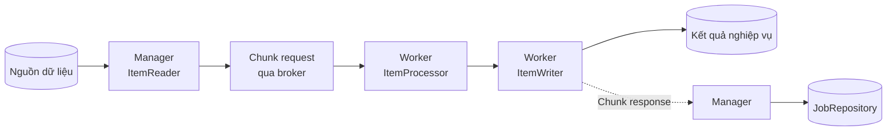
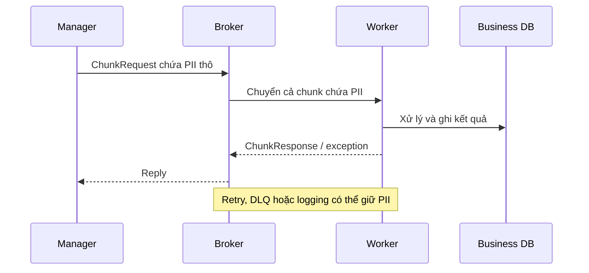
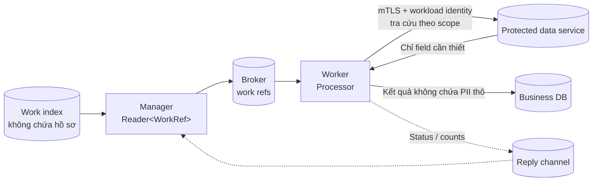
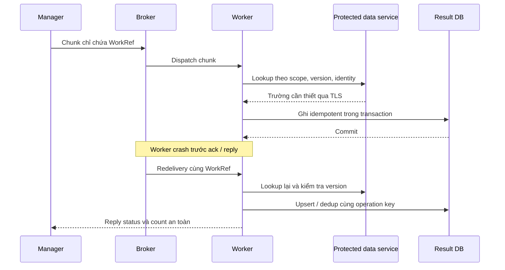

# Không gửi PII trong chunk message

> **Chương:** Bảo mật  
> **Module:** `SPRING_BATCH_SCALING_OPERATIONS` — vận hành và mở rộng Spring Batch với multi-threaded step, parallel steps, partitioning và các mô hình phân tán, đồng thời bảo đảm tính đúng đắn của dữ liệu, retry/restart, thread safety và hiệu năng.

## Mục tiêu học tập

Sau bài học, bạn có thể:

1. Nhận diện dữ liệu định danh cá nhân (PII) trong **request, reply, error, log và dead-letter queue** của Spring Batch remote chunking.
2. Giải thích vì sao mã hóa kênh truyền không thay thế yêu cầu **giảm thiểu dữ liệu gửi qua broker**.
3. Thiết kế `ItemReader` chỉ tạo **tham chiếu công việc** và để worker truy xuất thuộc tính cần dùng từ nguồn dữ liệu được phân quyền.
4. Bảo vệ ranh giới xác thực/phân quyền khi worker lấy dữ liệu, đồng thời xử lý idempotency, retry, restart và tính nhất quán snapshot.
5. Xây dựng kiểm thử phát hiện PII lọt vào payload, trace, message lỗi hoặc lưu trữ vận hành, kể cả dưới tải lớn.

## 1. Vì sao PII trong chunk message là rủi ro?

**PII (Personally Identifiable Information)** là thông tin có thể dùng để nhận diện một người trực tiếp hoặc gián tiếp, tự nó hoặc khi kết hợp với dữ liệu khác. Ví dụ: họ tên kèm địa chỉ, email, số điện thoại, số giấy tờ tùy thân, ngày sinh, hồ sơ sức khỏe, vị trí cá nhân và định danh tài khoản gắn với một người cụ thể. Phạm vi pháp lý của dữ liệu cá nhân khác nhau tùy quy định áp dụng; đối với thiết kế kỹ thuật, nên xử lý cả các giá trị **có thể liên kết lại với cá nhân** như dữ liệu cần bảo vệ.

Với **remote chunking**, manager thường đọc một nhóm `Item` rồi đưa chúng vào message request để worker xử lý và ghi kết quả. Nếu `Item` là đối tượng khách hàng chứa email, số giấy tờ hoặc thông tin tài chính, những trường đó có thể đi qua broker dù worker chỉ cần một vài thuộc tính.

Ví dụ, một item tưởng như tiện dụng:

```java
public record CustomerItem(
        String customerId,
        String fullName,
        String email,
        String phone,
        String nationalId,
        BigDecimal debtAmount
) {}
```

Khi `CustomerItem` được serialize vào chunk request, **toàn bộ trường được serializer hỗ trợ** có thể đi theo message. Những nơi có thể giữ bản sao gồm:

| Vị trí | Điều có thể xảy ra | Hậu quả |
|---|---|---|
| Broker, queue hoặc topic | Message được ghi bền vững, replicate hoặc lưu bản sao | Phạm vi truy cập PII rộng hơn nguồn dữ liệu |
| Consumer bị chậm, retry hoặc redelivery | Payload tồn tại lâu hơn dự tính | Tăng thời gian phơi lộ dữ liệu |
| Dead-letter queue (DLQ) | Request lỗi nằm trong queue phục vụ điều tra | Người vận hành có thể đọc PII ngoài nhu cầu công việc |
| Log của manager/worker/integration | In payload, exception hoặc header | PII phát tán sang log aggregation |
| Distributed tracing/APM | Thu thập message body hoặc baggage | PII nằm trong hệ thống quan sát có nhiều người truy cập |
| Backup và snapshot broker | Payload lưu trong bản sao lưu | Khó xóa triệt để khi hết thời hạn lưu trữ |
| Công cụ debug hoặc dashboard | Xem nội dung message để xử lý sự cố | Tăng số người có khả năng truy cập dữ liệu |

**Nguyên tắc thiết kế:** nếu broker chỉ cần biết *công việc nào cần làm*, đừng gửi toàn bộ *hồ sơ của người liên quan*. Việc broker nằm trong mạng nội bộ không loại bỏ những rủi ro trên.

### Phân biệt PII trực tiếp, tham chiếu và bí mật truy cập

| Loại dữ liệu | Ví dụ | Cách xử lý |
|---|---|---|
| PII trực tiếp | Email, số điện thoại, số giấy tờ, địa chỉ | **Không đưa vào chunk payload** nếu worker có thể lấy an toàn khi cần |
| Thuộc tính nhạy cảm | Thu nhập, số dư, thông tin sức khỏe | Chỉ truy xuất theo phạm vi xử lý được phép |
| Định danh có thể liên kết | Customer ID, order ID, UUID ánh xạ tới cá nhân | Vẫn phải bảo vệ; ưu tiên token khó đoán, ngắn hạn và giới hạn phạm vi |
| Metadata vận hành | Job/step execution ID, loại thao tác, schema version | Kiểm tra khả năng liên kết trước khi ghi ra log/metric |
| Credential | Access token, API key, mật khẩu, secret | **Không gửi trong message**; worker lấy danh tính qua workload identity/secret store |

Một UUID ngẫu nhiên không chứa họ tên, nhưng nếu hệ thống có bảng đối chiếu UUID → khách hàng thì nó là **dữ liệu giả danh (pseudonymous)**, chưa phải dữ liệu vô danh tuyệt đối. Tránh tuyên bố “không còn dữ liệu cá nhân” chỉ vì đã thay email bằng một ID.

## 2. Ranh giới dữ liệu của remote chunking

Sơ đồ cơ bản:



Trong Spring Batch remote chunking, **manager đọc item**, tạo chunk và gửi đến worker; **worker xử lý và ghi** rồi trả phản hồi theo cấu hình tích hợp messaging. Vì vậy, nếu manager đọc nguyên `CustomerItem`, tính riêng tư đã bị ảnh hưởng **ngay ở khâu tạo chunk**, trước khi worker có cơ hội lọc bỏ trường không cần thiết.

Một số triển khai dùng `ChunkRequest<T>` / `ChunkResponse` của Spring Batch và các adapter Spring Integration. Không nên giả định framework tự động loại bỏ trường nhạy cảm, tự redaction exception hoặc tự cung cấp chính sách phân quyền dữ liệu. Cần kiểm soát **kiểu item T**, serializer, header, đường trả lời và error channel.

### Luồng thường gặp chứa rủi ro



Ngay cả khi hệ thống đã dùng TLS và encryption at rest, người có quyền đọc message, backup, log hoặc DLQ vẫn có thể tiếp cận PII. **Mã hóa là lớp phòng vệ bổ sung; tối thiểu hóa dữ liệu là quyết định kiến trúc.**

## 3. Thiết kế đích: gửi work reference, truy xuất PII tại worker

Thay vì truyền `CustomerItem`, manager chỉ gửi một **tham chiếu công việc**. Worker có danh tính dịch vụ và quyền cần thiết để lấy **những trường được phép** từ một nguồn dữ liệu được bảo vệ, xử lý trong bộ nhớ, sau đó chỉ ghi kết quả tối thiểu.



**Dòng dữ liệu:**

1. Manager lấy `workId` ngẫu nhiên cùng `scopeId` và `sourceVersion` đã được lưu trong chỉ mục công việc. Manager **không cần đọc hồ sơ PII**.
2. Manager gửi danh sách tham chiếu trong chunk request, không gửi email, tên, địa chỉ hay thuộc tính nhạy cảm.
3. Worker xác thực với protected data service bằng **danh tính workload**, không nhận credential qua message.
4. Data service kiểm tra worker có được xử lý `scopeId`, `workId` và phiên bản dữ liệu đó không; chỉ trả các trường mà nghiệp vụ cần.
5. Worker xử lý trong bộ nhớ, tránh log raw object; writer lưu kết quả theo idempotency key ổn định.
6. Reply chỉ truyền trạng thái, số lượng/metadata cần thiết, không đính kèm hồ sơ gốc hoặc stack trace chứa giá trị nhạy cảm.

### Trước và sau

Ví dụ **payload minh họa**; đây không phải biểu diễn wire format cố định của `ChunkRequest` Spring Batch.

**Không nên gửi:**

```json
{
  "jobExecutionId": 841,
  "items": [
    {
      "customerId": "C1234",
      "fullName": "Nguyen Van A",
      "email": "person@example.test",
      "phone": "+84xxxxxxxxx",
      "nationalId": "xxxx-xxxx-xxxx",
      "debtAmount": 4200000
    }
  ]
}
```

**Nên hướng tới:**

```json
{
  "protocolVersion": 1,
  "jobExecutionId": 841,
  "stepExecutionId": 1942,
  "correlationId": "6f13ea8d-8321-42b1-8b86-f279a1e6c7cb",
  "items": [
    {
      "workId": "d8424d62-5123-42ea-92dc-36f6b9f5ac0d",
      "scopeId": "ce362127-332b-4fdc-a561-8172bce8d2ef",
      "sourceVersion": 7
    }
  ]
}
```

`workId` cần được sinh ngẫu nhiên, khó đoán và không mã hóa trực tiếp tên, số giấy tờ hay số điện thoại. Tuy nhiên, **tham chiếu vẫn có thể liên kết lại với cá nhân**, vì thế cần bảo vệ queue, message và khả năng tra cứu tương ứng. `scopeId` giới hạn nhóm công việc có thể truy xuất; nó **không thay thế xác thực và phân quyền** tại data service.

## 4. Ví dụ mã Java theo cấu trúc Spring Batch

### 4.1. Hợp đồng item tối thiểu

Worker chỉ nhận tham chiếu:

```java
import java.io.Serializable;
import java.util.UUID;

public record WorkRef(
        UUID workId,
        UUID scopeId,
        long sourceVersion
) implements Serializable {}

public record EligibilityDecision(
        UUID workId,
        UUID scopeId,
        long sourceVersion,
        boolean eligible
) {}
```

`WorkRef` là kiểu item logic mà manager reader cung cấp và remote chunking serializer phải hỗ trợ. Việc triển khai thực tế còn cần cấu hình reader, manager step, request/reply channel, worker step và serializer phù hợp với phiên bản Spring Batch/Spring Integration đang dùng.

### 4.2. Manager chỉ truy vấn chỉ mục tham chiếu

Một truy vấn kiểu:

```sql
SELECT work_id, scope_id, source_version
FROM batch_work_index
WHERE batch_scope = :current_scope
  AND state = 'READY'
ORDER BY work_id;
```

Tài khoản DB của manager chỉ cần quyền đọc chỉ mục công việc; không cần quyền đọc bảng chứa email, số giấy tờ hoặc hồ sơ chi tiết. Trong môi trường đa tenant, phải áp dụng bộ lọc tenant/scope ngay ở tầng truy vấn và quyền truy cập dữ liệu.

`batch_work_index` là bảng ví dụ do ứng dụng thiết kế, **không phải bảng mặc định của Spring Batch**. Dữ liệu chỉ mục có thể vẫn là dữ liệu cá nhân gián tiếp nên cũng phải được quản lý vòng đời.

### 4.3. Worker fetch theo quyền, xử lý PII trong bộ nhớ

```java
import org.springframework.batch.item.ItemProcessor;
import org.springframework.context.annotation.Bean;
import org.springframework.context.annotation.Configuration;

@Configuration
class SecureWorkerConfig {
    @Bean
    ItemProcessor<WorkRef, EligibilityDecision> eligibilityProcessor(
            ProtectedProfileClient profiles,
            EligibilityPolicy policy
    ) {
        return ref -> {
            // Client dùng workload identity / mTLS ở cấu hình riêng.
            // Server phải authorize workId trong scopeId; không tin ID trong message.
            ProfileProjection profile = profiles.fetchAllowedFields(
                    ref.scopeId(),
                    ref.workId(),
                    ref.sourceVersion()
            );

            // Chỉ chuyển kết quả nghiệp vụ cần thiết sang writer.
            // Không ghi profile hoặc toàn bộ object vào log.
            boolean allowed = policy.isEligible(profile);
            return new EligibilityDecision(
                    ref.workId(),
                    ref.scopeId(),
                    ref.sourceVersion(),
                    allowed
            );
        };
    }
}
```

`ProtectedProfileClient`, `ProfileProjection` và `EligibilityPolicy` là abstraction minh họa cần được hiện thực trong dự án. `ProfileProjection` chỉ nên có những trường phục vụ `isEligible`; tránh endpoint kiểu `GET /customers/{id}` trả nguyên hồ sơ nếu worker chỉ dùng hai thuộc tính.

**Không chuyển `ProfileProjection` vào `ExecutionContext`, JobParameters, task log hoặc chunk reply**. Nó nên tồn tại trong bộ nhớ của worker theo thời gian xử lý ngắn nhất có thể. Với lỗi, sử dụng mã lỗi an toàn và correlation ID, không nối `profile.toString()` vào exception.

### 4.4. Writer có tính idempotent

Worker có thể xử lý lại một tham chiếu khi broker redeliver sau timeout hoặc crash. Writer phải xác định **khóa nghiệp vụ ổn định qua các lần retry**, ví dụ `scope_id + work_id + policy_version`, và lưu kết quả theo ràng buộc duy nhất.

```sql
CREATE TABLE eligibility_result (
    scope_id UUID NOT NULL,
    work_id UUID NOT NULL,
    policy_version INTEGER NOT NULL,
    source_version BIGINT NOT NULL,
    eligible BOOLEAN NOT NULL,
    PRIMARY KEY (scope_id, work_id, policy_version)
);

INSERT INTO eligibility_result (
    scope_id, work_id, policy_version, source_version, eligible
) VALUES (
    :scope_id, :work_id, :policy_version, :source_version, :eligible
)
ON CONFLICT (scope_id, work_id, policy_version)
DO NOTHING;
```

Đây là SQL **minh họa cho PostgreSQL**. `DO NOTHING` chỉ phù hợp khi xử lý lại cùng operation có kết quả tương đương; nếu `source_version` hoặc kết quả khác, ứng dụng phải **phát hiện xung đột và điều tra**, không âm thầm chấp nhận dữ liệu không nhất quán. Trạng thái transaction của business DB, broker acknowledgment và `JobRepository` có thể có ranh giới khác nhau.

## 5. Phân quyền lookup, giới hạn quyền và chống lạm dụng tham chiếu

Thay `CustomerItem` bằng `WorkRef` giảm lượng dữ liệu trên broker nhưng mở ra một API tra cứu. Nếu API cho phép bất kỳ worker nào đổi `workId` để lấy mọi hồ sơ, thiết kế vẫn không an toàn.

Một lượt lookup nên kiểm tra đồng thời:

1. **Xác thực service identity:** ví dụ workload identity có thể cấp token ngắn hạn hoặc mTLS; credential được worker lấy từ môi trường được bảo vệ.
2. **Ủy quyền theo vai trò và phạm vi:** worker của batch A chỉ được đọc các `workId` thuộc `scopeId` A, các tenant được cấp quyền và đúng loại trường cần dùng.
3. **Ủy quyền theo trạng thái công việc:** lookup gắn với lứa job hợp lệ, không cho tra cứu tùy ý dữ liệu bên ngoài batch.
4. **Giới hạn projection:** endpoint chỉ xuất trả trường cần thiết; tránh phản hồi toàn bộ object và giảm khả năng bị ghi log nhầm.
5. **Kiểm soát tần suất và audit:** có rate limit/bulk access policy; audit sự kiện truy xuất, principal, purpose, outcome và ID đã được bảo vệ, không ghi raw PII vào audit log.
6. **Phiên bản/snapshot:** kiểm tra `sourceVersion` để tránh xử lý dữ liệu đã thay đổi giữa lúc manager dispatch và lúc worker fetch.

### Không mang quyền truy cập trong payload

Không nhúng JWT bearer token, API key, database password hoặc URL ký sẵn có thời hạn dài trong chunk message. Broker có thể lưu lại message để retry, DLQ hoặc backup; credential có thể sống lâu hơn dự tính hoặc bị replay. Nếu ứng dụng buộc phải dùng token truy cập một lần, cần ràng buộc tenant/work item, audience, TTL, chống replay và chính sách lưu trữ chặt; vẫn ưu tiên worker tự xác thực bằng workload identity.

### Snapshot consistency và quyền xóa

Ví dụ: manager dispatch `sourceVersion=7`, trong lúc chờ worker thì khách hàng cập nhật dữ liệu thành version 8. Hệ thống phải quyết định rõ:

- **Snapshot semantics:** worker đọc dữ liệu của version 7 từ nguồn hỗ trợ version/snapshot.
- **Latest semantics:** worker đọc version mới nhất và ghi nhận kết quả phụ thuộc version đó, nếu nghiệp vụ cho phép.
- **Fail and retry:** nếu version không còn hợp lệ thì báo lỗi có mã an toàn, không tự ý lấy bản mới mà bỏ qua checkpoint.

Khi có yêu cầu xóa hoặc hạn chế xử lý dữ liệu, cần bảo đảm chính sách đó được thực thi tại protected data service; token/reference còn trong queue không được tự động vượt qua quyền riêng tư đã bị thu hồi.

## 6. Message request, response và các đường lỗi đều phải sạch PII

Chỉ kiểm tra request thành công là chưa đủ. PII có thể rò rỉ qua **exception** do driver DB, HTTP client, mapper, business validation hoặc serialization:

```text
BAD:  Failed processing CustomerItem(email=..., phone=..., nationalId=...)
GOOD: BATCH_ITEM_REJECTED correlationId=... reasonCode=POLICY_INPUT_INVALID
```

Thiết kế cần kiểm tra:

| Thành phần | Cần làm |
|---|---|
| Request body | Chỉ serialize các field được allowlist trong `WorkRef` |
| Request headers | Không dùng email/customer name làm `correlationId`, routing key, partition key, trace baggage |
| Reply body | Chỉ trả code, trạng thái hoặc count thực sự cần; không echo item chứa PII |
| Exception | Ánh xạ lỗi sang mã an toàn; không expose thông điệp từ DB/HTTP chứa giá trị PII |
| Error channel | Kiểm tra liệu payload gốc có nằm trong `ErrorMessage`/exception chain không |
| DLQ/quarantine | Không giả định hệ thống tự xóa payload gốc; phải có ACL, retention, redaction/quarantine policy |
| Log & tracing | Tắt log toàn bộ message; không đưa workId/customer ID vào metric label có cardinality cao |
| JobRepository | Tránh raw PII trong `JobParameters`, `ExecutionContext`, `ExitStatus` và thông điệp lỗi |

**Lưu ý:** lỗi framework có thể đóng gói request gốc trong failure object, ngay cả khi reply bình thường chỉ chứa status. Hãy kiểm tra serializer, error handler, retry advice và cách đưa message vào DLQ trên broker cụ thể. Việc chỉ sửa phương thức `toString()` của item **không ngăn** serializer gửi các trường PII.

### Mẫu log nên dùng

```java
// Log số lượng, loại lỗi và correlation an toàn.
log.warn(
    "remote_chunk_failed release={} jobExecutionId={} chunkId={} reasonCode={}",
    release,
    jobExecutionId,
    chunkId,
    "PROFILE_LOOKUP_TIMEOUT"
);

// Tránh:
// log.error("Failed customer {}", customerProfile, exception);
// log.debug("requestPayload={}", entireChunkRequest);
```

Correlation ID hoặc workId vẫn có thể bị liên kết với một người trong hệ thống nội bộ, nên cần giới hạn quyền truy cập và thời hạn lưu log. Với metric tổng hợp, ưu tiên label như job type, step, release, error code thay vì ID của từng item.

## 7. Retry, restart và đặc tính at-least-once

Broker và framework có thể phát lại công việc trong nhiều tình huống; đừng giả định một work reference được xử lý đúng một lần vật lý. Điều cần bảo đảm là **kết quả nghiệp vụ đúng** khi có duplicate, crash hoặc restart.



### Tình huống và chính sách khôi phục

| Sự kiện | Rủi ro | Cách xử lý |
|---|---|---|
| Worker chết trước khi commit | Chunk chưa có kết quả | Retry/restart từ trạng thái hợp lệ |
| Worker commit DB rồi chết trước reply/ack | Message bị giao lại, nguy cơ ghi trùng | Idempotent writer và reconciliation |
| Lookup timeout hoặc 503 | Sự cố tạm thời | Retry có giới hạn, backoff, tránh quá tải dịch vụ PII |
| WorkRef không hợp lệ hoặc ngoài scope | Truy cập dữ liệu trái quyền | Reject, audit không chứa PII, không retry vô hạn |
| Version dữ liệu không khớp | Kết quả có thể phụ thuộc snapshot khác | Dừng/kiểm soát retry theo quy tắc snapshot |
| Dữ liệu đã bị xóa/hạn chế | Không thể hoặc không được xử lý | Mã lỗi nghiệp vụ rõ ràng, không khôi phục từ queue cũ |
| Chunk response thất lạc | Manager không nhận được trạng thái cuối | Correlate, retry an toàn, kiểm tra metadata và kết quả |
| Restart từ `ExecutionContext` cũ | Schema/checkpoint đã thay đổi | Giữ hợp đồng reference và chính sách version tương thích |

**Checkpoint không nên chứa PII.** Trong Spring Batch, các giá trị trong `ExecutionContext` có thể được lưu vào bảng metadata để phục vụ restart. Reader nên lưu con trỏ/index hoặc khóa tham chiếu phù hợp; tránh lưu nguyên bản `CustomerItem`, `ProfileProjection` hoặc JSON chứa hồ sơ.

**Một lưu ý về idempotency:** khóa chống trùng phải ổn định qua cả restart của cùng công việc logic. Nếu lấy `jobExecutionId` làm thành phần duy nhất cho khóa, một lần restart có thể có ID execution mới và bỏ qua phát hiện trùng. Chọn business operation key hoặc `JobInstance`/scope ổn định theo nghiệp vụ.

## 8. Trade-off hiệu năng khi chỉ gửi tham chiếu

Giảm PII trên broker có thể khiến worker phải thực hiện thêm lookup. Với workload hàng triệu item và nhiều worker, thiết kế này cần được đo và tune như một phần của **Spring Batch Scaling Operations**, không chỉ đánh giá bảo mật.

### Tác động tài nguyên

Giả sử có 12 worker, mỗi worker xử lý đồng thời 4 chunk. Nếu mỗi chunk gây một lượt truy vấn kết nối DB, có thể có tới **48 tác vụ tra cứu song song** trước khi tính thêm request từ nơi khác. Nếu mỗi item gây một request riêng, số request có thể tăng theo `chunkSize × chunksInFlight`, gây nghẽn data service.

Biện pháp kiểm soát:

- **Bulk lookup theo danh sách `WorkRef`** khi chính sách phân quyền cho phép, thay vì N+1 API call; vẫn kiểm tra scope từng item.
- Giới hạn thread pool, concurrency và connection pool theo throughput thực đo, không tăng workers chỉ vì queue lag cao.
- Dùng projection nhỏ và index trên `work_id + scope_id + source_version` để giảm truy vấn và network.
- Thiết kế timeout, rate limit, circuit breaker và exponential backoff; tránh retry storm vào nguồn PII.
- Chọn kích thước chunk dựa trên latency xử lý, memory và khả năng restart. Chunk quá lớn kéo dài transaction và làm redelivery tốn kém.
- Chỉ cache nội bộ khi có lý do, TTL ngắn, mã hóa/giới hạn memory dump phù hợp; **không cache PII vào broker, log, JobRepository**.

### Chỉ số nên theo dõi

| Metric | Mục đích |
|---|---|
| `chunk_requests_total`, `chunk_replies_total` | Phát hiện request chưa có reply |
| `work_refs_per_chunk` | Đánh giá kích thước chunk |
| `profile_lookup_latency` và tỉ lệ lỗi | Đo nút thắt của protected data service |
| `worker_inflight`, `broker_unacked`, `dlq_count` | Phát hiện backlog và redelivery |
| `batch_retry_total`, `batch_skip_total` | Theo dõi retry/skip bất thường |
| `privacy_payload_rejection_total` | Số message bị schema gate chặn vì chứa trường không được phép |
| `data_reconciliation_mismatch` | Phát hiện thiếu/trùng kết quả |

Không gắn `workId`, email, số điện thoại hay ID khách hàng vào metric labels. Dùng histogram/summary và counters theo job type, release, step, error code; correlation ID chỉ lưu ở trace/log có kiểm soát khi thật cần.

## 9. Phòng vệ nhiều lớp cho hệ thống messaging

**Không gửi PII thô** là mục tiêu dữ liệu. Đồng thời vẫn cần bảo vệ message tham chiếu và hệ thống truy xuất:

1. **Transport:** TLS cho broker và data service; cân nhắc mTLS để xác thực workload giữa các thành phần.
2. **Broker authorization:** ACL riêng cho producer, consumer, reply queue, DLQ và admin; worker chỉ tiêu thụ route được phân công.
3. **Storage:** mã hóa dữ liệu lưu trữ, backup và hạn chế quyền đọc dump; có chính sách retention cho queue, DLQ và retry topic.
4. **Serialization:** allowlist field, type-safe DTO, schema version; không dùng serializer phản chiếu toàn bộ entity ORM vào message.
5. **Secrets:** workload identity, secret manager hoặc cơ chế cấp phát an toàn; rotation; không đính kèm bearer token vào request.
6. **Application:** projection nhỏ, authorization server-side, idempotent writer, redaction và exception mapping.
7. **Operations:** RBAC dashboard/log/APM, cảnh báo khi payload có field cấm, quy trình xử lý sự cố và xóa dữ liệu.

Nếu cần tuân thủ chế độ lưu giữ/xóa dữ liệu cá nhân, phải xét cả **data service, result DB, `JobRepository`, audit, backup và log**. Việc chuyển PII khỏi chunk body chỉ giảm một tuyến lưu trữ; nó không tự giải quyết mọi nghĩa vụ xử lý dữ liệu.

## 10. Kiểm thử bắt buộc trước khi triển khai

Mỗi lớp kiểm thử nên kiểm tra cả **happy path** lẫn **failure path**, vì dữ liệu có thể chỉ xuất hiện trong error message.

### 10.1. Contract test: chỉ cho phép tham chiếu

Với JSON minh họa, bộ kiểm thử có thể kiểm tra schema cho phép đúng `workId`, `scopeId`, `sourceVersion` trong mỗi item và từ chối field lạ:

```json
{
  "type": "object",
  "required": ["workId", "scopeId", "sourceVersion"],
  "additionalProperties": false,
  "properties": {
    "workId": { "type": "string", "format": "uuid" },
    "scopeId": { "type": "string", "format": "uuid" },
    "sourceVersion": { "type": "integer", "minimum": 0 }
  }
}
```

Schema trên chỉ áp dụng cho **item DTO mẫu**, không thay thế schema của toàn bộ `ChunkRequest` do framework serialize. Khi dùng Java serialization hoặc serializer khác, kiểm thử cần giải mã message thực tế và xác nhận không chứa entity hồ sơ/tham chiếu không mong muốn.

### 10.2. Kiểm tra dữ liệu bí mật có chủ đích

Tạo dữ liệu thử chứa chuỗi sentinel dễ nhận biết (ví dụ `TEST_PERSON_PRIVATE_9e42`) ở mọi field nhạy cảm. Cho manager tạo chunk, để worker xử lý thành công, rồi chủ động gây timeout, serialization error, database error, retry và DLQ. Kiểm tra:

- Request bytes thực tế và header đi qua broker.
- Chunk reply, error channel, DLQ và retry topic.
- Log của manager/worker, trace, APM event, audit và metadata Batch.
- Không có chuỗi sentinel xuất hiện ngoài nguồn dữ liệu hợp lệ.

Chỉ scan chuỗi thô có thể bỏ sót dữ liệu đã mã hóa base64, chuyển dạng hoặc tách trường; vì vậy phải kết hợp **schema allowlist, kiểm tra object graph và decoded payload**. Không sử dụng PII thật làm fixture hoặc upload dump chứa PII lên hệ thống CI không có quyền phù hợp.

### 10.3. Kiểm thử phân quyền và recovery

| Test case | Kỳ vọng |
|---|---|
| Worker đọc `workId` thuộc scope khác | Từ chối, audit có mã lỗi an toàn |
| Message bị sửa `scopeId` hoặc `sourceVersion` | Không cho lấy hồ sơ ngoài quyền hoặc snapshot sai |
| Worker chết sau DB commit, trước ack | Redelivery không tạo duplicate business result |
| Protected data service trả 503 | Retry có backoff, không lộ response body nhạy cảm |
| Xử lý lỗi có input PII tại nguồn | Error/reply/log/DLQ chỉ chứa mã lỗi và metadata tối thiểu |
| Restart job từ checkpoint | Không cần khôi phục `ProfileProjection` trong `ExecutionContext` |
| Tăng worker từ 2 lên 16 | Không làm cạn pool DB hoặc vượt rate limit |
| Dữ liệu bị thu hồi quyền truy cập | Worker không xử lý trái quyền dù WorkRef vẫn tồn tại trong queue |

## 11. Tình huống thực tế: tính điều kiện duyệt hồ sơ

Một hệ thống cần đánh giá **5 triệu hồ sơ** mỗi đêm. Trước đây manager đọc `CustomerProfile` với email, số điện thoại, ngày sinh và dữ liệu thu nhập, rồi gửi cả object qua broker cho 16 worker. Khi một worker lỗi, toàn bộ request gốc xuất hiện trong DLQ và debug log. Thực tế, phép tính chỉ cần ba thuộc tính nghiệp vụ từ dữ liệu nguồn.

### Thiết kế thay đổi

**Manager:** đọc 5 triệu `WorkRef` từ bảng chỉ mục, theo trang/chunk; broker chỉ nhận các tham chiếu, scope và version. `ItemReader` không truy cập bảng hồ sơ đầy đủ.

**Worker:** nhận chunk, xác thực tới protected data service, batch fetch đúng ba thuộc tính được phép cho các `WorkRef` trong scope, tính quyết định, chỉ ghi decision/result code. Giữ PII trong bộ nhớ theo thời gian xử lý, không gắn vào reply hoặc exception.

**Business DB:** dùng unique constraint theo operation key để retry/redelivery không tạo thêm kết quả. JobRepository lưu checkpoint dạng con trỏ và trạng thái xử lý, không giữ hồ sơ gốc.

**Vận hành:** giám sát lookup latency, broker unacked, số lần retry, mismatched output và các sự kiện schema gate reject. DLQ chứa tham chiếu và mã lỗi đã redaction; truy cập DLQ có ACL riêng và retention phù hợp.

### Trường hợp không thể fetch lại dữ liệu

Nếu nguồn dữ liệu được bảo vệ không thể truy xuất theo reference vào thời điểm worker chạy, cần **thiết kế nguồn trung gian được kiểm soát**, chẳng hạn một staging store mã hóa, ACL theo job/scope, TTL rõ ràng và dữ liệu được giảm thiểu. Worker đọc từ staging store bằng workload identity; message vẫn chỉ mang tham chiếu. Không chuyển dữ liệu nhạy cảm sang JSON message như một cách “đơn giản hóa” vì staging tạm thời chưa sẵn sàng.

## 12. Checklist khi review code và vận hành

- [ ] `ItemReader` phía manager chỉ trả DTO tối thiểu, không serialize entity chứa PII.
- [ ] Đã kiểm tra cả request **và reply**, header, error channel, retry và DLQ.
- [ ] `WorkRef` dùng định danh khó đoán, hạn chế liên kết; biết rằng tham chiếu vẫn cần bảo vệ.
- [ ] Không có email/số điện thoại/tên người trong routing key, log, trace baggage hoặc metric label.
- [ ] Worker xác thực bằng workload identity; mọi lookup được authorize theo scope, tenant và quyền trường.
- [ ] Không đưa credential hay token dài hạn vào message.
- [ ] Có chính sách source version/snapshot khi nguồn dữ liệu thay đổi.
- [ ] Writer idempotent và có đối soát sau retry/redelivery.
- [ ] `JobParameters`, `ExecutionContext` và `ExitStatus` không chứa raw PII.
- [ ] Broker, DLQ, log, backup có ACL, encryption, retention và cơ chế xử lý sự cố.
- [ ] Đã đo tác động tới protected data service, pool DB, chunk throughput và retry storm.
- [ ] Kiểm thử sentinel và schema allowlist đạt yêu cầu cho cả happy/failure path.

## 13. Câu hỏi tự kiểm tra

**Câu 1.** Chỉ dùng TLS và mã hóa broker có đáp ứng mục tiêu “không gửi PII trong chunk message” không?

*Gợi ý:* Không. PII vẫn có mặt trong payload khi được giải mã hợp lệ, có thể đi vào DLQ, log, backup và hệ thống giám sát. Thiết kế message phải giảm thiểu dữ liệu từ đầu.

**Câu 2.** Thay email bằng `customerId` tuần tự có làm message chắc chắn vô danh không?

*Gợi ý:* Không. ID tuần tự dễ bị dò; ngay cả UUID ngẫu nhiên vẫn là dữ liệu có thể liên kết khi tồn tại bảng ánh xạ. Cần kiểm soát quyền và vòng đời của tham chiếu.

**Câu 3.** Worker nhận `WorkRef` nhưng data service cho phép mọi worker truy cập mọi hồ sơ theo ID. Điều gì còn thiếu?

*Gợi ý:* Xác thực principal, authorization theo scope/tenant/purpose, projection theo trường, rate limit và audit. Một work reference không được coi là bằng chứng được phép truy cập.

**Câu 4.** Chunk được xử lý thành công, DB đã commit nhưng worker mất kết nối trước ack. Kết quả cần có tính chất gì?

*Gợi ý:* Có thể xử lý lại cùng công việc mà không tạo side effect trùng; dùng khóa nghiệp vụ ổn định, writer idempotent và kiểm tra đối soát.

**Câu 5.** Vì sao không nên đặt JSON hồ sơ khách hàng vào `ExecutionContext` cho tiện restart?

*Gợi ý:* `ExecutionContext` được lưu vào JobRepository; PII sẽ tồn tại ở metadata và backup. Hãy lưu con trỏ/version hoặc tham chiếu được bảo vệ và phục hồi dữ liệu theo chính sách.

## Kết luận

Đối với Spring Batch remote chunking, dữ liệu trong `ItemReader` của manager chính là ứng viên được truyền qua broker. Vì vậy, **không gửi PII trong chunk message** cần được giải quyết ngay ở thiết kế item: manager phát `WorkRef`, worker dùng danh tính được cấp quyền để lấy projection tối thiểu từ nguồn bảo vệ, xử lý trong bộ nhớ và ghi kết quả idempotent. Sau đó phải kiểm chứng toàn bộ đường request, response, retry, exception, DLQ và metadata. Cách tiếp cận này vừa giảm phạm vi phơi lộ dữ liệu khi mở rộng hàng loạt worker, vừa giữ được khả năng đo hiệu năng, restart và xử lý lỗi của Spring Batch.
