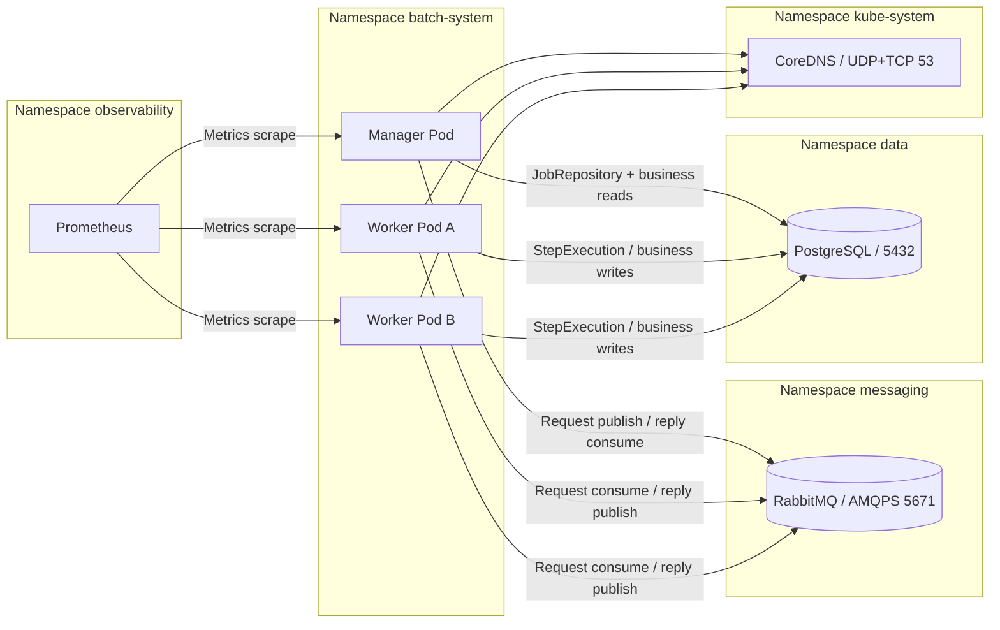
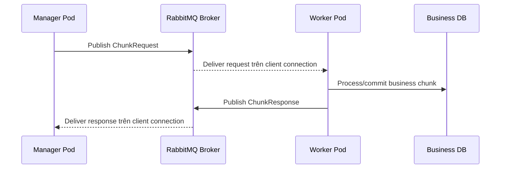

# Network policy giữa các thành phần trong Spring Batch Scaling Operations

Một cụm Spring Batch xử lý hàng chục triệu bản ghi bằng **remote partitioning**: manager phát yêu cầu qua RabbitMQ, nhiều worker nhận partition, đọc/ghi PostgreSQL và cập nhật `JobRepository`. Khi mở rộng worker từ 4 lên 24 Pod, mỗi Pod có thêm đường kết nối tới broker, database, DNS và endpoint giám sát. Nếu mạng nội bộ Kubernetes mặc định cho mọi Pod nói chuyện với mọi Pod, một workload bị xâm nhập trong namespace khác có thể thử truy cập broker hoặc database dù nó không có lý do nghiệp vụ. Ngược lại, nếu cấu hình `default-deny` thiếu đường đi hợp lệ, job có thể đứng ở trạng thái `STARTED`, manager không nhận replies, worker không mở được kết nối `JobRepository` hoặc cơ chế restart thất bại.

Bài **“Network policy giữa các thành phần”** thuộc chương **Bảo mật** của module `SPRING_BATCH_SCALING_OPERATIONS`. Mục tiêu là thiết kế, triển khai và kiểm thử **phân đoạn mạng theo nguyên tắc tối thiểu quyền** cho manager, worker, message broker, JobRepository/business database và monitoring khi dùng **multi-threaded step, parallel steps, local/remote partitioning và remote chunking**. Nội dung nhấn mạnh cả **an toàn kết nối lẫn tính đúng nghiệp vụ**: chặn truy cập không cần thiết nhưng không làm mất dữ liệu, phá checkpoint, retry/restart hoặc báo `COMPLETED` giả.

Ví dụ dùng **Kubernetes `networking.k8s.io/v1 NetworkPolicy`**, RabbitMQ qua **AMQPS TCP/5671**, PostgreSQL TCP/5432, Spring Batch 5.2.x và Prometheus. Tất cả hostname, nhãn, namespace và cổng là **topology minh họa**; phải kiểm tra cấu hình thực tại cluster trước khi triển khai. Tệp YAML bên dưới là **mẫu cấu hình để học và điều chỉnh**, không được coi là policy production dùng nguyên xi.

## 1. Phạm vi của NetworkPolicy

`NetworkPolicy` chuẩn của Kubernetes là tài nguyên mô tả **những kết nối layer 4 được phép thiết lập** tới/từ các Pods theo:

- `podSelector`: chọn Pods áp dụng policy trong namespace chứa policy.
- `policyTypes`: chọn hướng `Ingress`, `Egress` hoặc cả hai.
- `ingress[].from` và `ports`: nguồn/cổng nào được đến Pod đã chọn.
- `egress[].to` và `ports`: Pod đã chọn được đi tới đích/cổng nào.
- `namespaceSelector`, `podSelector` và `ipBlock`: chọn peers theo namespace, nhãn Pod hoặc CIDR.

NetworkPolicy chuẩn **không** thay thế **authentication, authorization, TLS/mTLS, rate limiting, firewall cấp node, RBAC hay kiểm soát HTTP path**. Nó không tự hiểu `JobExecutionId`, RabbitMQ queue/vhost, quyền đọc bảng `BATCH_*` hoặc business operation key.

**Điều kiện bắt buộc:** CNI/network plugin phải **thực thi Kubernetes NetworkPolicy**. API server có thể nhận tài nguyên YAML nhưng policy **không có tác dụng lọc traffic** nếu môi trường không có network-policy enforcement. Phải kiểm tra plugin thực và thử luồng **được phép/không được phép** trên cluster.

## 2. Sơ đồ trust boundary cho Spring Batch phân tán



Mỗi mũi tên là **một luồng ứng dụng cần thiết trong ví dụ remote partitioning**, không phải lời khẳng định tất cả topology Spring Batch bắt buộc có cùng lưu lượng.

Đặc biệt:

- **Remote partitioning:** worker thường cần truy cập **shared JobRepository** để xử lý `StepExecution`, cùng business database/resource của worker step.
- **Remote chunking:** manager đọc và gửi `ChunkRequest`; worker xử lý/writes và gửi `ChunkResponse`. Worker có thể **không cần kết nối JobRepository** trong cấu hình cụ thể. Chỉ mở DB cho worker khi nó thực sự dùng.
- **Multi-threaded step, parallel steps và local partitioning trong một JVM:** các threads/flows **không tạo network hop nội bộ mới chỉ vì chạy song song**; NetworkPolicy vẫn kiểm các kết nối từ Pod đến DB, broker/API bên ngoài.

## 3. Tạo bảng kết nối trước khi viết YAML

| Source | Destination | Protocol/port ví dụ | Vì sao cần | Nếu bị chặn |
| --- | --- | --- | --- | --- |
| Manager | RabbitMQ | TCP/5671 | Publish requests, consume replies qua AMQPS | Dispatch/reply thất bại |
| Worker | RabbitMQ | TCP/5671 | Consume requests, publish replies | Worker không nhận việc/không trả lời |
| Manager | PostgreSQL | TCP/5432 | JobRepository, job state, reader tùy topology | Launch/checkpoint/restart lỗi |
| Worker | PostgreSQL | TCP/5432 | Shared StepExecution và business writer | Commit/checkpoint thất bại |
| Manager/Worker | CoreDNS | UDP/53, TCP/53 | Phân giải tên Service/broker/DB | `UnknownHostException`, connect fail |
| Prometheus | Manager/Worker | TCP/8081 (minh họa) | Scrape metrics riêng, đã bảo vệ | Mất giám sát hoặc alarm no-data |
| Prometheus | RabbitMQ metrics | TCP/15692 (nếu bật) | Theo dõi ready/unacked/retry | Mất broker metrics |
| Manager/Worker | External API | TCP/443 và đích được kiểm soát | Processor enrich/callback nếu cần | Retry/backoff/HTTP failure |
| RabbitMQ node | RabbitMQ peers | Phụ thuộc topology: Erlang clustering, discovery | Khi dùng cluster RabbitMQ | Cluster mất quorum/replication |
| PostgreSQL node | DB peers/backup/monitoring | Phụ thuộc HA/backup | Replication, failover, backups | HA/recovery có thể hỏng |

**Phân biệt traffic client-server và peer-to-peer.** RabbitMQ manager/worker dùng **outbound TCP connection tới broker**, không nhất thiết phải cho broker thiết lập kết nối TCP mới vào Pod worker. Với cách kết nối này, **return traffic của kết nối đã được phép được CNI xử lý theo semantics NetworkPolicy**; không tạo rule mở ngược toàn bộ cổng worker chỉ để nhận ACK/reply qua kết nối AMQP đã thiết lập.

## 4. Chọn topology và mức cô lập

Mẫu minh họa sử dụng bốn namespaces:

```text
batch-system    -> manager, worker
messaging       -> RabbitMQ
data            -> PostgreSQL
observability   -> Prometheus
kube-system     -> CoreDNS (hạ tầng chung)
```

Pod labels quy ước:

```yaml
# Chỉ mô tả nhãn cần có trên Pod template, không phải một manifest Pod đầy đủ.
batch-system:
  manager: {app: batch-manager}
  worker: {app: batch-worker}
messaging:
  broker: {app: batch-rabbitmq}
data:
  database: {app: batch-postgres}
observability:
  collector: {app: prometheus}
```

Sử dụng namespace label tự động `kubernetes.io/metadata.name` khi Kubernetes version hỗ trợ, và xác minh:

```bash
kubectl get namespace batch-system messaging data observability \
  --show-labels
kubectl -n batch-system get pods --show-labels
kubectl -n messaging get pods --show-labels
kubectl -n data get pods --show-labels
```

**Nhãn là cơ chế chọn network peers, không phải bằng chứng nhận dạng mật mã.** Quyền tạo/sửa Pod labels và namespaces phải được khóa bằng RBAC/admission control. Nếu một actor có thể tạo Pod tự gán `app: batch-manager` trong namespace cho phép, nó có thể khớp policy dù không phải manager thật.

## 5. Các nguyên tắc Kubernetes dễ bị hiểu sai

1. Pod **không được chọn bởi một NetworkPolicy ở một hướng** thường vẫn **không bị cô lập ở hướng đó** theo cơ chế NetworkPolicy; không mặc định có default deny.
2. `Ingress` và `Egress` là **hai hướng độc lập**. Kết nối Pod A → Pod B cần được cho phép qua egress của A **và** ingress của B **nếu** mỗi phía đã được cô lập.
3. Nhiều NetworkPolicies chọn cùng Pod được **hợp nhất theo phép OR/union các allow rules**; không có deny rule với độ ưu tiên cao hơn cho phép ở policy khác.
4. `podSelector: {}` chọn **mọi Pod** trong namespace chứa policy, không chọn toàn cluster.
5. `policyTypes: [Ingress, Egress]` với không có `ingress/egress` rule nghĩa là **không cho phép kết nối ứng dụng mới** theo hai hướng được kiểm soát, trừ các ngoại lệ nền tảng/CNI.
6. `namespaceSelector` + `podSelector` **cùng một phần tử peer** là phép **AND**; hai phần tử khác nhau là phép **OR**.
7. Traffic đến/từ **node chứa Pod** có các ngoại lệ theo Kubernetes; `hostNetwork`, CNI host endpoints và SNAT có thể làm isolation không giống Pod-to-Pod traffic thuần.

**Không quảng cáo một NetworkPolicy như tường lửa tuyệt đối chống mọi traffic node/host, ICMP, hostNetwork hoặc bypass CNI.** Test trên môi trường network plugin và cloud provider cụ thể.

## 6. Default deny: khởi đầu với cả ingress và egress

Manifest dưới đây áp dụng cho **mọi Pod trong namespace `batch-system`**:

```yaml
apiVersion: networking.k8s.io/v1
kind: NetworkPolicy
metadata:
  name: batch-default-deny
  namespace: batch-system
spec:
  podSelector: {}
  policyTypes:
    - Ingress
    - Egress
```

Tài nguyên này **cô lập ingress/egress theo NetworkPolicy**, nhưng **chưa có một kết nối cần thiết nào được mở**. Nếu áp vào namespace đang chạy batch mà chưa bổ sung allows, có thể làm broker/DB/DNS connections bị chặn, khiến JobExecution đang chạy lỗi và retry storm.

Thực hiện theo lộ trình:

1. Lập connection inventory và **chuẩn bị allow policies** trước.
2. Test trong namespace/staging cách ly, gồm **negative tests**.
3. Chỉ bật default deny cho workload production khi các luồng chức năng/giám sát/recovery đều đã kiểm.
4. Theo dõi `Connection refused` vs timeout, DNS lookup, TLS handshake, broker/DB reconnect và JobRepository progress.

`default-deny` không phải “policy ưu tiên cuối cùng”: một allow-all policy khác có thể **mở lại** toàn bộ kết nối được chọn vì NetworkPolicies là **additive**. Phải rà soát **toàn bộ NetworkPolicies chọn cùng Pod**.

## 7. NetworkPolicy không làm cùng công việc với RBAC hay TLS

| Tầng | Công cụ | Giới hạn trách nhiệm |
| --- | --- | --- |
| Kubernetes API authorization | RBAC, service accounts, admission | Ai được tạo/sửa Pod, Secret, NetworkPolicy |
| Network L3/L4 | NetworkPolicy/CNI | Pod nào có thể thiết lập TCP/UDP kết nối |
| Transport confidentiality | TLS/mTLS | Chống nghe lén/sửa traffic trên đường |
| Broker/database identity | RabbitMQ credentials/vhosts, PostgreSQL roles | Principal được đọc/ghi tài nguyên nào |
| Application authorization | Job launch/stop/restart APIs, service auth | Ai được tác động `JobExecution` |
| Business correctness | Transactions, idempotency, audit, reconciliation | Có mất/nhân đôi work khi lỗi mạng không |

**NetworkPolicy cho phép manager TCP/5671 tới RabbitMQ không đồng nghĩa manager được `consume` tất cả queues.** Broker phải dùng users/vhosts/permissions riêng. Tương tự TCP/5432 tới PostgreSQL không đồng nghĩa một DB role được phép `SELECT` mọi bảng hoặc chỉnh `BATCH_JOB_EXECUTION` tùy tiện.

## 8. CNI và môi trường cần kiểm trước khi thiết kế

Kubernetes API `NetworkPolicy` có tồn tại **không bảo đảm** chính sách được thi hành. Kiểm:

- CNI đang dùng có hỗ trợ ingress **và** egress policy không?
- Pod-to-Pod/Pod-to-Service traffic bị kiểm ở bước nào so với DNAT/SNAT?
- Có traffic qua Service Mesh sidecar, eBPF, node-local DNS hay hostNetwork không?
- Cluster có một namespace/system policy khác đang mở/khóa traffic không?
- Có broker/DB **ngoài Kubernetes**, phải kiểm egress CIDR/hostname thay vì `podSelector`?
- Có giới hạn firewall/security group cấp cloud node/ENI/broker LB/DB managed service không?

`kubectl apply` thành công chỉ chứng minh API lưu resource; cần **functional connectivity tests ở cả hướng được phép và bị cấm**, cùng logs/flow observability từ CNI nếu có.

## 9. Ingress và egress của client AMQP là hai phép kiểm khác nhau

Manager/worker thiết lập TCP socket **đến** broker, ví dụ:

```text
manager Pod (ephemeral TCP port 43xxx)
  ──── TCP/TLS ────> broker Pod TCP 5671

Worker Pod (ephemeral TCP port 51xxx)
  ──── TCP/TLS ────> broker Pod TCP 5671
```

Nếu `batch-system` default-deny egress, phải có allow egress manager/worker → broker. Nếu `messaging` default-deny ingress, phải có allow ingress broker ← manager/worker. Với các kết nối được phép, traffic phản hồi thường được cho phép theo stateful semantics; **không mở ingress all trên worker chỉ để nhận AMQP reply**, vì reply là message gửi qua kết nối client đã tạo tới broker.

Khi một topology dùng **HTTP callback/webhook từ broker hoặc gateway tới worker**, đó là **kết nối mới khác** và cần rule ingress riêng có TLS/auth. Đừng suy từ kiến trúc “message reply” rằng broker luôn mở TCP ngược về worker.

## 10. Cho manager kết nối đúng broker và JobRepository

Trong **topology ví dụ remote partitioning**, manager cần AMQPS tới broker và PostgreSQL chứa JobRepository:

```yaml
apiVersion: networking.k8s.io/v1
kind: NetworkPolicy
metadata:
  name: batch-manager-egress
  namespace: batch-system
spec:
  podSelector:
    matchLabels:
      app: batch-manager
  policyTypes:
    - Egress
  egress:
    - to:
        - namespaceSelector:
            matchLabels:
              kubernetes.io/metadata.name: messaging
          podSelector:
            matchLabels:
              app: batch-rabbitmq
      ports:
        - protocol: TCP
          port: 5671
    - to:
        - namespaceSelector:
            matchLabels:
              kubernetes.io/metadata.name: data
          podSelector:
            matchLabels:
              app: batch-postgres
      ports:
        - protocol: TCP
          port: 5432
```

Với mỗi phần tử `to` phía trên, `namespaceSelector` và `podSelector` nằm **cùng một peer object**, nghĩa là **chỉ Pod mang nhãn tương ứng trong đúng namespace đó** được chọn. `ports` nằm cùng cấp với `to` nên áp vào những peers trong cùng rule.

**Không dùng hai phần tử `to` riêng** cho namespace và pod khi ý định là giới hạn cả hai: cấu hình ấy tạo phép OR, có thể mở quyền tới **mọi Pod trong namespace** hoặc **Pod cùng nhãn tại namespace hiện tại**.

Một policy này chỉ cấp **egress** từ manager. Nếu broker hoặc DB có ingress isolation, phải cấp ingress tương ứng ở các namespaces đó. Nếu manager còn cần Kafka, Redis, object storage, Vault, external API hay `JobRepository` đặt tại DB khác, phải bổ sung **luồng thật sự dùng** sau review thay vì mở TCP/443 tới mọi nơi.

## 11. Cho worker kết nối đúng broker và database

Worker remote partitioning trong ví dụ cần kết nối broker AMQPS và shared PostgreSQL:

```yaml
apiVersion: networking.k8s.io/v1
kind: NetworkPolicy
metadata:
  name: batch-worker-egress
  namespace: batch-system
spec:
  podSelector:
    matchLabels:
      app: batch-worker
  policyTypes:
    - Egress
  egress:
    - to:
        - namespaceSelector:
            matchLabels:
              kubernetes.io/metadata.name: messaging
          podSelector:
            matchLabels:
              app: batch-rabbitmq
      ports:
        - protocol: TCP
          port: 5671
    - to:
        - namespaceSelector:
            matchLabels:
              kubernetes.io/metadata.name: data
          podSelector:
            matchLabels:
              app: batch-postgres
      ports:
        - protocol: TCP
          port: 5432
```

Điểm cần kiểm ở topology thật:

- Worker có **truy cập `JobRepository`** không? Remote partitioning thường cần; remote chunking có thể không.
- Business database có phải **cùng PostgreSQL** với JobRepository không? Nếu khác, phải cấp riêng đích và credential.
- `ItemProcessor` có gọi external HTTP/gRPC không? Nếu có, cần đích/port riêng.
- Worker có gọi metadata service/cloud credentials endpoint/Vault không? Phải xét cơ chế identity và egress từng loại.
- Worker có cần kết nối tới **manager HTTP API** không? Không tự mở nếu giao thức chỉ là broker request/reply.

Mở TCP/5432 là **quyền kết nối**, không phải quyền ghi bảng. Worker database principal nên có **quyền tối thiểu**, tránh cấp role owner/superuser.

## 12. Cho DNS hoạt động sau default-deny egress

`default-deny` egress trong `batch-system` có thể chặn truy vấn DNS tới CoreDNS. Một số triệu chứng:

```text
java.net.UnknownHostException: rabbitmq.messaging.svc.cluster.local
org.postgresql.util.PSQLException: The connection attempt failed
Rabbit listener không reconnect sau restart Pod
```

Policy ví dụ cho manager và worker:

```yaml
apiVersion: networking.k8s.io/v1
kind: NetworkPolicy
metadata:
  name: batch-dns-egress
  namespace: batch-system
spec:
  podSelector:
    matchExpressions:
      - key: app
        operator: In
        values:
          - batch-manager
          - batch-worker
  policyTypes:
    - Egress
  egress:
    - to:
        - namespaceSelector:
            matchLabels:
              kubernetes.io/metadata.name: kube-system
          podSelector:
            matchLabels:
              k8s-app: kube-dns
      ports:
        - protocol: UDP
          port: 53
        - protocol: TCP
          port: 53
```

**Đây là rule cho một dạng CoreDNS deployment phổ biến**, phải xác minh `kubectl -n kube-system get pods --show-labels`. Cluster có **NodeLocal DNSCache, custom DNS, hostNetwork DNS, DNS-over-TLS/HTTPS hoặc kube-dns Service với đường network policy khác** có thể cần rule/biện pháp CNI khác. Không mặc định mọi cluster dùng `k8s-app=kube-dns` hay tất cả DNS traffic đi trực tiếp tới CoreDNS Pod.

Nếu CNI thực thi policy trên Pod IP sau Service DNAT, chọn CoreDNS Pods có thể hoạt động; nếu cụm áp dụng đặc điểm NAT/Service khác, phải **thử lookup thực**. Đừng thay DNS rule bằng `to: [{}] ports: 53` mà không hiểu nó có thể cho truy cập **bất kỳ DNS server nào** trên cổng 53.

### 12.1. DNS resolve thành công vẫn chưa chứng minh kết nối broker được phép

`nslookup rabbitmq.messaging.svc.cluster.local` chỉ kiểm phần phân giải tên. Sau khi DNS trả IP, phải test **TCP/TLS/AMQP** tới broker, **PostgreSQL startup + TLS + auth** tới database và ACK/reply lifecycle. Kiểm cả:

- FQDN Service nội bộ.
- Broker/DB Pod hoặc endpoints sau rollout/scale.
- Retry DNS khi endpoint đổi sau node rescheduling.
- DNS cache TTL và JVM connection pool reconnect behavior.

## 13. Default deny ingress cho broker mà không chặn client hợp lệ

Trong namespace `messaging`, cần phân đoạn **ingress** để ngăn các Pods tùy ý kết nối AMQP. Ví dụ này cố ý **chưa cô lập egress của RabbitMQ** vì broker clustering/peer discovery, DNS và operator/backup có nhiều phụ thuộc riêng phải kiểm kê trước.

```yaml
apiVersion: networking.k8s.io/v1
kind: NetworkPolicy
metadata:
  name: messaging-default-deny-ingress
  namespace: messaging
spec:
  podSelector: {}
  policyTypes:
    - Ingress
---
apiVersion: networking.k8s.io/v1
kind: NetworkPolicy
metadata:
  name: rabbitmq-amqps-from-batch
  namespace: messaging
spec:
  podSelector:
    matchLabels:
      app: batch-rabbitmq
  policyTypes:
    - Ingress
  ingress:
    - from:
        - namespaceSelector:
            matchLabels:
              kubernetes.io/metadata.name: batch-system
          podSelector:
            matchExpressions:
              - key: app
                operator: In
                values:
                  - batch-manager
                  - batch-worker
      ports:
        - protocol: TCP
          port: 5671
```

Lưu ý:

- `metadata.namespace: messaging` xác định nơi chính sách được lưu.
- `spec.podSelector: app=batch-rabbitmq` xác định **Pod đích**, không phải Kubernetes Service.
- `from` giới hạn **Pod nguồn** bằng nhãn, namespace và cổng.
- Ingress của broker được mở cho hai vai trò nhưng **không** mở management UI/AMQP cleartext TCP/5672.
- Client phải được cấu hình **TLS endpoint TCP/5671** thật sự. Nếu RabbitMQ đang lắng nghe 5672 plaintext, policy này sẽ làm client không kết nối được, đó là điều kiện cần migrate/kiểm thử.

**Không bật deny ingress toàn namespace messaging nếu RabbitMQ chạy cluster HA mà chưa thêm các luồng Erlang peer clustering và các health/operator/monitoring paths cần thiết.** `default deny` sẽ chặn cả Pod khác trong cùng namespace nếu chúng không nằm trong allow rules.

## 14. Bảo vệ ingress PostgreSQL trong namespace data

Chọn DB Pods bằng `app=batch-postgres`, cho manager và worker của namespace `batch-system` tới TCP/5432:

```yaml
apiVersion: networking.k8s.io/v1
kind: NetworkPolicy
metadata:
  name: data-default-deny-ingress
  namespace: data
spec:
  podSelector: {}
  policyTypes:
    - Ingress
---
apiVersion: networking.k8s.io/v1
kind: NetworkPolicy
metadata:
  name: postgres-from-batch
  namespace: data
spec:
  podSelector:
    matchLabels:
      app: batch-postgres
  policyTypes:
    - Ingress
  ingress:
    - from:
        - namespaceSelector:
            matchLabels:
              kubernetes.io/metadata.name: batch-system
          podSelector:
            matchExpressions:
              - key: app
                operator: In
                values:
                  - batch-manager
                  - batch-worker
      ports:
        - protocol: TCP
          port: 5432
```

**Phạm vi chỉ là database nội bộ ví dụ.** PostgreSQL thực tế có thể dùng operator/Patroni, streaming replication, backups, metrics exporter, PgBouncer, standby nodes hoặc managed cloud DB. `data-default-deny-ingress` áp dụng **mọi Pod trong namespace data**, nên nếu chưa cấp các đường đó sẽ gây outage. Production có thể chọn **default deny theo nhóm Pods**, hoặc chỉ chuyển toàn namespace sang default deny sau khi lập connection inventory đầy đủ.

### 14.1. Database managed ngoài Kubernetes

Khi dùng AWS RDS, Cloud SQL, Azure Database hoặc PostgreSQL ngoài cluster, `namespaceSelector`/`podSelector` sẽ **không chọn được service đích**. NetworkPolicy chuẩn dùng `ipBlock.cidr` cho IP/CIDR; nhiều managed endpoints có IP thay đổi, NAT, load balancer và DNS rotation:

- Nếu provider bảo đảm **ổn định CIDR**, dùng allowlist CIDR có quản trị và cloud firewall/security group đồng bộ.
- Nếu cần policy theo FQDN, phải dùng **mở rộng của CNI/egress gateway** có cơ chế DNS/IP update được kiểm tra, **không** ghi `fqdn` vào Kubernetes NetworkPolicy chuẩn.
- Cần kiểm sau DNAT/SNAT policy nhìn thấy **Pod IP, Service IP hay external IP**; Kubernetes không chuẩn hóa tất cả trường hợp.
- Đừng đưa CIDR `0.0.0.0/0` chỉ để database connect “cho chắc”; nó phá mục tiêu least privilege.

NetworkPolicy, DB firewall và authentication phải cùng cho phép kết nối hợp lệ. Một phía đúng nhưng phía khác thiếu vẫn làm job thất bại.

## 15. Cho Prometheus scrape mà không mở Actuator cho toàn cluster

Giả sử Spring Boot Actuator của manager/worker dùng **management port TCP/8081**, Prometheus nằm ở `observability` và Pod được gắn `app=prometheus`:

```yaml
apiVersion: networking.k8s.io/v1
kind: NetworkPolicy
metadata:
  name: batch-metrics-ingress
  namespace: batch-system
spec:
  podSelector:
    matchExpressions:
      - key: app
        operator: In
        values:
          - batch-manager
          - batch-worker
  policyTypes:
    - Ingress
  ingress:
    - from:
        - namespaceSelector:
            matchLabels:
              kubernetes.io/metadata.name: observability
          podSelector:
            matchLabels:
              app: prometheus
      ports:
        - protocol: TCP
          port: 8081
```

Policy này mở **toàn TCP port 8081** cho Prometheus Pods được chọn, không chỉ URI `/actuator/prometheus`. **NetworkPolicy chuẩn không lọc HTTP path**. Phải:

- Giới hạn Actuator exposure thật chỉ các endpoints cần (và áp auth nếu phù hợp).
- Không public `/actuator/env`, `/heapdump`, `/configprops`, `/shutdown` chỉ vì port được cho phép.
- Xác minh `management.server.port`, scheme (HTTP/HTTPS), Pod port thực và TLS/auth scrape.
- Đảm bảo Prometheus **egress** tới Pods này nếu monitoring namespace cũng bị cô lập egress.

### 15.1. Cho Prometheus đọc RabbitMQ metrics riêng

```yaml
apiVersion: networking.k8s.io/v1
kind: NetworkPolicy
metadata:
  name: rabbitmq-prometheus-ingress
  namespace: messaging
spec:
  podSelector:
    matchLabels:
      app: batch-rabbitmq
  policyTypes:
    - Ingress
  ingress:
    - from:
        - namespaceSelector:
            matchLabels:
              kubernetes.io/metadata.name: observability
          podSelector:
            matchLabels:
              app: prometheus
      ports:
        - protocol: TCP
          port: 15692
```

RabbitMQ plugin Prometheus có port **15692 mặc định nếu bật HTTP**, và cổng TLS/port config có thể khác. Chính sách mở mạng không tự bật plugin, xác thực hoặc TLS. Nếu exporter nằm ở Pod riêng, phải chọn **Pod exporter** thật thay vì broker Pod.

## 16. Nếu namespace observability cũng chặn egress

Một nguồn bị cô lập egress phải được cấp đường ra, ngay cả khi đích đã cấp ingress. Ví dụ Prometheus egress chỉ tới manager/worker metrics và broker metrics:

```yaml
apiVersion: networking.k8s.io/v1
kind: NetworkPolicy
metadata:
  name: prometheus-batch-scrape-egress
  namespace: observability
spec:
  podSelector:
    matchLabels:
      app: prometheus
  policyTypes:
    - Egress
  egress:
    - to:
        - namespaceSelector:
            matchLabels:
              kubernetes.io/metadata.name: batch-system
          podSelector:
            matchExpressions:
              - key: app
                operator: In
                values:
                  - batch-manager
                  - batch-worker
      ports:
        - protocol: TCP
          port: 8081
    - to:
        - namespaceSelector:
            matchLabels:
              kubernetes.io/metadata.name: messaging
          podSelector:
            matchLabels:
              app: batch-rabbitmq
      ports:
        - protocol: TCP
          port: 15692
```

Đây **không phải chính sách egress đầy đủ cho Prometheus**. Nó còn có thể cần DNS, Kubernetes API service discovery, Alertmanager, remote-write storage, Thanos, object storage và alert webhook. Nếu observability namespace được default-deny egress, phải **bổ sung những flows bắt buộc** trước khi bật deny. Một metrics scrape fail không nên khiến operator lầm tưởng tất cả workers đã chết và force-restart `JobExecution`.

## 17. Kiểm sự khác nhau giữa AND và OR ở peer selectors

Hai ví dụ sau **không tương đương**:

```yaml
# ĐÚNG nếu chỉ muốn app=batch-worker trong namespace batch-system:
from:
  - namespaceSelector:
      matchLabels:
        kubernetes.io/metadata.name: batch-system
    podSelector:
      matchLabels:
        app: batch-worker
```

```yaml
# KHÁC: hai lựa chọn độc lập (OR), mở rộng hơn dự kiến:
from:
  - namespaceSelector:
      matchLabels:
        kubernetes.io/metadata.name: batch-system
  - podSelector:
      matchLabels:
        app: batch-worker
```

**Giải thích:** Trong đoạn thứ hai, peer `namespaceSelector` đơn lẻ cho phép **mọi Pod trong batch-system**, còn `podSelector` đơn lẻ chọn Pods `app=batch-worker` **trong namespace nơi policy được tạo**. Nếu policy ở `messaging`, vế thứ hai là worker-labeled Pods ngay trong `messaging`, không phải worker trong `batch-system`.

Kiểm bằng `kubectl describe networkpolicy` và kết nối âm/dương thực tế; YAML parser hợp lệ không có nghĩa semantics khớp yêu cầu security.

## 18. Default-deny phải tính tới Pod chưa được gắn nhãn

Trong rollout, manager Deployment đôi khi có Pod labels khác giữa các versions:

```yaml
# Version cũ
metadata:
  labels:
    app: batch-manager

# Version mới (chỉ là ví dụ sai lệch)
metadata:
  labels:
    app.kubernetes.io/name: invoice-manager
```

Nếu NetworkPolicy vẫn chỉ chọn `app=batch-manager` trong allow egress, version mới **không được mở luồng broker/DB** dưới namespace default deny. Đây không phải lỗi DNS hay RabbitMQ. Kiểm:

- `spec.template.metadata.labels` trong Deployment và actual Pod labels.
- Label selectors của Service và NetworkPolicy có khớp không.
- Job/cronjob Pods mới có labels như worker hay không.
- Canary worker Pod có tên/ngẫu nhiên labels nhưng vẫn được chọn đúng hay không.

Chọn label stable có ownership rõ, ví dụ `app.kubernetes.io/component=worker` hoặc `app=batch-worker`, và quản lý đồng bộ bằng manifests/GitOps. **Không gắn quyền kết nối vào label có thể do tenant tùy ý tự khai báo** mà không có admission/RBAC kiểm soát.

## 19. Remote chunking: manager và worker có thật sự cần nói chuyện trực tiếp?

Với **Spring Batch Integration remote chunking** sử dụng RabbitMQ làm middleware:



Hai chiều **application messages** không đồng nghĩa có hai chiều **network-initiated TCP sockets giữa manager và worker**. Với kiểu AMQP thông thường:

- Manager mở **outbound** TCP/TLS tới broker để publish requests, subscribe replies.
- Worker mở **outbound** TCP/TLS tới broker để consume requests, publish replies.
- Broker nhận **inbound** TCP từ cả hai.
- Không bắt buộc mở `worker → manager TCP` hoặc `manager → worker TCP`.

Nếu ứng dụng khác dùng gRPC/REST **direct callback** hoặc HTTP partition handler, connectivity matrix phải thay đổi. Phải kiểm topology thực từ **Spring Integration channel adapters/bindings**, không suy từ tên `ChunkRequest`/`ChunkResponse` rằng worker phải được mở ingress mọi port.

### 19.1. Chặn sai broker path làm ảnh hưởng restart thế nào?

Giả sử NetworkPolicy chặn worker → RabbitMQ sau khi worker đã commit chunk. Worker không gửi được `ChunkResponse`, manager có thể timeout dù DB output đã tồn tại. Nếu operator coi reply timeout là bằng chứng chưa commit rồi dispatch lại, một payment writer thiếu idempotency có thể **ghi trùng**.

Runbook phải kiểm cả **broker request/reply state, manager pending correlation, business output và `JobExecution`** trước khi reassign. **Thất bại do network policy là lỗi transport, không được biến thành lỗi nghiệp vụ âm thầm.**

## 20. Remote partitioning: shared JobRepository là đường mạng quan trọng

Trong remote partitioning, worker thực thi **child `StepExecution`**, thường tải và cập nhật state qua shared `JobRepository`. Một luồng hợp lệ:

```text
Manager:
  -> RabbitMQ AMQPS: StepExecutionRequest/replies
  -> Shared JobRepository: JobExecution, partition metadata

Worker:
  -> RabbitMQ AMQPS: receive StepExecutionRequest, send result
  -> Shared JobRepository: load/update child StepExecution
  -> Business DB/file/object storage: work của partition
```

Nếu chặn worker → JobRepository TCP/5432 trong lúc chunk đang chạy:

- Worker không ghi được metadata checkpoint hoặc step status.
- Retry/reconnect có thể tăng, trong khi business database có thể đã commit một phần.
- Manager có thể thấy `STARTED`/lỗi và chờ, không chứng minh worker đã chết.
- Lần restart có thể replay phần input chưa được checkpoint.

**Chỉ cấp network connectivity không đủ:** worker còn cần DB credentials/permissions và transaction semantics đúng. Nếu nhiều data sources cùng tồn tại, tách rule JobRepository và business DB; **tránh cấp toàn bộ worker truy cập mọi database trong namespace data** chỉ vì tiện cấu hình.

### 20.1. Remote partitioning có thể dùng repository polling

Một topology có thể dùng reply channel hoặc manager quan sát `JobRepository` để xác định child step completion. Nếu không có reply TCP path riêng, không cần mở network chỉ để “có reply”; nhưng manager/worker vẫn cần broker request path tương ứng nếu dispatch bằng middleware.

Test phải xác minh **cách dispatch, cách report completion và cách phát hiện worker chết** đúng với `PartitionHandler`/`StepExecutionRequestHandler` đã triển khai. Không viết policy theo một sơ đồ tham khảo rồi áp cho mọi pattern.

## 21. Multi-threaded step, parallel steps và local partitioning

Trong cùng JVM/Pod:

- Các chunks chạy trên `ThreadPoolTaskExecutor` cùng process **không cần kết nối TCP giữa threads**.
- Hai parallel flows trong cùng job JVM **không cần Service/NetworkPolicy ingress riêng** chỉ vì chạy song song.
- Local partitioning qua executor chỉ tạo thêm `StepExecution` và threads; không tạo remote worker network identity.

Nhưng concurrency có thể làm **nhiều connections outbound hơn** tới DB/API/broker:

```text
1 Pod × 8 active chunk threads
=> đến 8 (hoặc hơn) DB/HTTP operations concurrent
=> 1 NetworkPolicy vẫn chọn toàn Pod, không phân biệt từng thread
```

**NetworkPolicy không giới hạn số connections/requests per second hoặc chunk concurrency.** Dùng connection pools, bounded queues, rate limiting, retry budgets và observability để chống saturation. Network allow + TLS + valid credentials vẫn chưa bảo đảm worker không tạo retry storm lên DB khi quá tải.

## 22. TLS cho RabbitMQ: NetworkPolicy không mã hóa AMQP

RabbitMQ theo tài liệu networking hỗ trợ AMQP client TCP/5672 không TLS và TCP/5671 với TLS (khi configured). Policy mẫu chỉ mở **5671** với giả định broker **đang lắng nghe TLS**. Kiểm:

- Manager/worker dùng broker hostname phù hợp **SAN của server certificate**.
- Client có trust anchor/CA đúng, bật **hostname verification**.
- Broker bắt buộc TLS, chặn hoặc không expose plaintext listener nếu không cần.
- Cert renewal/rotation không làm hàng trăm worker mất kết nối cùng lúc.
- RabbitMQ users/vhosts/permissions được tách theo vai trò, không dùng `guest/guest`.
- Credential/CA/client keys không đưa vào log, metrics labels, `ExecutionContext` hoặc message headers không được bảo vệ.

Ví dụ **dạng cấu hình minh họa**, không phải bản đầy đủ cho một phiên bản Spring Boot cụ thể:

```yaml
# application.yml — cần bổ sung SSL trust/key material qua cơ chế đã duyệt
spring:
  rabbitmq:
    host: rabbitmq.messaging.svc.cluster.local
    port: 5671
    ssl:
      enabled: true
      validate-server-certificate: true
      verify-hostname: true
    # username/password lấy từ Secret hoặc workload identity,
    # tuyệt đối không nhúng trực tiếp vào YAML committed trong Git.
```

**Bật `ssl.enabled` không tự cung cấp CA/client cert và cũng không chứng minh hostname validation đúng trên mọi Boot/AMQP client version.** Phải integration test TLS handshake thật, kiểm truststore/PEM, SAN, protocol/cipher policies, certificate rotation và client authentication requirements. Không “sửa” SSL handshake failure bằng cách tắt xác minh chứng chỉ.

## 23. TLS và quyền DB cho JobRepository/business database

Một JDBC PostgreSQL URL minh họa:

```text
jdbc:postgresql://pg-primary.data.svc.cluster.local:5432/batchdb?sslmode=verify-full
```

Để kết nối hoạt động:

1. PostgreSQL server phải bật TLS, có certificate phù hợp với DNS hostname.
2. JDBC driver phải tin CA và **verify-full** hoạt động với SAN/hostname.
3. Pod có root certificate đúng trong trust/config driver.
4. `pg_hba.conf`/DB firewall/role cho phép client principal hợp lệ.
5. NetworkPolicy manager/worker egress và database ingress cùng cho phép TCP/5432.
6. Kết nối qua pool/`JobRepository` còn phải hỗ trợ reconnect/restart an toàn.

**Đừng lưu DB username/password hoặc JDBC URL chứa secret trong `JobParameters`, `ExecutionContext` hay HTTP diagnostics**. Các giá trị đó có thể xuất hiện trong JobRepository, logs hoặc trang quản trị; dùng Kubernetes Secret/secret manager và cơ chế inject an toàn.

### 23.1. Network segmentation không thay DB privilege segmentation

Ví dụ manager có thể cần tạo Job/Step metadata, còn một worker remote partitioning cần cập nhật child `StepExecution`. Quyền bảng `BATCH_*` cần theo **hành vi repository implementation/DAO** và transaction contract thực, không tự đoán rằng worker chỉ cần `SELECT`. Mỗi business DB writer nên dùng role có quyền tối thiểu đúng tables/procedures, tránh role superuser/DDL trên runtime.

## 24. ServiceAccount, RBAC và Pod labels phải là một phần của threat model

Một Pod chỉ cần broker/DB connectivity thường **không cần** quyền gọi Kubernetes API. Dùng ServiceAccount riêng theo role và:

- `automountServiceAccountToken: false` nếu component không cần API.
- Nếu thực sự cần Kubernetes API, dùng RBAC verbs/resources tối thiểu.
- Chỉ operator/deploy controller được tạo/sửa `NetworkPolicy` hoặc đổi labels/security context quan trọng.
- Không cho tenant tùy ý tạo Pod trong `batch-system` với `app=batch-manager` và lấy network allow của manager.
- Bảo vệ Kubernetes Secrets, image pull credentials, workload identity và admission controls.
- Giới hạn quyền `kubectl exec`/`pods/ephemeralcontainers` đối với workloads có DB/broker connectivity.

Một ví dụ Pod template fragment:

```yaml
spec:
  template:
    metadata:
      labels:
        app: batch-worker
    spec:
      serviceAccountName: batch-worker
      automountServiceAccountToken: false
      containers:
        - name: worker
          image: example.invalid/batch-worker:REPLACE_ME
```

Đây chỉ là **đoạn Pod template minh họa**, không phải manifest Deployment hoàn chỉnh; container image phải được thay bằng image đã ký/kiểm soát trong registry thật. `automountServiceAccountToken=false` không thay thế Cloud IAM/secret permissions, và không dùng nếu worker đã được thiết kế cần truy cập Kubernetes API.

## 25. Secret rotation, CA rotation và DNS endpoint changes

Với Spring Batch job kéo dài nhiều giờ, các yếu tố sau có thể thay đổi khi đang chạy:

- RabbitMQ client credential/password hoặc TLS CA.
- PostgreSQL certificate/hostname.
- Broker cluster leader, queue mirror/quorum member, Pod IP.
- DB primary trong failover/replication.
- CNI rule/Service endpoints khi scale hoặc node drain.

NetworkPolicy theo **Pod labels/namespace** thường linh hoạt hơn hardcode Pod IP; nhưng tên DNS và TLS hostname validation phải vẫn khớp endpoint hiện tại. Xây runbook:

1. Rotate certificates/credentials với overlap thời gian phù hợp.
2. Xác minh new connections thành công trước khi thu hồi old material.
3. Quan sát broker reconnect, JDBC pool resets và job chunk failures.
4. Kiểm `JobRepository`/business DB transaction outcome khi connection drop.
5. Chỉ restart/reassign worker khi liveness, owner/fencing và idempotency đã được xác minh.

**Không đưa secrets vào queue payload để “worker dễ kết nối lại”**. Dùng secret delivery mechanism riêng và kiểm log sanitization.

## 26. External HTTP API: NetworkPolicy chuẩn không lọc FQDN

Một worker `ItemProcessor` có thể gọi API:

```text
https://partner-api.example.com/v1/enrich
```

Vanilla `NetworkPolicy` không có trường chuẩn kiểu:

```yaml
# KHÔNG HỢP LỆ đối với networking.k8s.io/v1 NetworkPolicy:
# egress:
#   - to:
#       - fqdn: partner-api.example.com
```

Nếu partner cung cấp **IP/CIDR ổn định**, có thể mở TCP/443 tới IP đó bằng `ipBlock`, kết hợp DNS/TLS và firewall. Nếu IP thay đổi theo CDN, cần:

- CNI cung cấp egress policy theo FQDN với hành vi/độ trễ update được kiểm chứng; hoặc
- Egress proxy/gateway cố định và chỉ cho worker tới proxy; proxy thực thi allowlist HTTP host/TLS; hoặc
- Private endpoint/service network do cloud cung cấp, kiểm security groups.

**Không coi HTTPS/TCP 443 tới mọi IP là least privilege.** Nếu cần nhiều endpoints, tạo danh sách destinations và owners; dùng egress gateway để centralize audit và controls.

### 26.1. SNAT/DNAT và Service IP có thể làm rule ipBlock khó đoán

Kubernetes tài liệu nêu rõ việc match `ipBlock` có thể bị ảnh hưởng bởi **thứ tự NAT so với NetworkPolicy processing** khác nhau giữa CNI/cloud/Service. Đặc biệt traffic tới `ClusterIP` Service trỏ ra external IP không bảo đảm cùng semantics ở mọi môi trường. Không debug bằng cách “thêm 0.0.0.0/0 rồi quên”:

1. Test direct Pod/endpoint IP và Service DNS riêng.
2. Kiểm CNI flow logs/conntrack/egress gateway path nếu có.
3. Xác minh actual destination sau NAT và nơi CNI áp rule.
4. Điều chỉnh topology/egress gateway/cloud firewall thay vì bỏ toàn bộ egress restrictions.

## 27. Broker HA và PostgreSQL HA cần policies riêng

Ví dụ bài dùng RabbitMQ/PostgreSQL như **mỗi một nhóm Pod đích**, nhưng deployment HA có thể cần nhiều đường nội bộ:

| Thành phần HA | Đường mạng ngoài client port | Lý do |
| --- | --- | --- |
| RabbitMQ cluster | Peer discovery `epmd` TCP/4369, Erlang distribution TCP/25672 mặc định (kiểm thực tế) | Nút broker trao đổi trạng thái |
| RabbitMQ operators | Kubernetes API/metrics/health theo controller | Reconcile, lifecycle |
| PostgreSQL replication | Streaming replication, operator health/backup endpoints | Primary/standby replication |
| PgBouncer | Client→proxy và proxy→DB, hai policies khác nhau | Connection pooling |
| Prometheus/alerts | Broker/DB exporters, Alertmanager/remote-write | Giám sát và thông báo |
| Backup/restore | Backup agent→DB/object storage | Recovery/RPO-RTO |

Một `default-deny-ingress` áp dụng toàn namespace messaging/data mà chỉ có allow manager/worker sẽ **chặn HA paths**. Thực hiện traffic inventory từ Helm chart/Operator docs **của deployment cụ thể**, không đoán cổng mặc định nếu container config đã đổi. Đặc biệt RabbitMQ clustering port khác với client AMQP port và có thể dùng TLS riêng.

### 27.1. Egress isolation của broker/database nên là giai đoạn riêng

Không nên chỉ vì “default-deny all” mà lập tức chặn egress của broker/DB trước khi xác minh:

- DNS/peer discovery và client callbacks nếu có.
- Replication/leader election/quorum traffic.
- Cloud control plane, metadata/object storage, backup, KMS.
- Health/metrics/alerting và certificate renewal.

Sau khi kiểm kê, thêm **egress allows cụ thể cho những process đó**, rồi mới bật deny. Lựa chọn ingress-only cho broker/DB trong ví dụ là **quyết định triển khai theo giai đoạn**, không có nghĩa egress của chúng không cần bảo vệ.

## 28. Kubernetes NetworkPolicy chỉ chọn Pod, không chọn Service

Một service `rabbitmq.messaging.svc.cluster.local` có thể trỏ tới nhiều Pod endpoints:

```text
RabbitMQ Service ClusterIP
  -> Pod broker-0 (app=batch-rabbitmq)
  -> Pod broker-1 (app=batch-rabbitmq)
  -> Pod broker-2 (app=batch-rabbitmq)
```

`podSelector` trong NetworkPolicy thường chọn **Pod labels**, không phải `Service.metadata.labels`. Nếu Deployment/StatefulSet Pods không có nhãn `app=batch-rabbitmq` như manifest minh họa, policy có thể chọn **0 Pod** hoặc không cho đúng endpoints.

Trước khi triển khai:

```bash
kubectl -n messaging get service rabbitmq -o wide
kubectl -n messaging get endpointslice \
  -l kubernetes.io/service-name=rabbitmq -o wide
kubectl -n messaging get pods --show-labels
kubectl -n messaging describe networkpolicy rabbitmq-amqps-from-batch
```

Các lệnh **minh họa**, chỉ chạy nếu Service/namespace thật có tên tương ứng và caller được phép. `EndpointSlice` giúp kiểm đích Service, nhưng không thay thế test giao thức TLS/AMQP. Kubernetes Service port có thể khác `targetPort`; NetworkPolicy port phải được đối chiếu với **cổng đích mà datapath thực sự xử lý**, theo CNI.

### 28.1. Named ports và chuyển đổi Service port

`NetworkPolicyPort` hỗ trợ cổng số hoặc tên; named port trong policy được tra theo **port name của Pod đích** theo semantics Kubernetes. Nếu Service expose `5671` rồi forward tới container `5673`, viết policy ingress TCP/5671 mà không kiểm Pod target port có thể sai.

Hãy lấy `Service.spec.ports[].port/targetPort` và `Pod.spec.containers[].ports[]` rồi test trên CNI thật. Đối với trường hợp có sidecar/proxy port translation, chỉ chọn port sau khi đo flow thực; đừng dựa trên tên `amqps` để mặc định port số.

## 29. Khi nào nên dùng một policy chung, khi nào tách policy?

Chính sách trong ví dụ tách theo mục đích:

- `batch-default-deny`: cô lập hướng.
- `batch-manager-egress`: quyền outbound của manager.
- `batch-worker-egress`: quyền outbound của worker.
- `batch-dns-egress`: hạ tầng DNS dùng chung.
- `rabbitmq-amqps-from-batch`: inbound broker.
- `postgres-from-batch`: inbound database.
- `batch-metrics-ingress`: monitoring.

Ưu điểm là **review từng quyền**, thêm/bỏ rule theo workflow và tránh nhúng một policy YAML vài trăm dòng. Tuy nhiên vì policies **additive**:

```text
allow A: batch-worker -> broker:5671
allow B: batch-worker -> any:443
--------------------------------
effective egress = broker:5671 OR any:443
```

Một rule allow-all tồn tại ở policy khác **không bị default-deny “ghi đè”**. Khi audit, luôn liệt kê **tất cả policy chọn cùng Pods**, không chỉ file vừa sửa.

### 29.1. Namespace-wide default deny có thể quá rộng trong một bước

Nếu namespace hiện đang chứa manager, worker, debug agents, exporters, operators và init jobs, `podSelector: {}` chọn tất cả. Một hướng chuyển đổi ít rủi ro:

1. Tạo namespace riêng cho batch workloads mới hoặc canary với labels ổn định.
2. Tạo allows và deny ở namespace đó, xác minh bằng integration tests.
3. Migrate từng loại workload và theo dõi `JobExecution`/business outcome.
4. Chỉ áp namespace-wide default deny lên production namespace cũ sau khi có **connection inventory đầy đủ**.

Đừng gắn allow-all tạm thời rồi quên xóa; nó có thể vô hiệu hóa ý định hardening mà dashboard vẫn hiển thị resource `default-deny` “đang tồn tại”.

## 30. Manifest validation không thay kiểm thử mạng

Lệnh minh họa cho **file policy đã được review** tại máy/operator, không tạo file khác trong bài:

```bash
# Kiểm syntax và schema với API server; không áp chính sách.
kubectl apply --dry-run=server -f reviewed-network-policies.yaml

# Xem policy cùng namespace trước thay đổi.
kubectl -n batch-system get networkpolicies
kubectl -n messaging get networkpolicies
kubectl -n data get networkpolicies

# Sau khi đã deploy ở staging:
kubectl -n batch-system describe networkpolicy batch-manager-egress
kubectl -n batch-system describe networkpolicy batch-worker-egress
kubectl -n messaging describe networkpolicy rabbitmq-amqps-from-batch
kubectl -n data describe networkpolicy postgres-from-batch
```

**Không áp lên production chỉ vì dry-run thành công.** API server chỉ xác minh manifest được chấp nhận; không chứng minh plugin thi hành, policy có chọn đúng Pod labels hay broker TLS hoạt động. Tham số `-f reviewed-network-policies.yaml` giả định operator đã gom các manifests vào tệp được quản lý theo GitOps; tên file chỉ minh họa.

### 30.1. Quy tắc kiểm thay đổi không làm gián đoạn job

Với job đang hoạt động, một network policy update có thể ảnh hưởng **new connections** và tùy CNI có thể ảnh hưởng established connections. Một job có connection pool còn sống có thể “chạy được” cho tới khi DB hoặc RabbitMQ reconnect, sau đó mới thất bại. Test phải **đóng/mở lại client connections** có kiểm soát trong staging, không chỉ ping một Pod đang giữ kết nối cũ.

## 31. Positive tests: chứng minh mọi luồng được phép chạy

Trên môi trường staging có **cùng CNI, labels và policy stack**, thử từ một Pod mang đúng role:

| Test | Nguồn | Đích | Bằng chứng |
| --- | --- | --- | --- |
| DNS | Manager | CoreDNS | Resolve broker/DB FQDN |
| AMQPS TLS | Manager | RabbitMQ:5671 | Handshake + auth + publish/consume |
| AMQPS TLS | Worker | RabbitMQ:5671 | Handshake + auth + consume/publish |
| JobRepository | Manager | PostgreSQL:5432 | `JobExplorer`/launch/checkpoint thành công |
| JobRepository | Worker | PostgreSQL:5432 | Child `StepExecution` load/update thành công |
| Business write | Worker | Business DB | Commit chunk và output đúng |
| Metrics | Prometheus | Manager/Worker:8081 | Scrape thành công, đúng endpoint |
| Broker metrics | Prometheus | RabbitMQ:15692 | Broker exporter scrape thành công |
| Restart | Worker mới sau crash | Broker/DB | Reconnect, replay đúng |

Lệnh chẩn đoán nếu image test chứa tools:

```bash
# DNS. Không đặt secrets trong command line.
getent hosts rabbitmq.messaging.svc.cluster.local
getent hosts pg-primary.data.svc.cluster.local

# TCP connect chỉ là lớp đầu tiên, không chứng minh auth.
nc -vz -w 3 rabbitmq.messaging.svc.cluster.local 5671
nc -vz -w 3 pg-primary.data.svc.cluster.local 5432

# TLS certificate check từ client có đúng CA/trust material.
openssl s_client \
  -connect rabbitmq.messaging.svc.cluster.local:5671 \
  -servername rabbitmq.messaging.svc.cluster.local \
  -verify_return_error
```

**Không chạy các lệnh này trong Pod production bằng cách cài thêm tool bừa bãi**. Dùng ephemeral debug Pod/test image có quyền truy cập tương đương, kiểm namespace/labels đúng và policy áp dụng. `nc` thành công chỉ chứng minh TCP connect; chưa đủ để chứng minh AMQP authentication, DB transaction, authorization hoặc TLS hostname validation của client ứng dụng.

### 31.1. Tests phải chạy từ cùng identity mạng

Một debug Pod không có nhãn `app=batch-worker` sẽ **không nhận allow egress dành riêng cho worker**. Thất bại của Pod ấy **không chứng minh** worker thật bị chặn. Ngược lại, chạy test bằng Pod có label đặc quyền là bài học cho threat model: Pod labels phải được kiểm soát bằng admission/RBAC, và không để người dùng bình thường tự tạo Pod giả mạo.

## 32. Negative tests: chứng minh những đường không cần bị chặn

Ít nhất cần các ca:

1. Một Pod **không thuộc batch-system** không được kết nối RabbitMQ TCP/5671 nếu không có policy khác cấp quyền.
2. Một Pod `app=batch-worker` chỉ được AMQPS, không được truy cập RabbitMQ management UI TCP/15672/15671 nếu không được cho phép.
3. Manager không được kết nối database admin endpoint không nằm trong allowlist.
4. Worker không được truy cập external HTTPS host tùy ý nếu không có egress policy cấp quyền.
5. Một Pod không phải Prometheus không được scrape manager Actuator TCP/8081.
6. Một Pod trong cùng namespace `messaging` nhưng khác role không được AMQPS chỉ vì “cùng namespace”.
7. Một Pod có label tương tự nhưng namespace sai không được khớp peer yêu cầu cả namespace AND pod label.
8. Sau tạo Pod/restart/relabel, các quyền deny vẫn được giữ, không có giai đoạn policy mất tác dụng vì rollout.

**Định nghĩa success của negative test:** network connection **không thể thiết lập/không truyền được traffic theo protocol** trong giới hạn thời gian thử. Một HTTP 403 hoặc broker “authentication failed” chỉ chứng minh tầng ứng dụng từ chối; **TCP connection đã tới đích** nên **không phải bằng chứng NetworkPolicy deny**. Ngược lại nếu TLS lỗi truststore, cũng không thể kết luận network traffic bị chặn.

### 32.1. Cần xác minh tất cả allow-all policies khác

Vì policy additive, nếu có `allow-all-egress` trên worker hoặc `allow-all-ingress` trên broker từ một chart khác, negative test sẽ thất bại dù manifest mới đúng cú pháp. Audit toàn bộ selected policies và source/destination namespaces. Không thể tạo một `deny` chuẩn để “ưu tiên cao hơn” allow-all khác; phải chỉnh/xóa chính allow rule gây mở quyền.

## 33. Phân biệt lỗi DNS, TCP, TLS, xác thực và cấp quyền

Khi worker không kết nối tới broker:

| Triệu chứng | Tầng nghi vấn | Cách kiểm |
| --- | --- | --- |
| `UnknownHostException` | DNS rule/Service/CoreDNS | Resolve từ đúng Pod, coredns logs |
| TCP connect timeout | NetworkPolicy/CNI/firewall/routing | Destination IP/port và flow logs |
| TCP connection refused | Không có listener/port sai hoặc endpoint từ chối | Broker listeners, Service targetPort |
| TLS handshake/cert verify failure | CA/SAN/cipher/cert expiry | TLS client logs, cert chain/rotation |
| AMQP `ACCESS_REFUSED` | RabbitMQ user/vhost/permissions | Broker auth/authorization logs |
| JDBC `permission denied` | PostgreSQL role/SQL permissions | DB logs, role grants |
| Connection success, job still `STARTED` | Reply routing/JobRepository/job logic | Chunk/reply correlation, StepExecution |
| Old connection works; reconnect fails | Policy rollout/TLS/DNS after rotation | Fresh connection test và network logs |

**Đừng “sửa NetworkPolicy” bằng cách mở mọi cổng khi lỗi thực là TLS SAN mismatch hoặc DB role.** Ngược lại, đừng reset database passwords hàng loạt khi CNI đang drop SYN. Mỗi tầng phải có diagnostic và owner riêng.

## 34. Kubernetes API, probes, webhooks và sidecars

Một số đường mạng không thể suy chỉ từ business components:

- **Kubelet liveness/readiness/startup probes:** thường khởi tạo từ node; Kubernetes NetworkPolicy có ngoại lệ cho traffic node→Pod theo mô hình chuẩn. CNI host policies có thể khác, cần thử thực.
- **Kubernetes API:** ứng dụng không tự cần API chỉ vì chạy trong Pod. Nếu manager dùng Kubernetes Job launcher hoặc dynamic client, phải tính egress tới API server và RBAC theo service account.
- **Mutating/validating admission webhooks:** traffic API server→webhook Pods thường nằm ngoài hướng client batch; không tự mở quyền broker cho webhook.
- **Service mesh sidecars:** Envoy/Linkerd proxy có thể tạo kết nối control plane, certificate issuer, DNS và chuyển hướng traffic qua sidecar; policies theo Pod IP/port có thể tương tác với interception.
- **Node-local agents:** log/metrics collectors đôi khi dùng hostNetwork, host ports hoặc scraping node; phải xem ngoại lệ NetworkPolicy/CNI.
- **Init containers:** có thể cần DNS/DB để chạy migration hoặc fetch config trước worker chính. Nên tách migration/admin Job với quyền cao hơn và hạn sử dụng ngắn thay vì cấp worker runtime quyền DDL.

Không vì probe thất bại mà mặc định mở ingress của manager/worker từ toàn `kube-system`: traffic node/kubelet, system Pods và monitoring có các path khác nhau, cần xác minh thực.

## 35. Phân tích mối đe dọa: giả sử một worker bị xâm nhập

Một worker Pod xử lý input không đáng tin hoặc thư viện có lỗ hổng bị chiếm quyền có thể trở thành điểm khởi phát **lateral movement** trong cluster. NetworkPolicy chỉ là một lớp giảm thiểu tác động:

| Đích mà worker bị xâm nhập muốn tiếp cận | Biện pháp network | Biện pháp ngoài network bắt buộc |
| --- | --- | --- |
| Job manager API/admin port | Không mở worker→manager trừ giao thức thật cần | App auth, RBAC cho launch/stop/restart |
| RabbitMQ queues/vhosts khác | Chỉ mở broker TLS port cần | Broker principal/vhost permissions riêng |
| JobRepository hoặc business DB ngoài phạm vi | Chỉ mở đúng DB Pod/endpoint cần | DB roles, least privilege, audit |
| Secret manager/KMS | Egress riêng theo workload identity | Policy cho principal, key rotation |
| Kubernetes API | Không mở nếu worker không dùng | ServiceAccount và RBAC tối thiểu |
| External internet/C2 | Không mở `0.0.0.0/0:443` tràn lan | Egress proxy/allowlist, detection |
| Peer workers trong namespace | Không có allow ingress peer-to-peer nếu không cần | Pod security, process isolation |
| Metrics/Actuator của workers khác | Chỉ cho monitoring scraper hợp lệ | Endpoint exposure/auth |

**Giới hạn quan trọng:** Nếu worker hợp lệ được phép tới DB và credential của nó có quyền ghi bảng nhạy cảm, NetworkPolicy **không thể ngăn chính worker đó ghi sai dữ liệu**. Cần validation, giới hạn quyền DB và bảo vệ business idempotency. Ngược lại, TLS **không** ngăn một worker được xác thực gọi sai API; đó là vấn đề authorization.

### 35.1. Vai trò manager và worker không nhất thiết có cùng quyền

Trong ví dụ, cả hai được truy cập PostgreSQL. Tại production có thể tách:

- `JobRepository`: database/role riêng cho metadata.
- `business-read`: manager reader quyền đọc snapshot.
- `business-write`: worker writer quyền ghi bảng kết quả.
- `operations-admin`: service account/role độc lập thực hiện migration, JobOperator/admin tasks.

Nếu dùng remote chunking mà worker không chạm JobRepository, **bỏ quyền egress tới JobRepository** của worker. Nếu manager không ghi business DB, bỏ quyền write ở DB roles. **Tối thiểu quyền dựa trên runtime call graph**, không dựa vào tên ứng dụng.

## 36. Phân biệt security policy, reliability policy và backpressure

Một tình huống dễ phát sinh sự cố:

```text
NetworkPolicy deny PostgreSQL 5432
-> 24 workers không mở được DB connection
-> Spring Retry liên tục thử kết nối
-> RabbitMQ unacked/backlog tăng
-> manager không nhận đủ replies
-> operator nhầm là thiếu workers và scale thành 48 Pods
-> tăng tải reconnect và kéo dài incident
```

Các lớp cần phối hợp:

- **NetworkPolicy:** chỉ đường cần được kết nối.
- **Authentication/TLS:** kết nối đúng principal và không bị MITM.
- **Retry/backoff:** phân biệt lỗi transient (DB failover) và cấu hình deny kéo dài; cap attempts, jitter.
- **Backpressure:** bounded pending requests/queues; không dispatch vô hạn khi worker không commit.
- **JobRepository:** lưu metadata/checkpoint; phục hồi đúng `JobInstance`.
- **Idempotency:** nếu commit đã xảy ra nhưng ACK/reply lỗi, replay vẫn an toàn.
- **Observability:** nối chart network-deny/DB connection error/broker ready/unacked/StepExecution progress.

**Không tự động retry vĩnh viễn một lỗi cấu hình NetworkPolicy.** Với network deny chắc chắn, nó **không tự hết bằng cách chờ 100ms**, chỉ làm tiêu tài nguyên và kéo dài SLA. Bảo đảm fail rõ ràng, alert đúng owner và recovery policy.

## 37. Cách rollout policies mà không làm gián đoạn JobExecution

**Giai đoạn 1 — Inventory:** thu connection tuples từ network telemetry, broker connection logs, DB `pg_stat_activity`, app configuration và Service/EndpointSlices. Xác định cả đường ít xuất hiện như secret rotation, startup migration, certificate issuer, JobOperator và retry.

**Giai đoạn 2 — Review:** lưu manifests theo GitOps, rà lại selectors, CIDR, protocol/ports, namespace labels, Service targetPorts; kiểm cluster có CNI enforcement. Tách riêng deny/allow policies để reviewer nhìn rõ lý do mỗi quyền.

**Giai đoạn 3 — Staging:** triển khai topology tương đương với NetworkPolicies và chạy **positive + negative tests**, kèm các ca restart và DB/broker failover.

**Giai đoạn 4 — Canary:** áp cho một namespace/new workload độc lập. Không chuyển một nửa worker của cùng `JobInstance` sang policy mới khi không có chiến lược versioning/ownership; tránh hai versions gây side effects trùng.

**Giai đoạn 5 — Production:** apply controlled change window, quan sát connection resets, health, metrics scrape, `JobRepository` progress, RabbitMQ ready/unacked/replies. Không cần hứa “zero downtime” nếu CNI/plugin chưa được test khi thay policy trên connections đang mở.

**Giai đoạn 6 — Verification/rollback:** nếu một allow rule thiếu gây outage, rollback manifest theo version đã review. **Không xóa toàn bộ NetworkPolicies một cách mù quáng** và bỏ cluster mở toang; có thể khôi phục allow path cụ thể khẩn cấp trong quy trình break-glass có TTL/audit.

### 37.1. Bảng rollout gate

| Cổng nghiệm thu | Điều kiện đạt |
| --- | --- |
| Manifest/schema | Server-side dry-run thành công; selectors/chosen ports đúng |
| CNI | Negative test bị chặn thật; positive test vẫn thông |
| TLS/auth | Broker/DB handshake và authorization đúng |
| Batch behavior | Manager launch, worker write, reply correlation, checkpoint đúng |
| Restart | Worker/manager crash và replay không mất/nhân đôi output |
| Observability | Prometheus/Broker metrics, logging/alerting hoạt động |
| HA | RabbitMQ/PostgreSQL failover/backup paths hoạt động |
| Rollback | Có manifests phiên bản trước, owner, quyền và playbook đã thử |

## 38. Failure injection: 22 ca cho NetworkPolicy

**Chỉ thực hiện trên staging/lab cách ly** với broker/DB sandbox và `JobRepository` không chia sẻ production. Chuẩn bị input snapshot cố định và biết số business operations mong đợi trước mỗi ca.

| # | Kịch bản | Quan sát kỹ thuật | Tiêu chí nghiệp vụ |
| --- | --- | --- | --- |
| 1 | Manager→RabbitMQ allow TCP/5671 | AMQPS/TLS/auth, queue publish | Chunk requests được nhận |
| 2 | Worker→RabbitMQ allow TCP/5671 | Consumer ready/ACK/replies | Worker xử lý hợp lệ |
| 3 | Manager→PostgreSQL allow 5432 | JobRepository connection | Launch/checkpoint được |
| 4 | Worker→PostgreSQL allow 5432 | DB transaction/StepExecution | Output và state khớp |
| 5 | DNS egress UDP/53 | Service FQDN lookup | Không mất job vì DNS |
| 6 | DNS fallback TCP/53 | Large/TC DNS response | Lookup vẫn hoạt động |
| 7 | Chặn manager→broker cố ý | TCP timeouts, retry bounded | Không đánh dấu dispatched hoàn tất |
| 8 | Chặn worker→DB khi chunk chạy | Rollback/DB pool/metadata | Không thiếu hoặc ghi trùng output |
| 9 | Chặn manager→DB khi job start | JobRepository failures | Không tạo COMPLETED giả |
| 10 | Chặn worker→RabbitMQ sau DB commit | Reply/ACK timeout, redelivery | Idempotent replay |
| 11 | Chặn Prometheus→worker:8081 | `up`/missing metrics alert | Không coi no-data là healthy |
| 12 | Unauthorized Pod→broker:5671 | TCP deny trên CNI | Không truy cập broker |
| 13 | Worker→broker admin port 15672 | Negative TCP test | Không mở UI/API |
| 14 | Unauthorized Pod→DB 5432 | Negative TCP test | Không truy cập DB |
| 15 | Giả Pod trong namespace sai có `app=batch-worker` | Peer selector AND | Không truy cập broker |
| 16 | Policy khác cho allow-all ingress | Negative tests fail có chủ đích | Phát hiện rule mở rộng |
| 17 | Scale worker từ 4→16 Pods | Labels/ingress/egress/DB pool | Không Pod mới bị bỏ sót |
| 18 | Rotate broker TLS cert | TLS hostname/CA/reconnect | Chunk/replies không mất |
| 19 | RabbitMQ failover/peer traffic | Cluster health + AMQPS | Không mất durable work |
| 20 | PostgreSQL primary failover | New DNS/endpoints/DB retry | Correct restart/commit |
| 21 | Restart manager khi pending replies | JobRepository + broker state | Không reassign trùng vô điều kiện |
| 22 | Node drain và Pod reschedule | New Pod IP, label/selectors | Policy vẫn đúng; không drift |

### 38.1. Mẫu bảng kết quả cần điền

| Run | Role/source | Destination | Expected allow/deny | Observed TCP/TLS/Auth | Job state | Business reconciliation |
| --- | --- | --- | --- | --- | --- | --- |
| A | manager | broker:5671 | Allow | Đo | Đo | PASS/FAIL |
| B | worker | postgres:5432 | Allow | Đo | Đo | PASS/FAIL |
| C | unauthorized Pod | broker:5671 | Deny | Đo | N/A | PASS/FAIL |
| D | worker | broker admin:15672 | Deny | Đo | N/A | PASS/FAIL |
| E | worker after crash | broker/DB | Allow after restart | Đo | Đo | PASS/FAIL |

**Không điền số hoặc `PASS` giả**. Test giữ manifest git SHA, CNI/plugin version, namespaces/pod labels, timestamp, broker/PostgreSQL topology, `JobExecutionId`, input snapshot và expected output để tái lập.

## 39. Metrics và dấu vết phục vụ điều tra

Không phải mọi CNI có cùng tên counter `networkpolicy_denied_total`. Tên và granularity của flow verdicts tùy **Calico, Cilium, Antrea, cloud CNI** và cấu hình observability. Nên thu:

| Nguồn | Điều cần nhìn | Chú ý |
| --- | --- | --- |
| CNI flow logs | Source/destination Pod, policy verdict, TCP SYN drop | Tên event và khả năng thấy host traffic tùy plugin |
| Kubernetes Events | Pod/network/controller errors | Không chắc mọi deny đều phát Event |
| RabbitMQ connections | Auth, TLS, reconnect, connection churn | Không đủ chứng minh NetworkPolicy deny |
| PostgreSQL | Connection attempts, authentication, role errors | Kết nối bị chặn trước DB có thể không có DB log |
| Spring Batch JobRepository | Job/StepExecution progress, rollback/retry | Metadata không phải heartbeat từng giây |
| Spring Boot/Micrometer | Connection pool pending, retry, chunk time, errors | Không gắn job IDs vào labels cardinality cao |
| Prometheus | `up`, scrape failures, broker ready/unacked, worker throughput | Missing metrics khác zero |

Ghép flow logs với `JobExecutionId` qua **structured logs/traces tại ứng dụng** (nếu có trace context), không đưa `invoiceId`/`messageId` vào label Prometheus. Một flow bị deny có thể cùng lúc làm:

```text
worker connection failures ↑
Hikari/Rabbit reconnect attempts ↑
RabbitMQ messages_ready/unacked ↑
committed items/s ↓
manager pending replies ↑
```

Đó là **triệu chứng đa tầng**; không nên alert chỉ dựa vào network deny rate vì một số traffic bị chặn là **đúng chủ đích** trong security negative tests.

## 40. Runbook: Spring Batch treo sau khi áp NetworkPolicy

**Tình huống:** 15 phút sau khi bật `batch-default-deny`, manager `JobExecution` còn `STARTED`, worker không cập nhật `StepExecution`, RabbitMQ request queue tăng và database không thấy thêm committed rows.

### Bước 1 — Khoanh phạm vi thay đổi

Ghi thời điểm policy deploy, manifest version/Git commit, CNI version, namespace, Pod labels, `JobInstance/JobExecutionId`, worker replicas và broker/DB endpoints. Đừng sửa đồng thời chunk size, retry limit, worker count và broker prefetch; điều đó che nguồn lỗi.

### Bước 2 — Xem connection matrix theo từng hướng

Hỏi theo thứ tự:

1. Manager **resolve** được DNS của broker/DB không?
2. Manager **thiết lập** TCP/TLS broker:5671 và DB:5432 không?
3. Worker resolve và connect TCP/TLS được các đích tương ứng không?
4. Broker/database ingress đã **cho đúng source namespace+Pod labels** chưa?
5. Có một policy khác đang mở hoặc chặn theo CNI-specific control không?
6. Prometheus/exporters có còn thấy metrics không?
7. RabbitMQ/DB có đang healthy không, hay lỗi không liên quan policy?

**Nhớ:** Nếu egress worker và ingress DB đều bị cô lập, một kết nối hợp lệ phải qua **cả hai**. Không chỉ xem policy tại nguồn rồi tuyên bố port mở.

### Bước 3 — Kiểm DNS trước khi debug TLS/auth

Nếu tên không resolve, kiểm CoreDNS/NodeLocal DNS path, UDP/TCP 53 và `/etc/resolv.conf` của Pod. Khi DNS thành công, test TCP connect mới có ý nghĩa. **Đừng thử TLS khi DNS chưa thông rồi gộp mọi lỗi vào “RabbitMQ down”.**

### Bước 4 — Phân loại lỗi sau TCP connect

- **Timeout/drop:** kiểm CNI flow verdict, NetworkPolicy, Service endpoint, cloud firewall.
- **Connection refused/reset:** kiểm broker/DB listeners, targetPort và chính sách CNI có thể reject chủ động.
- **TLS handshake failure:** kiểm cert/CA/SAN, không tắt verify hostname.
- **Authentication/authorization failure:** kiểm RabbitMQ vhost permissions hoặc PostgreSQL roles.
- **Kết nối thông nhưng business không tiến:** kiểm chunk processing, DB locks, JobRepository và reply correlation.

### Bước 5 — Giảm retry amplification

Nếu network deny làm workers reconnect liên tục, pause/giảm new dispatch ở **ranh giới an toàn**, giữ work intent trong nguồn bền vững, bounded retry với backoff/jitter, giới hạn broker pending/unacked. Không tăng worker replicas ồ ạt khi nguyên nhân là policy deny; nó chỉ làm tăng connection attempts.

### Bước 6 — Restore đúng allow path

Chỉ bổ sung/sửa **namespaceSelector, podSelector, protocol, port hoặc egress gateway** được xác minh là thiếu. Trong emergency, dùng break-glass allow **được giám sát, có thời hạn và người phê duyệt**, rồi thu hồi; tránh `allow-all-ingress/egress` không audit. Nếu rollback policy, khôi phục version đã biết đúng và kiểm cả **negative tests** để không làm mất bảo vệ.

### Bước 7 — Reconcile JobRepository, business DB và broker

Kiểm `StepExecution` status/`ExecutionContext`, broker ready/unacked/replies và committed business operations. Một worker có thể **đã commit xong nhưng không trả được reply** do broker egress bị chặn. Không coi timeout là lệnh gửi lại payment vô điều kiện. Nếu worker/manager crash để lại execution `STARTED` mồ côi, dùng runbook xác minh owner cũ đã dừng/fencing rồi mới phục hồi metadata hợp lệ; **không tự UPDATE bảng `BATCH_*` để ép hoàn thành**.

### Bước 8 — Xác minh khôi phục và đóng incident

- Manager/worker reconnect broker và DB thành công, không phải chỉ socket đang mở từ trước.
- Chunk/reply processing và `JobRepository` tiến triển.
- Broker backlog drain hoặc còn lại theo kế hoạch rõ ràng.
- Missing business keys = 0; duplicate committed external effects = 0.
- Alert/metrics scrape và certificate/credential health trở lại bình thường.
- Các đường unauthorized vẫn bị chặn; security posture không bị nới vô thời hạn.

## 41. Những sai lầm phổ biến khi viết NetworkPolicy

| Sai lầm | Hậu quả | Cách sửa |
| --- | --- | --- |
| “Tạo NetworkPolicy thì CNI tự áp dụng” | Không có enforcement | Xác minh plugin và negative test |
| “Có default-deny là mọi traffic đã bị chặn tuyệt đối” | Node/host/CNI exceptions và allow rules khác | Hiểu phạm vi, test thực tế |
| “Một policy deny thắng policy allow” | Các allows là union, allow-all còn hiệu lực | Audit mọi selected policies |
| “Chỉ cần ingress ở broker, không cần egress client” | Client bị cô lập egress vẫn không connect | Mở cả hai hướng khi cần |
| “Worker nhận reply từ broker nên phải mở ingress all” | Mở lateral movement vô ích | Dùng client AMQP outbound; chỉ callback thật mới mở ingress |
| “`namespaceSelector` và `podSelector` luôn là AND” | Hai peer entries khác nhau tạo OR | Đặt chung trong một peer object |
| “`podSelector: {}` chọn toàn cluster” | Chỉ chọn namespace hiện tại | Hiểu namespace scope |
| “Allow toàn namespace batch-system là đủ chi tiết” | Bất kỳ Pod trong namespace có thể truy cập | Thêm podSelector và RBAC/admission |
| “Service label giống Pod label” | Policy không chọn đúng endpoints | Kiểm Pod template/EndpointSlice |
| “Dùng Pod IP cố định cho broker/DB” | IP thay sau rollout | Dùng selectors và Service DNS |
| “Mọi cluster dùng CoreDNS nhãn `k8s-app=kube-dns`” | DNS rule chọn sai | Kiểm hạ tầng DNS thực |
| “DNS chỉ dùng UDP/53” | Một số queries cần TCP fallback | Cho cả UDP/TCP theo resolver thực |
| “Deny egress không ảnh hưởng broker/DB HA” | Replication/backup/discovery lỗi | Lập inventory peer/HA flows |
| “Port 5671 luôn sẵn sàng dù chưa bật RabbitMQ TLS” | Broker không lắng nghe TLS | Cấu hình TLS và test handshake |
| “Mở TCP/5671 nghĩa broker đã phân quyền queue” | User có thể có vhost perms quá rộng | Broker authorization/credentials riêng |
| “Mở TCP/5432 nghĩa DB role đã an toàn” | DB principal quá mạnh | Least-privilege DB roles |
| “Mở metrics port chỉ cho phép `/actuator/prometheus`” | NetworkPolicy không filter HTTP path | Restrict Actuator + auth |
| “TCP connect thành công nghĩa TLS + auth đúng” | Handshake/auth có thể fail | Kiểm cả TCP/TLS/app permissions |
| “HTTP 403 là NetworkPolicy deny” | TCP đã tới application | Negative test phải chặn network flow |
| “Policy chuẩn hỗ trợ FQDN egress” | `fqdn` không hợp lệ trong v1 | CNI extension/egress gateway |
| “`ipBlock` luôn thấy Pod/Service IP trước NAT” | CNI/cloud có thể xử lý NAT khác | Xác minh datapath thực |
| “Chặn worker→JobRepository chỉ gây timeout vô hại” | Checkpoint/restart drift | Test metadata + business consistency |
| “Chặn reply tức worker chưa commit” | Có thể commit-before-reply | Reconcile/idempotency |
| “Metrics mất nghĩa tất cả workers chết” | Scrape network có thể bị chặn | Alert `up` và kiểm CNI |
| “NetworkPolicy chặn retry storm” | L4 không giới hạn attempts/s | Bounded retry/rate limit/backpressure |
| “Cùng Pod có nhiều threads cần nhiều NetworkPolicies” | NetworkPolicy chọn Pod, không từng thread | Tập trung egress của process |
| “Chỉ positive test là đủ” | Có thể còn allow-all mở rộng | Positive + negative tests |
| “Dry-run thành công nghĩa policy enforce đúng” | API chỉ nhận YAML | Chạy tests trên CNI thật |
| “Áp default-deny production trước, sửa dần” | Job đang chạy có thể outage | Staging/canary, allow trước deny |
| “Dùng allow-all tạm mà không deadline” | Security posture bị mất lâu dài | Break-glass TTL/audit/rollback |
| “Secret trong JobParameters tiện restart” | Secrets có thể lộ trong JobRepository/log | Secret manager/workload identity |
| “Pod labels không cần khóa vì chỉ là metadata” | Attacker spoof role và match policy | RBAC/admission/namespace isolation |

## 42. Câu hỏi tự kiểm tra

**Câu 1.** Nếu cluster không có CNI hỗ trợ NetworkPolicy, tạo tài nguyên `kind: NetworkPolicy` có chặn Pod traffic không?

**Đáp án:** Không theo Kubernetes NetworkPolicy API thuần túy; API resource có thể tồn tại nhưng cần network plugin thực thi. Test thực tế bắt buộc.

**Câu 2.** Worker đã được allow egress TCP/5432 tới database, nhưng database namespace có default-deny ingress. Kết nối có chắc thành công?

**Đáp án:** Không. Khi cả hai phía bị cô lập ở hướng liên quan, source egress **và** destination ingress phải cho phép.

**Câu 3.** Một `batch-default-deny` có chặn traffic được cho phép bởi một `allow-all-egress` khác chọn cùng Pod không?

**Đáp án:** Không. NetworkPolicies additive theo union của allows; cần xóa/sửa allow-all để thực sự giới hạn.

**Câu 4.** `podSelector: {}` trong policy namespace `data` chọn Pod nào?

**Đáp án:** Mọi Pod trong chính namespace `data`, không phải mọi Pod trong cluster.

**Câu 5.** Trong cùng peer entry, `namespaceSelector=messaging` và `podSelector=app=batch-rabbitmq` là AND hay OR?

**Đáp án:** AND. Chỉ các Pod đúng label trong namespace đã chọn được match. Hai peer entries riêng lại là OR.

**Câu 6.** Vì sao cả manager và worker đều phải có outbound TCP tới RabbitMQ, nhưng không cần mở worker ingress all?

**Đáp án:** Khi dùng AMQP client connections, mỗi bên tự mở socket tới broker; broker delivers messages qua connections đó. Reply message không phải một TCP callback trực tiếp broker→worker.

**Câu 7.** Remote partitioning worker bị chặn DB JobRepository TCP/5432, nhưng business writer đã commit một số records. Rủi ro chính?

**Đáp án:** Child `StepExecution`/checkpoint có thể không cập nhật, job treo hoặc restart replay; cần đối soát metadata với business output và idempotency.

**Câu 8.** Tại sao remote chunking worker không mặc định phải được mở JobRepository?

**Đáp án:** Worker có thể chỉ xử lý `ChunkRequest` và gửi `ChunkResponse` qua middleware; quyền DB phải theo implementation thực tế, không copy nguyên remote partitioning matrix.

**Câu 9.** NetworkPolicy mở TCP/5671 chứng minh RabbitMQ TLS/hostname/permission đã đúng chưa?

**Đáp án:** Chưa. Nó chỉ cho phép kết nối ở L4. Vẫn cần TLS handshake/CA/SAN, client auth và RabbitMQ vhost/queue permissions.

**Câu 10.** Sau default-deny egress, broker hostname không resolve. Nên sửa broker port trước hay DNS?

**Đáp án:** Kiểm DNS Pod/resolver và egress UDP/TCP 53 trước; khi tên resolve mới kiểm TCP/TLS broker.

**Câu 11.** Có thể chặn egress HTTP theo `partner-api.example.com` bằng trường `fqdn` của `networking.k8s.io/v1` không?

**Đáp án:** Không. Vanilla NetworkPolicy không có FQDN peer field; dùng giải pháp CNI mở rộng, CIDR ổn định hoặc egress gateway với controls tương ứng.

**Câu 12.** Vì sao Pod IP-based `ipBlock` có thể hoạt động khác khi truy cập Service qua DNAT?

**Đáp án:** Thứ tự network policy evaluation so với NAT có thể khác giữa CNI/cloud/Service implementations; cần test datapath thực và quan sát packet/flow.

**Câu 13.** Prometheus scrape vào TCP/8081 đã được mở, endpoint `/actuator/heapdump` có tự bị NetworkPolicy chặn trong cùng port không?

**Đáp án:** Không. NetworkPolicy L4 không phân biệt HTTP path; Actuator exposure, auth và service configuration phải giới hạn riêng.

**Câu 14.** Một negative test tới RabbitMQ trả AMQP authentication error. Có chứng minh NetworkPolicy đã chặn không?

**Đáp án:** Không. Kết nối đã tới broker; đó là ứng dụng từ chối. Network deny test cần xác minh kết nối mạng bị drop/reject tại datapath.

**Câu 15.** Worker dùng 16 chunk threads, có cần 16 allow rules vào PostgreSQL không?

**Đáp án:** Không. NetworkPolicy chọn Pod và đích/port, không chọn thread. Giới hạn concurrency do executor/JDBC pool/rate limits đảm nhiệm.

**Câu 16.** Worker timeout gửi reply sau khi đã commit business DB. Manager có nên dispatch lại ngay chỉ vì lag cao?

**Đáp án:** Không. Phải xác minh worker/metadata/broker và committed output; nếu replay cần stable business idempotency/fencing để không double write.

**Câu 17.** Vì sao không áp ingress default-deny toàn `messaging` nếu chưa kiểm RabbitMQ cluster ports?

**Đáp án:** Cluster peer discovery/Erlang distribution/operator/metrics có thể cần inbound khác TCP/5671; chặn thiếu làm mất quorum hoặc làm cluster không recover.

**Câu 18.** Điều gì chứng minh một thay đổi network policy thành công cho batch phân tán?

**Đáp án:** CNI enforce đúng allow và deny paths; TLS/auth hoạt động; JobRepository/checkpoint/worker replies/metrics/HA healthy; retry/restart đúng và business output đủ, không có committed side effects trùng.

## 43. Checklist trước khi áp NetworkPolicy cho Spring Batch

- [ ] Đã xác minh CNI/network plugin hỗ trợ **NetworkPolicy ingress và egress**.
- [ ] Có connection inventory manager, worker, broker, JobRepository, DB, DNS, metrics, HA/backup và API ngoài.
- [ ] Phân biệt topology: local threads/flows, remote chunking hay remote partitioning.
- [ ] Các Pod/namespace labels thực khớp `podSelector`/`namespaceSelector`/Service EndpointSlice.
- [ ] Default-deny được triển khai theo giai đoạn, không làm mất connectivity trước allow rules.
- [ ] Chỉ cấp source egress và destination ingress cần thiết, hiểu policy additive.
- [ ] Không có `allow-all-egress/ingress` khác làm vô hiệu hóa mục tiêu least privilege.
- [ ] DNS UDP/TCP 53 đúng CoreDNS/NodeLocal DNS path; Service FQDN resolve.
- [ ] RabbitMQ AMQPS TCP/5671 và PostgreSQL TCP/5432 theo port thực, không đoán từ docs.
- [ ] Cổng clustering RabbitMQ/PostgreSQL replication và operator/backup đã được kiểm kê.
- [ ] Ingress metrics chỉ từ đúng Prometheus agent/pod; Actuator exposure/auth riêng.
- [ ] External API dùng controlled CIDR, private endpoint hoặc egress gateway; không mở `0.0.0.0/0:443` mù quáng.
- [ ] TLS truststore/hostname validation, cert/credential rotation và broker/DB authorizations đã được test.
- [ ] Worker/manager dùng ServiceAccount/RBAC/Pod labels được bảo vệ bởi admission controls.
- [ ] Đã chạy server-side dry-run, inspect tất cả selected NetworkPolicies và verify CNI enforcement.
- [ ] Đã chạy positive tests cho broker/DB/DNS/metrics/restart.
- [ ] Đã chạy negative tests cho unauthorized Pods/management ports/non-allowed egress.
- [ ] Đã thử reconnect sau Pod restart/cert rotation và lỗi policy khi chunk đang active.
- [ ] Retry/backpressure có giới hạn khi network deny, không tạo storm hoặc mất work.
- [ ] Có dashboard CNI verdict (nếu hỗ trợ), broker ready/unacked, JDBC pool, JobRepository progress, `up`.
- [ ] Có runbook phân biệt DNS, TCP, TLS, authentication, authorization và business issues.
- [ ] Có cơ chế rollback manifest bảo mật có audit/time-bound break-glass.
- [ ] Đối soát business output, replay/idempotency và state `JobExecution` sau failure injection.

## 44. Tài liệu tham khảo

- [Kubernetes — Network Policies](https://kubernetes.io/docs/concepts/services-networking/network-policies/): isolation ingress/egress, additive allows, Pod/Namespace selectors, default deny và giới hạn implementation.
- [Kubernetes — NetworkPolicy API v1](https://kubernetes.io/docs/reference/kubernetes-api/networking/network-policy-v1/): schema `NetworkPolicy`, `NetworkPolicyPeer`, `NetworkPolicyPort`, `policyTypes`.
- [Kubernetes — Namespace Labels](https://kubernetes.io/docs/concepts/overview/working-with-objects/namespaces/): ý nghĩa namespace và `kubernetes.io/metadata.name`.
- [Kubernetes — NetworkPolicy Walkthrough](https://kubernetes.io/docs/tasks/administer-cluster/declare-network-policy/): cách cấu hình và thử kết nối giữa Pods.
- [Kubernetes — Services](https://kubernetes.io/docs/concepts/services-networking/service/): `Service`, endpoints và traffic routing.
- [Kubernetes — RBAC Authorization](https://kubernetes.io/docs/reference/access-authn-authz/rbac/): kiểm soát quyền tạo/sửa Pod, policies và service accounts.
- [Spring Batch 5.2 — Scaling and Parallel Processing](https://docs.spring.io/spring-batch/reference/5.2/scalability.html): multi-threaded steps, parallel flows, remote chunking và partitioning.
- [Spring Batch 5.2 — Spring Batch Integration: Remote Chunking](https://docs.spring.io/spring-batch/reference/5.2/spring-batch-integration/sub-elements.html): `ChunkRequest`/`ChunkResponse` và manager/worker.
- [Spring Batch 5.2 — Spring Batch Integration: Remote Partitioning](https://docs.spring.io/spring-batch/reference/5.2/spring-batch-integration/sub-elements.html): `StepExecutionRequest`, shared repository và worker execution.
- [Spring Batch 5.2 — Advanced Metadata Usage](https://docs.spring.io/spring-batch/reference/5.2/job/advanced-meta-data.html): `JobExplorer`, `JobOperator` và lifecycle recovery.
- [RabbitMQ — Networking](https://www.rabbitmq.com/docs/networking): AMQP TLS/non-TLS port, Erlang clustering, metrics/management ports.
- [RabbitMQ — TLS Support](https://www.rabbitmq.com/docs/ssl): TLS transport, trust/certificate verification và client configuration.
- [RabbitMQ — Prometheus and Grafana](https://www.rabbitmq.com/docs/prometheus): metrics endpoint và TCP/15692 mặc định.
- [RabbitMQ — Consumer Acknowledgements](https://www.rabbitmq.com/docs/confirms): ACK/redelivery và ranh giới message delivery.
- [PostgreSQL — SSL Support](https://www.postgresql.org/docs/current/ssl-tcp.html): kết nối TLS và server certificates.
- [PostgreSQL — Client Verification](https://www.postgresql.org/docs/current/libpq-ssl.html): `verify-full` và trust/hostname semantics.
- [Spring Boot — Actuator Endpoints](https://docs.spring.io/spring-boot/reference/actuator/endpoints.html): exposure và bảo vệ management endpoints.

**Ghi nhớ:** Thiết kế **Network policy giữa các thành phần** của Spring Batch phải bắt đầu từ **luồng kết nối thực của mỗi topology**, không từ danh sách cổng được copy mù. Dùng **default-deny + allow đúng Pod/namespace/port**, kiểm **hai hướng egress/ingress**, cấp DNS và monitoring có chủ đích, bảo vệ broker/database bằng **TLS và quyền ứng dụng**, kiểm HA/sidecar/external API, rồi xác minh bằng **positive lẫn negative tests trên CNI thật**. Khi policy chặn một luồng lúc job đang chạy, phải điều tra và phục hồi **JobRepository, broker replies và business outcomes** trước khi retry/reassign, vì **network isolation tốt không được đánh đổi bằng mất dữ liệu hoặc duplicate side effects**.
