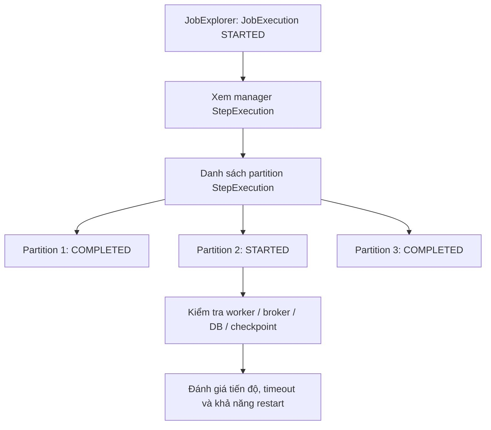

# Kiểm tra JobExecution đang chạy trong Spring Batch

Trong môi trường vận hành, câu hỏi “Job Spring Batch có đang chạy không?” không đơn thuần là kiểm tra một process Java còn sống. Một job có thể chạy bất đồng bộ, chia thành nhiều step, thực thi song song trên nhiều thread hoặc phân phối partition đến các worker. Đôi khi metadata vẫn ghi `STARTED` dù tiến trình đã chết; ngược lại, manager có thể đang chờ phản hồi trong khi worker vẫn xử lý dữ liệu.

Bài học thuộc chương **Vận hành** của module **SPRING_BATCH_SCALING_OPERATIONS**, tập trung vào cách nhận diện `JobExecution` đang chạy, đọc đúng trạng thái thực thi, phân tích tiến độ và phân biệt job còn hoạt động với job bị treo. Đây là nền tảng để giám sát workload dữ liệu lớn, đo nút thắt, vận hành multi-threaded step, parallel steps, partitioning/remote processing, và đưa ra quyết định stop, retry hay restart an toàn.

## 1. Phân biệt Job, JobInstance và JobExecution

Spring Batch có ba khái niệm cần làm rõ ngay khi tra cứu:

| Khái niệm | Diễn giải | Ví dụ |
| --- | --- | --- |
| `Job` | Định nghĩa công việc batch: tên job, cấu hình step và flow. | `dailySettlementJob` |
| `JobInstance` | Một lần chạy mang tính nghiệp vụ được xác định bằng **tên job và các identifying JobParameters**. | Tổng kết giao dịch ngày `2026-11-25`. |
| `JobExecution` | Một lần **thực thi cụ thể** của JobInstance, có ID, trạng thái, thời gian bắt đầu/kết thúc và metadata riêng. | Execution `815` thất bại, sau đó restart tạo execution `823` cho cùng instance. |
| `StepExecution` | Một lần thực thi step bên trong một JobExecution, lưu tiến độ và trạng thái của step. | Step `aggregatePayments` của execution `823`. |

Một job tên `dailySettlementJob` có thể đồng thời tồn tại nhiều `JobExecution` tương ứng **những JobInstance khác nhau** (ví dụ ngày nghiệp vụ khác nhau), tùy hệ thống cho phép. Ngược lại, Spring Batch không cho khởi chạy đồng thời hai `JobExecution` cho cùng một `JobInstance` đang chạy thông qua cơ chế kiểm soát của `JobRepository`.

**Khi hỏi “đang chạy”, luôn xác định phạm vi:** hỏi theo tên `Job`, theo một bộ `JobParameters`/JobInstance, hay theo một ID `JobExecution` cụ thể. Mỗi cách có thể trả về kết quả khác nhau.

## 2. Nguồn dữ liệu quan sát: JobRepository, runtime và hệ thống đích

`JobRepository` là nơi Spring Batch lưu metadata về job và step, thường thông qua các bảng `BATCH_JOB_INSTANCE`, `BATCH_JOB_EXECUTION`, `BATCH_STEP_EXECUTION` và các bảng tham số/`ExecutionContext` liên quan.

Tuy nhiên, để kết luận thực tế, cần phân biệt:

1. **Trạng thái ghi nhận:** `JobExecution.status` ở lần cập nhật gần nhất trong JobRepository.
2. **Tình trạng tiến trình:** JVM/container/job launcher và các worker có còn sống, còn thread xử lý hay đang bị nghẽn?
3. **Tiến độ xử lý:** `readCount`, `writeCount`, `commitCount`, checkpoint, log và kết quả ở hệ thống đích có thay đổi không?
4. **Điều phối phân tán:** request/reply queue, consumer, broker và các partition có đang tiến triển không?

Ví dụ: `JobExecution.status = STARTED` cho biết metadata được lưu với trạng thái đang chạy. Điều đó **không chứng minh** rằng worker vẫn sống tại thời điểm kiểm tra. Sau khi một máy chết đột ngột, metadata có thể chưa kịp chuyển sang `FAILED`; cần bổ sung thông tin runtime và cơ chế phục hồi.

`JobRepository` và `JobExplorer` cung cấp thông tin bền vững để truy vấn từ tiến trình giám sát; log, tracing và metric giúp kiểm chứng tính sống và tìm nút thắt.

## 3. Hiểu đúng các trạng thái BatchStatus

Các trạng thái thường gặp của `JobExecution` và `StepExecution`:

| `BatchStatus` | Ý nghĩa vận hành | Có thể xem là đang chạy theo metadata? |
| --- | --- | --- |
| `STARTING` | Execution được tạo và đang bước vào pha khởi động. | Có. |
| `STARTED` | Execution đã bắt đầu và chưa đánh dấu hoàn tất. | Có. |
| `STOPPING` | Đã yêu cầu dừng; quá trình dừng có thể còn chờ checkpoint/ranh giới xử lý. | Có, đang trong quá trình dừng. |
| `STOPPED` | Execution đã dừng. | Không. Có thể được restart nếu điều kiện cho phép. |
| `COMPLETED` | Execution kết thúc thành công theo quy tắc của job/step. | Không. |
| `FAILED` | Execution thất bại. | Không. Có thể kiểm tra khả năng restart. |
| `ABANDONED` | Đã bị đánh dấu bỏ qua; không nên tự giả định có thể restart như `FAILED`. | Không. |
| `UNKNOWN` | Không xác định chắc trạng thái; cần điều tra trước khi thao tác. | Không thể kết luận chỉ từ trạng thái. |

Trong Spring Batch, API `BatchStatus.isRunning()` coi các trạng thái vòng đời đang thực thi như `STARTING`, `STARTED` và `STOPPING` là running. Nó là kiểm tra **trạng thái của bản ghi**, không phải lệnh kiểm chứng heartbeat của JVM.

Ngoài `BatchStatus` còn có `ExitStatus`, vốn thể hiện **kết quả/điều kiện điều khiển flow** của step hoặc job. Ví dụ `ExitStatus` có mã tùy biến được dùng để rẽ nhánh. Khi kiểm tra job đang chạy, ưu tiên `BatchStatus`; khi tìm nguyên nhân và quyết định bước tiếp theo, đọc thêm `ExitStatus` và mô tả lỗi.

**Lưu ý:** `END_TIME = NULL` thường gặp khi execution đang diễn ra, nhưng không đủ để khẳng định đang chạy. Execution có thể chết đột ngột và không được cập nhật `END_TIME`.

## 4. Cách chuẩn: dùng JobExplorer tìm các execution đang chạy

`JobExplorer` là API đọc metadata của Spring Batch. Khi ứng dụng có quyền truy cập `JobRepository`, đây là lựa chọn thuận tiện để liệt kê execution đang chạy theo **tên job** mà không phụ thuộc tên bảng/SQL của một database cụ thể.

Với Spring Batch 5.x, phương thức cốt lõi:

```java
Set<JobExecution> executions =
    jobExplorer.findRunningJobExecutions("dailySettlementJob");
```

Kết quả phản ánh những `JobExecution` có trạng thái running theo metadata repository tại thời điểm truy vấn. Nó có thể gồm các execution bị “kẹt” ở `STARTED` sau crash; đừng dùng riêng kết quả này như bằng chứng chắc chắn tiến trình còn sống.

### 4.1. Ví dụ service kiểm tra và ghi log

Mã minh họa dưới đây dùng Java 17 và API Spring Batch 5.x:

```java
import java.util.Comparator;
import org.slf4j.Logger;
import org.slf4j.LoggerFactory;
import org.springframework.batch.core.JobExecution;
import org.springframework.batch.core.StepExecution;
import org.springframework.batch.core.explore.JobExplorer;
import org.springframework.stereotype.Service;

@Service
public class RunningJobInspector {

    private static final Logger log =
            LoggerFactory.getLogger(RunningJobInspector.class);

    private final JobExplorer jobExplorer;

    public RunningJobInspector(JobExplorer jobExplorer) {
        this.jobExplorer = jobExplorer;
    }

    public void inspect(String jobName) {
        var executions = jobExplorer.findRunningJobExecutions(jobName);

        if (executions.isEmpty()) {
            log.info("No execution marked as running for job={}", jobName);
            return;
        }

        executions.stream()
                .sorted(Comparator.comparing(JobExecution::getId))
                .forEach(execution -> {
                    log.info(
                        "job={} executionId={} instanceId={} status={} "
                            + "startTime={} endTime={} exitStatus={}",
                        jobName,
                        execution.getId(),
                        execution.getJobInstance().getId(),
                        execution.getStatus(),
                        execution.getStartTime(),
                        execution.getEndTime(),
                        execution.getExitStatus());

                    for (StepExecution step : execution.getStepExecutions()) {
                        log.info(
                            "executionId={} stepId={} step={} status={} "
                                + "read={} written={} skipped={} commits={} "
                                + "rollbacks={} lastUpdated={}",
                            execution.getId(),
                            step.getId(),
                            step.getStepName(),
                            step.getStatus(),
                            step.getReadCount(),
                            step.getWriteCount(),
                            step.getSkipCount(),
                            step.getCommitCount(),
                            step.getRollbackCount(),
                            step.getLastUpdated());
                    }
                });
    }
}
```

Điểm đáng chú ý:

- Trả về tập rỗng nghĩa là **repository hiện không ghi nhận execution running** cho tên job đó; không có nghĩa tên job chưa bao giờ chạy. Muốn xem lịch sử, dùng các API tìm `JobInstance`/`JobExecution` phù hợp.
- `JobExecution.getStepExecutions()` cho các step đã được ghi nhận trong execution. Nếu job vừa chuyển sang `STARTING`, có thể chưa có StepExecution.
- `startTime`, `endTime`, `lastUpdated` có thể là `null`, phụ thuộc thời điểm lifecycle và tình trạng cập nhật.
- Chỉ ghi thông tin phục vụ giám sát. `JobParameters` hoặc `ExecutionContext` có thể chứa thông tin nhạy cảm; không log toàn bộ khi không cần.
- Từ một object `JobExecution` đã nạp, dữ liệu không tự cập nhật theo thời gian. Khi kiểm tra lại, gọi mới `JobExplorer` để có snapshot mới.
- Với job đang chạy theo lịch, nên dùng endpoint nội bộ hoặc scheduled monitor với chu kỳ hợp lý; tránh gọi DB liên tục ở tần suất quá cao.

### 4.2. Kiểm tra theo ID khi cần xác minh một lần chạy

Nếu đã có ID, chẳng hạn `823`:

```java
JobExecution execution = jobExplorer.getJobExecution(823L);

if (execution == null) {
    // Không tồn tại hoặc không truy xuất được ID này trong repository.
} else {
    boolean runningInMetadata = execution.getStatus().isRunning();
    // Kiểm tra thêm step, timestamp, tiến độ và hệ thống runtime.
}
```

Việc truy vấn theo ID tránh nhầm một execution mới với một lần chạy cũ của cùng tên job. Trong bảng điều khiển vận hành, nên hiển thị đồng thời **job name, instance ID, execution ID, status, start time và last update**.

Nếu job chạy qua `TaskExecutorJobLauncher` hoặc scheduler bất đồng bộ, kết quả trả về ngay lúc khởi chạy không khẳng định công việc đã kết thúc. Truy vấn `JobExplorer` lại khi cần đọc trạng thái đã cập nhật.

## 5. Truy vấn SQL trên bảng metadata khi điều tra production

Khi không truy cập được trực tiếp API Java, người vận hành có thể kiểm tra bảng Spring Batch bằng tài khoản **chỉ đọc**. Ví dụ sau dùng schema metadata Spring Batch 5.x thường gặp; tên schema, tiền tố bảng và quyền truy cập thay đổi theo triển khai.

### 5.1. Liệt kê JobExecution đang chạy theo job name

```sql
SELECT
    ji.JOB_NAME,
    je.JOB_INSTANCE_ID,
    je.JOB_EXECUTION_ID,
    je.STATUS,
    je.EXIT_CODE,
    je.CREATE_TIME,
    je.START_TIME,
    je.END_TIME,
    je.LAST_UPDATED
FROM BATCH_JOB_EXECUTION AS je
JOIN BATCH_JOB_INSTANCE AS ji
    ON ji.JOB_INSTANCE_ID = je.JOB_INSTANCE_ID
WHERE ji.JOB_NAME = 'dailySettlementJob'
  AND je.STATUS IN ('STARTING', 'STARTED', 'STOPPING')
ORDER BY je.CREATE_TIME DESC, je.JOB_EXECUTION_ID DESC;
```

Kết quả mẫu:

| JOB_EXECUTION_ID | STATUS | START_TIME | LAST_UPDATED | Cần làm gì? |
| ---: | --- | --- | --- | --- |
| 823 | STARTED | 02:00:05 | 02:17:42 | Kiểm tra các step và tốc độ tiến độ. |
| 799 | STOPPING | 01:30:00 | 01:45:10 | Kiểm tra yêu cầu stop, việc cleanup và worker. |

Thời điểm trong bảng là **ví dụ minh họa**. Tùy timezone cấu hình database và ứng dụng, cần chuẩn hóa UTC/offset trước khi tính thời gian chạy hoặc kết luận stale.

Để xem **lần chạy gần nhất**, kể cả `COMPLETED` hay `FAILED`, bỏ bộ lọc trạng thái và giới hạn kết quả theo cú pháp của DB đang dùng. Tuy nhiên “lần chạy gần nhất” và “đang chạy” là hai tập truy vấn khác nhau.

### 5.2. Kiểm tra tất cả step của một execution

```sql
SELECT
    se.JOB_EXECUTION_ID,
    se.STEP_EXECUTION_ID,
    se.STEP_NAME,
    se.STATUS,
    se.EXIT_CODE,
    se.READ_COUNT,
    se.WRITE_COUNT,
    se.FILTER_COUNT,
    se.READ_SKIP_COUNT,
    se.PROCESS_SKIP_COUNT,
    se.WRITE_SKIP_COUNT,
    se.COMMIT_COUNT,
    se.ROLLBACK_COUNT,
    se.START_TIME,
    se.END_TIME,
    se.LAST_UPDATED
FROM BATCH_STEP_EXECUTION AS se
WHERE se.JOB_EXECUTION_ID = 823
ORDER BY se.STEP_EXECUTION_ID;
```

Cần đánh giá:

- Step nào đã `COMPLETED`, step nào còn `STARTED`, `STOPPING` hoặc `FAILED`?
- Trong các lần lấy mẫu liên tiếp, `READ_COUNT`/`WRITE_COUNT`/`COMMIT_COUNT` có tăng không?
- `ROLLBACK_COUNT` và skip có tăng bất thường không?
- Một partition cụ thể đang mất nhiều thời gian hơn phần còn lại hay tất cả cùng dừng?
- Step chạy đã bao lâu so với baseline lịch sử và SLA?

`LAST_UPDATED` là thời điểm cập nhật metadata, **không phải heartbeat độc lập**. Với chunk cực dài hoặc custom tasklet không cập nhật metadata thường xuyên, giá trị này có thể cũ dù thread vẫn làm việc. Không được tự động đánh dấu thất bại chỉ vì chênh lệch timestamp vượt một ngưỡng chung.

### 5.3. Tìm các bản ghi có thể “stale” (minh họa PostgreSQL)

```sql
SELECT
    ji.JOB_NAME,
    je.JOB_EXECUTION_ID,
    je.STATUS,
    je.START_TIME,
    je.LAST_UPDATED
FROM BATCH_JOB_EXECUTION AS je
JOIN BATCH_JOB_INSTANCE AS ji
    ON ji.JOB_INSTANCE_ID = je.JOB_INSTANCE_ID
WHERE je.STATUS IN ('STARTING', 'STARTED', 'STOPPING')
  AND je.LAST_UPDATED < CURRENT_TIMESTAMP - INTERVAL '30 minutes'
ORDER BY je.LAST_UPDATED;
```

Đây chỉ là truy vấn **sàng lọc**. Một job đang chạy vẫn có thể không cập nhật hàng `BATCH_JOB_EXECUTION` trong suốt thời gian các step hoạt động. Nên ưu tiên kiểm tra `BATCH_STEP_EXECUTION.LAST_UPDATED`, counter, metric và dấu hiệu runtime rồi mới diễn giải. Ngưỡng 30 phút cần điều chỉnh theo nhịp chunk, kiểu tasklet, duration thực tế và mục tiêu SLA; không dùng như quy tắc chung để quyết định kill/restart.

## 6. “Đang chạy” khác “đang tiến triển” và “còn sống”

Xét bốn tín hiệu:

| Tín hiệu | Câu hỏi | Ví dụ |
| --- | --- | --- |
| `BatchStatus` trong JobRepository | Execution **được ghi nhận** đang chạy chứ? | `STARTED` |
| Health của JVM/container/worker | Tiến trình và thread có còn tồn tại không? | Pod Running, worker heartbeat hiện diện |
| Tiến độ dữ liệu | Có item/commit mới hoặc checkpoint mới không? | `READ_COUNT` tăng sau 1 phút |
| Tài nguyên và điều phối | Có đang bị block trên DB, queue, lock, I/O hoặc API không? | Thread `WAITING`, queue backlog tăng |

Một số tình huống dễ nhầm:

| Hiện tượng | Diễn giải có thể đúng | Hướng xác minh |
| --- | --- | --- |
| `STARTED` + read/write tăng | Job đang thực sự tiến triển. | Theo dõi throughput và ETA. |
| `STARTED` + counters đứng yên, CPU cao | Có thể đang xử lý CPU nặng, GC, retry hoặc vòng lặp. | Thread dump, CPU/GC profile, retry logs. |
| `STARTED` + counters đứng yên, CPU thấp | Có thể chờ DB lock, API, broker, thread pool hoặc I/O. | Thread dump, timeout, DB wait/locks, broker metrics. |
| `STARTED` + không có process/worker tương ứng | Có thể metadata còn sót sau crash. | Kiểm tra deployment, scheduler, lịch sử restart và JobRepository. |
| `STOPPING` kéo dài | Yêu cầu stop chưa đạt điểm dừng an toàn. | Kiểm tra chunk/tasklet, worker và thời gian commit. |
| `FAILED` nhưng còn message/worker đang xử lý | Có thể luồng phân tán chưa được thu dọn đầy đủ. | Xác minh request/reply, retry của broker, tác động tới dữ liệu đích. |

**Quy tắc vận hành:** `STATUS='STARTED'` là điều kiện để **điều tra tiếp**, không đủ để khẳng định job khỏe mạnh. Việc counter không đổi vài giây cũng chưa nói lên job treo nếu có chunk dài hoặc bước xử lý theo lô.

## 7. Theo dõi tiến độ thực tế từ StepExecution

Metadata `StepExecution` có các counter rất hữu ích:

| Counter | Ý nghĩa | Cảnh báo khi nào? |
| --- | --- | --- |
| `readCount` | Số item reader trả về. | Không tăng đủ lâu so với baseline của step đang đọc. |
| `writeCount` | Số item được ghi theo logic của step. | Đọc tăng nhưng ghi không tăng, sau khi xét filtering. |
| `filterCount` | Item được processor lọc ra. | Tăng đột biến so với phân bố dữ liệu dự kiến. |
| `skipCount` | Tổng số item bỏ qua khi fault-tolerant step cho phép. | Vượt error budget hoặc tập trung vào một partition. |
| `commitCount` | Số lần commit chunk/step theo metadata. | Đứng yên dài bất thường; xem chunk size/transaction. |
| `rollbackCount` | Số lần rollback. | Tăng liên tục, có thể khiến throughput ròng rất thấp. |

Các counter có ý nghĩa theo **StepExecution cụ thể**. Khi restart, Spring Batch thường tạo `JobExecution` mới và các `StepExecution` theo lifecycle restart; không cộng tất cả bản ghi lịch sử để suy ra số item duy nhất đã xử lý. Các retry/rollback và ghi side effect ngoài transaction càng làm tổng counter khác dữ liệu thực tế ở đích.

### 7.1. Ước tính throughput từ hai snapshot

Giả sử cùng `StepExecution ID = 9125`:

| Thời điểm UTC | `READ_COUNT` | `WRITE_COUNT` | `COMMIT_COUNT` |
| --- | ---: | ---: | ---: |
| 02:10 | 300.000 | 299.000 | 600 |
| 02:15 | 450.000 | 448.500 | 900 |

Trong năm phút, tốc độ đọc bình quân:

\[
T_{\text{read}} =
\frac{450.000-300.000}{5\times60}
=500\text{ item/giây}
\]

Tốc độ ghi bình quân:

\[
T_{\text{write}} =
\frac{448.500-299.000}{5\times60}
\approx498,3\text{ item/giây}
\]

Nếu một step dự kiến phải đọc 900.000 item và tốc độ giữ ổn định, ước tính thời gian còn lại tại thời điểm 02:15:

\[
ETA\approx\frac{900.000-450.000}{500}
=900\text{ giây}=15\text{ phút}
\]

**Điều kiện của ETA:** tổng workload phải biết và cố định tương đối; tốc độ tại khoảng đo phải đại diện; partition không quá lệch tải; chưa tính startup, finalization, retry, sự cố và bottleneck của các step tiếp theo. Với job phân tán, thời gian hoàn tất toàn job thường phụ thuộc **partition chậm nhất**, không đơn thuần lấy tổng read count chia tổng throughput.

### 7.2. Thiết lập baseline để phát hiện sai lệch

Ghi nhận duration, throughput, latency theo P50/P95, số bản ghi, thời điểm chạy và phiên bản ứng dụng. Một job xử lý 10 triệu dòng cần thời gian khác job xử lý 100 nghìn dòng; đặt cảnh báo duy nhất theo duration sẽ báo sai khi workload dao động. Tốt hơn nên kết hợp:

- Tỷ lệ `items/giây` hoặc `MB/giây` so với workload tương đương.
- Thời gian không có commit mới so với P95 chunk duration.
- Tỷ lệ skip/rollback/retry và lỗi đọc/ghi.
- Time budget còn lại trước deadline SLA.
- Tình trạng CPU, heap, connection pool, locks, network, broker và DB.

## 8. Spring Batch chạy song song hoặc phân tán: xem gì thêm?

### 8.1. Multi-threaded step

Một step có thể sử dụng nhiều thread để xử lý chunk. `StepExecution` cung cấp counter tổng hợp cho step, nhưng chưa cho biết mỗi thread đang làm gì hoặc có thread nào đang chờ. Khi nghi ngờ treo, cần kiểm tra thread dump, task executor queue, connection pool, transaction lock và thread safety của reader/writer.

**Không đồng nhất** “có 8 thread” với “đang xử lý 8 chunk”. Thread có thể chờ I/O hoặc thiếu kết nối; counter của StepExecution không tự giải thích điều đó.

### 8.2. Parallel steps

Job có thể có nhiều flow/step chạy đồng thời. JobExecution vẫn `STARTED` trong khi một số step `COMPLETED`, một số `STARTED`. Xem **tất cả StepExecution**, quan hệ phụ thuộc flow và step đang chặn kết thúc job.

### 8.3. Local partitioning và remote partitioning

Trong partitioning, manager tạo nhiều partition step executions. Với **remote partitioning**, worker có thể chạy ở JVM/máy riêng. Manager cần nhận kết quả từ worker qua reply message hoặc cơ chế polling `JobRepository` tùy cấu hình.



Để xác định nguyên nhân JobExecution còn chạy, quan sát riêng:

1. **Manager:** còn chờ bao nhiêu partition, giới hạn timeout/reply có hợp lý không?
2. **Worker:** partition nào đang `STARTED`, counters và log của worker có tiến triển?
3. **Broker:** request queue, reply queue, consumer, retry/DLQ, correlation có chính xác?
4. **Repository chung:** manager và worker có cùng database metadata, cập nhật trạng thái có bị trễ/khóa?
5. **Đích nghiệp vụ:** transaction, lock và throughput ghi của tất cả worker.

Khi một worker chết sau khi commit dữ liệu nhưng trước khi phát reply, manager có thể vẫn đợi hoặc timeout. Không được kết luận partition chưa chạy chỉ vì thiếu reply. Xác minh repository và dữ liệu đích trước khi replay message.

### 8.4. Remote chunking

Remote chunking gửi từng nhóm item cho worker xử lý. Manager có thể vẫn `STARTED` khi đang chờ phản hồi chunk. Khi điều tra cần xem pending chunks, request/reply, retry, khả năng khử trùng lặp và tốc độ xử lý của writer/worker. Đó là cơ chế khác với StepExecution reply của remote partitioning.

## 9. Hướng dẫn xử lý một JobExecution chạy quá lâu

Sau đây là quy trình thực tế dành cho người trực vận hành.

### Bước 1 — Xác định chính xác execution

Ghi lại **job name**, identifying parameters của JobInstance, `jobInstanceId`, `jobExecutionId`, trạng thái hiện tại, lịch chạy và deadline. Tránh nhầm một execution cũ với execution mới vừa được scheduler kích hoạt.

### Bước 2 — Chụp snapshot metadata

Dùng `JobExplorer` hoặc SQL chỉ đọc, ghi:

- JobExecution: `status`, `startTime`, `endTime`, `lastUpdated`, `exitStatus`.
- Các StepExecution: `status`, counter, `lastUpdated`, thứ tự/quan hệ step.
- Các partition: số lượng dự kiến/đã xong/đang chạy/thất bại.
- Khoảng cách đến SLA và mức dữ liệu cần hoàn tất.

Đặt lại snapshot sau một khoảng **phù hợp với nhịp commit** để xem delta, không dựa vào một ảnh chụp duy nhất.

### Bước 3 — Kiểm tra runtime và dependency

Đối chiếu JVM/container, thread dump, CPU/GC, heap, DB connection pool, DB locks, log exception, API timeout, broker backlog/consumer và mạng. Với worker phân tán, kiểm tra toàn bộ worker đang nhận phân vùng chứ không chỉ manager.

### Bước 4 — Chẩn đoán nguyên nhân

Dựa vào bảng tình huống ở phần 6 để phân biệt:

- Công việc đang chạy bình thường nhưng workload lớn hơn dự kiến.
- Tranh chấp tài nguyên khiến throughput giảm hoặc backpressure.
- Partition phân bố lệch làm một worker chạy quá lâu.
- Thử lại/rollback liên tục vì dữ liệu hoặc kết nối lỗi.
- Worker đã chết nhưng trạng thái metadata chưa chuyển.
- Mất reply hoặc lệch correlation khiến manager đợi kết quả không đến.

### Bước 5 — Chọn hành động an toàn

Trước khi quyết định dừng/restart, kiểm tra khả năng tiếp tục xử lý và rủi ro ghi trùng ở đích. Nếu công việc còn tiến triển và chưa vi phạm SLA, tiếp tục giám sát có thể là hành động hợp lý. Nếu lỗi rõ ràng, lựa chọn dừng có kiểm soát, khôi phục dependency hoặc chuyển sang recovery theo runbook đã duyệt.

**Không trực tiếp sửa `STATUS` trong bảng metadata** để “mở khóa” hoặc ép một execution từ `STARTED` sang `FAILED`. Các bảng có ràng buộc lifecycle, version/optimistic locking và `ExecutionContext`; thao tác thủ công dễ phá vỡ khả năng restart. Với execution ở trạng thái không nhất quán sau crash, cần quy trình khôi phục đã được kiểm tra và bảo đảm không còn worker đang ghi dữ liệu.

### Bước 6 — Xác minh sau khôi phục

Kiểm tra execution mới/cũ, counter, checkpoint, dữ liệu đích, bản ghi trùng, DLQ và kết quả SLA. Ghi nhận thời điểm và nguyên nhân xử lý để tránh lặp lại sự cố.

## 10. Dừng và khởi động lại: những gì cần xác minh

`JobOperator` có API thao tác vận hành như `stop(executionId)` và `restart(executionId)` trong các phiên bản Spring Batch phù hợp. Đây là thao tác **thay đổi trạng thái hệ thống**, chỉ thực hiện sau khi có bằng chứng và quyền vận hành.

Khác biệt cần nhớ:

- **Stop** là yêu cầu dừng có kiểm soát. Không phải mọi step đều dừng tức thì: tác vụ có thể phải hoàn tất transaction/chunk hiện tại hoặc kiểm tra cờ dừng tại ranh giới thích hợp.
- **Restart** tạo một lần thực thi phù hợp với semantics JobInstance và metadata hiện có. Spring Batch sử dụng trạng thái step và `ExecutionContext` để quyết định bước nào phải làm lại theo cấu hình.
- **Rerun với tham số identifying khác** thường tạo JobInstance khác; không tương đương restart execution đang lỗi.
- **Broker redelivery** trong remote processing là trường hợp riêng; có thể chạy lại phần ghi dữ liệu nếu writer không idempotent.
- **Không khởi động lại khi chưa chắc worker cũ đã dừng**. Nếu process cũ còn ghi nhưng metadata bị stale, hai luồng có thể gây race, ghi lặp hoặc phá tính đúng đắn.

Sau khi gọi một thao tác stop, nên đọc lại metadata theo ID để xem `STOPPING` có chuyển tới `STOPPED` hay không, rồi kiểm tra worker và dữ liệu đích. Không suy ra quá trình dừng đã hoàn tất chỉ từ việc API tiếp nhận yêu cầu thành công.

Nếu job kết thúc với `FAILED`, cần đọc `ExitStatus`, stack trace liên quan và trạng thái các step để xác định lỗi có thể retry hay phải sửa dữ liệu. Với `UNKNOWN` hoặc metadata hỏng, dừng việc tự động restart và điều tra trước.

## 11. Thiết kế dashboard và cảnh báo cho JobExecution

Dashboard nên trả lời nhanh: **job nào đang chạy, chạy từ khi nào, bước nào đang xử lý, tiến độ tới đâu, còn bao lâu tới deadline và có worker nào bất thường**.

| Trường hiển thị | Nguồn dữ liệu | Cách sử dụng |
| --- | --- | --- |
| `jobName`, `jobInstanceId`, `jobExecutionId` | JobRepository/JobExplorer | Phân biệt job và từng lần chạy. |
| `status`, `startTime`, duration | JobExecution | Nhận diện lifecycle và job chạy lâu. |
| Danh sách step/partition + status | StepExecution | Xác định vùng nghẽn cụ thể. |
| `readCount`, `writeCount`, `commitCount` | StepExecution | Đo delta tiến độ theo thời gian. |
| Runtime/container/worker health | Orchestrator, application metrics | Kiểm chứng process còn sống. |
| CPU/GC, DB wait, pool usage, API errors | APM/metrics | Tìm nguyên nhân công suất giảm. |
| Request/reply queue, retry, DLQ | Broker | Điều tra remote partitioning/chunking. |
| SLA deadline, dự báo ETA | Scheduler + tiến độ quan sát | Quyết định ưu tiên phản ứng. |

Những cảnh báo có ích hơn “STATUS=STARTED quá 5 phút”:

- Job duration hoặc ETA vượt ngưỡng dự kiến của workload/SLA.
- Một partition vượt P95 duration lịch sử, trong khi các partition khác đã xong.
- Nhiều chu kỳ liên tiếp không có commit mới **và** có dấu hiệu lỗi/wait bất thường.
- `ROLLBACK_COUNT`, skip hoặc retry tăng liên tục.
- Metadata `STARTED` nhưng runtime tương ứng không còn, sau khi đã loại trừ tình huống chạy trên worker khác.
- Reply queue/backlog tăng và manager vượt timeout.
- Tỷ lệ `FAILED`/`STOPPED` theo job hoặc instance tăng ngoài baseline.

Metric có tag `jobName`, `stepName`, trạng thái thường phù hợp để tổng hợp. Tránh gắn `jobExecutionId` hoặc `stepExecutionId` làm tag trên mọi time series vì tạo cardinality rất cao; dùng log có cấu trúc và tracing cho ID chi tiết. Thận trọng với việc đưa JobParameters có dữ liệu cá nhân lên dashboard hoặc log.

## 12. Lỗi phổ biến khi kiểm tra job đang chạy

1. **Chỉ kiểm tra process Java:** process còn sống không bảo đảm job còn tiến triển; job có thể bị lock hoặc đang chờ broker.
2. **Chỉ kiểm tra `STARTED`:** crash có thể để lại metadata stale.
3. **Dùng `END_TIME IS NULL` để kết luận running:** giá trị null cũng gặp khi job chưa khởi động xong hoặc lỗi chưa được ghi trạng thái.
4. **Xem mỗi `JobExecution`:** bỏ sót step/partition thất bại hoặc bị lệch tải.
5. **Cộng tổng counter của mọi lần restart:** nhầm số item đã thử với số item duy nhất đã xử lý.
6. **Đặt timeout giống nhau cho mọi job:** workload, chunk duration và SLA khác nhau nên ngưỡng phải khác.
7. **Kết luận job treo chỉ vì `LAST_UPDATED` cũ:** metadata không phải heartbeat; cần đối chiếu tiến độ thực và runtime.
8. **Restart ngay khi không thấy reply:** worker có thể đã commit dữ liệu và chỉ mất tín hiệu trả lời.
9. **Sửa trực tiếp bảng Spring Batch bằng SQL:** làm mất nhất quán trạng thái, version và checkpoint.
10. **Không phân biệt JobInstance với JobExecution:** tạo nhầm lần chạy mới và xử lý dữ liệu hai lần.
11. **Giả định tăng worker luôn tăng throughput:** DB nguồn/đích, pool, thread safety và broker có thể là nút thắt thực sự.

## 13. Tình huống thực hành: một partition “kẹt”

Một job `dailySettlementJob` có `jobExecutionId = 823`, dự kiến hoàn tất trong 30 phút. Manager chia thành bốn partition:

| Partition | Trạng thái sau 20 phút | `readCount` | `commitCount` | Dấu hiệu |
| --- | --- | ---: | ---: | --- |
| `p0` | `COMPLETED` | 250.000 | 500 | Đã kết thúc. |
| `p1` | `COMPLETED` | 250.000 | 500 | Đã kết thúc. |
| `p2` | `STARTED` | 90.000 | 180 | Không tăng trong 8 phút. |
| `p3` | `COMPLETED` | 250.000 | 500 | Đã kết thúc. |

`JobExecution` và manager step đang `STARTED`. Trên worker chạy `p2`, CPU thấp, connection pool DB dùng hết, thread dump ghi nhận các thread đang chờ connection. Khi đó, hướng điều tra ưu tiên là pool usage, transaction mở lâu, lock/connection leak và mức concurrency thực tế. Không nên mặc định tăng số worker: làm vậy có thể khiến tình trạng thiếu kết nối nặng hơn.

**Câu hỏi tự kiểm tra:**

1. Tại sao `JobExecution.status = STARTED` là hợp lý dù ba partition đã `COMPLETED`?
2. Thông số nào cho thấy `p2` có tiến độ thấp, và tại sao chỉ cần một partition chậm cũng kéo dài tổng duration?
3. Để phân biệt thiếu kết nối DB với worker chết, bạn cần thêm bằng chứng gì?
4. Vì sao không nên restart `823` ngay lập tức khi worker `p2` có thể vẫn còn transaction đang chờ?
5. Nếu `p2` có `LAST_UPDATED` cũ nhưng một chunk mất 10 phút mới commit, cần thay đổi cách diễn giải dữ liệu theo dõi thế nào?

**Gợi ý trả lời:** JobExecution chỉ hoàn tất khi luồng step và các partition cần thiết được tổng hợp theo quy tắc job; cần đo tiến độ theo partition, kiểm tra runtime và tài nguyên đích, chờ trạng thái dừng xác thực, sau đó mới quyết định recovery/restart.

## 14. Checklist vận hành theo từng chu kỳ giám sát

| Thời điểm | Việc cần kiểm tra |
| --- | --- |
| **Trước lịch chạy** | Không có execution cũ bị stale chưa xử lý; nguồn/đích và broker sẵn sàng; batch window còn đủ. |
| **Ngay sau launch** | JobInstance/JobExecution ID đã được tạo đúng; chuyển `STARTING → STARTED`; step bắt đầu. |
| **Trong lúc chạy** | Duration, throughput, delta counter, partition chậm, DB/broker/worker và tiến độ tới SLA. |
| **Khi chậm bất thường** | Chụp snapshot, kiểm tra thread/DB lock/retry, đối chiếu lần chạy tương đương; xác định nguyên nhân. |
| **Khi stop/fail** | Xác nhận trạng thái cuối, dữ liệu đã commit, checkpoint và điều kiện restart. |
| **Sau khi hoàn tất** | Job và step terminal statuses, tổng số item xử lý, kết quả nghiệp vụ, cảnh báo còn tồn và thời gian thực hiện. |

## 15. Tài liệu để đối chiếu API và triển khai

- [Spring Batch Reference – JobRepository](https://docs.spring.io/spring-batch/reference/job/configuring-repository.html): repository và cấu hình metadata của job.
- [Spring Batch Reference – JobExplorer / JobOperator](https://docs.spring.io/spring-batch/reference/job/advanced-meta-data.html): tra cứu metadata và thao tác vận hành.
- [Spring Batch Reference – Scaling and Parallel Processing](https://docs.spring.io/spring-batch/reference/scalability.html): multi-threaded step, parallel steps, partitioning và xử lý phân tán.
- [JobExplorer Java API (Spring Batch 5.2)](https://docs.spring.io/spring-batch/docs/5.2.2/api/org/springframework/batch/core/explore/JobExplorer.html): `findRunningJobExecutions` và tra cứu một execution theo ID.
- [BatchStatus Java API (Spring Batch 5.2)](https://docs.spring.io/spring-batch/docs/5.2.2/api/org/springframework/batch/core/BatchStatus.html): tập giá trị trạng thái và `isRunning()`.
- [JobExecution Java API (Spring Batch 5.2)](https://docs.spring.io/spring-batch/docs/5.2.2/api/org/springframework/batch/core/JobExecution.html): thông tin lifecycle, status và quan hệ StepExecution.

> **Ghi nhớ:** Kiểm tra JobExecution đang chạy bắt đầu bằng `JobExplorer` hoặc metadata SQL, nhưng kết luận vận hành phải kết hợp trạng thái repository, tiến độ của các StepExecution, tình trạng JVM/worker, dependency và dữ liệu đích. Một execution “đang chạy” trong bảng metadata có thể đã mất worker, còn một execution “chậm” vẫn có thể đang tiến triển hợp lệ. Quyết định stop/restart chỉ an toàn khi đã xác minh cả hai phía.

