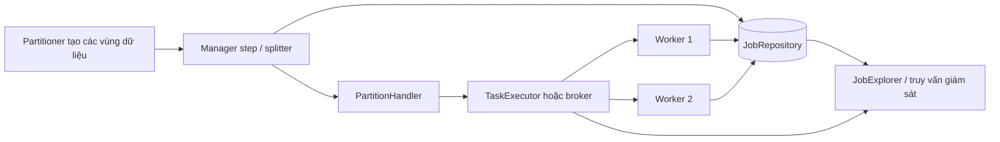

# Xem partition đang pending trong Spring Batch

Khi một Spring Batch job được chia thành nhiều partition, người vận hành thường muốn trả lời nhanh: **partition nào đã hoàn tất, partition nào đang chạy và partition nào vẫn đang chờ được xử lý?** Câu hỏi đặc biệt quan trọng khi tăng `gridSize`, giới hạn số worker, dùng `TaskExecutor` hoặc điều phối partition từ xa. Nếu nhìn sai trạng thái, ta có thể kết luận nhầm rằng job bị treo, tăng số luồng quá mức hoặc khởi chạy trùng công việc.

Bài học này thuộc phần **Vận hành** của module **SPRING_BATCH_SCALING_OPERATIONS**: mở rộng Spring Batch cho workload dữ liệu lớn bằng multi-threaded step, parallel steps, partitioning và các mô hình phân tán; đồng thời đo nút thắt, giữ thread safety, bảo đảm retry/restart và lựa chọn kiến trúc theo tài nguyên thực tế. Mục tiêu ở đây là xây dựng cách **quan sát partition đang pending** đủ chính xác để dùng khi vận hành và xử lý sự cố.

## 1. Hiểu đúng từ “pending”

**`PENDING` không phải một giá trị chuẩn của `BatchStatus` trong Spring Batch.** Các trạng thái như `STARTING`, `STARTED`, `STOPPING`, `STOPPED`, `COMPLETED`, `FAILED`, `ABANDONED` và `UNKNOWN` được dùng trong metadata của batch. Từ *pending* là cách người vận hành mô tả một partition **được dự kiến xử lý nhưng chưa bắt đầu công việc thực tế**.

Cần phân biệt ba tình huống:

| Tình huống | Dấu hiệu có thể quan sát | Cách hiểu |
| --- | --- | --- |
| Partition đã có `StepExecution`, chưa bắt đầu | Bản ghi step tồn tại; có thể đang `STARTING`, `START_TIME` còn `NULL` | **Ứng viên pending**; cần đối chiếu với executor hoặc hàng đợi |
| Partition đã được lên kế hoạch nhưng chưa có bản ghi step hiển thị | Có trong danh sách partition dự kiến, không có trong snapshot metadata | **Chưa thấy trong repository**; có thể chưa được tạo hoặc transaction chưa commit |
| Nhiệm vụ đã được gửi vào executor/broker nhưng worker chưa nhận | Queue depth hoặc thông tin pending message tăng; worker chưa ghi nhận tiến độ | **Đang đợi tài nguyên/điều phối**; metadata đơn lẻ không chứng minh được nguyên nhân |

Một partition `FAILED` hoặc `STOPPED` **không tự động là pending**. Nó có thể là ứng viên cần restart, nhưng chỉ khi cơ chế restart thực sự lên lịch chạy lại thì mới được xem là đang chờ lượt chạy mới. Tương tự, `STARTED` với bộ đếm không tăng có thể là tác vụ chậm, bị khóa hoặc mất kết nối; không nên tự ý đổi nhãn thành pending.

> **Nguyên tắc:** metadata cho biết trạng thái `StepExecution`; executor/broker cho biết độ dài hàng đợi và khả năng cấp worker. Muốn kết luận *pending vì sao*, thường phải xem cả hai.

## 2. Partition xuất hiện ở đâu trong luồng xử lý?

Trong partitioned step, manager tạo hoặc lấy lại các `StepExecution` tương ứng với partition. `PartitionHandler` điều phối chúng tới các worker; worker xử lý phần dữ liệu được chỉ định và ghi kết quả về metadata theo kiến trúc triển khai.



Ví dụ: dữ liệu được chia thành 8 partition nhưng executor chỉ có 2 luồng. Hai partition có thể bắt đầu chạy ngay, các partition còn lại đợi có luồng trống. Tại một thời điểm, danh sách metadata có thể phản ánh vài `STARTED` và một số `STARTING`; trạng thái chính xác thay đổi theo thời điểm tạo bản ghi, commit transaction và lúc worker thực sự khởi động.

Không có bảo đảm rằng **`gridSize = 8` luôn tạo đúng 8 bản ghi đang pending** trong mọi triển khai. Số partition thực tế do `Partitioner` quyết định; thứ tự tạo, thứ tự dispatch, restart và việc ghi metadata cũng ảnh hưởng đến snapshot.

## 3. Xác định đúng job execution và tên partition

Trước khi truy vấn, cần nắm các khóa định danh:

- **`JOB_INSTANCE_ID`** đại diện cho một job cùng bộ tham số nhận diện.
- **`JOB_EXECUTION_ID`** đại diện cho một lần chạy cụ thể của job. Khi restart, thường xuất hiện `JobExecution` mới trong cùng `JobInstance`.
- **`STEP_EXECUTION_ID`** định danh một lần thực thi step; mỗi partition được theo dõi bằng `StepExecution` tương ứng.
- **`STEP_NAME`** là tên step trong repository. Partition thường có tên dạng `workerStep:partition0`, `workerStep:partition1`… nhưng tên cụ thể phụ thuộc vào step/partitioner được cấu hình.

**Luôn lọc theo `JOB_EXECUTION_ID` cụ thể**, đồng thời đối chiếu đúng quy ước đặt tên partition của ứng dụng. Nếu chỉ lọc theo `JOB_INSTANCE_ID` hoặc tiền tố tên step, kết quả có thể trộn lần chạy trước với lần restart hiện tại. Trước khi dựa vào tiền tố `workerStep:`, hãy kiểm tra tên thực tế trong repository của chính job đang chạy.

## 4. Xem snapshot từ bảng metadata

Spring Batch thường lưu `StepExecution` trong bảng `BATCH_STEP_EXECUTION`. Với schema mặc định, câu SQL sau liệt kê các partition của một lần chạy:

```sql
-- Tham số ví dụ:
-- :jobExecutionId = 42015
-- :partitionNamePattern = 'workerStep:%'
SELECT
    se.STEP_EXECUTION_ID,
    se.STEP_NAME,
    se.STATUS,
    se.CREATE_TIME,
    se.START_TIME,
    se.END_TIME,
    se.LAST_UPDATED,
    se.READ_COUNT,
    se.WRITE_COUNT,
    se.ROLLBACK_COUNT
FROM BATCH_STEP_EXECUTION se
WHERE se.JOB_EXECUTION_ID = :jobExecutionId
  AND se.STEP_NAME LIKE :partitionNamePattern
ORDER BY se.CREATE_TIME, se.STEP_EXECUTION_ID;
```

Đây là SQL minh họa dùng **named parameters**. Hãy truyền tham số bằng JDBC/SQL client hỗ trợ bind; nếu chạy trực tiếp trong console thì thay các placeholder theo cú pháp của hệ quản trị cơ sở dữ liệu. Prefix `BATCH_` cũng có thể được cấu hình khác trong từng hệ thống.

Để tìm **ứng viên pending**, có thể dùng thêm điều kiện:

```sql
SELECT
    se.STEP_EXECUTION_ID,
    se.STEP_NAME,
    se.STATUS,
    se.CREATE_TIME,
    se.LAST_UPDATED
FROM BATCH_STEP_EXECUTION se
WHERE se.JOB_EXECUTION_ID = :jobExecutionId
  AND se.STEP_NAME LIKE :partitionNamePattern
  AND se.STATUS = 'STARTING'
  AND se.START_TIME IS NULL
ORDER BY se.CREATE_TIME, se.STEP_EXECUTION_ID;
```

Truy vấn này chỉ trả về **ứng viên**, không phải một danh sách pending được Spring Batch chứng nhận. Một partition có thể tạm thời ở `STARTING` trong lúc khởi tạo, chưa dispatch hoặc đang chờ worker; cũng có thể bị kẹt trước khi chuyển sang `STARTED`. Ngoài ra, partition chưa có bản ghi được commit sẽ không hiện ra trong kết quả SQL.

Để có bức tranh tổng quát, nhóm số lượng theo trạng thái:

```sql
SELECT se.STATUS, COUNT(*) AS PARTITION_COUNT
FROM BATCH_STEP_EXECUTION se
WHERE se.JOB_EXECUTION_ID = :jobExecutionId
  AND se.STEP_NAME LIKE :partitionNamePattern
GROUP BY se.STATUS
ORDER BY se.STATUS;
```

Nếu cần xem **thời gian chờ**, có thể tính từ `CREATE_TIME` đến thời điểm quan sát đối với bản ghi chưa có `START_TIME`. Không nên đồng nhất khoảng này với thời gian chờ queue thực tế: `CREATE_TIME` được ghi tại lúc tạo metadata, chưa chắc trùng với thời điểm message được publish hoặc task được submit.

### Khi không tìm thấy partition mong đợi

Đừng vội coi việc thiếu bản ghi là lỗi worker. Hãy kiểm tra manager đã đến bước partition chưa, `Partitioner` có trả đủ khóa hay không, transaction tạo step execution đã commit chưa, tên partition có đúng prefix truy vấn hay không, và danh sách partition có thay đổi khi restart không. Muốn tính số partition **chưa được tạo**, cần một tập *expected partition keys* được lấy từ cấu hình/manifest của lần chạy và so sánh với tập `STEP_NAME` thực tế; bảng `BATCH_STEP_EXECUTION` tự nó không lưu một danh sách kỳ vọng độc lập để so sánh.

## 5. Xem bằng `JobExplorer` trong ứng dụng Java

Trong Spring Batch, `JobExplorer` cung cấp giao diện **chỉ đọc** để xem metadata. Ví dụ dưới đây dành cho ứng dụng Java 17+ sử dụng Spring Batch 5+, nhận `jobExecutionId` và tiền tố tên worker step đã xác định:

```java
import java.time.LocalDateTime;
import java.util.Comparator;
import java.util.List;

import org.springframework.batch.core.BatchStatus;
import org.springframework.batch.core.JobExecution;
import org.springframework.batch.core.StepExecution;
import org.springframework.batch.core.explore.JobExplorer;
import org.springframework.stereotype.Service;

@Service
public class PartitionPendingInspector {

    private final JobExplorer jobExplorer;

    public PartitionPendingInspector(JobExplorer jobExplorer) {
        this.jobExplorer = jobExplorer;
    }

    public List<PartitionView> snapshot(long jobExecutionId, String workerStepName) {
        JobExecution job = jobExplorer.getJobExecution(jobExecutionId);
        if (job == null) {
            throw new IllegalArgumentException("Unknown jobExecutionId: " + jobExecutionId);
        }

        String partitionPrefix = workerStepName + ":";

        return job.getStepExecutions().stream()
                .filter(step -> step.getStepName().startsWith(partitionPrefix))
                .map(step -> new PartitionView(
                        step.getStepName(),
                        step.getStatus(),
                        step.getStartTime(),
                        step.getLastUpdated(),
                        step.getReadCount(),
                        step.getWriteCount(),
                        classify(step)))
                .sorted(Comparator.comparing(PartitionView::name))
                .toList();
    }

    private String classify(StepExecution step) {
        if (step.getStatus() == BatchStatus.STARTING
                && step.getStartTime() == null) {
            return "PENDING_CANDIDATE";
        }
        if (step.getStatus() == BatchStatus.STARTED) {
            return "RUNNING_OR_BLOCKED";
        }
        if (step.getStatus() == BatchStatus.COMPLETED) {
            return "DONE";
        }
        if (step.getStatus() == BatchStatus.FAILED
                || step.getStatus() == BatchStatus.STOPPED) {
            return "NEEDS_RESTART_DECISION";
        }
        return "INSPECT";
    }

    public record PartitionView(
            String name,
            BatchStatus status,
            LocalDateTime startTime,
            LocalDateTime lastUpdated,
            long readCount,
            long writeCount,
            String classification) {
    }
}
```

Ví dụ đầu ra đã rút gọn:

| Partition | `BatchStatus` | Phân loại vận hành | Gợi ý tiếp theo |
| --- | --- | --- | --- |
| `workerStep:partition0` | `COMPLETED` | `DONE` | Không cần dispatch thêm |
| `workerStep:partition1` | `STARTED` | `RUNNING_OR_BLOCKED` | Theo dõi `READ_COUNT`, `WRITE_COUNT`, thời gian cập nhật |
| `workerStep:partition2` | `STARTING` | `PENDING_CANDIDATE` | Xem queue/executor và thời điểm tạo |
| `workerStep:partition3` | `FAILED` | `NEEDS_RESTART_DECISION` | Xem lỗi và chính sách restart |

Kết quả `JobExplorer` là **ảnh chụp tại thời điểm gọi**, không phải một stream trạng thái trực tiếp. Nếu hệ thống dùng partition naming khác, thay điều kiện lọc `startsWith` bằng một quy tắc khớp tên chính xác hơn. Với hàng chục nghìn partition, cân nhắc truy vấn SQL phân trang hoặc một cơ chế tổng hợp metrics có kiểm soát để tránh tải toàn bộ `StepExecution` liên tục.

## 6. Đối chiếu với executor, broker và tài nguyên hệ thống

Trạng thái `STARTING` chưa giải thích **vì sao** partition chưa chạy. Tùy mô hình triển khai, cần đo thêm:

| Mô hình | Quan sát nên có | Giải thích thường gặp |
| --- | --- | --- |
| Local partitioning với `TaskExecutor` | Số luồng active, kích thước queue, pool size, tác vụ bị reject | Partition xếp hàng vì worker pool bận hoặc executor thiếu capacity |
| Remote partitioning qua broker | Ready/pending messages, unacked/in-flight messages, consumer count, redelivery, worker heartbeat | Message chưa được nhận, consumer thiếu hoặc worker nhận rồi nhưng chưa phản hồi |
| Worker đọc/ghi database | Connection pool active/waiting, DB locks, query latency, deadlock/timeout | Worker đã chạy nhưng bị nghẽn I/O, dễ bị nhầm thành pending |
| Nhiều job đồng thời | Số worker dùng chung, CPU/memory, hạn mức container/pod | Tài nguyên bị tranh chấp giữa nhiều execution |

Chú ý: một message đang **unacked/in-flight** thường đã được một consumer nhận, vì vậy không nên cộng thẳng với số message chưa được nhận để suy ra “pending chưa khởi chạy”. Mỗi broker/executor có cách định nghĩa queue depth và độ trễ cập nhật riêng. Hãy dùng tên metric, ý nghĩa và đơn vị thực tế của nền tảng đang vận hành.

Một dashboard hữu ích có thể hiển thị theo từng `jobExecutionId`: số partition đã thấy trong repository, tổng theo `BatchStatus`, số `PENDING_CANDIDATE`, tuổi lớn nhất của candidate, queue depth, số worker active, số `FAILED`, cùng `READ_COUNT`/`WRITE_COUNT` và `LAST_UPDATED` của partition đang chạy. Lấy snapshot theo nhịp vừa phải (chẳng hạn 15–30 giây lúc điều tra) và điều chỉnh theo tải thực tế; không cần truy vấn metadata nhiều lần mỗi giây.

## 7. Phân tích tình huống thực tế

Giả sử một job xử lý 40 triệu bản ghi, `Partitioner` chia thành **8 partition**, `TaskExecutor` cho phép tối đa **2 partition chạy đồng thời**. Sau khi manager điều phối, quan sát được:

| Chỉ số | Giá trị tại thời điểm quan sát |
| --- | ---: |
| Partition dự kiến | 8 |
| `COMPLETED` | 0 |
| `STARTED` | 2 |
| `STARTING` và chưa có `START_TIME` | 6 |
| Worker thread đang bận | 2/2 |
| Queue executor | 6 task chờ (theo metric thực tế) |

Ở đây, sáu partition nhiều khả năng **đang chờ lượt chạy do giới hạn concurrency**. Đây có thể là hành vi bình thường, không phải sự cố. Cách đánh giá phù hợp là xem hai partition đang chạy có tiến độ, throughput đủ tốt và có được giải phóng để các partition kế tiếp khởi động không.

Nếu sau vài phút, hai partition vẫn `STARTED` nhưng `READ_COUNT`, `WRITE_COUNT` và `LAST_UPDATED` không đổi, queue vẫn đầy, cần kiểm tra worker thread dump, connection pool, database locks, thời gian chờ I/O và log lỗi. Nếu queue rỗng nhưng vẫn có sáu candidate `STARTING` kéo dài, cần kiểm tra lỗi submit/dispatch, transaction, health của manager/worker và khả năng metadata chưa được đồng bộ như kỳ vọng. **Không tự động tăng pool size** khi chưa xác định bottleneck; tăng concurrency có thể làm DB quá tải hoặc gây contention.

Khi restart job sau lỗi, phân tích lại theo **`JOB_EXECUTION_ID` của lần chạy mới** và xem trạng thái các partition từ lần chạy trước để giải thích quyết định chạy lại. Không được chỉ lấy danh sách `FAILED` rồi cưỡng bức chạy cùng một partition đồng thời; Spring Batch phải kiểm soát cơ chế restart và ranh giới dữ liệu để tránh xử lý trùng.

## 8. Runbook: xử lý partition chờ lâu

1. **Xác nhận execution:** lấy đúng `JOB_EXECUTION_ID`, tên manager/worker step và thời điểm job bắt đầu; kiểm tra manager còn `STARTED` hay đã dừng.
2. **Lấy snapshot metadata:** liệt kê `STEP_NAME`, `STATUS`, `CREATE_TIME`, `START_TIME`, `LAST_UPDATED`, các bộ đếm tiến độ. Xác định ứng viên `STARTING` + `START_TIME IS NULL`, và các `FAILED`/`STOPPED` riêng biệt.
3. **So với expected partition keys:** xác nhận số và khóa partition mà `Partitioner` dự kiến cho execution này; tìm partition chưa có bản ghi và kiểm tra quy ước đặt tên.
4. **Xem tín hiệu điều phối:** kiểm tra queue depth, active workers, broker consumer/unacked messages, timeout, retry và lỗi submit/dispatch theo kiến trúc local hoặc remote.
5. **Kiểm tra tiến độ và tài nguyên:** so sánh ít nhất hai snapshot để xem số partition hoàn tất có tăng hay không; đối chiếu CPU, bộ nhớ, DB pool, khóa DB, I/O và error logs.
6. **Quyết định xử lý:** nếu worker bận và đang tiến triển, chờ có capacity; nếu hệ thống bị nghẽn, xử lý nút thắt; nếu có lỗi, dùng quy trình stop/restart chuẩn, dựa vào idempotency và thiết kế restart của reader/processor/writer.
7. **Xác minh sau xử lý:** số partition còn chờ giảm, `COMPLETED` tăng, `FAILED` được xử lý đúng chính sách, và không có duplicate side effects.

Ví dụ điều kiện cảnh báo thực hành: `PENDING_CANDIDATE > 0` liên tục 5 phút **đồng thời** không có partition nào chuyển sang `STARTED`/`COMPLETED`, hoặc queue tăng liên tục trong khi worker active bằng 0. Các mốc 5 phút chỉ là ví dụ; cần thiết lập theo thời lượng chunk, SLA, grid size và hành vi khởi động thực tế, tránh báo động giả khi khối lượng xử lý có độ lệch lớn giữa các partition.

## 9. Các lỗi quan sát thường gặp

- **Cho rằng `STARTING = PENDING` trong mọi trường hợp:** `STARTING` cũng bao gồm giai đoạn chuẩn bị chạy, hoặc có thể kéo dài vì lỗi trước khi worker báo `STARTED`.
- **Đếm mọi `StepExecution` như partition:** bảng còn lưu manager step và các step khác; phải lọc đúng nhóm tên partition.
- **Bỏ qua `JOB_EXECUTION_ID`:** dữ liệu giữa các lần restart có thể bị trộn, làm số lượng partition trông như tăng hoặc giảm vô lý.
- **Suy ra pending bằng `gridSize - COMPLETED`:** phép trừ này lẫn cả partition đang chạy, failed, stopped và partition chưa tạo; `gridSize` cũng không nhất thiết bằng số partition thực tế.
- **Chỉ tin vào queue:** queue chỉ thấy giai đoạn broker/executor quản lý; không chứa toàn bộ trạng thái xử lý và metadata.
- **Coi `LAST_UPDATED` là heartbeat tuyệt đối:** tần suất cập nhật phụ thuộc transaction, commit interval và cách worker ghi metadata; thiếu cập nhật trong một khoảng ngắn chưa chứng minh worker chết.
- **Scale out khi chưa đo bottleneck:** thêm worker có thể làm connection pool cạn, tăng lock contention hoặc vượt giới hạn tài nguyên.

## 10. Bài thực hành tự kiểm tra

**Bối cảnh:** một job remote partitioning tạo 12 partition. Snapshot từ repository cho thấy 3 `COMPLETED`, 4 `STARTED`, 4 `STARTING` chưa có thời điểm bắt đầu và 1 `FAILED`. Broker báo 4 ready messages, 0 unacked; có 4 consumer đang xử lý và throughput vẫn tăng.

Hãy trả lời:

1. Có bao nhiêu **ứng viên pending** theo quy tắc metadata trong bài?
2. Vì sao không được kết luận job đang treo chỉ vì còn nhiều partition `STARTING`?
3. Partition `FAILED` có được đưa vào số pending không? Bước vận hành tiếp theo là gì?
4. Nếu ready messages giữ nguyên trong thời gian dài, thông số và log nào nên xem trước khi tăng số worker?

**Gợi ý đối chiếu:** (1) Có **4 ứng viên**; (2) bốn worker vẫn đang xử lý và tạo tiến độ, ready messages có thể đơn giản đang đợi capacity; (3) partition `FAILED` cần xem exception và chính sách restart, không tự động tính pending; (4) kiểm tra tốc độ xử lý, thời gian chạy mỗi partition, độ lệch dữ liệu, consumer health, connection pool, CPU/memory, khóa DB và thông tin retry/redelivery.

Khi vận hành Spring Batch ở quy mô lớn, danh sách “partition đang pending” tốt nhất là một **phân loại vận hành có nguồn chứng cứ rõ ràng**: định danh đúng lần chạy, xem metadata `StepExecution`, đối chiếu queue/executor và theo dõi tiến độ theo thời gian. Cách này giúp nhận ra queue bình thường, thiếu worker, nghẽn tài nguyên hay lỗi dispatch trước khi can thiệp vào hệ thống.
