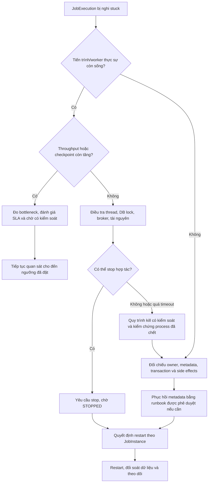

# Xử lý stuck execution trong Spring Batch

Một đêm chạy đối soát 20 triệu giao dịch, dashboard cho biết Spring Batch Job đã ở trạng thái `STARTED` hơn hai giờ nhưng số bản ghi đầu ra không tăng. Người vận hành muốn chạy lại Job ngay để kịp SLA. Nếu execution cũ vẫn đang ghi dữ liệu, thao tác đó có thể gây xử lý trùng, tranh chấp lock và làm sai kết quả đối soát; nếu tiến trình thực ra đã chết từ lâu, metadata `STARTED` có thể ngăn restart và khiến hệ thống đứng yên. Cả hai tình huống đều được gọi là **stuck execution**, nhưng cách giải quyết khác nhau.

Bài học thuộc chương **Vận hành** của module **SPRING_BATCH_SCALING_OPERATIONS**. Trọng tâm là xác định JobExecution/StepExecution thực sự bị kẹt, phân biệt **mất tiến độ** với **metadata còn trạng thái chạy sau sự cố**, khoanh vùng nút thắt khi sử dụng multi-threaded step, parallel steps, partitioning hoặc worker phân tán, sau đó dừng và phục hồi Job mà vẫn bảo đảm thread safety, checkpoint, retry/restart và tính đúng đắn của dữ liệu.

> **Nguyên tắc vận hành:** Trước khi khởi chạy hoặc sửa trạng thái của một JobInstance, phải biết có còn tiến trình/worker nào đang thực thi công việc của instance đó không, phần nào đã commit và thao tác lặp lại có an toàn không. Một dòng `STATUS='STARTED'` trong database không đủ để kết luận tiến trình còn sống.

## 1. Thế nào là stuck execution?

**JobExecution** là một lần thực thi của **JobInstance**. **StepExecution** ghi nhận một lần thực thi Step cùng số lượng bản ghi đọc/ghi/commit, thời điểm và trạng thái. Một JobInstance được nhận diện bởi **Job name + tập JobParameters định danh**; một instance có thể có nhiều execution qua các lần restart hợp lệ.

Một execution bị nghi là stuck khi thời gian chạy vượt ngưỡng có cơ sở hoặc không còn tiến triển theo những tín hiệu kỳ vọng. Có ba dạng cần phân biệt:

| Dạng | Dấu hiệu | Bản chất | Hành động đầu tiên |
|---|---|---|---|
| **Stuck thật, tiến trình còn sống** | Pod/JVM còn chạy nhưng throughput hoặc commit đứng yên, thread chờ lock/I/O/queue | Công việc vẫn giữ tài nguyên hoặc đang bị chặn | Điều tra lock, thread, CPU/GC, downstream; cân nhắc stop có kiểm soát |
| **Stale execution sau crash** | `JobRepository` báo `STARTED`/`STOPPING` nhưng không còn executor hoặc worker tương ứng | Metadata chưa kịp được cập nhật khi JVM/Pod chết | Chứng minh không còn chủ sở hữu chạy, đối soát dữ liệu rồi phục hồi metadata có kiểm soát |
| **Chạy chậm nhưng vẫn tiến triển** | Throughput thấp, commit vẫn tăng; partition cuối xử lý dữ liệu lệch | Có thể do dữ liệu skew, giới hạn DB hoặc tài nguyên | Đo nút thắt và SLA; không cưỡng bức restart chỉ dựa vào thời gian chạy |

Các biểu hiện thường gây nhầm lẫn:

- `STARTED` kéo dài **không tự động có nghĩa là deadlock**. Một chunk lớn hoặc truy vấn SQL dài có thể chưa cập nhật metadata.
- `LAST_UPDATED` không đổi trong vài phút **không tự động chứng minh hung thread**: tần suất cập nhật tùy Step, checkpoint và phiên bản Spring Batch.
- `STOPPING` là yêu cầu dừng đã được ghi nhận, **chưa có nghĩa là STOPPED**; Step phải đạt điểm dừng phù hợp.
- Pod `Running` không đồng nghĩa Job còn xử lý: JVM có thể đang đợi kết nối, deadlock, giữ thread nhưng không tăng tiến độ.
- Pod `Succeeded` hoặc container exit code 0 cũng chưa chứng minh dữ liệu đã hoàn tất nếu ứng dụng ánh xạ Batch status sang exit code chưa đúng.

## 2. Hiểu trạng thái Spring Batch trước khi can thiệp

Spring Batch duy trì vòng đời Job/Step trong `JobRepository`; tên trạng thái có ý nghĩa trực tiếp đối với quyết định stop hoặc restart:

| `BatchStatus` | Ý nghĩa vận hành | Hướng xử lý |
|---|---|---|
| `STARTING` | Execution được tạo và đang trong giai đoạn khởi động | Kiểm tra startup, scheduler, kết nối repository, bean khởi tạo |
| `STARTED` | Đã bắt đầu thực thi; metadata có thể vẫn giữ trạng thái này sau crash | Xác định tiến trình thực và tín hiệu progress |
| `STOPPING` | Đã yêu cầu dừng, framework/Step đang phối hợp để ngừng | Theo dõi chunk/Tasklet và thời gian drain, không gửi stop vô hạn |
| `STOPPED` | Dừng hợp lệ, có thể là điểm bắt đầu restart nếu Job hỗ trợ | Xác minh trạng thái dữ liệu rồi restart cùng JobInstance |
| `FAILED` | Lần thực thi kết thúc với lỗi | Đọc nguyên nhân, xác minh idempotency và điều kiện restart |
| `COMPLETED` | Hoàn tất theo logic Job | Không tự restart cùng JobInstance hoàn tất; đối chiếu kết quả nghiệp vụ |
| `ABANDONED` | Execution đã bị bỏ qua theo quy trình quản trị | Không coi đây là bước sửa stuck mặc định; kiểm tra hậu quả đối với restart |
| `UNKNOWN` | Framework không xác định chắc trạng thái | Dừng tự động hóa, điều tra repository và external side effects |

Không suy luận chỉ từ `BatchStatus`: `ExitStatus` thể hiện kết quả/nhánh điều khiển của Job; metadata của Step, transaction, message broker và dữ liệu đích có thể đưa ra thông tin khác. Một Job đang `STARTED` có thể gồm nhiều Step đã `COMPLETED` và một Step còn chờ.



## 3. Nguyên tắc an toàn trong 5–15 phút đầu

Khi nhận cảnh báo, nên thực hiện theo thứ tự để giữ bằng chứng và tránh tạo execution trùng:

1. **Xác định danh tính chính xác**: job name, JobInstance ID, JobExecution ID, JobParameters định danh, thời điểm khởi động, pod/host/worker sở hữu execution và bản build đang chạy.
2. **Ngăn khởi chạy trùng**: tạm dừng scheduler/trigger mới cho *cùng phạm vi dữ liệu* hoặc sử dụng cơ chế khóa phát hành có sẵn. Không mở thêm JobInstance chỉ để vượt lỗi `JobExecutionAlreadyRunningException`.
3. **Chụp trạng thái trước thay đổi**: lưu metadata Job/Step, pod events, log cuối, metrics progress, trạng thái transaction/lock và hàng đợi.
4. **Xác minh owner thật**: có JVM/Pod, worker, consumer hoặc transaction nào vẫn thao tác trên cùng dữ liệu hay không? Với remote partitioning, kiểm tra cả manager lẫn mọi worker.
5. **Phân loại**: đang tiến triển chậm, kẹt vì tài nguyên/lock, hay stale metadata sau crash; sau đó mới chọn wait, stop, kill hoặc recovery.

Trường hợp có nguy cơ dữ liệu sai hoặc trùng, việc tạm dừng trigger mới trong phạm vi bị ảnh hưởng thường an toàn hơn việc tăng số worker khi chưa xác định nguyên nhân.

### Dấu hiệu tiến độ cần quan sát đồng thời

| Tín hiệu | Chứng cứ hữu ích | Cách diễn giải |
|---|---|---|
| `readCount/writeCount/commitCount` | So sánh hai thời điểm của cùng StepExecution | Tăng là có progress; đứng yên lâu phải đối chiếu độ dài chunk |
| Input/output nghiệp vụ | Bản ghi theo key, partition, checkpoint cuối | Phản ánh tiến độ thật, giúp phát hiện ghi trùng |
| Threads/JVM | Thread dump, blocked/waiting/runnable, GC pause | Phát hiện deadlock, thread starvation, lock hoặc busy loop |
| Database | Active query, lock waits, connection-pool saturation | Tìm giới hạn nằm ngoài executor |
| Broker/queue | Lag, unacked messages, retry, redelivery | Nhận diện worker ngừng consume hay đang chờ ack |
| Container | CPU usage/throttling, memory, OOM, restarts, pod events | Phân biệt thiếu tài nguyên với logic treo |
| JobRepository | `START_TIME`, `END_TIME`, `LAST_UPDATED`, status | Biết framework ghi nhận gì, chưa đủ chứng minh liveness |

Ngưỡng stuck cần dựa vào phân bố thực tế của chunk/partition. Ví dụ một hệ thống có p99 chunk duration 45 giây và job thường 20 phút có thể cảnh báo khi **không có commit/progress 5 phút**, đồng thời tăng mức độ cảnh báo nếu toàn Job vượt SLA. Đây là **giá trị minh họa**, không phải ngưỡng chung.

## 4. Truy vấn JobRepository để chẩn đoán (chỉ đọc)

Các ví dụ SQL dưới đây minh họa bảng metadata Spring Batch phổ biến trên **PostgreSQL**. Tên cột/cấu trúc có thể khác giữa phiên bản, tên bảng có thể mang prefix riêng; cần điều chỉnh theo schema đang triển khai. Chỉ chạy với quyền **SELECT**, tránh chỉnh sửa trạng thái khi chưa kết luận nguyên nhân.

### Xác định execution còn trạng thái running

```sql
SELECT
    ji.JOB_NAME,
    ji.JOB_INSTANCE_ID,
    je.JOB_EXECUTION_ID,
    je.STATUS,
    je.EXIT_CODE,
    je.START_TIME,
    je.END_TIME,
    je.LAST_UPDATED
FROM BATCH_JOB_EXECUTION AS je
JOIN BATCH_JOB_INSTANCE AS ji
  ON ji.JOB_INSTANCE_ID = je.JOB_INSTANCE_ID
WHERE je.STATUS IN ('STARTING', 'STARTED', 'STOPPING')
ORDER BY je.START_TIME NULLS FIRST, je.JOB_EXECUTION_ID;
```

Kết quả là **danh sách ứng viên cần điều tra**. Một trạng thái `STARTED` không chứng minh worker thực còn sống. Đối chiếu JobExecution ID với log ứng dụng và thông tin triển khai trước khi thay đổi metadata.

### Xem StepExecution/partition đang ở đâu

```sql
SELECT
    STEP_EXECUTION_ID,
    JOB_EXECUTION_ID,
    STEP_NAME,
    STATUS,
    START_TIME,
    END_TIME,
    LAST_UPDATED,
    READ_COUNT,
    WRITE_COUNT,
    COMMIT_COUNT,
    ROLLBACK_COUNT,
    READ_SKIP_COUNT,
    PROCESS_SKIP_COUNT,
    WRITE_SKIP_COUNT
FROM BATCH_STEP_EXECUTION
WHERE JOB_EXECUTION_ID = :job_execution_id
ORDER BY STEP_EXECUTION_ID;
```

`:job_execution_id` là placeholder của client SQL, cần truyền bằng cơ chế tham số tương ứng. Lấy snapshot ở hai thời điểm cách nhau một khoảng đủ dài so với chunk p99. Nếu `COMMIT_COUNT` và `WRITE_COUNT` của một partition không đổi, nhưng 15 partition khác hoàn tất, điều tra partition bị kẹt trước khi kết luận toàn hệ thống cần restart.

### Tìm truy vấn PostgreSQL bị lock/chờ

```sql
SELECT
    pid,
    application_name,
    state,
    wait_event_type,
    wait_event,
    now() - query_start AS query_duration,
    pg_blocking_pids(pid) AS blocking_pids,
    left(query, 300) AS query_sample
FROM pg_stat_activity
WHERE datname = current_database()
  AND state <> 'idle'
ORDER BY query_start NULLS LAST;
```

Truy vấn trên giúp phát hiện backend đang bị lock hoặc chờ tài nguyên. `blocking_pids` khác rỗng là manh mối cho lock contention; không tự động kết luận khóa nào cũng nên bị kill. Cần kiểm tra transaction đang sở hữu lock, nghiệp vụ và các thao tác ảnh hưởng trước khi can thiệp; kết thúc backend DB có thể làm rollback giao dịch đang chạy.

Với Oracle, MySQL hoặc SQL Server, sử dụng view quan sát phù hợp của từng hệ quản trị, không sao chép SQL PostgreSQL sang môi trường khác.

### Khi nào LAST_UPDATED không đủ?

Metadata được cập nhật ở các thời điểm Spring Batch quản lý execution/Step và checkpoint; một processor có lời gọi API lâu hoặc một chunk kéo dài có thể khiến thời điểm cập nhật chậm hơn tiến độ trong bộ nhớ. Ngược lại, metadata được cập nhật nhưng writer bên ngoài không tạo kết quả mong đợi cũng là một loại lỗi. Vì vậy phải kết hợp **transaction, checkpoint, log và kết quả nghiệp vụ**.

## 5. Phân tích nút thắt khi JVM hoặc Pod còn sống

### 5.1. Kiểm tra thread dump và tiến trình Java

Thu thập ít nhất hai thread dump cách nhau trong lúc vấn đề diễn ra, so sánh những thread xử lý Step và tên executor:

```bash
# Chạy trong môi trường có công cụ JDK phù hợp và được cấp quyền.
jcmd <java-pid> Thread.print -l
jcmd <java-pid> GC.heap_info
```

Trong container chỉ có JRE, `jcmd` có thể không được đóng gói; có thể dùng cơ chế thread dump/JFR hoặc công cụ quan sát đã chuẩn bị trong môi trường chạy. Không yêu cầu thay image production ngay giữa sự cố nếu thay đổi đó làm mất bằng chứng.

| Thread dump | Khả năng xảy ra | Kiểm tra tiếp |
|---|---|---|
| Nhiều thread `BLOCKED` tại cùng monitor | Lock contention hoặc Java deadlock | Thread sở hữu monitor, dữ liệu chia sẻ, reader/writer thread safety |
| Nhiều thread `WAITING` tại connection pool | Hết kết nối DB, pool quá nhỏ hoặc transaction giữ kết nối lâu | Active/idle/pending của HikariCP, max connections DB, query duration |
| Thread chờ socket read | API/DB/broker chậm hoặc thiếu read timeout | Timeout, latency và tình trạng endpoint |
| Thread liên tục `RUNNABLE`, CPU cao | Busy loop, xử lý CPU-bound hoặc GC pressure | CPU throttling, profiler/JFR, heap/GC |
| Không còn worker xử lý nhưng Job `STARTED` | Executor/scheduler chưa cấp nhiệm vụ, queue nghẽn hoặc logic Step kết thúc bất thường | Executor queue, rejected tasks, Step state và log |

Không diễn giải `WAITING` là lỗi mặc định: nhiều thread idle hợp lệ ở pool. Điểm đáng lo là **thread đang giữ công việc nhưng chờ vô thời hạn** và throughput không tăng.

### 5.2. Kiểm tra Kubernetes/container

```bash
kubectl get pods -n batch -o wide
kubectl describe pod -n batch <pod-name>
kubectl logs -n batch <pod-name> -c batch --timestamps
kubectl get job -n batch <kubernetes-job-name> -o yaml
kubectl top pod -n batch --containers
```

Nếu Pod đã được thay thế, tra hệ thống log tập trung hoặc dùng log container trước khi restart khi còn tồn tại. `kubectl top` yêu cầu metrics API/Metrics Server và chỉ cho thấy giá trị gần hiện tại; muốn phân tích CPU throttling, memory peak, GC pause hoặc restart cần metrics lịch sử.

Nguyên nhân thường gặp:

- **CPU throttling**: container có `limits.cpu` thấp so với tổng concurrency, khiến nhiều worker thread chạy chậm dù không deadlock.
- **Memory pressure / GC**: heap gần giới hạn, GC pause dài, native memory tăng; OOMKilled có thể để lại metadata chưa kết thúc.
- **Connection pool exhaustion**: số chunk/partition đồng thời lớn hơn khả năng pool hoặc DB, làm tất cả thread chờ cấp connection.
- **Storage/volume**: I/O file tạm bị nghẽn, disk đầy, write latency cao hoặc filesystem không đáp ứng.
- **Network/downstream**: API không có timeout, broker mất kết nối hoặc queue lag tăng.

Không tăng số thread, chunk hay partition trước khi xác minh bottleneck. Trong mô hình scaling, tăng concurrency thường làm vấn đề lock, DB contention hoặc CPU throttling nặng hơn.

### 5.3. Phân tích step song song và partition

**Multi-threaded step:** kiểm tra `TaskExecutor`, queue capacity, số thread active, reader/writer có thread-safe hay không, và thời gian giữ transaction. Một reader stateful bị nhiều thread truy cập có thể vừa gây treo vừa làm sai checkpoint.

**Parallel steps:** xem Step nào chưa hoàn tất. Một Step đang chờ tài nguyên do Step khác giữ có thể tạo chuỗi chặn; không tự gộp toàn bộ StepExecution vào một cảnh báo chung.

**Local partitioning:** xem từng worker StepExecution trong cùng JVM; partition bị skew có thể chạy lâu hơn nhiều partition khác. Đánh giá kích thước vùng dữ liệu, khóa phân vùng và thời điểm commit riêng.

**Remote partitioning:** phân biệt manager, worker và broker. Manager có thể báo chưa xong do không nhận được kết quả trong khi worker đã commit dữ liệu. Kiểm tra partition identity, kết quả gửi về, consumer ack và cách chuyển việc sang worker khác.

**Remote chunking:** kiểm tra message in-flight, ack/retry, connection và deduplication. Nếu consumer đã xử lý nhưng message chưa ack, broker có thể redeliver và gây ghi trùng khi phục hồi.

## 6. Quy trình ra quyết định: chờ, stop, terminate hay recovery?

### Trường hợp A: execution còn sống và vẫn tiến triển

Nếu Step tiếp tục commit hoặc có heartbeat của task đang chạy, đừng dùng trạng thái kéo dài làm lý do kill ngay. So sánh tốc độ hiện tại với SLA, kiểm tra đầu vào bất thường và khả năng sắp hoàn tất. Nếu phải dừng để bảo vệ tài nguyên, chọn stop có kiểm soát.

### Trường hợp B: execution còn sống nhưng không tiến triển

Điều tra lock và kết nối trước. Nếu có thể sửa nghẽn downstream nhanh và an toàn, tiếp tục quan sát. Nếu cần dừng, dùng cơ chế của Spring Batch như `JobOperator.stop(executionId)` cho execution **đang chạy và do phạm vi điều phối này sở hữu**.

```java
// Đoạn trích minh họa bên trong dịch vụ quản trị có JobOperator và JobExplorer.
long executionId = 4281L; // ID thực tế đã đối chiếu với Pod và JobInstance
JobExecution execution = jobExplorer.getJobExecution(executionId);
if (execution == null) {
    throw new IllegalArgumentException("Unknown execution: " + executionId);
}
if (execution.isRunning()) {
    boolean accepted = jobOperator.stop(executionId);
    log.info("Stop requested={}, executionId={}", accepted, executionId);
}
// Tiếp tục quan sát JobRepository cho đến khi STOPPED hoặc hết timeout.
```

Ví dụ trên giả định các bean `jobOperator`, `jobExplorer` và `log` đã được khai báo trong ứng dụng. `stop` gửi yêu cầu, **không chứng minh Job đã dừng khi lời gọi trả về**. Một Step đang thực hiện chunk rất dài hoặc Tasklet không hợp tác có thể giữ trạng thái `STOPPING`. Đặt deadline quan sát, không gọi stop lặp vô hạn.

Sau khi yêu cầu stop:

1. Dừng cấp thêm input/partition mới theo cơ chế điều phối.
2. Chờ worker hoàn tất hoặc rollback các giao dịch đang mở trong giới hạn timeout.
3. Xác nhận trạng thái Step và Job đã kết thúc phù hợp (thường `STOPPED`).
4. Chụp lại checkpoint, dữ liệu đích và số message còn pending; chỉ restart khi không còn owner xử lý cùng vùng dữ liệu.

### Trường hợp C: execution còn sống nhưng không thể stop trong thời hạn

Nếu I/O hoặc thread đang treo và không thể dừng hợp tác, cân nhắc kết thúc tiến trình **theo runbook sự cố**. Trước khi terminate cần:

- Ngăn giao việc mới và xác định chính xác Pod/worker cần tác động.
- Thu thập thread dump, log, metrics, trạng thái DB/broker.
- Nắm được timeout/transaction rollback và ảnh hưởng của SIGTERM rồi SIGKILL.
- Xác nhận sau terminate rằng **không còn consumer, Pod cũ hoặc backend DB** đang tiếp tục ghi cùng phạm vi dữ liệu.
- Thực hiện đối soát rồi mới triển khai execution thay thế.

Việc kill Pod không tự động chuyển Spring Batch execution sang `FAILED`; container có thể chết trước khi ghi metadata.

### Trường hợp D: Pod đã chết, JobRepository còn STARTED/STOPPING

Đây là **stale execution**. `JobOperator.restart` có thể từ chối restart vì metadata vẫn cho rằng execution đang chạy. Chỉ sau khi đã kiểm chứng toàn bộ worker liên quan không còn sống, transaction bị bỏ dở không còn hoạt động và side effects đã được đối soát, mới đưa instance về trạng thái có thể phục hồi thông qua **quy trình quản trị được kiểm soát**.

Không có một lệnh SQL chung an toàn cho mọi trường hợp. Việc chỉ đổi `BATCH_JOB_EXECUTION.STATUS='FAILED'` có thể để lại StepExecution ở `STARTED`, metadata `ExecutionContext` chưa nhất quán hoặc khiến Spring Batch bỏ qua/phát lại phần việc sai. Nếu cần sửa trạng thái metadata do crash, quy trình phải xác định chính xác **JobExecution và các StepExecution liên quan**, sao lưu trạng thái trước khi đổi, ghi lý do sự cố, kiểm tra tính nhất quán và áp dụng công cụ/logic quản trị được kiểm thử với đúng phiên bản Spring Batch.

Không sửa metadata trong lúc còn execution cũ đang chạy, không tự thay đổi `JobParameters` định danh để bỏ qua guard của `JobRepository`, và không đánh dấu `COMPLETED` chỉ để làm dashboard hết cảnh báo.

## 7. Restart và bảo toàn tính đúng đắn dữ liệu

Sau khi Job thực sự dừng với trạng thái cho phép restart, có thể dùng `JobOperator.restart(executionId)` hoặc luồng restart được ứng dụng hỗ trợ. Điều kiện tiên quyết là Job restartable, không còn execution trùng đang chạy và dữ liệu đã được đối soát phù hợp. Spring Batch thường tạo **JobExecution mới cho cùng JobInstance** khi restart hợp lệ.

### Điều phải giữ nhất quán

| Thành phần | Kiểm tra trước restart |
|---|---|
| `JobInstance` | Tên Job và JobParameters định danh phải trỏ về đúng dữ liệu cần phục hồi |
| `JobRepository` | Lưu trữ bền vững, không mất metadata khi Pod được thay |
| `ExecutionContext` | Reader/writer/Step lưu vị trí và state đúng nơi, đúng thời điểm |
| Transaction | Dữ liệu đã commit và chưa commit được phân biệt rõ |
| Writer | Idempotent hoặc có unique key/upsert, tránh side effect lặp |
| Partition | Partition key/range ổn định; không chia lại vô tình làm chồng lấn khi restart |
| Broker | Quy tắc ack/redelivery phù hợp với commit và khả năng xử lý trùng |
| Tài nguyên | DB/CPU/memory đủ cho cấu hình concurrency đang khởi chạy lại |

**Ví dụ:** Chunk xử lý các order ID 1–500 đã ghi sang API bên ngoài, nhưng Pod chết trước khi checkpoint được lưu chắc chắn. Sau restart, reader có thể đọc lại 1–500. Nếu API hỗ trợ idempotency key theo `orderId + operationType`, yêu cầu lặp không tạo giao dịch trùng; nếu không có cơ chế chống trùng, chỉ dựa vào trạng thái Spring Batch sẽ không bảo đảm kết quả đúng.

Trong local/remote partitioning, cần lưu **partition identity và work range**. Nếu manager được restart với cách chia 8 partition thành 12 partition nhưng vẫn tái sử dụng metadata cũ mà không thiết kế tương thích, có thể bỏ sót hoặc đụng phạm vi dữ liệu. Việc tăng số worker chỉ nên thực hiện sau khi cách phân vùng và checkpoint đã được kiểm chứng.

### Khi nào không restart tự động?

- Không xác định được tiến trình cũ có còn sống hay không.
- `ExecutionContext` hoặc dữ liệu đích bị lệch, chưa biết commit cuối cùng.
- Có side effect ngoài transaction chưa idempotent và chưa đối soát.
- Metadata ở trạng thái `UNKNOWN` hoặc đã bị can thiệp thủ công không rõ lịch sử.
- Nút thắt gây stuck (ví dụ DB lock kéo dài, API không timeout, OOM) vẫn tồn tại.

Trong các trường hợp này, ưu tiên dừng pipeline và thực hiện recovery có người kiểm tra theo runbook trước khi bật retry.

## 8. Runbook xử lý sự cố từ cảnh báo đến đóng incident

| Giai đoạn | Hành động | Điều kiện để chuyển bước |
|---|---|---|
| **Detect** | Cảnh báo không có progress, vượt SLA hoặc `STARTED` lâu bất thường | Xác định đúng JobInstance/Execution |
| **Contain** | Dừng trigger cùng phạm vi dữ liệu; giữ log, metadata, thread/DB metrics | Không tự phát sinh execution trùng |
| **Diagnose** | Kiểm tra owner, Step/partition progress, thread, DB/broker, CPU/GC | Phân loại chạy chậm, stuck thật hay metadata stale |
| **Stop** | Nếu cần, yêu cầu stop và chờ kết quả trong deadline | Biết execution cũ đã dừng hoặc cần quy trình terminate |
| **Recover** | Chứng minh không còn owner; xử lý transaction/metadata theo quy trình, restart cùng JobInstance khi hợp lệ | Job mới chạy không đụng vùng dữ liệu đã xử lý sai |
| **Validate** | Đối chiếu số bản ghi, checksum/key nghiệp vụ, duplicate, retry, số partition | Kết quả đầy đủ và nhất quán |
| **Close** | Khôi phục scheduler, ghi timeline/căn nguyên, bổ sung alert hoặc timeout | Ngăn tái diễn cùng nguyên nhân |

Một incident cần ghi rõ **ai/điều gì đã thực thi hành động**, **JobExecution ID**, **thời điểm** và **evidence** trước/sau. Không dùng nhãn “đã restart thành công” khi chỉ thấy Pod mới ở trạng thái Running; phải chứng minh tiến độ trở lại và kết quả dữ liệu đúng.

## 9. Thiết kế để giảm stuck execution

### 9.1. Giới hạn thời gian của I/O và chunk

Thiết lập timeout cho connection, đọc/ghi socket, statement/query và transaction theo nhu cầu; một timeout không tự động bao phủ các lớp khác.

Ví dụ `spring.datasource.hikari.connection-timeout` là thời gian **chờ lấy kết nối từ pool**, không phải giới hạn thời gian chạy một câu SQL:

```yaml
spring:
  datasource:
    hikari:
      maximum-pool-size: 12
      connection-timeout: 30000
```

Nếu DB query treo, cần cấu hình timeout ở JDBC driver, query/statement hoặc transaction theo cách ứng dụng thực sự sử dụng. Nếu HTTP API treo, cần connect/read/overall timeout phù hợp trên HTTP client. Timeout phải ngắn hơn ngân sách xử lý một chunk/partition, tính cả retry/backoff và khoảng thời gian cần để shutdown graceful.

### 9.2. Ràng buộc concurrency theo tài nguyên thực

Với multi-threaded step, đặt giới hạn thread/queue và connection pool đủ để phục vụ thao tác đồng thời mà không làm DB quá tải. Với remote partitioning, tính **số worker Pod × số DB connection/worker** trước khi tăng song song. Theo dõi pool active, pending, timeout; nếu mọi thread đều chờ pool, tăng thread chỉ tăng hàng đợi.

Đối với CPU-bound processor, đo CPU throttling và GC. Đối với I/O-bound reader/writer, đo wait time, lock và broker lag. Chunk quá lớn làm transaction kéo dài, checkpoint ít và stop phản hồi chậm; chunk quá nhỏ làm tăng overhead. Tối ưu bằng thử nghiệm cùng dữ liệu đại diện.

### 9.3. Làm Tasklet có thể dừng

Tasklet có vòng lặp lớn phải trả quyền điều khiển cho Spring Batch hoặc chủ động hợp tác với tín hiệu dừng, thay vì giữ một lời gọi vô hạn:

```java
@Override
public RepeatStatus execute(
        StepContribution contribution, ChunkContext chunkContext) {
    // Mỗi đơn vị xử lý phải có thời gian kết thúc hữu hạn.
    processOneBoundedUnit();
    // Nhường lượt cho framework kiểm tra stop trước khi xử lý tiếp.
    return RepeatStatus.CONTINUABLE;
}
```

Đây là phần thân minh họa của một `Tasklet`; bean, imports, transaction và state persistence được lược bỏ. Thiết kế thực tế cần lưu checkpoint theo đúng boundary và trả `FINISHED` khi hoàn tất nghiệp vụ bình thường. Không lấy việc trả `FINISHED` làm thủ thuật che trạng thái stop.

### 9.4. Giám sát progress dựa trên dữ liệu, không chỉ “còn process”

Kết hợp tối thiểu:

- Job duration theo job name, phiên bản, kích thước đầu vào và số partition.
- `readCount/writeCount/commitCount` theo StepExecution hoặc số key nghiệp vụ đã xử lý.
- Thời gian không có progress, duration mỗi chunk và phân vị p95/p99.
- Số partition active/completed/failed/stale, queue lag và unacked.
- CPU usage/throttling, heap/GC, pool connection pending, DB lock wait, error/retry.
- Số execution ở `STARTING`/`STARTED`/`STOPPING` lâu bất thường so với job cùng loại.

Metrics “không thấy progress” phải có ngưỡng đủ dài cho chunk lớn và phân biệt trường hợp Job chờ lịch, reader hết dữ liệu hoặc đã kết thúc. Một rule phù hợp có thể cần **đồng thời** `status đang chạy + progress không tăng + vượt thời gian kỳ vọng`.

Không cấu hình liveness probe chỉ dựa vào tiến độ batch với ngưỡng quá ngắn: Kubernetes có thể liên tục kill Pod đang xử lý một chunk hợp lệ, khiến metadata stale và retry storm. Health probe nên phản ánh khả năng tiến trình phục vụ vai trò của nó; giám sát tiến độ nghiệp vụ cần alert/runbook riêng.

## 10. Tình huống vận hành thực tế

### Tình huống A: Job STARTED nhưng Pod đã OOMKilled

Một worker có `JobExecution ID=4281`, metadata ghi `STARTED`; Pod cũ báo `OOMKilled` và không còn container nào tương ứng. Scheduler liên tục cố launch Job cùng JobParameters nhưng nhận lỗi execution đang chạy.

**Phân tích:** Đây có thể là stale metadata sau kill. Trước khi recovery, xác minh không còn Pod/worker khác đang xử lý cùng instance, kiểm tra transaction và dữ liệu đã commit, đối chiếu StepExecution/ExecutionContext, rồi phục hồi trạng thái bằng quy trình được kiểm thử. Sau đó restart hợp lệ, kiểm tra tính idempotent và khắc phục memory peak/chunk size gây OOM.

**Sai lầm cần tránh:** Tạo `run.id` mới để chạy Job từ đầu ngay lập tức. Cách này có thể sinh JobInstance khác và ghi lại toàn bộ dữ liệu.

### Tình huống B: 12 partition, 11 đã hoàn tất

Manager còn `STARTED` sau 40 phút, trong khi 11 worker partition báo `COMPLETED` và một worker đứng ở `STARTED`; tổng throughput gần bằng 0. Thread dump cho thấy worker còn lại chờ database lock từ một giao dịch khác.

**Phân tích:** Đây là bottleneck cục bộ, chưa chắc cần restart toàn Job. Xác định blocking transaction, tác động nghiệp vụ của việc chờ hoặc xử lý lock, rồi chọn stop/rollback có kiểm soát nếu không thể hoàn thành trong SLA. Giữ nguyên định danh partition và checkpoint trước khi phân công lại.

**Sai lầm cần tránh:** Tăng worker từ 12 lên 24 trong khi lock chưa được giải quyết; nhiều worker hơn có thể khiến contention nặng hơn.

### Tình huống C: STOPPING mãi không về STOPPED

Operator đã gọi `JobOperator.stop(executionId)`, metadata thành `STOPPING` nhưng một Tasklet đang chờ API không có read timeout. Pod có `terminationGracePeriodSeconds=90`; sau 90 giây bị SIGKILL.

**Phân tích:** Yêu cầu stop không thể cắt ngang mọi I/O. Cần đặt timeout ở HTTP client, chia Tasklet thành đơn vị nhỏ, để framework quan sát yêu cầu dừng và bảo đảm side effect idempotent. Sau kill, phải dùng quy trình xác minh process đã chết, đối soát state và recovery thay vì giả định execution đã STOPPED.

### Tình huống D: Remote chunking bị redelivery

Consumer đã gọi API thanh toán và ghi DB, nhưng mất kết nối broker trước khi ack message. Manager vẫn chờ completion; sau khi Pod restart, broker phát lại chunk.

**Phân tích:** Stuck ở đường truyền/ack có thể che giấu việc dữ liệu thực đã được ghi. Phải đối chiếu kết quả ở hệ thống đích, dùng key idempotency/unique constraint hoặc mô hình outbox phù hợp, rồi mới quyết định ack/retry. Restart mù quáng có thể tạo thanh toán trùng.

## 11. Bài tập thực hành và tiêu chí nghiệm thu

**Bài tập:** Xây một Job nhập 1 triệu bản ghi theo 8 partition. Mỗi partition có checkpoint và writer idempotent; chạy trên container có logging và JobRepository bền vững. Mô phỏng 4 lỗi: SQL bị lock, HTTP call hết timeout, một Pod OOMKilled và worker nhận lại message sau mất ack.

Yêu cầu người thực hành:

1. Ghi job name, JobInstance/JobExecution ID, từng StepExecution ID và partition identity trước khi can thiệp.
2. Thu thập hai snapshot metadata cùng metrics và phân biệt partition chậm với không có progress.
3. Chứng minh worker cũ còn sống hay đã kết thúc; dùng stop có kiểm soát khi có thể.
4. Chỉ restart khi JobInstance/metadata và dữ liệu đã được đối soát an toàn.
5. Kiểm tra tổng số key nghiệp vụ, duplicate và skip sau khi Job hoàn tất.
6. Viết timeline incident, nguyên nhân gốc, thay đổi timeout/concurrency hoặc cảnh báo cần bổ sung.

| Tiêu chí nghiệm thu | Dấu hiệu PASS |
|---|---|
| Chẩn đoán đúng | Phân loại được live stuck, slow execution và stale metadata |
| Không xử lý trùng | Không có hai owner đồng thời thực thi cùng tập dữ liệu |
| Stop đúng | Lời gọi stop được theo dõi đến trạng thái cuối hoặc hết deadline có kiểm soát |
| Recovery an toàn | Dữ liệu sau restart đủ, không trùng, metadata nhất quán |
| Điều chỉnh hiệu năng | Thay đổi timeout/pool/thread/partition được chứng minh bằng metrics |
| Truy vết | Log, ID execution, thời điểm và hành động của incident có thể tái kiểm tra |

## 12. Checklist xử lý stuck execution trên production

1. Xác nhận đúng JobInstance, JobExecution, JobParameters định danh và vùng dữ liệu đang xử lý.
2. Giữ bằng chứng; tạm dừng trigger trùng trong phạm vi cần bảo vệ.
3. So sánh progress của Job/Step/partition cùng với thời lượng chunk và SLA.
4. Đối chiếu Pod/JVM/worker thật, thread dump, transaction DB, broker và tài nguyên cluster.
5. Phân loại chậm, kẹt thật, `STOPPING` kéo dài hay stale metadata sau crash.
6. Ưu tiên xử lý bottleneck hoặc stop hợp tác, với deadline và quan sát trạng thái cuối.
7. Nếu phải terminate, xác nhận không còn tiến trình/worker cũ đang ghi dữ liệu.
8. Đối soát dữ liệu đã commit, message đã ack và side effect bên ngoài trước mọi restart.
9. Phục hồi metadata stale bằng runbook/công cụ được kiểm thử, không sửa `STATUS` theo cảm tính.
10. Restart đúng JobInstance, kiểm tra idempotency, checkpoint và partition identity.
11. Theo dõi tiến độ trở lại đến khi đủ dữ liệu, ghi lại timeline và cải thiện cảnh báo.

Một execution chỉ thực sự được **xử lý xong** khi hệ thống biết nguyên nhân vì sao nó ngừng tiến triển, đã loại bỏ nguy cơ chạy trùng và chứng minh được kết quả dữ liệu sau phục hồi. Đó là tiêu chuẩn quan trọng nhất khi vận hành Spring Batch ở quy mô lớn.
