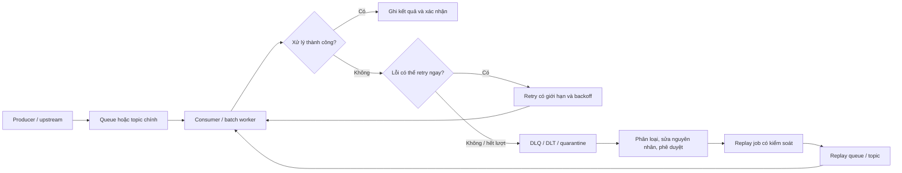
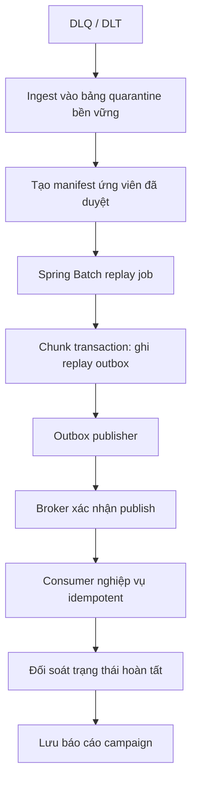

# Replay dead-letter message khi mở rộng Spring Batch

Trong hệ thống xử lý dữ liệu lớn, một message bị đưa vào **dead-letter queue (DLQ)** hoặc **dead-letter topic (DLT)** chưa chắc là dữ liệu hỏng vĩnh viễn. Nguyên nhân có thể là dịch vụ đích tạm ngừng, lỗi chuyển đổi schema, cấu hình consumer sai, hoặc một bản ghi không đáp ứng quy tắc nghiệp vụ. **Replay dead-letter message** là quy trình chọn, kiểm tra và gửi xử lý lại những message này sau khi đã xử lý nguyên nhân thất bại.

Với `SPRING_BATCH_SCALING_OPERATIONS`, replay phải được thiết kế cùng các đặc tính của Spring Batch như chunk transaction, `JobRepository`, restart, partitioning, multi-threaded step và remote chunking. Mục tiêu không chỉ là đọc lại DLQ: cần bảo đảm dữ liệu không bị áp dụng hai lần, không làm nghẽn workload chính và có thể đối soát được kết quả.

## 1. Kết quả học tập

Sau bài này, bạn có thể:

- Phân biệt **retry trong một lần xử lý**, **restart Spring Batch job** và **replay message từ DLQ/DLT**.
- Xác định trường hợp được phép replay, dữ liệu cần giữ lại và nguyên nhân phải sửa trước khi replay.
- Thiết kế luồng replay có kiểm soát theo lô, idempotency, transaction, checkpoint và giới hạn tải.
- Vận hành và đối soát một chiến dịch replay với RabbitMQ hoặc Kafka trong kiến trúc Spring Batch phân tán.
- Nhận biết các lỗi khó như vòng lặp dead-letter, trùng side effect, mất thứ tự và replay chunk cũ sau khi job đã hoàn tất.

## 2. DLQ/DLT nằm ở đâu trong pipeline batch?

Một ứng dụng Spring Batch có thể đọc dữ liệu từ cơ sở dữ liệu, file hoặc message broker. Trong kiến trúc có RabbitMQ/Kafka, message thường được gửi sang DLQ/DLT khi consumer đã hết số lần thử lại hoặc quyết định không thể xử lý tiếp. Ngoài ra, ứng dụng cũng có thể tự lưu bản ghi lỗi vào bảng *quarantine* để xử lý về sau.



Các cơ chế sau không thay thế nhau:

| Cơ chế | Phạm vi | Khi nên dùng | Điểm cần nhớ |
|---|---|---|---|
| Retry trong consumer hoặc chunk | Cùng lần xử lý, số lượt giới hạn | Timeout, lỗi mạng ngắn hạn, deadlock thoáng qua | Cần backoff; không thử vô hạn với lỗi dữ liệu |
| Restart Spring Batch job | Tái sử dụng trạng thái `JobRepository` của `JobInstance` có thể restart | Job hoặc step thất bại và cần chạy tiếp từ checkpoint hợp lệ | Restart không tự kéo message ra khỏi DLQ |
| Replay DLQ/DLT | Message đã tách khỏi luồng xử lý chính | Lỗi đã được sửa, cần gửi lại tập message được chọn | Đây là lần giao mới; có thể trùng với lần giao cũ |
| Chạy lại toàn bộ job với tham số mới | Một lần thực thi độc lập | Cần tái tính toán toàn bộ dữ liệu theo nghiệp vụ | Phạm vi rộng, dễ tạo side effect nếu không có cơ chế chống trùng |

**Lưu ý Spring Batch:** cấu hình `.retry(...)`, `.skip(...)` hoặc `SkipListener` không mặc nhiên tạo DLQ trên broker. Nếu muốn lưu item bị skip, ứng dụng phải xây dựng cơ chế ghi lỗi riêng và bảo đảm việc ghi đó phù hợp với transaction.

## 3. Khi nào một dead-letter message đủ điều kiện replay?

Không nên replay hàng loạt chỉ vì DLQ đang tăng. Trước hết cần phân loại nguyên nhân và xác định phiên bản consumer hiện tại có xử lý được message hay không.

| Nguyên nhân | Hành động trước replay | Quyết định thường gặp |
|---|---|---|
| Dịch vụ phụ thuộc bị gián đoạn | Kiểm tra dịch vụ phục hồi, đo tỷ lệ lỗi hiện tại | Replay theo lô nhỏ, có rate limit |
| Timeout hoặc giới hạn kết nối DB | Sửa pool/timeout, đánh giá capacity và tải chính | Replay khi có đủ tài nguyên, tránh dồn đỉnh |
| Schema không tương thích | Cập nhật serializer/deserializer, bổ sung migration | Replay sau khi consumer hỗ trợ phiên bản dữ liệu cũ |
| Dữ liệu sai quy tắc nghiệp vụ | Xác định khả năng sửa dữ liệu, nhận phê duyệt | Quarantine hoặc loại bỏ có lý do; không tự động phát lại |
| Lỗi lập trình xác định | Sửa và triển khai code, kiểm tra bằng mẫu đại diện | Replay sau khi xác nhận bản sửa hoạt động |
| Message trùng, hết hiệu lực hoặc đã có kết quả | Kiểm tra khóa nghiệp vụ và trạng thái đích | Bỏ qua có ghi nhận, không nhân đôi side effect |

Checklist trước khi mở replay:

1. Đã tìm được nguyên nhân và xác nhận lỗi không còn tái hiện trên mẫu thử.
2. Đã chọn đúng nguồn DLQ/DLT, khoảng thời gian, tenant, loại sự kiện và tập message cần xử lý; có cơ chế loại trừ dữ liệu không hợp lệ.
3. Consumer có idempotency; schema, trạng thái nghiệp vụ và thứ tự xử lý vẫn tương thích.
4. Đã ước lượng số message, kích thước payload, tốc độ replay an toàn và khả năng chịu tải của DB, broker, API downstream.
5. Đã định nghĩa điều kiện tạm dừng, người phê duyệt (nếu quy trình yêu cầu), cách đối soát và chính sách giữ dữ liệu gốc.

Một message thiếu payload, checksum sai, không thể giải mã hoặc không còn được phép xử lý phải ở trạng thái **quarantine** để điều tra. Không xóa DLQ để giảm chỉ số tồn đọng khi chưa có quyết định xử lý dữ liệu.

## 4. Giữ đủ metadata để replay đúng nguồn gốc

Chỉ lưu payload thường không đủ. Message chết có thể xuất phát từ nhiều topic/queue, nhiều partition và nhiều `JobExecution`. Khi phát lại cần biết **cái gì đã thất bại, ở đâu, do đâu và đã thử bao nhiêu lần**.

Một envelope dùng cho bảng lưu trữ DLQ nội bộ có thể như sau (giá trị minh họa):

```json
{
  "messageId": "evt-order-8701",
  "eventType": "OrderConfirmed",
  "schemaVersion": 2,
  "source": {
    "broker": "kafka",
    "destination": "orders.events",
    "partition": 3,
    "offset": 105421
  },
  "batch": {
    "jobName": "syncOrdersJob",
    "jobExecutionId": 4821,
    "stepName": "processOrdersPartition2"
  },
  "failure": {
    "category": "DOWNSTREAM_TIMEOUT",
    "attempts": 4,
    "firstFailedAt": "2026-10-05T02:10:00Z"
  },
  "traceId": "trace-sample-42",
  "payload": {
    "orderId": "ORD-8701",
    "status": "CONFIRMED"
  }
}
```

Các trường quan trọng gồm `messageId`/khóa nghiệp vụ, `eventType`, `schemaVersion`, đích gốc, timestamp sự kiện, số lần thất bại, mã lỗi, trace/correlation ID và định danh job/step/partition nếu liên quan. Có thể bổ sung `replayCampaignId`, `replayAttempt`, `replayedAt`, `operator` và trạng thái xử lý để audit.

- **RabbitMQ:** khi dùng dead-letter exchange, broker có thể bổ sung header `x-death` (nguồn, lý do, số lần dead-letter...). Cần cấu hình dead-letter exchange, routing key và binding đúng; không giả định mọi message đều có đầy đủ header.
- **Kafka:** DLQ thường là một *DLT topic* do ứng dụng hoặc framework xuất bản (ví dụ `DeadLetterPublishingRecoverer` trong Spring Kafka), không phải tính năng tự động có cho mọi consumer. Header về topic, partition, offset và exception phụ thuộc cấu hình producer/recoverer; phải kiểm tra thực tế.
- **Batch metadata:** `JobExecutionId`, `StepExecutionId`, `partitionId` giúp truy vết, nhưng **không phải khóa idempotency nghiệp vụ**. Một message có thể được xử lý trong nhiều lần job chạy.

Chỉ lưu metadata và dữ liệu cần thiết để khôi phục; hạn chế ghi thông tin nhạy cảm trong exception stack trace, áp dụng phân quyền, mã hóa và thời hạn lưu phù hợp chính sách dữ liệu.

## 5. Chọn chiến lược replay

| Chiến lược | Cách thực hiện | Ưu điểm | Hạn chế và điều kiện |
|---|---|---|---|
| Republish trực tiếp từ DLQ sang queue/topic gốc | Công cụ vận hành hoặc consumer đọc DLQ rồi publish lại | Dễ áp dụng cho lượng nhỏ, xử lý sự cố đơn giản | Khó audit và throttle khi lượng lớn; cần ack/commit an toàn |
| Replay qua queue/topic riêng | Consumer DLQ gửi message vào kênh replay, dùng worker xử lý với giới hạn concurrency | Tách tải khôi phục khỏi lưu lượng chính, dễ quan sát | Cần quyết định cách giữ thứ tự và cùng logic xử lý nghiệp vụ |
| **Spring Batch recovery job** | Chụp tập ứng viên vào manifest; reader lấy theo lô, writer ghi outbox, publisher đưa lên broker | Có checkpoint, thống kê, partitioning, restart và lịch vận hành | Cần kho ứng viên bền vững, xử lý phát trùng và đối soát |

Với vài message đơn lẻ, republish thủ công có kiểm soát có thể đủ. Khi DLQ chứa hàng chục nghìn đến hàng triệu message, nên có *replay campaign* (chiến dịch replay) với bộ lọc cố định, hạn mức, trạng thái và audit. Batch recovery job giúp khai thác chunk và partitioning mà không buộc consumer chính phải quét toàn bộ DLQ.

### Luồng recovery job đề xuất



Trong thiết kế này, **manifest là danh sách ID bất biến cho một campaign**. Việc cố định tập ứng viên giúp job restart mà không liên tục thay đổi tập đọc. Bảng outbox nằm cùng cơ sở dữ liệu và transaction với thao tác ghi của replay step; publisher đọc outbox, gửi message và đánh dấu đã phát khi broker xác nhận. Publisher có thể gửi một message nhiều lần nếu gặp sự cố giữa lần broker nhận và lần cập nhật trạng thái: consumer vẫn phải idempotent.

Tránh dùng `JdbcPagingItemReader` lọc trực tiếp `status = 'PENDING'` rồi đổi `status` của các hàng vừa đọc ngay trong lúc phân trang: điều kiện truy vấn biến đổi có thể làm một số bản ghi bị bỏ qua. Hãy đọc từ manifest bất biến, chia dải ID ổn định, hoặc sử dụng chiến lược claim có checkpoint rõ ràng.

## 6. Ví dụ: Spring Batch ghi outbox để replay

Giả sử một tác vụ đồng bộ đơn hàng gặp lỗi API downstream và các message thất bại đã được lưu vào bảng quarantine. Người vận hành chọn tập message hợp lệ, tạo `campaignId` và manifest. Mỗi hàng manifest ánh xạ sang `ReplayCandidate` gồm ID phát lại ổn định, ID message gốc, payload và đích gửi.

Schema outbox minh họa dùng PostgreSQL:

```sql
CREATE TABLE replay_outbox (
    replay_id           UUID PRIMARY KEY,
    campaign_id         UUID NOT NULL,
    original_message_id VARCHAR(160) NOT NULL,
    destination         VARCHAR(255) NOT NULL,
    payload             TEXT NOT NULL,
    created_at          TIMESTAMPTZ NOT NULL DEFAULT CURRENT_TIMESTAMP,
    published_at        TIMESTAMPTZ
);

CREATE INDEX idx_replay_outbox_unpublished
    ON replay_outbox (created_at)
    WHERE published_at IS NULL;
```

Định nghĩa writer trong Spring Batch 5 (sử dụng API builder có `JobRepository` và `PlatformTransactionManager`):

```java
import java.util.UUID;
import javax.sql.DataSource;
import org.springframework.batch.core.Step;
import org.springframework.batch.core.job.builder.JobBuilder;
import org.springframework.batch.core.Job;
import org.springframework.batch.core.repository.JobRepository;
import org.springframework.batch.core.step.builder.StepBuilder;
import org.springframework.batch.item.ItemReader;
import org.springframework.batch.item.ItemWriter;
import org.springframework.context.annotation.Bean;
import org.springframework.context.annotation.Configuration;
import org.springframework.jdbc.core.JdbcTemplate;
import org.springframework.transaction.PlatformTransactionManager;

record ReplayCandidate(
    UUID replayId,
    UUID campaignId,
    String originalMessageId,
    String destination,
    String payload
) {}

@Configuration
class DeadLetterReplayConfiguration {
    @Bean
    ItemWriter<ReplayCandidate> stageReplayWriter(DataSource dataSource) {
        JdbcTemplate jdbc = new JdbcTemplate(dataSource);
        return chunk -> {
            for (ReplayCandidate candidate : chunk.getItems()) {
                jdbc.update("""
                    INSERT INTO replay_outbox
                      (replay_id, campaign_id, original_message_id, destination, payload)
                    VALUES (?, ?, ?, ?, ?)
                    ON CONFLICT (replay_id) DO NOTHING
                    """,
                    candidate.replayId(), candidate.campaignId(),
                    candidate.originalMessageId(), candidate.destination(),
                    candidate.payload());
            }
        };
    }

    @Bean
    Step replayDeadLetterStep(
        JobRepository repository,
        PlatformTransactionManager transactionManager,
        ItemReader<ReplayCandidate> approvedManifestReader,
        ItemWriter<ReplayCandidate> stageReplayWriter
    ) {
        return new StepBuilder("replayDeadLetterStep", repository)
            .<ReplayCandidate, ReplayCandidate>chunk(100, transactionManager)
            .reader(approvedManifestReader)
            .writer(stageReplayWriter)
            .build();
    }

    @Bean
    Job replayDeadLetterJob(JobRepository repository, Step replayDeadLetterStep) {
        return new JobBuilder("replayDeadLetterJob", repository)
            .start(replayDeadLetterStep)
            .build();
    }
}
```

Đây là phần **staging** của giải pháp, không phải ứng dụng hoàn chỉnh. `approvedManifestReader` cần được triển khai từ danh sách ID đã duyệt, lưu checkpoint khi restart và lọc đúng `campaignId` (thường nhận qua job parameter trong bean `@StepScope`). `replayId` phải được tạo **deterministic**, chẳng hạn UUID từ cặp `(campaignId, originalMessageId)`, để cùng campaign chạy lại vẫn dùng đúng khóa duy nhất. Tránh tạo UUID ngẫu nhiên mỗi lần đọc.

`ON CONFLICT (replay_id) DO NOTHING` khiến việc ghi outbox không tạo thêm hàng khi một chunk được chạy lại. Cách viết này dành riêng cho PostgreSQL; các hệ quản trị khác cần cú pháp tương đương. DataSource của `JdbcTemplate` và transaction manager của step phải tham gia cùng giao dịch đối với phần ghi outbox. Nếu dùng nhiều DB/transaction manager, phải thiết kế lại ranh giới nhất quán.

Publisher chạy riêng: lấy các hàng `published_at IS NULL`, claim theo cơ chế tránh hai publisher cùng giữ một hàng, publish kèm `originalMessageId` và `replayId`, chờ broker confirm, sau đó cập nhật `published_at`. Chỉ số `published_at` có nghĩa là **đã được broker chấp nhận**, không có nghĩa consumer downstream đã xử lý thành công. Cần thêm acknowledgment hoặc đối soát nghiệp vụ để xác nhận hoàn tất.

### Idempotency ở consumer nhận replay

Một replay có thể lặp lại ngay cả khi publisher và broker hoạt động chính xác, vì consumer có thể commit side effect rồi bị mất kết nối trước khi xác nhận message. Do đó, consumer cần kiểm tra **event ID gốc hoặc khóa nghiệp vụ**, không chỉ `replayId` của campaign.

Ví dụ với PostgreSQL, trong **cùng transaction** với cập nhật nghiệp vụ:

```sql
INSERT INTO processed_event (event_id, processed_at)
VALUES (:originalMessageId, CURRENT_TIMESTAMP)
ON CONFLICT (event_id) DO NOTHING
RETURNING event_id;
```

Nếu câu lệnh không trả về hàng, event đã được xử lý trước đó và consumer bỏ qua side effect. Nếu có hàng mới, consumer thực hiện thay đổi nghiệp vụ trong **chính transaction đó**; khi rollback, bản ghi dedup cũng rollback. Bảng `processed_event` phải có unique constraint trên `event_id`. Với nghiệp vụ hỗ trợ xử lý lại có chủ đích (ví dụ tái tính toán một version), cần thiết kế khóa theo quy tắc nghiệp vụ thay vì mặc định chặn mọi event cũ.

**Không thể suy ra exactly-once cho toàn hệ thống chỉ từ transaction của Spring Batch, broker acknowledgment hoặc outbox.** Khi đi qua nhiều dịch vụ và nguồn dữ liệu, phải chấp nhận khả năng giao lặp và biến side effect thành idempotent hoặc có cơ chế bù trừ.

## 7. RabbitMQ và Kafka: replay khác nhau ở đâu?

### RabbitMQ

Thông thường queue chính cấu hình dead-letter exchange (DLX) để định tuyến message bị reject/nack không requeue, hết TTL hoặc vượt giới hạn phù hợp sang DLQ. Khi muốn replay, ứng dụng hoặc công cụ vận hành **publish một message mới** tới exchange/routing key đã chọn.

Quy trình an toàn cho consumer hút DLQ là: nhận message → xác thực và lưu bền vững vào staging/outbox hoặc publish thành công có confirm → **mới ack message DLQ**. Nếu ack trước khi nơi nhận tiếp theo chấp nhận, một lần crash có thể làm mất bản sao cần replay. Nếu publish thành công nhưng ack DLQ thất bại, message có thể đến hai lần: dedup giải quyết trường hợp này.

Không dùng `basicNack(requeue=true)` lặp vô hạn như một cơ chế replay. Nó có thể tạo poison-message loop và chiếm toàn bộ consumer. Cần đếm lượt replay trong metadata do ứng dụng quản lý, đặt ngưỡng và chuyển message tái thất bại trở lại quarantine có lý do cụ thể.

### Kafka

DLT thường là topic riêng, ví dụ `orders.events.DLT`, được ghi bởi error handler/recoverer của ứng dụng. Replay job đọc bản ghi DLT theo phạm vi offset hoặc manifest, sau đó **produce một bản ghi mới** vào topic xử lý được chọn. Bản ghi mới nhận offset mới; không có thao tác “đặt lại” offset gốc trên topic chính tương đương replay một message riêng lẻ.

Chỉ commit offset của consumer DLT sau khi dữ liệu đã được staging bền vững hoặc việc publish được bảo đảm theo thiết kế transaction đang dùng. Khi dùng Kafka transaction cần hiểu rõ transaction đó bao phủ những gì; nó không tự làm cho thao tác ghi vào DB ngoài Kafka trở thành atomic. Giữ key gốc nếu business cần các event cùng entity đi cùng partition, và đánh giá khả năng sự kiện cũ đến sau các sự kiện mới.

| Vấn đề | RabbitMQ | Kafka |
|---|---|---|
| Dead-letter | DLX/queue do topology cấu hình | DLT topic thường do ứng dụng/framework publish |
| Xác nhận đã lấy khỏi DLQ/DLT | Ack message sau thao tác an toàn | Commit offset sau thao tác an toàn |
| Thứ tự | Phụ thuộc queue và concurrency; republish thay đổi vị trí | Thứ tự được đảm bảo trong từng partition, replay tạo offset mới |
| Dấu vết nguồn | Headers như `x-death` (khi có) | Topic/partition/offset và DLT headers (nếu được ghi) |
| Điểm nhạy cảm | Nack/requeue loop, publisher confirms | Commit offset, key/partition, transactional boundaries |

## 8. Liên hệ với các mô hình scale của Spring Batch

Replay gây tải thật lên hệ thống đang chạy; số worker càng lớn thì nguy cơ quá tải và giao trùng càng đáng kể.

| Mô hình | Rủi ro khi replay | Cách kiểm soát |
|---|---|---|
| Multi-threaded step | Reader/state chung không thread-safe; ghi trùng do retry | Reader riêng theo partition hoặc reader hỗ trợ concurrency; writer idempotent |
| Parallel steps | Các step có thể tác động cùng bản ghi hoặc cùng downstream | Phân tách nguồn, khóa nghiệp vụ, giới hạn pool/connection |
| Local/remote partitioning | Hai partition nhận vùng dữ liệu chồng lấn; restart thay đổi ranh giới | Manifest bất biến, phân vùng ID không giao nhau, checkpoint độc lập |
| Remote chunking | Message chunk cũ đến lại khi manager/worker đã đổi trạng thái | Correlate `jobExecutionId`, `stepExecutionId`, `chunkId`; kiểm tra trạng thái và chống áp dụng lặp |
| Nhiều instance consumer | Replay tạo đợt tải lớn, tranh chấp lock và kết nối | Giới hạn concurrency, backpressure, retry có jitter |

Đặc biệt với **remote chunking**, message mang dữ liệu điều phối chunk không nên được phát lại một cách mù quáng sau khi `JobExecution` gốc đã kết thúc. Trước hết cần đối chiếu trạng thái `JobRepository`, kết quả ghi nghiệp vụ, `chunkId`/correlation ID và khả năng chấp nhận lại của manager/worker. Trong nhiều trường hợp, restart job/step được hỗ trợ hoặc chuyển các item lỗi thành nhiệm vụ khôi phục độc lập sẽ an toàn hơn việc bơm lại một chunk protocol cũ.

Nếu một replay job được partition, mỗi partition phải có vùng manifest riêng, dùng reader instance riêng (`@StepScope` nếu phù hợp) và chỉ số tiến độ riêng. `gridSize`, số thread, connection pool, broker prefetch và tốc độ gửi cần chọn theo bottleneck đo được, không tăng đồng loạt.

## 9. Runbook vận hành một chiến dịch replay

Một quy trình vận hành có thể triển khai theo các bước sau:

1. **Khoanh vùng:** chốt nguồn DLQ/DLT, số lượng và độ tuổi message, nhóm lỗi, khoảng thời gian, tenant và các destination liên quan. Giữ snapshot/manifest các ID đã duyệt.
2. **Sửa lỗi và thử mẫu:** xác nhận sự cố nguồn được khắc phục; thử số ít message đại diện trên môi trường kiểm soát hoặc với đường xử lý an toàn, quan sát cả dữ liệu cuối.
3. **Lập campaign:** tạo `campaignId` duy nhất, xác định số message dự kiến, giới hạn throughput/concurrency, lịch chạy và tiêu chí tạm dừng. Job parameter phân biệt các campaign để không dùng nhầm trạng thái restart.
4. **Staging theo chunk:** Spring Batch đọc manifest cố định, ghi outbox trong transaction, restart dựa trên trạng thái job và khóa duy nhất; giữ bản ghi lỗi gốc trong thời gian đối soát.
5. **Publish có backpressure:** gửi theo tốc độ downstream chịu được; nếu API/DB chậm, giảm tốc độ hoặc tạm dừng. Không để replay chiếm hết connection pool hoặc broker consumer của tải chính.
6. **Đối soát:** phân biệt số ứng viên, số staged, số broker-confirmed, số business-success, số deduplicated, số lỗi mới và số còn chờ. Mọi record phải có trạng thái cuối hoặc lý do tồn đọng.
7. **Đóng campaign:** lưu log/audit, thông số, version code, kết quả và quyết định đối với message không thể phục hồi. Chỉ áp dụng chính sách retention sau khi đối soát đạt yêu cầu.

Một ví dụ: có 12.000 message thất bại khi API tra cứu tồn kho ngừng hoạt động. Sau khi API phục hồi, đội vận hành chọn 10.500 message còn hiệu lực vào manifest, replay thử 100 message, sau đó tăng tốc theo độ trễ API. 1.000 message đã được xử lý từ một luồng khác sẽ được consumer đánh dấu `DEDUPLICATED`, còn các message lỗi schema tiếp tục quarantine. Không coi “10.500 message đã publish” là “10.500 thay đổi nghiệp vụ đã hoàn tất”.

### Chỉ số nên giám sát

| Nhóm | Chỉ số/alert đề xuất | Ý nghĩa |
|---|---|---|
| Tồn đọng | DLQ depth, oldest-message age, số message đủ điều kiện replay | Nhận biết backlog và độ trễ khôi phục |
| Lưu lượng | Replay staged/s, published/s, consumer success/s | So sánh tốc độ phát với tốc độ xử lý thực |
| Chất lượng | Re-dead-letter rate, lỗi theo category, số duplicate | Phát hiện lỗi gốc chưa được khắc phục |
| Nguồn lực | DB pool saturation, CPU, heap, broker lag, downstream p95/p99 | Giữ replay trong ngân sách tài nguyên |
| Đối soát | Pending/staged/published/processed/rejected theo campaign | Xác nhận không bỏ sót message |

Ví dụ điều kiện dừng tự động: tỷ lệ message quay lại DLQ tăng đột biến so với mẫu thử, downstream chạm giới hạn rate, DB connection pool gần cạn, hoặc độ trễ workload chính vượt ngưỡng vận hành đã định. Giá trị ngưỡng phải dựa trên SLO và đo đạc thực tế của hệ thống.

## 10. Các tình huống dễ xử lý sai

**Tình huống A — Crash sau commit DB, trước khi ack broker.** Message được giao lại; nếu consumer chỉ kiểm tra `replayId` nhưng event gốc đã được xử lý trong campaign trước, side effect có thể lặp. Cần dedup theo định danh sự kiện/khóa nghiệp vụ trong cùng transaction với thay đổi dữ liệu.

**Tình huống B — Một item được skip trong Spring Batch rồi đưa lên DLQ trực tiếp từ callback.** Nếu callback gọi broker không cùng transaction và chunk sau đó rollback, trạng thái DB và broker có thể lệch nhau. Dùng outbox hoặc cơ chế ghi lỗi có bảo đảm transactional phù hợp, đồng thời thiết kế chống trùng cho lần restart.

**Tình huống C — Replay sự kiện cũ sau một bản cập nhật mới.** Event `OrderConfirmed` đến sau `OrderCancelled` có thể ghi đè trạng thái mới. Cần version/sequence check hoặc quy tắc chuyển trạng thái có điều kiện; giữ Kafka key gốc chỉ giảm một phần nguy cơ, không tự chữa việc phát lại muộn.

**Tình huống D — Worker đọc DLQ hàng loạt và tăng `gridSize` tối đa.** Replay có thể bão hòa DB, làm chậm cả job chính và kích hoạt thêm retry/DLQ. Hãy tách ngân sách kết nối và điều chỉnh tốc độ theo downstream, không lấy throughput publisher làm thước đo thành công duy nhất.

**Tình huống E — Restart job nhưng thay đổi tập ứng viên.** Reader phân trang theo `status = 'PENDING'` trong khi writer cập nhật `status` có thể bỏ sót message. Cố định danh sách ID campaign và dùng khóa outbox ổn định để chạy lại an toàn.

## 11. Bài tập ứng dụng

Bạn vận hành một Spring Batch job nhận event thanh toán qua Kafka, sử dụng remote partitioning để tính đối soát. Sau một bản triển khai lỗi, 30.000 event vào topic DLT. Hệ thống chính vẫn nhận event mới.

Hãy thiết kế phương án replay trả lời các câu hỏi:

1. Metadata tối thiểu nào phải lưu để xác định event gốc, topic/partition/offset và `JobExecution` liên quan?
2. Làm thế nào chọn đúng 30.000 event nhưng loại các event đã được đối soát thành công hoặc đã hết hiệu lực?
3. Làm thế nào bảo đảm crash giữa `publish`, `ack/commit` và cập nhật DB không tạo ra thanh toán/đối soát trùng?
4. Nên dùng replay queue/topic riêng hay đưa lại topic chính? Điều gì quyết định giới hạn concurrency và cách giữ thứ tự?
5. Những con số nào chứng minh campaign hoàn tất, thay vì chỉ chứng minh publisher gửi hết message?

**Gợi ý đáp án:** tạo manifest đã duyệt và khóa idempotency theo event/đối tượng nghiệp vụ; Spring Batch staging outbox theo chunk; publisher có confirm; consumer xử lý có kiểm soát version/state và dedup; giới hạn tải theo lag và tài nguyên; đối soát từng trạng thái tới kết quả cuối. Với remote partitioning, chỉ replay dữ liệu nghiệp vụ độc lập sau khi kiểm tra trạng thái job cũ, không phát lại chunk điều phối đã hết ngữ cảnh.

## 12. Ghi nhớ khi áp dụng

- Replay là một **quy trình khôi phục có trạng thái và khả năng kiểm chứng**, không phải thao tác đổi routing key rồi gửi lại vô hạn.
- Spring Batch hỗ trợ chunk, checkpoint, restart và partitioning cho recovery job; việc publish lên broker và xử lý nghiệp vụ vẫn cần idempotency, transaction/outbox và kiểm soát backpressure.
- Ack/commit hay publisher confirm chỉ nói lên một phần của hành trình message. Kết quả đúng phải được xác nhận ở trạng thái nghiệp vụ sau cùng.
- Mọi campaign cần giới hạn phạm vi, giữ bằng chứng nguồn gốc, phân loại lỗi tái diễn và có cách tạm dừng/đối soát rõ ràng.
