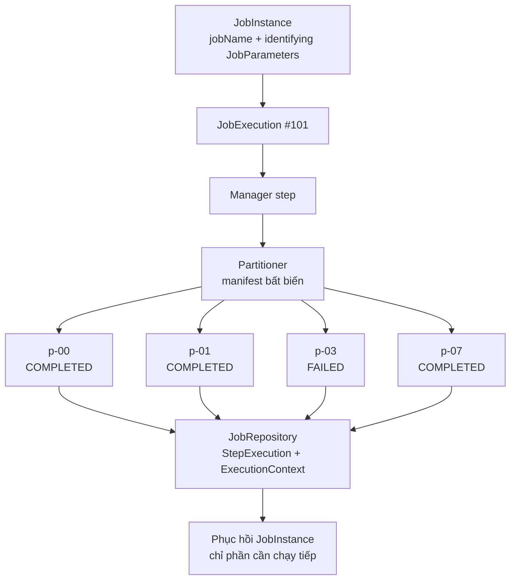
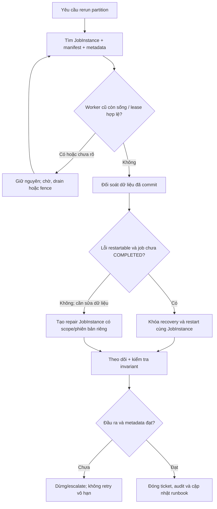

# Rerun partition có kiểm soát trong Spring Batch

## 1. Bối cảnh: chạy lại một partition mà không làm hỏng dữ liệu

Trong hệ thống xử lý dữ liệu lớn, **partitioning** chia một step thành nhiều phần việc độc lập để thực thi song song trên thread hoặc worker khác nhau. Nếu 1 trong 16 partition lỗi sau khi 15 partition đã hoàn thành, việc chạy lại toàn bộ dữ liệu vừa tốn tài nguyên vừa có nguy cơ tạo bản ghi trùng. Ngược lại, tự chọn một worker và bảo nó chạy lại partition lỗi mà không kiểm tra `JobRepository` cũng có thể tạo hai chủ thể cùng xử lý một vùng dữ liệu.

Bài **“Rerun partition có kiểm soát”** thuộc chương **Vận hành** của module **SPRING_BATCH_SCALING_OPERATIONS**: mở rộng Spring Batch cho workload dữ liệu lớn bằng multi-threaded step, parallel steps, partitioning và các mô hình phân tán; đo nút thắt, giữ thread safety, retry/restart và chọn kiến trúc theo tài nguyên thực tế.

Giả sử job đối soát có 1.000.000 giao dịch, chia thành tám partition, mỗi partition xử lý một khoảng `transaction_id` không giao nhau:

| Partition | Khoảng ID `[from, to)` | Trạng thái | Kết quả |
| --- | --- | --- | --- |
| `p-00` | `[1, 125001)` | `COMPLETED` | Đã đối soát |
| `p-01` | `[125001, 250001)` | `COMPLETED` | Đã đối soát |
| `p-02` | `[250001, 375001)` | `COMPLETED` | Đã đối soát |
| `p-03` | `[375001, 500001)` | `FAILED` | Đã commit một phần, worker mất kết nối |
| `p-04` đến `p-07` | Các khoảng tiếp theo tới `1000001` | `COMPLETED` | Đã đối soát |

**Mục tiêu** là hoàn tất logical job, ưu tiên tiếp tục phần chưa commit của `p-03`, không chạy lại bừa bãi bảy partition đã `COMPLETED` và không ghi trùng phần đã commit. Có thể phải phục hồi execution hoặc triển khai một job sửa dữ liệu riêng, tùy trạng thái thực tế.

Một lần rerun an toàn phải chứng minh được năm điều:

1. **Danh tính đúng**: chọn đúng `JobInstance`, execution và partition theo cùng một bộ tham số định danh.
2. **Phạm vi đúng**: giữ nguyên bộ lọc nguồn, snapshot, partition name và biên dữ liệu; không vô ý chuyển sang phân vùng mới.
3. **Chủ sở hữu duy nhất**: worker cũ không thể tiếp tục ghi khi worker mới được phép xử lý.
4. **Kết quả restart-safe**: checkpoint, transaction và idempotency bảo vệ dữ liệu đã commit.
5. **Có bằng chứng hoàn thành**: metadata Spring Batch khớp với đối soát nghiệp vụ, và mọi lần can thiệp đều có audit.

> “Rerun partition” có thể mang ba nghĩa khác nhau: restart các partition lỗi của **cùng JobInstance**, chạy lại có chọn lọc để **sửa dữ liệu đã hoàn tất**, hoặc replay toàn bộ logical job vì yêu cầu nghiệp vụ mới. Phải phân loại trước khi thao tác.

## 2. Spring Batch ghi nhận partition như thế nào?

Trong mô hình partitioning thông thường, **manager step** dùng `Partitioner` để tạo các partition có tên và `ExecutionContext`; `PartitionHandler` chuyển phần việc sang các worker step, có thể ngay trong cùng JVM hoặc qua cơ chế phân tán. Mỗi partition có `StepExecution` riêng để lưu trạng thái và số liệu xử lý trong `JobRepository`.



Các đối tượng quan trọng:

| Đối tượng | Vai trò khi rerun |
| --- | --- |
| `JobInstance` | Đại diện một logical run; được định danh bởi tên job và **identifying `JobParameters`**. |
| `JobExecution` | Một lần thực thi của `JobInstance`; restart thường sinh một execution mới của cùng instance. |
| `StepExecution` | Ghi trạng thái của manager/worker step, số lần commit/rollback, read/write count, exit status và tiến độ. |
| `ExecutionContext` | Lưu trạng thái cần thiết cho restart, chẳng hạn offset/khóa đã đọc hoặc khoảng dữ liệu partition. |
| `Partitioner` | Tạo tập partition và context đầu vào; tên partition phải ổn định xuyên restart. |
| `PartitionHandler` | Điều phối worker step; khác nhau giữa thực thi cục bộ và từ xa. |
| `JobRepository` | Kho metadata bền vững để framework quyết định execution nào được phép tiếp tục. |

Với cấu hình partitioning tiêu chuẩn và job có thể restart, Spring Batch sử dụng metadata các `StepExecution` trước đó để xác định bước/partition đã hoàn tất và phần cần tiếp tục. **Không giả định** rằng gọi lại `partitioner.partition()` trực tiếp sẽ tạo ra đúng cơ chế restart của Spring Batch: đây là logic điều phối được framework và `JobRepository` phối hợp.

Các trạng thái cần phân biệt:

- `COMPLETED`: thường được bỏ qua khi restart cùng `JobInstance`; không mặc định rerun chỉ vì operator gọi lại job.
- `FAILED` hoặc `STOPPED`: có thể được chạy lại nếu job/step restartable, checkpoint và tham số còn tương thích.
- `STARTED` hoặc `STARTING` quá lâu: **chưa đủ bằng chứng worker chết**; cần đối chiếu process, heartbeat, lease, owner và metadata.
- `STOPPING`: đã nhận yêu cầu dừng nhưng chưa hoàn tất; không khởi chạy một worker khác chồng lên.
- `UNKNOWN` hoặc `ABANDONED`: cần điều tra theo chính sách vận hành; không ép restart bằng thao tác sửa status đơn giản.

`BatchStatus` và `ExitStatus` không hoàn toàn đồng nghĩa: trạng thái thực thi và exit code tùy biến có thể khác nhau. Khi chẩn đoán, xem cả `STATUS`, `EXIT_CODE`, `EXIT_MESSAGE`, timestamp và số liệu chunk, đồng thời đối chiếu dữ liệu đích.

## 3. Chọn đúng hình thức chạy lại

| Tình huống | Phương án ưu tiên | Điều cần tránh |
| --- | --- | --- |
| Manager/worker step thất bại, các partition khác đã hoàn tất | **Restart cùng `JobInstance`** sau khi đã xác minh execution cũ terminal và reader/writer restart-safe | Tạo `run.id` mới để bỏ qua lỗi rồi ghi lại toàn bộ |
| Partition đang `STARTED`, nhưng pod không còn | **Reconcile stale execution** trước, xác minh không còn owner và tác dụng phụ chưa ghi nhận | Ép `STARTED → FAILED` bằng SQL tùy tiện rồi chạy đồng thời |
| Partition đã `COMPLETED` nhưng phát hiện dữ liệu sai | Chạy **repair job có phạm vi rõ ràng**, request/audit riêng, dữ liệu và phiên bản đầu vào cố định | Bật `allowStartIfComplete` rồi mong chỉ một partition tự chạy lại |
| Nguồn dữ liệu đã đổi và nghiệp vụ muốn xử lý lại tập mới | Tạo **logical run mới** với identifying parameters và snapshot/source version mới | Dùng checkpoint cũ cho dữ liệu có thứ tự/vùng giá trị khác |
| Worker tạm lỗi trong cùng execution, có thể retry ngay | Retry có giới hạn, backoff và phân loại lỗi tại chunk/item phù hợp | Retry vô hạn lỗi dữ liệu không thể tự hồi phục |
| Manager và worker từ xa mất kết nối, không biết commit đã thành công | Đối soát owner, message, transaction và output trước khi phát lại | Kết luận “không có reply” nghĩa là worker chưa ghi dữ liệu |

**Restart** và **reprocess** là hai hợp đồng nghiệp vụ khác nhau. Restart nhằm hoàn thành *công việc cũ*, giữ nguyên identity và snapshot; reprocess tạo yêu cầu xử lý/sửa dữ liệu có phạm vi, phiên bản và dấu vết mới. Một thiết kế tốt hỗ trợ cả hai mà không trộn metadata.

## 4. Điều kiện tiên quyết: partition manifest bất biến

Trong job có thể restart, không nên tính lại khoảng partition từ số row đang có tại thời điểm rerun. Nếu dữ liệu nguồn đã tăng từ 1 triệu lên 1,2 triệu row, thuật toán chia `gridSize=8` theo giá trị `MAX(id)` mới sẽ thay đổi biên và làm xuất hiện overlap/gap so với lần chạy đầu.

Với mỗi logical run, duy trì một **partition manifest bất biến**, chẳng hạn:

```sql
-- Lược đồ minh họa; điều chỉnh kiểu cột theo DB đang dùng.
CREATE TABLE batch_partition_manifest (
    request_id       VARCHAR(100) NOT NULL,
    partition_key    VARCHAR(100) NOT NULL,
    source_snapshot  VARCHAR(100) NOT NULL,
    from_id          BIGINT NOT NULL,
    to_id_exclusive  BIGINT NOT NULL,
    partition_hash   VARCHAR(128) NOT NULL,
    PRIMARY KEY (request_id, partition_key),
    CHECK (from_id < to_id_exclusive)
);
```

Từng hàng xác định `partition_key`, khoảng `[from_id, to_id_exclusive)`, phiên bản dữ liệu nguồn và checksum của định nghĩa. Schema là minh họa cho một hệ thống **quản trị partition riêng**, không phải bảng metadata mặc định của Spring Batch.

Nguyên tắc thiết kế:

1. Sinh manifest một lần khi tiếp nhận job; kiểm tra không trùng và phủ đúng phạm vi nghiệp vụ.
2. Gắn manifest với một `requestId` là identifying parameter; pin hoặc kiểm tra `source_snapshot`.
3. Khi restart, tra **cùng manifest** và trả cùng partition name, cùng biên, cùng kiểu dữ liệu trong `ExecutionContext`.
4. Không để `gridSize` hoặc số lượng worker mới làm thay đổi partition đang tồn tại; `gridSize` là gợi ý về song song và số partition do `Partitioner` thực tế tạo.
5. Đặt `partition_key` ngắn, ổn định, không chứa dữ liệu nhạy cảm; không sinh partition name bằng UUID hoặc timestamp mới mỗi lần restart.

Một `Partitioner` có thể tải manifest đã được chốt:

```java
public final class ManifestPartitioner implements Partitioner {
    private final PartitionManifestStore store;
    private final String requestId;

    public ManifestPartitioner(PartitionManifestStore store, String requestId) {
        this.store = store;
        this.requestId = requestId;
    }

    @Override
    public Map<String, ExecutionContext> partition(int gridSize) {
        Map<String, ExecutionContext> result = new LinkedHashMap<>();
        for (PartitionRange range : store.getApprovedRanges(requestId)) {
            ExecutionContext context = new ExecutionContext();
            context.putLong("fromId", range.fromId());
            context.putLong("toIdExclusive", range.toIdExclusive());
            context.putString("snapshotId", range.snapshotId());
            result.put(range.partitionKey(), context);
        }
        return result;
    }
}
```

`PartitionManifestStore` và `PartitionRange` là abstraction của ứng dụng; đoạn mã minh họa ý tưởng, chưa bao gồm bean scope, dependency injection, cache, validation và điều phối đầy đủ. `getApprovedRanges()` phải trả đúng manifest đã chốt; không query live DB để chia lại theo số bản ghi mới.

Nếu triển khai `PartitionNameProvider` để tối ưu restart, tập tên mà phương thức đó trả về cũng phải **giống hệt** tập key đã được `partition()` tạo trong lần chạy đầu; không dựa vào trạng thái worker hiện tại để tự sinh danh sách khác.

### Bao phủ khoảng và bất biến snapshot

Với `N` khoảng sắp xếp tăng dần:

\[
\text{from}_0 = \text{sourceMin},\quad
\text{to}_i = \text{from}_{i+1},\quad
\text{to}_{N-1} = \text{sourceMaxExclusive}
\]

Và mọi khoảng đều thỏa `from < to`. Điều này cho phép chứng minh không có gap/overlap trên trục ID. Nhưng **không bảo đảm** mọi row nghiệp vụ đều được xử lý nếu nguồn thay đổi trong thời gian job chạy. Cần dữ liệu snapshot, watermark ổn định hoặc quy tắc xử lý bản ghi mới đến sau.

## 5. Checkpoint là điều kiện để rerun an toàn

Spring Batch có thể resume từ checkpoint nếu `ItemReader`/`ItemWriter` lưu và khôi phục trạng thái đúng cách qua `ExecutionContext`. Đối với chunk-oriented step, checkpoint thường được cập nhật theo ranh giới chunk/transaction. Với reader/writer custom, phải hiện thực đúng hợp đồng `ItemStream` khi cần giữ trạng thái.

Ví dụ worker dùng khoảng ID từ `ExecutionContext`:

```java
@Bean
@StepScope
public ItemReader<TransactionRow> transactionReader(
        @Value("#{stepExecutionContext['fromId']}") Long fromId,
        @Value("#{stepExecutionContext['toIdExclusive']}") Long toIdExclusive,
        @Value("#{stepExecutionContext['snapshotId']}") String snapshotId) {
    // Tạo reader chỉ đọc [fromId, toIdExclusive) của source snapshot.
    // Nếu reader có trạng thái: cấu hình saveState/name và bảo đảm restart ổn định.
    return createPartitionReader(fromId, toIdExclusive, snapshotId);
}
```

Hàm `createPartitionReader(...)` là hàm ứng dụng giả định. `@StepScope` làm mỗi worker step nhận context của chính nó; cấu hình bean và đọc tham số bằng SpEL phải được kiểm chứng trong phiên bản Spring Batch đang dùng.

Ví dụ partition `p-03` commit được 60.000 giao dịch rồi crash. Nếu transaction và checkpoint hoạt động như thiết kế, những chunk đã commit được ghi nhận, còn chunk dang dở được rollback và có thể thử lại. Tuy nhiên không thể kết luận **đúng 60.000 bản ghi không bao giờ được đọc lại** trong mọi mô hình: việc đọc lại tùy reader, bộ nhớ đệm, commit boundary và nguồn bên ngoài. Điều bắt buộc là **đầu ra sau recovery đúng**.

Đặc biệt khi `JobRepository` và dữ liệu đích sử dụng transaction manager khác nhau, hoặc writer gửi dữ liệu ra HTTP/broker/object storage:

```text
Worker write thành công bên ngoài
    ↓
Worker crash trước khi checkpoint/ACK được ghi bền vững
    ↓
Rerun nhận lại item/chunk đã xử lý
    ↓
Writer phải xử lý lặp bằng khóa idempotency hoặc đối soát/compensation
```

Đối với database, có thể dùng unique key và UPSERT theo khóa nghiệp vụ, chẳng hạn `(request_id, transaction_id, output_version)`; nếu yêu cầu sửa kết quả cũ, cần chính sách version/tombstone/correction rõ ràng. Đối với API, gửi idempotency key ổn định; đối với broker, dùng deduplication, outbox/inbox hoặc quy tắc xác nhận bền vững thích hợp.

**Không lưu password/token** vào `ExecutionContext` hay `JobParameters`. Chỉ lưu ID tham chiếu nguồn và thông tin checkpoint cần thiết; khi rerun, lấy credential hiện hành qua lớp quản lý bí mật.

## 6. Cấu hình partitioning và restart của Spring Batch

Ví dụ Java cấu hình một manager step chạy các worker trong cùng ứng dụng:

```java
@Bean
Step reconciliationManagerStep(
        JobRepository jobRepository,
        Step reconciliationWorkerStep,
        Partitioner manifestPartitioner,
        TaskExecutor partitionTaskExecutor) {
    return new StepBuilder("reconciliationManagerStep", jobRepository)
            .partitioner(reconciliationWorkerStep.getName(), manifestPartitioner)
            .step(reconciliationWorkerStep)
            .gridSize(8)
            .taskExecutor(partitionTaskExecutor)
            .build();
}
```

Đây là mẫu cho các phiên bản Spring Batch dùng API builder có `JobRepository` trong constructor; dependency bean, worker step, transaction manager và `TaskExecutor` phải được cấu hình đầy đủ ở dự án. `gridSize(8)` không phải tuyên bố rằng framework sẽ tự tạo đúng tám partition nếu `Partitioner` trả số khác. Điều quan trọng cho restart là partition names/context **không thay đổi**.

Với Spring Batch restart thông thường, khi `JobInstance` trước đã thất bại, dùng `JobOperator` hoặc launcher theo cơ chế được hỗ trợ để tạo execution tiếp theo **cùng identifying parameters**:

```java
// failedExecutionId được lấy từ JobExplorer và đã qua kiểm tra trạng thái,
// nguồn dữ liệu, owner còn sống, idempotency và policy restart.
Long restartedExecutionId = jobOperator.restart(failedExecutionId);
```

`JobOperator.restart(...)` không phải API “chạy chính xác partition p-03”. Nó yêu cầu restart execution của job; framework và metadata xác định những step/partition nào phải chạy tiếp. Chỉ gọi khi execution cũ đã ở trạng thái restartable và job không bị chạy trùng. Giá trị trả về và các ngoại lệ cần xử lý theo phiên bản Spring Batch dùng trong dự án.

Các điều kiện dễ bị bỏ qua:

- **Giữ identifying `JobParameters`**: thay `run.id` sẽ tạo `JobInstance` khác; thường không còn lợi ích skip partition `COMPLETED` từ execution cũ.
- **Giữ tên step và partition**: đổi `workerStepName`, key partition hoặc cách render tên có thể làm metadata không khớp.
- **Giữ định nghĩa checkpoint**: đổi reader, thứ tự sort, paging query, serializer hoặc `ExecutionContext` key có thể khiến resume sai vị trí.
- **`allowStartIfComplete(true)` không phải nút “rerun một partition”**: tùy cấu trúc step, nó có thể cho phép step hoàn tất chạy lại; phải dùng thật thận trọng và có kiểm thử.
- **Không chỉnh trực tiếp `BATCH_STEP_EXECUTION.STATUS` để ép framework chạy**: dễ tạo lỗi đồng thời và mất nhất quán metadata.

Nếu ứng dụng thay đổi phiên bản giữa lúc job lỗi và lúc restart, cần kiểm tra compatibility hoặc chạy lại bằng binary/image đã pin. Đặc biệt cẩn trọng khi thay đổi chiến lược phân vùng hoặc schema của `ExecutionContext`.

## 7. Quy trình runbook: rerun partition lỗi

Runbook dưới đây dành cho trường hợp partition lỗi giữa một job xử lý dữ liệu lớn. Mỗi bước có hành động và điều kiện để tiến tiếp:

| Giai đoạn | Hành động | Điều kiện chuyển bước |
| --- | --- | --- |
| **1. Tiếp nhận** | Ghi ticket với `requestId`, `jobName`, `JobInstance`, `JobExecution`, partition, lý do lỗi | Định danh được một logical run duy nhất |
| **2. Khoanh vùng** | Đọc metadata, log và partition manifest; xem `BatchStatus`, `ExitStatus`, checkpoint, commit/rollback | Có tập partition hoàn tất/lỗi/chưa xác định rõ ràng |
| **3. Chặn chạy chồng** | Tạm dừng auto-retry/dispatch trùng, lấy recovery lock; xác minh worker/lease/heartbeat cũ | Không còn owner hợp lệ đang ghi cùng partition |
| **4. Đối soát** | So sánh dữ liệu đích, khóa idempotency, số lượng và checksum với checkpoint/snapshot | Biết rõ phần nào đã có side effect và phần nào cần xử lý |
| **5. Chọn phương án** | Restart cùng `JobInstance` nếu lỗi restartable, hoặc tạo repair job/version mới nếu cần reprocess | Phạm vi, binary và kế hoạch rollback được phê duyệt theo policy |
| **6. Thực thi** | Gửi một yêu cầu restart/repair duy nhất với concurrency limit, retry budget và audit | Có execution/attempt ID được ghi bền vững |
| **7. Theo dõi** | Quan sát read/write count, rollback, queue lag, owner, heartbeat, tốc độ, lỗi dữ liệu | Không phát hiện overlap, stalled execution hay lỗi tăng bất thường |
| **8. Kết thúc** | Đối chiếu tất cả partition, xác nhận đầu ra và ghi lại nguyên nhân gốc | Job/repair đạt trạng thái cuối, ticket có bằng chứng |

Quy trình điều phối có thể thể hiện như sau:



**Cửa chặn ở bước 3 là bắt buộc**. Một worker từ xa có thể mất kết nối manager nhưng vẫn ghi vào database. Nếu operator chỉ xem pod manager đã chết rồi kích hoạt worker mới, cùng partition có thể chạy hai nơi và phá vỡ bất biến.

### Ví dụ áp dụng với `p-03`

1. Job có identifying parameter `requestId=reconcile-2026-11-26`; manifest vẫn ghi `p-03 = [375001, 500001)`, `snapshot=v17`.
2. `JobExplorer` cho thấy execution #101 `FAILED`, manager và `p-03` lỗi; các partition còn lại `COMPLETED`. Kiểm tra Kubernetes/broker xác nhận worker sở hữu `p-03` cũ đã dừng, không còn lease có thể ghi.
3. Đối soát bảng kết quả: các giao dịch đã commit ở `p-03` có unique key; chunk chưa commit không xuất hiện. Reader/writer đã kiểm thử restart.
4. Giữ cùng binary/schema cần thiết rồi gọi restart trên execution #101 một lần. Một JobExecution mới được tạo, framework dùng metadata để xác định phần còn lại.
5. Theo dõi `p-03` và xác nhận 1.000.000 giao dịch hợp lệ đã được xử lý theo quy tắc, không có duplicate business key; các partition `COMPLETED` không bị thực thi lại ngoài ý muốn.

Không tự suy ra `p-03` chỉ còn “65.000 giao dịch cần chạy” bằng phép trừ từ `readCount`: số đếm Spring Batch không phải nguồn sự thật duy nhất về những side effect đã commit. Sử dụng checkpoint và kiểm chứng dữ liệu đích.

## 8. Fencing và chống chạy trùng trong hệ phân tán

Trong local partitioning, nhiều worker step có thể chạy ở nhiều thread. Trong remote partitioning, manager gửi execution tới nhiều tiến trình và có thể mất kết nối giữa lúc worker vẫn đang ghi. **Lease timeout chưa đủ** để bảo đảm owner cũ dừng ngay, đặc biệt khi xảy ra network partition.

Một cơ chế an toàn hơn dùng **fencing token tăng đơn điệu** trên mỗi partition:

```text
Attempt A được cấp fence=41, đang ghi dữ liệu
    ↓
Manager không nhận heartbeat từ A, lease hết hạn
    ↓
Reconciler xác minh/chặn owner A và cấp fence=42 cho Attempt B
    ↓
Writer/đích chỉ chấp nhận tác vụ có token 42
    ↓
Attempt A trở lại với token 41: bị từ chối, không thể ghi mới
```

Ví dụ kiểm tra token trong transaction với database **có hỗ trợ ràng buộc đồng bộ**:

```sql
-- Minh họa một phần của giao thức claim/fencing, không phải SQL
-- có sẵn trong schema BATCH_* của Spring Batch.
UPDATE partition_claim
SET heartbeat_at = CURRENT_TIMESTAMP
WHERE request_id = :request_id
  AND partition_key = :partition_key
  AND owner_id = :worker_id
  AND fence_token = :fence_token;

-- Chỉ được ghi khi kết quả update đúng 1 hàng và điều kiện bảo vệ
-- trạng thái/transaction đích được duy trì tới commit.
```

Kiểm tra heartbeat độc lập trước một lần ghi **chưa tạo fencing thực sự**: token có thể đổi ngay sau khi kiểm tra. Với dữ liệu đích cùng DB, cần điều kiện bảo vệ gắn với lock/transaction ghi; với hệ thống bên ngoài, hệ thống nhận phải hỗ trợ version/fence/idempotency hoặc có cơ chế ngăn owner cũ tương đương.

Các quy tắc bắt buộc:

- Mỗi partition chỉ có một owner hợp lệ tại thời điểm ghi; claim phải bền vững, có CAS/unique constraint và cơ chế gia hạn.
- Mỗi attempt mang `attemptId` và token, được log theo request/partition nhưng không chứa secret.
- Reconciler **không** cấp quyền xử lý mới khi metadata `STARTED` cũ chưa được làm rõ hoặc owner chưa bị fence.
- Khi manager restart, phản hồi trễ từ attempt A không được ghi đè trạng thái mới của attempt B.
- Với broker, message có thể giao lại ít nhất một lần; worker xử lý idempotent và ACK sau điểm commit/chuyển giao bền vững.

Trong hệ thống chưa xây được fencing chắc chắn, chọn chiến lược thận trọng: **dừng nhận task mới, xác nhận worker cũ đã ngừng thật, rồi mới rerun**. Khả năng chờ phục hồi an toàn tốt hơn phát sinh hỏng dữ liệu khó đối soát.

## 9. Khi nào cần repair job cho một partition đã hoàn tất?

Một partition `COMPLETED` không có nghĩa dữ liệu nghiệp vụ chắc chắn đúng: có thể writer dùng quy tắc tính toán cũ, mapping sai hoặc nguồn cập nhật lại. Nhưng sửa kết quả đã hoàn tất khác với restart lỗi.

Ví dụ `p-03` đã `COMPLETED`, sau đó phát hiện công thức phí sai cho 2.000 giao dịch trong partition. Nên thiết kế **repair request** tách khỏi job gốc:

```yaml
# Nội dung request nghiệp vụ minh họa; không phải cấu hình Spring Batch mặc định.
repairId: repair-fee-20261126-01
originalRequestId: reconcile-2026-11-26
targetPartitions:
  - p-03
sourceSnapshot: v17
repairReason: fee-calculation-v2
outputVersion: 2
mode: upsert-with-audit
```

Repair job là một `JobInstance` mới có `repairId` là identifying parameter, nhưng đọc **cùng khoảng dữ liệu/snapshot** và giới hạn bản ghi cần sửa theo phạm vi đã duyệt. Writer dùng chính sách cập nhật có version hoặc bù trừ theo nghiệp vụ. Có thể có bước kiểm tra diff trước khi apply và duyệt sau khi kiểm chứng. Cách này giữ lịch sử `COMPLETED` của job gốc nguyên vẹn, không biến metadata cũ thành giả.

Với hệ thống phát sinh side effect không thể hoàn tác (gửi email, chuyển tiền, gọi API ngoài), một repair job không nên mù quáng gọi lại side effect; cần chiến lược **compensation** hoặc loại trừ lặp bằng khóa nghiệp vụ và giao thức xác nhận.

Không dùng `allowStartIfComplete(true)` như cách phổ quát để ép chạy lại `p-03`. Tùy cấu hình step, nó có thể khởi chạy lại nhiều thành phần đã hoàn tất; chưa giải quyết phạm vi target, idempotency hay audit.

## 10. Retry, restart, skip và chính sách lỗi

Đừng gộp mọi lỗi thành “rerun partition”:

| Loại lỗi | Ví dụ | Phản ứng phù hợp |
| --- | --- | --- |
| Transient | DB connection timeout, broker failover ngắn | Retry có giới hạn với backoff/jitter, phân loại exception chính xác |
| Resource exhaustion | Connection pool hết, worker quá tải | Giảm concurrency, chunk size hoặc backpressure; sau đó restart có kiểm soát |
| Dữ liệu đầu vào không hợp lệ | Thiếu mã giao dịch, định dạng sai | Skip/quarantine theo policy, sửa dữ liệu nguồn hoặc repair riêng |
| Mismatch snapshot/context | Partition range thay đổi, reader sort khác | Chặn restart, phục hồi manifest/version đúng |
| Process crash | OOM, node evicted, `SIGKILL` | Fencing và stale-execution recovery; không tự coi `STARTED` là terminal |
| Lỗi logic nghiệp vụ | Tính toán sai nhưng step `COMPLETED` | Repair job có version và đối soát |
| Lỗi không xác định về side effect | Timeout sau khi gửi API thanh toán | Kiểm tra idempotency/outcome; không tự gọi lại không điều kiện |

Retry ở chunk/item có thể làm tăng `rollbackCount` hoặc tái gọi writer; thiết kế idempotency phải có hiệu lực **ngay cả trước khi restart**. Giới hạn attempt theo partition và từng loại lỗi để tránh một partition lỗi liên tục làm mất toàn bộ tài nguyên. Khi vượt ngân sách retry, chuyển `FAILED` và tạo cảnh báo/ticket thay vì retry vô hạn.

## 11. Quản trị tài nguyên khi rerun

Rerun có vẻ nhỏ nhưng dễ gây bùng tải khi job mới vẫn đang chạy. Ví dụ tám partition bình thường dùng mỗi worker tối đa 10 connection; operator chạy thêm bốn partition repair cùng lúc có thể đẩy số connection tăng đáng kể. Nếu nhiều job dùng chung database, phải giới hạn concurrency toàn hệ thống.

Các yếu tố cần đo:

- **DB connection budget**: tổng số pool của manager, worker cũ/mới, repair worker, admin và traffic khác; có headroom cho failover.
- **Thread safety**: `ItemReader`/`ItemWriter` dùng chung giữa thread có bảo đảm hay không, `@StepScope` có thực sự tạo context riêng cho partition không.
- **Chunk size**: chunk quá lớn kéo dài transaction và thời gian rollback; chunk quá nhỏ tăng chi phí metadata và commit.
- **Data skew**: partition có nhiều bản ghi khó xử lý có thể kéo dài hơn phần còn lại; cần đo `records/s`, p95/p99 transaction, lỗi và backlog theo partition.
- **External rate limit**: API/object storage/broker có thể bị quá tải khi cả job bình thường và rerun cùng hoạt động.
- **Lịch chạy**: nếu rerun trùng thời điểm close-of-day hoặc khóa dữ liệu đích, cần priority/quota hoặc cửa sổ riêng.

Chọn mức song song từ số liệu CPU, I/O, DB pool, throughput và SLA thực tế. Không tăng `gridSize` của **cùng logical run** theo cảm tính nếu việc đó làm đổi partition mapping. Khi muốn tăng mức song song cho các run mới, tạo manifest mới với chính sách mới và kiểm thử cách restart của nó.

## 12. Quan sát và audit đủ để chứng minh đúng

Một bản ghi audit tối thiểu cho rerun nên có:

```json
{
  "requestId": "reconcile-2026-11-26",
  "jobInstanceId": 240,
  "previousJobExecutionId": 101,
  "partitionKey": "p-03",
  "reason": "worker-lost-connection",
  "action": "restart",
  "sourceSnapshot": "v17",
  "manifestHash": "sha256:example-only",
  "attemptId": "rerun-0002",
  "operatorOrController": "batch-reconciler",
  "approvedAt": "2026-11-26T03:45:00Z",
  "result": "PENDING"
}
```

Các ID chỉ là ví dụ, không ngụ ý giá trị của hệ thống đang chạy. Trong thực tế, dùng `JobExplorer`/dashboard để đọc trạng thái chính thức từ Spring Batch, kết hợp dữ liệu manifest, scheduler, broker và bảng kết quả nghiệp vụ. Audit không nên chứa password, access token hoặc dữ liệu cá nhân không cần thiết.

Theo dõi các metric:

| Nhóm | Tín hiệu | Mục đích |
| --- | --- | --- |
| Execution | Số job/step theo `BatchStatus`, thời gian `STARTED`/`STOPPING` | Phát hiện execution stale hoặc stop chưa xong |
| Partition | Số `COMPLETED`, `FAILED`, đang in-flight; số attempt | Nhìn tiến độ và tránh tự động rerun lặp |
| Throughput | `readCount`, `writeCount`, commit/rollback, tốc độ bản ghi | Phân biệt rerun đang tiến triển hay bị kẹt |
| Ownership | Heartbeat, tuổi lease, fencing conflict | Phát hiện worker trùng và owner cũ trở lại |
| Data correctness | Unique-key conflicts, checksum, output count, source coverage | Xác minh kết quả cuối, không chỉ job status |
| Hạ tầng | DB connection, thread pool, CPU, memory, queue lag | Điều tiết concurrency khi phục hồi |

Tránh tạo metric label chứa `partitionKey`/`requestId` cho mọi giá trị nếu số lượng không giới hạn; có thể dùng structured logs và trace để tra theo ID, còn dashboard metrics dùng tổng hợp có cardinality kiểm soát.

Mẫu truy vấn **chỉ đọc** để hỗ trợ kiểm tra một execution (schema có thể thay đổi theo phiên bản và cấu hình database):

```sql
SELECT STEP_EXECUTION_ID,
       STEP_NAME,
       STATUS,
       EXIT_CODE,
       READ_COUNT,
       WRITE_COUNT,
       COMMIT_COUNT,
       ROLLBACK_COUNT
FROM BATCH_STEP_EXECUTION
WHERE JOB_EXECUTION_ID = :job_execution_id
ORDER BY STEP_EXECUTION_ID;
```

Metadata này trả lời “Spring Batch ghi nhận điều gì”; kết quả nghiệp vụ và hệ thống ngoài vẫn phải được đối chiếu riêng. Không dùng câu `UPDATE` vào các bảng `BATCH_*` làm thao tác rerun thông thường.

## 13. Kiểm thử fault injection trước khi vận hành thật

Rerun nên được kiểm chứng trên staging với nguồn dữ liệu giả lập có thể xác định tổng hợp chính xác. Các trường hợp:

| Kịch bản | Thao tác thử | Điều kiện đạt |
| --- | --- | --- |
| Worker chết trước commit | Kill pod giữa một chunk của `p-03` | Chunk rollback, restart hoàn tất, không thiếu/trùng nghiệp vụ |
| Worker chết sau commit nhưng trước reply | Chặn ACK/reply rồi tắt worker | Replay được dedup, kết quả cuối vẫn đúng |
| 7 partition đã `COMPLETED`, 1 partition `FAILED` | Restart cùng `JobInstance` | Các partition `COMPLETED` không bị ghi lại ngoài chủ đích |
| Worker mất heartbeat nhưng vẫn có thể ghi DB | Partition mạng manager-worker | Fencing/ownership chặn worker cũ và worker mới ghi đồng thời |
| Manager crash khi dispatch | Tắt manager sau khi worker đã nhận task | Không phân việc trùng không kiểm soát; metadata/reply được reconcile |
| Dữ liệu nguồn tăng sau lần chạy đầu | Thêm row rồi thử restart | Partition manifest/snapshot vẫn bất biến; row mới không lẫn vào rerun |
| Sai checkpoint reader | Thay sort hoặc reset state trong staging | Kiểm thử phát hiện gap/duplicate, chặn release |
| Rerun quá tải tài nguyên | Chạy repair đồng thời job mới | Không vượt connection/CPU/rate-limit budget |
| Rerun trùng yêu cầu | Hai operator/controller cùng gửi restart | Chỉ một recovery claim hợp lệ; không có overlapping execution |
| Repair partition `COMPLETED` | Tạo repair job chỉ nhắm `p-03` | Chỉ bản ghi thuộc phạm vi được cập nhật, audit/version đúng |

**Invariant nên tự động kiểm tra**:

1. Mọi ID hợp lệ trong snapshot thuộc đúng một partition; không có khoảng thiếu hoặc giao nhau.
2. Không có hai attempt còn quyền ghi cùng `requestId + partitionKey` tại một thời điểm.
3. Mỗi bản ghi kết quả có khóa nghiệp vụ duy nhất; tổng số output sau rerun bằng kỳ vọng theo quy tắc nghiệp vụ.
4. Không có yêu cầu rerun “mồ côi” thiếu `JobExecution`/repair run hoặc trạng thái terminal/cảnh báo.
5. Job/repair chỉ được đóng `COMPLETED` sau khi kiểm chứng metadata **và** dữ liệu đích.

## 14. Các lỗi vận hành thường gặp

| Cách làm sai | Hậu quả có thể xảy ra | Cách thay thế |
| --- | --- | --- |
| Sinh partition name mới khi restart | Framework không tìm đúng metadata partition trước | Tên và manifest bất biến theo logical run |
| Chạy job với `run.id` mới mỗi lần worker lỗi | Đổi `JobInstance`, có thể xử lý lại tất cả | Restart cùng identifying parameters khi lỗi restartable |
| Giả định job `STARTED` nghĩa là pod còn sống hoặc ngược lại | Bỏ sót execution stale hoặc chạy chồng | Đối chiếu metadata, pod, heartbeat, lease và fencing |
| Dựa vào `writeCount` để khẳng định dữ liệu đã commit ngoài DB | Ghi thiếu/trùng khi reply/checkpoint lỗi | Idempotency + đối soát dữ liệu đích |
| Chỉ nhấn retry trên broker | Message delivery không phản ánh trạng thái commit | ACK đúng thời điểm, dedup, theo dõi StepExecution |
| Bật `allowStartIfComplete` để sửa một partition | Có thể chạy lại phần đã hoàn tất ngoài phạm vi | Repair job có chọn lọc và audit riêng |
| Thay partition range theo tổng row hiện tại | Gap/overlap hoặc thay đổi snapshot đầu vào | Manifest/snapshot được chốt từ đầu |
| Đổi binary/reader giữa hai execution không kiểm thử | Checkpoint/serializer không tương thích | Pin version hoặc migration có kiểm thử |
| Tự cập nhật `BATCH_STEP_EXECUTION.STATUS` | Metadata không nhất quán, nguy cơ hai owner | Recovery có xác minh, API/quy trình được hỗ trợ và audit |
| Retry vô hạn partition lỗi dữ liệu | Tốn tài nguyên và che dấu lỗi gốc | Retry budget, quarantine, repair rõ ràng |

## 15. Checklist trước khi phê duyệt rerun

- [ ] Định danh chính xác `JobInstance`, identifying `JobParameters`, `JobExecution` và partition cần can thiệp.
- [ ] Phân loại được **restart failed partition** hay **reprocess/repair completed partition**.
- [ ] Đã kiểm tra `BatchStatus`, `ExitStatus`, checkpoint và nguyên nhân lỗi; không nhầm metadata `STARTED` với worker còn sống.
- [ ] Partition manifest, tên partition, biên dữ liệu và source snapshot còn nguyên vẹn.
- [ ] Đã xác minh không có owner cũ còn quyền ghi; có recovery claim/lease/fencing hoặc đã dừng worker chắc chắn.
- [ ] Reader/writer restart-safe, transaction boundary rõ và side effect ngoài DB có idempotency/compensation.
- [ ] Có chính sách retry budget, backoff, concurrency limit và kiểm soát tài nguyên khi job khác vẫn chạy.
- [ ] Không chỉnh trực tiếp Spring Batch metadata để ép trạng thái; đường phục hồi được hỗ trợ và có audit.
- [ ] Nếu cần sửa partition `COMPLETED`, có repair request/version riêng, scope rõ, không làm thay đổi lịch sử job gốc.
- [ ] Đã kiểm thử crash trước/sau commit, mất ACK, manager crash, source drift và restart lặp.
- [ ] Dashboard và runbook đủ để xác minh metadata, output count, unique key, checksum và mọi partition cuối cùng.
- [ ] Có điều kiện dừng/escalation khi xuất hiện overlap, dữ liệu không khớp hoặc trạng thái không xác định.

## 16. Kết luận

**Rerun partition có kiểm soát** không chỉ là khởi động lại một worker. Phải giữ cùng danh tính logical run, dùng partition manifest bất biến, tận dụng `JobRepository` và `ExecutionContext` để restart đúng phần lỗi, ngăn hai owner cùng ghi và kiểm chứng kết quả bằng dữ liệu nghiệp vụ. Những partition đã `COMPLETED` nhưng cần sửa phải được xử lý như một **repair run có chủ đích**, với phạm vi, version và audit riêng.

Khi hệ thống được thiết kế đúng, việc một partition lỗi không buộc toàn bộ workload dữ liệu lớn chạy lại. Đồng thời, khả năng khôi phục đó phải được chứng minh qua các tình huống crash, retry, side effect trùng và mất kết nối trong môi trường multi-threaded hoặc phân tán, chứ không chỉ qua trạng thái `COMPLETED` trên dashboard.
