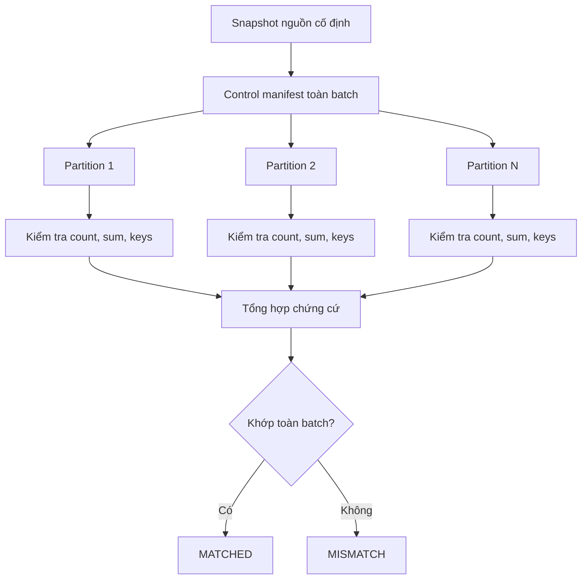
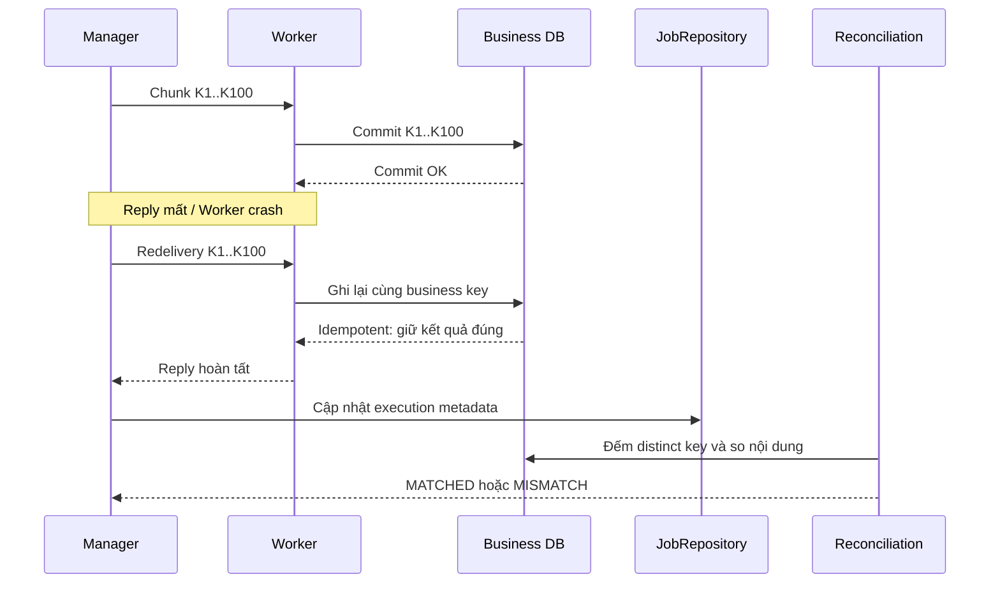
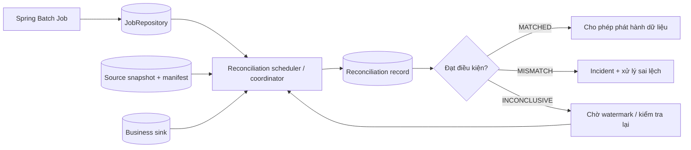

# Đối soát đầu vào đầu ra trong Spring Batch

> **Chương:** Vận hành  
> **Module:** `SPRING_BATCH_SCALING_OPERATIONS` — mở rộng Spring Batch cho workload dữ liệu lớn bằng multi-threaded step, parallel steps, partitioning và các mô hình phân tán; đo nút thắt, bảo đảm thread safety, retry/restart và lựa chọn kiến trúc theo tài nguyên thực tế.

## Mục tiêu học tập

Sau bài học, bạn có thể:

1. Phân biệt **job chạy thành công**, **số đếm của Spring Batch** và **kết quả nghiệp vụ đã đối soát thành công**.
2. Thiết kế tập đầu vào cố định, khóa nghiệp vụ, quy tắc lọc/skip và tập đầu ra để tìm record bị thiếu, thừa, trùng hoặc sai giá trị.
3. Xây dựng đối soát theo số lượng, tổng kiểm soát, khóa và nội dung, kể cả khi một item đầu vào tạo nhiều item đầu ra.
4. Tổng hợp dữ liệu từ multi-threaded step, remote chunking và remote partitioning mà không đếm đôi khi retry/restart.
5. Vận hành một chu trình đối soát có trạng thái, bằng chứng, cảnh báo và phương án xử lý chênh lệch rõ ràng.

## 1. Vì sao batch phải đối soát?

Giả sử một hệ thống thanh toán dùng Spring Batch nhập **10 triệu giao dịch**. Job kết thúc với `BatchStatus.COMPLETED`. Điều này cho biết luồng thực thi đã hoàn thành theo cấu hình của ứng dụng, nhưng chưa chứng minh 10 triệu giao dịch đã tạo **đúng 10 triệu kết quả nghiệp vụ**.

Một số lỗi có thể lọt qua kiểm tra status:

- Writer ghi thành công vào database rồi worker chết trước khi gửi acknowledgment; broker phát lại chunk và hệ thống có thể ghi trùng.
- Một partition không được cấp phát hoặc bị cấp phát hai lần do cấu hình range sai.
- Reader dùng truy vấn thiếu điều kiện lọc, bỏ sót bản ghi hoặc lặp bản ghi khi nguồn thay đổi trong lúc chạy.
- Skip/filter đã được cho phép nhưng không có danh sách giải thích record bị loại.
- Writer gọi API ngoài DB; request timeout xảy ra **sau khi** API đã thực hiện side effect.
- Một job tổng hợp thành công nhưng sai tổng tiền do làm tròn, khác tỷ giá hoặc xử lý nhầm kỳ dữ liệu.
- Dashboard chỉ đếm metric trong `StepExecution` và không đối chiếu bảng kết quả thực tế.

**Đối soát (reconciliation)** là quá trình kiểm tra độc lập rằng tập dữ liệu đầu ra tương ứng chính xác với **tập đầu vào có hiệu lực**, theo những quy tắc biến đổi, loại trừ, thời điểm và tính duy nhất đã xác định trước.

**Điểm mấu chốt:** trạng thái `COMPLETED` là một tín hiệu vận hành; trạng thái `RECONCILED` cần được hệ thống nghiệp vụ tự xác định bằng bằng chứng từ nguồn và đích.

### Ba lớp bằng chứng

| Lớp | Câu hỏi | Nguồn dữ liệu điển hình |
|---|---|---|
| **Thực thi** | Job/step đã chạy ra sao, có retry/skip/rollback không? | `JobRepository`, `JobExecution`, `StepExecution`, log |
| **Dữ liệu** | Những khóa và giá trị nào thực sự tồn tại ở nguồn/đích? | Snapshot nguồn, bảng kết quả, ledger, kiểm đếm độc lập |
| **Nghiệp vụ** | Kết quả có đúng quy tắc, kỳ xử lý và tổng kiểm soát không? | Quy tắc eligibility, reconciliation manifest, tổng tiền/đơn vị |

Thiếu một lớp có thể dẫn tới kết luận nhầm. Ví dụ, `writeCount=100000` không chứng minh đã có 100000 bản ghi duy nhất trong database; `COUNT(*)=100000` cũng không bảo đảm **đúng 100000 khóa** cần xử lý.

## 2. Xác định hợp đồng đối soát trước khi chạy

Một bài toán đối soát cần một **hợp đồng dữ liệu** đủ cụ thể để tính lại được vào hôm sau:

| Thành phần | Cần chốt rõ | Ví dụ |
|---|---|---|
| `batchId` / kỳ nghiệp vụ | Một lần xử lý logic thuộc tập nào? | `settlement-2026-11-26` |
| Cửa sổ đầu vào | Tính đến thời điểm nào và theo múi giờ nào? | `event_time` trong ngày D theo `Asia/Ho_Chi_Minh` |
| Snapshot / watermark | Cố định tập đầu vào khi nguồn tiếp tục ghi ra sao? | `snapshotId=S9824`, `sourceMaxLsn=...` |
| Khóa nghiệp vụ | Nhận diện một công việc logic qua retry/restart | `merchantId + transactionId` |
| Quy tắc biến đổi | Một input → một output, nhiều output hay tổng hợp? | Một giao dịch hợp lệ → một settlement row |
| Loại trừ được chấp thuận | Record filter/skip nào hợp lệ? | Hủy trước cutoff, mã lý do đã phê duyệt |
| Điều kiện kiểm soát | Đối chiếu count, sum, key set và nội dung nào? | `COUNT`, `SUM(amount)`, thiếu/thừa/trùng |
| Độ trễ nguồn/đích | Khi nào dữ liệu đủ ổn định để đối soát? | Sau khi CDC hoặc external sink đạt watermark |
| Chủ sở hữu và hành động | Ai xác nhận, xử lý sai lệch và mở lại job? | Job operator + data owner |

### 2.1. Chốt snapshot để tránh so sánh hai tập khác nhau

Nếu reader chạy một giờ trong khi bảng nguồn có thêm record, truy vấn `COUNT(*)` sau khi job kết thúc có thể lớn hơn dữ liệu reader thực sự nhìn thấy. Đó là **sai lệch phạm vi**, chưa chắc là lỗi của worker.

Các phương án thường gặp:

1. Chốt `snapshotId` ở upstream và lưu một bảng manifest/keys bất biến cho kỳ xử lý.
2. Sử dụng `batchId`, event-time cutoff và một high-water mark / CDC offset cố định; lưu cả quy tắc xử lý late event.
3. Dùng transaction snapshot hoặc snapshot database phù hợp, nhưng phải cân nhắc thời gian sống transaction và khả năng scale; không giữ transaction đọc dài hàng giờ chỉ để “khóa” dữ liệu.

Khi đối soát, **đọc lại cùng snapshot logic**, không dùng câu lệnh “đếm tất cả dữ liệu hiện tại” nếu đó là một tập khác. Lưu `snapshotId`, `batchId`, `cutoff`, phiên bản nghiệp vụ và fingerprint của manifest như bằng chứng, tránh lưu PII thô vào `JobParameters` hoặc log.

### 2.2. Định nghĩa tập hợp trước công thức

Với bài toán **một input tạo tối đa một output**, ký hiệu:

- `I`: tập **khóa đầu vào duy nhất** có trong snapshot đã khóa.
- `F`: tập khóa bị filter hợp lệ theo quy tắc nghiệp vụ.
- `S`: tập khóa bị skip hợp lệ **đã được phê duyệt** hoặc được phép loại trừ.
- `O`: tập khóa có đầu ra đã commit và hợp lệ.

Điều kiện mong muốn là:

```text
I = O union F union S
O intersect F = empty
O intersect S = empty
F intersect S = empty

|I| = |O| + |F| + |S|
```

Nhưng **đếm bằng nhau chưa đủ**: tập `O` có thể thừa một khóa sai và thiếu một khóa đúng, khiến tổng count không đổi. Phải kiểm tra chênh lệch theo **khóa**. Không đánh dấu `S` hợp lệ chỉ vì StepExecution có skip; phải biết những business key cụ thể và mã lý do nào đã được chấp nhận.

Nếu nghiệp vụ không chấp nhận skip, `S` phải rỗng. Nếu input có bản ghi trùng hợp lệ, cần định nghĩa business key và chiến lược dedup trước khi áp dụng công thức.

## 3. Đọc đúng các bộ đếm Spring Batch

Spring Batch lưu metadata theo `JobExecution` và `StepExecution`; các bộ đếm thường dùng:

| Thuộc tính `StepExecution` | Ý nghĩa thực hành | Giới hạn khi đối soát |
|---|---|---|
| `readCount` | Số item được reader đọc thành công theo step | Không tự bằng số hàng trong source snapshot |
| `writeCount` | Số item được writer xử lý thành công theo thống kê step | Không chứng minh số business row cuối cùng |
| `filterCount` | Số item processor loại bỏ, thường khi trả `null` | Không tự cung cấp tập business key đã filter |
| `readSkipCount` | Số skip khi đọc | Record bị bỏ qua có thể cần truy xuất từ nguồn lỗi để đối soát |
| `processSkipCount` | Số skip khi xử lý | Cần đối chiếu lý do và quyền cho phép skip |
| `writeSkipCount` | Số skip khi ghi | Có thể liên quan nhiều lần gọi writer/retry; phải kiểm tra cụ thể |
| `rollbackCount` | Số lần rollback step ghi nhận | Là chỉ báo lỗi/chi phí retry; không tương đương số record bị mất |
| `status`, `exitStatus` | Trạng thái và kết quả thực thi | Không thay thế đối soát nghiệp vụ |

**Không áp dụng công thức cứng** kiểu `readCount = writeCount + filterCount + skipCount` cho mọi job. Công thức có thể sai khi:

- Reader/processor/writer có hành vi khác một-vào-một, writer gọi API ngoài hệ thống hoặc sinh nhiều dòng từ một item.
- Read skip xảy ra **trước khi** có item hợp lệ; một số item đã retry/rollback.
- Có skip/retry theo transaction boundary hoặc retry có side effect ngoài transaction.
- Dữ liệu cuối cùng có thể bị cập nhật hoặc xóa sau khi batch ghi.

Sử dụng bộ đếm để **phát hiện bất thường và khoanh vùng**, rồi dùng nguồn/đích độc lập để xác nhận. Các metric phải gắn với **đúng `JobExecution` và StepExecution**; job restart có thể tạo `JobExecution` mới cho cùng `JobInstance`, nên cộng dồn các lần thực thi một cách máy móc sẽ đếm đôi.

### 3.1. Ba loại đếm cần phân biệt

```text
readCount       = item reader đọc thành công trong step execution
writeCount      = item worker/writer xử lý thành công theo thống kê step
business count  = số business key đã commit và còn tồn tại tại đích
```

Chúng có quan hệ với nhau nhưng **không luôn bằng nhau**. Khi một writer nhận 1 item và ghi 3 bảng, `writeCount` thường phản ánh item được đưa qua writer, không mặc định bằng tổng số dòng được ghi trên cả 3 bảng.

### 3.2. Vì sao count của một lần restart dễ đánh lừa?

Giả sử execution #101 ghi 600.000 dòng rồi lỗi; execution #102 restart và ghi 400.000 dòng còn lại. Sau cùng, nguồn/đích có đúng 1 triệu khóa. Nếu cộng không kiểm soát `readCount` hoặc các bộ đếm từ mọi execution, có thể thấy số lớn hơn 1 triệu do phần đã thử đọc lại hoặc do retry.

Đối soát chính phải dựa vào **business key và batch scope**; metadata theo execution được dùng để giải thích phần chênh lệch, thời gian và nguyên nhân.

## 4. Bốn tầng đối soát

Không có một phép kiểm tra duy nhất chứng minh đầy đủ tính đúng đắn. Nên triển khai theo tầng từ rẻ đến sâu:

| Tầng | Phép kiểm tra | Phát hiện | Giới hạn |
|---|---|---|---|
| 1. **Số lượng** | `COUNT(*)` theo batch và loại kết quả | Thiếu/thừa rõ rệt | Có thể có thiếu và thừa triệt tiêu |
| 2. **Control totals** | `SUM(amount)`, số debit/credit, tổng đơn vị | Sai lệch tài chính hoặc thuộc tính tổng | Các sai lệch đối nghịch có thể triệt tiêu |
| 3. **Tập business key** | Anti-join / set difference, duplicate check | Khóa thiếu, khóa lạ, xử lý hai lần | Chưa chứng minh giá trị mỗi khóa đúng |
| 4. **Nội dung** | Join theo key, so sánh giá trị chuẩn hóa | Sai số tiền, trạng thái, rule version | Phải thống nhất quy tắc transform |

Với hệ thống tài chính hoặc quyền lợi người dùng, chỉ kiểm tra count thường không đủ. Lưu trạng thái tổng thể `MATCHED` khi **toàn bộ kiểm tra bắt buộc** đã đạt.

### 4.1. Trường hợp một input tạo nhiều output

Ví dụ một giao dịch gốc tạo 3 dòng hạch toán (debit, credit, phí). Khi đó `|I|=|O|` không còn đúng. Định nghĩa:

```text
Mỗi giao dịch hợp lệ phải sinh đúng:
  1 debit leg + 1 credit leg + 1 fee leg (nếu fee áp dụng)
Với từng transaction_id:
  SUM(ledger_line.amount_signed) = 0  (nếu nguyên tắc ghi sổ yêu cầu)
Không có transaction_id ở đầu ra ngoài tập source đã chốt.
```

Đối soát cần kiểm tra **số line theo loại**, quan hệ cha-con và tính cân bằng theo từng transaction. Tổng tiền global bằng 0 có thể vẫn che giấu một giao dịch lệch +100 và giao dịch khác lệch -100.

### 4.2. Trường hợp nhiều input tạo một output

Ví dụ tổng hợp 1 triệu giao dịch theo `merchant_id + settlement_date`. Đối soát theo **nhóm** và quy tắc:

```text
SUM(source.amount WHERE eligible, grouped by merchant/date)
  = output.net_amount + adjustments_defined_by_business_rule
```

Đừng so sánh row count của hai bảng nếu đầu ra đã được aggregate; hãy kiểm tra đúng **cardinality và hàm biến đổi**.

## 5. Ví dụ SQL đối soát đầu vào và đầu ra

Ví dụ dùng **PostgreSQL** và giả định nghiệp vụ một-vào-một: một record đã chốt đầu vào hoặc có đúng một output cùng amount, hoặc nằm trong bảng loại trừ được duyệt. Các bảng dưới đây là **bảng nghiệp vụ minh họa**, không phải bảng metadata mặc định của Spring Batch.

### 5.1. Cấu trúc dữ liệu kiểm soát

```sql
CREATE TABLE recon_input (
    batch_id         TEXT NOT NULL,
    work_key         UUID NOT NULL,
    expected_amount  NUMERIC(18, 2) NOT NULL,
    source_partition INT NOT NULL,
    PRIMARY KEY (batch_id, work_key)
);

CREATE TABLE recon_output (
    batch_id        TEXT NOT NULL,
    work_key        UUID NOT NULL,
    actual_amount   NUMERIC(18, 2) NOT NULL,
    applied_version INT NOT NULL,
    PRIMARY KEY (batch_id, work_key)
);

CREATE TABLE recon_exception (
    batch_id       TEXT NOT NULL,
    work_key       UUID NOT NULL,
    reason_code    TEXT NOT NULL,
    approved       BOOLEAN NOT NULL DEFAULT FALSE,
    PRIMARY KEY (batch_id, work_key)
);
```

Ràng buộc `PRIMARY KEY (batch_id, work_key)` ở bảng output giúp chặn **hai dòng cho cùng công việc logic** và hỗ trợ retry an toàn. Nếu writer cố ghi lại một key, ứng dụng phải phân biệt “cùng kết quả” với “xung đột giá trị”; không tự ý bỏ qua `DuplicateKeyException` trong mọi trường hợp.

### 5.2. Đối soát số lượng và tổng tiền

```sql
-- Snapshot nguồn đã chốt
SELECT COUNT(*) AS source_rows,
       COALESCE(SUM(expected_amount), 0) AS source_amount
FROM recon_input
WHERE batch_id = :batch_id;

-- Kết quả đã lưu
SELECT COUNT(*) AS output_rows,
       COALESCE(SUM(actual_amount), 0) AS output_amount
FROM recon_output
WHERE batch_id = :batch_id;

-- Các khóa được loại trừ hợp lệ
SELECT COUNT(*) AS approved_exception_rows
FROM recon_exception
WHERE batch_id = :batch_id AND approved = TRUE;
```

Nếu có exception hợp lệ, cần trừ **tổng tiền của chính những input bị loại trừ**, không lấy `source_amount - output_amount = 0` làm tiêu chí cứng. Ví dụ:

```sql
SELECT COALESCE(SUM(s.expected_amount), 0) AS approved_excluded_amount
FROM recon_input s
JOIN recon_exception e
  ON e.batch_id = s.batch_id
 AND e.work_key = s.work_key
WHERE s.batch_id = :batch_id
  AND e.approved = TRUE;
```

Với nghiệp vụ giữ nguyên số tiền, kỳ vọng:

```text
source_rows   = output_rows + approved_exception_rows
source_amount = output_amount + approved_excluded_amount
```

Hai phương trình này chỉ hợp lệ sau khi xác nhận **exception là một tập con của source và không trùng với output**, và khi không có phép biến đổi số tiền. Để kiểm tra điều đó, dùng truy vấn theo khóa ngay dưới đây.

### 5.3. Tìm input thiếu output hoặc exception hợp lệ

```sql
SELECT s.work_key
FROM recon_input s
LEFT JOIN recon_output o
  ON o.batch_id = s.batch_id
 AND o.work_key = s.work_key
LEFT JOIN recon_exception e
  ON e.batch_id = s.batch_id
 AND e.work_key = s.work_key
 AND e.approved = TRUE
WHERE s.batch_id = :batch_id
  AND o.work_key IS NULL
  AND e.work_key IS NULL
ORDER BY s.work_key;
```

Mỗi dòng trả về là **input chưa được giải thích**: chưa có output và chưa có exception được duyệt. Trong production, dùng `COUNT` hoặc paging để tránh tải toàn bộ danh sách hàng triệu khóa vào bộ nhớ.

### 5.4. Tìm output không thuộc input đã chốt

```sql
SELECT o.work_key
FROM recon_output o
LEFT JOIN recon_input s
  ON s.batch_id = o.batch_id
 AND s.work_key = o.work_key
WHERE o.batch_id = :batch_id
  AND s.work_key IS NULL
ORDER BY o.work_key;
```

Nếu có output thừa, cần kiểm tra **sai batchId, đọc nhầm kỳ, side effect từ job trước hoặc xử lý lại không đúng khóa**.

### 5.5. Tìm khóa vừa có output vừa bị loại trừ

```sql
SELECT o.work_key
FROM recon_output o
JOIN recon_exception e
  ON e.batch_id = o.batch_id
 AND e.work_key = o.work_key
WHERE o.batch_id = :batch_id
  AND e.approved = TRUE;
```

Một khóa vừa có output vừa được tính là “đã loại trừ” có thể khiến phương trình count nhìn đúng dù ý nghĩa nghiệp vụ sai.

### 5.6. Tìm giá trị sai theo khóa

```sql
SELECT s.work_key,
       s.expected_amount,
       o.actual_amount
FROM recon_input s
JOIN recon_output o
  ON o.batch_id = s.batch_id
 AND o.work_key = s.work_key
WHERE s.batch_id = :batch_id
  AND s.expected_amount IS DISTINCT FROM o.actual_amount;
```

Trong ví dụ này tiền dùng `NUMERIC(18,2)`, giúp so sánh theo mức chính xác định trước. Với tiền tệ, phải quy định rõ **currency, scale, quy tắc rounding, timezone, ngoại lệ tỷ giá/chiết khấu**. Tránh dùng `FLOAT/DOUBLE` và so sánh bằng tuyệt đối cho giá trị tài chính.

### 5.7. Kiểm tra exception bất hợp lệ

```sql
-- Exception chưa được duyệt hoặc không có input tương ứng.
SELECT e.work_key, e.reason_code, e.approved
FROM recon_exception e
LEFT JOIN recon_input s
  ON s.batch_id = e.batch_id
 AND s.work_key = e.work_key
WHERE e.batch_id = :batch_id
  AND (e.approved = FALSE OR s.work_key IS NULL);
```

Không xem tất cả bản ghi trong bảng exception là hợp lệ chỉ vì có lý do dạng chuỗi. Cần danh mục reason code, điều kiện phê duyệt và chính sách tái xử lý rõ ràng.

### 5.8. Phát hiện duplicate ở sink không có ràng buộc

Với bảng đích legacy chưa có unique constraint hoặc với staging nhận dữ liệu thô, kiểm tra:

```sql
SELECT batch_id, work_key, COUNT(*) AS copies
FROM legacy_output_without_unique_key
WHERE batch_id = :batch_id
GROUP BY batch_id, work_key
HAVING COUNT(*) > 1;
```

`legacy_output_without_unique_key` là **tên bảng giả định**, thay bằng bảng thực tế. Với bảng `recon_output` có primary key ở trên, duplicate row theo đúng khóa đã bị database chặn; vẫn phải kiểm tra xem doanh nghiệp có thể ghi trùng dưới **những khóa khác nhau** hay không.

## 6. Manifest kiểm soát và đối soát theo partition

Với dữ liệu lớn, việc quét toàn bộ bảng sau mỗi retry có thể tốn tài nguyên. Một thiết kế thường dùng là **control manifest** bất biến theo `batchId + partitionKey`, được tạo từ nguồn trước khi xử lý.

Ví dụ cấu trúc logic:

```json
{
  "batchId": "settlement-2026-11-26",
  "snapshotId": "snapshot-9824",
  "partitionKey": "range-010",
  "ruleVersion": 3,
  "sourceCount": 125000,
  "sourceAmount": "4852109301.00",
  "expectedOutputType": "one-to-one",
  "manifestHash": "sha256-of-canonical-manifest"
}
```

`manifestHash` trong ví dụ là **mô tả**; giá trị thực phải tính từ biểu diễn canonical đã xác định (thứ tự, kiểu dữ liệu, encoding, delimiter, null, quy tắc chuẩn hóa). Chỉ lưu hash nếu có thể tái tạo độc lập từ cùng snapshot. **Hash tổng hợp không thay thế** kiểm tra key set và giá trị; các phép XOR/checksum tự chế có thể che giấu lỗi.

### 6.1. Tách phạm vi partition

Với remote partitioning, đảm bảo các partition:

- **Phủ đủ** tập khóa trong snapshot, không có khoảng trống.
- **Không giao nhau** về business key, trừ khi thuật toán chủ đích cho phép lặp và writer xử lý idempotent.
- Có tên/ID partition ổn định qua retry/restart.
- Có kết quả control total theo partition, sau đó cộng để so với tổng manifest toàn batch.



Vì một partition có thể được retry, bản đối soát nên được xác định theo **business partition key + batchId + snapshotId**, không theo mỗi lần worker khởi chạy. Nếu cộng tất cả bản ghi kiểm soát của mọi `StepExecution` được restart, kết quả dễ bị đếm hai lần.

### 6.2. Trường hợp partition skew

Nếu partition 1 chứa 90% giao dịch giá trị cao, trong khi partition khác chỉ có ít dữ liệu, đếm số partition hoàn thành không nói lên tiến độ nghiệp vụ. Quan sát thêm input count, output count, tổng tiền và latency theo partition. Có thể cần thay `gridSize`, partitioning strategy hoặc connection pool, nhưng thay đổi phải giữ nguyên quy tắc phân vùng khóa và restart.

## 7. Reconciliation trong các mô hình scaling

### 7.1. Multi-threaded step

Các thread dùng chung cấu hình step nhưng reader/writer có thể không thread-safe tùy implementation. Khi record bị đọc trùng do truy cập reader không an toàn, `writeCount` không đủ để giải thích vì sao dữ liệu đích sai.

Khuyến nghị: dùng reader/writer phù hợp cho concurrent execution, thiết kế khóa/idempotency ở đích và đối soát theo **business key**, không giả định thứ tự ghi bằng thứ tự đọc. Khi dùng paging reader, cân nhắc tác động khi tập nguồn bị thay đổi trong lúc phân trang.

### 7.2. Parallel steps

Nhiều step có thể xử lý các dataset khác nhau hoặc các giai đoạn phụ thuộc nhau. Đặt **hợp đồng đối soát cho từng luồng dữ liệu**, rồi mới đối soát tổng kết. Không cộng `writeCount` của hai step nếu step thứ hai chỉ biến đổi lại kết quả step thứ nhất — như vậy sẽ đếm cùng một dữ liệu logic hai lần.

### 7.3. Remote chunking

Manager đọc item và phát `ChunkRequest`; worker xử lý/ghi rồi gửi `ChunkResponse`. Các tình huống cần phân biệt:

1. Worker chưa ghi, message bị giao lại: xử lý lại là bình thường.
2. Worker đã commit dữ liệu nhưng reply mất: manager có thể thấy request chưa hoàn tất dù kết quả đã tồn tại.
3. Manager restart và phát lại một phần dữ liệu: writer có thể gặp trùng business key.

**Bằng chứng chính** là kết quả thực tế trong sink với khóa idempotent, không chỉ `ChunkResponse` hay số message ack. Đối soát cả request và reply backlog, DLQ và trạng thái `JobRepository`; dùng control manifest để xác định tập dữ liệu mong đợi.

### 7.4. Remote partitioning

Manager phân phối partition; worker chạy một step trên từng partition với metadata step tương ứng. Đối soát:

- Kết quả của **mỗi partition logic** so với tập khóa nguồn được gán cho partition đó.
- Trạng thái `StepExecution` của các partition và các trường hợp bị restart.
- Tập kết quả toàn job theo `batchId`, không cộng nhầm số lần thử của cùng partition.

Trong cấu hình có manager step và worker steps, cần hiểu step nào chứa số đo thực tế; không cộng mù quáng bộ đếm manager với bộ đếm của worker.

### 7.5. Side effect ngoài transaction

Nếu writer gửi HTTP request hoặc message tới hệ thống khác, `COMPLETED` và `writeCount` chưa chắc chứng minh bên nhận đã commit. Cần một trong các cách:

- Downstream cung cấp receipt/ack có `operationKey` để tra cứu trạng thái.
- Outbox và consumer có idempotency key, trạng thái gửi và xác nhận.
- Đối soát độc lập tại phía đích hoặc dịch vụ xác nhận, có watermark để chờ eventual consistency.

Không tự động phát lại mọi request chỉ vì chưa nhận reply: cần xác minh side effect trước đó có thể đã thành công.

## 8. Retry/restart và nguyên tắc không đếm đôi

Giả sử `batchId=B42` có 1.000.000 khóa. Lần chạy đầu ghi 700.000 khóa, sau đó worker lỗi. Khi restart, reader có thể đọc lại một số item hoặc partition chạy lại; đầu ra cuối cùng vẫn phải có **1.000.000 khóa duy nhất và đúng giá trị**.



**Chọn idempotency key theo nghiệp vụ**, ví dụ `batchId + transactionId + operationType` nếu mỗi operation trong batch có đúng một kết quả. Không chỉ dùng `JobExecutionId`, vì một `JobInstance` restart có thể tạo execution mới và làm khóa chống trùng thay đổi.

### Ma trận kết quả sau retry

| Hiện tượng | Cần kiểm tra | Hành động |
|---|---|---|
| Count trùng nhưng tổng tiền đúng | Khóa thừa/thiếu bù nhau | Anti-join từng phía, diff theo key |
| Count thừa sau redelivery | Duplicate business key hoặc sai idempotency | Chặn ghi trùng, xác định item liên quan và sửa dữ liệu |
| Count thiếu, còn partition `STARTED` | Worker/manager có thể đang xử lý | Chờ trạng thái cuối, không kết luận sớm |
| Count thiếu, job đã `COMPLETED` | Filter/skip ngoài dự kiến hoặc bỏ sót input | Xem reason code, reader ranges, checkpoint |
| Count khớp nhưng amount lệch | Lỗi transform, rounding, currency, rule version | Diff theo key và version, đối soát lại theo business rule |
| Sink có dữ liệu nhưng metadata lỗi | Commit và metadata/reply không cùng transaction | Không xóa kết quả rồi chạy lại ngay; kiểm tra và phục hồi có idempotency |

## 9. Tổ chức đối soát như một bước vận hành độc lập

Nên có **trạng thái đối soát riêng** thay vì dựa hoàn toàn vào trạng thái Spring Batch:

```text
PENDING -> RUNNING -> MATCHED
                   -> MISMATCH -> INVESTIGATING -> RESOLVED -> MATCHED
                   -> INCONCLUSIVE -> RUNNING
```

- `PENDING`: job hoặc dữ liệu đích chưa đạt điều kiện bắt đầu đối soát.
- `RUNNING`: đang kiểm tra cùng snapshot và rule version đã chốt.
- `MATCHED`: mọi kiểm soát bắt buộc đã đạt, không còn ngoại lệ chưa được phê duyệt.
- `MISMATCH`: có bằng chứng sai lệch dữ liệu cần xử lý.
- `INCONCLUSIVE`: chưa đủ dữ liệu để kết luận, ví dụ downstream còn lag.
- `INVESTIGATING` / `RESOLVED`: trạng thái quy trình xử lý chênh lệch do ứng dụng đặt ra.

Đây là các trạng thái **nghiệp vụ do hệ thống tự định nghĩa**, không phải giá trị `BatchStatus` chuẩn của Spring Batch.

### 9.1. Bảng lưu bằng chứng đối soát

```sql
CREATE TABLE batch_reconciliation (
    batch_id            TEXT PRIMARY KEY,
    job_instance_id     BIGINT,
    latest_execution_id BIGINT,
    snapshot_id         TEXT NOT NULL,
    rule_version        INTEGER NOT NULL,
    expected_count      BIGINT,
    actual_count        BIGINT,
    expected_total      NUMERIC(28,2),
    actual_total        NUMERIC(28,2),
    missing_count       BIGINT,
    extra_count         BIGINT,
    mismatched_count    BIGINT,
    state               TEXT NOT NULL,
    checked_at          TIMESTAMPTZ,
    evidence_uri        TEXT
);
```

`evidence_uri` nên trỏ tới báo cáo được phân quyền chứa danh sách **business key đã được bảo vệ**, không gửi số giấy tờ, email, thông tin cá nhân vào metric hoặc dashboard chung. Các trường expected/actual chỉ nên cập nhật sau khi đã gắn đúng snapshot và bộ quy tắc.

### 9.2. Tách scheduler đối soát khỏi xử lý chunk

Có thể gắn `JobExecutionListener.afterJob` để phát tín hiệu kích hoạt đối soát, nhưng không nên đặt một phép quét hàng triệu dòng trực tiếp vào listener rồi mặc nhiên xem nó là transaction với toàn bộ job. Listener có thể chạy lại hoặc lỗi trong khoảng ranh giới giữa job hoàn thành và ghi trạng thái đối soát.

Một kiến trúc bền vững hơn:



Coordinator chọn job hoặc batch có đầu ra đã ổn định, tạo/chạy đối soát **idempotent** theo `batchId + snapshotId + ruleVersion` và lưu bằng chứng. Có thể định kỳ quét các job chưa đối soát để tránh mất tín hiệu khi listener lỗi. Chỉ cho phép publish báo cáo, đóng sổ hoặc kích hoạt bước phụ thuộc sau khi đạt tiêu chí nghiệp vụ.

### 9.3. Ví dụ pseudocode của coordinator

```java
void reconcileBatch(BatchScope scope) {
    // BatchScope: batchId, snapshotId, ruleVersion, cutoff, expectedSinkWatermark.
    JobState job = jobRepositoryView.readLogicalBatchState(scope.batchId());
    if (!job.isTerminalAndEligibleForReconciliation()) {
        reconciliationStore.markPending(scope);
        return;
    }

    if (!sinkWatermarkService.hasReached(scope.expectedSinkWatermark())) {
        reconciliationStore.markInconclusive(scope, "SINK_LAG");
        return;
    }

    // Một lease/idempotent claim ngăn hai coordinator kiểm tra cùng scope.
    if (!reconciliationStore.tryClaim(scope)) {
        return;
    }

    ControlTotals expected = manifestRepository.read(scope);
    ControlTotals actual = sinkRepository.aggregate(scope);
    KeyDifferences differences = diffService.compareExactKeys(scope);

    ReconciliationEvidence evidence =
            decisionService.evaluate(expected, actual, differences);
    reconciliationStore.complete(scope, evidence);
}
```

Đoạn trên là **pseudocode kiến trúc**, các interface chưa phải API Spring Batch có sẵn. Tính nhất quán giữa `tryClaim`, `complete` và khả năng scheduler chết phải được thiết kế bằng transaction/lease timeout phù hợp. Nếu job có thể `COMPLETED` nhưng business sink vẫn eventual-consistent, cần đợi **watermark phía sink**, không sử dụng sleep cố định để đoán.

## 10. Runbook đối soát hàng ngày

### Pha A — Trước khi chạy job

1. Chốt `batchId`, cutoff, timezone, snapshot và quy tắc biến đổi.
2. Sinh manifest đầu vào với số lượng, tổng kiểm soát, phạm vi partition và phiên bản quy tắc.
3. Xác minh nguồn không có key trùng ngoài thiết kế; kiểm tra quyền truy cập và tính khả dụng của manifest.
4. Gắn `batchId` làm định danh nghiệp vụ ổn định trong log/metadata; cấu hình retry, skip, idempotent writer và ranh giới transaction.

### Pha B — Khi xử lý

Quan sát step status, `readCount`, `writeCount`, `filterCount`, các skip count, `rollbackCount`, throughput, active partitions, queue backlog và DB connection pool. Ghi nhận bản ghi lỗi theo **mã lý do + business key được bảo vệ**, không copy PII thô vào log.

Với remote chunking, theo dõi request chưa reply, redelivery và DLQ; với remote partitioning, theo dõi tiến độ từng partition và tránh cộng đúp khi partition retry.

### Pha C — Sau khi job xử lý xong

1. Kiểm tra các step/execution đã đạt trạng thái cuối hợp lệ, không còn job chạy âm thầm.
2. Chờ watermark/snapshot phía sink, hoặc điều kiện tương đương chứng minh dữ liệu có thể đọc nhất quán.
3. Chạy kiểm tra count và control totals theo batch/partition.
4. Tính missing, extra, overlap exception và mismatch value theo **khóa chính xác**.
5. Phân loại tất cả skip/filter; xác nhận chỉ có ngoại lệ được cho phép.
6. Lưu kết quả, bằng chứng, phiên bản rule, thời gian kiểm tra, người duyệt hoặc tự động duyệt theo chính sách.
7. Chỉ mở bước phụ thuộc khi đạt `MATCHED`; nếu `MISMATCH`, phát cảnh báo và chuyển vào quy trình điều tra.

### Pha D — Khi phát hiện mismatch

Đừng xóa bảng đích hay chạy lại toàn job ngay. Cần xác định:

- Chênh lệch nằm ở **tập nguồn**, quá trình reader, processor/filter, writer hay downstream sink?
- Có record đến muộn, khác snapshot/cutoff, vùng dữ liệu bị phân vùng thiếu hoặc overlap không?
- Có redelivery sau commit, metadata ghi trễ hoặc retry với khóa không ổn định không?
- Mismatch là **dữ liệu sai thật** hay vì data sink chưa đạt watermark?
- Đã có side effect ngoài database cần kiểm tra/compensate chưa?

Sau khi xác định root cause, chọn **restart hợp lệ**, replay có idempotency cho tập thiếu, sửa dữ liệu được phê duyệt hoặc phát hành adjustment riêng. Mỗi lần remediation phải lưu dấu vết, sau đó **đối soát lại toàn bộ điều kiện bắt buộc**, không chỉ kiểm tra “số lượng đã khớp”.

## 11. Ví dụ vận hành: settlement 8 triệu giao dịch

Đội dữ liệu xử lý 8.000.000 giao dịch theo ngày nghiệp vụ D bằng remote partitioning; mỗi giao dịch hợp lệ tạo một kết quả settlement. Snapshot đã chốt chứa các số liệu:

| Chỉ số của snapshot | Giá trị minh họa |
|---|---:|
| Input keys duy nhất | 8.000.000 |
| Filter hợp lệ (hủy trước cutoff) | 20.000 |
| Skip được phê duyệt | 500 |
| Output dự kiến | 7.979.500 |

Sau khi worker hoàn tất, bảng đích có **7.979.500 dòng**. Nhìn count thì khớp. Nhưng đối soát khóa phát hiện:

- 3 giao dịch hợp lệ **bị thiếu** đầu ra.
- 3 kết quả **không thuộc snapshot** (được gán nhầm batch).
- 2 giao dịch có `actual_amount` khác `expected_amount`.

Đây là **MISMATCH** dù count tổng bằng nhau. Việc đầu tiên là giữ nguyên snapshot và báo cáo chênh lệch; kiểm tra log/partition và sửa chính xác 8 trường hợp theo quyền được phê duyệt. Cần soát cả lỗi gốc nếu các sai lệch có quan hệ chung. Sau remediation, chạy lại tất cả kiểm tra: count, key set, value mismatch, approved exception và totals.

### Khác biệt giữa restart và đối soát

`JobOperator.restart(...)` hoặc cơ chế restart tương đương phục hồi công việc Batch theo metadata và `ExecutionContext`; nó không tự biết 3 output thừa nằm trong bảng đích. Ngược lại, reconciliation tìm thấy dữ liệu sai nhưng không tự quyết định được xử lý nghiệp vụ nào là an toàn. Cả **restart** lẫn **reconciliation** đều cần hợp đồng rõ ràng và quyền vận hành thích hợp.

## 12. Tối ưu đối soát cho dữ liệu lớn

Đối soát đầy đủ có thể ngốn CPU, I/O và connection pool. Khi chạy song song nhiều step/worker, một truy vấn diff toàn bảng có thể gây contention với chính job đang ghi.

### Hướng tối ưu

- **Partition-aware verification:** đối soát theo partition key hoặc dải khóa, sau đó tổng hợp; vẫn chạy kiểm tra phạm vi và không overlap.
- **Index phù hợp:** ví dụ `(batch_id, work_key)` ở nguồn/đích; query plan cần xác minh bằng workload thực.
- **Incremental control totals:** cập nhật manifest/result counters theo transaction hoặc sự kiện đã commit, nhưng không dùng counter đã retry nhiều lần làm nguồn chân lý nếu không idempotent.
- **Streaming/paging diff:** lấy từng trang khóa thiếu/thừa để tránh tạo một object list hàng triệu item trong RAM.
- **Tối ưu thời điểm:** chạy kiểm tra sâu sau khi write load giảm, dùng read replica nếu đảm bảo consistency/watermark.
- **Kiểm tra theo tầng:** count/sum trước, rồi key/value diff; đối với dữ liệu trọng yếu, không bỏ qua diff chính xác chỉ vì totals trùng.
- **Chỉ số độ lệch:** theo dõi runtime đối soát, số khóa mismatch, tỷ lệ retry, độ trễ sink và tốc độ hoàn tất partition để dự báo SLA.

### Điều không nên tối ưu bỏ đi

Không nên thay kiểm tra toàn bộ khóa bằng **lấy mẫu** trong các luồng yêu cầu tính đầy đủ hoặc giao dịch tài chính; lấy mẫu chỉ phát hiện lỗi với một xác suất nhất định. Không sử dụng một hash tổng cộng làm bằng chứng duy nhất vì collision/chuẩn hóa sai và đối xứng tổng có thể che giấu chênh lệch. Không thêm business key vào Prometheus label, vì cardinality rất cao và có nguy cơ lộ dữ liệu liên kết cá nhân.

## 13. Cảnh báo, SLO và bằng chứng audit

Một job có thể xử lý nhanh nhưng đối soát chậm hơn SLA. Cần giám sát cả **thời gian có kết quả đáng tin cậy**.

| Chỉ số vận hành | Ý nghĩa |
|---|---|
| `batch_reconciliation_state` | Trạng thái đối soát theo job type/batch class |
| `reconciliation_duration_seconds` | Thời gian từ bắt đầu đối soát đến kết luận |
| `reconciliation_missing_count` | Số input chưa được giải thích |
| `reconciliation_extra_count` | Số output nằm ngoài snapshot |
| `reconciliation_value_mismatch_count` | Số khóa có giá trị sai |
| `reconciliation_unapproved_skip_count` | Số skip chưa được chấp thuận |
| `batch_end_to_reconciled_seconds` | Thời gian từ job hoàn thành tới dữ liệu sẵn sàng sử dụng |
| `downstream_sink_lag_seconds` | Độ trễ khiến trạng thái `INCONCLUSIVE` kéo dài |

Ví dụ ngưỡng **minh họa**, phải điều chỉnh theo SLO thực tế: kết quả settlement chỉ được phát hành nếu `missing=extra=valueMismatch=unapprovedSkip=0`, các control totals khớp và đối soát đạt `MATCHED` trước 06:00 giờ nghiệp vụ. Nếu quá hạn, cần phát cảnh báo cho người chịu trách nhiệm, không tự đổi từ `INCONCLUSIVE` thành `MATCHED`.

Bản ghi audit nên lưu phạm vi snapshot, phiên bản quy tắc, truy vấn/phiên bản công cụ tính toán, thời gian, tổng số lỗi, đường dẫn bằng chứng có ACL và quyết định xử lý. Giới hạn PII trong log, metric và chứng cứ; danh sách khóa chi tiết cần phân quyền truy cập và retention phù hợp.

## 14. Kiểm thử chiến lược đối soát

Một bộ kiểm thử có ý nghĩa cần **cố tình tạo ra các sai lệch** mà phép kiểm tra đơn giản có thể bỏ sót:

| Kịch bản | Kỳ vọng |
|---|---|
| Input 1.000 khóa, output đúng 1.000 khóa và giá trị | `MATCHED` |
| Output thiếu một khóa, thừa một khóa khác (count không đổi) | `MISMATCH` vì key set |
| Count và key set khớp nhưng amount của hai khóa sai ngược chiều | `MISMATCH` vì value diff |
| Một khóa vừa ở output vừa ở exception approved | `MISMATCH` vì tập giao nhau |
| Có skip không được duyệt | `MISMATCH` và cần xử lý nguyên nhân |
| Worker chết sau commit, trước reply rồi chunk được phát lại | Không phát sinh duplicate hoặc side effect sai |
| Partition đầu và cuối có ranh giới overlap/gap | Đối soát partition coverage phát hiện |
| Job restart qua nhiều `JobExecution` | Đếm theo business key, không cộng trùng lần thử |
| Sink eventual-consistent chưa đạt watermark | `INCONCLUSIVE`, kiểm tra lại khi đủ bằng chứng |
| Một giao dịch tạo 3 ledger line | Kiểm tra đúng số line và cân bằng theo từng transaction |
| Reader đọc trong lúc nguồn phát sinh late records | So sánh đúng snapshot/cutoff đã chốt |
| Bulk reconciliation chạy trên dữ liệu lớn | Không làm cạn connection pool hoặc vượt SLA |

Trên môi trường test, nên seed một bộ dữ liệu nhỏ có kết quả độc lập đã biết trước, rồi gây crash/retry tại điểm giữa commit và reply. Nếu chỉ kiểm tra rằng code đối soát chạy không ném exception, test chưa chứng minh khả năng **phát hiện dữ liệu sai**.

## 15. Checklist dành cho người vận hành

- [ ] `batchId`, cutoff, snapshot và rule version đã được chốt và tái tạo được.
- [ ] Đã định nghĩa business key và quan hệ input/output (1:1, 1:N hay N:1).
- [ ] Manifest đầu vào có control totals và phạm vi partition rõ ràng.
- [ ] Filter/skip có business key, reason code và chính sách phê duyệt.
- [ ] Writer hoặc hệ thống đích có cơ chế idempotent và chống ghi trùng.
- [ ] Các bộ đếm `StepExecution` được dùng để chẩn đoán, không thay thế chứng cứ từ sink.
- [ ] Đã xét retry, restart, remote chunk reply và side effect ngoài transaction.
- [ ] Có kiểm tra missing, extra, overlap, duplicate và value mismatch theo khóa.
- [ ] Đã đợi sink đạt watermark/consistency trước khi kết luận.
- [ ] Kết quả đối soát có trạng thái, bằng chứng, cảnh báo và cách chạy lại idempotent.
- [ ] Chỉ cho phép phát hành dữ liệu khi các quy tắc kiểm soát bắt buộc đạt.
- [ ] Đã đo hiệu năng đối soát và kiểm soát quyền truy cập báo cáo chi tiết.

## 16. Câu hỏi tự kiểm tra

**Câu 1.** Job có `BatchStatus.COMPLETED`, `readCount=100000`, `writeCount=100000`. Có được tuyên bố dữ liệu đã đối soát không?

*Gợi ý:* Chưa. Phải so sánh cùng snapshot nguồn và dữ liệu đích theo business key, tổng kiểm soát, quy tắc biến đổi và tập ngoại lệ hợp lệ.

**Câu 2.** Số dòng nguồn và đích đều là 1.000, tổng số tiền cũng bằng nhau. Điều gì vẫn có thể sai?

*Gợi ý:* Một khóa đúng bị thiếu và một khóa sai bị thừa; hai giao dịch có amount lệch đối nghịch; output thuộc sai batch; dữ liệu bị ghi trùng dưới khóa khác. Cần diff theo khóa và giá trị.

**Câu 3.** Vì sao cộng `writeCount` của mọi `StepExecution` trong các lần restart có thể sai?

*Gợi ý:* Một item/partition có thể được đọc, xử lý hoặc thử ghi lại; `JobExecution` mới không có nghĩa là business input mới. Phải dedup theo nghiệp vụ.

**Câu 4.** Nếu sink là dịch vụ bên ngoài trả lời sau vài phút, có thể đối soát ngay khi Spring Batch step kết thúc không?

*Gợi ý:* Chỉ khi có bằng chứng sink đã commit và có thể đọc nhất quán. Nếu chưa, đánh dấu `INCONCLUSIVE`, đợi watermark/receipt rồi kiểm tra lại.

**Câu 5.** Với một giao dịch sinh 3 dòng ledger, công thức `sourceRows=outputRows` có đúng không?

*Gợi ý:* Không. Đối soát theo cardinality và các bất biến kế toán được định nghĩa, ví dụ mỗi loại line phải tồn tại và tổng số tiền signed cân bằng theo từng giao dịch.

## Kết luận

Đối soát đầu vào đầu ra là **chốt kiểm chứng nghiệp vụ** khi mở rộng Spring Batch: dữ liệu có thể được xử lý trên nhiều thread, partition hoặc worker và có thể retry/restart, nhưng kết quả cuối cùng vẫn phải đúng theo **cùng snapshot, cùng business key và cùng phiên bản quy tắc**. Dùng metadata Batch để quan sát quá trình; dùng manifest nguồn và kết quả đích để chứng minh tính đầy đủ, duy nhất và chính xác. Một runbook có trạng thái `MATCHED`/`MISMATCH`/`INCONCLUSIVE`, kiểm tra theo khóa và quy trình xử lý chênh lệch sẽ giúp vận hành workload lớn mà không đánh đổi tính đúng đắn của dữ liệu.
