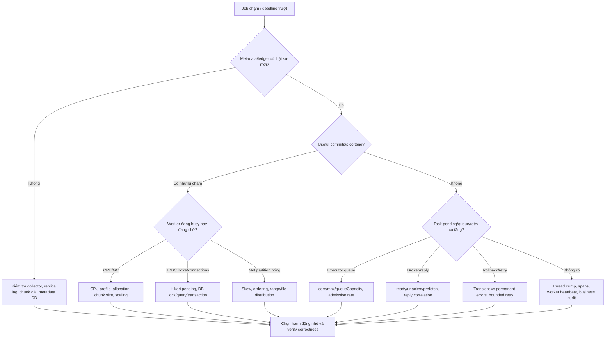
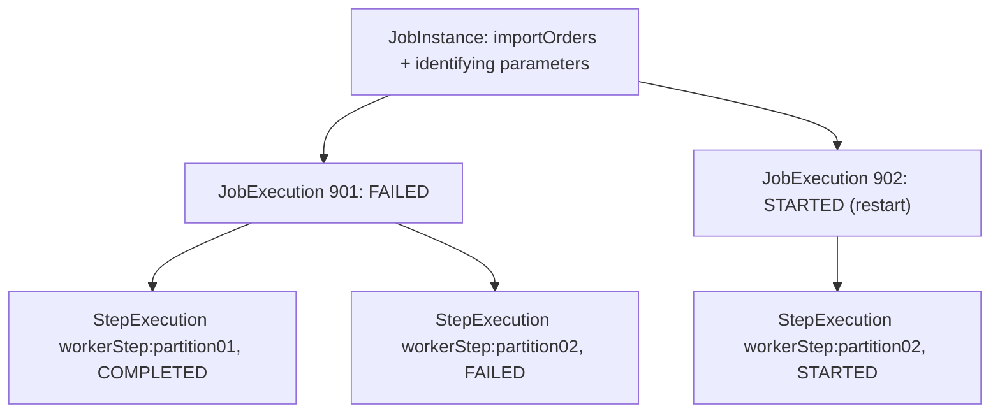
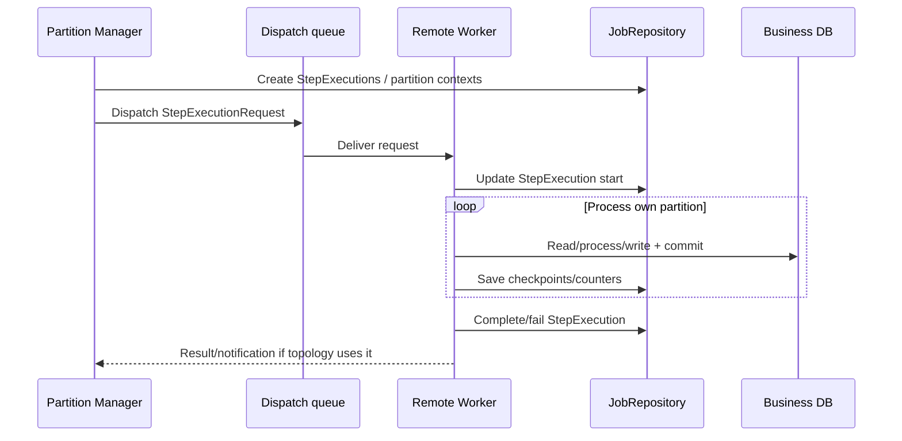
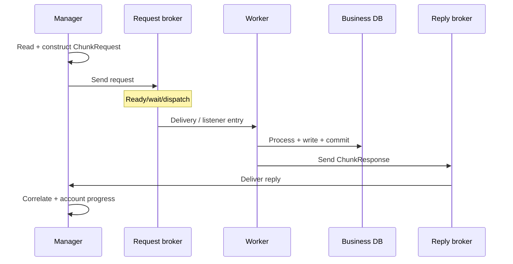
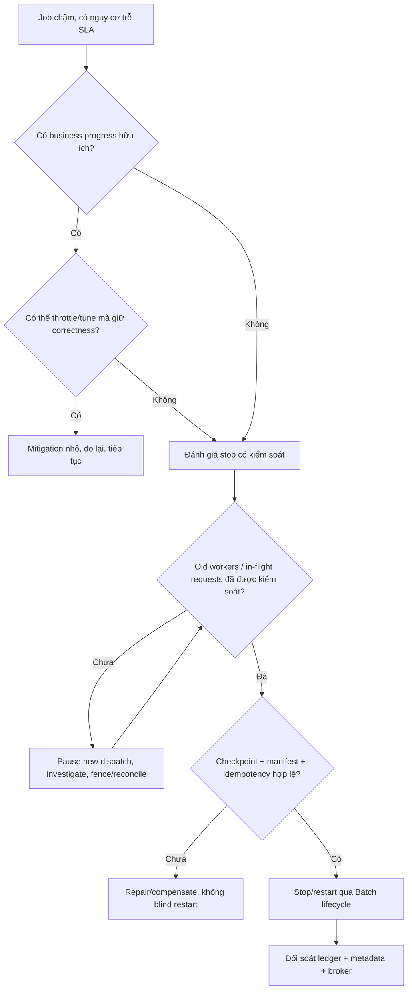

# Runbook khi Job chậm: chẩn đoán và khôi phục Spring Batch có kiểm soát

## 1. Tình huống: Job vẫn STARTED nhưng deadline đang trượt

Một hệ thống xử lý 80 triệu giao dịch qua Spring Batch mỗi đêm. Job `reconcileTransactions` được thiết kế chạy xong trước **06:00**, thường mất 70 phút. Hôm nay đến 05:30, JobRepository vẫn ghi `STARTED`, `READ_COUNT` tăng chậm, một số worker partition không cập nhật đã 20 phút và hàng đợi message đang dài lên. Người vận hành có ba lựa chọn tưởng đơn giản:

1. Tăng từ 8 lên 32 worker.
2. Tăng `chunkSize` để giảm số commit.
3. Stop job và chạy lại từ đầu.

Cả ba lựa chọn đều **có thể làm sự cố nặng hơn**. Nếu business database đang bị lock hoặc cạn JDBC connections, tăng workers sẽ tăng contention; nếu một chunk đã quá lớn, tăng chunk size làm rollback lâu hơn; nếu dữ liệu đã commit nhưng JobRepository/reply chưa cập nhật, chạy lại một JobInstance mới có thể gây ghi trùng.

**Runbook khi Job chậm** là quy trình vận hành có bằng chứng, ưu tiên:

- Xác định job chậm thật hay **chỉ dashboard/metadata cập nhật trễ**.
- Xác định work đang **chờ tài nguyên**, đang xử lý, bị retry hay thất lạc reply.
- Bảo vệ **tính đầy đủ, idempotency và restartability**.
- Chọn hành động **ít rủi ro, đo được hiệu quả và có đường rollback**.
- Ghi lại nguyên nhân, diễn biến và điều kiện ngăn tái phát.

Bài thuộc chương **Vận hành** của module `SPRING_BATCH_SCALING_OPERATIONS`. Module tập trung mở rộng Spring Batch cho workload dữ liệu lớn qua **multi-threaded step, parallel steps, partitioning và xử lý phân tán**, đo nút thắt, giữ thread safety, retry/restart và chọn kiến trúc phù hợp tài nguyên thực tế. Vì vậy runbook không chỉ dành cho batch chạy tuần tự: nó bao phủ **local executor, remote workers, broker request/reply, database và JobRepository**.

### Kết quả học tập

Sau bài này, bạn có thể:

1. Xây quy trình **0–5–15–30–60 phút** khi một JobExecution có nguy cơ trễ SLA.
2. Đọc đúng `JobInstance`, `JobExecution`, `StepExecution`, `BatchStatus` và restart attempts.
3. Đo **useful throughput**, pending work, queue wait, worker service time và ETA có độ tin cậy.
4. Tra cứu Spring Batch JDBC metadata bằng SQL read-only mà không cộng trùng dữ liệu qua restart.
5. Phân biệt nghẽn **JDBC pool, DB locks/IO, CPU/GC, executor, partition skew, broker hoặc reply channel**.
6. Ra quyết định throttle, tạm dừng upstream, scale, stop/restart, reconcile theo từng failure mode.
7. Thiết kế alerts, test chậm có chủ đích và checklist xác nhận phục hồi đúng nghiệp vụ.

> **Phạm vi:** Spring Batch **5.2.x**, Spring Framework 6.x, Spring Boot 3.x, Java 17+, JDBC `JobRepository`, PostgreSQL và Micrometer; ví dụ messaging dựa trên JMS/Spring Integration. Tên SQL/metric cần điều chỉnh khi ứng dụng dùng schema prefix hoặc backend khác. Các mốc thời gian, số lượng và ngưỡng trong bài chỉ là **minh họa để thiết kế runbook**, không phải số đo của một hệ thống thực tế.

## 2. Trước khi xử lý: định nghĩa đúng “Job chậm”

`Job chậm` không có nghĩa duy nhất là `END_TIME - START_TIME` lớn. Cần phân biệt:

| Hiện tượng | Dấu hiệu | Ý nghĩa |
| --- | --- | --- |
| **Slow start / admission** | Đã có yêu cầu chạy nhưng chưa tạo `JobExecution` hoặc chưa bắt đầu Step | Scheduler/JobLauncher/admission/broker trước job |
| **Slow worker start** | Manager đã dispatch nhưng partition/task chưa run | Executor queue, broker queue, worker capacity |
| **Slow processing** | Worker hoạt động nhưng read/write commits/s giảm | CPU, GC, DB, reader, remote API, data skew |
| **Slow completion/accounting** | Worker có thể đã commit, manager chưa nhận reply/status | Reply channel, JobRepository, stale metadata |
| **Stalled** | Không có tiến triển hữu ích trong nhiều cửa sổ và phải điều tra | Có thể deadlock, hung I/O, lost worker, stale metadata |
| **Slow recovery** | Job thất bại rồi restart/replay tốn lâu | Checkpoint, retries, DLQ, input snapshot và RTO |
| **Observability lag** | Business DB tăng, metadata/metrics đứng yên | Collector, replica lag, chunk dài, telemetry issue |

### 2.1. Các chỉ số SLA phải được chốt từ đầu

| SLI/SLO | Định nghĩa chính xác | Lưu ý |
| --- | --- | --- |
| **Job deadline** | Khoảng từ mốc scheduler/accepted input tới business completion | Không tự bắt đầu tại `START_TIME` nếu scheduler chờ lâu |
| **Job wall-clock** | `END_TIME - START_TIME` của một JobExecution | Không bao gồm thời gian giữa các restart attempts |
| **Useful throughput** | Số **logical operations duy nhất đã commit** mỗi giây | Khác read/write/delivery attempts |
| **Partition completion** | Logical partitions COMPLETED / partitions trong plan sealed | Khác % rows nếu partition sizes lệch |
| **Queue start delay** | Manager/executor submit → worker run start | Không tự bằng broker queue residence |
| **DB acquire/lock latency** | Chờ JDBC connection / SQL lock | Worker có thể active nhưng không xử lý được item |
| **Retry/rollback pressure** | Retry/rollback/skips theo cửa sổ | Có thể throughput gộp tăng do replay mà useful output không tăng |
| **Freshness** | Age của metadata, heartbeat, ledger snapshot | Không đồng nghĩa worker chết |

### 2.2. Mục tiêu vận hành theo thứ tự

1. **Safety:** không làm mất việc, không phát sinh side effect trùng.
2. **Correctness:** kiểm chứng dữ liệu/partition scope và rollback/restart semantics.
3. **Availability/recoverability:** giữ đường stop/restart và đủ logs/metadata cho điều tra.
4. **Performance:** tăng useful throughput và bảo vệ deadline.
5. **Efficiency:** giảm CPU/DB/broker cost cho mỗi logical operation đúng.

Một job báo **COMPLETED** sau khi silently discard 30% messages không phải phục hồi. Một job có p99 queue wait thấp nhờ tăng `DiscardPolicy` cũng không phải tối ưu đúng.

## 3. Runbook nhanh: 0–5–15–30–60 phút

Các cửa sổ là **khung vận hành tham khảo**, phải chỉnh theo deadline/RTO thực tế. Việc điều tra không bắt buộc phải chờ đúng 5 hay 15 phút mới được hành động.

### 3.1. Tại phút 0–5: xác thực sự cố và bảo toàn bằng chứng

1. Xác định **jobName, JobInstanceId, JobExecutionId, parameters, manifest/input snapshot, step names**.
2. Xác nhận **thời gian hiện tại**, business deadline, expected remaining work, ETA ước lượng và mức chậm so với baseline tương đương.
3. Kiểm tra batch status trên **write primary hoặc read source có độ trễ đã biết**, không chỉ một dashboard đã cache.
4. Lưu snapshot metrics: read/write/commit/rollback/skip, active workers, queue depth/age, Hikari pending, DB locks, CPU/GC, broker ready/unacked/DLQ.
5. Kiểm tra **recent deploy/config changes** (chunk size, pool, worker count, broker prefetch, query/index, JobRepository schema).
6. Không tùy tiện `UPDATE BATCH_...`, purge queue, kill worker hàng loạt hoặc đổi identifying JobParameters.
7. Nếu ảnh hưởng deadline, mở incident và chỉ định operator điều phối các thay đổi để tránh hai người scale/restart đồng thời.

**Đầu ra 5 phút:** incident identity, độ mới dữ liệu, delta throughput, nhóm lỗi ban đầu và quyết định có cần kiểm soát admission ngay không.

### 3.2. Phút 5–15: phân loại tầng đang nghẽn

Kiểm tra theo thứ tự:

- `JobRepository` có ghi **STARTING/STARTED/STOPPING** không; step nào chậm nhất?
- Worker `readCount/writeCount/commitCount` có **tăng qua hai snapshot** không?
- `rollbackCount`, retries, skip, exceptions, deadlocks có tăng cùng lúc?
- Worker threads đang CPU, blocked JDBC pool, waiting remote HTTP, blocked lock hay chờ queue?
- Executor `activeCount/poolSize/queueSize` và broker **ready/unacked/prefetch/reply pending** thế nào?
- Partition durations có lệch rất nhiều, một hot partition chi phối tổng thời gian?

**Đầu ra 15 phút:** phân loại **CPU-bound, DB-bound, queue/admission-bound, skew/ordering-bound, transport/reply-bound, retry-bound, metadata-bound** hoặc **unknown cần bằng chứng thêm**.

### 3.3. Phút 15–30: can thiệp nhỏ, đo lại và bảo vệ correctness

Chọn **một hành động có độ đảo ngược cao**:

- Giảm producer admission/in-flight khi DB/broker đã bão hòa.
- Tăng concurrency **một bước nhỏ** chỉ khi downstream có headroom.
- Giảm prefetch hoặc thay consumer load distribution khi client buffer giấu backlog.
- Đưa query/index/lock contention vào luồng xử lý DB có quyền thay đổi.
- Stop một nguồn **duplicate dispatch** khi xác minh manager/worker ownership.
- Cô lập poison message theo retry/DLQ policy đã duyệt.

Đặt ngưỡng **abort/rollback** cho hành động, chẳng hạn p99 DB lock wait tăng, errors tăng hoặc unique commits/s giảm. Không đổi `chunkSize`/partition boundaries giữa một JobExecution đang chạy mà chưa hiểu restart contract.

### 3.4. Phút 30–60: quyết định recovery hoặc tiếp tục có kiểm soát

Nếu useful throughput **phục hồi** và ETA đáp ứng business deadline: tiếp tục quan sát, đối soát incomplete/retry work.

Nếu vẫn nghẽn:

1. Xác minh **có thể stop/restart** hay không (Step restartable, input snapshot, writer idempotent).
2. Xác minh old workers đã **dừng/fenced** trước khi giao lại same scope.
3. Đối soát business effects đã commit, broker in-flight/replies và JobRepository metadata.
4. Chọn stop/restart **cùng JobInstance** hoặc run compensation/new business run khi thật sự cần, không tạo JobInstance mới chỉ để reset status.
5. Escalate DB/broker/application owners khi có lock/deadlock, lost replies hoặc unknown transaction outcome.

### 3.5. Kết thúc sự cố

Chỉ đóng khi:

- Useful business throughput và ETA trở về mức chấp nhận.
- Không còn pending/unaccounted logical partitions/chunks ngoài policy.
- Các StepExecution/job có trạng thái kết thúc hợp lệ, hoặc còn công việc đã được giao vào recovery queue có owner rõ.
- Manifest/ledger reconciliation không có missing/duplicate business effects không được phép.
- Đã ghi lại thay đổi, kết quả đo, điều kiện rollback và root cause/hypotheses.

## 4. Bản đồ luồng xử lý: Job chậm ở lớp nào?



**Không suy ra nguyên nhân chỉ từ `STARTED`:** framework status không chứng minh có tiến triển. **Không suy ra dead worker chỉ từ `LAST_UPDATED`:** metadata có thể không được persist giữa một chunk dài.

## 5. Phân biệt identity và attempts trước khi đọc SQL



- `JobInstance` là một **logical run** được xác định bằng job name và **identifying JobParameters**.
- `JobExecution` là một **attempt** chạy JobInstance; restart thường có JobExecution mới.
- `StepExecution` là execution/counters của step trong attempt; partitioning có các worker step names như `workerStep:partition01`.
- Logical partition được xác định từ **Partitioner/manifest/scope**, có thể có nhiều StepExecutions qua restart.

Một partition **COMPLETED** ở JobExecution 901 có thể không chạy lại trong 902; nếu chỉ truy vấn attempt 902, dashboard có thể tưởng nó biến mất. Ngược lại, cộng `READ_COUNT` của 901 và 902 có thể **double-count items do replay**.

### 5.1. Framework status và nhãn vận hành

| Framework `BatchStatus` | Diễn giải | Cảnh báo runbook |
| --- | --- | --- |
| `STARTING` | Job/step đang khởi động | Không mặc định worker đã chạy |
| `STARTED` | Last persisted status đang chạy | Không phải heartbeat |
| `STOPPING` | Đã có yêu cầu dừng | Không đồng nghĩa đã stop xong |
| `STOPPED` | Dừng được ghi nhận | Cần xác minh old worker/reply state |
| `FAILED` | Attempt kết thúc thất bại | Business side effects có thể đã commit một phần |
| `COMPLETED` | Framework đã đánh dấu xong | Còn cần kiểm chứng dữ liệu nghiệp vụ |
| `ABANDONED`/`UNKNOWN` | Trạng thái đặc biệt | Không tự chuyển thành COMPLETED |

Các nhãn như **SUSPECTED_STALE**, **QUEUED**, **BLOCKED_DB**, **RECONCILIATION_REQUIRED** là suy diễn của ứng dụng/dashboard, **không phải `BatchStatus` mặc định**.

### 5.2. Ba trường thời gian cần đọc cẩn thận

- `CREATE_TIME`: metadata execution được tạo.
- `START_TIME`: thời điểm start execution được ghi nhận theo lifecycle.
- `END_TIME`: thời điểm execution kết thúc (có thể null khi đang chạy).
- `LAST_UPDATED`: metadata lần cuối persist; **không phải heartbeat định kỳ của JVM**.

Khác biệt giữa clock của app server và DB, session timezone hoặc replication lag có thể làm cảnh báo “age âm/già” sai. Chuẩn hóa timestamp (thường UTC), ghi nguồn và độ mới của snapshot.

## 6. SQL read-only: kiểm tra JobExecution và StepExecution nào đang chậm

Các truy vấn dưới dùng **PostgreSQL** và schema mặc định của Spring Batch **5.2.x** với các bảng `BATCH_JOB_INSTANCE`, `BATCH_JOB_EXECUTION`, `BATCH_STEP_EXECUTION`. `:jobInstanceId`, `:workerStepName` là **named parameters của client/DAO**, không phải cú pháp có thể dán trực tiếp vào `psql` khi chưa bind. Nếu ứng dụng đổi table prefix/schema, sửa tên bảng nhất quán.

**Nguyên tắc vận hành:** chỉ dùng quyền **SELECT**, có `statement_timeout` và giới hạn phạm vi JobInstance; ưu tiên read replica/snapshot cache được đánh dấu replication lag. Không chạy query nặng không filter, `VACUUM FULL`, sửa `BATCH_*` hoặc `EXPLAIN ANALYZE` tác động production chỉ để chẩn đoán.

### 6.1. Tìm các JobExecutions của một JobInstance

```sql
SELECT ji.JOB_NAME,
       ji.JOB_INSTANCE_ID,
       je.JOB_EXECUTION_ID,
       je.CREATE_TIME,
       je.START_TIME,
       je.END_TIME,
       je.STATUS,
       je.EXIT_CODE,
       je.LAST_UPDATED,
       EXTRACT(EPOCH FROM
           (CURRENT_TIMESTAMP - je.START_TIME)
       ) AS elapsed_since_start_seconds
FROM BATCH_JOB_INSTANCE ji
JOIN BATCH_JOB_EXECUTION je
  ON je.JOB_INSTANCE_ID = ji.JOB_INSTANCE_ID
WHERE ji.JOB_INSTANCE_ID = :jobInstanceId
ORDER BY je.CREATE_TIME DESC, je.JOB_EXECUTION_ID DESC;
```

**Phân tích:**

- Có nhiều `JOB_EXECUTION_ID` cho một `JobInstance`? Có thể là lịch sử restart hợp lệ.
- Job `STARTED` quá lâu nhưng `END_TIME` null? Cần phân tích StepExecution và worker state, không tuyên bố dead.
- `EXIT_CODE` hữu ích khi job đã kết thúc; không trích raw `EXIT_MESSAGE` lên dashboard công khai vì có thể chứa PII/secrets.
- `elapsed_since_start_seconds` là “tuổi kể từ start” khi job còn chạy, **không phải service time của từng worker**. Với job đã kết thúc, duration đúng là `END_TIME - START_TIME`.

### 6.2. Tổng hợp counters theo từng StepExecution của một attempt

```sql
SELECT se.STEP_EXECUTION_ID,
       se.STEP_NAME,
       se.STATUS,
       se.START_TIME,
       se.END_TIME,
       se.LAST_UPDATED,
       se.READ_COUNT,
       se.WRITE_COUNT,
       se.FILTER_COUNT,
       se.READ_SKIP_COUNT,
       se.PROCESS_SKIP_COUNT,
       se.WRITE_SKIP_COUNT,
       se.COMMIT_COUNT,
       se.ROLLBACK_COUNT,
       EXTRACT(EPOCH FROM
           (CURRENT_TIMESTAMP - se.LAST_UPDATED)
       ) AS metadata_age_seconds
FROM BATCH_STEP_EXECUTION se
WHERE se.JOB_EXECUTION_ID = :jobExecutionId
ORDER BY se.STEP_NAME, se.STEP_EXECUTION_ID;
```

Ví dụ:

| Step | Status | READ | WRITE | COMMIT | ROLLBACK | Điều tra |
| --- | --- | ---: | ---: | ---: | ---: | --- |
| `extractStep` | COMPLETED | 1.000.000 | 1.000.000 | 2.001 | 0 | Đã xong |
| `workerStep:p00` | STARTED | 100.000 | 97.000 | 502 | 2 | Tiến triển, có filter/skip? |
| `workerStep:p01` | STARTED | 2.000 | 2.000 | 11 | 50 | Retry/rollback pressure |
| `workerStep:p02` | STARTED | 0 | 0 | 0 | 0 | Pending? Reader chậm? Worker chưa start? |

**Đây là ví dụ minh họa;** `READ_COUNT=0` không đủ kết luận partition chết: có thể source rỗng, worker đang khởi tạo, reader bị block hoặc một chunk dài chưa checkpoint.

### 6.3. Chọn attempt cuối của mỗi logical partition qua restart

Để tránh cộng nhiều StepExecution attempts của cùng partition:

```sql
WITH ranked AS (
    SELECT je.JOB_INSTANCE_ID,
           je.JOB_EXECUTION_ID,
           je.CREATE_TIME AS job_execution_created_at,
           se.STEP_EXECUTION_ID,
           se.STEP_NAME,
           se.STATUS,
           se.READ_COUNT,
           se.WRITE_COUNT,
           se.COMMIT_COUNT,
           se.ROLLBACK_COUNT,
           se.START_TIME,
           se.END_TIME,
           se.LAST_UPDATED,
           ROW_NUMBER() OVER (
               PARTITION BY je.JOB_INSTANCE_ID, se.STEP_NAME
               ORDER BY je.CREATE_TIME DESC,
                        se.STEP_EXECUTION_ID DESC
           ) AS attempt_rank,
           COUNT(*) OVER (
               PARTITION BY je.JOB_INSTANCE_ID, se.STEP_NAME
           ) AS attempt_count
    FROM BATCH_JOB_EXECUTION je
    JOIN BATCH_STEP_EXECUTION se
      ON se.JOB_EXECUTION_ID = je.JOB_EXECUTION_ID
    WHERE je.JOB_INSTANCE_ID = :jobInstanceId
      AND LEFT(se.STEP_NAME, LENGTH(:workerStepName) + 1)
          = :workerStepName || ':'
)
SELECT STEP_NAME,
       JOB_EXECUTION_ID,
       STEP_EXECUTION_ID,
       STATUS,
       attempt_count,
       READ_COUNT,
       WRITE_COUNT,
       COMMIT_COUNT,
       ROLLBACK_COUNT,
       START_TIME,
       END_TIME,
       LAST_UPDATED
FROM ranked
WHERE attempt_rank = 1
ORDER BY STEP_NAME;
```

Query này cho một row mỗi **full step name** trong JobInstance. Nó không thấy partition **chưa từng được tạo StepExecution**; để thấy PENDING phải `LEFT JOIN` với **partition manifest** đã chốt theo JobInstance và worker step.

**Giới hạn:** latest attempt theo metadata không xác nhận worker cũ đã thật sự dừng; một old worker đang tiếp tục ghi DB sau failover cần được fence tại resource level. Đừng dùng `ROW_NUMBER()` như một distributed lock.

### 6.4. Partition có metadata cũ cần kiểm tra

```sql
WITH latest AS (
    SELECT se.STEP_EXECUTION_ID,
           se.STEP_NAME,
           se.STATUS,
           se.START_TIME,
           se.LAST_UPDATED,
           ROW_NUMBER() OVER (
               PARTITION BY je.JOB_INSTANCE_ID, se.STEP_NAME
               ORDER BY je.CREATE_TIME DESC,
                        se.STEP_EXECUTION_ID DESC
           ) AS rn
    FROM BATCH_JOB_EXECUTION je
    JOIN BATCH_STEP_EXECUTION se
      ON se.JOB_EXECUTION_ID = je.JOB_EXECUTION_ID
    WHERE je.JOB_INSTANCE_ID = :jobInstanceId
)
SELECT STEP_NAME,
       STEP_EXECUTION_ID,
       STATUS,
       START_TIME,
       LAST_UPDATED
FROM latest
WHERE rn = 1
  AND STATUS IN ('STARTING', 'STARTED', 'STOPPING')
  AND LAST_UPDATED <
      CURRENT_TIMESTAMP - INTERVAL '15 minutes'
ORDER BY LAST_UPDATED;
```

Đây là danh sách **suspected stale**, **không phải list dead workers**. Cần kết hợp worker heartbeat, thread dump, chunk duration, CPU, database locks và clock freshness trước khi restart.

### 6.5. Đo khoảng chênh giữa hai snapshot

Một snapshot `READ_COUNT=100.000` không nói worker đang chạy nhanh hay chậm; phải lấy **delta trong thời gian đo**. Đối với cùng `STEP_EXECUTION_ID`:

\[
R_{\mathrm{read,attempt}}=
\frac{READ\_COUNT(t_2)-READ\_COUNT(t_1)}
{t_2-t_1}
\]

Ví dụ cùng một StepExecution đọc thêm 20.000 records trong 60 giây → khoảng **333 reads/s**. Nhưng:

- Nếu restart tạo `STEP_EXECUTION_ID` mới, **không trừ** count mới với count của attempt cũ.
- `READ_COUNT` có thể không cập nhật giữa chunk đang chạy, hoặc filter/skip làm `WRITE_COUNT` khác.
- Nếu reader replay từ checkpoint và writer idempotent no-op, reads/s tăng nhưng **unique commits/s không tăng tương ứng**.
- Một source có input không đồng đều sẽ khiến tốc độ items/s khác với bytes/s hoặc business value/s.

Đối với job có effect không được lặp, dùng **business ledger/target database** để tính **useful throughput**:

\[
R_{\mathrm{useful}}=
\frac{\mathrm{UniqueCommitted}(t_2)-
\mathrm{UniqueCommitted}(t_1)}
{t_2-t_1}
\]

Ledger count/s có thể cần materialized counters hoặc watermark có tối ưu; không nên `COUNT(*)` toàn bảng hàng trăm triệu rows mỗi 5 giây gây thêm tải cho DB đang nghẽn.

## 7. Chẩn đoán CPU, heap, GC và thread starvation

Nếu worker `activeCount` cao và throughput giảm, điều đầu tiên không phải **tăng số threads**. Cần biết threads đang **chạy CPU** hay **đang chờ**.

### 7.1. Bộ tín hiệu JVM

| Tín hiệu | Cách đọc | Hướng chẩn đoán |
| --- | --- | --- |
| Process/container CPU utilization | CPU có sát giới hạn thực của pod? | Processor CPU-bound, serialization, compression |
| Container CPU throttling | CPU quota làm thread bị throttle? | Resources/limits Kubernetes |
| JVM heap used/after GC | Heap sau GC tăng đều? | Object retention, chunk large, collector queue |
| GC pause p95/p99 / % time | Latency spikes đồng pha stop-the-world? | Allocation rate, heap, codec, chunk size |
| Thread count/states | Nhiều `BLOCKED` hoặc `WAITING`? | Lock contention, pool starvation, external I/O |
| Allocation/bytes per item | Chunks lớn tạo objects quá nhiều? | Serialization, reader buffering, batch writer |
| OOMKilled / restart count | Process bị kernel/container kill? | Resource pressure, leak, queue không giới hạn |
| Context switches | Threads nhiều nhưng useful CPU thấp? | Over-threading / lock contention |

### 7.2. Quy trình lấy thread dump có kiểm soát

Khi có quyền và môi trường phù hợp:

```text
# JVM tool ví dụ, chỉ chạy trên process sở hữu/có quyền
jcmd <pid> Thread.print -l

# Hoặc lệnh tương đương do platform runtime hỗ trợ
# Thu 2-3 samples cách nhau 10-30 giây để tìm stack lặp
```

Đây là **hướng dẫn thao tác có giới hạn**, không phải lệnh tự động chạy trong production. Với containers, phải xác định PID/namespace, quyền `jcmd` và JDK tool availability. Thread dump có thể chứa tên lớp, SQL/text hoặc thông tin nhạy cảm; lưu trong vị trí access-controlled.

Diễn giải các tình huống:

- Nhiều threads ở `HikariPool.getConnection`: **JDBC connection acquire wait**, không phải CPU-bound.
- Nhiều ở `SocketInputStream`/HTTP client: ngoại dịch vụ hoặc network wait.
- Nhiều ở cùng `synchronized`/`ReentrantLock`: contention của code ứng dụng hoặc shared reader/writer.
- Nhiều threads `RUNNABLE` với CPU high trong regex/JSON mapping: processor/serialization CPU bottleneck.
- Worker bị chặn trong `Future.get()`/queue poll: có thể không có work hoặc có thread pool deadlock.

Đừng coi mọi `WAITING` là deadlock: worker pool idle cũng chờ queue và hoàn toàn bình thường. Cần đối chiếu **task count, ownership và throughput**.

### 7.3. Thread safety khi multi-threaded step

Một `ItemReader`/`ItemWriter` có mutable cursor/cache có thể **không thread-safe**. Khi tăng threads:

- Reader có thể đọc trùng/bỏ item, làm `READ_COUNT` hoặc scope sai.
- `ExecutionContext` saveState từ nhiều threads có thể không nhất quán.
- Writer có thể giữ shared buffers/connection không an toàn.
- Sử dụng synchronized reader có thể serialize toàn bộ work và khiến thêm threads không tăng throughput.

Nếu phải sửa concurrency, kiểm tra **thread-safe implementations, scope/lifecycle, partition ownership, checkpoint và idempotency**. Đừng scale sau khi thấy CPU thấp mà bỏ qua data correctness.

### 7.4. Heap pressure do chunk quá lớn

Một chunk giữ item list trong RAM, có thể cùng lúc giữ DTO input, mapped output, batch SQL args và serialized request. Tăng `chunkSize` từ 200 lên 10.000 có thể:

- Giảm số commit nhưng **tăng peak heap/GC**.
- Kéo dài transaction, giữ DB locks lâu.
- Tăng rollback/replay window khi chunk thất bại.
- Tạo message vượt broker size limit trong remote chunking.

Chỉ điều chỉnh chunk size **sau benchmark**, xét items/chunk * serialized item bytes, CPU/GC, DB commit cost, retry/restart và memory headroom. Không đổi khi job đang xử lý một snapshot mà metadata/reader semantics phụ thuộc commit interval nếu chưa có playbook cụ thể.

## 8. Chẩn đoán JDBC pool, database locks, slow SQL và JobRepository

Database thường là **điểm hội tụ** của nhiều worker. Một mô hình có 12 worker pods, mỗi pod 10 threads có thể tạo hàng trăm JDBC callers; tăng concurrency không làm database có thêm connection/IO/lock capacity.

### 8.1. Tách hai nguồn DB

Một ứng dụng có thể dùng:

- **Business DataSource:** reader/writer thực hiện SQL vào các bảng nghiệp vụ.
- **JobRepository DataSource:** ghi job/step metadata và `ExecutionContext`.

Chúng có thể cùng một PostgreSQL cluster, tách database/schema/pool, hoặc được cấu hình khác nhau. Chậm ở **JobRepository** có thể làm job checkpoint/launch/restart chậm dù business SQL chạy nhanh. Chậm ở **business DB** có thể làm worker active nhưng không hoàn tất chunks.

Không cho rằng `transactionManager` của business step và transaction manager của repository **luôn cùng một**. Khi side effects ở các tài nguyên khác nhau, có các **failure windows** giữa business commit và metadata/reply update.

### 8.2. Dấu hiệu HikariCP

Theo dõi:

| Metric/resource | Bình thường | Nghi ngờ nghẽn |
| --- | --- | --- |
| Active connections | Tăng theo concurrency, còn headroom | Chạm `maximumPoolSize` kéo dài |
| Idle connections | Một số connections rảnh | Gần 0 khi active chạm trần |
| Pending threads | Thấp/không kéo dài | Tăng, không thoát |
| Connection acquire wait p95/p99 | Ổn định | Tăng trước khi Step throughput giảm |
| Connection timeout count | Gần 0 ngoài lỗi được dự kiến | Tăng khi workers tranh pool |
| Connection usage duration | Gắn với transaction length | Tăng do long-running SQL, lock wait hoặc leak |

Micrometer/Hikari metrics thực tế tùy Spring Boot/Actuator registry; kiểm tra metric exposition trước khi viết dashboard/alert với một tên cụ thể. Nếu 100 threads đều đang chờ lấy connection của pool chỉ có 16 connections, tăng `maxPoolSize` phải xem **DB max_connections, connections của các dịch vụ khác, transaction cost**. Tăng pool không làm DB tự có thêm CPU/IO.

### 8.3. PostgreSQL: nhìn các sessions đang chờ

Query **read-only**, kết quả phụ thuộc quyền quan sát sessions:

```sql
SELECT pid,
       usename,
       application_name,
       state,
       wait_event_type,
       wait_event,
       backend_start,
       xact_start,
       query_start,
       EXTRACT(EPOCH FROM (
           CURRENT_TIMESTAMP - query_start
       )) AS query_age_seconds,
       LEFT(query, 180) AS query_preview
FROM pg_stat_activity
WHERE datname = current_database()
  AND pid <> pg_backend_pid()
ORDER BY query_start NULLS LAST
LIMIT 50;
```

**Lưu ý bảo mật:** `query_preview` có thể chứa literal PII/secrets. Trong production, chỉ truy xuất khi được phép và **không xuất raw SQL text lên dashboard công khai**; có thể bỏ cột `query`, group theo `application_name, wait_event_type, wait_event` trước.

Diễn giải:

- `wait_event_type='Lock'`: đang chờ lock. Xác định blocker/transaction lâu trước khi tăng workers.
- `state='idle in transaction'` với `xact_start` lâu: transaction giữ resources/locks mà không chạy SQL.
- `wait_event_type='IO'` hoặc các events IO/WAL: có thể đang nghẽn storage.
- `wait_event_type='Client'` có thể là backend chờ client, không khẳng định database đang bị CPU-bound.
- `query_start` lâu không tự chứng minh query chậm nếu state là idle; xem `state/xact_start` cùng nhau.

### 8.4. PostgreSQL: tìm blocking sessions

```sql
SELECT blocked.pid AS blocked_pid,
       blocked.application_name AS blocked_app,
       blocked.wait_event_type,
       blocked.wait_event,
       blocker.pid AS blocker_pid,
       blocker.application_name AS blocker_app,
       blocker.state AS blocker_state,
       blocker.xact_start AS blocker_xact_start
FROM pg_stat_activity blocked
CROSS JOIN LATERAL unnest(
    pg_blocking_pids(blocked.pid)
) AS blocking_pid(pid)
JOIN pg_stat_activity blocker
  ON blocker.pid = blocking_pid.pid
WHERE blocked.datname = current_database()
ORDER BY blocker.xact_start NULLS LAST;
```

Query chỉ **phát hiện blocker**; không được auto `pg_terminate_backend`. Terminate một business transaction có thể kích hoạt rollback lớn, retry storm, tạm mất tiến độ hoặc ảnh hưởng nhiều ứng dụng. Phải có quyền/đánh giá điều phối DB owner và transaction safety trước quyết định.

### 8.5. Những nguyên nhân DB thường gặp

| Nguyên nhân | Bằng chứng | Hành động phù hợp |
| --- | --- | --- |
| Hot row/aggregate locks | `pg_blocking_pids`, lock wait, partitions cùng ghi một key | Giảm concurrency; sửa partition key/sharding ở run sau |
| Thiếu index trên reader paging/range | Slow query + nhiều scanned rows, full scans | Phân tích plan trên staging, bổ sung index bằng quy trình DB |
| Offset pagination quá sâu | Các page sau càng chậm | Cân nhắc keyset/range pagination và snapshot |
| Transaction quá lớn | Commit latency, WAL/lock/rollback lớn | Benchmark chunk size nhỏ hơn, giảm scope TX |
| Pool exhaustion | Hikari pending/connectionTimeout | Điều chỉnh concurrency/pool toàn hệ, tránh tạo thêm callers |
| Long-running vacuum/maintenance contention | IO/locks theo cửa sổ | Phối hợp maintenance window và DB owner |
| JobRepository metadata table hot spots | Repo transaction latency, optimistic locking | Giảm metadata write pressure, kiểm tra shared repository/index |
| DB failover / replica lag | Connection errors, sudden read staleness | Kiểm tra primary/read replica, recovery, RPO và checkpoints |

**Đừng chạy migration/index DDL trực tiếp trong khi incident** chỉ vì thấy một query chậm, trừ khi đó là playbook approved. DDL có thể giữ locks và làm outage nặng hơn.

### 8.6. Khi một commit chậm

Một chunk có thể:

```text
read/process          400 ms
writer SQL             50 ms
wait row lock         1500 ms
commit/WAL             300 ms
metadata/context       200 ms
```

Nếu chỉ đo `ItemWriter.write` quanh SQL, có thể bỏ sót phần wait ở DB commit hoặc JobRepository metadata. Cần tracing/timers ở **DataSource acquire, SQL, business commit, chunk, repository update** và định nghĩa boundaries rõ, không cộng p99 mỗi span thành p99 tổng.

### 8.7. JobRepository là hệ thống vận hành, không phải nơi scan dashboard vô hạn

Một manager có hàng nghìn partitions có thể ghi nhiều `StepExecution`/`ExecutionContext` rows. Dashboard polling tất cả partitions mỗi giây, group/window full table không filter có thể tạo DB load không cần thiết.

Chọn **read-only snapshots/cached materialized view**, phân trang và filter theo JobInstance. Nếu dùng read replica, hiển thị `replication lag/freshness` để tránh coi data cũ là job kẹt. Không delete/recreate `BATCH_*` metadata để “giải nghẽn” trong incident.

## 9. Chẩn đoán TaskExecutor, queue và giới hạn concurrency

Spring Batch chạy song song qua local `TaskExecutor` có thể đang bị **hàng đợi**, không phải CPU/DB. Một manager có 64 partitions nhưng executor chỉ chạy bốn core threads không có nghĩa 60 partition đã thực sự được xử lý.

### 9.1. Hiểu cấu hình `ThreadPoolTaskExecutor`

Với `ThreadPoolTaskExecutor` dựa trên `ThreadPoolExecutor`, hành vi điển hình:

1. Nếu số threads ít hơn `corePoolSize`, tạo core worker.
2. Sau đó ưu tiên **đưa task vào queue** nếu queue còn chỗ.
3. Khi queue đầy, tăng threads tới `maxPoolSize`.
4. Khi threads đạt max và queue đầy, thực hiện rejection policy.

| Cấu hình | Hậu quả có thể |
| --- | --- |
| `core=4, max=32, queueCapacity=10.000` | Có thể giữ gần 4 threads khá lâu vì tasks được queue |
| `core=4, max=32, queueCapacity=0` | `SynchronousQueue` không lưu pending; dễ reject khi max đã chạy |
| `core=8, max=8, queueCapacity=64` | Concurrency 8, queue hấp thụ burst hữu hạn |
| `CallerRunsPolicy` | Producer/manager thread chạy task khi pool bão hòa; thay execution context |
| `DiscardPolicy` | Có thể mất partition/chunk âm thầm, **không dùng** với work phải xử lý đủ |

Không chỉ nhìn `queueSize=0` rồi kết luận executor khỏe khi `queueCapacity=0`: tasks có thể bị reject. Không coi `maxPoolSize=32` là 32 threads luôn chạy khi core/queue policy khác.

### 9.2. Các metric executor tối thiểu

- `activeCount`, `poolSize`, `corePoolSize`, `maxPoolSize`.
- `queueSize`, `queueCapacity`, **oldestPendingAge** nếu instrument được.
- `tasksSubmitted/accepted/started/completed/rejected/canceled`.
- Submit→run-start delay p50/p95/p99.
- Useful business commits/s, DB pool/CPU/GC cạnh nhau.

**Timer submit-to-start chỉ đo tasks đã bắt đầu.** Những tasks còn queue hàng phút, bị cancel/reject hoặc process crash chưa có duration sample; cần pending count/age và outcome counters để không rơi vào **survivor bias**.

### 9.3. Đo executor start delay bằng `TaskDecorator`

Ví dụ cấu hình executor riêng cho local partitioning, dùng Micrometer:

```java
// PartitionExecutorConfig.java
package example.batch.operations;

import io.micrometer.core.instrument.MeterRegistry;
import io.micrometer.core.instrument.Timer;
import java.util.concurrent.TimeUnit;
import org.springframework.context.annotation.Bean;
import org.springframework.context.annotation.Configuration;
import org.springframework.scheduling.concurrent.ThreadPoolTaskExecutor;

@Configuration
public class PartitionExecutorConfig {

    @Bean("partitionTaskExecutor")
    public ThreadPoolTaskExecutor partitionTaskExecutor(
            MeterRegistry registry) {

        Timer startDelay = Timer.builder(
                    "batch.partition.executor.start.delay")
                .tag("pool", "local-partitions")
                .description("Task decorate to run start delay")
                .publishPercentileHistogram()
                .register(registry);

        ThreadPoolTaskExecutor executor =
                new ThreadPoolTaskExecutor();
        executor.setThreadNamePrefix("partition-");
        executor.setCorePoolSize(8);
        executor.setMaxPoolSize(8);
        executor.setQueueCapacity(32);
        executor.setTaskDecorator(task -> {
            long preparedAt = System.nanoTime();
            return () -> {
                startDelay.record(
                        System.nanoTime() - preparedAt,
                        TimeUnit.NANOSECONDS);
                task.run();
            };
        });
        // @Bean lifecycle initializes/shuts down this executor.
        return executor;
    }
}
```

Đây là **decorate-to-run delay gần với submit-to-start**, không phải exact residence trong internal queue: tasks có thể được giao trực tiếp cho worker không qua queue. `TaskDecorator` có thể nhận callback wrapper của `FutureTask`, không luôn là Runnable nguyên bản; không dùng cast vào domain type.

Đoạn code chỉ thêm Timer, chưa thêm rejected/pending counters và chưa gắn vào `PartitionHandler`. Nó **không tự áp dụng** cho mọi Spring Batch step. Khi triển khai cần wire `TaskExecutor` vào đúng manager/Step, đo rejection và không swallow `TaskRejectedException`.

### 9.4. Backpressure phù hợp hơn tăng queue vô hạn

Khi tốc độ tạo công việc `λ_in` lớn hơn tốc độ hoàn tất `μ` kéo dài:

\[
\Delta Q \approx (\lambda_{in}-\mu)\Delta t
\]

Ví dụ offered=120 tasks/s, completed=80 tasks/s trong 30 giây → backlog tăng khoảng 1.200 tasks nếu không có thay đổi khác.

Tăng queue capacity từ 1.000 lên 10.000 **chỉ trì hoãn** lúc queue đầy; nó không tăng service capacity. Chọn bounded admission, giới hạn outstanding requests/partitions hoặc làm chậm producer **trước khi giữ DB locks**. Nếu có retries, backoff/jitter để tránh retry storms.

Nếu `CallerRunsPolicy` được dùng, một `ChunkProcessor` có thể chạy trên manager thread, ảnh hưởng transaction/thread-local/correlation; phải test. Với `DiscardPolicy`, manager có thể tưởng dispatch thành công trong khi task bị bỏ — **không phù hợp** với restartable batch cần đủ input.

### 9.5. Concurrency budget tổng hợp

Đừng tune riêng một pod:

```text
12 worker pods
8 active threads per pod
→ tối đa 96 worker tasks đồng thời

Business DB:
40 connections available to this service
→ không thể giả định 96 transactions sẽ lấy connection ngay
```

Tổng nhu cầu connections còn phụ thuộc reader/writer, repository và số connections mỗi task; **không nhất thiết mỗi task dùng đúng một connection**. Nhưng budget cho thấy vì sao tăng workers có thể làm `Hikari.pending` và p99 latency tăng.

## 10. Chẩn đoán remote partitioning: worker ở xa, partition bị kẹt hay bị lệch tải?

Ở **remote partitioning**, manager tạo logical partitions và giao các worker `StepExecution` sang nhiều processes; mỗi worker tự đọc và xử lý phạm vi theo `ExecutionContext`. Một partition có thể chạy rất lâu so với đồng nghiệp mà **không phải do broker chậm**.



### 10.1. Đo sáu khoảng để tìm bottleneck

1. **Plan/dispatch delay:** partition được tạo từ khi nào, khi nào manager publish request?
2. **Broker/transport delay:** request đã accepted/ready/dispatch lúc nào?
3. **Worker start delay:** listener vào, handler khởi tạo `StepExecution` và bắt đầu run lúc nào?
4. **Worker processing time:** từ start tới checkpoint/commit/end.
5. **Result aggregation delay:** worker đã kết thúc nhưng manager chưa account kết quả?
6. **Restart/retry debt:** partition còn history FAILED/STOPPED hoặc orphaned request?

Chỉ có `BATCH_STEP_EXECUTION.START_TIME`/`END_TIME` **không đủ** để tách broker wait và manager dispatch latency. Nếu cần SLI đó, phải instrument **gửi request, listener entry và worker actual start** theo clock domain và correlation hợp lệ.

### 10.2. Manifest là mẫu số của tiến độ

Không lấy `gridSize` mặc định làm **số partition đã thực sự tồn tại**. `Partitioner.partition(gridSize)` có thể trả số entries khác. Một manifest ứng dụng (theo `JobInstance`, `workerStepName`, `partitionName`, scope range/file, estimated size) cho phép:

- Biết partitions **chưa từng có StepExecution**.
- Tìm partition rỗng/hot, overlap/gap trong scope.
- Định lượng percent theo **partition count** và percent theo estimated items riêng.
- Giữ names/scope ổn định khi restart, tránh phân chia lại giữa một run.

**Nếu chưa có manifest**, báo progress là “observed StepExecutions” với giới hạn rõ; không tuyên bố 100% công việc khi chưa chứng minh đủ mọi partitions đáng lẽ phải được giao.

### 10.3. Phân biệt hot partition với worker lỗi

Ví dụ:

| Partition | Estimated records | Đã hoàn tất | Runtime | Worker | Diễn giải |
| --- | ---: | ---: | --- | --- | --- |
| p00 | 10.000 | 10.000 | 15 s | A | Đã xong |
| p01 | 15.000 | 15.000 | 20 s | B | Đã xong |
| p02 | 800.000 | 400.000 | 45 phút | C | Một hot partition |
| p03 | 20.000 | 0 | 30 phút | D | Cần xem queue/reader/DB/heartbeat |

Nếu p02 có throughput ổn định 150 items/s, nó còn ~44 phút; thêm một worker **không làm một partition đang có single owner chạy song song**. Cần tối ưu reader/writer hoặc thay partition granularity ở một run mới có checkpoint/ordering được thiết kế lại.

Ngược lại p03 không có `READ_COUNT` tăng có thể là:

- Worker chưa nhận request do broker queue/prefetch.
- Worker đã nhận nhưng đang chờ JDBC/khởi tạo reader.
- Chunk rất dài chưa commit.
- Process chết nhưng `STARTED` metadata còn stale.
- Partition thực sự không có input, đang dừng hoặc đã hoàn tất ở attempt khác.

### 10.4. Stale worker và duplicate ownership

Khi worker mất heartbeat, manager có thể muốn giao lại partition. Nhưng network partition có thể làm worker cũ **vẫn đang ghi business DB**. Giao lại cùng scope cho worker mới tạo hai concurrent owners:

```text
worker-old (partition p02, epoch 11) -- still writing DB
worker-new (partition p02, epoch 12) -- replay same range
```

`JobRepository` metadata không tự cung cấp **distributed fencing token** cho mọi external side effect. Nếu hệ thống cần **single writer**, phải dùng ownership/lease epoch được resource/ledger thực thi, hoặc writer idempotent/unique operation IDs được thiết kế tương đương.

**Không cho phép cùng scope bị xử lý bởi hai workers chỉ vì StepExecution row mới hơn.** Cần chứng minh old owner đã stop/fenced, dữ liệu đã commit được đối soát và restart tiếp tục từ checkpoint hợp lệ.

### 10.5. Stop/restart với remote workers

Manager gửi yêu cầu stop và Spring Batch ghi `STOPPING` chưa chắc worker đã dừng ngay khi đang block network/DB. Đợi trạng thái kết thúc được xác minh qua metadata + worker/process + broker in-flight và **quyền ghi của old owner**.

Nếu worker process biến mất mà metadata vẫn `STARTED`, đừng tự chạy SQL `UPDATE BATCH_STEP_EXECUTION SET STATUS='FAILED'`. Đó là can thiệp metadata rủi ro, có thể phá optimistic locking và restart semantics; cần dùng quy trình recovery được thiết kế và có operator/maintainer phê duyệt.

## 11. Chẩn đoán remote chunking: request, reply và DB commit không cùng một mốc

Remote chunking thường có **ItemReader ở manager** và **processing/writing ở workers**. Manager gửi `ChunkRequest`, workers gửi `ChunkResponse` về manager. Do đó, job chậm có thể do **request broker**, **prefetch**, **worker service** hoặc **reply aggregation**.



### 11.1. Phép đo nên tách riêng

| Mốc / độ trễ | Instrument ở đâu | Kết luận có thể rút |
| --- | --- | --- |
| Producer send API latency | Trước/sau send invocation | Manager bị block ở serialization, connection/publish? |
| Broker ready/queue residence | Broker-native metric có semantics rõ | Message đang đứng trong broker bao lâu? |
| Producer-to-listener age | Timestamp producer và worker listener | Tổng network/broker/prefetch/scheduling, chịu clock skew |
| Worker processing+commit | Listener/process start → DB committed | Reader/processor/DB cost của request |
| Reply outbound/queue wait | Worker publish → manager reply listener | Reply pipeline chậm? |
| Manager request→reply RTT | Same manager JVM monotonic duration | Toàn hành trình, **bao gồm worker processing** |
| Manager correlation/accounting | Reply listener → contribution/checkpoint update | Có nghẽn ở manager/JobRepository? |

`JMSTimestamp` phản ánh thời điểm message được trao cho **JMS provider để gửi**, **không chắc là broker enqueue**; dùng nó đến worker listener entry chỉ là **producer-to-listener age**, không phải broker-only wait. Khi clocks khác host, cần time-sync hoặc broker-native timing.

### 11.2. Các tình huống tưởng broker chậm

**Broker ready=0 nhưng request RTT cao:** client đã prefetch messages; unacked/in-flight có thể rất lớn và worker xử lý tuần tự.

**Worker DB đã commit nhưng manager vẫn pending:** reply queue, return channel, correlation aggregator hoặc manager repository có thể đang tắc. Chỉ scale worker sẽ phát sinh **nhiều replies hơn** và làm nghẽn nặng.

**Redelivery count tăng nhưng unique commits/s không đổi:** broker giao lại request đã commit vì ACK/reply thất lạc. Cần kiểm tra idempotency và failure windows; **deliveries/s không phải useful throughput**.

**Nhiều message đi DLQ:** poison payload/schema mismatch hoặc retry limit. DLQ tăng là **unfinished business work** trừ khi đã có approved skip/compensation, không coi là hoàn thành.

### 11.3. Request/reply timeout không chứng minh rollback

Timeline có thể là:

```text
Worker:
  ChunkRequest received
  ItemWriter commits business transaction
  Worker crashes before ACK or reply

Broker:
  Request redelivered

Manager:
  Sees timeout, no ChunkResponse
```

**Không suy “timeout → DB chưa commit”**. Replay phải idempotent hoặc query business ledger theo **logical operation IDs** trước khi thực hiện side effect. Nếu đồng hồ/reply message trễ làm manager thấy timeout, worker cũ có thể vẫn đang hoàn tất; cần xử lý duplicate reply và stale result correlation.

### 11.4. Các điều chỉnh middleware cần test trước

- Consumer concurrency và broker prefetch/credit (fairness vs network RTT).
- Request payload/chunk bytes và serialization GC.
- Reply handler concurrency/correlation state cleanup.
- JMS persistent delivery/transaction/acknowledgement, retry/DLQ policies.
- Network/TLS RTT, broker storage/replication/quorum.
- `QueueChannel`/`ExecutorChannel` trong Spring Integration và các buffers nội bộ.

**Không đổi ACK sang auto-ack sớm chỉ để tăng throughput**: crash sau ACK trước business commit có thể mất request. Không purge queue để giảm depth, vì queue đang chứa công việc chưa được account.

## 12. Retry, skip, rollback và exception phân loại nguyên nhân

Một job chậm có thể đang tốn phần lớn thời gian **thử lại cùng một công việc**. Trong Batch, hãy nhìn đồng thời:

- `ROLLBACK_COUNT` và commit success rate.
- `READ_SKIP_COUNT`, `PROCESS_SKIP_COUNT`, `WRITE_SKIP_COUNT`.
- Logs lỗi theo **reason code**, retry/backoff attempts, DLQ.
- Unique business operations completed/s.
- DB deadlock/timeout, JDBC acquire failures hoặc external service 429/503.

### 12.1. Bảng phân loại

| Lỗi | Tính chất | Hành động gợi ý |
| --- | --- | --- |
| JDBC deadlock/serialization failure | Thường transient ở transaction boundary phù hợp | Bounded retry/backoff; kiểm tra lock contention/ordering |
| Connection acquisition timeout | Có thể do pool overload | Giảm concurrency/requests, điều chỉnh resource budget |
| External API 429 | Rate limit | Respect Retry-After nếu có, bounded backoff/jitter |
| External API 503 | Service unavailable | Retry có giới hạn/circuit breaker; giữ input durable |
| JSON/schema mismatch | Thường permanent cho payload hiện tại | Quarantine/DLQ, schema compatible consumer, không infinite retry |
| Invalid business data | Permanent/skip theo policy | Approved skip + audit, không coi silent discard là success |
| Broker send timeout after possible acceptance | Outcome unknown | Correlate/reconcile, không assume request không tồn tại |
| DB commit outcome unknown | Có thể đã commit | Idempotency ledger/DB audit trước replay |
| Concurrent step ownership | Nguy cơ duplicate processing | Fencing/lease enforcement, stop duplicate dispatch |

### 12.2. Retry explosion làm số liệu throughput sai

Giả sử mỗi logical operation thất bại 3 lần trước khi thành công:

```text
100 logical operations offered
300 failed delivery/processing attempts
100 successful logical effects
400 total attempts (theoretical example)
```

Metric `attempts/s` có thể rất cao trong khi `unique commits/s` chỉ bằng một phần. Không lấy broker deliveries hoặc `SUM(READ_COUNT)` qua restarts để tính phần trăm hoàn tất.

### 12.3. Backoff/jitter và retry budget

Một chính sách minh họa:

```text
Transient DB deadlock:
  Retry <= 3 attempts per transaction
  Exponential backoff with jitter
  Fail/record execution if exhausted

Permanent schema mismatch:
  No blind automatic retry
  Durable quarantine / DLQ + incident

Unknown commit:
  Reconcile by stable operation ID
  Replay only through idempotent path
```

Đây là **policy ví dụ**, không phải cấu hình Spring Batch tự nhận. Với Spring Batch `faultTolerant().retry(...)`, exception list, retry limit, transaction rollback và skip logic phải được test cùng transaction manager. Một lỗi “transient” không bảo đảm **retry an toàn** nếu nghiệp vụ đã gọi external side effect ngoài transaction.

### 12.4. Sự khác nhau giữa skip và mất việc

Một `ItemProcessor` return `null` có thể là **filtered item có chủ đích**, còn `skip` sau exception phải được phép bởi business rules. Nếu input có 10.000 events, `WRITE_COUNT` có thể 8.000 vì 2.000 filtered; điều đó **không nhất thiết** là thiếu dữ liệu.

Nhưng nếu 2.000 events vào DLQ vì không decode được schema mới mà runbook coi đó là “skip hợp lệ”, báo cáo job có thể đẹp trong khi không có business effect. Cần **expected/approved skipped set** và reconciliation.

### 12.5. Khi xử lý rollback storm

1. Tìm loại exception/stack trace có tỷ lệ cao, top SQL lock waits, shared hot keys.
2. Kiểm tra transaction scope và idempotency.
3. Giảm in-flight requests/concurrency nếu DB/remote API đã quá tải.
4. Giữ đủ context cho restart, không xóa retry state hay DLQ vì muốn p99 thấp.
5. Nếu loại lỗi permanent, dừng retry có kiểm soát, chuyển quarantine theo policy có audit.
6. Khi đã sửa nguyên nhân, resume/replay **đúng logical requests**, đo lại useful throughput.

## 13. Bộ số liệu tối thiểu cho ca trực: metrics, logs, traces và dashboard

Một incident job chậm cần **tương quan giữa các lớp**, không chỉ một đồ thị thời lượng JobExecution.

### 13.1. Các panel nên nằm cạnh nhau

| Lớp | Các metric quan trọng | Câu hỏi vận hành |
| --- | --- | --- |
| **Job/SLA** | Job start, elapsed, deadline margin, completion outcome | Có đang trễ hay chỉ baseline thay đổi? |
| **Progress** | Read/write/filter/skip deltas, commit/rollback rates | Step nào tiến triển, step nào đứng yên? |
| **Business** | Unique committed operations/s, remaining work, reconciliation gaps | Có tạo ra kết quả đúng không? |
| **Partition** | Planned/started/completed/failed, slowest remaining | Một partition nóng chi phối makespan? |
| **Executor** | Active/max threads, queue depth/age, rejections | Worker chưa được start hay đã busy? |
| **Broker** | Ready, unacked, oldest pending age, redelivery, DLQ | Request ở đâu và có bị giao lại nhiều lần? |
| **Reply** | Outstanding correlations, replies/s, unmatched/timeout | Worker xong nhưng manager chưa account? |
| **JDBC** | Hikari active/idle/pending, acquire wait, lock waits | DB có cản trở tiến độ? |
| **JVM** | CPU, throttling, heap, GC pause, threads | CPU-bound, memory-bound hay blocked? |
| **JobRepository** | Metadata write latency, error, freshness | Progress view có chậm do repo không? |
| **Dependents** | External API p95/p99, 429/503, circuit status | Upstream/downstream đang rate-limit? |

### 13.2. Spring Batch Micrometer metrics có sẵn và giới hạn

Spring Batch 5.2 hỗ trợ Micrometer instrumentation khi có `MeterRegistry` được cấu hình; tài liệu liệt kê nhóm metric với tiền tố `spring.batch`, chẳng hạn:

- `spring.batch.job`: timer về JobExecution duration.
- `spring.batch.job.active`: long task timer cho jobs đang chạy.
- `spring.batch.step`: timer cho step executions.
- `spring.batch.step.active`: long task timer cho active steps.
- `spring.batch.item.read`, `spring.batch.item.process`: read/process time.
- `spring.batch.chunk.write`: thời gian ghi chunk.

Những metric này **không tự cho biết** business committed unique IDs, partition manifest denominator, broker-native residence hoặc JDBC blocking session. Cần custom meters/snapshots tương ứng với data path.

Micrometer metric names/tags sau khi export sang Prometheus có thể được normalized/suffixed khác so với Java meter names; kiểm tra `/actuator/prometheus` hoặc monitoring backend thật trước khi dùng truy vấn production.

### 13.3. Custom metrics nên thiết kế

Các tên dưới chỉ là **đề xuất**:

```text
batch.job.useful.commits             Counter
batch.job.remaining.operations       Gauge (nếu biết)
batch.partition.status.count         Gauge by bounded status
batch.partition.progress.age         Gauge for suspect partitions aggregate
batch.executor.start.delay           Timer
batch.executor.queue.depth           Gauge
batch.executor.rejected              Counter
batch.middleware.request.age         Timer
batch.middleware.reply.pending       Gauge
batch.middleware.redelivered         Counter
batch.job.reconciliation.missing     Gauge
batch.job.reconciliation.duplicate   Gauge
```

**Không dùng ID của mỗi item/message/partition/job execution làm metric label dài hạn** nếu hàng nghìn/hàng triệu values. Tags hữu hạn như `jobName`, `stepType`, `workerGroup`, `reasonCode`, `status`; per-partition detail lưu ở read model/tracing/logs có phân trang.

### 13.4. Tính alert theo tốc độ thay đổi và đủ samples

Một alert `READ_COUNT=0` tại một snapshot là quá nhạy. Chính sách gợi ý:

```text
Potential stall:
  Job status STARTED
  AND useful commits rate below workload baseline
  AND no relevant progress for 3 consecutive windows
  AND job is not intentionally paused/stopped

Saturation:
  executor active/max ~ 100%
  AND queue oldest age growing
  AND accepted/sent > completed/sustained

Database pressure:
  Hikari pending high
  AND acquire p95 increased
  AND database lock waits/transactions increased

Correctness incident:
  reconciled missing/duplicate business effects > approved threshold
```

Đây là **pseudocode alert policy**, không phải Prometheus/Actuator config copy được. Ngưỡng phải theo workload, chunk/partition service times, SLA và **dữ liệu có độ mới đủ**. Nếu job chạy vào những khoảng không có input, unique commit rate=0 là bình thường.

### 13.5. Prometheus truy vấn minh họa

Nếu ứng dụng instrument custom `batch.job.useful.commits` Counter với tag `job`, Prometheus naming convention có thể cho phép truy vấn:

```promql
sum by (job) (
  rate(batch_job_useful_commits_total[5m])
)
```

Nếu `batch.executor.start.delay` được export dưới dạng histogram:

```promql
histogram_quantile(
  0.95,
  sum by (le, pool) (
    rate(batch_executor_start_delay_seconds_bucket[5m])
  )
)
```

**Chỉ là PromQL minh họa** nếu meters/exporter thực sự có các series ấy. `publishPercentileHistogram()`/SLO buckets và exporter config quyết định có `_bucket`; không dựng SLO p95 từ một Timer chỉ có sum/count rồi gọi đó là quantile chính xác.

### 13.6. Dữ liệu giám sát có thể tự bị chậm

- `lastMetadataReadAt` khác `lastWorkerHeartbeatAt`.
- `read replica` có replication lag.
- Micrometer counters có thể reset sau worker restart; khi tính rate nhớ xử lý reset.
- APM trace sampling có thể bỏ qua một số slow paths.
- Histogram chỉ chứa tasks **đã start/complete**, bỏ tasks đang pending hoặc timeout chưa kết thúc.
- Collector/Prometheus scrape bị fail không đồng nghĩa business job fail.

Dashboard cần hiển thị **source freshness, sample count và unknown/no-data** rõ ràng; không điền “0 ms latency” khi không có sample.

## 14. Tính ETA và “độ chậm” có thể hành động

Runbook cần câu trả lời: **nếu không thay gì, job còn bao lâu?** Một ETA đáng tin không thể lấy duy nhất `partitionsCompleted / partitionsTotal` khi workload lệch.

### 14.1. ETA từ workload còn lại

Nếu có **immutable manifest** và accurate business ledger:

\[
\mathrm{ETA}_{rough} =
\frac{\mathrm{RemainingUniqueOperations}}
     {\mathrm{RecentUsefulCommitsPerSecond}}
\]

Ví dụ:

```text
Remaining unique operations = 4,000,000
Observed useful throughput  = 2,000 operations/s
ETA rough                   = 2,000s ~ 33.3 minutes
```

Đây là **ước lượng sơ bộ** với assumption throughput ổn định. Nếu throughput=0, ETA là **unknown/blocked**, không được chia 0. Nếu source input thay đổi liên tục, denominator không đóng băng thì phải báo “estimated/not-sealed”.

### 14.2. Critical partition chi phối makespan

Với fixed partition scope, mỗi partition có một owner:

\[
T_{\mathrm{remaining},i} \approx \frac{w_i}{r_i}
\]

Giá trị `max(T_remaining,i)` của partitions active có thể là **lower bound** của makespan khi không thể chia nhỏ công việc đang giao. Còn pending partitions cần tính thêm queue/admission và scheduling.

Ví dụ 7 partitions đã xong, một partition có 2 triệu records còn lại nhưng rate chỉ 200/s → **2.8 giờ**. Mặc dù 7/8 partitions = 87.5%, job chưa gần xong. Tăng worker count không làm partition cuối xử lý nhanh hơn nếu scope/ordering không cho split.

### 14.3. Deadline margin

\[
\mathrm{DeadlineMargin} =
\mathrm{BusinessDeadline}
-(\mathrm{Now}+\mathrm{ETA}_{rough})
\]

Với `BusinessDeadline=06:00`, `Now=05:30` và `ETA=45 phút`, margin = **−15 phút**: job có nguy cơ trễ deadline. Nhưng một ETA dựa trên 1 phút sau DB failover có thể nhiễu; dùng rolling windows 1/5/15 phút và phân loại confidence.

### 14.4. Confidence labels

| Nhãn | Khi dùng | Cách hiển thị |
| --- | --- | --- |
| **High confidence** | Manifest sealed, throughput ổn định, nhiều samples, no retries lớn | ETA gần đúng + range |
| **Medium** | Có skew, recent deploy/scale, data estimates | ETA range rộng hơn |
| **Low** | Stalls, high rollback/retries, unknown partitions | ETA uncertain |
| **Unknown** | Không biết denominator hoặc useful rate=0 | Không hiển thị giờ kết thúc giả |

Nếu business deadline gấp, operator vẫn có thể cần quyết định sớm ngay khi ETA low-confidence, nhưng không nên dùng một con số đẹp từ readCount như dự báo chắc chắn.

## 15. Bảng quyết định thao tác: mitigation theo triệu chứng

| Bằng chứng quan sát | Giả thuyết ưu tiên | Hành động ít rủi ro | Hành động tránh |
| --- | --- | --- | --- |
| `CPU≈100%`, GC thấp, DB còn dư | Processor CPU-bound | Profile, tăng worker capacity nhỏ, kiểm tra scaling hiệu quả | Tăng chunkSize không đo |
| `GC pause`/heap tăng khi chunk lớn | Allocation/memory pressure | Giảm concurrency/chunk ở run tương thích, phân tích allocation | Cấp heap vô hạn |
| `Hikari.pending` cao, DB lock cao | JDBC contention | Throttle producer, giảm workers, xử lý locks/SQL | Tăng max worker threads |
| Business DB khỏe, executor queue dài, pool gần core | Executor queue policy | Kiểm tra core/max/queueCapacity, bounded admission | Chỉ tăng max với queue cực lớn |
| Broker ready thấp nhưng unacked/prefetch cao | Client buffer wait | Test giảm prefetch/fairness, xem listener concurrency | Coi ready=0 là hết việc |
| Worker commits nhanh, reply pending tăng | Manager/reply bottleneck | Đo reply channel/correlation/JobRepository | Tăng request producers |
| Một partition lâu vượt trội, vẫn tiến triển | Partition skew/hot scope | Tối ưu scoped reader/query; kế hoạch repartition **run sau** | Giao lại scope đang chạy song song |
| `ROLLBACK_COUNT` tăng, DB deadlocks | Retry storm/locks | Bounded backoff, giảm concurrency, xử lý key ordering | Retry vô hạn |
| `LAST_UPDATED` cũ, heartbeat và CPU còn | Chunk dài/metadata cadence | Theo dõi chunk age/DB, thu stack, chờ budget | Auto-mark FAILED |
| `LAST_UPDATED` cũ, worker đã chết | Lost worker | Verify fencing/metadata/restart plan | SQL sửa status tùy tiện |
| `COMPLETED` nhưng ledger thiếu | Correctness/RPO issue | Reconcile, repair, audit failover | Đóng incident theo status |
| Schema mismatch/DLQ tăng sau deploy | Protocol incompatibility | Pause new-version emission, dual-read/route/replay | Purge queue |

**Một thay đổi mỗi lần:** ghi trước/sau các số liệu `useful commits/s`, p95/p99 queue/DB latency, CPU/GC, retries, error rate, `missing/duplicate effects`. Thay một biến chính giúp biết sự cải thiện có thật hay chỉ do input burst đã tự hết.

### 15.1. Cấu hình phải có recovery/rollback plan

Ví dụ muốn tăng worker concurrency từ 8 lên 12:

1. Kiểm tra business DB có **headroom** cho thêm concurrent writers/readers.
2. Test thread safety và lock contention; xác định ảnh hưởng ordering/partition scope.
3. Thay đổi theo canary/step boundary hợp lệ, **không restart mù** một StepExecution đang chạy.
4. Theo dõi unique commits/s và DB p99 cùng lúc, ít nhất vài cửa sổ quan sát.
5. Nếu DB locks hoặc error rate tăng, quay về 8 và giảm offered rate.
6. Ghi config version và các tickets thay đổi; không để hai automation cùng điều chỉnh concurrency.

**Điều kiện dừng:** mọi thay đổi gây missing/duplicate business effects hoặc mất khả năng restart phải được rollback/khắc phục dù throughput có vẻ tăng.

## 16. Stop, restart, resume: khi nào an toàn và khi nào không?

Một job chậm không nhất thiết phải stop. Dừng không đúng lúc có thể khiến **ngày mai phải reprocess hàng triệu records**, và với remote workers có thể tạo song song hai owners trên cùng partition.

### 16.1. Ba quyết định phải tách biệt

| Quyết định | Khi phù hợp | Cần xác minh |
| --- | --- | --- |
| **Tiếp tục chạy và giảm tải upstream** | Worker còn tiến triển, DB overload, job có cơ hội phục hồi | SLA margin, business data consistency, backpressure controls |
| **Yêu cầu stop có kiểm soát** | Không thể đáp ứng deadline hoặc cần chuyển sang kế hoạch recovery | Step stop semantics, checkpoint, remote ownership, timeouts |
| **Restart một JobInstance** | Attempt đã dừng/thất bại hợp lệ, input/checkpoint không đổi, writer idempotent | Old workers fenced, JobRepository state, identifying params |

### 16.2. `JobOperator.stop` không đồng nghĩa process đã dừng ngay

Spring Batch hỗ trợ yêu cầu dừng một execution qua `JobOperator.stop(jobExecutionId)` hoặc cơ chế quản lý tương đương. Yêu cầu stop có thể trả về **đã gửi thành công**, nhưng:

- Batch step thường chỉ đáp ứng stop ở **safe points**, có thể cần đợi chunk/transaction kết thúc.
- Một worker bị block trong JDBC/network call có thể không dừng ngay.
- Remote manager có thể chưa biết worker đã nhận stop.
- Metadata có thể ở `STOPPING` trong khi business effect tiếp tục commit.

Do đó **không bắt đầu một execution khác trên cùng scope chỉ vì `stop(...)` đã được gọi**. Phải kiểm chứng trạng thái kết thúc và ownership ở actual workers/database.

### 16.3. Checklist trước khi restart

1. **Input snapshot/manifest** còn ổn định: file, range, API cursor hoặc query scope không đổi.
2. **Identifying JobParameters** không thay đổi, vẫn cùng JobInstance; không tạo `run.id=timestamp` để lách lỗi.
3. `ExecutionContext`/serializer/reader có thể đọc checkpoint đã lưu.
4. Writer và external side effects có idempotency/ledger phù hợp hoặc reconciliation đã hoàn tất.
5. Business DB và JobRepository dùng primary/recovery point hợp lệ sau failover; biết RPO/RTO.
6. Broker pending/unacked/reply correlation có đường reconcile, không blind replay.
7. Remote old worker dừng hoặc **fenced**; không có duplicate scope ownership.
8. Chưa có một JobExecution khác của cùng JobInstance đang RUNNING theo cơ chế điều phối.
9. Operator đã ghi request/approval và điều kiện giám sát sau restart.

### 16.4. Hành vi restart của Spring Batch

Spring Batch có cơ chế restart từ JobRepository/StepExecution/`ExecutionContext` khi job được đánh dấu restartable. Step đã `COMPLETED` thường không cần chạy lại, trừ khi cấu hình như `allowStartIfComplete` thay đổi behavior. Một StepExecution thất bại có thể tiếp tục từ checkpoint phù hợp nếu reader/writer và JobRepository được thiết kế restart.

**Không thể kết luận “restart từ item thứ 5001” chỉ vì `READ_COUNT=5000`.** Checkpoint state có thể lưu file offset, page key, resource URI và transaction boundaries; đồng thời DB writes/reply persistence có thể tách transaction.

### 16.5. Flow quyết định stop/restart



### 16.6. Khi nào nên *không* restart ngay?

- Job `STARTED` nhưng worker còn commit đều; không có lý do đè execution khác.
- Đang DB failover với **commit outcome unknown**, chưa reconcile.
- Có old remote worker sống và chưa bị fence.
- Reader source đã đổi ordering/input snapshot; checkpoint cũ có thể dẫn tới gap/duplicate.
- Schema `ExecutionContext`/message đã đổi và worker mới không đọc được state cũ.
- Business API ngoài transaction không có idempotency key.
- Một partition đang thực thi external operation không thể hủy an toàn.

Trong những trường hợp này, **khôi phục state/correctness trước**, rồi mới quyết định rerun/compensation.

## 17. Xác minh tính đầy đủ bằng manifest và business ledger

Một runbook performance phải kết thúc ở **đầu ra nghiệp vụ**, không chỉ `BatchStatus.COMPLETED`. Với data lớn, nên có **input manifest bất biến** và **operation ledger** hoặc một nguồn xác nhận equivalent.

### 17.1. Ví dụ mô hình đối soát

Các bảng minh họa dưới thuộc **ứng dụng**, không phải Spring Batch:

```sql
CREATE TABLE app_expected_operation (
    run_manifest_id VARCHAR(120) NOT NULL,
    tenant_id BIGINT NOT NULL,
    operation_id VARCHAR(120) NOT NULL,
    PRIMARY KEY (run_manifest_id, tenant_id, operation_id)
);

CREATE TABLE app_applied_operation (
    run_manifest_id VARCHAR(120) NOT NULL,
    tenant_id BIGINT NOT NULL,
    operation_id VARCHAR(120) NOT NULL,
    canonical_payload_hash VARCHAR(128) NOT NULL,
    applied_at TIMESTAMPTZ NOT NULL DEFAULT CURRENT_TIMESTAMP,
    PRIMARY KEY (run_manifest_id, tenant_id, operation_id)
);
```

Đây là schema **dành cho bài tập/recovery design**, không phải đề xuất phải thay database production trong lúc incident. `canonical_payload_hash` giúp phát hiện cùng operation ID nhưng payload khác; nó phải dựa trên encoding/semantic contract ổn định, không phải Java `hashCode()`.

### 17.2. SQL tìm operations còn thiếu

```sql
SELECT e.run_manifest_id,
       e.tenant_id,
       e.operation_id
FROM app_expected_operation e
LEFT JOIN app_applied_operation a
  ON a.run_manifest_id = e.run_manifest_id
 AND a.tenant_id = e.tenant_id
 AND a.operation_id = e.operation_id
WHERE e.run_manifest_id = :manifestId
  AND a.operation_id IS NULL
ORDER BY e.tenant_id, e.operation_id
LIMIT 100;
```

Nếu query trả rows, cần xác định chúng là **đang pending hợp lệ**, **approved skipped** hay **thực sự missing** sau khi job/drain kết thúc. Đừng báo mất dữ liệu khi job còn đang xử lý hoặc ledger snapshot stale.

### 17.3. SQL tìm unexpected effects

```sql
SELECT a.run_manifest_id,
       a.tenant_id,
       a.operation_id
FROM app_applied_operation a
LEFT JOIN app_expected_operation e
  ON e.run_manifest_id = a.run_manifest_id
 AND e.tenant_id = a.tenant_id
 AND e.operation_id = a.operation_id
WHERE a.run_manifest_id = :manifestId
  AND e.operation_id IS NULL
LIMIT 100;
```

Nếu một operation không có trong manifest mà đã được applied, đó có thể là **scope violation**, run mismatch hoặc ledger association lỗi. Điều tra trước khi xóa bất kỳ row nào.

### 17.4. Primary key không tự đảm bảo transaction correctness

`app_applied_operation` có unique key, nhưng business effect chỉ chống ghi trùng nếu:

1. Chèn/claim operation ID theo contract **trước side effect**.
2. Nếu conflict, xác minh **payload hash/semantics** khớp (không silently ignore mismatched IDs).
3. Ledger marker và business write **cùng transaction** khi dùng cùng database.
4. Nếu external API khác transaction, API cần idempotency key/compensation/outbox phù hợp.
5. Crash trước/sau commit và redelivery/restart đều được test.

Ví dụ operation **balance += delta** không idempotent chỉ nhờ `UPSERT` row đích nếu replay lại cùng delta. Ledger/unique operation ID hoặc một protocol exactly-once-equivalent theo business semantics là cần thiết.

### 17.5. Quan hệ giữa metadata và ledger

| Metadata | Business ledger | Quyết định |
| --- | --- | --- |
| STARTED | Unique commits tăng | Job đang tiến triển, metadata có thể lag |
| STARTED | Không tăng, worker alive | Chẩn đoán DB/queue/CPU/long chunk |
| FAILED | Một phần effects đã commit | Restart idempotent, không giả định rollback toàn job |
| COMPLETED | Đủ expected IDs, no unexpected | Có cơ sở đóng correctness check |
| COMPLETED | Thiếu operations | Incident correctness, không đóng theo status |
| STOPPED | In-flight request còn | Drain/reconcile trước restart |
| UNKNOWN | Ledger có effects | Preserve audit và xác minh ownership/RPO |

### 17.6. Retention và thời điểm kiểm chứng

Không scan cả bảng ledger của hàng trăm triệu operations liên tục để làm ETA; dùng counters/materialized snapshots hoặc sample phù hợp cho monitoring. Đối soát đầy đủ nên thực hiện theo **end-of-job milestone, partition completion, checkpoint window** hoặc khi incident cần, trên tài nguyên có budget rõ.

Backup/retention của `JobRepository` và business ledger phải cho phép điều tra/khôi phục sau job failure. Xóa metadata cũ/ledger quá sớm có thể khiến khó xác minh duplicate effects trong đợt replay từ DLQ.

## 18. Một số case studies chẩn đoán

Các số liệu bên dưới **là ví dụ giả định**, không phải đo đạc trong production.

### 18.1. Case A — CPU thấp nhưng job chậm vì DB locks

```text
Workers                      16
CPU worker                   25%
Hikari pending connections   40
DB lock wait p95             4.0s
Executor active threads      16/16
Useful commits/s             300 (trước đó 1.500)
```

**Chẩn đoán:** workers chủ yếu **block ở DB**, nên CPU thấp không đồng nghĩa còn khả năng scale. Kiểm tra `pg_blocking_pids`, transaction duration và hot partition keys.

**Can thiệp:** giảm new dispatch/concurrency trước, phối hợp DB owner giải quyết locks, sau đó mở lại dần. **Không tăng worker threads** khi database đã quá tải.

**Kiểm chứng:** Hikari pending giảm, lock wait p95 giảm, useful commits/s phục hồi, rollback không tăng, không có duplicate effect.

### 18.2. Case B — `maxPoolSize=32` nhưng chỉ có 4 workers chạy

```text
executor core=4, max=32, queueCapacity=10000
queued tasks: 1,500
activeCount: 4
business DB: available connections plentiful
submit-to-start p95: 120s
```

**Chẩn đoán:** `ThreadPoolExecutor` ưu tiên queue sau core trước khi mở thêm threads tới max. Queue quá lớn che việc thiếu concurrency.

**Can thiệp:** thử nâng `corePoolSize` hoặc chọn queue hữu hạn nhỏ phù hợp trên staging; đảm bảo thread-safe readers/writers và DB headroom. Đổi pool config ở một deployment/run boundary an toàn.

**Kiểm chứng:** active workers thực sự tăng và **unique commits/s tăng**, queue age giảm, memory/DB không xấu.

### 18.3. Case C — Partition gần xong trên dashboard nhưng ETA rất dài

```text
37/40 logical partitions COMPLETED
Remaining partitions estimated work:
  p37 = 5k items
  p38 = 7k items
  p39 = 3,000k items, 400 items/s
```

**Chẩn đoán:** progress theo partition count là 92,5%, nhưng partition p39 cần khoảng **125 phút** ở tốc độ hiện tại. Không có worker nào tự chia thêm p39 trong run đang xử lý scope cố định.

**Can thiệp:** profile SQL/read/writer của p39, kiểm tra hot key, partition design cho run tiếp theo. Không cắt range p39 đang chạy và giao phần trùng cho worker khác.

### 18.4. Case D — Broker queue rỗng nhưng reply backlog cao

```text
request ready queue = 0
consumer unacked = 700
worker business commits p95 = 120 ms
manager pending correlations = 850
reply handler queue = 600
request→reply p99 = 15 s
```

**Chẩn đoán:** work có thể đã đi qua request broker, nhưng **client prefetch/reply processing** chậm. Cần phân biệt 700 unacked requests với 600 pending replies, không cộng bừa thành unique logical count.

**Can thiệp:** xem prefetch, worker DB, reply consumer, manager aggregation/JobRepository; **không tăng producer**.

### 18.5. Case E — Job chậm sau nâng schema message

```text
worker-v1 replicas still consuming
manager-v2 emits schemaVersion=2
decode errors ↑
redeliveries ↑
DLQ ↑
unique commits/s ↓
```

**Chẩn đoán:** mixed-version consumer pool không hiểu payload mới. Retry vô hạn không khắc phục một schema mismatch permanent.

**Can thiệp:** tắt emission v2, giữ v2-capable dual-read consumers, drain/quarantine message cũ/mới có kiểm soát; xác minh reply compatibility và business ledger trước replay. Không purge queue.

### 18.6. Case F — Worker crash sau commit, manager tưởng chunk chưa xử lý

```text
worker committed operation IDs [A, B, C]
worker crashed before sending ChunkResponse
manager request timed out
broker redelivered request with same operations
```

**Chẩn đoán:** outcome từ góc nhìn manager **unknown**, không phải definitely failed. Nếu writer tăng balance không idempotent, replay có thể double effect.

**Can thiệp:** verify ledger/unique operation keys, sửa replay idempotency/ACK policy, manager correlation và recovery flow. Không tạo JobInstance mới để blind rerun.

### 18.7. Case G — Metadata đứng yên do chunk dài

```text
StepExecution STATUS=STARTED
LAST_UPDATED age=18 min
Worker heartbeat age=8 sec
Worker CPU=70%
current chunk active duration=17 min
Business DB committed progress not yet updated
```

**Chẩn đoán:** có thể worker đang xử lý chunk rất dài, không phải chết. Thu thread dump và profile CPU/DB, so với chunk time budget; tránh auto restart.

**Can thiệp:** giữ safety, nếu cần stop thì đợi safe point theo budget; sau run tối ưu chunk, reader/processor memory và checkpoints.

## 19. Kiểm thử runbook trước khi xảy ra sự cố

Runbook chỉ có giá trị khi operator có thể thực hiện trên môi trường staging và các tín hiệu thực sự phân biệt đúng nguyên nhân. Test nên giữ **input manifest và output ledger** để kiểm tra performance **và** correctness.

### 19.1. Ma trận kiểm thử giả lập

| Test | Fault/load injection | Kỳ vọng observability | Hành động và bất biến cần đạt |
| --- | --- | --- | --- |
| 1. Normal baseline | Job trên input snapshot cố định | Throughput và p95/p99 bình thường | Establish ETA/SLI baseline |
| 2. Large input | Tăng items/file size không đổi schema | Duration tăng nhưng throughput ổn | Không báo stall sai |
| 3. CPU-bound processor | Tạo CPU work synthetic | CPU/threads high, DB còn dư | Scale nhỏ có đo, no duplicates |
| 4. JVM GC pressure | Tạo allocation nhiều ở processor | GC pause/heap tăng | Phát hiện memory pressure |
| 5. JDBC pool saturation | Giảm pool trong staging | Hikari pending/acquire tăng | Backpressure, không retry storm |
| 6. DB row lock | Hai partitions ghi một hot key test | `pg_blocking_pids` phát hiện blocker | Không tự terminate production sessions |
| 7. Slow query | Bỏ index trong test DB | SQL duration tăng | Không kết luận broker chậm |
| 8. Long transaction | Chunk lớn với SQL delay | Commit/lock/metadata update thưa | Không auto-mark worker dead |
| 9. Executor core too small | `core=2,max=16,queue` lớn | Pool gần core, pending age tăng | Chẩn đoán cấu hình queue |
| 10. Executor queue full | `core=max=2,queue=1` | Rejection tăng, timer không có rejected sample | Không bỏ task im lặng |
| 11. CallerRuns | Bật policy trong staging | Producer tự block, send rate giảm | Không đảo transaction/correlation |
| 12. Partition skew | Một partition có 80% records | Max partition ETA chi phối | Không nhân đôi scope |
| 13. Remote worker slow | Giữ worker bằng latch/delay | Request age/unacked tăng | Tách broker wait với worker service |
| 14. Prefetch high | Consumer prefetch lớn, chỉ ít threads | Ready thấp, unacked/age cao | Giảm prefetch có đo |
| 15. Reply consumer stalled | Chặn reply listener | Worker commit, manager pending tăng | Không replay mù |
| 16. Worker crash before commit | Kill staging worker giữa chunk | Rollback + redelivery | Không có partial incorrect effect |
| 17. Worker crash after commit | Inject sau DB commit, trước ACK/reply | Redelivery, ledger tồn tại | No double business effect |
| 18. Manager crash | Manager ngừng khi requests in-flight | Pending correlations/restarts | Restart đúng JobInstance |
| 19. DB failover | Simulate test DB primary change | Connections/retries/RPO changes | Reconcile JobRepository vs business DB |
| 20. Broker outage | Tạm ngắt test broker | Send/reply timeouts | Bounded retry, no lost input |
| 21. Message schema mismatch | Worker v1 đọc payload v2 | Decode/DLQ tăng | Quarantine + consumer rollback strategy |
| 22. Poison item | Invalid payload ở một chunk | Failure reason rõ, bounded retry | Approved skip hoặc fail/recovery |
| 23. Stale metadata | Collector replica lag/long chunk | LAST_UPDATED cũ, worker alive | Không trigger duplicate restart |
| 24. Duplicate owner | Old/new workers cùng scope có fencing test | Ownership alarm | Chỉ một owner được commit |
| 25. Job stop | Yêu cầu stop khi chunk đang chạy | STOPPING→STOPPED sau safe point | Không claim stop hoàn tất quá sớm |
| 26. Restart checkpoint | Restart từ `ExecutionContext` thật | Không đọc sai input snapshot/range | Unique effects đúng |
| 27. High-cardinality metrics | 20.000 partitions test | Monitoring series/backfill pressure | Giới hạn tags, dashboard phân trang |
| 28. Collector failure | Tắt Prometheus/exporter | No-data/freshness cảnh báo | Business job không fail do telemetry |
| 29. Read replica lag | Dashboard đọc metadata stale | Source freshness lag visible | Không tuyên bố job chết |
| 30. Mixed-version rolling | Manager/worker old/new xen kẽ | Version/contract errors surfaced | Không phá reply/restart |

Chỉ inject lỗi trên **staging với dữ liệu tổng hợp/được phép**, có kill switch, backup và phạm vi cô lập. Không làm sập broker/database production đang phục vụ workload khác để “test runbook”.

### 19.2. Quy tắc đánh giá performance test

Mỗi lần thay một tham số, ghi:

```text
input snapshot / manifest ID
job name, JobInstance identifying params
application and dependency versions
worker pods, executor core/max/queue, chunk size
DB pools, broker prefetch/ACK/durability
warmup duration, offered rate, service load
start/end window and source freshness
unique committed operations/s
read/write/skip/rollback/commit rates
p50/p95/p99/max of relevant latency
rejected/canceled/timeouts and in-flight count
missing/duplicate effects after recovery
```

**Không dùng p99 chỉ từ successes** để mô tả toàn bộ offered requests khi có timeouts/rejections. Không cộng p99 broker + p99 DB + p99 reply để có p99 tổng. Không so sánh hai runs có input dataset, DB cache hoặc durability semantics khác nhau rồi quy mọi thay đổi cho worker count.

### 19.3. Chaos drill có tiêu chí pass/fail rõ

Một drill **worker crash sau business commit trước reply** pass khi:

1. Broker/manager thể hiện request chưa được account, không báo success sai.
2. Logical request được recover theo retry/restart contract.
3. Ledger phát hiện operation IDs đã commit.
4. Replay **không tạo double business effect**.
5. Job/StepExecution cuối có trạng thái phù hợp hoặc có runbook triage rõ cho unknown outcome.
6. Dashboard useful progress chỉ tính mỗi operation một lần.
7. Không còn orphan in-flight messages ngoài retention/DLQ policy.

Nếu chỉ đo “job restart thành công” nhưng business balance tăng hai lần, drill **không đạt** dù `BatchStatus.COMPLETED`.

### 19.4. Đo chi phí của runbook và telemetry

Chẩn đoán bằng query có thể làm chậm JobRepository nếu operator run full-table query trên primary. Trong drill, đo:

- SQL duration/QPS của runbook queries; có `statement_timeout` và filter.
- Worker CPU/GC overhead khi thêm tracing/listeners.
- Prometheus cardinality và memory footprint.
- Network/log volume của step/partition event sampling.
- Time to detect, time to classify, time to mitigate, time to recover.
- Tổng unique operations đã xử lý đúng trong thời gian incident.

Observability phải phục vụ recovery chứ **không biến thành bottleneck mới**.

## 20. Quản lý thao tác, phân quyền và phối hợp incident

### 20.1. Phân vai rõ

| Vai trò | Quyền và nhiệm vụ |
| --- | --- |
| **Incident commander/operator** | Chốt JobInstance/scope, timeline, ưu tiên bảo toàn dữ liệu, điều phối thay đổi |
| **Application/Spring Batch owner** | Diễn giải restartability, code thread safety, chunk/partition semantics |
| **DB owner/DBA** | Xác minh locks, slow SQL, pool budget, DB failover/RPO |
| **Messaging owner** | Broker queue ready/unacked, reply, DLQ, prefetch, persistence |
| **Platform/Kubernetes owner** | Pod health, CPU throttling, OOM, autoscaling và shutdown |
| **Business/data owner** | SLA, approved skips, ledger correctness, accept/reject compensation |

Trong đội nhỏ, một người có thể giữ nhiều vai trò. Điều quan trọng là **một người chịu trách nhiệm chốt thao tác**; tránh hai người đồng thời đổi worker count, broker prefetch và DB pool khiến không còn biết nguyên nhân/ảnh hưởng.

### 20.2. Nguyên tắc hành động rủi ro cao

Cần phê duyệt/kiểm soát đặc biệt khi:

- Terminate một DB session đang giữ transaction chưa rõ nghiệp vụ.
- Stop/restart một JobExecution có external side effects.
- Xóa/purge broker queue/DLQ hoặc reset retries.
- Sửa metadata `BATCH_*`/`ExecutionContext` bằng SQL.
- Tạo JobInstance mới trên input snapshot đã từng xử lý.
- Thay partition bounds hoặc retry behavior khi còn worker cũ.
- Tắt message persistence/delivery acknowledgement để tăng tốc.
- Deploy đổi DB schema/message schema đồng thời ở mixed-version cluster.

Runbook mặc định **không khuyến khích** những thao tác này. Nếu unavoidable, phải có review bởi owner, backup/provenance, kế hoạch đối soát và khả năng bù dữ liệu.

### 20.3. Bảo vệ log và dữ liệu quan sát

JobParameters, `ExecutionContext`, `EXIT_MESSAGE`, broker message body và thread dump có thể chứa file paths, tenant IDs, SQL literal values và PII. Không đăng trực tiếp raw contents vào dashboard/slack rộng quyền.

Chỉ dùng role read-only cho metadata/DB diagnostics, redact error descriptions, mask secrets và ghi audit người đã stop/restart/can thiệp. Logs/traces nên có retention policy đủ cho RTO/RCA nhưng không lưu payload nhạy cảm vô hạn.

### 20.4. Khi liên lạc về deadline

Thay vì báo “Job còn 10%”, thông báo có ngữ nghĩa:

```text
Job: reconcileTransactions / JobInstance 501
Business deadline: 06:00 UTC+7
Snapshot: 05:32 (freshness 11s)
Partition progress: 28/40 completed (70% by partition count)
Business committed progress: 41% (ledger watermark at 05:31)
Useful throughput: 1,200 operations/s (5m average)
ETA: 55–75 minutes, LOW confidence due one hot partition
Working hypothesis: DB row lock contention on partition p39
Mitigation: reduced new partition admission, under observation
Correctness: no missing/duplicate confirmed yet; full audit pending
Next decision: after 3 more telemetry windows or if error rate spikes
```

Mọi số liệu đều **giả định để minh họa mẫu incident update**; không nên sao chép sang production báo thật. Số `partition count`, `ledger progress`, `ETA` phải có nguồn/độ mới rõ.

## 21. Mẫu incident record và postmortem

Một record có cấu trúc giúp so sánh các incident tương tự và tránh chạy lại cùng phép chẩn đoán từ đầu:

```yaml
incidentId: batch-slow-2026-11-26-001
service: SPRING_BATCH_SCALING_OPERATIONS
jobName: reconcileTransactions
jobInstanceId: 501
jobExecutionId: 902
manifestId: immutable-input-v7
deadline: "2026-11-26T06:00:00+07:00"
observedAt: "2026-11-26T05:32:00+07:00"
symptoms:
  - useful-commits-rate-below-baseline
  - database-lock-wait-high
dataSources:
  - batch-jobrepository-readonly
  - business-ledger-watermark
  - worker-micrometer
  - postgres-activity-snapshot
hypothesis: "hot-row DB lock contention"
action:
  - "throttle new partition dispatch"
validation:
  - "useful commits/s up"
  - "Hikari pending down"
  - "no new duplicate effects"
status: INVESTIGATING
```

Đây là **mẫu hồ sơ vận hành**, không phải cấu hình Spring Boot hay trạng thái YAML của bài học. `status: INVESTIGATING` không liên quan `BatchStatus` và không phải giá trị cần ghi vào metadata Spring Batch.

### 21.1. Câu hỏi postmortem

1. **Detection:** vì sao biết job chậm ở thời điểm đó, alert dựa trên SLI nào?
2. **Impact:** job vượt deadline bao lâu, phần việc/dữ liệu nào bị ảnh hưởng?
3. **Root cause:** nguyên nhân kỹ thuật nào có bằng chứng, không chỉ “DB chậm”?
4. **Contributing factors:** partition skew, pool budget, retry storm, schema mismatch, observer lag?
5. **Timeline:** deploy/config changes, first bad metric, mitigation, restart, recovery và reconciliation.
6. **Correctness:** có missing/duplicate business operations, DLQ/outstanding replies không?
7. **Preventive actions:** thêm index, thay partition key, canary, backpressure, SLO/alert, test failure window.
8. **Verification:** kiểm thử nào chứng minh fix có hiệu quả và không phá restartability?

Đề xuất action items nên có **owner, điều kiện đạt và mốc kiểm tra**; ví dụ “giảm p95 DB lock wait dưới ngưỡng workload trên staging với 8→16 workers, no duplicate effects under crash-after-commit test”, thay vì “tối ưu hệ thống”.

## 22. Anti-pattern thường gặp khi Job chậm

| Anti-pattern | Tại sao sai | Cách thay thế |
| --- | --- | --- |
| **Chỉ nhìn `BatchStatus.STARTED`** | Metadata status không chứng minh tiến triển | Delta counters, heartbeat và useful commits |
| **`LAST_UPDATED` cũ → chắc worker chết** | Chunk dài/DB locks/replica lag có thể làm metadata cũ | Triage bằng worker/process/DB/clock |
| **Lấy số partition hoàn thành làm % data** | Partition kích thước lệch | Manifest + estimated/unique item progress riêng |
| **Chỉ query JobExecution hiện tại** | Bỏ partitions completed ở attempt trước | Group theo logical partition across JobInstance |
| **Cộng `READ_COUNT` qua restart** | Item replay có thể đếm nhiều lần | Attempt counters riêng, ledger unique |
| **Thấy CPU thấp → tăng worker threads** | Workers có thể block DB/pool/network | Thread dumps, Hikari pending, locks |
| **Tăng `maxPoolSize` với queue capacity rất lớn** | Pool có thể không mở quá core | Hiểu core→queue→max, benchmark |
| **Tăng queue vô hạn để hết rejection** | Chỉ che overload, tăng wait/heap | Bounded admission và backpressure |
| **Cho `DiscardPolicy` làm giảm p99** | Mất tasks nhưng timer chỉ đo tasks sống sót | Reject minh bạch, preserve work |
| **Đọc p99 Timer mà không xem timeouts/pending** | Histogram không thấy requests chưa hoàn thành | Queue age, in-flight, errors, sample count |
| **Chỉ dùng broker ready queue depth** | Prefetch/unacked/reply queue có thể chứa backlog | Ready+unacked+age+reply pending |
| **Coi JMS reply timeout = DB rollback** | Worker có thể đã commit trước crash | Ledger reconciliation/idempotent replay |
| **Tăng chunk size gấp 10 giữa incident** | Transaction/GC/rollback/message size tăng | Benchmark theo bytes/chunk/commit |
| **Thay partition bounds khi restart** | Đổi ownership, gap/overlap và checkpoint sai | Plan sealed + stable identity |
| **Dùng `runId`/timestamp mới để “restart”** | Tạo JobInstance mới, replay toàn bộ input | Đúng restart lifecycle/params |
| **SQL UPDATE metadata để “giải kẹt”** | Phá optimistic locking/restart audit | Framework-supported recovery, owner review |
| **Kill DB blocker không biết transaction** | Rollback lớn, mất dữ liệu chưa commit | Phối hợp DBA, đánh giá safety |
| **Tăng pool size chỉ trên một pod** | Tổng DB connections có thể vượt ngân sách | Capacity tính trên toàn cluster |
| **Chỉ scale worker để chữa reply backlog** | Manager càng bị flood replies | Đo reply channel/aggregator/repository |
| **NACK vô hạn poison schema message** | Redelivery storm, backlog starvation | Permanent error → durable quarantine |
| **ACK trước DB commit để nhanh** | Crash sau ACK có thể làm mất input | Delivery/transaction policy đúng |
| **Bỏ qua external side effects khi retry** | DB rollback nhưng API side effect đã xảy ra | Idempotency/outbox/compensation |
| **Dùng JobRepository làm dashboard scan toàn bảng** | Tăng metadata DB latency | Filter/cache/read model/read replica có freshness |
| **Báo ETA từ một lần đo ngắn sau failover** | Rate nhiễu, remaining work không rõ | Multi-window rate, ETA confidence |
| **Tắt monitoring khi job chậm** | Mất bằng chứng, không biết phục hồi thật | Giảm telemetry overhead có kiểm soát |
| **Log raw `ExecutionContext`/message body** | Lộ secret/PII | Redaction, RBAC, structured reason codes |
| **Giảm queueDepth bằng purge** | Xóa logical requests chưa hoàn thành | Quiesce/drain/reconcile theo policy |
| **Đóng incident chỉ vì `COMPLETED`** | Metadata không tự chứng minh data correctness | Manifest-to-ledger audit |

### 22.1. Một con số “nhanh hơn” không đủ

Giả sử sau khi tuning:

```text
Before:
  broker deliveries = 600/s
  business unique commits = 500/s
  missing operations = 0

After:
  broker deliveries = 1200/s
  business unique commits = 480/s
  missing operations = unknown
```

Không thể kết luận throughput **tăng gấp đôi**. Có thể requests được replay/redeliver nhiều hơn, trong khi công việc nghiệp vụ hoàn tất còn thấp hơn và correctness chưa được chứng minh.

Sự cải thiện đáng tin là **unique correct commits/s tăng**, tail latency/queue age trong SLO, resource usage hợp lý và restart/failover vẫn không làm mất/trùng side effects.

## 23. Checklist vận hành khi Job chậm

### 23.1. Xác nhận sự cố và nguồn dữ liệu

- [ ] Chọn đúng jobName, JobInstance, current JobExecution, identifying JobParameters và input manifest.
- [ ] Xác định business deadline, job wall-clock, SLA margin và ETA có confidence.
- [ ] Có baseline so sánh đúng input distribution và resource topology.
- [ ] Repository, worker, broker, ledger và monitoring đều có **last-observed/freshness** rõ ràng.
- [ ] Biết đang đọc DB primary hay replica, replication lag và timezone policy.
- [ ] Không tự sửa `BATCH_*`/`ExecutionContext` và không purge queue trong chẩn đoán.
- [ ] Đã lưu snapshot metrics/logs/traces có kiểm soát quyền/PII.

### 23.2. Tiến độ và nguyên nhân

- [ ] Lấy SQL read-only theo đúng `JOB_INSTANCE_ID`/`JOB_EXECUTION_ID` với statement/query budget.
- [ ] Nhìn `READ/WRITE/FILTER/SKIP/COMMIT/ROLLBACK` theo delta qua ít nhất hai snapshots.
- [ ] Không cộng counters qua multiple restart attempts thành unique progress.
- [ ] Với partitioning, biết số logical partitions planned/completed/pending/failed và scopes.
- [ ] Với multi-threaded step, kiểm tra reader/writer thread safety, no shared mutable cursor race.
- [ ] Với parallel flows, biết dependency/critical path của các steps.
- [ ] Với remote chunking, tách request queue, client prefetch, worker DB commit và reply path.
- [ ] Với remote partitioning, tách dispatch→worker start, processing, checkpoint và result aggregation.
- [ ] Có useful business commits/s hoặc ít nhất ghi rõ hạn chế nếu chỉ có attempt counters.
- [ ] ETA tính trên remaining work/critical partitions, không chỉ percent partition count.

### 23.3. Tài nguyên, queue và retry

- [ ] CPU/CPU throttling, heap/GC, thread dump/lock contention đã được xem cùng throughput.
- [ ] Hikari active/idle/pending/acquire latency, DB blockers và transaction length đã được kiểm tra.
- [ ] JobRepository latency và business DB latency được phân biệt.
- [ ] Executor core/max/queueCapacity/activeCount/rejections được xác nhận từ config thực tế.
- [ ] Có queue oldest pending age hoặc không kết luận khỏe từ Timer chỉ chứa started tasks.
- [ ] Broker ready/unacked/prefetch/reply queue, redeliveries, DLQ và send failures được đối chiếu.
- [ ] Retry/skip/rollback storms được phân loại transient/permanent/unknown outcome.
- [ ] Có bounded retry, exponential backoff/jitter và durable parking của poison messages.
- [ ] Không tăng workers/pool khi downstream DB đã chạm trần.
- [ ] Không thay đổi ACK/durability/transaction policy chỉ để làm nhanh hơn.

### 23.4. Hành động và khôi phục

- [ ] Mỗi thay đổi mitigation có owner, thời điểm, giả thuyết, dự kiến tác động và rollback threshold.
- [ ] Ưu tiên thao tác reversible: throttle/admission/canary trước thay đổi kiến trúc lớn.
- [ ] Nếu stop job, `STOPPING` không được coi là đã stop xong; remote worker state được xác minh.
- [ ] Nếu restart, xác định đúng cùng JobInstance, input snapshot, checkpoint serializer và partition names.
- [ ] Old workers đã dừng/fenced trước khi giao lại cùng logical scope.
- [ ] Broker messages in-flight/replies unknown được reconcile, không blind replay.
- [ ] Business writer có idempotency/ledger hoặc external compensation phù hợp.
- [ ] Không đổi JobParameters identifying để tạo run mới vô cớ.
- [ ] Sau recovery có manifest-to-ledger reconciliation cho missing/duplicate/unexpected effects.
- [ ] Mọi approved skip được audit theo business policy, không coi DLQ tự động là success.

### 23.5. Kiểm chứng và ngăn tái phát

- [ ] Useful throughput phục hồi và ETA đáp ứng SLA hoặc có business-approved alternative.
- [ ] p95/p99 DB/queue latency, errors/rejections/GC/retries không tăng ngoài tolerance.
- [ ] Job/StepExecution statuses phù hợp và mọi logical operations đều có outcome được account.
- [ ] Load tests có data snapshot và kiểm thử crash trước/sau DB commit.
- [ ] Đã thử worker/manager/broker/DB failover, restart checkpoints và duplicate ownership.
- [ ] Dashboard không gắn high-cardinality operation IDs vào metric tags và có data freshness.
- [ ] Query/runbook không tạo thêm bottleneck cho JobRepository trong incident.
- [ ] Postmortem có timeline, root cause, contributing factors, action items và owners.

## 24. Tổng kết

**Runbook khi Job chậm** không bắt đầu bằng “tăng threads” hay “restart job”, mà bắt đầu bằng **xác minh đúng JobInstance, SLA, dữ liệu đang tiến triển và tầng đang chờ tài nguyên**. Spring Batch có metadata để biết job/step execution attempts, nhưng `STARTED`/`LAST_UPDATED` không phải heartbeat, `READ_COUNT` không phải business commit duy nhất và một reply timeout không chứng minh DB rollback.

Đối với workload dữ liệu lớn, cần liên hệ ít nhất bốn góc nhìn:

1. **Job/partition progress:** manifest, StepExecution counters, checkpoint/restart.
2. **Service/resource capacity:** CPU/GC, executor threads/queues, Hikari/DB locks/IO.
3. **Transport/distribution:** broker ready/unacked/prefetch, remote workers, reply correlation, retries.
4. **Business correctness:** unique committed operations, missing/duplicate detection và recovery ledger.

Khi đã xác định bottleneck, ưu tiên **mitigation có thể đảo ngược và đo được**, chẳng hạn giảm admission hay canary concurrency nhỏ, rồi mới quyết định stop/restart. Một recovery chỉ hoàn tất khi **công việc nghiệp vụ được account đủ, không mất/trùng, checkpoint và quyền sở hữu rõ ràng** — không phải khi biểu đồ `queueDepth` về 0 hoặc dashboard hiển thị một thanh màu xanh.

### Tài liệu tham khảo chính thức

- [Spring Batch 5.2 — Scaling and Parallel Processing](https://docs.spring.io/spring-batch/reference/5.2/scalability.html) — multi-threaded step, parallel steps, partitioning và remote chunking.
- [Spring Batch 5.2 — Monitoring and Metrics](https://docs.spring.io/spring-batch/reference/5.2/monitoring-and-metrics.html) — metric `spring.batch.*` và Micrometer.
- [Spring Batch 5.2 — JobRepository Metadata Schema](https://docs.spring.io/spring-batch/reference/5.2/schema-appendix.html) — `BATCH_JOB_EXECUTION`, `BATCH_STEP_EXECUTION` counters/contexts.
- [Spring Batch 5.2 — Domain Language](https://docs.spring.io/spring-batch/reference/5.2/domain.html) — JobInstance, JobExecution, StepExecution và BatchStatus.
- [Spring Batch 5.2 — JobOperator](https://docs.spring.io/spring-batch/docs/5.2.x/api/org/springframework/batch/core/launch/JobOperator.html) — stop/restart lifecycle.
- [Spring Batch 5.2 — Configuring a Step](https://docs.spring.io/spring-batch/reference/5.2/step/chunk-oriented-processing.html) — chunk transaction/read/write.
- [Spring Batch 5.2 — Retry Logic](https://docs.spring.io/spring-batch/reference/5.2/step/chunk-oriented-processing/retry-logic.html) — retry semantics.
- [Spring Batch 5.2 — Skip Logic](https://docs.spring.io/spring-batch/reference/5.2/step/chunk-oriented-processing/configuring-skip.html) — permitted skips.
- [Spring Integration — JMS Support](https://docs.spring.io/spring-integration/reference/jms.html) — request/reply adapters và broker semantics.
- [Spring Integration — Messaging Channels](https://docs.spring.io/spring-integration/reference/channel.html) — queue/executor/direct channel boundaries.
- [Spring Framework 6.x — `ThreadPoolTaskExecutor` API](https://docs.spring.io/spring-framework/docs/6.2.14/javadoc-api/org/springframework/scheduling/concurrent/ThreadPoolTaskExecutor.html) — core/max/queue và TaskDecorator.
- [Java SE — `ThreadPoolExecutor`](https://docs.oracle.com/en/java/javase/21/docs/api/java.base/java/util/concurrent/ThreadPoolExecutor.html) — queuing/rejection.
- [Micrometer — Timers](https://docs.micrometer.io/micrometer/reference/concepts/timers.html) — latency histograms và percentiles.
- [Spring Boot 3.4 — Metrics and Observability](https://docs.spring.io/spring-boot/3.4/reference/actuator/metrics.html) — Actuator exporters, application observability.
- [PostgreSQL — `pg_stat_activity`](https://www.postgresql.org/docs/current/monitoring-stats.html#MONITORING-PG-STAT-ACTIVITY-VIEW) — sessions, wait events và query age.
- [PostgreSQL — `pg_blocking_pids`](https://www.postgresql.org/docs/current/functions-info.html) — blocking sessions và lock diagnosis.
- [PostgreSQL — Explicit Locking](https://www.postgresql.org/docs/current/explicit-locking.html) — lock modes và deadlock considerations.
