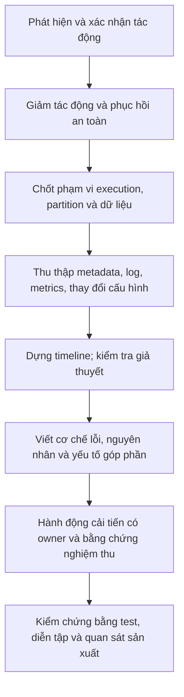

# Postmortem sau sự cố Spring Batch: từ dữ kiện đến cải tiến vận hành

Trong hệ thống xử lý dữ liệu lớn, sự cố Spring Batch không chỉ là một job có trạng thái `FAILED`. Job có thể chạy quá SLA, một partition đứng yên, retry tạo tải đột biến, restart bỏ sót hoặc xử lý trùng dữ liệu, hay một thay đổi về số worker khiến cơ sở dữ liệu cạn kết nối. Sau khi khôi phục dịch vụ, đội vận hành cần trả lời **điều gì đã xảy ra, tác động thực tế là gì, vì sao các cơ chế bảo vệ không ngăn được sự cố và thay đổi nào sẽ giảm xác suất tái diễn**.

Bài học thuộc chương **Vận hành** của module **SPRING_BATCH_SCALING_OPERATIONS**, tập trung vào cách vận hành Spring Batch khi mở rộng bằng multi-threaded step, parallel steps, partitioning hoặc worker phân tán. Cách viết postmortem dưới đây kết nối các vấn đề đặc thù của mô hình mở rộng — thread safety, queue, bottleneck tài nguyên, retry/restart và tính đúng đắn dữ liệu — với quy trình điều tra có thể lặp lại.

## 1. Postmortem là gì, khi nào cần thực hiện?

**Postmortem** là tài liệu phân tích sau sự cố, dựa trên bằng chứng, nhằm làm rõ diễn biến và cải tiến hệ thống. Nó khác với nhật ký xử lý sự cố theo thời gian thực: nhật ký trả lời *đã thao tác gì*, còn postmortem giải thích *vì sao sự cố hình thành và điều gì cần thay đổi*.

Nên thực hiện postmortem khi có một trong các dấu hiệu sau:

- Job vượt thời hạn bàn giao dữ liệu hoặc làm ảnh hưởng hệ thống hạ nguồn.
- Có mất dữ liệu, ghi trùng, sai số liệu, sai phạm vi partition hoặc kết quả không thể đối soát.
- Retry/restart gây vòng lặp lỗi, khởi chạy trùng hoặc khiến worker không thể tiến triển.
- Queue tích tụ, partition đứng lâu, deadlock, connection pool cạn, CPU/memory bị ép hoặc worker chết hàng loạt.
- Người vận hành phải can thiệp thủ công đáng kể, kể cả khi kết quả cuối cùng vẫn đúng.
- Sự cố lặp lại hoặc được phát hiện nhờ khách hàng/hệ thống hạ nguồn thay vì cảnh báo nội bộ.

Một bản postmortem hiệu quả có **phạm vi rõ ràng, diễn biến có mốc thời gian, tác động định lượng, phân biệt sự thật với giả thuyết, nguyên nhân và yếu tố góp phần, biện pháp phục hồi, hành động có người chịu trách nhiệm và cách xác minh hiệu quả**. Văn phong nên trung lập, tập trung vào thiết kế, tín hiệu và quyết định trong bối cảnh lúc đó; tránh quy trách nhiệm cá nhân.

## 2. Định nghĩa phạm vi và tác động trước khi phân tích nguyên nhân

Mỗi postmortem cần một định danh sự cố và tập execution có liên quan. Ví dụ, một job xử lý giao dịch có thể trải qua lần chạy thất bại và một hoặc nhiều lần restart, nhưng các lần đó không nhất thiết tương ứng với cùng `JOB_EXECUTION_ID`.

| Thông tin | Câu hỏi phải trả lời | Ví dụ minh họa |
| --- | --- | --- |
| Mã sự cố | Tài liệu này nói về sự cố nào? | `INC-BATCH-042` |
| Job / môi trường | Workload bị ảnh hưởng ở đâu? | `settlementImport`, production |
| Job instance | Nhóm lần chạy nào có cùng tham số nhận diện? | `JOB_INSTANCE_ID = 812` |
| Các lần chạy | Những lần nào lỗi, được restart, đã phục hồi? | `JOB_EXECUTION_ID = 1451, 1452` |
| Phạm vi bước | Manager step, worker step, partition nào? | `importWorker:partition0..11` |
| Khách hàng / hệ thống phụ thuộc | Ai phải chờ hoặc nhận dữ liệu sai? | Báo cáo đối soát cuối ngày |
| Tác động định lượng | Trễ bao lâu, bao nhiêu bản ghi bị ảnh hưởng? | 12 phút trễ; 2 triệu bản ghi đến muộn |
| Độ tin cậy của tác động | Đã đối soát hay chỉ ước tính? | Đối soát khóa nghiệp vụ hoàn tất |

**Phân loại tác động** ít nhất theo ba chiều: **availability/timeliness** (không có dữ liệu hoặc giao trễ), **correctness** (mất, trùng, sai giá trị) và **resource/cost** (CPU, DB, broker, retry, ảnh hưởng workload khác). Một job báo `COMPLETED` chỉ chứng minh luồng batch đã hoàn tất theo cơ chế framework; không đủ để khẳng định kết quả nghiệp vụ chính xác.

Tránh mô tả mơ hồ như “rất nhiều partition lỗi”. Thay bằng “4/12 partition `FAILED` trong lần chạy 1451; 8 partition `COMPLETED`; trạng thái sau restart được xác minh trong lần chạy 1452”. Khi chưa biết số bản ghi thiếu/trùng, ghi rõ **đang xác minh**, phương pháp xác minh và người phụ trách; không kết luận an toàn trước khi có bằng chứng.

## 3. Bảo toàn bằng chứng ngay sau khi hệ thống ổn định

Sau khi giảm tác động tức thời, thu thập bằng chứng **theo mốc thời gian thống nhất** (nên dùng UTC, ghi rõ múi giờ nếu hiển thị giờ địa phương). Tập bằng chứng tối thiểu:

1. **Spring Batch metadata:** `JOB_INSTANCE_ID`, toàn bộ `JOB_EXECUTION_ID` liên quan, `STEP_EXECUTION_ID`, `STEP_NAME`, trạng thái, thời gian bắt đầu/kết thúc, `EXIT_CODE`, `EXIT_MESSAGE`, bộ đếm read/write/skip/rollback/commit.
2. **Thông tin triển khai:** phiên bản ứng dụng, thay đổi cấu hình `gridSize`, `TaskExecutor`, kích thước chunk, pool kết nối, số pod/consumer, thời điểm rollout hoặc feature toggle.
3. **Log và trace:** exception đầu tiên, log dispatch partition, timeout/retry, correlation ID, thông tin failover; giữ thứ tự sự kiện và định danh worker.
4. **Metrics có timestamp:** throughput, thời gian mỗi chunk/partition, active threads, queue depth, broker ready/unacked, consumer count, DB connection active/pending, lock wait, CPU/memory, GC, tỉ lệ lỗi.
5. **Bằng chứng nghiệp vụ:** số bản ghi nguồn/đích, đối chiếu theo partition và khóa nghiệp vụ, watermark, checkpoint, kiểm tra duplicate và tác động hệ thống hạ nguồn.
6. **Thao tác vận hành:** lệnh stop/restart, scaling, thay đổi cấu hình, rollback, thông báo và các giả thuyết đã thử.

Dùng kho lưu trữ sự cố có quyền truy cập phù hợp; hạn chế sao chép dữ liệu cá nhân, thông tin xác thực, nội dung payload hoặc tham số job nhạy cảm vào báo cáo. Gắn liên kết tới log/trace/dashboard có chính sách lưu giữ, cùng snapshot quan trọng khi dữ liệu metrics có thể hết hạn.

### Truy vấn metadata bằng SQL

Với schema Spring Batch mặc định, có thể lấy trạng thái của **một lần chạy cụ thể** như sau:

```sql
-- :jobExecutionId là tham số bind của SQL client/JDBC.
SELECT
    je.JOB_EXECUTION_ID,
    je.JOB_INSTANCE_ID,
    je.STATUS,
    je.EXIT_CODE,
    je.CREATE_TIME,
    je.START_TIME,
    je.END_TIME,
    je.LAST_UPDATED
FROM BATCH_JOB_EXECUTION je
WHERE je.JOB_EXECUTION_ID = :jobExecutionId;
```

Truy vấn chi tiết step và các partition thuộc lần chạy đó:

```sql
SELECT
    se.STEP_EXECUTION_ID,
    se.STEP_NAME,
    se.STATUS,
    se.EXIT_CODE,
    se.CREATE_TIME,
    se.START_TIME,
    se.END_TIME,
    se.LAST_UPDATED,
    se.COMMIT_COUNT,
    se.READ_COUNT,
    se.WRITE_COUNT,
    se.READ_SKIP_COUNT,
    se.PROCESS_SKIP_COUNT,
    se.WRITE_SKIP_COUNT,
    se.ROLLBACK_COUNT
FROM BATCH_STEP_EXECUTION se
WHERE se.JOB_EXECUTION_ID = :jobExecutionId
ORDER BY se.STEP_NAME, se.STEP_EXECUTION_ID;
```

Đối với một nhóm partition, thêm điều kiện phù hợp với quy ước đặt tên trong ứng dụng, chẳng hạn `AND se.STEP_NAME LIKE 'importWorker:%'`. Tên partition phụ thuộc cấu hình, nên **không mặc định mọi partition đều có tên theo mẫu này**. Các bảng có thể dùng prefix khác `BATCH_`; SQL trên dùng cú pháp named parameter và cần được điều chỉnh theo client/DB thực tế.

Để so sánh các lần chạy của **cùng job instance**:

```sql
SELECT
    je.JOB_EXECUTION_ID,
    je.STATUS,
    je.START_TIME,
    je.END_TIME,
    je.EXIT_CODE
FROM BATCH_JOB_EXECUTION je
WHERE je.JOB_INSTANCE_ID = :jobInstanceId
ORDER BY je.JOB_EXECUTION_ID;
```

Các bộ đếm và trạng thái trong repository phản ánh tiến trình đã được framework ghi nhận tại thời điểm chụp. Chúng không thay thế bằng chứng về số bản ghi thực tế trong hệ thống đích, đặc biệt khi writer gọi API ngoài transaction hoặc khi nhiều worker cùng ghi chung một tài nguyên.

## 4. Lập timeline có thể kiểm chứng

Timeline nên theo dạng **thời điểm → sự kiện quan sát được → nguồn chứng cứ → hệ quả/quyết định**. Đừng gộp thời gian *lỗi bắt đầu*, *hệ thống phát hiện*, *người vận hành xác nhận*, *thực hiện giảm tác động* và *dữ liệu thực sự phục hồi* thành một mốc “đã xử lý”.

Ví dụ giả định (tất cả thời gian là UTC):

| Thời điểm | Sự kiện | Bằng chứng |
| --- | --- | --- |
| 01:00 | `settlementImport` khởi chạy, dự kiến 12 partition | `BATCH_JOB_EXECUTION`, log manager |
| 01:03 | Worker active tăng; DB pool luôn chạm mức tối đa | Metrics executor và HikariCP |
| 01:05 | Xuất hiện timeout khi chờ kết nối; một số worker bắt đầu thất bại | Stack trace, `BATCH_STEP_EXECUTION` |
| 01:08 | Cảnh báo job chậm được phát; đội on-call tiếp nhận | Alert history, incident channel |
| 01:11 | Hạn chế retry tự động trong phạm vi được kiểm soát | Thay đổi runtime, log |
| 01:24 | Áp dụng cấu hình concurrency đã được xác nhận an toàn | Deployment/config audit |
| 01:30 | Restart theo quy trình và đối chiếu partition cần chạy lại | `JOB_EXECUTION_ID` mới, metadata |
| 01:42 | Job hoàn tất; xác minh đầu ra theo khóa nghiệp vụ | Job status, reconciliation report |

Ví dụ trên có SLA phải bàn giao trước **01:30 UTC**, nên thời gian trễ là **12 phút**, dù hệ thống bắt đầu có lỗi trước đó. Nếu log các máy lệch đồng hồ, dùng NTP/trace và thông tin thứ tự sự kiện để điều chỉnh, đồng thời ghi lại sai số; không gán chính xác đến mili giây khi nguồn không đủ tin cậy.

Có thể biểu diễn quy trình điều tra:



## 5. Tìm nguyên nhân: sự kiện khởi phát, cơ chế lỗi và yếu tố góp phần

Một postmortem tốt tách ít nhất bốn lớp:

| Lớp phân tích | Nội dung | Minh họa |
| --- | --- | --- |
| **Trigger** | Điều gì làm sự cố bắt đầu tại thời điểm đó? | Rollout tăng số worker đồng thời |
| **Failure mechanism** | Chuỗi kỹ thuật cụ thể dẫn tới tác động | Concurrency vượt capacity DB → timeout mượn connection → retry → thêm tải |
| **Contributing factors** | Vì sao hệ thống dễ bị tổn thương / phát hiện chậm? | Thiếu chỉ số pool pending, không có load test sát sản xuất |
| **Detection / mitigation gaps** | Cơ chế phát hiện và giới hạn thiệt hại thiếu gì? | Chỉ alert khi job `FAILED`, không cảnh báo backlog và deadline |

Nên xuất phát từ **dữ kiện** rồi lập giả thuyết, kiểm tra bằng timeline và metrics. Tránh ghi “DB chậm là nguyên nhân gốc” nếu chưa biết vì sao DB chậm, tại sao worker không được giới hạn và vì sao cảnh báo không phát sớm.

Ví dụ phân tích chuỗi nguyên nhân:

1. Tham số concurrency của worker được tăng nhằm giảm thời gian hoàn tất.
2. Pool kết nối cơ sở dữ liệu không được tăng tương ứng, trong khi có workload khác dùng chung.
3. Nhiều worker giữ connection khi xử lý chunk; các worker còn lại chờ pool và timeout.
4. Retry của một số thao tác tiếp tục gia tăng số lần truy cập, làm hàng đợi và độ trễ lớn hơn.
5. Dashboard không có tín hiệu “connection pending + throughput giảm”; cảnh báo chỉ xuất hiện sau khi tiến độ đã suy giảm.

Hành động sửa phải khớp **từng cơ chế có bằng chứng**: giới hạn concurrency theo ngân sách DB; kiểm thử tải với throughput và lock contention; đặt timeout/retry/backoff có giới hạn; thêm cảnh báo sớm; và xác minh hiệu quả bằng phép đo. “Nhắc mọi người cẩn thận khi scale” không giải quyết được điều kiện kỹ thuật đã tạo sự cố.

### Đánh giá bằng chứng và sự không chắc chắn

Phân biệt trong báo cáo:

- **Đã xác nhận:** có log timeout chờ connection tại 01:05 và metric pending tăng cùng thời điểm.
- **Có khả năng cao:** tăng concurrency là yếu tố làm tình trạng pool nghiêm trọng hơn; cần đối chiếu chính xác phiên bản cấu hình được áp dụng.
- **Chưa xác minh:** retry có tạo duplicate side effects ở API ngoài hay không; cần đối soát idempotency key.
- **Đã loại trừ bằng kiểm tra:** không có deadlock được DB ghi nhận trong khoảng thời gian sự cố (nếu đã tra đúng hệ thống và khoảng thời gian).

Dùng mức độ chắc chắn phù hợp; một dashboard trống vì mất metrics không chứng minh tài nguyên hoạt động bình thường.

## 6. Checklist nguyên nhân đặc thù khi scale Spring Batch

| Kiến trúc / tính năng | Dấu hiệu cần điều tra | Bằng chứng hoặc câu hỏi quyết định |
| --- | --- | --- |
| **Multi-threaded step** | Kết quả trùng, thứ tự không ổn định, reader dùng state chung | Reader/processor/writer có thread-safe? State/connection/transaction có bị chia sẻ sai? |
| **Parallel steps** | Một step hoàn tất sớm nhưng job vẫn chậm hoặc fail | Step phụ thuộc lẫn nhau? Có cạnh tranh DB/CPU/I/O giữa các flow? |
| **Local partitioning** | Nhiều partition `STARTING`, queue chờ, executor reject | `gridSize`, số partition thực tế, active/queued threads, queue capacity, rejection policy? |
| **Remote partitioning** | Message tích tụ, consumer biến mất, kết quả về trễ | Ready/unacked/redelivery, worker heartbeat, broker ack, dispatch timeout, worker logs? |
| **Partition skew** | Vài partition chạy lâu hơn hẳn số còn lại | Dải dữ liệu phân không đều? Hot keys, range scans, lock contention? |
| **Retry / skip** | Retry storm, số skip bất thường, tăng `ROLLBACK_COUNT` | Retryable exception đúng chưa? backoff, retry limit, skip limit, idempotency? |
| **Restart** | Chạy lại một phần dữ liệu, bị trùng hoặc bỏ sót | `ExecutionContext`, checkpoint, identifying job params, writer idempotency, partition key ổn định? |
| **Triển khai worker** | Phiên bản worker không đồng nhất, lỗi serialization/config | Image digest, config version, rolling deployment, compatibility của payload và schema? |
| **Resource exhaustion** | Hết connection, OOM, CPU throttle, GC dài | Pool waits, container limit, DB locks, thread dump, heap/GC metrics, giới hạn kết nối? |

Để phân biệt **partition pending** với partition đã bắt đầu nhưng mắc kẹt, phải phối hợp metadata `StepExecution` với executor/broker và tiến độ xử lý. Spring Batch không có `BatchStatus.PENDING` chính thức; `STARTING` có thể là **ứng viên chờ** nhưng không đủ để kết luận nguyên nhân. `STARTED` mà không có tiến độ cũng cần điều tra, song không tự động là pending. Khi postmortem, mô tả rõ quy tắc phân loại và nguồn dữ liệu.

## 7. Kiểm chứng đúng đắn dữ liệu và khả năng restart

Khắc phục một job bằng việc restart rồi thấy `COMPLETED` vẫn để ngỏ câu hỏi quan trọng: **dữ liệu có đầy đủ và không trùng không?** Cần một chiến lược đối soát độc lập, phù hợp với nghiệp vụ:

| Phép kiểm tra | Mục đích | Lưu ý |
| --- | --- | --- |
| Đếm nguồn/đích theo khoảng thời gian và partition | Phát hiện thiếu hoặc tăng bất thường | Có thể khác nếu processor lọc bản ghi; tính riêng `FILTER_COUNT` |
| So khớp khóa nghiệp vụ | Phát hiện thiếu hoặc trùng | Dùng khóa định danh ổn định, tránh chỉ dựa vào số dòng |
| Kiểm tra checksum hoặc tổng nghiệp vụ | Phát hiện sai giá trị âm thầm | Chọn hàm tổng hợp/chuẩn hóa phù hợp |
| Kiểm tra watermark/checkpoint | Xác minh resume đúng điểm | Phân biệt checkpoint đã commit và trạng thái bộ nhớ |
| Đối chiếu event/API ngoài | Xác minh side effect | API ngoài không tự động rollback theo transaction của batch |
| Kiểm tra hậu quả ở hệ thống hạ nguồn | Xác minh impact đã hết | Báo cáo và cache có thể cần refresh lại |

Mô hình xử lý an toàn thường cần **idempotency** ở ranh giới ghi kết quả. Ví dụ, khi ghi vào bảng tổng hợp, đặt unique constraint trên `(business_date, business_key)` và sử dụng upsert có quy tắc nghiệp vụ rõ ràng; khi gọi dịch vụ ngoài, truyền idempotency key bền vững để retry không nhân đôi side effect. Key phải gắn với **đơn vị nghiệp vụ cần xử lý đúng một lần**, không đơn thuần là `STEP_EXECUTION_ID` vì identifier của execution có thể thay đổi qua restart.

```text
Idempotency key (minh họa):
settlement:{businessDate}:{transactionId}:{operationType}

Không nên dùng:
settlement:{jobExecutionId}:{transactionId}
# Vì restart thường tạo JobExecution mới cho cùng công việc.
```

Cần xác định transaction boundary của reader/processor/writer, kích thước chunk, chính sách skip/retry, cách cập nhật `ExecutionContext`, và tính ổn định của partition key khi restart. Với remote partitioning, cơ chế gửi/nhận thông điệp có thể dẫn tới redelivery; xử lý trùng phải được thiết kế để an toàn, thay vì giả định mỗi message luôn chỉ được giao đúng một lần.

Nếu phát hiện dữ liệu sai, ghi rõ **kế hoạch bù trừ (compensation)**, tập bản ghi ảnh hưởng, tiêu chuẩn đối soát, cách chống xử lý trùng khi chạy lại và người phê duyệt thao tác ảnh hưởng dữ liệu. Không khởi chạy một job mới với tham số nhận diện tùy tiện chỉ để “né” trạng thái failed của execution cũ: việc đó có thể tạo `JobInstance` khác và làm mất cơ chế restart dự kiến.

## 8. Mẫu postmortem dùng trực tiếp

Nhóm có thể áp dụng mẫu dưới đây và điều chỉnh theo mức độ nghiêm trọng. Phần chưa có bằng chứng phải ghi “Chưa xác minh” và gắn người phụ trách.

```markdown
# Postmortem: [Mã sự cố] — [Tên ngắn gọn]

- Trạng thái báo cáo: Draft / Reviewed / Closed
- Ngày và múi giờ: [YYYY-MM-DD, UTC]
- Job / môi trường / phiên bản: [...]
- JOB_INSTANCE_ID: [...]
- Các JOB_EXECUTION_ID liên quan: [...]
- Chủ trì điều tra / người rà soát: [...]
- Mức độ ảnh hưởng / SLA: [...]

## Tóm tắt và tác động
- Điều gì xảy ra (2–4 câu, không suy đoán):
- Bắt đầu ảnh hưởng / phát hiện / giảm tác động / phục hồi:
- Số partition, records, hệ thống và người dùng bị ảnh hưởng:
- Kết quả đối soát dữ liệu (phương pháp + bằng chứng):
- Những điều còn chưa chắc chắn:

## Timeline (UTC)
| Thời điểm | Quan sát / quyết định | Nguồn chứng cứ |
| --- | --- | --- |
| ... | ... | ... |

## Phân tích
- Trigger:
- Cơ chế lỗi (quan hệ nhân quả có chứng cứ):
- Yếu tố góp phần:
- Vì sao cảnh báo/giới hạn tải chưa ngăn sự cố:
- Giả thuyết đã kiểm tra và kết luận:
- Những tín hiệu còn thiếu:

## Ứng phó và phục hồi
- Biện pháp giảm tác động đã thực hiện:
- Thay đổi concurrency, retries, timeout hoặc deployment:
- Cách xác nhận restart an toàn:
- Kết quả đối soát đầu ra và tác động còn tồn:

## Điều đã hiệu quả / Điều cần cải thiện
- Cơ chế đã giúp phát hiện hoặc hạn chế thiệt hại:
- Điểm gây chậm xử lý hoặc tăng mức độ ảnh hưởng:

## Hành động phòng ngừa
| Action ID | Việc cụ thể | Owner | Hạn | Cách kiểm chứng |
| --- | --- | --- | --- | --- |
| A1 | ... | ... | ... | ... |

## Kiểm tra sau khi đóng
- Test/load test/chaos drill đã chạy:
- Metrics xác nhận hiệu quả:
- Rủi ro tồn đọng và kế hoạch xử lý:
- Liên kết dashboard, log, incident ticket, PR, kết quả đối soát:
```

Mẫu không thay thế bằng chứng thực tế. Nên liên kết trực tiếp tới `JOB_EXECUTION_ID`, truy vấn đã dùng (không lộ bí mật), biểu đồ metrics có thời gian và kết quả đối soát có thể kiểm tra lại.

## 9. Ví dụ postmortem đã điền: tăng worker làm cạn DB pool

**Đây là tình huống minh họa, không phải dữ liệu của một hệ thống cụ thể.**

**Tóm tắt:** Job `settlementImport` chia 2 triệu bản ghi thành 12 partition. Sau một lần triển khai, giới hạn thực thi đồng thời tăng từ 4 lên 12 nhưng pool kết nối chia sẻ vẫn giữ tối đa 6. Hàng đợi chờ DB connection tăng, một số chunk timeout và job thất bại. Kết quả bàn giao trễ 12 phút so với SLA. Đội vận hành phục hồi bằng cách điều chỉnh concurrency, thực hiện restart có kiểm soát và đối soát đầu ra.

**Tác động:** trong `JOB_EXECUTION_ID=1451`, 8/12 partition `COMPLETED`, 4/12 `FAILED`. Các bản ghi của bốn partition lỗi đến đích chậm. Dữ liệu cuối cùng được bàn giao tại 01:42 UTC thay vì 01:30 UTC; sau restart và kiểm tra toàn bộ khóa nghiệp vụ trong phạm vi công việc, không phát hiện bản ghi thiếu hoặc trùng. Mức độ an toàn này dựa trên đối soát của tình huống minh họa, không thể suy ra chỉ từ status `COMPLETED`.

**Bằng chứng:** sự thay đổi concurrency xuất hiện trong lịch sử cấu hình trước 01:00; từ 01:03 pool hoạt động ở mức tối đa và số thread chờ connection tăng; timeout bắt đầu lúc 01:05; `ROLLBACK_COUNT` của các partition lỗi tăng; throughput giảm. DB metrics không cho thấy deadlock trong khoảng điều tra; từ đó nhóm tập trung vào tranh chấp connection và retry.

**Cơ chế lỗi:** số partition chạy đồng thời vượt ngân sách connection thực tế. Khi một số worker chờ mượn connection, chúng chiếm worker threads và kéo dài chunk; retry của các thao tác timeout làm hệ thống tiếp tục chịu tải. Việc thiếu alert trên `connection pending` và throughput khiến đội phản ứng khi job đã mất đáng kể thời gian.

**Khôi phục:** giảm concurrency về mức đã đo có đủ DB capacity, kiểm tra các partition hoàn tất và trạng thái lỗi, rồi dùng restart chuẩn của Spring Batch với cùng job instance khi điều kiện cho phép. Đội đối soát dữ liệu theo khóa nghiệp vụ, kiểm tra side effects và xác nhận tác động hạ nguồn trước khi đóng sự cố.

**Action items:**

| ID | Hành động | Owner (vai trò) | Hạn minh họa | Tiêu chí hoàn tất |
| --- | --- | --- | --- | --- |
| A1 | Ràng buộc số worker đồng thời với ngân sách connection pool, có headroom cho workload khác | Platform | T+2 ngày | Load test không có connection timeout tại tải mục tiêu |
| A2 | Thêm alert kết hợp queue backlog, throughput và DB pool pending | SRE | T+5 ngày | Diễn tập cho thấy cảnh báo phát trước khi trễ SLA |
| A3 | Chuẩn hóa retry limit, backoff và phân loại exception DB | Batch team | T+7 ngày | Fault injection không gây retry storm; lỗi không retry được thất bại nhanh |
| A4 | Bổ sung test restart với partition fail giữa chunk và writer idempotent | Batch team | T+10 ngày | Đối soát không thiếu/trùng trong kịch bản fault |
| A5 | Bổ sung bước rà soát capacity và rollback trong checklist rollout | Release owner | T+7 ngày | Thay đổi concurrency bắt buộc kèm kết quả capacity test |

Lưu ý: các mốc `T+...` là ví dụ thời hạn tính từ lúc chốt postmortem; khi áp dụng cần chuyển thành ngày cụ thể và chỉ định **một người chịu trách nhiệm** cho mỗi hành động. Biện pháp “giảm concurrency” là cách khôi phục tức thời; giải pháp dài hạn còn phải xử lý capacity planning, retry, quan sát và các trường hợp dữ liệu sai.

## 10. Hành động cải tiến có thể nghiệm thu

Action item nên mô tả **thay đổi quan sát được** thay vì ý định. Viết “Thêm cảnh báo khi queue depth tăng ba chu kỳ liên tiếp và throughput bằng 0 trong khi job đang `STARTED`, có kiểm thử alert” cụ thể hơn “Cải thiện monitoring”. Ngưỡng thực tế phải được hiệu chỉnh theo kích thước partition, thời gian chunk, thời gian cold start và SLA.

Ưu tiên các nhóm hành động:

1. **Ngăn lỗi tái diễn:** bảo vệ thread safety, khóa nghiệp vụ, idempotency, giới hạn concurrency, connection budget, retry/backoff, cấu hình timeout.
2. **Giảm tác động:** circuit breaker hoặc backpressure khi áp dụng được, khả năng stop/restart an toàn, cách ly workload, rollback cấu hình đã kiểm chứng.
3. **Phát hiện sớm:** throughput, partition tiến triển, retry/rollback, queue backlog, trạng thái worker, DB pool pending, tỉ lệ chậm SLA.
4. **Rút ngắn phục hồi:** runbook theo `JOB_EXECUTION_ID`, dashboard theo partition, quy trình đối soát, thao tác khôi phục được diễn tập.
5. **Kiểm chứng cải tiến:** test concurrency, fault injection, load test có tải hạ nguồn, diễn tập chết worker và restart trong điều kiện giới hạn tài nguyên.

Mỗi action nên có **owner, thời hạn, tiêu chí nghiệm thu và bằng chứng**: pull request, cấu hình đang áp dụng, kết quả test hoặc đồ thị quan sát sau rollout. Nếu hành động bị hoãn, ghi rủi ro tồn tại và người quyết định.

## 11. Đo chất lượng ứng phó và học từ nhiều sự cố

Để so sánh nhiều postmortem, nhóm có thể theo dõi:

| Chỉ số | Cách hiểu / cách đo |
| --- | --- |
| **Time to detect** | Từ lúc ảnh hưởng bắt đầu đến lúc hệ thống phát hiện được; ghi rõ mốc nào là ước tính |
| **Time to mitigate** | Từ lúc phát hiện đến khi có biện pháp giảm tác động hiệu quả |
| **Time to restore** | Từ lúc ảnh hưởng bắt đầu đến khi dữ liệu/dịch vụ đáp ứng tiêu chí phục hồi |
| **SLA breach duration** | Thời gian vượt hạn bàn giao đã thỏa thuận |
| **Max queue backlog** | Độ sâu queue lớn nhất tại cùng thời gian đo, phân biệt ready và in-flight |
| **Partition skew** | Độ chênh lệch thời lượng/khối lượng giữa partition; dùng percentile thay vì chỉ trung bình |
| **Retry/rollback pressure** | Tỉ lệ retry, rollback, timeout trên đơn vị công việc |
| **Data reconciliation result** | Số bản ghi thiếu/trùng/sai còn lại sau phục hồi |
| **Action completion** | Hành động đã nghiệm thu đúng hạn và đã chứng minh hiệu quả |

Không dùng riêng MTTR để đánh giá con người; số liệu phục hồi phụ thuộc độ phức tạp và tác động của sự cố. Quan trọng hơn là **cải thiện tốc độ phát hiện, độ tin cậy dữ liệu và khả năng khôi phục có thể kiểm chứng**.

Một postmortem được xem là **đủ điều kiện đóng** khi tác động đã được định lượng và đối soát, timeline có bằng chứng, cơ chế lỗi được giải thích ở mức có thể hành động, các điều chưa chắc chắn được ghi rõ, và hành động phòng ngừa có owner cùng tiêu chí nghiệm thu. Việc triển khai action có thể diễn ra sau khi báo cáo được phê duyệt; nên tiếp tục theo dõi cho đến khi kiểm chứng hiệu quả trong môi trường phù hợp.

## 12. Bài thực hành

Một batch job có 16 partition chạy trên 4 remote workers. Sau triển khai, broker báo 12 message ready, 4 in-flight. Repository hiển thị 4 partition `STARTED`, 12 partition `STARTING`; 10 phút sau có 2 partition `FAILED`, hệ thống hạ nguồn báo dữ liệu thiếu. Trong log có `connection timeout` và redelivery. Đội đã restart job, cuối cùng trạng thái `COMPLETED`.

Hãy lập đề cương postmortem gồm: (a) phạm vi các `JOB_EXECUTION_ID` cần thu thập; (b) ít nhất ba giả thuyết về cơ chế lỗi kèm loại bằng chứng phân biệt; (c) cách xác định 12 partition thực sự đang chờ hay đã nhận việc; (d) cách kiểm tra dữ liệu sau restart; (e) ba action item có tiêu chí nghiệm thu.

**Gợi ý:** kiểm tra các lần chạy cũ/mới cùng `JOB_INSTANCE_ID`; đối chiếu `StepExecution` với ready/in-flight, consumer health và trace dispatch; kiểm tra kết nối DB, số worker, timeout/retry và khoảng commit; đối soát khóa nghiệp vụ/side effect thay vì chỉ tin `COMPLETED`; đặt action về capacity test, alert theo tiến độ và restart/idempotency test. Những dữ kiện đã cho **chưa đủ** để khẳng định duy nhất một nguyên nhân, và redelivery không tự chứng minh có ghi trùng.

---

**Điểm cần mang vào vận hành:** postmortem tốt kết nối **execution cụ thể → dòng thời gian có bằng chứng → tác động nghiệp vụ → cơ chế kỹ thuật → hành động được kiểm chứng**. Đối với Spring Batch scaling, phải cùng lúc xem trạng thái step/partition, luồng dispatch, tài nguyên hệ thống và tính đúng đắn dữ liệu sau retry/restart. Cách làm này giúp biến một lần chữa sự cố thành thay đổi đo được cho các lần chạy tiếp theo.
