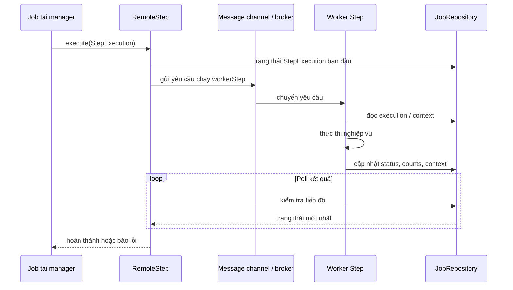

# RemoteStep phụ thuộc phiên bản

## 1. Vì sao phải kiểm tra phiên bản trước khi dùng RemoteStep?

Trong module **SPRING_BATCH_SCALING_OPERATIONS**, chúng ta mở rộng Spring Batch cho workload dữ liệu lớn bằng multi-threaded step, parallel steps, partitioning và các mô hình xử lý phân tán. Khi chuyển một phần công việc sang JVM hoặc máy khác, một sai sót phổ biến là thấy ví dụ có lớp `RemoteStep` rồi đưa nguyên mã vào dự án đang dùng Spring Batch 5.x. Kết quả thường là lỗi import hoặc không tìm thấy class: **`RemoteStep` là API mới được giới thiệu ở Spring Batch 6.0**, không phải API có sẵn ở mọi đời Spring Batch.

Điểm khác biệt này ảnh hưởng đến cả cách viết cấu hình, thiết kế manager/worker, cách theo dõi `JobRepository` và lựa chọn phương án mở rộng khi dự án chưa nâng cấp được.

Sau bài học, bạn sẽ:

1. Xác định chính xác `RemoteStep` thuộc phiên bản và module nào.
2. Phân biệt **remote step execution**, **remote partitioning** và **remote chunking**.
3. Đọc cấu hình `RemoteStep` ở Spring Batch 6.x mà không nhầm sang API của 5.x.
4. Chọn phương án thay thế hợp lệ khi hệ thống vẫn dùng 5.x.
5. Kiểm tra dependency, cấu hình messaging, trạng thái thực thi, retry/restart và tính tương thích của các node.

> **Quy tắc đầu tiên:** Kiểm tra **version thực sự nằm trên runtime classpath** và Javadoc đúng nhánh trước khi chọn API. Tên phương án xử lý “remote” không bảo đảm sự hiện diện của lớp Java cùng tên.

## 2. Ma trận phiên bản của RemoteStep

Theo tài liệu tham khảo API chính thức, lớp `org.springframework.batch.integration.remote.RemoteStep` có chú thích **`Since: 6.0.0`**.

| Dòng Spring Batch | `RemoteStep` chuyên dụng | Cách xử lý phân tán có thể dùng |
| --- | --- | --- |
| **4.x** | Chưa có lớp `RemoteStep` được giới thiệu ở 6.0 | Dùng khả năng remote chunking / remote partitioning tương ứng với API và tài liệu của nhánh đang chạy |
| **5.0–5.2.x** | **Không có API `RemoteStep` của 6.0** | `RemotePartitioningManagerStepBuilderFactory`, `RemotePartitioningWorkerStepBuilderFactory`, `MessageChannelPartitionHandler` hoặc remote chunking, tùy kiến trúc |
| **6.0.x** | **Có**, tại `spring-batch-integration` | Có thêm remote step execution; remote partitioning/chunking vẫn là các mô hình riêng |
| **6.1.x** | **Có** trong API cùng nhóm `org.springframework.batch.integration.remote` | Kiểm tra Javadoc và hướng dẫn chính xác của phiên bản 6.1.x đang dùng |

**Cẩn thận khi đọc bảng:** Bảng cho biết **khi nào có class**, không cam kết mỗi API builder hay mỗi dòng cấu hình của một minor version giữ nguyên mãi. Tính tương thích cuối cùng còn phụ thuộc phiên bản Spring Framework, Spring Integration, thư viện messaging và cơ chế cấu hình Spring Boot.

Trong Spring Batch 6, lớp có tên đầy đủ:

```java
import org.springframework.batch.integration.remote.RemoteStep;
```

Lớp này thuộc artifact:

```text
org.springframework.batch:spring-batch-integration
```

**Không thể chỉ thêm artifact `spring-batch-integration` phiên bản 5.x rồi import `RemoteStep`**: trong dòng đó chưa có class này. Ngược lại, không nên thêm riêng `spring-batch-integration` 6.x vào ứng dụng có `spring-batch-core` 5.x để “mượn” class vì làm lệch major version và có thể gây lỗi liên kết API ở runtime.

Nguồn xác nhận mốc giới thiệu: [RemoteStep API của Spring Batch 6](https://docs.spring.io/spring-batch/reference/api/org/springframework/batch/integration/remote/RemoteStep.html) và [Scaling and Parallel Processing 6.0](https://docs.spring.io/spring-batch/reference/6.0/scalability.html).

## 3. RemoteStep thực sự thực hiện việc gì?

`RemoteStep` là một triển khai `Step` đóng vai trò **đại diện tại manager** cho một worker step được thực thi ở nơi khác. Trong mô hình này:

- Manager đang chạy `Job`, tạo/điều phối một `StepExecution` rồi gửi yêu cầu thực thi qua Spring Integration messaging.
- Yêu cầu chứa định danh cần thiết để worker xác định step và execution cần chạy.
- Worker nhận yêu cầu, định vị bean `Step` bằng `StepLocator`, thực thi logic thật và cập nhật trạng thái, context trong `JobRepository` dùng chung.
- `RemoteStep` tại manager **poll `JobRepository`** để biết remote execution đã hoàn thành, thất bại hoặc đến giới hạn chờ.



**Điểm mạnh:** Có thể đưa logic của một step sang tiến trình khác mà job ở manager vẫn sử dụng abstraction `Step` quen thuộc.

**Giới hạn:** `RemoteStep` **không tự chia một step thành nhiều partition**, không tự phân phối từng chunk, không tạo broker, không tự triển khai `JobRepository` và không tự xử lý idempotency của nghiệp vụ.

Tên `RemoteStep` cũng không có nghĩa mọi `StepExecution` đều chạy đồng thời: một remote step là một đơn vị thực thi được ủy quyền sang remote worker; song song hóa nhiều đơn vị công việc phải được thiết kế thêm trong flow, partitioning hoặc chiến lược khác.

## 4. Phân biệt ba mô hình: RemoteStep, remote partitioning và remote chunking

| Câu hỏi | Remote step execution (`RemoteStep` 6.x) | Remote partitioning | Remote chunking |
| --- | --- | --- | --- |
| **Đơn vị giao việc** | Một lần thực thi của **cả step** | Nhiều `StepExecution`, mỗi execution đại diện **một partition** | Các **chunk item** do manager đọc và gửi |
| **Ai đọc dữ liệu?** | Worker thực thi step thật | Mỗi worker/partition có reader theo dữ liệu của mình | Thường manager đọc và chia chunk |
| **Ai xử lý và ghi?** | Worker | Worker của từng partition | Worker xử lý/ghi các chunk nhận được |
| **Có partition key riêng?** | Không tự sinh | Có, nếu `Partitioner` cung cấp | Không phải cơ chế partition theo `ExecutionContext` |
| **Quản lý trạng thái** | StepExecution được worker cập nhật trong repository dùng chung | Metadata StepExecution/context của từng partition | Theo mô hình chunking và cơ chế gửi/nhận kết quả |
| **Khi phù hợp** | Muốn chuyển **toàn bộ step** sang tiến trình khác | Muốn chia dataset lớn thành các vùng độc lập, restart từng vùng | Reader tập trung, xử lý/ghi theo chunk đủ nặng để phân phối |

Trong remote partitioning, manager có `PartitionStep` và chia nguồn dữ liệu bằng `Partitioner`; các worker chạy những phần khác nhau. Trong remote chunking, manager vẫn điều phối hoạt động đọc và nhóm item thành chunk, rồi chuyển chunk qua middleware.

Nếu dự án Spring Batch 5.x muốn xử lý song song trên nhiều máy, **không nhất thiết phải nâng lên 6.x chỉ để có tính năng phân tán**: remote partitioning và remote chunking đã có trong các phiên bản trước. Chọn giải pháp dựa trên cách chia dữ liệu và yêu cầu restart, thay vì dựa trên tên lớp.

## 5. Cấu hình lõi với Spring Batch 6.x

Ví dụ sau trình bày **phần cốt lõi của RemoteStep trong Spring Batch 6.x**, tách khỏi code ứng dụng cụ thể. Giả sử ứng dụng đã có một `JobRepository` phù hợp, một channel gửi request ra broker, và một worker có thể nhận request từ broker đó.

### 5.1. Phía manager

```java
import org.springframework.batch.core.Step;
import org.springframework.batch.core.repository.JobRepository;
import org.springframework.batch.integration.remote.RemoteStep;
import org.springframework.beans.factory.annotation.Qualifier;
import org.springframework.context.annotation.Bean;
import org.springframework.context.annotation.Configuration;
import org.springframework.integration.core.MessagingTemplate;
import org.springframework.messaging.MessageChannel;

@Configuration
class RemoteStepManagerConfiguration {

    @Bean
    MessagingTemplate remoteStepMessagingTemplate(
            @Qualifier("outboundStepRequests") MessageChannel outbound) {
        MessagingTemplate template = new MessagingTemplate();
        template.setDefaultChannel(outbound);
        return template;
    }

    @Bean
    Step billingRemoteStep(
            JobRepository jobRepository,
            @Qualifier("remoteStepMessagingTemplate")
                MessagingTemplate messagingTemplate) {
        return new RemoteStep(
            "billingRemoteStep", // tên step trong job tại manager
            "billingWorkerStep", // tên Step mà worker phải tìm thấy
            jobRepository,
            messagingTemplate
        );
    }
}
```

Ở đây:

1. `billingRemoteStep` là step mà `Job` tại manager tham chiếu.
2. `billingWorkerStep` là tên **worker step** sẽ được `StepLocator` phía remote nhận diện.
3. `remoteStepMessagingTemplate` gửi message đến outbound channel đã được nối với middleware.
4. `JobRepository` phải được chuẩn bị để metadata của execution có thể truy cập từ worker.

**Các bean `outboundStepRequests` và IntegrationFlow nối channel với broker chưa được khai báo trong đoạn mã**. Đây là ví dụ cấu hình lõi, không phải ứng dụng chạy độc lập sau khi copy/paste. Cần bổ sung adapter thực tế, bảo mật transport, cấu hình timeout và chính sách xử lý khi worker unavailable.

API của `RemoteStep` trong 6.x còn cung cấp các phương thức cấu hình như `setPollInterval(...)`, `setTimeout(...)` và `setMessageChannel(...)`. Trước khi thay giá trị mặc định, đọc Javadoc của **đúng phiên bản patch** để xác nhận đơn vị thời gian và ý nghĩa timeout; **timeout của manager không đồng nghĩa worker đã dừng hoặc transaction đã rollback**.

### 5.2. Phía worker

Ở worker, định nghĩa một bean `Step` mang tên `billingWorkerStep` chứa nghiệp vụ đọc, xử lý và ghi theo API của Spring Batch **6.x**. Một handler nhận yêu cầu remote, tra cứu step đó và điều phối execution:

```java
import org.springframework.batch.core.repository.JobRepository;
import org.springframework.batch.integration.partition.BeanFactoryStepLocator;
import org.springframework.batch.integration.partition.StepExecutionRequestHandler;
import org.springframework.batch.integration.partition.StepLocator;
import org.springframework.beans.factory.BeanFactory;
import org.springframework.context.annotation.Bean;
import org.springframework.context.annotation.Configuration;

@Configuration
class RemoteStepWorkerConfiguration {

    @Bean
    StepLocator stepLocator(BeanFactory beanFactory) {
        BeanFactoryStepLocator locator = new BeanFactoryStepLocator();
        locator.setBeanFactory(beanFactory);
        return locator;
    }

    @Bean
    StepExecutionRequestHandler stepExecutionRequestHandler(
            JobRepository jobRepository,
            StepLocator stepLocator) {
        StepExecutionRequestHandler handler =
            new StepExecutionRequestHandler();
        handler.setJobRepository(jobRepository);
        handler.setStepLocator(stepLocator);
        return handler;
    }
}
```

Phần còn thiếu là **IntegrationFlow nhận message** từ middleware, chuyển payload hợp lệ vào `StepExecutionRequestHandler.handle(...)`, cùng bean thực sự mang tên `billingWorkerStep`. Ví dụ cấu trúc triển khai:

```text
JMS/AMQP inbound adapter
    -> inboundStepRequests channel
    -> StepExecutionRequestHandler.handle(...)
    -> BeanFactoryStepLocator("billingWorkerStep")
    -> chạy Step và ghi StepExecution vào JobRepository
```

Tài liệu Spring Batch 6.0 có ví dụ dùng Spring Integration `Jms.messageDrivenChannelAdapter(...)` và `IntegrationFlow.handle(handler, "handle")`. Cấu hình cụ thể thay đổi theo broker và loại message adapter, nên không áp dụng máy móc đoạn JMS của phiên bản khác.

### 5.3. Tối thiểu phải triển khai những hạng mục nào?

| Hạng mục | Manager | Worker |
| --- | --- | --- |
| Spring Batch + Spring Integration tương thích | Có | Có |
| `JobRepository` chung về mặt lưu trữ metadata | Gửi/đọc trạng thái | Tra cứu/cập nhật trạng thái |
| `RemoteStep` | Có | Không bắt buộc |
| Bean `Step` thật, tên khớp `remoteStepName` | Có thể không chứa logic thật | **Bắt buộc** |
| Channel/adapter kết nối broker | Outbound request | Inbound request |
| Handler nhận `StepExecutionRequest` | Không phải thành phần chính | `StepExecutionRequestHandler` |
| Timeout, reconnect, tracing | Có | Có chính sách nhận/retry |

Không dùng channel cục bộ như `DirectChannel` giữa hai JVM rồi kỳ vọng chúng tự trao đổi với nhau. `DirectChannel` chỉ truyền message trong cùng application context; muốn qua nhiều tiến trình phải có transport hoặc adapter thực tế.

## 6. Nếu hệ thống đang dùng Spring Batch 5.x thì làm gì?

Với Spring Batch 5.x, áp dụng remote partitioning nếu dữ liệu có thể chia thành các tập độc lập. Phía manager có thể sử dụng `RemotePartitioningManagerStepBuilderFactory` (API từ Spring Batch Integration 5.x) để khai báo `Partitioner`, `gridSize` và các channel request/reply.

Ví dụ **cú pháp định hướng cho 5.x**, giả sử các channel và `Partitioner` đã tồn tại:

```java
import org.springframework.batch.core.Step;
import org.springframework.batch.core.partition.support.Partitioner;
import org.springframework.batch.integration.partition.RemotePartitioningManagerStepBuilderFactory;
import org.springframework.beans.factory.annotation.Qualifier;
import org.springframework.context.annotation.Bean;
import org.springframework.messaging.MessageChannel;

@Bean
Step ordersManagerStep(
        RemotePartitioningManagerStepBuilderFactory factory,
        Partitioner ordersPartitioner,
        @Qualifier("partitionRequests") MessageChannel requests,
        @Qualifier("partitionReplies") MessageChannel replies) {

    return factory.get("ordersManagerStep")
        .partitioner("ordersWorkerStep", ordersPartitioner)
        .gridSize(4)
        .outputChannel(requests)
        .inputChannel(replies)
        .build();
}
```

Đoạn trên **không phải `RemoteStep`**: manager gửi **nhiều partition execution** cho worker, thay vì proxy một step execution đơn lẻ. Worker cần được cấu hình bằng cơ chế worker tương ứng (ví dụ `RemotePartitioningWorkerStepBuilderFactory`) và truy cập metadata phù hợp; app cần khai báo transport adapter thực tế. Đây là trích đoạn hướng dẫn kiến trúc, không phải toàn bộ cấu hình production.

Nếu nguồn dữ liệu cần một reader tập trung và công việc `process/write` mới là phần nặng, có thể dùng **remote chunking** của 5.x. Khi đó manager gửi từng chunk qua messaging; đừng dùng thiết kế này nếu việc đọc tập trung đã là nút thắt.

### Không đổi API chỉ vì tên gần giống

```text
Spring Batch 5.x:
    RemotePartitioningManagerStepBuilderFactory
        + Partitioner + PartitionHandler
        -> nhiều partition StepExecution

Spring Batch 6.0+:
    RemoteStep
        + MessagingTemplate + StepExecutionRequestHandler
        -> ủy quyền một step execution sang worker
```

Hai API phục vụ **hai nhu cầu khác nhau**. Việc nâng cấp dự án 5.x lên 6.x không buộc phải thay mọi remote partitioning bằng `RemoteStep`; nếu vẫn cần chia dataset thành nhiều dải ID và restart từng partition, tiếp tục dùng mô hình partitioning tương thích là lựa chọn hợp lý.

## 7. Kiểm tra dependency trước khi sửa mã

### 7.1. Nhận diện phiên bản thực tế

Xem file build của ứng dụng để biết nhánh Spring Batch được quản lý bởi Spring Boot/BOM nào. Sau đó kiểm tra cây dependency thực sự được giải quyết:

```bash
# Maven: liệt kê Spring Batch artifacts trong cây dependency.
mvn dependency:tree -Dincludes=org.springframework.batch

# Gradle: xem phiên bản được chọn của spring-batch-core.
./gradlew dependencyInsight --dependency spring-batch-core --configuration runtimeClasspath

# Gradle: kiểm tra cả artifact tích hợp.
./gradlew dependencyInsight --dependency spring-batch-integration --configuration runtimeClasspath
```

**Chỉ là lệnh minh họa**, tùy dự án Windows có thể dùng `gradlew.bat`. Xem đồng thời `spring-batch-core` và `spring-batch-integration` để nhận ra việc hai artifact bị ép về các major version khác nhau.

### 7.2. Khai báo artifact đúng cách

Với dự án có BOM quản lý Spring Batch **6.x**, khai báo thêm:

```xml
<dependency>
    <groupId>org.springframework.batch</groupId>
    <artifactId>spring-batch-integration</artifactId>
</dependency>
```

Giữ việc chọn phiên bản nhất quán qua BOM hoặc dependency management của dự án. Không thêm `version` thủ công khác major chỉ để sửa lỗi import. Nếu không dùng BOM, pin tập artifact Spring Batch và Spring Integration theo tổ hợp tương thích được tài liệu phiên bản xác nhận.

Với hệ thống Spring Boot, phải kiểm tra phiên bản Spring Boot hiện tại **quản lý nhánh Spring Batch nào**; không suy ra rằng phiên bản Spring Boot bất kỳ đều cung cấp Spring Batch 6.

### 7.3. Triệu chứng thường gặp

| Triệu chứng | Khả năng cao | Cách kiểm tra |
| --- | --- | --- |
| `Cannot resolve symbol RemoteStep` | Đang dùng Batch 5.x hoặc thiếu `spring-batch-integration` | Xem version và classpath compile |
| `ClassNotFoundException` / `NoClassDefFoundError` | Compile/runtime classpath khác nhau, artifact thiếu | Xem dependency tree của **artifact đã deploy** |
| `NoSuchMethodError` | Artifact Spring Batch/Spring Integration lệch API | Kiểm tra BOM, dependency override và classpath |
| Bean `Step` tại worker không được tìm thấy | `remoteStepName` không khớp tên worker step hoặc `StepLocator` chưa nhìn thấy bean | Đối chiếu tên bean/step và application context |
| Manager chờ mãi | Request không tới worker, metadata không cập nhật, polling/messaging lỗi | Kiểm tra broker, worker log, `JobRepository` và timeout |
| Một số node hoạt động, node khác lỗi serialize | Phiên bản hoặc định dạng message không tương thích | Kiểm tra dependency và hợp đồng payload của toàn bộ node |

## 8. Tương thích khi vận hành nhiều tiến trình

Một class có tồn tại trong JAR chưa có nghĩa kiến trúc remote đã hoạt động an toàn. Các thành phần cần tương thích ở **nhiều lớp**:

### 8.1. Repository và metadata

Manager và worker phải phối hợp với **cùng kho metadata logic**, có schema phù hợp với phiên bản đang sử dụng. Không được dùng repository in-memory riêng ở mỗi tiến trình rồi kỳ vọng worker có thể cập nhật `StepExecution` mà manager đang polling.

Trước khi nâng cấp, đọc hướng dẫn migration và kiểm tra thay đổi schema metadata, cơ chế serialization của `ExecutionContext` và cách xử lý job/step execution đã tồn tại. Việc chạy manager 6.x với worker 5.x trỏ vào cùng metadata **không nên được giả định là tổ hợp được hỗ trợ**.

### 8.2. Phiên bản và hợp đồng message

Cấu hình transport bảo đảm request đúng đích, định danh execution không bị thay đổi, message đủ dữ liệu để handler tra cứu step và context. Nếu dùng JMS/AMQP:

- Kiểm tra serializer, headers, type mapping và payload giữa các tiến trình.
- Với các luồng phản hồi/aggregation có correlation, bảo toàn các headers cần thiết theo tài liệu Spring Integration.
- Kiểm tra ack/requeue/dead-letter, redelivery và tác động khi broker hoặc worker ngắt kết nối.
- Tránh giả định broker gửi **đúng một lần** đồng nghĩa tác dụng phụ nghiệp vụ cũng đúng một lần.

`RemoteStep` là cơ chế ủy quyền execution qua messaging; nó không thay thế thiết kế broker bền vững và chính sách khôi phục khi gửi yêu cầu bị gián đoạn.

### 8.3. Trạng thái khi timeout và restart

Giả sử manager gửi request, worker nhận và ghi một phần kết quả, nhưng manager timeout do kết nối bị đứt:

1. Manager có thể không biết kết quả cuối cùng của worker tại thời điểm timeout.
2. Worker có thể vẫn đang chạy hoặc đã commit một số chunk.
3. Việc gửi lại yêu cầu hoặc restart phải dựa trên metadata thực tế, không chỉ trên ngoại lệ ở manager.
4. Ghi dữ liệu đích cần khóa nghiệp vụ, transaction và cơ chế idempotent nếu có khả năng replay.
5. Khi restart, kiểm tra `JobInstance`, `JobExecution`, `StepExecution`, `ExecutionContext` và dữ liệu đích trước khi quyết định chạy lại.

**Timeout không tương đương cancel thành công.** Mọi cơ chế dừng worker đều cần được kiểm chứng theo API và cách truyền tín hiệu trong hệ thống cụ thể.

### 8.4. Quan sát bottleneck thực tế

Trong workload lớn, đặt các metric riêng cho:

| Điểm đo | Metric hoặc bằng chứng |
| --- | --- |
| Gửi request | Thời gian publish, số message lỗi/retry, backlog broker |
| Xếp hàng tại worker | Queue depth, thời gian từ gửi tới nhận |
| Thực thi step | Thời gian `read/process/write`, throughput, CPU, memory |
| Metadata | Thời gian cập nhật/đọc `JobRepository`, lock/connection wait |
| Hoàn thành | Trạng thái/exit code, độ trễ polling, timeout, lỗi |
| Tính đúng | Bản ghi duy nhất, duplicate, lost records, retry/restart |

Nếu chỉ có một remote step rất nặng chạy trên một worker, thêm hàng chục worker rỗi không tự tăng tốc job. Khi dataset chia được thành vùng độc lập, cân nhắc partitioning để sử dụng nhiều worker với các `StepExecution` riêng.

## 9. Lộ trình đưa RemoteStep vào dự án

Một quy trình an toàn:

1. **Đóng băng baseline:** Ghi nhận phiên bản Spring Boot (nếu có), Spring Batch Core/Integration, Spring Framework/Integration, JDK và schema repository đang vận hành.
2. **Xác định mục tiêu:** Cần đưa *một step* sang worker riêng, chia dataset thành *nhiều partition*, hay gửi *các chunk* để xử lý phân tán?
3. **Chọn API theo phiên bản:** 5.x dùng remote partitioning/chunking phù hợp; 6.x có thể dùng `RemoteStep` cho remote execution cả step.
4. **Thiết kế transport:** Kênh gửi nhận, xác thực, retry/redelivery, độ bền message và giới hạn queue.
5. **Thiết kế trạng thái:** Repository dùng chung, tên worker step ổn định, checkpoint và quy tắc restart.
6. **Đo trên tập đại diện:** So sánh throughput và độ trễ; xác nhận điểm nghẽn có chuyển từ CPU/I/O sang broker, network hoặc DB.
7. **Diễn tập lỗi:** Dừng worker giữa chunk, đứt broker, timeout manager, restart; so sánh dữ liệu đầu ra bằng khóa nghiệp vụ.

### Ví dụ chọn giải pháp

Hệ thống có job gồm `downloadStep`, `normalizeStep` và `publishStep`. `normalizeStep` cần thư viện nặng và có thể chạy trên một máy riêng; không có nhu cầu chia nó thành nhiều partition. Nếu nền tảng đã chạy Spring Batch 6.x, `RemoteStep` là một lựa chọn để ủy quyền toàn bộ `normalizeStep` sang worker.

Ngược lại, job phải xử lý **50 triệu giao dịch** có thể chia theo dải ID, cần 16 worker và khả năng restart riêng từng khoảng. **Remote partitioning** phù hợp mục tiêu hơn; chỉ thay bằng một `RemoteStep` sẽ không tự tạo 16 partition hay cung cấp checkpoint riêng từng vùng.

## 10. Câu hỏi tự kiểm tra

1. `RemoteStep` được giới thiệu từ phiên bản Spring Batch nào và nằm trong artifact nào?
2. Vì sao thêm `spring-batch-integration` 5.x không giải quyết lỗi `Cannot resolve symbol RemoteStep`?
3. Khi dùng `RemoteStep`, manager xác định trạng thái kết thúc remote execution bằng cách nào?
4. Vì sao `RemoteStep` không đồng nghĩa với remote partitioning?
5. Hệ thống dùng Spring Batch 5.2 muốn xử lý 100 triệu bản ghi trên nhiều máy: có những lựa chọn phân tán nào?
6. Khi manager timeout nhưng worker có thể vẫn chạy, tại sao không nên gửi lại yêu cầu ngay mà chưa kiểm tra metadata và tính idempotent?
7. Trước khi đổi major version, cần xác minh những dependency và thay đổi repository nào?

## 11. Tài liệu tham khảo theo phiên bản

- [Spring Batch 6.0 — Scaling and Parallel Processing: Remote Step execution](https://docs.spring.io/spring-batch/reference/6.0/scalability.html).
- [Spring Batch 6 — RemoteStep Java API, `Since: 6.0.0`](https://docs.spring.io/spring-batch/reference/api/org/springframework/batch/integration/remote/RemoteStep.html).
- [Spring Batch 6.0 — Externalizing Batch Process Execution](https://docs.spring.io/spring-batch/reference/6.0/spring-batch-integration/externalizing-execution.html).
- [Spring Batch 5.2 — Scaling and Parallel Processing](https://docs.spring.io/spring-batch/reference/5.2/scalability.html).
- [Spring Batch 6.0 — What's New](https://docs.spring.io/spring-batch/reference/6.0/whatsnew.html).

**Ghi nhớ:** `RemoteStep` là một API cụ thể của **Spring Batch 6.0 trở lên**, nằm trong `spring-batch-integration` và dùng messaging để ủy quyền **toàn bộ step execution** sang remote worker. Trong Spring Batch 5.x, hãy dùng các cơ chế remote partitioning/chunking có thật trong phiên bản đó. Dù chọn phương án nào, hãy giữ dependency nhất quán, chia dữ liệu đúng cách, bảo vệ `JobRepository`, diễn tập retry/restart và đo thông lượng theo tài nguyên thực tế.
