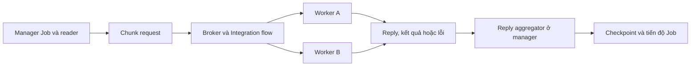
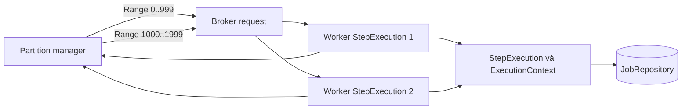

# Spring Batch Integration tương thích: phiên bản, API và giao thức phân tán

Khi một Spring Batch Job được chạy trên một JVM duy nhất, nhiều vấn đề tương thích có thể được phát hiện ngay lúc biên dịch hoặc khởi động ứng dụng. Với **Spring Batch Integration**, sự tương thích còn trải rộng sang các thành phần messaging, broker, worker chạy trên nhiều container, bảng metadata của `JobRepository` và các message tồn tại giữa hai đợt triển khai. Một manager vẫn khởi động thành công sau khi nâng cấp nhưng không nhận được phản hồi của worker là tình huống thực tế: hệ thống có thể treo ở trạng thái `STARTED`, gây retry hoặc xử lý trùng nếu khôi phục sai cách.

Bài này thuộc chương **Tương thích phiên bản** của module **SPRING_BATCH_SCALING_OPERATIONS**. Trong phạm vi mở rộng Spring Batch cho dữ liệu lớn bằng multi-threaded step, parallel steps, partitioning và mô hình phân tán, mục tiêu là **chọn đúng tổ hợp phiên bản Spring Batch – Spring Integration – Spring Boot – Java**, hiểu các điểm thay đổi của API, duy trì hợp đồng message/metadata và có quy trình thử nghiệm nâng cấp mà vẫn bảo đảm thread safety, checkpoint, retry/restart.

Các ví dụ phiên bản được đối chiếu với tài liệu chính thức tại thời điểm **26/11/2026**; khi sử dụng bài trong tương lai, cần kiểm tra lại BOM của chính phiên bản Spring Boot dự kiến triển khai.

## 1. Spring Batch Integration là gì?

**Spring Batch** quản lý Job, Step, chunk, transaction, metadata, checkpoint và restart. **Spring Integration** cung cấp message channel, gateway, adapter và flow để kết nối các thành phần nội bộ hoặc hệ thống bên ngoài. **Spring Batch Integration** là tập hợp thành phần tích hợp giúp phối hợp hai framework này, thường được cung cấp qua artifact `org.springframework.batch:spring-batch-integration`.

Các nhóm use case chính:

| Nhu cầu | Cơ chế thường dùng | Lưu ý tương thích |
|---|---|---|
| Nhận message để chạy Batch Job | `JobLaunchingGateway` hoặc message handler liên quan | Kiểm tra kiểu payload, `JobParameters`, kiểu phản hồi và xử lý lỗi |
| Phát thông báo trạng thái Job | Event/listener gửi sang Spring Integration flow | Phân biệt trạng thái framework và kết quả nghiệp vụ; bảo đảm gửi lại an toàn |
| Đẩy chunk sang worker | **Remote chunking**, manager gửi chunk qua channel/broker | Hợp đồng chunk request/reply, correlation, serialization, ack và retry |
| Đẩy một Step/partition sang worker | **Remote partitioning**, worker thực thi một Step với dữ liệu riêng | Tên Step, `ExecutionContext`, định danh partition, `JobRepository` dùng chung |
| Thực thi Step ở JVM khác | **Remote step execution** được giới thiệu trong Spring Batch 6 | API và giao thức riêng; không đồng nhất với remote partitioning |
| Xử lý bất đồng bộ trong một JVM | `AsyncItemProcessor`, `AsyncItemWriter`, local chunking | Cần xem nơi đặt class theo phiên bản; không phải trường hợp nào cũng cần `spring-batch-integration` |

Hai loại tương thích cần được đánh giá riêng:

1. **Tương thích thư viện trong một JVM:** dependency cùng release train, API/ABI, bean configuration, transaction manager, Java baseline.
2. **Tương thích giữa các tiến trình:** format message, header, version payload, data contract, partition identity, metadata repository, giao thức retry và việc cùng tồn tại worker cũ/mới trong lúc rollout.

Một ứng dụng build thành công chỉ cho biết tầng thứ nhất qua được một số kiểm tra. Không thể lấy kết quả build làm bằng chứng rằng manager và worker giao tiếp đúng khi chạy trong môi trường phân tán.

## 2. Ma trận phiên bản để bắt đầu đánh giá

Spring Batch, Spring Integration và Spring Framework được phát hành theo nhịp riêng. **Không chọn phiên bản bằng cách làm cho các số major giống nhau**; hãy dùng dependency management của Spring Boot hoặc BOM chính thức, rồi đối chiếu release notes của thành phần liên quan.

| Tổ hợp tham khảo | Spring Batch / Batch Integration | Spring Integration | Spring Framework | Java nền tảng | Ghi chú |
|---|---|---|---|---|---|
| Spring Boot **3.5.x** | **5.2.x** | **6.5.x** | **6.2.x** | **17+** | Nhánh 5.x quen thuộc với nhiều hệ thống dùng remote chunking/partitioning |
| Spring Boot **4.0.x** | **6.0.x** | **7.0.x** | **7.0.x** | **17+** | Nâng cấp major, nhiều thay đổi API và dependency |
| Spring Boot **4.2.0** (ví dụ xác định) | **6.1.0** | **7.2.0** | **7.1.0** | **17+** | Batch 6.1 chuyển một số API async/local chunking vào core |

**Cách đọc bảng:** Mỗi dòng nêu một **hệ phiên bản do Boot quản lý**; trong một nhánh patch, số phiên bản cụ thể thay đổi theo phiên bản Boot. Chẳng hạn, BOM Spring Boot 3.5 tại thời điểm tra cứu quản lý các artifact Batch 5.2.6 và Integration 6.5.10, nhưng không có nghĩa mọi Boot 3.5.x đều dùng đúng hai bản patch đó. Tương tự, bảng chỉ cho thấy tổ hợp điển hình; không bảo đảm mọi adapter/broker hoặc plugin bên ngoài đều tương thích mà không cần thử nghiệm.

**Mốc cần nhớ:**

- Spring Batch **6.0** đi cùng thế hệ Spring Framework **7** và Spring Integration **7**, yêu cầu tối thiểu **Java 17** theo hướng dẫn migration của dự án.
- Spring Batch **6.1** đi cùng Spring Framework **7.1** và Spring Integration **7.2**; nên đọc release notes nếu dùng `spring-batch-integration`.
- Các mốc 6.1/7.2 nêu trên là phiên bản có thật tại ngày ghi bài. Không dựa vào tên nhánh `SNAPSHOT` khi đánh giá production; cần kiểm tra release stable và BOM đang khóa trong build.

### Không trộn jar của hai hệ major trong cùng JVM

Ví dụ, dự án đang sử dụng Spring Boot 3.5 nhưng khai báo trực tiếp `spring-batch-integration:6.1.0` trong khi `spring-batch-core` vẫn là 5.2.x tạo nguy cơ sai API/ABI. Tương tự, kéo `spring-integration-core:7.2.0` vào Spring Framework 6.x là tổ hợp vượt khỏi hệ phụ thuộc được quản lý.

Biểu hiện có thể là `NoClassDefFoundError`, `NoSuchMethodError`, lỗi bean initialization, lỗi method signature hoặc hoạt động sai lúc runtime. Cách sửa là **chọn lại cả hệ phụ thuộc** rồi kiểm tra dependency tree; ép riêng một bản jar mới hơn thường chỉ che xung đột ở chỗ khác.

## 3. Khai báo phụ thuộc đúng cách

Với ứng dụng sử dụng Spring Boot, ưu tiên quản lý version từ `spring-boot-starter-parent`, Spring Boot BOM hoặc Gradle dependency management mà nhóm đã chọn. Một module Spring Batch Integration cần **thêm dependency riêng** nếu thực sự dùng API tích hợp; việc chỉ thêm Batch starter hoặc Integration starter không thay thế yêu cầu này trong mọi cấu hình.

### Ví dụ Maven cho Spring Boot 4.2.0 và Batch 6.1.0

Đoạn dưới minh họa **các phần liên quan** trong `pom.xml` của manager dùng JDBC JobRepository và Spring Integration qua JMS. Đây không phải toàn bộ cấu hình có thể chạy ngay; cần bổ sung driver DB, broker client/provider, cấu hình credential, flow và bean Job/Step.

```xml
<project>
  <modelVersion>4.0.0</modelVersion>
  <parent>
    <groupId>org.springframework.boot</groupId>
    <artifactId>spring-boot-starter-parent</artifactId>
    <version>4.2.0</version>
    <relativePath/>
  </parent>

  <groupId>example.batch</groupId>
  <artifactId>batch-manager</artifactId>
  <version>1.0.0</version>

  <properties>
    <java.version>21</java.version>
  </properties>

  <dependencies>
    <dependency>
      <groupId>org.springframework.boot</groupId>
      <artifactId>spring-boot-starter-batch-jdbc</artifactId>
    </dependency>
    <dependency>
      <groupId>org.springframework.boot</groupId>
      <artifactId>spring-boot-starter-integration</artifactId>
    </dependency>
    <dependency>
      <groupId>org.springframework.batch</groupId>
      <artifactId>spring-batch-integration</artifactId>
    </dependency>
    <dependency>
      <groupId>org.springframework.integration</groupId>
      <artifactId>spring-integration-jms</artifactId>
    </dependency>
  </dependencies>
</project>
```

`java.version=21` ở ví dụ là **lựa chọn triển khai**, không hàm ý Spring Batch 6 bắt buộc Java 21; baseline tối thiểu của Spring Batch 6 vẫn là Java 17. Tổ chức nên thống nhất JDK giữa manager, worker, build và container để dễ kiểm chứng serialization và thư viện native.

Nếu ứng dụng không dùng JDBC repository, cần chọn starter/infrastructure phù hợp với store được hỗ trợ bởi phiên bản Spring Boot, Spring Batch đang sử dụng. Việc khai báo starter không tự tạo ra bộ dữ liệu và schema đúng cho một database đã chạy từ phiên bản cũ.

### Kiểm tra phiên bản thực tế trong artifact

```bash
# Maven: xem chính xác phiên bản và đường phụ thuộc
./mvnw dependency:tree -Dincludes=org.springframework.batch,org.springframework.integration,org.springframework

# Gradle: lọc về runtime classpath và giải thích một artifact
./gradlew dependencies --configuration runtimeClasspath
./gradlew dependencyInsight --dependency spring-batch-integration --configuration runtimeClasspath
./gradlew dependencyInsight --dependency spring-integration-core --configuration runtimeClasspath
```

Các lệnh trên là lựa chọn theo công cụ build, không cần chạy cả Maven lẫn Gradle trên cùng dự án. Kiểm tra thêm dependency của transport (JMS, AMQP, Kafka), Jackson/JSON, JDBC driver, Micrometer và các thư viện do project override. Không nên kết luận chỉ từ `pom.xml` hoặc `build.gradle` vì các dependency transitives và BOM khác có thể thay phiên bản cuối cùng.

Ở hệ có manager và worker build độc lập, xuất danh sách dependency của **từng artifact container** và đối chiếu; việc “dùng cùng source repository” vẫn có thể tạo classpath khác nhau do profile, module hoặc cache của CI.

## 4. Tương thích theo mô hình mở rộng

### 4.1. Remote chunking

Trong remote chunking, manager giữ phần đọc và điều phối chunk; worker thường xử lý/ghi các item nhận qua message. Quá trình trao đổi có **request, reply, correlation và ack**.



Những yếu tố phải tương thích:

- Format của item trong chunk và cách serialize; worker phiên bản mới còn đọc được message mà manager cũ đã đưa lên broker không?
- Kiểu request/reply và header correlation, đặc biệt khi message đi qua JMS/AMQP/Kafka adapter.
- Timeout chờ reply, cơ chế nhận lại message, lỗi worker và giới hạn số chunk đang chờ.
- Side effect ở worker có idempotent không; message được redeliver có tạo bản ghi trùng không?
- Cách tính completion và ghi metadata khi một worker xử lý xong nhưng reply không về manager.

**Không mặc định** broker đảm bảo exactly-once cho cả quy trình. Việc message được gửi một lần không đồng nghĩa side effect ở DB/API bên ngoài chỉ xảy ra một lần, nhất là khi lỗi xảy ra giữa commit và ack/reply.

### 4.2. Remote partitioning

Trong remote partitioning, manager chia dữ liệu thành những **partition có định danh riêng**. Mỗi worker chạy một StepExecution tương ứng, thường gồm reader, processor và writer hoàn chỉnh.



Những yếu tố phải tương thích:

- Tên Step, PartitionHandler, tên partition, version của `ExecutionContext` và kiểu giá trị lưu trong context.
- Khả năng worker đọc đúng job/step metadata từ repository tương ứng.
- Các schema DB được Spring Batch hỗ trợ và migration nếu có thay đổi cấu trúc metadata.
- Dạng identifier của partition phải nhất quán qua restart; đổi cách chia range giữa một JobInstance đang dở có thể gây trùng/bỏ sót.
- Version và mapping của message `StepExecutionRequest`, dữ liệu trả về, khả năng manager xác định worker hoàn tất.

**Remote chunking và remote partitioning không có hợp đồng giống nhau.** Remote chunking gửi dữ liệu của chunk qua message, còn remote partitioning chủ yếu gửi chỉ thị xử lý phạm vi dữ liệu/StepExecution. Không tái sử dụng serializer hoặc lược đồ queue cho hai mô hình mà chưa định nghĩa rõ schema.

### 4.3. Remote step execution từ Spring Batch 6

Spring Batch 6 bổ sung hỗ trợ **remote step execution** (ví dụ `RemoteStep`, `StepExecutionRequestHandler`). Đây là lựa chọn khác khi cần thực thi một Step ở process/cluster ngoài; cũng sử dụng kênh messaging Spring Integration.

Khi nâng từ Spring Batch 5 lên 6, không tự chuyển thiết kế remote partitioning sang remote step vì hai mô hình có cách điều phối khác nhau. Cần xác định rõ mục tiêu phân chia tải và mô hình checkpoint để chọn kiến trúc phù hợp.

### 4.4. Job launching qua message

`JobLaunchingGateway` có thể nhận yêu cầu để chạy Job; phần tương thích tập trung vào payload `JobLaunchRequest`/`JobParameters`, converter và cách ánh xạ lỗi, timeout, phản hồi.

Nếu payload chứa các object Java tự định nghĩa hoặc thời gian/ngày tháng, việc đổi serializer/converter có thể làm thay đổi kiểu hoặc format dữ liệu. Kiểm thử bằng **message đã được lưu từ phiên bản cũ**, thay vì chỉ tạo message mới bằng cùng phiên bản producer và consumer.

## 5. Những thay đổi API cần nhận diện khi nâng cấp

### Từ Spring Batch 5.x lên 6.0

Spring Batch 6 nâng Spring Framework lên 7, Spring Integration lên 7 và thay đổi một số API, dependency và cách cấu hình hạ tầng. Một số điểm có ảnh hưởng tới ứng dụng scaling:

| Khu vực | Điều cần rà soát |
|---|---|
| Hạ tầng JobRepository | Xem hướng dẫn cấu hình mới, ví dụ các annotation cấu hình JDBC/Mongo repository; không chuyển máy móc cấu hình `@EnableBatchProcessing` cũ |
| Chunk processing | Kiểm tra các builder, hook/listener và sự phụ thuộc vào API chunk nội bộ đã deprecated hoặc removed |
| Domain model | Một số model có hướng immutability mạnh hơn; đoạn code tự sửa ID/state có thể không còn hợp lệ |
| Messaging/Integration | Spring Integration 7 thay đổi API/behavior của nhiều adapter, header mapper, serializers và kênh |
| Test/tooling | Cập nhật kiểm thử theo JUnit, build plugin, AOT nếu đang sử dụng; đọc migration guide chứ không chỉ sửa lỗi compile |
| Quản lý Java và dependency | Java 17+ và các dependency cùng release train; tránh ép version lệch BOM |

Đừng thay tất cả class deprecated bằng cách tìm-và-thay một lượt rồi triển khai luôn. Một thay đổi có thể giữ **API biên dịch** nhưng thay hành vi, ví dụ mapping header JMS hoặc chuyển mã hóa payload.

### Từ Spring Batch 6.0 lên 6.1

Spring Batch 6.1 có những thay đổi đáng chú ý nếu ứng dụng đang dùng `spring-batch-integration`:

1. `AsyncItemProcessor`, `AsyncItemWriter` và `ChunkTaskExecutorItemWriter` (local chunking) được chuyển sang **`spring-batch-core`**, package `org.springframework.batch.core.step.item`.
2. Các class nằm trong package cũ của `spring-batch-integration` vẫn được giữ dưới dạng subclass deprecated để hỗ trợ chuyển tiếp; nên đổi import khi nâng cấp để tránh phụ thuộc một API có kế hoạch loại bỏ.
3. Remote chunking có `RemoteChunkingManagerBuilder` mới, thay thế đường cấu hình `RemoteChunkingManagerStepBuilder`/`RemoteChunkingManagerStepBuilderFactory` được deprecated.
4. Thành phần xử lý chunk riêng lẻ có `DefaultChunkProcessor` thay cho `SimpleChunkProcessor` ở những use case thích hợp. Hai class có chức năng/hook khác nhau; cần kiểm tra listener và metrics trước khi thay.
5. Hệ phụ thuộc nâng lên Spring Integration 7.2/Spring Framework 7.1; phải chạy lại test transport và serialization, kể cả khi API Batch không đổi.

Ví dụ chuyển import cho async/local chunking:

```java
// Spring Batch 5.2 hoặc 6.0: API ở spring-batch-integration
// import org.springframework.batch.integration.async.AsyncItemProcessor;
// import org.springframework.batch.integration.async.AsyncItemWriter;
// import org.springframework.batch.integration.chunk.ChunkTaskExecutorItemWriter;

// Spring Batch 6.1: API mới ở spring-batch-core
import org.springframework.batch.core.step.item.AsyncItemProcessor;
import org.springframework.batch.core.step.item.AsyncItemWriter;
import org.springframework.batch.core.step.item.ChunkTaskExecutorItemWriter;
```

Đoạn code trên là **ví dụ cho phiên bản 6.1**; dùng các import mới khi dự án còn ở Batch 5.2 sẽ không biên dịch. Không thêm `spring-batch-integration` chỉ để dùng async processing nếu bản Batch đang sử dụng đã cung cấp API cần thiết ở core và không cần messaging.

Một đoạn minh họa cách cấu hình manager trong Spring Batch 6.1:

```java
// Minh họa các lệnh builder chính; yêu cầu import, bean, channel,
// reader và transactionManager tương ứng ở ứng dụng thực tế.
Step manager = new RemoteChunkingManagerBuilder(
        "invoiceRemoteChunkStep", jobRepository)
        .outputChannel(chunkRequests)
        .inputChannel(chunkReplies)
        .chunk(250)
        .reader(invoiceReader)
        .transactionManager(transactionManager)
        .build();
```

Với builder mới, **khai báo channel trước khi gọi `chunk(int)`**. Đồng thời, transaction manager mặc định trong đường cấu hình mới không nhất thiết giống đường factory cũ: nếu reader dùng resource cần transaction, phải truyền `transactionManager` phù hợp và kiểm thử commit/checkpoint. Đây là thay đổi có thể dẫn đến lỗi logic mặc dù code build thành công.

### Cẩn thận với ví dụ từ phiên bản cũ

Nhiều bài viết trực tuyến còn dùng `JobBuilderFactory`/`StepBuilderFactory`, cấu hình XML kiểu cũ hoặc class `SimpleChunkProcessor`. Chúng có thể hợp lệ trong nhánh cũ nhưng sai hoặc deprecated ở nhánh đang dùng. Khi sao chép ví dụ, phải kiểm tra **version selector** trên documentation và API Javadoc cụ thể.

## 6. Bẫy tương thích header JMS: reply bị mất correlation

Một thay đổi đặc biệt quan trọng đối với **remote chunking** và **remote partitioning qua JMS**: tài liệu Spring Batch mới cảnh báo việc `DefaultJmsHeaderMapper` ở Spring Integration **7.0.6+** mặc định chỉ ánh xạ một phần property (ví dụ `content_type` trên inbound). Nếu các header liên quan đến correlation không được chuyển từ JMS property về Spring Message header, aggregator của manager không ghép được reply.

Các header cần lưu ý gồm:

- `correlationId`: xác định request/chunk/nhóm phản hồi.
- `sequenceNumber`: thứ tự của message trong nhóm.
- `sequenceSize`: tổng số message trong nhóm.

Một symptom điển hình là manager chờ reply mãi hoặc lỗi `IllegalStateException: Null correlation not allowed`. Trong tình huống đó, worker có thể đã ghi dữ liệu; restart vội dễ gây ghi trùng.

**Ví dụ Spring Integration DSL (trích phần cấu hình):**

```java
@Bean
IntegrationFlow inboundReplies(ConnectionFactory jmsConnectionFactory) {
    return IntegrationFlow
            .from(Jms.messageDrivenChannelAdapter(jmsConnectionFactory)
                    .destination("batch-replies")
                    .headerMapper(new DefaultJmsHeaderMapper(
                            "correlationId", "sequenceNumber", "sequenceSize")))
            .channel("batchReplyChannel")
            .get();
}
```

Trong ví dụ cần import các class JMS/Integration tương ứng với phiên bản, khai báo `batchReplyChannel` và broker. Constructor mapper với danh sách property chọn lọc là cách giới hạn header hợp lý khi chỉ cần những header Batch yêu cầu. Chọn cấu hình cho inbound **reply adapter ở nơi message vào từ JMS**, và kiểm tra mọi gateway/transformer trong flow không làm rơi các header này.

Có thể chọn `new DefaultJmsHeaderMapper("*")` nếu chấp nhận ánh xạ mọi JMS property, nhưng với hệ thống cần kiểm soát header, allowlist tường minh thường dễ quản trị hơn. Test phải kiểm tra message **đi qua broker thật**; test chỉ dùng `DirectChannel` trong một JVM sẽ không phát hiện lỗi ánh xạ JMS property.

**Phân tích lỗi:** So sánh header của message trước khi gửi JMS, JMS property trong broker và Spring Message sau khi inbound adapter nhận. Nếu chỉ lớp inbound mất `correlationId`, tập trung vào mapper; nếu header có mặt nhưng aggregator vẫn không hoàn thành, kiểm tra timeout, sequence, delivery order, error channel và các reply còn tồn trong queue.

## 7. Hợp đồng message quan trọng hơn việc biên dịch

Trong hệ manager/worker phân tán, cần coi message như một **API có version**, không như chi tiết nội bộ tùy ý. Mỗi lần nâng phiên bản nên biết worker nào có thể đọc payload nào.

Ví dụ hợp đồng message nghiệp vụ được kiểm soát bởi ứng dụng (mang tính minh họa, không phải wire format mặc định của Spring Batch):

```json
{
  "schemaVersion": 2,
  "jobInstanceKey": "invoice-2026-11-26",
  "partitionKey": "region-04",
  "rangeStart": 100000,
  "rangeEndExclusive": 120000,
  "requestId": "invoice-2026-11-26-region-04-v2"
}
```

Nếu ứng dụng tự định nghĩa DTO bọc message, các thuộc tính nên có ý nghĩa ổn định. `rangeEndExclusive` phải được định nghĩa rõ ràng; không để một worker cũ hiểu “inclusive” và worker mới hiểu “exclusive”. `requestId` cần giúp hỗ trợ idempotency, nhưng bản thân nó không tạo bảo đảm exactly-once.

Các nguyên tắc:

- **Schema version rõ ràng** cho message do hệ thống sở hữu; reader nên hỗ trợ ít nhất các version còn nằm trong queue khi rollout.
- **Thêm field theo hướng tương thích** khi có thể: field mới optional, default an toàn; tránh đổi nghĩa hoặc đổi type field cũ mà không version.
- **Không coi Java serialization của object framework là hợp đồng liên phiên bản**. Thay đổi class/package/JDK có thể khiến worker không giải mã được; với message nội bộ của Spring Batch, cần kiểm thử đúng version của framework giữa hai đầu, không mặc định serializer ứng dụng là đủ.
- **Kiểm tra payload và header ở cả hai chiều**. Reply cũng cần version/định danh và error contract, không chỉ request.
- **Phân biệt delivery semantics với xử lý nghiệp vụ**: ack, broker transaction và DB commit là các bước khác nhau; retry/redelivery có thể phát lại cùng item hoặc partition.
- **Không chia sẻ object mutable qua nhiều thread** chỉ vì đã có messaging. Trong cùng JVM, concurrency vẫn phải xem xét thread safety của reader/writer và callback.

### Tương thích JobRepository và `ExecutionContext`

Ngoài message, `ExecutionContext` có thể lưu giá trị cần thiết để restart. Nếu worker phiên bản mới không đọc được state do phiên bản cũ serialize, Job có thể không resume được dù metadata bảng vẫn tồn tại. Vì vậy cần kiểm tra:

1. Schema metadata chính thức của phiên bản đích, script migration và kiểu cơ sở dữ liệu thực tế.
2. Serialization của `ExecutionContext`, nhất là nếu lưu class tùy chỉnh hoặc kiểu ngày/giờ.
3. `JobParameters` định danh; nâng cấp converter không được âm thầm tạo JobInstance mới hoặc thay cách đối chiếu instance cũ.
4. Phạm vi partition, tên Step và quy tắc map input để không phân lại phần công việc chưa hoàn tất sai cách.

Không chạy migration schema bằng cách khởi động nhiều Pod mới cùng lúc nếu database chưa chuẩn bị. Sao lưu metadata và diễn tập recovery từ snapshot ở staging trước khi cập nhật production.

## 8. Nâng cấp manager và worker: kế hoạch triển khai thực tế

### 8.1. Phân loại thay đổi

| Mức thay đổi | Ví dụ | Cách triển khai mặc định |
|---|---|---|
| Chỉ cập nhật patch trong cùng nhánh BOM | Batch 6.1.0 → bản patch 6.1.x, adapter không đổi hợp đồng | Kiểm thử regression và message flow; vẫn cần kiểm tra changelog |
| Thay minor có di chuyển API | Batch 6.0 → 6.1, Integration 7.0 → 7.2 | Build lại, rà deprecated API, test serializer/header và restart |
| Thay major | Boot 3.x/Batch 5.x → Boot 4.x/Batch 6.x | Kế hoạch migration schema/API riêng, diễn tập với dữ liệu thật |
| Thay transport | JMS → Kafka, hoặc đổi broker/client | Thiết kế lại ordering, ack, timeout, retry, partition, correlation |
| Thay kiểu partition hoặc DTO | Trường range/identifier đổi ngữ nghĩa | Version payload, kiểm thử old/new, bảo toàn checkpoint và idempotency |

Không nên triển khai rolling “manager mới + worker cũ” chỉ vì hai phiên bản Spring Integration có thể cùng kết nối broker. Nhiều message và serialized framework object là **giao thức nội bộ**, không có cam kết tương thích lâu dài giữa các major. Chỉ chấp nhận chạy lẫn phiên bản sau khi contract test chứng minh request, reply, serializer và restart thực sự tương thích.

### 8.2. Quy trình đề xuất khi nâng major

1. **Inventory:** Chụp BOM/dependency tree của manager và worker, Java runtime, broker/JDBC driver, schema repository và message đang còn trong queue.
2. **Đóng băng giao thức:** Xác nhận message schema, header, serializer, loại partition, JobParameters, tên Step, idempotency key.
3. **Tạo môi trường staging:** Dùng database snapshot đã ẩn thông tin nhạy cảm, broker test và dữ liệu đại diện với partition skew.
4. **Nâng một nhánh riêng:** Thay BOM, sửa API theo migration guide và build toàn bộ manager/worker.
5. **Kiểm thử hai đầu:** Start/stop, request/reply, ack/redelivery, retry, restart, mất manager, mất worker, rollback transaction và số lượng dữ liệu đầu ra.
6. **Chọn cutover:** Với thay đổi wire format hoặc repository schema lớn, ưu tiên drain Job cũ và queue cũ, sau đó kích hoạt manager/worker mới đồng bộ; hoặc tách queue/consumer group theo version để blue-green.
7. **Triển khai có kiểm soát:** Khóa lịch chạy mới cho tập dữ liệu tương ứng, đối soát các JobInstance đang dở và ghi lại điểm chuyển phiên bản.
8. **Quan sát sau phát hành:** Theo dõi timeout, orphan messages, `STOPPING` kéo dài, JobExecution bất thường, throughput và số item ghi trùng.

**Rollback** cần được chuẩn bị trước khi đổi schema hoặc format: rollback image không phải lúc nào cũng rollback được cơ sở dữ liệu, `ExecutionContext` hoặc message đã sinh bởi phiên bản mới. Nếu dữ liệu trong queue và metadata đã được nâng cấp, phải có quy trình chuyển đổi/khôi phục tương ứng; không tự khởi động lại manager cũ rồi cho chạy trên state mới chưa được kiểm chứng.

## 9. Kiểm thử tương thích có thể tự động hóa

Bài kiểm thử cần có **hai chiều**: chạy thành phần mới cùng nhau, và (nếu kế hoạch rollout cần) chạy phiên bản khác nhau giữa manager/worker.

| Kiểm thử | Dữ liệu đầu vào | Điều cần quan sát |
|---|---|---|
| Dependency convergence | POM/build và BOM đích | Một phiên bản hợp lệ của từng module Batch/Integration/Framework |
| Context startup | Config Job/Step và hạ tầng thật | Không có thiếu bean, lỗi class hoặc method |
| Manager → worker | Một chunk hoặc partition thật qua broker | Request nhận đủ header/payload, đúng kiểu và phạm vi |
| Worker → manager | Reply thành công/thất bại | Correlation/sequence đúng, aggregator hoàn tất |
| Message tồn trước rollout | Queue có payload do phiên bản cũ tạo | Worker mới đọc được hoặc có xử lý chuyển đổi rõ ràng |
| Thất bại giữa transaction và ack | Kill worker sau side effect, trước reply | Redelivery không tạo dữ liệu trùng ngoài thiết kế |
| Restart một JobInstance dở | Metadata/ExecutionContext từ bản trước | Resume từ checkpoint đúng, không bỏ sót dữ liệu |
| Back-pressure | Nhiều chunk/partition đồng thời | Không tràn queue, timeout, quá tải DB, thread starvation |
| Graceful shutdown | Dừng manager/worker giữa job | Drain và trạng thái metadata nhất quán |
| Performance regression | Tập dữ liệu, hạ tầng, concurrency cố định | Throughput, p95/p99, CPU, memory, broker lag trong ngưỡng |

Có thể dùng Testcontainers cho broker và DB trong integration test. Test với `DirectChannel` phù hợp để kiểm tra flow logic cơ bản nhưng **không thay thế** test transport vì bỏ qua serialization, queue, consumer retry và header mapping.

### Pseudocode của một contract test

```text
Arrange:
  manager-version = V_m
  worker-version  = V_w
  repository-schema = S
  broker có message fixture từ V_old
Act:
  gửi 10 partition độc lập
  kill worker sau khi commit 1 partition nhưng trước khi ack
  khởi động lại worker
Assert:
  10 partition hoàn thành đúng một lần về mặt nghiệp vụ
  mọi reply có correlation/sequence hợp lệ
  JobExecution/StepExecution và checkpoint nhất quán
  không có message orphan hoặc hung aggregator
```

Đây là khung kiểm thử, không phải kịch bản đảm bảo exactly-once ở tầng broker. “Đúng một lần về mặt nghiệp vụ” yêu cầu khóa duy nhất hoặc idempotency được kiểm tra trên dữ liệu đích.

### Tại sao cần đối chiếu input/output?

Thử nghiệm chỉ kiểm tra `BatchStatus.COMPLETED` có thể bỏ sót dữ liệu nhân đôi hoặc partition không đúng. Nên đối chiếu:

- Tổng key nghiệp vụ đầu vào với key đầu ra hợp lệ, theo từng partition/range.
- Tổng `readCount/writeCount/commitCount/rollbackCount` và tỷ lệ skip/retry.
- Số message request, reply, dead-letter, redelivery và các message chờ lâu.
- Số lần gọi API ngoài DB theo idempotency key; trạng thái thanh toán/đối soát sau replay.

## 10. Dấu hiệu lỗi tương thích và hướng điều tra

| Hiện tượng | Nguyên nhân có thể | Kiểm tra ưu tiên |
|---|---|---|
| `NoSuchMethodError`, `NoClassDefFoundError` | Trộn version, API bị di chuyển/xóa, dependency transitive xung đột | Dependency tree của manager và worker, BOM, JDK |
| `BeanCreationException` khi startup | API builder/configuration hoặc auto-configuration thay đổi | Version docs, cách khai báo JobRepository, channels, bean |
| Không deserialize được message | DTO/class/package/serializer/Jackson thay đổi | Message fixture cũ, codec từng đầu, classpath |
| `Null correlation not allowed` | JMS inbound mapper bỏ mất `correlationId` | Header before/after broker, `DefaultJmsHeaderMapper` |
| Manager `STARTED` mãi, worker đã ghi dữ liệu | Reply mất, aggregator/timeout hoặc trạng thái Step không được đồng bộ | Queue replies, correlation, metadata, dead-letter, transaction |
| Worker retry gây ghi trùng | Ack/commit khác transaction, idempotency thiếu | Side effect nghiệp vụ, dedup key, redelivery |
| Restart thất bại sau upgrade | Schema metadata hoặc `ExecutionContext` không đọc được | Repository migration, serializer, JobParameters |
| Throughput giảm sau upgrade | Throttle, executor, lock DB, cấu hình adapter/poller | CPU/GC, threads, queue lag, pool connection, metrics so sánh |

Mỗi lỗi cần được phân loại là **tương thích dependency**, **wire protocol**, **repository/state**, hay **nút thắt vận hành**. Không coi mọi Job chạy chậm sau nâng cấp là do version; nếu broker hoặc database đang đạt ngưỡng tải, tăng phiên bản không giải quyết được giới hạn vật lý.

## 11. Tình huống minh họa

### Tình huống A: Nâng Spring Integration nhưng reply JMS không ghép được

Manager và worker vẫn kết nối broker, worker xử lý xong chunk, nhưng Job không hoàn tất; log aggregator có lỗi correlation null. Trong trường hợp adapter JMS inbound áp dụng cơ chế default mới của Spring Integration 7.0.6+, các header correlation có thể không còn được map về Spring Message.

**Giải pháp:** Kiểm tra message trước và sau inbound adapter, cấu hình allowlist `correlationId/sequenceNumber/sequenceSize`, chạy lại integration test qua broker. Trước khi retry chunk, đối chiếu side effect đã được commit để tránh ghi trùng.

### Tình huống B: Nâng Boot 3.5 lên Boot 4.2, một module vẫn ghim Batch 5.2

Manager sử dụng Spring Batch 6.1 nhưng module chung ghim `spring-batch-integration:5.2.x`. Lúc startup hoặc dispatch message xuất hiện lỗi class/method.

**Giải pháp:** Bỏ override gây lệch; dựa trên Boot 4.2 BOM chọn toàn bộ nhánh Batch 6.1/Integration 7.2/Framework 7.1, cập nhật API đã thay đổi, sau đó chạy startup + contract tests. Không giải quyết bằng việc ép riêng `spring-integration-core` mà vẫn giữ Batch Integration 5.2.

### Tình huống C: Worker mới không đọc được ExecutionContext cũ

Hệ thống restart JobInstance đang dở sau khi chuyển serializer của ExecutionContext hoặc object tùy chỉnh, worker mới báo lỗi giải mã.

**Giải pháp:** Xác định format mà bản cũ đã ghi, giữ đường migrate/deserialize tương thích hoặc diễn tập chuyển đổi state; đừng xóa repository để “làm sạch” vì như vậy mất checkpoint. Xác minh key nghiệp vụ đã commit và chỉ restart sau khi có phương án không tạo bản ghi trùng.

### Tình huống D: Nâng cấp đồng thời tăng số partition

Một Job cũ có 8 partition, đang xử lý dở. Bản mới đổi thành 24 partition và thay quy tắc range; manager mới nhận metadata cũ nhưng một số worker xử lý lại vùng dữ liệu đã commit.

**Giải pháp:** Giữ partition identity và thuật toán chia range cho JobInstance còn dang dở, hoặc kết thúc và đối soát dữ liệu trước khi chuyển sang cấu trúc mới. Tăng số worker/partition chỉ được coi là cải tiến hiệu năng sau khi restart correctness đã được kiểm chứng.

## 12. Checklist trước khi quyết định “tương thích”

1. Xác định chính xác phiên bản Spring Boot, Spring Batch Core, Batch Integration, Spring Integration, Spring Framework, Java và transport ở **mỗi** manager/worker.
2. Dùng BOM hoặc dependency management của release train phù hợp; không ghim jar chéo major khi chưa có bằng chứng được hỗ trợ.
3. Đối chiếu migration guide theo đúng version, đặc biệt API moved/deprecated ở Batch 6.1 và thay đổi adapter Spring Integration 7.
4. Test message request **và reply** qua broker thật, có đầy đủ correlation/sequence headers.
5. Test message tồn sẵn từ bản cũ; xác định schema version, serializer và dữ liệu framework-owned cần xử lý.
6. Bảo toàn JobRepository schema, `ExecutionContext`, JobParameters định danh và partition identity cho mọi JobInstance cần restart.
7. Kiểm thử kill/retry/redelivery và đối soát dữ liệu đích bằng idempotency/unique key.
8. Tính đồng thời manager/worker/DB/broker và đo throughput, heap/CPU, queue lag, lock wait trên workload đại diện.
9. Chọn rolling hoặc blue-green dựa trên **bằng chứng tương thích old/new**; nếu không có bằng chứng, drain và cutover đồng bộ.
10. Xác nhận rollback plan gồm cả metadata, message tồn đọng và data contract chứ không chỉ image container.

**Kết luận:** Spring Batch Integration “tương thích” khi ba lớp đều đạt: **dependency/classpath đúng**, **message contract và API đúng**, **metadata/transaction/restart đúng**. Nâng cấp thành công phải được chứng minh bằng việc manager và worker phối hợp xử lý hết dữ liệu, chịu được lỗi và khôi phục mà không tạo kết quả sai; compiler và trạng thái Pod `Running` không thể thay cho phép kiểm chứng này.

## Tài liệu đối chiếu chính thức

- Spring Batch 6.1 – What's new: https://docs.spring.io/spring-batch/reference/whatsnew.html
- Spring Batch Integration – Externalizing batch process execution: https://docs.spring.io/spring-batch/reference/spring-batch-integration/externalizing-execution.html
- Spring Batch – Scaling and parallel processing: https://docs.spring.io/spring-batch/reference/scalability.html
- Spring Batch 6 migration guide: https://github.com/spring-projects/spring-batch/wiki/Spring-Batch-6.0-Migration-Guide
- Spring Integration 6.x → 7.0 migration guide: https://github.com/spring-projects/spring-integration/wiki/Spring-Integration-6.x-to-7.0-Migration-Guide
- Spring Boot managed dependencies (xem đúng version đang triển khai): https://docs.spring.io/spring-boot/appendix/dependency-versions/coordinates.html
- Spring Boot 3.5 managed dependencies: https://docs.spring.io/spring-boot/3.5/appendix/dependency-versions/coordinates.html

Các liên kết chứa tài liệu có version cụ thể hoặc trang theo phiên bản hiện tại. Trước mỗi đợt nâng cấp mới, cần dùng tài liệu và BOM **đúng version đích** thay vì suy diễn từ ma trận ví dụ trong bài.
