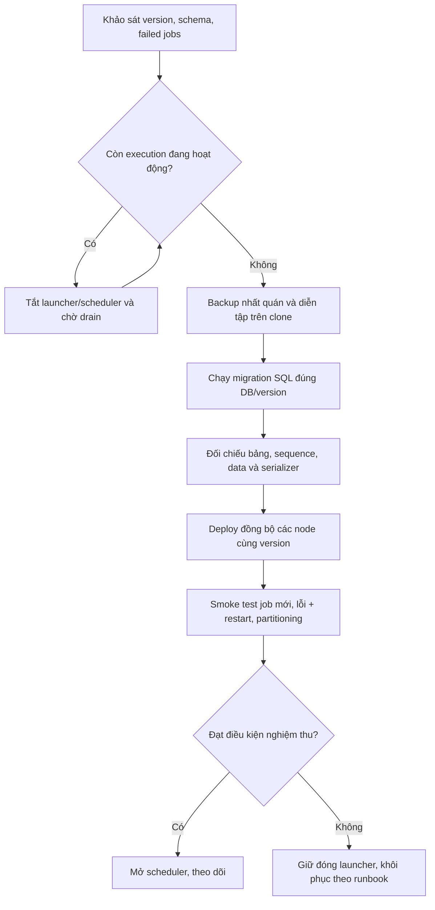

# JobRepository migration trong Spring Batch: nâng cấp metadata mà vẫn kiểm soát được restart

> **Chương:** Tương thích phiên bản  
> **Phạm vi:** SPRING_BATCH_SCALING_OPERATIONS — mở rộng Spring Batch cho workload dữ liệu lớn bằng multi-threaded step, parallel steps, partitioning và xử lý phân tán; ưu tiên khả năng restart, tính an toàn khi chạy đồng thời và vận hành thực tế.

## Mục tiêu học tập

Sau bài này, bạn có thể:

1. Phân biệt nâng cấp thư viện Spring Batch với migration kho metadata của `JobRepository`.
2. Xác định các thay đổi quan trọng khi đi từ Spring Batch 4.x → 5.x → 6.x, đặc biệt là `JobParameters`, `ExecutionContext`, cấu trúc bảng và cấu hình repository.
3. Lập quy trình preflight, dừng ghi, sao lưu, chạy migration theo hệ quản trị CSDL, kiểm tra và cutover mà không làm hỏng trạng thái các job đang chạy.
4. Thiết kế bài kiểm tra restart, partitioning, parallel execution và rollback trước khi cho workload thật chạy trên phiên bản mới.
5. Chọn cách xử lý metadata lịch sử dựa trên yêu cầu audit, restart và khả năng phục hồi.

## 1. Vì sao JobRepository là tâm điểm của migration?

`JobRepository` là nơi Spring Batch lưu trạng thái điều phối job. Với JDBC repository, dữ liệu chủ yếu nằm trong sáu bảng:

| Bảng | Vai trò |
|---|---|
| `BATCH_JOB_INSTANCE` | Định danh một lần xử lý logic: tên job kết hợp với các `JobParameters` có cờ `identifying`. |
| `BATCH_JOB_EXECUTION` | Mỗi lần thực thi/thử chạy của một `JobInstance`, kèm trạng thái và mốc thời gian. |
| `BATCH_JOB_EXECUTION_PARAMS` | Các tham số của từng `JobExecution`. |
| `BATCH_STEP_EXECUTION` | Trạng thái, số lượng read/write/skip/commit/rollback của các step execution. |
| `BATCH_JOB_EXECUTION_CONTEXT` | `ExecutionContext` ở mức job. |
| `BATCH_STEP_EXECUTION_CONTEXT` | `ExecutionContext` ở mức step: cursor, offset, trạng thái cần để restart, bao gồm cả partition. |

`JobInstance` và `JobExecution` không đồng nghĩa. Ví dụ, `dailySettlement` với tham số định danh `businessDate=2026-11-25` là *một* `JobInstance`; nếu job lỗi ở chunk thứ 40 và được restart, nó có thêm `JobExecution`. Để tiếp tục đúng, framework phải đọc lại trạng thái step và execution context của lần chạy trước.

Trong mô hình partitioning, một manager có thể tạo nhiều `StepExecution` như `workerStep:partition0`, `workerStep:partition1`; khi restart, thông tin về từng partition đã hoàn tất hay còn lỗi cũng phụ thuộc vào metadata. Vì vậy, một schema tưởng như chỉ phục vụ audit thực chất quyết định **khả năng không xử lý trùng dữ liệu** sau sự cố.

`JobRepository` còn dùng cột `VERSION` để kiểm tra optimistic locking. Nhiều JVM/worker cùng cập nhật metadata có thể gây `OptimisticLockingFailureException` nếu ghi vào phiên bản bản ghi đã thay đổi. Đây là cơ chế phát hiện cập nhật đồng thời, không phải lỗi có thể giải quyết an toàn bằng cách sửa tay `VERSION`.

**Hai trục migration cần quản lý riêng:**

- **Migration cấu trúc:** bảng/cột/sequence, SQL dialect, quyền CSDL, prefix và transaction manager.
- **Migration ngữ nghĩa:** cách mã hóa `JobParameters`, serializer của `ExecutionContext`, khả năng đọc lịch sử, identity của job và hành vi restart.

Cập nhật DDL thành công **không đủ** để chứng minh dữ liệu lịch sử có thể đọc lại hoặc restart được.

## 2. Ma trận thay đổi theo phiên bản

| Giai đoạn | Các thay đổi liên quan đến repository | Rủi ro vận hành cần xử lý |
|---|---|---|
| **4.x → 5.0** | Yêu cầu Java 17+, bỏ Map-based repository; JDBC repository cần `DataSource`. `BATCH_JOB_EXECUTION_PARAMS` chuyển sang `PARAMETER_NAME`, `PARAMETER_TYPE`, `PARAMETER_VALUE`; `BATCH_STEP_EXECUTION` bổ sung `CREATE_TIME` và cho phép `START_TIME` null; `JOB_CONFIGURATION_LOCATION` không còn sử dụng. | Các execution từ 4.x có thể không được API đọc metadata của 5.x diễn giải đúng; các failed job 4.x cần hoàn tất hoặc được xử lý trước cutover. |
| **4.x → 5.0** | Serializer `ExecutionContext` mặc định đổi từ kiểu Jackson sang `DefaultExecutionContextSerializer` (Base64); CLI converter tham số thay đổi. SQL Server chuyển từ bảng mô phỏng sequence sang sequence thực; Oracle có điều chỉnh sequence. | Metadata cũ có thể không giải mã được bằng serializer mới; sequence cần tiếp tục cấp ID không trùng. |
| **5.x → 6.0** | `@EnableBatchProcessing` không còn tự hàm ý JDBC; dùng `@EnableJdbcJobRepository` khi cần repository bền vững. `BATCH_JOB_SEQ` đổi thành `BATCH_JOB_INSTANCE_SEQ`. Kiểu `JobParameter` thay đổi; lịch sử tham số 5.x không tương thích hoàn toàn với 6.x. | Nguy cơ vô tình chạy `ResourcelessJobRepository`; **không thể dựa vào restart failed instance khởi tạo trên 5.x bằng 6.x**. |
| **6.0 → 6.1** | Các JDBC DAO dùng `JdbcClient` và thay đổi constructor nếu ứng dụng tự khởi tạo DAO; 6.1 bổ sung tối ưu truy vấn khi restart và khi giám sát nhiều partition. | Kiểm tra custom DAO/extension tự khởi tạo JDBC DAO, tải metadata lịch sử và hành vi tải nhiều partition; ứng dụng dùng cấu hình chuẩn ít bị ảnh hưởng bởi thay đổi constructor. |

Bảng này tập trung vào các mốc thay đổi lớn; khi nâng cấp từ phiên bản cụ thể, phải rà đúng changelog và script migration của **phiên bản đích**. Spring Batch 6.1 được phát hành ngày 19/11/2026; không nên mặc định mọi nâng cấp trong cùng major version đều không có thay đổi API.

### 2.1. Chi tiết cấu trúc tham số ở Spring Batch 5

Trước Spring Batch 5, `BATCH_JOB_EXECUTION_PARAMS` lưu những cột như `TYPE_CD`, `KEY_NAME`, `STRING_VAL`, `DATE_VAL`, `LONG_VAL`, `DOUBLE_VAL`. Kể từ 5.0, mỗi tham số được biểu diễn bằng tên, tên lớp kiểu dữ liệu và giá trị ở dạng chuỗi:

```sql
-- Hình dạng cốt lõi của bảng params trong Spring Batch 5/6.
-- Chỉ để nhận diện cấu trúc; không chạy như script migration.
CREATE TABLE BATCH_JOB_EXECUTION_PARAMS (
    JOB_EXECUTION_ID BIGINT NOT NULL,
    PARAMETER_NAME   VARCHAR(100) NOT NULL,
    PARAMETER_TYPE   VARCHAR(100) NOT NULL,
    PARAMETER_VALUE  VARCHAR(2500),
    IDENTIFYING      CHAR(1) NOT NULL
    -- Thêm FOREIGN KEY theo schema chính thức của CSDL đích.
);
```

Giá trị `PARAMETER_TYPE` là kiểu Java, chẳng hạn `java.lang.String` hoặc `java.lang.Long`; giá trị tham số được chuyển đổi bằng Spring `ConversionService`. Với kiểu tự định nghĩa, phải đảm bảo converter tương ứng vẫn tồn tại và xử lý nhất quán ở thời điểm đọc lại lịch sử.

**Không đơn giản đổi tên cột `KEY_NAME` thành `PARAMETER_NAME` rồi bỏ các cột cũ.** Bản ghi 4.x cần được đánh giá theo kiểu nguồn, cách chuyển `DATE_VAL` (múi giờ/độ chính xác), flag `IDENTIFYING` và chính sách giữ lịch sử. Migration script chính thức là điểm khởi đầu cho DDL; việc chuyển đổi dữ liệu đã tồn tại là một hạng mục phải kiểm nghiệm riêng.

### 2.2. ExecutionContext không chỉ là một chuỗi trong CSDL

`ExecutionContext` chứa trạng thái mà `ItemStream`, reader hoặc partitioner cần khi chạy lại. Ví dụ reader lưu `current.count=500000` để lần restart không đọc lại từ bản ghi đầu tiên. Nếu dữ liệu context được ghi bằng một serializer mà bản mới không biết đọc, việc thấy các bảng đầy đủ vẫn không giúp restart được.

Với Spring Batch 5, serializer mặc định chuyển sang `DefaultExecutionContextSerializer` và lưu dữ liệu Base64. Nếu hệ thống trước đó lưu JSON nhờ Jackson, phải đưa quyết định rõ ràng: giữ serializer tương thích có cấu hình kiểm chứng, chuyển đổi dữ liệu lịch sử bằng công cụ riêng đã test, hoặc chấp nhận chỉ truy xuất lịch sử để audit mà không restart. Đừng thử sửa chuỗi `SERIALIZED_CONTEXT` bằng SQL thủ công hay dùng một serializer mới để đoán định dạng cũ.

### 2.3. Điểm gãy đặc biệt khi nâng cấp lên Spring Batch 6

Spring Batch 6 thay đổi cấu trúc API và cách tuần tự hóa tham số job. Migration guide chính thức nêu rõ: **failed job instance tạo bằng 5.x không thể được restart bằng 6.x**. Do đó, trước bước 5.x → 6.x phải hoàn tất các instance lỗi còn cần restart bằng phiên bản 5.x, hoặc đánh dấu `ABANDONED` theo quy trình nghiệp vụ rồi lên phương án chạy một instance mới. Không chỉnh `JOB_KEY` hoặc chèn `JobExecution` thủ công để “lách” ràng buộc.

Ngoài thay đổi metadata, trong 6.x, cấu hình `@EnableBatchProcessing` hoặc `DefaultBatchConfiguration` mặc định có thể cung cấp `ResourcelessJobRepository`. Repository này không lưu metadata, không phục vụ restart và không phù hợp môi trường chạy đồng thời/partitioning. Đối với module xử lý dữ liệu lớn có nhiều worker, hãy khai báo JDBC repository (hoặc repository persistent được hỗ trợ và thiết kế cho workload), sau đó xác nhận bean thực tế lúc chạy.

## 3. Quyết định migration trước khi mở SQL editor

Trả lời những câu hỏi sau để tránh “nâng cấp xong rồi mới phát hiện không thể restart”:

| Câu hỏi | Cách quyết định |
|---|---|
| Metadata đang chạy Spring Batch bản nào, ở CSDL nào, schema/prefix nào? | Ghi nhận version artifact, JDBC URL, dialect, schema owner, `tablePrefix`, số lượng `JobInstance`, `JobExecution`, `StepExecution` và sequence hiện có. |
| Có execution đang `STARTING`, `STARTED`, `STOPPING` hoặc `UNKNOWN`? | Tạm dừng scheduler và mọi launcher; chờ kết thúc hoặc xử lý chính thức từng execution. `UNKNOWN` cần điều tra, không tự sửa thành `COMPLETED`. |
| Failed instance nào còn giá trị restart? | Restart hoặc xử lý kết thúc trên phiên bản nguồn trước khi nâng major version có thay đổi tham số. |
| Có cần giữ dữ liệu cũ cho audit? | Giữ bản sao read-only có version và serializer phù hợp; phân biệt lưu trữ để audit với khả năng restart trên bản mới. |
| Có nhiều node cùng dùng metadata? | Dừng **tất cả** launcher, manager, worker, scheduler, cả tiến trình chạy nền và công cụ vận hành có thể ghi; xác nhận không còn writer từ phiên bản cũ. |
| Ứng dụng dùng bảng tên tùy chỉnh, custom DAO, converter hoặc serializer? | Đưa các cấu hình tùy chỉnh vào checklist thử nghiệm và sửa mọi script theo prefix/dialect thực tế. |
| Cần rollback đến đâu? | Chuẩn bị backup CSDL nhất quán, snapshot cấu hình/binary nguồn, cơ chế kiểm soát tác động nghiệp vụ đã commit ra ngoài metadata. |

Không có một cột `SCHEMA_VERSION` tiêu chuẩn trong sáu bảng metadata để tự kết luận mức schema hiện tại. Dùng lịch sử migration của Flyway/Liquibase (nếu có), định nghĩa schema thực tế và phiên bản ứng dụng để xác nhận.

## 4. Runbook migration có thể triển khai



### Bước 1 — Chụp hiện trạng và khoanh vùng

Dùng tài khoản chỉ đọc để khảo sát. Ví dụ sau dành riêng cho PostgreSQL với schema mặc định `public` và prefix `BATCH_`; đổi schema/prefix cho phù hợp:

```sql
-- Số execution theo trạng thái: ghi nhận trước và sau cutover.
SELECT STATUS, COUNT(*) AS EXECUTIONS
FROM BATCH_JOB_EXECUTION
GROUP BY STATUS
ORDER BY STATUS;

-- Các execution cần điều tra trước khi dừng hẳn.
SELECT JOB_EXECUTION_ID, JOB_INSTANCE_ID, STATUS, START_TIME, END_TIME
FROM BATCH_JOB_EXECUTION
WHERE STATUS IN ('STARTING', 'STARTED', 'STOPPING', 'UNKNOWN')
ORDER BY JOB_EXECUTION_ID;

-- Kiểm tra dạng cột hiện có, để biết đang ở schema cũ hay mới.
SELECT TABLE_NAME, COLUMN_NAME, DATA_TYPE, IS_NULLABLE
FROM INFORMATION_SCHEMA.COLUMNS
WHERE TABLE_SCHEMA = 'public'
  AND TABLE_NAME IN ('batch_job_execution_params', 'batch_step_execution')
ORDER BY TABLE_NAME, ORDINAL_POSITION;
```

Việc query không còn `STARTED` chỉ là *một* dấu hiệu: cần xác nhận hệ thống message broker, partition manager, remote worker và scheduler đã thực sự dừng ghi. Với remote partitioning, một worker vẫn xử lý side effect sau khi manager đã mất kết nối; phải drain hoặc cô lập worker trước.

### Bước 2 — Đóng cửa ghi và hoàn tất các restart quan trọng

Tắt lịch chạy, API launch và đường message kích hoạt job mới; không để phiên bản cũ tạo execution trong lúc đổi schema. Kiểm tra số phiên kết nối CSDL có quyền ghi metadata và trạng thái worker ở mọi node. Sau đó:

1. Restart trên **bản nguồn** các failed job cần kết thúc. Đối với bước **4.x → 5.x** và **5.x → 6.x**, đây là điều kiện tương thích đặc biệt quan trọng.
2. Với job không còn được chạy lại, xử lý `ABANDONED` qua API/quy trình vận hành chính thức sau khi xác nhận tác động nghiệp vụ. `ABANDONED` không đồng nghĩa hoàn tất công việc nghiệp vụ.
3. Chụp lại tập ID và trạng thái trước khi nâng cấp; lưu số liệu này trong biên bản cutover.

Không đổi status trực tiếp trong bảng hoặc xóa row chỉ để vượt qua một bước migration.

### Bước 3 — Sao lưu, diễn tập và chọn script đúng

Sao lưu **cùng một thời điểm nhất quán** toàn bộ bảng metadata, sequence/bảng cấp ID, schema DDL, user grants và cấu hình liên quan. Một bản dump chỉ chứa sáu bảng nhưng thiếu trạng thái sequence có thể gây trùng khóa ngay lần khởi chạy sau. Kiểm tra restore vào môi trường clone, không chỉ kiểm tra lệnh backup trả mã thành công.

Các tài nguyên trong `spring-batch-core` cung cấp:

- `org/springframework/batch/core/schema-*.sql`: tạo bảng cho **cơ sở dữ liệu mới**.
- `org/springframework/batch/core/migration/5.0/`: script migration của thay đổi trong Spring Batch 5.
- `org/springframework/batch/core/migration/6.0/`: script migration của thay đổi trong Spring Batch 6.

Hãy lấy script từ **đúng bản Spring Batch đang chọn làm đích** và kiểm tra từng câu lệnh theo dialect. Script tạo schema mới (`schema-*.sql`) không được chạy đè lên metadata hiện hữu. Với MySQL có bảng mô phỏng sequence, hoặc SQL Server/Oracle/DB2 có đặc thù riêng, không dùng một script PostgreSQL cho tất cả.

**Một ví dụ nhỏ cho PostgreSQL khi nâng 5.x → 6.0:** Spring Batch 6 đổi tên sequence cấp `JOB_INSTANCE_ID` từ `BATCH_JOB_SEQ` sang `BATCH_JOB_INSTANCE_SEQ`. Khi môi trường đang dùng PostgreSQL sequence chuẩn, câu lệnh minh họa là:

```sql
-- Chỉ minh họa cho PostgreSQL với tên sequence mặc định.
-- Chạy trong migration có version, sau khi đã xác nhận sequence nguồn.
ALTER SEQUENCE BATCH_JOB_SEQ RENAME TO BATCH_JOB_INSTANCE_SEQ;
```

Lệnh này giữ giá trị sequence hiện có do chỉ đổi tên. Kiểm tra quyền sở hữu, prefix, current value và sự tồn tại của sequence đích trước khi áp dụng. Với DB2 LUW, không áp dụng máy móc lệnh rename sequence của biến thể DB2 trong repository: migration guide 6.0 ghi rõ cần phương án cấp số tiếp nối riêng cho DB2 LUW.

### Bước 4 — Đối chiếu dữ liệu sau migration SQL

Cần xác minh ít nhất bốn nhóm điều kiện:

- **Schema:** đủ bảng, cột, FK, `CREATE_TIME`, tính nullable của `START_TIME`, sequence/bảng cấp ID và tên theo prefix cấu hình.
- **Dữ liệu:** đếm tổng record không mất bất thường; không có `JobExecution` mồ côi khỏi `JobInstance` hoặc `StepExecution` mồ côi khỏi `JobExecution`.
- **ID:** số kế tiếp do sequence sinh ra phải lớn hơn ID tối đa đã có, tránh trùng khóa khi chạy job mới.
- **Ngữ nghĩa:** `JobParameters`, cờ `IDENTIFYING`, context của các job được chọn làm mẫu có thể đọc theo serializer/converter mục tiêu; không xem việc `SELECT COUNT(*)` thành công là xác nhận tương thích.

Ví dụ kiểm tra mồ côi trên PostgreSQL:

```sql
SELECT COUNT(*) AS ORPHAN_JOB_EXECUTIONS
FROM BATCH_JOB_EXECUTION je
LEFT JOIN BATCH_JOB_INSTANCE ji ON ji.JOB_INSTANCE_ID = je.JOB_INSTANCE_ID
WHERE ji.JOB_INSTANCE_ID IS NULL;

SELECT COUNT(*) AS ORPHAN_STEP_EXECUTIONS
FROM BATCH_STEP_EXECUTION se
LEFT JOIN BATCH_JOB_EXECUTION je ON je.JOB_EXECUTION_ID = se.JOB_EXECUTION_ID
WHERE je.JOB_EXECUTION_ID IS NULL;

SELECT MAX(JOB_INSTANCE_ID) AS MAX_JOB_INSTANCE_ID
FROM BATCH_JOB_INSTANCE;

-- Chỉ áp dụng cho PostgreSQL khi dùng native sequence Spring Batch 6.
SELECT last_value, is_called FROM BATCH_JOB_INSTANCE_SEQ;
```

Lưu ý `last_value` là trạng thái sequence tại lúc query; `is_called` cũng ảnh hưởng đến giá trị `nextval` tiếp theo. Không gọi `nextval` trong bước kiểm tra chỉ đọc vì nó làm tiến sequence. Với sequence cache hoặc nhiều writer chưa dừng, phép so sánh trạng thái không còn đáng tin.

### Bước 5 — Sửa cấu hình ứng dụng cho đúng version

Ví dụ dưới đây minh họa dùng hai bean đã được định nghĩa sẵn là `batchDataSource` và `batchTransactionManager`. Mã dùng **Spring Batch trực tiếp**; nếu chạy Spring Boot, cần đối chiếu cơ chế auto-configuration của đúng phiên bản Boot để không tạo hai bộ batch infrastructure.

**Spring Batch 5.x — JDBC repository đi cùng `@EnableBatchProcessing`:**

```java
@Configuration
@EnableBatchProcessing(
    dataSourceRef = "batchDataSource",
    transactionManagerRef = "batchTransactionManager"
)
class BatchInfrastructureV5 {
    // batchDataSource, batchTransactionManager được cấu hình ở lớp khác.
}
```

**Spring Batch 6.x — khai báo rõ repository persistent:**

```java
@Configuration
@EnableBatchProcessing
@EnableJdbcJobRepository(
    dataSourceRef = "batchDataSource",
    transactionManagerRef = "batchTransactionManager"
)
class BatchInfrastructureV6 {
    // batchDataSource, batchTransactionManager được cấu hình ở lớp khác.
}
```

Một job định nghĩa sử dụng repository được tiêm vào:

```java
@Bean
Job dailySettlement(JobRepository jobRepository, Step settleStep) {
    return new JobBuilder("dailySettlement", jobRepository)
            .start(settleStep)
            .build();
}
```

Tại thời điểm khởi động, kiểm tra bean repository thực tế là JDBC repository, trỏ đúng `DataSource` và `tablePrefix`, transaction manager bao phủ các thao tác metadata cần thiết. Nếu cấu hình Spring Batch 6 vô tình chọn `ResourcelessJobRepository`, job một lần có thể vẫn chạy thành công nhưng toàn bộ khả năng restart và phối hợp partition qua metadata bị mất.

Nếu ứng dụng gọi trực tiếp `JdbcJobInstanceDao`, `JdbcStepExecutionDao` hoặc DAO liên quan, cần xem lại constructor khi lên 6.1 vì nhóm DAO chuyển sang `JdbcClient`. Nếu dùng infrastructure của framework, các DAO thường được tạo giúp.

### Bước 6 — Cutover tất cả các tiến trình cùng dùng repository

Không rollout kiểu *mixed-version* trong khi hai phiên bản có thay đổi schema/serialization cùng ghi lên một `JobRepository`. Đây là vấn đề đặc biệt nghiêm trọng với parallel steps, multi-threaded step, manager và remote workers.

Một lịch cutover khả thi:

1. Dừng launcher và scheduler, chờ toàn bộ in-flight job/partition hoàn tất; xác nhận mọi writer cũ đã rút khỏi repository.
2. Backup + migration + xác minh trên CSDL đích.
3. Deploy đồng bộ manager, launcher, worker và công cụ operator cùng bộ thư viện tương thích.
4. Bật một tập job smoke test có kiểm soát; chỉ mở scheduler sau khi chúng đạt.
5. Theo dõi lỗi SQL, optimistic locking, số lượng failed/stuck executions, tốc độ restart và số partition chưa hoàn tất.

Blue/green cũng cần khóa đường ghi. Hai môi trường có thể tồn tại song song để kiểm tra, nhưng **không** được cho bản cũ và mới ghi đồng thời vào cùng metadata trong giai đoạn bất tương thích. Nếu chọn hai kho metadata tách biệt, phải giải quyết tác động dữ liệu nghiệp vụ và việc lịch sử restart không tự chuyển theo.

## 5. Bộ kiểm thử bắt buộc trước khi mở tải thật

| Tình huống | Cách thử trên clone hoặc staging | Điều kiện đạt |
|---|---|---|
| Job mới, input nhỏ | Chạy `dailySettlement` với `businessDate` mới. | Tạo một `JobInstance`, một `JobExecution` và step metadata đúng; không lỗi SQL/serializer. |
| Restart giữa chunk | Cố ý làm reader/writer lỗi ở một chunk đã chọn; khắc phục rồi restart **cùng identifying parameters, cùng phiên bản đích**. | Không đọc/ghi lặp các chunk đã commit; cursor được khôi phục; trạng thái execution chuyển như kỳ vọng. |
| Chạy lại job đã hoàn tất | Launch lại cùng tên job và cùng identifying parameters. | Framework nhận diện instance đã complete và xử lý theo chính sách restart của job, không bí mật tạo instance khác. |
| Partition có một worker lỗi | Chạy 8 partition, làm một partition thất bại, restart. | Các partition đã complete không phải xử lý lại ngoài chính sách; partition lỗi được xử lý đúng. |
| Launch cùng lúc từ hai node | Hai launcher cùng xin chạy một job với cùng identifying parameters. | Repository và transaction isolation ngăn việc tạo hai execution cạnh tranh không hợp lệ. |
| Tải đồng thời | Chạy parallel steps/multi-threaded steps theo workload representative. | Không phát sinh mất metadata, lỗi optimistic locking bất thường hoặc nghẽn pool/lock; tốc độ phù hợp giới hạn tài nguyên. |
| Dữ liệu lịch sử | Đọc một vài `JobExecution`, `StepExecution`, `ExecutionContext` có nguồn gốc từ phiên bản cũ. | Hành vi đọc đúng với chính sách bảo tồn lịch sử; failed instance không tương thích không bị đưa vào luồng restart mới. |
| Khôi phục khi cutover thất bại | Diễn tập restore snapshot và chạy lại binary/config nguồn trên clone. | Có thể phục hồi trạng thái metadata phù hợp với bản nguồn và đối soát side effect nghiệp vụ. |

Để test restart có ý nghĩa, reader phải lưu state chính xác, writer có transaction/idempotency phù hợp và phép thử phải gây lỗi **sau khi có chunk thành công**. Một test chỉ kiểm tra job chạy `COMPLETED` lần đầu không chứng minh được restartability.

Đối với hệ thống nhận message hoặc gọi API ngoài transaction CSDL, hãy dùng business key, idempotency key hay outbox/inbox tương ứng để tránh ghi trùng trong cả trường hợp metadata rollback nhưng side effect ngoài đã thành công.

## 6. Dấu hiệu lỗi và hướng xử lý

| Triệu chứng | Nghi vấn đầu tiên | Cách kiểm tra |
|---|---|---|
| `BadSqlGrammarException` hoặc “column does not exist” | Schema mới thiếu cột/sequence hoặc ứng dụng truy cập nhầm schema/prefix. | So sánh DDL thực với `schema-*.sql` của version đang chạy và đối chiếu cấu hình `DataSource`. |
| `ClassCastException`/`ClassNotFoundException` khi đọc context | Serializer, converter hoặc class cũ không còn tương thích. | Xác định context từng được ghi bởi version/serializer nào; test deserialization trên bản sao. |
| Restart báo lỗi job parameters cũ | Bản 4.x/5.x trước major upgrade không tương thích định dạng tham số của bản mới. | Tra lịch sử instance; hoàn tất/abandon trên version nguồn hoặc quyết định tạo instance mới theo nghiệp vụ. |
| Duplicate key ở `JOB_INSTANCE_ID`/`JOB_EXECUTION_ID` | Sequence/bảng cấp ID không tiếp nối dữ liệu cũ hoặc nhiều writer cùng chạy. | Kiểm tra max ID và trạng thái bộ cấp số; rà lịch cutover. |
| Job chạy nhưng không ghi bảng metadata | Chọn nhầm `ResourcelessJobRepository` hoặc trỏ nhầm DB. | In/kiểm tra bean `JobRepository` và JDBC connection thực tế trong runtime. |
| Nhiều worker bị stuck hoặc lỗi khóa | Còn phiên bản cũ ghi đồng thời, transaction isolation/pool/lock chưa phù hợp. | Đối chiếu phiên bản đang chạy ở mọi node, query active transactions/locks và metric pool. |
| Tăng mạnh số query khi restart/partition lớn | Metadata lịch sử phình to, thao tác repository tải dữ liệu nhiều. | Đo truy vấn/heap, cân nhắc sửa lên bản maintenance phù hợp; Spring Batch 6.1 có tối ưu ở điểm này. |

Không khắc phục lỗi restart bằng cách xóa `BATCH_STEP_EXECUTION_CONTEXT`, chèn row thử, đặt `VERSION=0` hoặc sửa trạng thái `STARTED` thành `COMPLETED` bằng SQL. Những thay đổi đó có thể làm hệ thống tưởng đã commit dữ liệu nghiệp vụ dù thực tế chưa có.

## 7. Rollback và chính sách lịch sử

**Rollback ứng dụng không tự động rollback schema.** Nếu 6.x đã ghi tham số hoặc context ở định dạng mới, đổi lại JAR 5.x trên cùng DB có thể khiến việc đọc metadata trở nên không tương thích. Phương án rollback thực tế phải xác định:

- Mốc backup nhất quán **trước migration**, quyền và thủ tục restore.
- Điểm dừng launcher, worker và side effect để không tạo thêm dữ liệu ngoài khi DB metadata bị đưa về mốc cũ.
- Khả năng replay công việc sau restore theo business key/idempotency; dữ liệu nghiệp vụ đã commit sau backup không tự bị đảo ngược theo metadata.
- Chủ sở hữu quyết định phục hồi, điều kiện dừng thử nghiệm và bộ smoke test sau restore.

Nếu lịch sử rất lớn, tách phần dữ liệu đã hoàn tất để audit thành kho chỉ đọc, có thời hạn lưu giữ và chính sách truy cập phù hợp; không xóa lịch sử đang được hệ thống dùng để restart. Việc archive phải giữ quan hệ giữa instance, execution, step và context, cũng như thông tin version/serializer, để về sau còn diễn giải được dữ liệu. Tạo repository hoàn toàn mới giúp khởi động sạch nhưng **không mang theo trạng thái restart cũ**: cần xem đây là quyết định nghiệp vụ có kiểm soát.

## 8. Bài tập tình huống

Một hệ thống trên Spring Batch 5.2 chạy `customerExport` hàng đêm. Mỗi lần có 16 partition chia theo dải khách hàng, ghi file lên object storage. Đang có:

- 1 job `COMPLETED` của ngày trước.
- 1 job `FAILED` của hôm nay; 14 partition complete, 2 partition lỗi sau khi đã ghi một phần file.
- 3 launcher/worker nodes cùng dùng PostgreSQL repository.
- Kế hoạch nâng lên Spring Batch 6.1 trước lần chạy tối nay.

**Hãy đề xuất phương án:**

1. Ưu tiên restart job `FAILED` **trên 5.2** sau khi bảo đảm ghi file theo đường dẫn/idempotency key không làm trùng dữ liệu; nếu chưa thể xử lý, hoãn cutover hoặc quyết định abandon có phê duyệt nghiệp vụ.
2. Dừng scheduler, đợi partition hoàn tất và xác nhận ba node không còn ghi metadata.
3. Backup CSDL, chạy thử migration 5.x → 6.x trên clone, kiểm tra đổi tên `BATCH_JOB_SEQ` → `BATCH_JOB_INSTANCE_SEQ` và bộ cấp ID.
4. Cấu hình `@EnableJdbcJobRepository`, deploy đồng bộ các node lên 6.1, kiểm thử job mới, fail/restart cùng version, partition lỗi và đối soát file đầu ra.
5. Chỉ mở lịch chạy thật sau khi kết quả đối soát, SQL metrics, pool và trạng thái execution đạt ngưỡng nghiệm thu.

**Câu hỏi tự kiểm:** Nếu giữ job `FAILED` của 5.2 rồi thử restart bằng 6.1, vì sao việc đã đổi tên sequence và đủ sáu bảng vẫn không đảm bảo thành công? Vì định dạng tham số/hành vi phục hồi lịch sử đã thay đổi giữa major versions; DDL chỉ giải quyết cấu trúc lưu trữ, không giải quyết tương thích ngữ nghĩa.

## Tài liệu tham khảo chính thức

- [Spring Batch 5.0 Migration Guide](https://github.com/spring-projects/spring-batch/wiki/Spring-Batch-5.0-Migration-Guide) — schema params, `CREATE_TIME`, serializer, JDBC repository và giới hạn dữ liệu lịch sử.
- [Spring Batch 6.0 Migration Guide](https://github.com/spring-projects/spring-batch/wiki/Spring-Batch-6.0-Migration-Guide) — `@EnableJdbcJobRepository`, đổi tên sequence và khả năng restart từ 5.x.
- [Spring Batch 6 — Meta-Data Schema](https://docs.spring.io/spring-batch/reference/6.0/schema-appendix.html) — quan hệ bảng, optimistic locking, ID generator và SQL migration.
- [Spring Batch 6 — What's New](https://docs.spring.io/spring-batch/reference/6.0/whatsnew.html) — `ResourcelessJobRepository` mặc định và tác động đến infrastructure.
- [Spring Batch 6.1 GA (19/11/2026)](https://spring.io/blog/2026/11/19/spring-batch-6-1-0-available-now/) — thay đổi JDBC DAO và tối ưu job restart/partitioning.

> **Nguyên tắc vận hành:** Chỉ coi migration hoàn thành khi một job mới chạy đúng, một job thất bại *trong phiên bản đích* restart đúng, metadata sau chạy có thể đọc lại, tất cả node đã dùng cấu hình tương thích và đã diễn tập được đường rollback.
