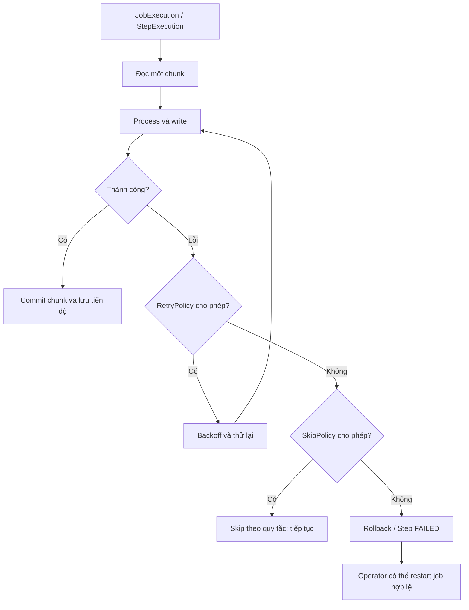
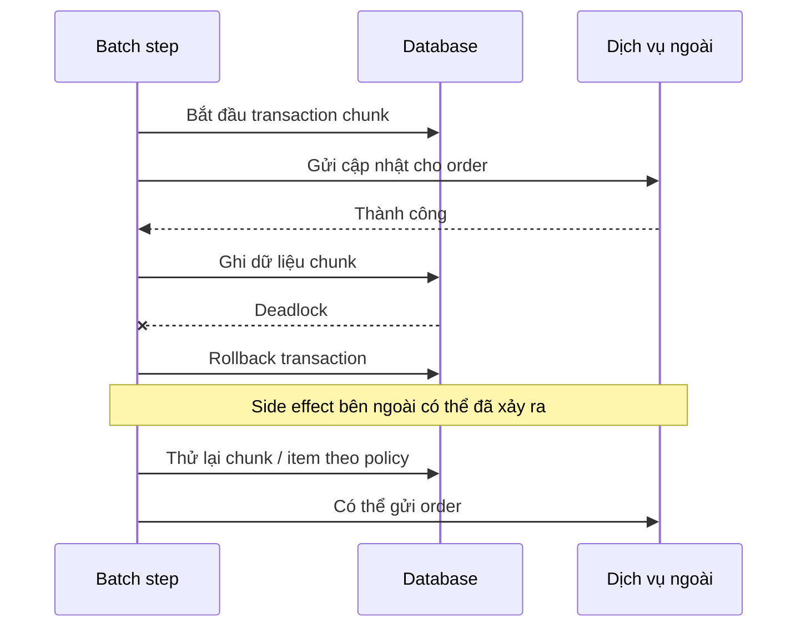
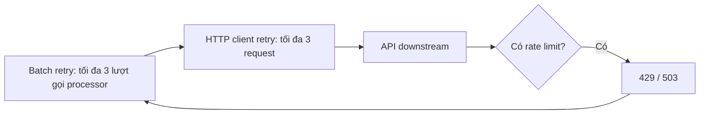

# Thay đổi retry implementation trong Spring Batch: tương thích và di trú từ 5.x lên 6.x

Trong module **SPRING_BATCH_SCALING_OPERATIONS**, Spring Batch được dùng để xử lý khối lượng dữ liệu lớn bằng multi-threaded step, parallel steps, partitioning và những mô hình phân tán phù hợp. Khi nâng phiên bản, một thay đổi ở cơ chế **retry** có thể khiến cùng một lỗi được thử lại nhiều hơn dự kiến, khác thời gian chờ, hoặc làm job thất bại thay vì skip. Điều đó tác động trực tiếp đến throughput, tải lên database và API downstream, idempotency, khả năng restart và cách vận hành job.

Bài học thuộc chương **Tương thích phiên bản**, tập trung vào bước chuyển từ **Spring Batch 5.x sang Spring Batch 6.x**, nơi phần triển khai chunk-oriented step mới sử dụng retry của **Spring Framework 7** thay cho cơ chế của **Spring Retry**. Đây là thay đổi về thư viện, API cấu hình và một số hành vi; không phải chỉ đổi tên method.

> Phạm vi phiên bản: ví dụ API mới hướng đến Spring Batch 6.0/6.1 và Spring Framework 7.0 tương ứng. Spring Batch 6 còn giữ một số API chunk cũ ở trạng thái deprecated để hỗ trợ chuyển đổi. Khi chạy trên một phiên bản cụ thể, hãy kiểm tra đúng tài liệu API của phiên bản đó và dependency tree của ứng dụng.

## 1. Kết quả học tập

Sau bài này, bạn có thể:

1. Phân biệt retry ở cấp item/chunk, retry của lời gọi dịch vụ, retry broker và **restart** của `JobExecution`.
2. Giải thích vì sao `FaultTolerantStepBuilder` và `org.springframework.retry.RetryPolicy` trong cấu hình cũ khác với `ChunkOrientedStepBuilder` và `org.springframework.core.retry.RetryPolicy` trong cấu hình mới.
3. Di trú giới hạn số lần retry, phân loại exception và chính sách backoff mà không vô tình thay đổi số lần gọi downstream.
4. Nhận biết thay đổi khi exception xuất hiện ở listener, khi đọc item và khi chunk transaction rollback.
5. Kiểm tra tương thích cho multi-threaded step, partitioning, remote worker và job restart trước khi triển khai.

## 2. Retry thực sự nằm ở lớp nào?

Giả sử một step đọc 1 triệu đơn hàng, xử lý từng đơn và ghi kết quả vào database. Một lệnh SQL gặp deadlock có thể thành công nếu thực hiện lại sau một khoảng chờ; ngược lại, một bản ghi sai định dạng thường vẫn sai ở lần thứ mười.



Sơ đồ này minh họa quyết định nghiệp vụ tổng quát; thứ tự xử lý nội bộ của read, process, write và scan chunk sau lỗi có thể phức tạp hơn, đặc biệt đối với lỗi write. Hãy nhớ rằng **retry không đồng nghĩa với commit**. Mỗi lần thử có thể nằm trong một transaction mới hoặc một lần xử lý chunk mới tùy giai đoạn và cấu hình.

| Cơ chế | Kích hoạt bởi | Phạm vi, đặc điểm | Tách biệt với |
|---|---|---|---|
| **Step retry** | Chính sách retry của chunk step | Thử lại thao tác read/process/write sau lỗi đủ điều kiện; tương tác rollback và skip | Restart toàn job |
| **Method/service retry** | `RetryTemplate`, `@Retryable` hoặc HTTP client | Thử lại một lời gọi cụ thể; có thể nằm bên trong item processor/writer | Step retry, nếu cùng bật sẽ cộng dồn số lượt |
| **Message redelivery/replay** | Broker ack, retry topic, DLQ | Một message được chuyển lại sau thất bại | Checkpoint của Spring Batch |
| **Job restart** | `JobRepository`, operator/launcher | Chạy tiếp `JobInstance` có thể restart từ trạng thái bền vững | Bộ đếm retry bên trong một lần xử lý |

Để vận hành an toàn, phải xác định **lớp nào chịu trách nhiệm retry chính**. Ví dụ, nếu một client HTTP đã retry 3 lần và step cũng retry 3 lần, số request thực tế trong trường hợp lỗi kéo dài có thể vượt xa con số nhìn thấy trong cấu hình batch.

## 3. Dòng thời gian và thay đổi chính giữa 5.x và 6.x

| Khía cạnh | Spring Batch 5.x | Spring Batch 6.x, chunk implementation mới |
|---|---|---|
| Cơ chế retry | Dựa trên **Spring Retry** cho fault-tolerant chunk processing truyền thống | Dựa trên retry của **Spring Framework 7** |
| Step implementation | Thường dùng `TaskletStep` + `ChunkOrientedTasklet`; builder `SimpleStepBuilder`/`FaultTolerantStepBuilder` | `ChunkOrientedStep`; builder `ChunkOrientedStepBuilder` |
| Tạo chunk | `.chunk(100, transactionManager)` | `.chunk(100).transactionManager(transactionManager)` |
| Retry policy tùy biến | `org.springframework.retry.RetryPolicy` | `org.springframework.core.retry.RetryPolicy` |
| Cấu hình backoff | Thường dùng `org.springframework.retry.backoff.BackOffPolicy` | Thường đặt `delay`, `jitter`, `multiplier`, `maxDelay` trong `RetryPolicy` của Framework 7 |
| Listener retry riêng | `org.springframework.retry.RetryListener` khi dùng Spring Retry | `org.springframework.core.retry.RetryListener` qua API retry mới |
| Skip | `skip`, `skipLimit`, `SkipPolicy` trong fault-tolerant builder | Có `skip`, `skipLimit`, `SkipPolicy`; new implementation tổ chức xử lý skip quanh `SkipPolicy` |
| API cũ | Là lựa chọn thông dụng | Một số API vẫn biên dịch được nhưng **deprecated**, dự kiến bỏ ở major version tiếp theo |

Điểm mốc: `ChunkOrientedStep` đã xuất hiện dưới dạng triển khai thử nghiệm từ **5.1**; tới **6.0** trở thành lựa chọn ổn định. Do đó, **chỉ nâng dependency mà không chuyển builder** có thể khiến dự án vẫn chạy theo đường legacy. Đừng kết luận rằng mọi ứng dụng Spring Batch 6 lập tức sử dụng retry implementation mới. Khi đánh giá một job cụ thể, cần xem cả **method `.chunk(...)` đang được gọi và builder trả về**.

Tài liệu chính thức về thay đổi này: [What's new in Spring Batch 6](https://docs.spring.io/spring-batch/reference/6.0/whatsnew.html), [Spring Batch 6.0 Migration Guide](https://github.com/spring-projects/spring-batch/wiki/Spring-Batch-6.0-Migration-Guide).

## 4. Điểm dễ sai nhất: `retryLimit` và `maxRetries` không cùng cách đếm

Trong builder truyền thống của Spring Batch 5, `retryLimit(3)` biểu thị tối đa **3 lần thử xử lý** cho một item bị lỗi, bao gồm lần đầu; nói cách khác, có tối đa **2 lần thử lại**.

Trong `RetryPolicy` của **Spring Framework 7**, `maxRetries(3)` biểu thị tối đa **3 lần thử lại sau lần đầu**, tức tối đa **4 lần thực thi**. Javadoc và tài liệu Framework 7 mô tả công thức:

```text
totalAttempts = 1 initial attempt + maxRetries

Spring Batch 5 legacy: retryLimit(3)  -> tối đa 3 lượt gọi (1 + 2)
Spring Framework 7:   maxRetries(3) -> tối đa 4 lượt gọi (1 + 3)
Muốn giữ 3 lượt gọi bằng policy mới: maxRetries(2)
```

| Cấu hình | Số lần gọi tối đa khi liên tục lỗi | Ghi chú |
|---|---:|---|
| Legacy `.retryLimit(1)` | 1 | Không thử lại |
| Legacy `.retryLimit(3)` | 3 | 1 lần đầu + tối đa 2 lần retry |
| New `RetryPolicy.builder().maxRetries(0)` | 1 | Không thử lại |
| New `RetryPolicy.builder().maxRetries(2)` | 3 | Tương đương ba lượt trong ví dụ legacy |
| New `RetryPolicy.builder().maxRetries(3)` | 4 | Nhiều hơn một lượt so với legacy `retryLimit(3)` |

`ChunkOrientedStepBuilder` mới cũng có tiện ích `.retry(...)` và `.retryLimit(long)`; Javadoc của API mới định nghĩa `retryLimit` theo số **retry attempts**. Không giả định chữ `retryLimit` bảo đảm ngữ nghĩa cũ khi bạn đã đổi builder. Khi cần quản lý thời gian chờ, ngoại lệ và số lần thử một cách rõ ràng, dùng `RetryPolicy` tường minh như ví dụ dưới.

**Hệ quả ở workload lớn:** nếu 200 partition cùng có 100 item gặp lỗi, chỉ thêm một lượt retry có thể tạo thêm hàng chục nghìn request hoặc transaction. Nên tính lại giới hạn từ **số lần gọi thực tế** thay vì chuyển nguyên số cấu hình.

## 5. Di trú code: Spring Batch 5 sang Spring Batch 6

### 5.1. Cấu hình Spring Batch 5.x (legacy)

Ví dụ một step đọc và ghi `Order`, retry deadlock tối đa 3 lượt, giữa các lượt chờ tăng dần. Đoạn code minh họa method cấu hình; các bean `reader` và `writer` được định nghĩa ở nơi khác.

```java
// Spring Batch 5.x
// Các kiểu ItemReader/ItemWriter nằm trong org.springframework.batch.item.*
// Spring Retry: org.springframework.retry.backoff.ExponentialBackOffPolicy

@Bean
Step legacyOrdersStep(
        JobRepository repository,
        PlatformTransactionManager tx,
        ItemReader<Order> reader,
        ItemWriter<Order> writer) {

    ExponentialBackOffPolicy backoff = new ExponentialBackOffPolicy();
    backoff.setInitialInterval(200L);
    backoff.setMultiplier(2.0);
    backoff.setMaxInterval(2000L);

    return new StepBuilder("ordersStep", repository)
            .<Order, Order>chunk(100, tx)
            .reader(reader)
            .writer(writer)
            .faultTolerant()
            .retry(DeadlockLoserDataAccessException.class)
            .retryLimit(3)
            .backOffPolicy(backoff)
            .build();
}
```

Nếu lỗi deadlock tiếp tục xảy ra, tối đa 3 lượt xử lý theo giới hạn legacy. `Order` là kiểu nghiệp vụ minh họa; ví dụ dùng `DeadlockLoserDataAccessException` từ `org.springframework.dao` để biểu diễn lỗi tạm thời.

### 5.2. Cấu hình Spring Batch 6.x với retry của Spring Framework 7

Các import quan trọng của **đường API mới**:

```java
import java.time.Duration;
import org.springframework.batch.core.step.Step;
import org.springframework.batch.core.step.builder.StepBuilder;
import org.springframework.batch.core.repository.JobRepository;
import org.springframework.batch.infrastructure.item.ItemReader;
import org.springframework.batch.infrastructure.item.ItemWriter;
import org.springframework.core.retry.RetryPolicy;
import org.springframework.dao.DeadlockLoserDataAccessException;
import org.springframework.transaction.PlatformTransactionManager;
import org.springframework.context.annotation.Bean;
```

Trong Spring Batch 6, các interface item như `ItemReader` và `ItemWriter` nằm trong package **`org.springframework.batch.infrastructure.item`**; khi di trú cả module còn cần sửa các import liên quan. Phần method có thể viết:

```java
// Spring Batch 6.x + Spring Framework 7.x
@Bean
Step ordersStep(
        JobRepository repository,
        PlatformTransactionManager tx,
        ItemReader<Order> reader,
        ItemWriter<Order> writer) {

    RetryPolicy retryPolicy = RetryPolicy.builder()
            .includes(DeadlockLoserDataAccessException.class)
            .maxRetries(2)                    // 1 lần đầu + 2 lần retry
            .delay(Duration.ofMillis(200))
            .multiplier(2)
            .maxDelay(Duration.ofSeconds(2))
            .jitter(Duration.ofMillis(50))
            .build();

    return new StepBuilder("ordersStep", repository)
            .<Order, Order>chunk(100)
            .transactionManager(tx)
            .reader(reader)
            .writer(writer)
            .faultTolerant()
            .retryPolicy(retryPolicy)
            .build();
}
```

Ở đây số lần gọi tối đa đã được giữ tương đương legacy; chiến lược jitter là **chủ ý mới** để giảm hiện tượng các worker retry đồng loạt. Nếu yêu cầu kiểm thử cần so sánh đúng lịch backoff cũ, trước tiên hãy giữ `delay`, `multiplier` và `maxDelay` tương thích, rồi đánh giá riêng tác động của jitter.

Trong ví dụ này, `RetryPolicy` là `org.springframework.core.retry.RetryPolicy` của Framework 7; nếu IDE tự import thành `org.springframework.retry.RetryPolicy` từ Spring Retry thì `.retryPolicy(...)` của `ChunkOrientedStepBuilder` mới sẽ không nhận đúng kiểu. Tương tự, `org.springframework.core.retry.RetryListener` không tương đương `org.springframework.retry.RetryListener`.

### 5.3. Không nhầm hai `RetryTemplate`

Ứng dụng có thể đồng thời chứa:

- `org.springframework.retry.support.RetryTemplate`: từ **thư viện Spring Retry**; có thể vẫn được các dịch vụ khác hoặc đường legacy sử dụng.
- `org.springframework.core.retry.RetryTemplate`: từ **Spring Framework 7**; dùng cùng `org.springframework.core.retry.RetryPolicy`.

Hai lớp có tên gần giống nhưng không thể xem là thay thế trực tiếp về constructor, callback, listener, exception và ngữ nghĩa số lần thử. Nếu dự án gọi `RetryTemplate` thủ công ở một bean nghiệp vụ, hãy di trú đoạn đó **riêng** khỏi cấu hình batch step và kiểm tra nơi nào còn cần dependency Spring Retry. Không xóa dependency chỉ vì đã đổi một step.

## 6. Lỗi nào nên retry? Lỗi nào nên skip hoặc fail?

`RetryPolicy` chỉ nên cho thử lại những lỗi có khả năng biến mất khi thực hiện lại sau một thời gian. Các lỗi xác định và dữ liệu không hợp lệ cần luồng xử lý khác.

| Trường hợp | Cách xử lý thường phù hợp | Lý do |
|---|---|---|
| Deadlock hoặc kết nối DB gián đoạn | Retry có giới hạn và backoff | Lock/kết nối có thể được khôi phục |
| HTTP 429 hoặc 503 từ downstream | Retry có backoff, tôn trọng `Retry-After` khi thích hợp | Tránh tạo thêm tải vào hệ thống đang quá mức |
| Timeout khi kết quả ghi chưa rõ | Retry **chỉ sau khi có idempotency/đối soát** | Bên nhận có thể đã commit dù client không nhận response |
| Parse file sai định dạng cố định | Skip/quarantine hoặc fail theo quy tắc dữ liệu | Lặp lại không sửa được payload |
| Vi phạm unique constraint do dữ liệu trùng | Dedup hoặc fail tùy nghiệp vụ | Retry mù quáng có thể lặp lỗi vĩnh viễn |
| Authorization/credential sai | Fail, khắc phục cấu hình rồi restart | Không nên thử vô hạn khi thông tin xác thực không thay đổi |
| `OutOfMemoryError` hoặc lỗi tài nguyên nghiêm trọng | Fail và điều tra | Retry ngay có thể làm tiến trình tệ hơn |

Spring Framework 7 cho phép policy giới hạn exception bằng `includes(...)` và `excludes(...)`. Việc matching có xét chuỗi nguyên nhân lồng nhau (*causes*) theo tài liệu của Framework; do đó, khi đổi từ Spring Retry, cần kiểm tra các exception wrapper thực tế của JDBC, HTTP client hoặc message handler, tránh thay đổi tập lỗi được retry mà không nhận ra.

Với Spring Batch 6 new builder, các cấu hình tiện ích `.retry(...)` và `.retryLimit(...)` vẫn tồn tại. Đặc biệt, **nếu chỉ đặt `retryLimit` mà không chỉ định loại exception, API mới có thể retry rộng với `Exception` (không phải `Error`)**. Trong batch có dữ liệu đầu vào phức tạp, nên chỉ định rõ tập lỗi được phép retry.

Nếu cần skip sau khi retry hết lượt, khai báo **`SkipPolicy`** với những exception tương ứng và kiểm thử hành vi sau khi retry exhausted. Không dùng skip như một cách “nuốt” lỗi hạ tầng hệ thống trên diện rộng. Đồng thời cần lưu dữ liệu lỗi ra quarantine/DLQ nếu quy trình vận hành yêu cầu khôi phục sau này.

## 7. Retry cùng chunk transaction, side effect và restart

Một step fault tolerant thường đọc nhiều item trong chunk rồi xử lý và ghi. Khi writer thất bại, transaction có thể rollback; các item có thể được xử lý hoặc ghi lại trong quá trình phục hồi. Tùy cách lỗi xuất hiện, **cùng một item có thể đi qua processor/writer nhiều lần**, kể cả khi bạn đã giới hạn retry.



Nếu bên ngoài DB được quản lý bởi chunk transaction (ví dụ REST API hay broker), rollback database **không rollback được lời gọi ngoài**. Cần idempotency key dựa trên khóa nghiệp vụ, unique constraint hoặc transactional outbox. Việc đổi engine retry từ Spring Retry sang Spring Framework 7 không tạo bảo đảm exactly-once.

Với `ItemReader`, rủi ro còn khó nhận thấy hơn: retry `read()` chỉ an toàn nếu lỗi không làm reader bỏ qua item trước khi trả về. Ví dụ thiết kế **không an toàn**:

```java
@Override
public Order read() throws Exception {
    Order value = delegate.read();  // nguồn đã được tiêu thụ
    validate(value);                // throw -> item bị mất nếu retry read() lấy item kế
    return value;
}
```

Thay vào đó, hãy đưa validation xác định vào processor với chính sách skip/quarantine; hoặc viết reader chỉ tăng cursor/offset sau khi đã hoàn tất bước đọc an toàn. Các reader JDBC paging thường truy vấn lại page khi lỗi xảy ra trước khi tiến vị trí; reader dùng cursor giữ kết nối dài có các giới hạn khôi phục riêng. Đừng suy luận rằng chỉ cần cấu hình retry là mọi reader đều restart-safe.

**Restart khác retry:** job restart dựa vào `JobRepository`, `ExecutionContext`, trạng thái step và các job parameter xác định cùng `JobInstance`. Một lần khởi động lại job có thể gặp lại những item đã xử lý trước khi crash hoặc trước khi ghi checkpoint. Khi nâng major version, hãy thử restart trên bản sao metadata/đầu vào thực tế, đối soát kết quả nghiệp vụ và bảo đảm cơ chế lưu checkpoint còn tương thích. Đặc biệt Spring Batch 6 có mặc định infrastructure *resourceless* trong một số cách cấu hình; ứng dụng cần restart bền vững phải chủ động thiết lập `JobRepository` lưu trữ phù hợp.

## 8. Thay đổi hành vi listener khi nâng lên Spring Batch 6

Đây là khác biệt dễ bị bỏ sót khi chỉ sửa API:

**Trong v5:** exception từ một số listener có thể được bọc thành `StepListenerFailedException` rồi đi qua retry/skip như lỗi xử lý item.

**Trong triển khai chunk mới của v6:** exception phát sinh ở `ItemReadListener`, `ItemProcessListener`, `ItemWriteListener` và các step listener tương tự được xem là lỗi của **extension point**, không phải lỗi read/process/write. Nó có thể làm step thất bại bằng `FatalStepExecutionException` và **không được retry/skip bằng policy của item**.

Ví dụ:

```java
// Anti-pattern: kỳ vọng retry policy của step sẽ retry lỗi audit listener.
@Override
public void afterWrite(Chunk<? extends Order> items) {
    remoteAuditClient.send(items);  // timeout -> v6 step có thể FAIL ngay
}
```

Nếu tác vụ audit là bắt buộc và cần retry cùng item, hãy đặt nó trong **reader, processor hoặc writer** theo đúng ranh giới nghiệp vụ, hoặc chuyển sang transactional outbox. Nếu listener chỉ để quan sát, tự xử lý lỗi metric/log ở mức hợp lý, tránh biến lỗi hệ thống giám sát thành lỗi toàn bộ batch.

Thay đổi liên quan: với `ChunkOrientedStep` mới, callback `beforeChunk`, `afterChunk` và `onChunkError` chạy **trong ngữ cảnh transaction chunk** theo API mới. `afterChunk` được gọi trước khi commit thực sự hoàn thành. Không gọi một dịch vụ ngoài không thể rollback tại `afterChunk` với giả định chunk đã commit chắc chắn; nếu cần thông báo sau commit, sử dụng cơ chế after-commit/outbox tương ứng. Nếu `onChunkError` cần ghi một bản audit sống qua rollback, cần transaction độc lập thích hợp (ví dụ `REQUIRES_NEW`) và kiểm tra thực tế.

## 9. Ảnh hưởng lên hệ thống mở rộng: multi-threading, parallel steps, partitioning

Retry làm tăng mức tiêu thụ tài nguyên theo tỷ lệ số item lỗi, số lần thử và concurrency. Việc nâng phiên bản cần đo cùng một workload ở cả hai cấu hình để phát hiện sự thay đổi throughput lẫn áp lực lên dependency.

| Mô hình | Nguy cơ khi retry thay đổi | Kiểm soát thiết kế |
|---|---|---|
| Multi-threaded chunk step | Nhiều thread retry cùng lúc, gây lock contention và cạn pool | Policy không chứa mutable state không an toàn; giới hạn task executor, backoff và connection pool |
| Parallel steps | Nhiều step cùng retry truy vấn một bảng/API | Tách phạm vi dữ liệu, lập ngân sách throughput tổng và quan sát từng step |
| Local partitioning | Partition gặp lỗi hàng loạt tạo retry storm | Partition key không giao nhau, giới hạn `gridSize` và concurrency theo capacity |
| Remote partitioning | Worker dùng version khác hiểu policy/exception khác | Đồng bộ version worker, payload/schema, retry contract và trạng thái restart |
| Remote chunking | Message chunk được giao lại sau lỗi; side effect có thể lặp | Correlation ID, idempotency, acknowledgement đúng transaction và version protocol |

Ví dụ 8 worker × 4 thread/worker = 32 luồng đồng thời. Nếu mỗi luồng gọi API và tối đa 4 lượt thay vì 3 lượt, riêng một đợt lỗi có thể tạo tối đa 128 lượt gọi thay vì 96 lượt cho 32 item, chưa kể retry ở HTTP client hoặc broker. Với trường hợp timeout 1 giây/lượt, cả lưu lượng lẫn thời gian giữ worker tăng đáng kể.

Đối với reader/processor/writer dùng chung trong multithreading, cần kiểm tra thread safety của từng bean. Không chia sẻ `RetryContext` mutable, bộ đếm retry tự viết hoặc cursor chung giữa các partition mà không có hợp đồng đồng bộ phù hợp. Phần state gắn với từng item phải có ranh giới rõ để không khiến retry của item A ảnh hưởng đến item B.

**V6 cũng thay đổi mô hình concurrency của chunk step mới** theo kiến trúc producer-consumer với hàng đợi có giới hạn. Vì vậy kết quả benchmark retry có thể thay đổi do cả concurrency lẫn retry implementation. Khi đo, cần cố định chunk size, dữ liệu, số worker, connection pool, latency và phân phối lỗi; chỉ sau đó mới thay đổi từng biến.

## 10. Tránh retry lồng nhau và retry storm



Giả sử một outer batch step có tối đa **3 lượt gọi processor** (1 lần đầu + 2 lần retry). Bên trong processor, HTTP client cũng thực hiện tối đa **3 request**. Khi tất cả thất bại và outer luôn gọi lại inner, có thể có **9 request** cho một item; nếu broker giao lại message, con số tiếp tục tăng.

Nguyên tắc vận hành:

1. Chọn rõ nơi áp dụng retry chính, biết tổng *retry budget* của cả luồng.
2. Dùng **exponential backoff + jitter** khi nhiều worker gọi chung một dịch vụ; giới hạn thời gian chờ tối đa.
3. Phân biệt lỗi transient với lỗi deterministic; tạm dừng hoặc mở circuit/cơ chế kiểm soát tải khi downstream không hồi phục.
4. Cấu hình timeout, thread pool, connection pool và số partition sao cho retry không làm mất năng lực xử lý dữ liệu mới.
5. Với giao dịch có side effect, sử dụng idempotency key bền vững; ghi log attempt, correlation ID và trạng thái kết quả cuối.

Không tự động coi retry của `@Retryable` trên method bean tương đương retry của Spring Batch: proxy invocation, transaction advice và lỗi nằm ở read/process/write có thể khác. Nếu chủ ý sử dụng `@Retryable` của Framework 7, phải xem thứ tự AOP/transaction của method đó cùng với transaction chunk.

## 11. Kế hoạch kiểm thử tương thích trước khi phát hành

Thay đổi implementation cần được kiểm thử bằng **hành vi thực tế**. Một bản build thành công chỉ chứng minh source code tương thích ở mức compile, chưa chứng minh số lần gọi, rollback, skip hoặc restart giữ nguyên.

| Kịch bản | Thiết lập lỗi | Kỳ vọng/điểm cần xác nhận |
|---|---|---|
| Thành công ngay | Writer trả kết quả ở lần đầu | 1 lần gọi, chunk commit một lần |
| Transient phục hồi | 2 lần đầu deadlock, lần 3 thành công | Với `maxRetries(2)`: 3 lượt; dữ liệu cuối đúng một lần |
| Retry exhausted | Liên tục deadlock | Hết lượt theo policy rồi fail/skip theo rule; không gọi vô hạn |
| Lỗi dữ liệu cố định | Parse/validate sai | Không tiêu tốn nhiều lần retry; skip/quarantine/fail đúng chính sách |
| Exception có nested cause | Wrapper chứa exception transient | Chính sách include/exclude đúng với exception chain thực tế |
| Listener throw | Audit hoặc metrics callback ném exception | V6 xử lý thành lỗi listener; không kỳ vọng item retry/skip |
| Writer rollback | Ghi DB lỗi sau khi processor đã gọi API | Side effect được chống trùng, DB không ghi nửa chunk |
| Reader fail mid-read | Reader throw trước khi trả item | Không nhảy qua bản ghi hoặc phá checkpoint |
| Restart sau crash | Dừng trước/sau commit chunk | Không mất item; không nhân đôi kết quả nghiệp vụ |
| Partition/threads nhiều | 8–32 worker gặp 429/timeout đồng thời | Throttle/backoff hoạt động, pool còn tài nguyên, không retry storm |
| Version mixed rollout | Worker cũ/mới cùng chạy phân tán | Chỉ cho phép sau khi xác nhận contract; ưu tiên đồng nhất runtime |

Để xác minh phép đếm của Spring Framework 7 ở mức đơn vị, có thể thử trực tiếp policy sau (đây là **retry API của Framework**, không đại diện toàn bộ transaction semantics của Batch):

```java
import java.util.concurrent.atomic.AtomicInteger;
import org.springframework.core.retry.RetryPolicy;
import org.springframework.core.retry.RetryTemplate;

RetryPolicy policy = RetryPolicy.builder()
        .includes(IllegalStateException.class)
        .maxRetries(2)
        .build();

AtomicInteger attempts = new AtomicInteger();
String result = new RetryTemplate(policy).invoke(() -> {
    if (attempts.incrementAndGet() < 3) {
        throw new IllegalStateException("temporary failure");
    }
    return "OK";
});

// Kỳ vọng: result = "OK" và attempts.get() = 3.
```

Khi kiểm thử integration step, cần đo đồng thời retry attempts, số transaction rollback, số item đã commit, `readCount`, `writeCount`, `skipCount`, latency và side effect bên ngoài. `retryCount` trong một metric hoặc log custom không nhất thiết có cùng định nghĩa giữa hai implementation; xác định rõ đơn vị đo trước khi so sánh dashboard.

## 12. Runbook nâng phiên bản retry cho một batch job dữ liệu lớn

Một lộ trình di trú có thể áp dụng trong hệ thống production:

1. **Khóa baseline:** liệt kê phiên bản Spring Batch, Spring Framework, Spring Retry, Spring Boot và các starter; ghi lại topology job/step, concurrency, retry/skip/backoff hiện tại.
2. **Lập bảng hợp đồng lỗi:** với mỗi bước read/process/write, xác định loại exception retry được, số lượt gọi tối đa, thời gian chờ và tác động transaction.
3. **Chuyển builder có chủ đích:** thay `.chunk(size, tx)` legacy bằng `.chunk(size).transactionManager(tx)` khi chọn new implementation; sửa import của `ItemReader`/`ItemWriter`, policy và listener tương ứng.
4. **Hiệu chỉnh số lần thử:** quy đổi `retryLimit` legacy theo số lượt thực thi, đặc biệt tránh copy trực tiếp 3 thành `maxRetries(3)` nếu mục tiêu vẫn là tổng 3 lượt.
5. **Tách lỗi listener:** kiểm tra listener có gọi dịch vụ hoặc ghi dữ liệu cần retry hay không; chuyển thao tác nghiệp vụ về reader/processor/writer hoặc outbox khi thích hợp.
6. **Chạy phép thử lỗi có kiểm soát:** deadlock, timeout, 429/503, poison item, nested exception, crash giữa commit và ack, restart job, nhiều partition đồng thời.
7. **Benchmark với workload đại diện:** đo p95/p99 chunk duration, DB contention, transaction rollback, API requests/second, retry exhausted, DLQ backlog và tổng thời gian job.
8. **Triển khai theo đợt:** kiểm tra tương thích manager/worker và checkpoint cũ trước khi chạy dữ liệu thật; có kế hoạch rollback phiên bản và xử lý các job đang dang dở.
9. **Theo dõi sau nâng cấp:** so sánh tỷ lệ retry, tần suất error, thời gian backoff, số item skip, hiệu suất và số bản ghi nghiệp vụ cuối cùng theo cùng bộ tiêu chí.

### Ví dụ quyết định di trú

Một job nhập dữ liệu 5 triệu bản ghi dùng 12 partition. Trước nâng cấp, `retryLimit(3)` và `ExponentialBackOffPolicy` giúp xử lý transient deadlock, còn parse error thì skip. Khi chuyển sang `ChunkOrientedStepBuilder` mới:

- Chọn `RetryPolicy.builder().includes(DeadlockLoserDataAccessException.class).maxRetries(2)...` để bảo toàn tối đa 3 lượt gọi.
- Chuyển chiến lược backoff sang policy mới, bổ sung jitter sau khi có baseline.
- Kiểm tra `SkipPolicy` cho parse error và không cấu hình retry bao trùm `Exception.class`.
- Thử các lỗi writer khiến rollback, bảo đảm key nghiệp vụ/unique constraint chống lặp.
- Chạy thử trên 1, 4, 12 partition và so sánh DB connection pool, số deadlock, độ trễ chunk, hiệu quả restart; chỉ tăng concurrency khi đo được bottleneck thật.

## 13. Lỗi di trú phổ biến và cách phát hiện

| Dấu hiệu | Nguyên nhân khả dĩ | Cách xử lý |
|---|---|---|
| `.retryPolicy(...)` báo type mismatch | Import `org.springframework.retry.RetryPolicy` vào builder mới | Đổi sang `org.springframework.core.retry.RetryPolicy` |
| Bật Spring Batch 6 nhưng retry vẫn chạy kiểu cũ | Dùng `.chunk(size, tx)` deprecated và `FaultTolerantStepBuilder` | Chuyển sang `.chunk(size).transactionManager(tx)` theo migration guide |
| Lượng gọi API tăng bất thường | Đếm `maxRetries` như tổng attempts; có retry lồng nhau | Đo attempts thực tế, giới hạn budget ở từng lớp |
| Listener lỗi khiến step FAILED | V6 không áp dụng retry/skip item cho lỗi listener | Xử lý lỗi listener tại chỗ hoặc chuyển tác vụ sang luồng phù hợp |
| Reader bỏ mất dòng sau transient error | Reader đã nâng vị trí trước khi throw | Thiết kế reader retry-safe, thêm kiểm thử không mất bản ghi |
| Job sau restart tạo duplicate | Side effect không transactional hoặc writer không idempotent | Outbox, unique constraint, business key và đối soát |
| Nhiều partition đồng loạt timeout | Retry storm và thiếu backpressure | Backoff có jitter, giảm concurrency, giới hạn kết nối/tốc độ |
| Đổi version xong chạy không restart được | Metadata/`ExecutionContext` hoặc hạ tầng repository chưa tương thích | Di trú trên bản sao dữ liệu thật; xác nhận persistent repository và checkpoint |

## 14. Câu hỏi tự đánh giá

1. Vì sao `.retryLimit(3)` của Spring Batch 5 legacy không tương đương trực tiếp với `.maxRetries(3)` của Spring Framework 7?
2. Hãy chỉ ra cách phân biệt đường legacy và đường new implementation khi cùng chạy trên Spring Batch 6.
3. Nếu `@Retryable` của HTTP client thử 3 lần và batch retry 4 lượt, trường hợp xấu nhất có bao nhiêu request cho một item? Cần cấu hình gì để hạn chế?
4. Một `ItemReadListener` phát sinh timeout khi gọi audit service. Vì sao kết quả có thể khác giữa v5 và v6? Bạn sẽ chuyển logic này đi đâu?
5. Reader đọc một item, tăng offset rồi `validate()` mới throw. Có thể xảy ra lỗi gì khi retry? Cách sửa phù hợp?
6. Với 16 partition cùng ghi một bảng thường xuyên deadlock, bạn sẽ đo những chỉ số nào để quyết định tăng hay giảm retry/concurrency?

**Gợi ý:** công thức cốt lõi là `1 + maxRetries` với Framework 7; phân biệt builder/API bằng chữ ký `.chunk(...)`; retry lồng nhau có thể nhân số lượt; không để listener thực hiện side effect bắt buộc thiếu transaction; giữ reader state an toàn; tối ưu dựa vào tỷ lệ lỗi, throughput, rollback, saturation và kết quả nghiệp vụ sau cùng.

## 15. Tài liệu tham khảo chính thức

- [Spring Batch 6.0 — What's new](https://docs.spring.io/spring-batch/reference/6.0/whatsnew.html): new chunk-oriented processing và retry implementation.
- [Spring Batch 6.0 Migration Guide](https://github.com/spring-projects/spring-batch/wiki/Spring-Batch-6.0-Migration-Guide): chuyển builder, thay đổi fault-tolerance/listener/transaction.
- [Spring Batch 6.1 — ChunkOrientedStepBuilder API](https://docs.spring.io/spring-batch/reference/api/org/springframework/batch/core/step/builder/ChunkOrientedStepBuilder.html): retry/skip/transaction/concurrency APIs mới.
- [Spring Batch 6.x — Configuring Retry Logic](https://docs.spring.io/spring-batch/reference/6.0/step/chunk-oriented-processing/retry-logic.html): retry reader, processor, writer và rủi ro reader làm mất item.
- [Spring Framework 7 — Resilience Features](https://docs.spring.io/spring-framework/reference/7.0/core/resilience.html): `RetryPolicy`, `RetryTemplate`, semantics `maxRetries`, delay, jitter, nested exceptions.
- [Spring Batch 5.2.6 — FaultTolerantStepBuilder API](https://www.springframework.org/spring-batch/docs/current/api/org/springframework/batch/core/step/builder/FaultTolerantStepBuilder.html): đối chiếu API legacy.

Điều quan trọng nhất khi nâng retry implementation là **bảo toàn hợp đồng xử lý lỗi**: loại lỗi nào được thử lại, tối đa bao nhiêu lượt, trong transaction nào, khi thất bại thì skip hay fail, và liệu restart có lặp side effect hay không. Tính tương thích cần được xác nhận bằng kịch bản lỗi thực tế, đặc biệt với job chạy song song và workload dữ liệu lớn.
