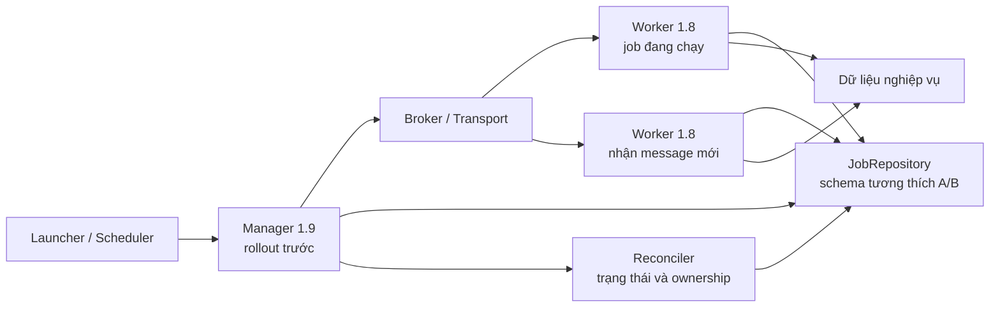
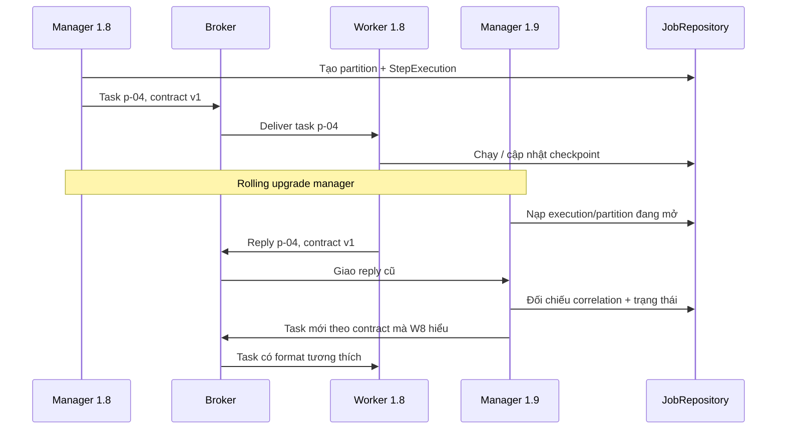

# Kiểm thử nâng cấp manager trước worker trong Spring Batch

## 1. Bài toán và kết quả cần đạt

Trong hệ thống **Spring Batch** xử lý dữ liệu lớn, manager và worker có thể là các tiến trình triển khai độc lập. Manager nhận yêu cầu, tạo và điều phối công việc; worker thực thi partition/chunk và phản hồi kết quả. Khi cần nâng cấp, đôi lúc phải triển khai **manager phiên bản mới trước**, trong khi worker cũ vẫn đang chạy job kéo dài hàng giờ. Đây là giai đoạn **version skew**: các tiến trình không cùng phiên bản nhưng phải phối hợp chính xác.

Bài học thuộc chương **Tương thích phiên bản** của module **SPRING_BATCH_SCALING_OPERATIONS**, nơi học cách mở rộng Spring Batch bằng multi-threaded step, parallel steps, partitioning và xử lý phân tán, đồng thời bảo đảm thread safety, retry/restart, đo nút thắt và vận hành an toàn theo tài nguyên thực tế. Nâng cấp manager trước worker chỉ chấp nhận được khi **hợp đồng giao tiếp và metadata vẫn tương thích** trong suốt thời gian các phiên bản cùng tồn tại.

Ví dụ: một job nhập 30 triệu giao dịch chạy trên 1 manager và 12 worker. Manager đang ở release `1.8`, worker cũng là `1.8`. Sắp nâng manager lên `1.9` nhưng các worker `1.8` còn giữ partition chưa hoàn tất. Sau rollout, manager `1.9` có thể:

- Nhận reply do worker `1.8` gửi, kể cả reply đến trễ hoặc gửi lặp không?
- Tra cứu đúng `StepExecution`, `ExecutionContext` và partition ownership do release cũ tạo không?
- Tiếp tục điều phối partition `1.8` đang chạy mà không tạo partition trùng không?
- Gửi task mới mà worker `1.8` hiểu được không?
- Rollback về manager `1.8` nếu phát hiện lỗi mà vẫn giữ được tiến độ và dữ liệu không?

**Định nghĩa thành công:** manager mới vẫn phục vụ được toàn bộ logical job cũ; không mất/nhân đôi chunk, partition hoặc kết quả; job có thể restart; trạng thái cuối đối chiếu được bằng dữ liệu nghiệp vụ; lỗi tương thích được phát hiện và chặn trước khi gửi thông điệp mà worker cũ không thể hiểu. Chỉ thấy pod `Ready` hay message được broker chấp nhận **không đủ** để chứng minh an toàn.

## 2. Phải phân biệt manager/worker của mô hình nào

Từ “manager” trong Spring Batch có thể ám chỉ các cơ chế khác nhau:

| Kiến trúc | Manager làm gì? | Worker làm gì? | Điểm dễ hỏng khi manager nâng cấp trước |
| --- | --- | --- | --- |
| **Remote partitioning** | Tạo partition, `StepExecution` và gửi yêu cầu thực thi tới worker | Nhận partition identity, tải context, chạy worker step và báo kết quả | Đổi tên step, partition, request DTO, serializer hoặc `ExecutionContext`; owner/reply không khớp |
| **Remote chunking** | Đọc/chia item thành các chunk, gửi yêu cầu và xử lý phản hồi | Xử lý/ghi chunk, gửi kết quả | Đổi chunk payload, reader/writer schema, correlation ID, ACK/reply protocol; phát lại có thể tạo side effect |
| **Local partitioning + multi-threaded step** | Chia việc và phân phối trong cùng JVM | Các thread trong cùng process | Không có skew do deploy manager/worker độc lập; vẫn có nguy cơ đổi checkpoint/schema khi job restart ở phiên bản mới |
| **Tự xây manager/worker qua REST hoặc queue** | Điều phối theo giao thức ứng dụng | Chạy task độc lập | Contract thực tế do ứng dụng định nghĩa; Spring Batch không tự bảo đảm wire compatibility |

Trong remote partitioning, cấu trúc thực tế phụ thuộc Spring Batch, Spring Integration, thư viện message binder và custom code được sử dụng. Một số giải pháp dùng metadata `JobRepository` chung; remote chunking lại có giao thức payload và reply khác. **Không mặc định hai cơ chế có thể dùng cùng kế hoạch rollout**.



Manager mới và worker cũ có thể **đồng thời truy cập** JobRepository, message broker, secret provider và dữ liệu nghiệp vụ. Vì vậy khả năng tương thích không chỉ là API giữa hai service.

## 3. Những lớp tương thích phải chứng minh

| Lớp | Điều phải ổn định trong cửa sổ mixed-version | Kiểm thử tiêu biểu |
| --- | --- | --- |
| **Business identity** | `jobName`, identifying `JobParameters`, request ID, snapshot/watermark | Replay cùng request không tạo `JobInstance` ngoài ý muốn |
| **Partition topology** | Tên worker step, tên partition, range, grid/manifest và cách gắn `StepExecution` | Manager 1.9 khôi phục chính xác partition 1.8 đã tạo |
| **Execution metadata** | `JobRepository` schema, `StepExecution` status, `ExecutionContext` keys/types, serialization | Worker 1.8 đọc/ghi metadata sau manager 1.9; restart không lỗi deserialize |
| **Request message** | Type/version, tên trường, correlation ID, tên step, ID execution, định nghĩa partition, serializer | Worker 1.8 nhận message từ manager 1.9 và xử lý được |
| **Reply message** | Result/status, header, correlation, exception representation, consumer acknowledgment | Manager 1.9 xử lý reply 1.8, kể cả out-of-order, duplicate, delayed |
| **Data/business contract** | Schema nguồn/đích, output version, writer idempotency, transaction boundary | Output đúng khi chunk/partition được retry giữa hai release |
| **Runtime stack** | Java, Spring Boot/Batch/Integration, JDBC driver, broker client và message converter | Boot thực tế lên được với binary cũ, giao tiếp với thư viện tương thích |
| **Operations** | Health/admission, drain, metrics, ACL/secret, lease/fencing, routing và rollback | Không có old worker bị loại nhầm hoặc task bị bỏ quên |

**Điểm cốt lõi:** kiểm thử phải chạy **manager 1.9 + worker 1.8**, không chỉ chạy các test unit của manager 1.9 hoặc toàn bộ hệ thống 1.9. Test toàn bộ phiên bản mới có thể xanh trong khi cửa sổ chuyển tiếp thực tế bị lỗi.

### Tương thích nguồn, binary, wire và metadata không đồng nhất

- **Source compatibility**: code cũ còn compile với API mới; không chứng minh object serializable cũ còn đọc được hoặc service cũ còn chạy.
- **Binary compatibility**: class/method bytecode tương thích; không chứng minh quy tắc nghiệp vụ, schema hay message hợp lệ.
- **Wire compatibility**: bytes/message mới và cũ vẫn trao đổi được theo một hợp đồng được version hóa.
- **Persistence compatibility**: record `BATCH_*`, `ExecutionContext`, manifest, dữ liệu đích và trạng thái cũ vẫn diễn giải đúng sau nâng cấp.
- **Semantic compatibility**: cùng message cho cùng tác dụng mong muốn; không chỉ deserialize thành công.

Một thay đổi như đổi `Long transactionId` thành `String transactionId` có thể được JSON parser chấp nhận trong vài trường hợp nhưng vẫn phá logic khoảng partition hoặc khóa idempotency. Test phải đo **hành vi**, không chỉ parse.

## 4. Xây compatibility contract trước khi rollout

Trước khi phát hành `1.9`, nhóm quản lý manager và worker cần công bố một ma trận hỗ trợ:

| Manager | Worker | Kết quả mong muốn | Mục đích test |
| --- | --- | --- | --- |
| `1.8` | `1.8` | Baseline | Đo đầu ra và tài nguyên làm chuẩn |
| `1.9` | `1.8` | **Bắt buộc pass** nếu manager nâng cấp trước | Đường nâng cấp chính |
| `1.9` | `1.9` | Pass | Trạng thái cuối sau rollout |
| `1.8` | `1.9` | Pass nếu rollback manager được hỗ trợ | Chứng minh rollback; nếu không, phải có phương án thay thế rõ ràng |
| `1.9` | `1.7` | Không mặc định hỗ trợ | Bảo đảm worker quá cũ được phát hiện, không nhận task không tương thích |

Đây là **ma trận minh họa của một sản phẩm**, không phải ma trận hỗ trợ chính thức của Spring Batch. Việc một cặp được cho là pass phải xuất phát từ kết quả test trên các binary thật, cấu hình thật, DB schema và broker tương ứng. Nếu `1.8 manager + 1.9 worker` không đạt, rollback manager sau khi đã nâng worker **không** được coi là phương án an toàn.

Trong hệ thống tự định nghĩa message, có thể công bố `protocolVersion`, `minimumWorkerVersion`, `capabilities` và `jobContractVersion`; tránh đồng nhất phiên bản release của service với phiên bản wire protocol:

```json
{
  "messageType": "ExecutePartition",
  "protocolVersion": 2,
  "requestId": "import-20261126-42",
  "jobInstanceId": 241,
  "stepExecutionId": 8804,
  "partitionKey": "p-04",
  "sourceSnapshot": "snapshot-20261126",
  "correlationId": "import-20261126-42:p-04:attempt-1",
  "requiredCapabilities": ["partition-context-v1"]
}
```

JSON trên là **envelope minh họa do ứng dụng tự thiết kế**, không phải format mặc định của Spring Batch remote partitioning. `protocolVersion: 2` chỉ an toàn với worker cũ nếu worker đó đã hỗ trợ chính xác version 2. Nếu worker cũ chỉ hỗ trợ version 1, manager mới cần phát **version 1** cho worker cũ hoặc tách route; việc thêm trường `protocolVersion` vào message không tự tạo backward compatibility.

Một chính sách nên định nghĩa rõ:

1. **Required fields không đổi ý nghĩa** trong cùng protocol version.
2. Trường mới chỉ optional khi worker cũ thật sự bỏ qua được; không dùng field mới để thay đổi hành vi mà worker cũ không biết.
3. Giá trị enum mới phải có đường fallback rõ ràng, tránh lỗi parser hoặc xử lý thành công giả.
4. Tên step, key của `ExecutionContext` và kiểu dữ liệu persisted phải ổn định cho JobInstance cũ.
5. Chỉ message có capability tương ứng mới được route tới worker cũ; thiếu capability phải fail-fast hoặc vào hàng đợi đúng version, không tự đổi format.
6. Cần correlation/deduplication có ý nghĩa xuyên upgrade; không xóa dữ liệu dedup trước khi reply cũ có thể đến muộn.

## 5. Spring Batch metadata: rủi ro lớn hơn thay đổi message

Với partitioning, worker có thể truy xuất `StepExecution` và `ExecutionContext` theo ID từ kho metadata chung. Nếu manager mới đổi schema, serializer, step name hoặc khóa context trong khi worker cũ vẫn hoạt động, message hợp lệ vẫn có thể dẫn đến lỗi runtime.

Ví dụ worker `1.8` mong đợi:

```text
stepExecutionContext:
  fromId: Long
  toIdExclusive: Long
  sourceSnapshot: String
```

Manager `1.9` muốn bổ sung trường `region` và đổi `toIdExclusive` thành `endId`. Nếu manager bắt đầu viết context chỉ có `endId`, worker `1.8` sẽ không còn biên trên, dù message chỉ chứa `stepExecutionId` không đổi.

Một cách chuyển an toàn khi còn old worker:

- Tiếp tục ghi `fromId`, `toIdExclusive`, `sourceSnapshot` theo format cũ cho **job/partition cũ**.
- Trường mới có thể thêm dưới key khác nếu worker cũ bỏ qua được và serialization tương thích.
- Nếu thuật toán mới cần `region` bắt buộc, chỉ gửi partition đó đến worker có capability mới; hoặc hoãn thay đổi đến khi không còn worker cũ.
- Giữ partition name và source snapshot của cùng `JobInstance`, kể cả khi tăng giảm số replica hoặc `gridSize`.

### JobRepository và framework upgrade

Một upgrade ứng dụng có thể kéo theo nâng Spring Batch major version, Spring Framework, Spring Boot, driver hoặc migration database. Các thay đổi này có thể ảnh hưởng schema, SQL, cơ chế serialize `ExecutionContext`, API builder và kiểu tham số job. **Không giả định** hai major version của Spring Batch có thể cùng đọc/ghi một JobRepository chỉ vì kết nối được cùng database.

Quy trình an toàn:

1. Ghi rõ phiên bản thực tế của Spring Batch, Spring Integration, Spring Boot, Java và database driver ở manager và worker. So sánh hướng dẫn migration **đúng các phiên bản đã chọn**.
2. Kiểm tra schema `BATCH_*` trước và sau migration bằng bản sao database và các execution thực. Xác định DDL nào có thể áp dụng theo hướng **expand → migrate → contract**.
3. Kiểm tra **đọc và ghi** metadata bằng cả manager mới và worker cũ, không chỉ kết nối hay truy vấn đọc.
4. Kiểm tra serialize/deserialize `ExecutionContext` thực tế chứa các loại dữ liệu có trong production, kể cả checkpoint của các job đang dang dở.
5. Kiểm tra tạo mới, update và restart `JobExecution`, `StepExecution`; rollback về binary cũ cần được thử nếu là mục tiêu.
6. Nếu không thể chứng minh tương thích major version, giữ **execution plane và repository riêng theo version** hoặc hoàn tất/drain job cũ trước khi di chuyển dữ liệu. Migration trạng thái phải có chiến lược được kiểm thử riêng.

Không sửa trực tiếp trạng thái trong bảng `BATCH_JOB_EXECUTION`/`BATCH_STEP_EXECUTION` để che lỗi version skew. Metadata `STARTED` sau crash cần đối chiếu owner và recovery chính thức; ép `FAILED` bằng SQL có thể kích hoạt hai worker ghi cùng partition.

## 6. Chuyển đổi manager khi còn worker đang chạy

Một manager thường vừa **sinh task mới**, vừa **nhận reply cũ**. Hai vai trò này phải được xét riêng khi nâng cấp.



Sơ đồ là **mục tiêu cần kiểm thử**. Một ứng dụng Spring Batch/Spring Integration không mặc định cho phép thay manager giữa chừng và tự tiếp quản mọi reply/aggregate in-memory. Nếu manager cũ giữ correlation, aggregator, reply channel hoặc partition tracking trong RAM, manager mới có thể **không có đủ trạng thái** để nhận reply trước đó.

Để manager mới tiếp quản được, cần thiết kế một trong các phương án:

- **Drain manager cũ trước**: ngừng phát task mới, đợi hết inflight/reply của các step đang chạy, sau đó chuyển manager. Phù hợp khi thời gian chờ chấp nhận được.
- **Bền vững hóa trạng thái điều phối**: lưu request ledger, partition dispatch, correlation/reply, recovery claim và ownership theo transactional protocol để manager mới có thể khôi phục. Phải xử lý replay/duplicate rõ ràng.
- **Pin mỗi JobInstance vào manager version**: job cũ tiếp tục dùng manager `1.8` đến khi kết thúc, manager `1.9` chỉ nhận job mới. Phù hợp job dài và nâng cấp protocol lớn.
- **Tách namespace/queue theo version**: manager/worker cùng version xử lý mỗi nhóm task, dữ liệu nghiệp vụ vẫn được đối soát toàn cục. Không dùng chung một queue rồi trông cậy vào worker tự đoán version.

Với nhiều job chạy nhiều giờ, **pin owner/version cho từng JobInstance** thường giảm rủi ro nhất nếu giao thức chưa có thiết kế tiếp quản bền vững. Yêu cầu “manager nâng trước worker” vẫn có thể đáp ứng ở mức **control plane** (manager mới nhận job mới), trong khi những manager cũ tạm thời còn chạy để hoàn tất execution cũ.

### Điều kiện cần với reply

Một reply từ worker cũ phải được xử lý dựa trên các thông tin:

- `requestId`, `JobInstance`/`StepExecution` identity và partition key tương ứng.
- Correlation ID và attempt/generation để phân biệt reply hiện tại với reply cũ đến muộn.
- Trạng thái chunk/partition ở `JobRepository` và quyền sở hữu hiện thời.
- Khả năng nhận duplicate, out-of-order và redelivery do broker.
- Hành vi khi reply chứa field lỗi, exception hoặc enum mà manager mới/worker cũ khác phiên bản diễn giải khác nhau.

Nếu manager mới chỉ parse được reply kiểu `1.9`, worker `1.8` hoàn thành công việc nhưng kết quả có thể bị bỏ quên. Nếu manager mới không kiểm tra attempt, một reply muộn của worker cũ có thể ghi đè kết quả partition đã được giao lại.

## 7. Giữ identity và partition manifest xuyên upgrade

Spring Batch xác định một `JobInstance` bằng tên job và các **identifying `JobParameters`**. Nếu manager `1.9` tự thêm tham số identifying mới cho các request của `1.8`, logical job có thể bị tách thành instance khác; restart sẽ không tìm đúng phần đã hoàn tất.

Ví dụ hai bản JobParameters cần cùng logic identity:

```java
// Identifying parameter phải giữ nguyên khi restart logical run cũ.
JobParameters parameters = new JobParametersBuilder()
    .addString("requestId", originalRequestId, true)
    .addString("sourceSnapshot", originalSnapshot, true)
    .toJobParameters();
```

Code minh họa cách tạo parameters; nếu job cũ có các identifying field khác, bản mới **phải khớp bộ field cũ** khi restart. Không tự động thêm `managerVersion` vào identifying parameters của job đang chạy chỉ để dễ quan sát; lưu version vào request ledger/audit hoặc dữ liệu không định danh được thiết kế sẵn.

Partition name và range nên được chốt thành **manifest bất biến**:

| Thuộc tính | Ví dụ | Tại sao phải giữ |
| --- | --- | --- |
| `requestId` | `import-20261126-42` | Định danh logical run |
| `partitionKey` | `p-04` | Match `StepExecution` cũ |
| `fromId`, `toIdExclusive` | `500001`, `625001` | Đảm bảo không gap/overlap |
| `sourceSnapshot` | `snapshot-20261126` | Chặn dữ liệu nguồn thay đổi âm thầm |
| `contractVersion` | `partition-context-v1` | Worker cũ có thể tiếp tục đọc |
| `workerImage` hoặc compatibility group | `worker:1.8` | Truy vết/restart đúng runtime |

Đừng để manager mới tính lại partition dựa trên số worker mới hoặc `MAX(id)` mới của nguồn. Khi một số partition được đánh dấu `COMPLETED` trong JobRepository, thay tên hoặc biên có thể khiến framework không ghép được metadata hoặc tạo xử lý trùng.

## 8. Cơ chế định tuyến worker theo khả năng

Trong mixed-version, không nên gửi ngẫu nhiên các task yêu cầu chức năng mới tới bất kỳ worker nào đang consume chung queue. Có ba cách thông dụng:

1. **Giao thức chung thấp nhất**: trong thời gian còn worker `1.8`, manager `1.9` chỉ phát message và context mà worker `1.8` hiểu. Khi tất cả worker nâng cấp, mới bật tính năng `1.9`.
2. **Queue/route theo protocol version**: task `contract-v1` gửi `worker-v1`, task `contract-v2` gửi `worker-v2`; chỉ manager/gateway biết ánh xạ. Cần phân biệt reply route và retry/dead-letter queue.
3. **Capability-aware scheduling**: worker đăng ký tập khả năng; manager chỉ phân task phù hợp. Registry capability phải có TTL, heartbeat, generation và fail-closed khi không chắc trạng thái.

Ví dụ policy mang tính minh họa:

```yaml
compatibility:
  managerRelease: "1.9"
  workerGroups:
    legacy:
      messageProtocol: "partition-v1"
      contextSchema: "context-v1"
      queue: "partition-requests-v1"
    current:
      messageProtocol: "partition-v2"
      contextSchema: "context-v2"
      queue: "partition-requests-v2"
  defaultWhenUnknown: "reject-and-alert"
```

Đây là **policy giả định của ứng dụng**, không phải thuộc tính YAML tự động được Spring Batch đọc. Phải có code routing, xác nhận capability và chiến lược rollback tương ứng. Đặc biệt không phát `context-v2` vào bảng metadata mà old worker truy cập được nếu nó không thể deserialize, kể cả message vẫn là `partition-v1`.

## 9. Test matrix: tối thiểu những gì phải chạy

Kiểm thử theo *cặp binary thật* và trạng thái job, không chỉ unit test của serializer.

| Nhóm test | Setup | Thao tác | Điều kiện pass |
| --- | --- | --- | --- |
| **Baseline** | Manager 1.8, worker 1.8, schema cũ | Chạy job đủ partition/chunk | Output đúng; có baseline throughput, lỗi và metadata |
| **New request to old worker** | Manager 1.9, worker 1.8 | Tạo task mới theo contract được hỗ trợ | Worker nhận, chạy, gửi reply; manager hiểu trạng thái |
| **Old reply to new manager** | Worker 1.8 còn task in-flight | Nâng manager trong lúc worker chạy | Reply không mất; state được reconcile hoặc được giữ ở owner cũ |
| **Checkpoint restart** | Một partition 1.8 đã commit một phần | Crash worker, chạy lại bằng runtime được hỗ trợ | Đọc đúng checkpoint và hoàn tất không duplicate |
| **Delayed/duplicate reply** | Broker giữ lại reply 1.8 | Phát lại sau khi task được retry | Reply cũ không ghi đè attempt mới |
| **Schema migration** | Bản sao JobRepository chứa execution cũ | Chạy DDL rồi cho cả version truy cập | Mỗi version còn đọc/ghi đúng trong thời gian overlap |
| **ExecutionContext** | Context chứa đủ trường production | Worker cũ đọc context do manager mới tạo | Không lỗi type/serializer; range/snapshot đúng |
| **New field/enum** | Manager tạo payload có trường mới | Thử worker cũ | Old worker bỏ qua an toàn hoặc nhận lỗi có kiểm soát; không xử lý sai |
| **Unknown capability** | Worker không báo version hoặc báo quá cũ | Manager dispatch | Task bị giữ/reroute/fail-fast; không âm thầm mất |
| **Manager rollback** | Manager 1.9 đã nhận/gửi task | Quay về 1.8 nếu được cam kết hỗ trợ | Manager cũ xử lý trạng thái tồn đọng, không tạo duplicate |
| **Mixed workers** | Worker 1.8 + 1.9 chạy song song | Chạy cùng tải, bật version routing | Không mất message, không trộn context bất tương thích |
| **Resource ceiling** | Canaries tăng số replica và connection | Chạy workload cao điểm | DB pool, queue lag, CPU/memory và latency trong ngưỡng |
| **Security/config** | Credential/cert đã được rotate | Kiểm tra old/new gọi DB, broker | Không lỗi xác thực hoặc mất quyền do version config |

**Không dùng job quá ngắn làm bằng chứng duy nhất.** Cần giữ ít nhất một job đang chạy trước khi bắt đầu upgrade, một partition đang commit, một reply đến trễ và một lần crash/restart. Các lỗi version skew thường xuất hiện khi trạng thái đã được tạo **trước** khi manager đổi phiên bản.

## 10. Bộ dữ liệu kiểm thử tái lập

Tạo tập dữ liệu staging có thể xác định kết quả đúng:

- 1.200.000 record với ID ổn định, có 12 partition rời nhau và manifest cố định.
- Có bản ghi hợp lệ, bản ghi bị skip/quarantine theo policy, record cần retry transient và record gây lỗi không thể retry.
- Khóa output duy nhất, ví dụ `(request_id, business_id, output_version)`; có truy vấn đối soát count và checksum tổng.
- Có checkpoint giữa chừng; tạo ít nhất một partition `COMPLETED`, một `FAILED`, một `STARTED` có worker còn sống và một worker crash bất ngờ.
- Lưu baseline metadata và output trước mỗi test; reset staging về snapshot riêng giữa các run để không nhầm sai khác do dữ liệu.

Các bất biến cần assert:

```text
1. Mọi accepted requestId ánh xạ tới đúng logical JobInstance mong muốn.
2. Mọi partitionKey trong manifest có đúng phạm vi và sourceSnapshot.
3. Không có hai owner còn quyền ghi cùng partition tại cùng thời điểm.
4. Không có committed business output thiếu hoặc trùng ngoài policy.
5. Manager mới xử lý được reply cũ hoặc giữ owner cũ chịu trách nhiệm.
6. Chỉ JobExecution có trạng thái terminal/được phép mới được restart.
7. Mọi task đã gửi hoặc được ghi nhận xong, hoặc còn trong trạng thái retry rõ ràng.
8. Rollback/restart không đòi thay đổi tham số identifying của JobInstance cũ.
```

Đối với remote chunking, test case có giá trị đặc biệt là **worker commit thành công nhưng reply/ACK không về**; message được giao lại có thể khiến writer lặp tác dụng phụ. Với remote partitioning, test **manager không nhận heartbeat nhưng worker cũ vẫn ghi DB** để xác minh fencing/ownership.

## 11. Ví dụ kiểm thử contract bằng Java

Khi ứng dụng định nghĩa envelope JSON, có thể viết contract test buộc manager mới phát payload mà worker cũ đọc được. Ví dụ dưới đây dùng Jackson và một DTO *giả định* của ứng dụng:

```java
@Test
void manager19MessageCanBeHandledByWorker18Contract() throws Exception {
    // Fixture serialize từ binary thật của manager 1.9 trong CI.
    String payload = fixtureStore.load("manager-1.9/partition-request-v1.json");

    // LegacyPartitionRequest được compile từ artifact contract của worker 1.8.
    LegacyPartitionRequest request =
            legacyWorker18Mapper.readValue(payload, LegacyPartitionRequest.class);

    assertThat(request.getStepExecutionId()).isPositive();
    assertThat(request.getPartitionKey()).isEqualTo("p-04");
    assertThat(request.getSourceSnapshot()).isEqualTo("snapshot-20261126");

    // Test end-to-end còn phải thực thi request trên worker 1.8 và đối soát output.
}
```

`fixtureStore`, `legacyWorker18Mapper` và DTO là thành phần của test harness; không phải API sẵn có của Spring Batch. Chỉ test parse **chưa đủ**: phải chạy integration test với **worker binary 1.8 thật**, converter, broker, JobRepository và chính sách xử lý lỗi thực. Đừng cấu hình Jackson bỏ qua mọi unknown field để che mất trường bắt buộc hoặc thay đổi ngữ nghĩa.

Một cách bổ sung là lưu **golden messages** từ thực tế (đã ẩn dữ liệu nhạy cảm) cho các loại `request`, `reply`, `retry`, `failure` và `late reply`. Chạy chúng qua code decode ở release mới, sau đó so sánh không chỉ object mà cả hành vi state transition. Giữ fixture theo `protocolVersion`, không chỉ theo tên release.

## 12. Runbook nâng manager trước worker

### Bước 1 — Chốt tương thích và phạm vi

Ghi chính xác version manager/worker, Spring Batch, Spring Integration, Spring Boot, JDK, broker client, serializer, database driver, schema JobRepository, và tất cả custom message handlers. Khóa tập tính năng mới đòi worker 1.9 bằng **feature flag** hoặc routing. Chỉ cho phép upgrade sau khi cặp **manager 1.9 + worker 1.8** được thử trên binary và schema mục tiêu.

### Bước 2 — Chốt trạng thái đang chạy

Trước rollout, ghi:

- Danh sách `JobInstance`, `JobExecution`, `StepExecution` và partition đang `STARTED`/`STOPPING`/`FAILED`.
- Số message in-flight/unacknowledged, correlation/attempt, queue lag, dead-letter queue.
- Owner/capability của worker, manifest và source snapshot.
- Phiên bản image digest, contract/schema và baseline checksum output.
- Tài nguyên còn trống để có thể chạy song song manager/worker cũ và mới.

Nếu manager không thể tiếp quản reply in-memory, **không thay thế owner cũ** của các execution đó. Hoàn tất/drain hoặc pin old manager cho từng JobInstance.

### Bước 3 — Triển khai canary manager

Đưa một replica manager 1.9 vào luồng traffic nhỏ hoặc namespace/job được định tuyến riêng, kiểm tra:

1. Nó nhận được task mới và worker 1.8 xử lý đúng theo protocol được hỗ trợ.
2. Nó xử lý hoặc không nhận trùng reply từ execution thuộc phạm vi của mình.
3. Kho metadata không xuất hiện lỗi SQL/serialization hoặc khác biệt status.
4. Không có worker 1.8 bị gửi task cần capability mới.
5. RPS/throughput, timeout, connection pool và lỗi ghi dữ liệu nằm trong guardrail.

Một canary không nên giành quyền quản lý job của manager cũ nếu chưa có **durable ownership transfer**. Nếu dùng controller/reconciler với leader election, phải kiểm tra lease/fencing và recovery của instance mới.

### Bước 4 — Triển khai manager mới từng đợt

Chỉ tăng số replica khi canary pass; sử dụng readiness phản ánh **khả năng điều phối thực sự**, không chỉ HTTP server khởi động. Tắt nhận task mới trên manager cũ và drain theo kiến trúc; không dừng manager cũ chỉ vì pod mới Ready. Bảo đảm những execution cũ không mất owner trong quá trình rollout.

Với Kubernetes Deployment, `maxUnavailable: 0`, `maxSurge` và `terminationGracePeriodSeconds` là **công cụ quản lý số replica**, không tự giữ correlation state hoặc checkpoint. Các callback `preStop`, SIGTERM, queue consumer shutdown và workflow bàn giao phải được ứng dụng hiện thực.

### Bước 5 — Giữ worker cũ trong cửa sổ tương thích

Trong lúc worker 1.8 còn chạy:

- Không đổi message protocol/context schema sang dạng nó không đọc được.
- Không chạy migration phá tính tương thích của JobRepository.
- Không sửa tên worker step, manifest và identifying JobParameters của job cũ.
- Không cho manager 1.9 thay thuật toán partition của các run cũ.
- Theo dõi replica cũ cuối cùng và task/reply chưa terminal trước khi kết thúc cửa sổ hỗ trợ.

### Bước 6 — Nâng worker và bật tính năng mới

Chỉ sau khi manager mới ổn định và các job/worker cũ đã drain an toàn, nâng worker theo canary/nhóm. Nếu cần thay protocol, dùng versioned queue/routing; không chuyển cả hệ thống khi còn message protocol cũ in-flight. Khi tất cả worker đã hỗ trợ tính năng mới và window rollback kết thúc, mới bật capability mới và loại bỏ compatibility layer theo kế hoạch.

### Bước 7 — Đối soát và kết thúc

Đối chiếu từng request với trạng thái terminal hoặc kế hoạch retry, xác minh không có execution mắc kẹt không owner, không có duplicate business key và tổng output theo snapshot chính xác. Ghi lại metric, kết quả canary/rollback, sự cố, schema và version chính thức để lần upgrade kế tiếp có căn cứ.

## 13. Khi không thể nâng manager trước worker

Một số trường hợp phải **thay đổi thứ tự rollout** hoặc giữ song song hai thế hệ:

- Manager 1.9 buộc phải phát message format mới nhưng worker 1.8 không có parser/capability tương ứng.
- Framework hoặc JobRepository đổi major version và chưa chứng minh hai runtime đọc/ghi chung metadata an toàn.
- Manager cũ lưu toàn bộ correlation state trong RAM, không thể drain, và manager mới không thể tiếp nhận các reply thuộc job cũ.
- Thuật toán partition, checksum, snapshot hoặc execution context mới không tương thích với các step cũ cần restart.
- Rollback manager cũ không thể đọc dữ liệu mà manager mới đã ghi; nhóm vận hành yêu cầu rollback nhanh.

Các lựa chọn an toàn hơn:

1. **Phát hành bản worker trung gian trước** chỉ bổ sung khả năng đọc cả protocol cũ và mới, chưa bật hành vi mới. Sau khi mọi worker có lớp tương thích, mới nâng manager.
2. **Blue/green theo job generation**: giữ manager 1.8 + worker 1.8 xử lý job cũ; manager 1.9 + worker 1.9 xử lý job mới, với routing/job ownership rõ ràng.
3. **Drain và freeze window**: ngừng nhận job mới, cho job cũ kết thúc hoặc dừng tại checkpoint, rồi chuyển toàn bộ stack.
4. **Migration có kiểm chứng**: nếu buộc thay repository/context, xuất/nhập hoặc chuyển trạng thái theo quy trình chuyên biệt đã test trên snapshot, không thao tác tay với DB production.

Không gọi một rollout là “zero downtime” nếu mọi pod Ready nhưng một số `JobExecution` phải xử lý lại mà không có idempotency. Mục tiêu thực tế là **không mất công việc, không mất tính đúng dữ liệu và có đường phục hồi rõ ràng**.

## 14. Rollback và xử lý sự cố version skew

Khi phát hiện manager 1.9 lỗi trong lúc worker 1.8 đang chạy, cần phân loại:

| Triệu chứng | Rủi ro | Hành động |
| --- | --- | --- |
| Worker 1.8 không deserialize request | Task bị retry/dead-letter hoặc mất thời gian | Tạm dừng dispatch protocol mới, route sang queue/manager cũ phù hợp; giữ message bền vững |
| Manager 1.9 không đọc reply 1.8 | Worker đã commit nhưng manager xem như chưa xong | Đối chiếu `StepExecution`/output, không gửi lại ngay; khôi phục reply/correlation |
| DB migration khiến worker 1.8 lỗi metadata | Không cập nhật được checkpoint, restart không an toàn | Ngừng thay đổi/dispatch, giữ dữ liệu, chuyển sang stack/schema tương thích được chứng minh |
| Manager 1.9 tạo partition key mới | Chồng lấn/thiếu dữ liệu | Chặn dispatch và rà manifest; chỉ rerun theo workflow recovery có fencing/idempotency |
| Worker 1.8 mất heartbeat trong lúc còn ghi DB | Manager có thể gửi lại partition cho worker khác | Chỉ cấp lại khi owner cũ đã bị loại trừ hoặc fencing thực sự có hiệu lực |
| Rollback về manager 1.8 sau khi đã gửi protocol v2 | Old manager có thể không đọc được task/reply tồn đọng | Dùng old+new manager song song theo namespace; xử lý drain/convert có kiểm thử |

**Rollback binary không đồng nghĩa rollback state.** Metadata và message đã do phiên bản mới ghi có thể không đọc được bởi phiên bản cũ; rollback phải được thiết kế trong compatibility matrix trước, không để đến sự cố mới thử.

Với lỗi nghiêm trọng, thứ tự xử lý thường là **ngừng phát task không tương thích → giữ message và metadata bền vững → xác minh owner và tác dụng phụ đã commit → chuyển về route/manager tương thích → restart/recover theo trạng thái thật**. Không trực tiếp đổi `BATCH_STEP_EXECUTION.STATUS` thành `FAILED` rồi kích hoạt lại khi chưa bảo đảm worker cũ dừng.

## 15. Giám sát và tiêu chí chấp nhận

Dashboard mixed-version nên tách theo manager release, worker release **và protocol version**:

| Metric hoặc log | Điều cần thấy |
| --- | --- |
| Task/request theo `protocolVersion` và worker capability | Không có message vượt khả năng worker |
| In-flight tasks, unacked messages, reply lag và DLQ | Không tăng bất thường khi chuyển manager |
| Parse/deserialize failures, unknown fields/enum | Bằng 0 hoặc đúng các rejection được kỳ vọng và báo động |
| `JobExecution` / `StepExecution` theo `BatchStatus` | Không có tỷ lệ `STARTED`/`STOPPING` stale tăng |
| Partition owner, lease, fencing conflict | Không có hai owner hợp lệ cho cùng partition |
| Chunk commit/rollback, retry, duplicate reply | Không xuất hiện side effect trùng hoặc retry storm |
| Output count, checksum, unique-key conflicts | Dữ liệu sau nâng cấp khớp snapshot và quy tắc nghiệp vụ |
| DB pool, CPU, heap, broker lag, task executor queue | Tài nguyên nằm trong ngưỡng đã đo, kể cả khi surge |

Guardrail cần được cấu hình theo baseline thực tế, ví dụ dừng rollout nếu `unknownMessageVersion > 0`, `deadLetterQueueGrowth` vượt mức cho phép, execution không tiến triển quá timeout theo loại job, hoặc checksum output lệch. Tránh đưa request ID có cardinality lớn vào metric label; dùng structured log/trace để truy vết chính xác.

### Bộ kiểm thử bắt buộc trước khi promote

- [ ] Manager 1.9 phát message được worker 1.8 thật xử lý thành công.
- [ ] Manager 1.9 tiếp nhận hoặc giữ đúng ownership của các reply/chunk từ trước rollout.
- [ ] `ExecutionContext`, partition manifest và `StepExecution` cũ vẫn đọc/ghi/restart được.
- [ ] Schema JobRepository được cả hai phiên bản sử dụng theo compatibility contract; kiểm thử trên dữ liệu metadata thực tế.
- [ ] Worker cũ không nhận task yêu cầu capability mới; có negative test cho unknown version.
- [ ] Mất ACK/reply, reply trễ/lặp và worker crash không tạo output trùng.
- [ ] Fencing/lease ngăn hai worker cùng ghi một partition khi manager failover.
- [ ] Rollback manager được thực hiện thật trong staging nếu được công bố hỗ trợ.
- [ ] Rerun partition lỗi không làm chạy lại các partition đã `COMPLETED` ngoài mong đợi.
- [ ] Throughput, latency, DB connections và queue lag đạt giới hạn trong điều kiện mixed-version.
- [ ] Đã có runbook dừng dispatch, pin manager cũ, reconcile metadata và recovery khi contract không tương thích.

## 16. Tự kiểm tra hiểu bài

1. Worker 1.8 đang ghi dữ liệu và reply sẽ đến sau 30 phút. Vì sao chỉ đặt `maxUnavailable: 0` cho Deployment manager 1.9 chưa bảo đảm reply được tiếp nhận?
2. Manager 1.9 chỉ thêm một field optional vào JSON request. Những điều kiện nào cần kiểm chứng trước khi khẳng định worker 1.8 không bị ảnh hưởng?
3. Tại sao bài test manager 1.9 + worker 1.9 không thể thay thế test manager 1.9 + worker 1.8?
4. Vì sao thêm `managerVersion` làm identifying JobParameter có thể phá restart của một logical job cũ?
5. Khi worker 1.8 còn sống nhưng mất heartbeat, cần chứng cứ hoặc fencing nào trước khi worker mới nhận lại partition?
6. Nếu Spring Batch major version mới thay cơ chế serialize `ExecutionContext`, tại sao một broker message hoàn toàn tương thích vẫn chưa đủ?
7. Khi nào chọn pin manager cũ theo JobInstance, và khi nào có thể chuyển quyền sở hữu một execution đang chạy sang manager mới?
8. Nếu không thể rollback binary về manager cũ vì schema đã thay, chiến lược blue/green nào cho phép tiếp tục xử lý job cũ?

## 17. Kết luận

**Nâng cấp manager trước worker** là một chiến lược hợp lệ khi có **compatibility contract được kiểm thử** giữa hai phiên bản, gồm message request/reply, JobRepository, `ExecutionContext`, partition identity, retry/restart, quyền sở hữu và dữ liệu đầu ra. Cửa sổ mixed-version là một trạng thái vận hành phải được thiết kế có chủ đích, với canary, routing, quan sát và rollback rõ ràng.

Đối với workload Spring Batch chạy lâu và phân tán, tiêu chí quan trọng nhất là **mỗi logical job vẫn có một đường thực thi và phục hồi chính xác**, kể cả khi manager mới và worker cũ cùng tồn tại. Nếu contract không thể được chứng minh, giữ manager/worker cũ cho job đang chạy hoặc nâng worker tương thích trước là lựa chọn đúng hơn việc ép rollout bằng trạng thái pod.
