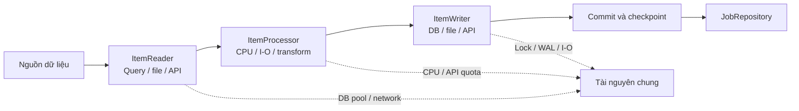
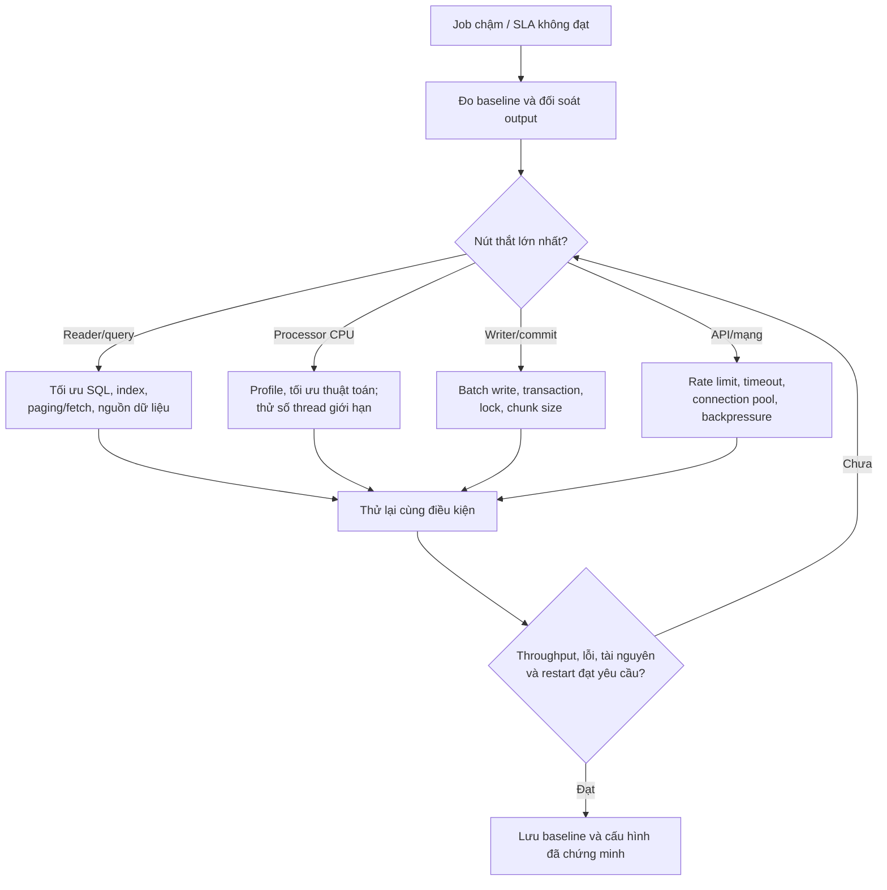

# Anti-pattern: Thêm thread mà không đo bottleneck

## 1. Tình huống: thêm 16 thread nhưng batch vẫn chậm

Một job Spring Batch xử lý 5 triệu giao dịch mỗi đêm. Ban đầu job có một step chạy tuần tự, hoàn tất trong 35 phút. Khi nhận yêu cầu rút xuống 15 phút, nhóm phát triển thêm `TaskExecutor` với 16 thread. Kết quả bất ngờ: job mất 38 phút, database tăng lock wait, số lỗi timeout tăng, memory cao hơn và việc restart khó kiểm soát hơn.

Sai lầm nằm ở cách ra quyết định: **chọn mức đồng thời trước khi chứng minh phần công việc nào đang giới hạn throughput**. Nếu phần lớn thời gian dùng để đọc dữ liệu qua một query chậm, chờ commit, ghi qua một writer tuần tự hoặc đợi một API có giới hạn tốc độ, thêm thread xử lý không giải quyết được nguyên nhân gốc.

Trong module `SPRING_BATCH_SCALING_OPERATIONS`, bài này đặt anti-pattern trên vào bối cảnh **mở rộng Spring Batch cho workload dữ liệu lớn**: multi-threaded step, parallel steps, local/remote chunking, partitioning và xử lý từ xa đều là công cụ có chi phí. Hãy dùng số đo thực tế để quyết định công cụ nào phù hợp.

Sau bài học, bạn có thể:

- Phân biệt **throughput, latency, concurrency và bottleneck**.
- Đọc các chỉ số Spring Batch, JVM, database và hệ thống ngoại vi để tìm nơi thời gian bị tiêu tốn.
- Giải thích vì sao tăng thread có thể gây contention, queueing, retry storm hoặc sai dữ liệu.
- Thiết kế thí nghiệm so sánh một thread với nhiều thread, có đối soát kết quả nghiệp vụ.
- Hiểu chính xác mô hình multi-threaded step trong **Spring Batch 6** và các ràng buộc về thread safety, transaction, restart.
- Chọn hướng tối ưu tuần tự, chia partition hoặc mở rộng phân tán khi bằng chứng cho thấy cần thiết.

> **Nguyên tắc:** trước khi tăng thread, hãy phát biểu giả thuyết kiểm chứng được, ví dụ: “`ItemProcessor` dùng 75% wall-clock time; CPU còn ít nhất 4 core rảnh; tăng concurrency lên 4 có thể tăng thông lượng nếu reader/writer đáp ứng được”.

## 2. Nhận diện anti-pattern

Các dấu hiệu điển hình:

1. Cấu hình `taskExecutor` hoặc tăng `gridSize` chỉ vì số lõi CPU/máy chủ tăng, chưa từng có baseline đủ tin cậy.
2. Chọn `16`, `32` hay `64` thread theo cảm tính; không biết connection pool, hạn mức API và số transaction đồng thời.
3. Dùng `readCount / duration` làm “throughput thành công” mà không kiểm tra `writeCount`, filter, skip, error và tính đúng đắn của output.
4. Xem CPU toàn máy thấp là chứng cứ phải thêm thread, dù một reader hoặc một writer vẫn đang chạy tuần tự.
5. Chạy benchmark nhiều thread trên input khác, cache khác, thời điểm DB ít tải hơn, rồi kết luận có cải thiện.
6. Chỉ so thời gian hoàn thành thành công, bỏ qua p95/p99 chunk duration, retry, lock wait và hành vi sau khi worker chết.
7. Dùng cùng một mutable state trong processor ở nhiều thread, sau đó sửa “lỗi ngẫu nhiên” bằng synchronized toàn hàm, khiến phần xử lý lại tuần tự.
8. Giảm thời gian của một step nhưng làm job phụ thuộc phía sau chậm hơn, khiến SLA tổng thể không cải thiện.

Anti-pattern có thể xảy ra ngay cả khi phép đo cho thấy tăng thread giúp một lần chạy nhanh hơn. Nếu người triển khai không đo tải hệ thống, không đối soát số liệu và không thử restart, cấu hình vẫn có nguy cơ thất bại khi lên production.

## 3. Bottleneck nằm ở đâu trong pipeline?

Một chunk-oriented step thường đi qua các công đoạn sau:



Trong hệ thống tuần tự, một công đoạn chậm có thể chi phối tổng thời gian. Trong hệ thống đồng thời, **năng lực phục vụ nhỏ nhất trên đường xử lý** thường giới hạn throughput bền vững; khi lượng yêu cầu đổ vào lớn hơn năng lực phục vụ, queue tăng, latency tăng và timeout xuất hiện.

| Công đoạn | Bottleneck có thể gặp | Bằng chứng cần thu thập |
|---|---|---|
| Reader | Full table scan, paging không ổn định, API nguồn chậm | Query plan, read timer, DB I/O, wait event, rows/s |
| Processor | CPU transform, JSON/XML parsing, mã hóa, gọi HTTP | Process timer, CPU profiling, allocation, HTTP latency |
| Writer | Ghi từng hàng, index/constraint, lock, transaction log | Write timer, JDBC batch throughput, lock wait, deadlock |
| Transaction | Commit nhiều lần, transaction quá dài | Commit count, rollback count, commit latency |
| JobRepository | Metadata DB trễ, lock, nhiều checkpoint/poll | Query latency, connection pool, lock metadata |
| Hạ tầng | CPU throttling, GC, disk saturation, network | JVM/OS/container metrics, IOPS, network RTT |
| Tài nguyên dùng chung | Pool cạn, API bị rate limit, storage nóng | Active/pending connections, HTTP 429/5xx, queue depth |

Các công đoạn không độc lập hoàn toàn: tăng concurrency của processor có thể khiến writer bị dồn tải và phát sinh lock; tăng partition có thể đẩy tổng lượng query vượt khả năng DB. Vì thế cần đo cả **trước và sau thay đổi**.

### Ba khái niệm dễ bị nhầm

- **Concurrency:** số item, chunk, step hoặc partition có thể đang xử lý cùng lúc. Cần nói rõ đơn vị: “8 thread processor” khác “8 partition”.
- **Throughput:** số kết quả hợp lệ hoàn thành trên một đơn vị thời gian, ví dụ `successful orders/s`.
- **Latency:** thời gian một item/transaction/job trải qua trước khi hoàn tất; có thể tăng khi queue dài dù throughput không tăng nữa.

Một hệ thống có 32 request đang chờ tài nguyên vẫn có concurrency quan sát cao, nhưng không nhất thiết có throughput cao.

## 4. Tại sao nhiều thread không đồng nghĩa nhanh hơn?

### 4.1. Giới hạn phần có thể song song hóa

Dùng **định luật Amdahl** như một ước lượng khi workload cố định:

\[
S(n) \le \frac{1}{(1-p)+\frac{p}{n}}
\]

Trong đó `p` là tỷ lệ công việc có thể song song hóa, `n` là số đơn vị xử lý, `S(n)` là speedup lý tưởng khi bỏ qua overhead.

Ví dụ chỉ 40% thời gian dành cho xử lý có thể chạy song song, 60% còn lại nằm ở reader, writer hoặc các công đoạn phụ thuộc. Dù thêm 8 thread, speedup lý tưởng tối đa chỉ xấp xỉ:

\[
S(8) \le \frac{1}{0.60 + 0.40/8} \approx 1.54
\]

Bỏ qua overhead đã chỉ đạt khoảng 1,54 lần, rất xa kỳ vọng 8 lần. Thực tế còn có scheduling, context switch, allocation, contention và giao tiếp giữa thread nên lợi ích có thể nhỏ hơn hoặc âm.

**Giới hạn của mô hình:** Amdahl là ước lượng tư duy cho cùng một lượng công việc, không phải công thức dự báo chính xác mọi Spring Batch job. Khi partition chia được nhiều truy vấn độc lập hoặc cache behavior thay đổi, hệ thống thực tế còn phải tính chi phí mới.

### 4.2. Nút thắt dịch chuyển

Giả sử reader cấp 5.000 item/s, processor xử lý được 2.000 item/s trên một thread, writer ghi tối đa 3.000 item/s.

- Một thread processor có thể giới hạn pipeline gần 2.000 item/s.
- Hai thread nâng processor lên khoảng 4.000 item/s nếu công việc độc lập.
- Sau đó writer giới hạn gần 3.000 item/s; từ 4 lên 16 thread processor sẽ không tạo throughput 16.000 item/s.

Khi producer nhanh hơn consumer, lượng item chờ writer tăng. Nếu queue không được giới hạn, memory có thể tăng, thời gian chờ kéo dài và lỗi sẽ dễ xảy ra hơn. Một giới hạn queue hợp lý giúp tạo **backpressure** để giảm áp lực lên phần chậm.

### 4.3. Đợi I/O và giới hạn tài nguyên

Với công việc CPU-bound, tăng thread quá số CPU thực có thể làm tăng context switching và cache miss. Với công việc I/O-bound, concurrency có thể giúp che thời gian chờ, **nếu** DB/API/network còn đủ capacity và việc xử lý là độc lập.

Ví dụ 12 worker đồng thời ghi DB qua connection pool tối đa 4 kết nối. Các worker dư có thể chờ kết nối; nếu mỗi transaction giữ lock lâu, tất cả cùng chậm hơn. Tăng pool cũng không phải thuốc chữa nếu DB đã chạm giới hạn IOPS hoặc CPU.

Một cách suy luận từ **Little's Law** trong hệ thống ổn định:

\[
L = \lambda W
\]

`L` là số yêu cầu trung bình đang ở trong hệ thống, `λ` là throughput trung bình, `W` là thời gian trung bình lưu lại. Tăng concurrency `L` có thể chỉ làm tăng `W` khi service capacity đã bão hòa, thay vì tăng `λ`. Điều kiện ổn định và cùng định nghĩa phạm vi đo là bắt buộc khi áp dụng công thức này.

## 5. Đo đúng trước khi thay đổi thiết kế

Đặt mục tiêu cụ thể, ví dụ:

> Hoàn thành 3 triệu giao dịch hợp lệ trong 12 phút, không ghi trùng, tỷ lệ lỗi nghiệp vụ không tăng, heap peak dưới giới hạn container và có thể restart an toàn sau khi kill worker.

Sau đó ghi các nhóm chỉ số:

| Nhóm | Các chỉ số nên lưu | Mục đích |
|---|---|---|
| Kết quả nghiệp vụ | Số input/output hợp lệ, checksum, số bản ghi trùng/mất | Xác nhận đúng, tránh “nhanh vì bỏ sót”. |
| Spring Batch | Job/step elapsed, `readCount`, `writeCount`, `filterCount`, `commitCount`, `rollbackCount`, skip/retry | Nhìn hiệu năng và fault behavior. |
| JVM | Process CPU, per-thread CPU, heap, allocation, GC pauses, thread count | Tách CPU-bound khỏi GC/thread overhead. |
| Database | Query latency, slow SQL, active/pending connections, lock wait, deadlocks, IOPS | Kiểm tra giới hạn dữ liệu/giao dịch. |
| Broker/API ngoài | Queue depth, inflight, HTTP p95/p99, 429/503, retry, timeout | Phát hiện giới hạn phụ thuộc. |
| OS/container | CPU quota/throttle, load, network RTT, disk, memory pressure | Tránh nhầm giới hạn hạ tầng với code. |
| SLA | Job wall-clock, throughput cuối, p95 chunk latency, recovery time | Đánh giá thực tế theo vận hành. |

### 5.1. Công thức throughput và speedup

Với `N_success` đầu ra nghiệp vụ xác nhận và `T` là thời gian wall-clock:

\[
\text{Throughput} = \frac{N_{\text{success}}}{T}
\]

So sánh cấu hình một thread (`T1`) và `n` thread (`Tn`) trên cùng dataset:

\[
\text{Speedup} = \frac{T_1}{T_n}, \quad
\text{Efficiency}(n) = \frac{\text{Speedup}}{n}
\]

Ví dụ 1 thread mất 600 giây, 4 thread mất 210 giây: speedup khoảng 2,86, hiệu suất mở rộng gần 71%. Đây có thể là cải thiện hợp lý, nhưng phải xem bộ nhớ, DB, error và tính đúng đắn trước khi triển khai.

**Đơn vị đo phải nhất quán.** Trong step có filter, `readCount` và `writeCount` có thể khác; với một item sinh nhiều dòng DB, còn cần đếm business output độc lập. Không dùng số item “đã nhận” để thay cho số item “đã commit thành công”.

### 5.2. Tách thời gian read/process/write

Spring Batch 6 có hỗ trợ Micrometer/Observation. Các metric built-in hữu ích gồm:

- `spring.batch.job`: thời gian job.
- `spring.batch.step`: thời gian step.
- `spring.batch.item.read`: thời gian đọc item.
- `spring.batch.item.process`: thời gian xử lý item.
- `spring.batch.chunk.write`: thời gian ghi chunk.

Cần khai báo `ObservationRegistry` và handler phù hợp để bật thu thập metrics; có thể kết hợp tracing/profiling và metrics từ DB, JVM. **Metric duration không tự giải thích nguyên nhân**: reader timer cao có thể do query DB chậm, network hoặc chờ connection.

Ví dụ dùng `JobRepository` JDBC với table prefix mặc định:

```sql
SELECT
    STEP_EXECUTION_ID,
    STEP_NAME,
    STATUS,
    READ_COUNT,
    WRITE_COUNT,
    FILTER_COUNT,
    READ_SKIP_COUNT,
    PROCESS_SKIP_COUNT,
    WRITE_SKIP_COUNT,
    COMMIT_COUNT,
    ROLLBACK_COUNT,
    START_TIME,
    END_TIME
FROM BATCH_STEP_EXECUTION
WHERE JOB_EXECUTION_ID = :jobExecutionId
ORDER BY STEP_EXECUTION_ID;
```

Metadata hỗ trợ đối soát kết quả và trạng thái; để phân tích chi tiết p95 chunk duration hoặc thời gian chờ connection, cần quan sát riêng. Tên bảng, table prefix và cấu trúc schema có thể khác khi triển khai.

## 6. Chẩn đoán bottleneck bằng bằng chứng

Dưới đây là quy trình ngắn trước khi chỉnh thread:

1. **Đo baseline đại diện:** giữ input, schema, JVM, máy, batch settings và tải nền nhất quán; chạy đủ nhiều lần để thấy median và độ biến thiên.
2. **Phân tách critical path:** xác định step nào kéo dài toàn job; trong step đó đo reader, processor, writer và commit.
3. **Xem tài nguyên tương ứng:** CPU profiler nếu processor nặng; slow query nếu reader chậm; DB lock/pool nếu writer chậm; queue/API quota nếu gọi dịch vụ ngoài.
4. **Phát biểu giả thuyết và can thiệp nhỏ:** ví dụ tối ưu index, chuyển writer sang JDBC batch, giảm chunk size, hoặc thử từ 1 lên 2–4 thread.
5. **Đo lại toàn job và tính đúng đắn:** cùng input, cùng số lượng record hợp lệ, cùng tỷ lệ skip và commit; xem p95, GC, DB wait.
6. **Chỉ mở rộng tiếp khi còn headroom:** nếu throughput plateau hoặc error tăng, dừng tăng thread và điều tra nút thắt mới.



Đừng chỉ quan sát CPU trung bình của cả máy. Một thread xử lý tuần tự ở 100% của **một core** trên máy 16 core chỉ làm CPU tổng gần 6% nếu các core khác rảnh. Cần xem per-thread CPU và flame graph để xác định có thật processor là điểm nghẽn.

## 7. Các trường hợp thường bị giải sai

### Trường hợp A: Reader là điểm nghẽn

Job cần đọc dữ liệu qua truy vấn `SELECT ... ORDER BY` không có index phù hợp, mỗi giây chỉ cấp được 700 item. Processor dùng CPU 10% và writer gần như không phải chờ. Chuyển từ 1 lên 16 thread processor không thể tạo 10.000 item/s vì **nguồn không cấp đủ dữ liệu**.

Hướng cải thiện: kiểm tra execution plan, index, phân trang theo key ổn định, fetch size, tải DB, partition hợp lý nếu có thể tách dữ liệu theo khóa. Cần benchmark lại query trước khi quyết định thêm worker.

### Trường hợp B: Processor thực sự CPU-bound

Job mã hóa, chuẩn hóa hoặc parse dữ liệu phức tạp. Processor dùng phần lớn thời gian; reader/writer còn headroom; profile chứng minh CPU đang tiêu thụ mạnh ở logic xử lý. Khi item độc lập và processor thread-safe, thử 2, 4, 8 thread có cơ sở hơn.

Vẫn cần kiểm tra CPU quota container: `Runtime.getRuntime().availableProcessors()` và số core trên host không đảm bảo JVM được phép dùng hết chúng. Cần dùng số CPU thực có và giới hạn của môi trường chạy.

### Trường hợp C: Writer chậm vì lock

16 thread xử lý nhanh nhưng writer ghi cùng bảng có index nóng và transaction kéo dài. DB xuất hiện lock wait, deadlock và rollback. Tăng thread có thể đẩy thêm lượng ghi vào hàng đợi mà không tăng tốc độ commit.

Hướng cải thiện: sửa thứ tự cập nhật khóa, batch write đúng cách, chia dữ liệu tránh tranh chấp, chọn chunk size phù hợp và tối ưu index/transaction. Nếu writer là điểm nghẽn cứng, thêm processor không thay đổi giới hạn đó.

### Trường hợp D: Dịch vụ ngoài bị rate limit

Processor gọi REST API với quota 200 request/s. Đẩy từ 4 lên 32 thread khiến HTTP 429 tăng; retry gây thêm tải và kéo dài thời gian job. Vùng throughput tối ưu phải nằm dưới quota ổn định, có timeout, retry/backoff phù hợp và giới hạn inflight.

**Tốc độ hoàn thành thành công** sau retry mới là thước đo, không phải số HTTP request gửi đi mỗi giây.

## 8. Hiểu chính xác multi-threaded step trong Spring Batch 6

Spring Batch 6 hỗ trợ cấu hình `TaskExecutor` trên `Step` để xử lý item bằng nhiều thread. **Trong cơ chế multi-threaded step của Spring Batch 6:**

- Các lần gọi `ItemProcessor` có thể chạy đồng thời trên worker threads.
- Đọc item (`ItemReader`) và ghi item (`ItemWriter`) vẫn diễn ra tuần tự ở thread điều phối step.
- Các processor dùng chung state phải thread-safe. Stateful bean, cache, counter, formatter và resource không an toàn có thể tạo race condition.
- Transaction của chunk gắn với thread điều phối; lời gọi processor trong worker thread **không tự tham gia cùng transaction** vì Spring transaction context là thread-bound.
- Nếu cần toàn bộ chunk chạy trên worker thread cùng transaction riêng, cần cân nhắc **local chunking**; Spring Batch 6 có `ChunkTaskExecutorItemWriter` nhưng việc quản lý transaction và retry/skip của delegate chunk processor cần thiết kế đúng.

Điểm này rất quan trọng khi đọc blog hoặc code mẫu của các phiên bản Spring Batch cũ: hành vi và chi tiết API có thể khác, do đó phải đối chiếu với **phiên bản đang chạy**.

### 8.1. Cấu hình thí nghiệm có giới hạn thread

```java
import java.math.BigDecimal;
import java.math.RoundingMode;

import org.springframework.batch.core.repository.JobRepository;
import org.springframework.batch.core.step.Step;
import org.springframework.batch.core.step.builder.StepBuilder;
import org.springframework.batch.infrastructure.item.ItemProcessor;
import org.springframework.batch.infrastructure.item.ItemReader;
import org.springframework.batch.infrastructure.item.ItemWriter;
import org.springframework.beans.factory.annotation.Qualifier;
import org.springframework.context.annotation.Bean;
import org.springframework.context.annotation.Configuration;
import org.springframework.scheduling.concurrent.ThreadPoolTaskExecutor;
import org.springframework.transaction.PlatformTransactionManager;

@Configuration
public class PaymentBatchConfiguration {

    public record PaymentRow(long paymentId, BigDecimal amount) {}
    public record PaymentResult(long paymentId, BigDecimal normalizedAmount) {}

    @Bean
    public ThreadPoolTaskExecutor paymentProcessorExecutor() {
        ThreadPoolTaskExecutor executor = new ThreadPoolTaskExecutor();
        executor.setCorePoolSize(4);
        executor.setMaxPoolSize(4);
        executor.setQueueCapacity(16);
        executor.setThreadNamePrefix("payment-processor-");
        return executor;
    }

    @Bean
    public ItemProcessor<PaymentRow, PaymentResult> paymentProcessor() {
        return row -> {
            BigDecimal amount = row.amount()
                    .setScale(2, RoundingMode.HALF_UP);
            return new PaymentResult(row.paymentId(), amount);
        };
    }

    @Bean
    public Step paymentStep(
            JobRepository jobRepository,
            PlatformTransactionManager transactionManager,
            ItemReader<PaymentRow> reader,
            ItemWriter<PaymentResult> writer,
            @Qualifier("paymentProcessor")
            ItemProcessor<PaymentRow, PaymentResult> processor,
            @Qualifier("paymentProcessorExecutor")
            ThreadPoolTaskExecutor executor) {

        return new StepBuilder("paymentStep", jobRepository)
                .<PaymentRow, PaymentResult>chunk(200)
                .transactionManager(transactionManager)
                .reader(reader)
                .processor(processor)
                .writer(writer)
                .taskExecutor(executor)
                .build();
    }
}
```

Ví dụ tập trung vào **bố trí thread có kiểm soát**. `PaymentRow` và `PaymentResult` được định nghĩa bằng Java `record`; processor là hàm không giữ mutable state chung. Reader, writer, `JobRepository`, transaction manager và hệ thống dữ liệu thực cần được cấu hình riêng để chạy end-to-end.

`corePoolSize=4`, `maxPoolSize=4` và `queueCapacity=16` chỉ là **giá trị thử nghiệm**, không phải cấu hình sản xuất khuyến nghị. Pool cố định với queue giới hạn giúp nhìn rõ mức độ sử dụng; chính sách khi queue đầy phải được tính theo SLA và hành vi `TaskExecutor`.

Không được suy ra từ code trên rằng writer chạy đồng thời hoặc job sẽ nhanh gấp bốn. Hãy chạy cùng một step với executor đồng bộ (`SyncTaskExecutor`) hoặc cấu hình không có executor trước, rồi so sánh.

### 8.2. Ví dụ processor không an toàn

```java
// Ví dụ lỗi: dùng chung bean, biến count++ không atomic.
class UnsafeProcessor implements ItemProcessor<PaymentRow, PaymentResult> {
    private long count;

    @Override
    public PaymentResult process(PaymentRow row) {
        count++; // Có thể mất lần tăng khi nhiều worker thread cùng gọi.
        return new PaymentResult(row.paymentId(), row.amount());
    }
}
```

Để đo số item, ưu tiên **Spring Batch metadata** hoặc metrics/atomic counter dùng cho giám sát; tránh sử dụng mutable counter làm nguồn sự thật nghiệp vụ. Đồng thời, việc đổi `count` thành `AtomicLong` chỉ sửa một race ở counter, không tự làm các thay đổi dữ liệu khác trở nên thread-safe.

Các cách tránh lỗi:

- Thiết kế processor stateless, nhận immutable input, trả immutable output.
- Nếu có cache chung, chọn implementation và chiến lược nhất quán phù hợp.
- Không dùng chung `EntityManager` không thread-safe giữa các processor thread.
- Với partitioning, dùng `@StepScope` cho component chứa state theo **mỗi StepExecution** khi thích hợp; không giả định `@StepScope` tạo instance riêng cho từng thread trong **cùng một step execution**.
- Test race, duplicate, lost updates và restart bằng dữ liệu đối soát; test hiệu năng một mình không phát hiện hết lỗi concurrency.

### 8.3. Transaction và tác dụng phụ

Vì processor trong Spring Batch 6 có thể chạy ở worker thread **ngoài transaction của chunk**, processor tốt nhất nên ưu tiên biến đổi dữ liệu thuần. Nếu processor thực hiện DB write, HTTP call hoặc gửi event, phải thiết kế transaction riêng, idempotency, retry và bảo đảm hiệu ứng nghiệp vụ nhất quán.

Ví dụ: processor gọi HTTP để tạo hóa đơn rồi writer thất bại và rollback transaction của step. HTTP call không tự rollback, nên restart có thể gọi lại và tạo hóa đơn trùng. Tăng concurrency làm tình huống này khó kiểm soát hơn. Hãy đưa side effect vào writer/đường publish có kiểm soát, hoặc dùng idempotency key, outbox/staging và đối soát phù hợp.

## 9. Một benchmark cho thấy vùng bão hòa

Giả sử step xử lý 1.200.000 item, processor CPU vừa phải và writer sử dụng DB có 8 connection hiệu dụng. Các con số dưới đây **hoàn toàn giả định**, dùng để minh họa cách đọc số liệu:

| Worker thread cho processor | Throughput thành công | Step elapsed | CPU ứng dụng | DB p95 write latency | Retry/rollback |
|---:|---:|---:|---:|---:|---:|
| 1 | 2.000 item/s | 600 s | 28% | 18 ms | 0 / 0 |
| 2 | 3.500 item/s | ~343 s | 47% | 20 ms | 0 / 0 |
| 4 | 5.000 item/s | 240 s | 72% | 26 ms | 0 / 0 |
| 8 | 5.200 item/s | ~231 s | 88% | 65 ms | 2 / 1 |
| 16 | 4.100 item/s | ~293 s | 92% | 160 ms | 35 / 12 |

So với `4` thread, `8` thread chỉ tăng throughput khoảng 4% nhưng write latency và lỗi bắt đầu tăng. `16` thread còn làm chậm hệ thống.

**Một lựa chọn hợp lý trong ví dụ** là giữ `4` thread trong khi điều tra writer/DB, sau đó lặp lại benchmark trên cùng workload. Nếu 8 thread cải thiện đáng kể theo nhiều lượt chạy, không làm xấu tail latency hoặc correctness và vẫn đạt giới hạn tài nguyên, kết luận có thể khác.

Tốc độ đạt được tại một step cũng chưa chứng minh SLA của job: phải kiểm tra các step phụ thuộc, thời gian launch/scheduling, commit cuối và báo cáo sau xử lý.

### Kiểm tra chất lượng phép đo

- So sánh cùng dữ liệu đầu vào, tỷ lệ filter/skip, cùng kết quả đối soát.
- Làm warm-up rồi chạy nhiều lượt; ghi median, min/max và p95/p99 thời gian chunk.
- Giữ cùng chunk size, isolation level, page/fetch size và cấu hình writer khi chỉ thay thread.
- Không chạy benchmark mới đồng thời với backup DB, reindex hoặc job sản xuất khác nếu không mô tả được tác động.
- Giữ nguyên giới hạn CPU/memory container; ghi pool size và tình trạng queue.
- Thử kill/restart để phát hiện xử lý trùng và metadata sai.
- Ghi rõ thay đổi architecture; multi-threaded processor và partitioned step không phải phép thử tương đương.

## 10. Thêm thread có thể làm sai dữ liệu, không chỉ giảm tốc độ

Một số failure mode phổ biến:

| Lỗi | Cơ chế | Phòng tránh |
|---|---|---|
| Lost update | Nhiều processor sửa chung một mutable counter/map | Stateless processor, khóa/atomic phù hợp hoặc phân vùng state |
| Duplicate output | Retry hoặc restart khi side effect không idempotent | Unique business key, UPSERT/conditional write, outbox, đối soát |
| Out-of-order output | Item hoàn tất bất đồng bộ, thời gian xử lý khác nhau | Không dựa vào thứ tự nếu không được bảo đảm; mang theo sequence/key |
| Pool starvation | Thread chờ DB connection hoặc HTTP client pool | Đo active/pending; giới hạn concurrency theo capacity |
| Deadlock/lock contention | Nhiều transaction cập nhật cùng khóa/index | Phân vùng theo khóa, tối ưu transaction, retry có backoff |
| Retry storm | Nhiều task đồng thời thất bại và cùng thử lại | Backoff có jitter, rate limit, circuit breaker khi phù hợp |
| Heap/GC tăng | Nhiều item/chunk hoặc request được giữ trong queue | Bounded queue, điều chỉnh chunk/concurrency, xem allocation |
| Checkpoint sai | Reader/writer tự viết lưu state không nhất quán | Kiểm thử restart, ExecutionContext, step scoping đúng mô hình |
| Transaction sai kỳ vọng | Processor thread không kế thừa chunk transaction | Rõ ràng ranh giới transaction, chuyển side effect tới vị trí thích hợp |

Một job được coi là cải thiện khi **kết quả đúng và vận hành ổn định** với throughput/latency đáp ứng mục tiêu. Một biểu đồ “items processed/s” đẹp không đủ nếu mất bản ghi hoặc tạo bản ghi trùng khi retry.

## 11. Chọn chiến lược scaling theo nút thắt

| Kết quả đo | Hành động ưu tiên | Khi nào cân nhắc scaling |
|---|---|---|
| SQL reader chậm, plan xấu | Sửa SQL/index, paging theo khóa ổn định, fetch phù hợp | Partition theo dải ID/file khi nguồn chịu được nhiều reader |
| Processor CPU-bound, item độc lập | Profile, giảm allocation/thuật toán dư thừa | Multi-threaded processor trên core còn rảnh |
| Writer có nhiều round-trip | JDBC batch/bulk write, kiểm tra commit/chunk size | Local chunking/partitioning nếu DB còn capacity và khóa độc lập |
| Các step độc lập | Loại bỏ chờ nối tiếp giữa các flow | Parallel steps, có giới hạn pool |
| Dữ liệu tự nhiên chia miền | Partition key và ExecutionContext theo từng phạm vi | Local/remote partitioning khi partition balance và checkpoint rõ |
| Manager đọc nhanh, xử lý/ghi đắt | Tách xử lý ra khỏi reader nếu có lợi | Remote chunking, cân đối broker và message overhead |
| Một step cần chạy ở node chuyên dụng | Chuyển tài nguyên hoặc môi trường thực thi | `RemoteStep` trong Spring Batch 6 |
| API ngoài rate-limited | Rate limiter, backoff, timeout, cache nếu hợp lệ | Chỉ tăng concurrency tới mức quota cho phép |
| DB đã bão hòa I/O/lock | Điều chỉnh workload, schema, chiến lược ghi | Scale database hoặc tái phân phối tải trước khi thêm worker |

### Những điều đặc biệt phải nhớ trong Spring Batch 6

**Multi-threaded step** chủ yếu mở rộng xử lý item; reader/writer của step đó vẫn tuần tự. **Parallel steps** cần các flow độc lập. **Local chunking** cho phép xử lý chunk trong thread khác, nhưng cần tự bảo đảm quản lý transaction và fault tolerance ở delegate tương ứng. **Partitioning** tạo nhiều StepExecution với input context/ranh giới dữ liệu riêng. **Remote chunking** dùng middleware để gửi chunk tới worker. **RemoteStep** chuyển trọn step sang máy khác, không tự chia một step thành nhiều shard.

Việc thêm bất kỳ mô hình nào đều làm tăng số thành phần cần quan sát, số trạng thái có thể xảy ra và yêu cầu restart. Do đó thiết kế phù hợp nhất không nhất thiết là thiết kế có nhiều thread hoặc nhiều node nhất.

## 12. Playbook điều tra production

Giả sử batch thường chạy 20 phút nhưng đêm qua mất 55 phút. Đừng tăng thread ngay. Hãy điều tra theo thứ tự:

1. **Xác định phạm vi:** job nào, `JobExecutionId`, step nào kéo dài, thời điểm bắt đầu/kết thúc, cùng dataset và tải ngày trước hay không.
2. **Kiểm tra tính đúng đắn trước:** job có `FAILED`, nhiều retry/skip/rollback, dữ liệu tăng bất thường hoặc input skew không?
3. **So sánh thời gian từng bước:** reader tăng do query plan? processor tăng do code mới? writer tăng do index/lock? commit tăng do storage?
4. **Đối chiếu hạ tầng tại thời điểm đó:** database backup, CPU throttle, broker queue, connection wait, network, deployment, GC.
5. **Áp dụng can thiệp ít rủi ro nhất:** sửa SQL, tăng batch efficiency, khôi phục capacity bị mất, hoặc giới hạn retry; chỉ thử thêm thread nếu kết quả đo chứng minh đoạn xử lý có thể chạy đồng thời là nút thắt.
6. **Chạy canary hoặc benchmark có kiểm soát:** kiểm tra throughput end-to-end, p95 latency, error/rollback, CPU/DB và đối soát output.
7. **Chuẩn bị rollback cấu hình:** lưu mức thread, chunk size, pool và phiên bản app trước khi thay; có thể quay về mức đã chứng minh an toàn.

Để giữ log có ích khi có nhiều thread, gắn `jobExecutionId`, `stepExecutionId`, partition key và business key vào thông điệp log/tracing; tránh chỉ dựa vào tên thread thay đổi theo lần chạy.

### Một mẫu báo cáo ngắn

```text
Job / Step:
Dataset và số item hợp lệ:
SLA:
Baseline (1 thread): thời gian, throughput, p95, lỗi:
Phần chiếm thời gian lớn nhất:
Bằng chứng: item timers / CPU / DB wait / API quota:
Giả thuyết:
Phép thử: chunk size = ..., thread = 1/2/4/8
Kết quả mỗi mức: throughput, speedup, heap, DB wait, retry:
Đối soát: source count/checksum -> target count/checksum:
Kiểm thử restart: PASS/FAIL và tình huống:
Cấu hình lựa chọn:
Điều kiện theo dõi và ngưỡng phải quay lại cấu hình cũ:
```

## 13. Bài tập thực hành: bóc tách “càng nhiều thread càng nhanh”

Một công ty có job chuyển đổi 1 triệu bản ghi:

- `readCount = 1.000.000`, `writeCount = 980.000`, 20.000 bản ghi được filter hợp lệ.
- Step tuần tự mất 500 giây.
- Team tăng từ 1 lên 8 processor thread; step mất 420 giây.
- CPU toàn máy tăng từ 18% lên 35%, p95 write latency tăng gấp đôi.
- Processor được đo chiếm khoảng 30% thời gian ở baseline; reader/writer còn 70%.

Hãy thực hiện các nhiệm vụ:

1. Tính throughput output hữu hiệu ở hai cấu hình: `980.000 / 500 = 1.960 item/s`, `980.000 / 420 ≈ 2.333 item/s`.
2. Tính speedup quan sát: `500/420 ≈ 1,19`, thấp hơn nhiều so với 8.
3. Dùng Amdahl với `p=0,30`, `n=8` ước lượng trần lý tưởng: `1/(0,70 + 0,30/8) ≈ 1,36`. Giải thích tại sao số đo 1,19 là hợp lý.
4. Đề xuất hai phép đo để kiểm tra reader/writer (item/chunk timers, SQL plan, active DB connection hoặc lock wait).
5. Thiết kế benchmark chỉ thay thread `1, 2, 4, 8`, giữ chunk size và input giống nhau; mô tả tiêu chí loại cấu hình rủi ro.
6. Thử ngắt job giữa lúc xử lý; kiểm tra output không trùng/mất, sau đó đối soát kết quả restart.
7. Viết kết luận lựa chọn thread count dựa trên dữ liệu thay vì chọn theo số CPU.

**Tiêu chí đạt:** nêu được nút thắt bằng chứng cứ, giải thích hiệu quả mở rộng có giới hạn, đề xuất tối ưu đúng tầng và chứng minh dữ liệu vẫn đúng khi chạy lại.

## 14. Câu hỏi tự kiểm tra

1. Một máy có 16 core và CPU trung bình 8%; vì sao dữ liệu đó chưa đủ để quyết định tăng thread?
2. Trong Spring Batch 6 multi-threaded step, những thành phần nào chạy song song và tại sao writer vẫn có thể giới hạn throughput?
3. Nếu processor gọi một API bị giới hạn 100 request/s, thêm thread có thể tạo hậu quả gì?
4. Tại sao việc tăng pool từ 4 lên 32 connection có thể không tăng throughput khi DB đã bị lock contention?
5. `throughput`, `latency`, `concurrency`, `speedup` khác nhau ở đâu?
6. Khi thấy `writeCount` thấp hơn `readCount`, bạn cần kiểm tra những nguyên nhân hợp lệ nào?
7. `@StepScope` có đồng nghĩa một bean riêng cho mỗi thread trong cùng một StepExecution không?
8. Vì sao transaction của chunk không tự bao trùm `ItemProcessor` chạy trên worker thread trong Spring Batch 6?
9. Khi nào nên chọn partitioning thay cho thêm processor thread?
10. Có thể chấp nhận cấu hình nhanh hơn 20% nhưng tạo output trùng sau restart không? Cần bổ sung cơ chế gì?

## 15. Tài liệu tham khảo

- [Spring Batch 6 — Scaling and Parallel Processing](https://docs.spring.io/spring-batch/reference/6.0/scalability.html). Tài liệu về multi-threaded step, parallel steps, local chunking, remote chunking, partitioning và RemoteStep.
- [Spring Batch 6 — Micrometer support](https://docs.spring.io/spring-batch/reference/6.0/spring-batch-observability/micrometer.html). Các timer `spring.batch.job`, `spring.batch.step`, `spring.batch.item.*`, `spring.batch.chunk.write`.
- [Spring Batch 6 — Frequently Asked Questions](https://docs.spring.io/spring-batch/reference/6.0/faq.html). Những lưu ý về concurrency, restartability và phân vùng xử lý.
- [Spring Batch 6 — Chunk-oriented Processing](https://docs.spring.io/spring-batch/reference/6.0/step/chunk-oriented-processing.html). Transaction, commit interval và cách một step xử lý theo chunk.
- [Spring Framework — Scheduling and Task Execution](https://docs.spring.io/spring-framework/reference/integration/scheduling.html). Cơ chế `TaskExecutor` và thread pool ở tầng Spring.

> **Ghi nhớ:** tăng thread chỉ có căn cứ khi phần việc song song được chứng minh là giới hạn throughput và các tầng phụ thuộc còn capacity. Tối ưu được tính bằng kết quả nghiệp vụ hoàn tất đúng, thời gian đáp ứng SLA và khả năng retry/restart an toàn — không tính bằng số thread cấu hình.
