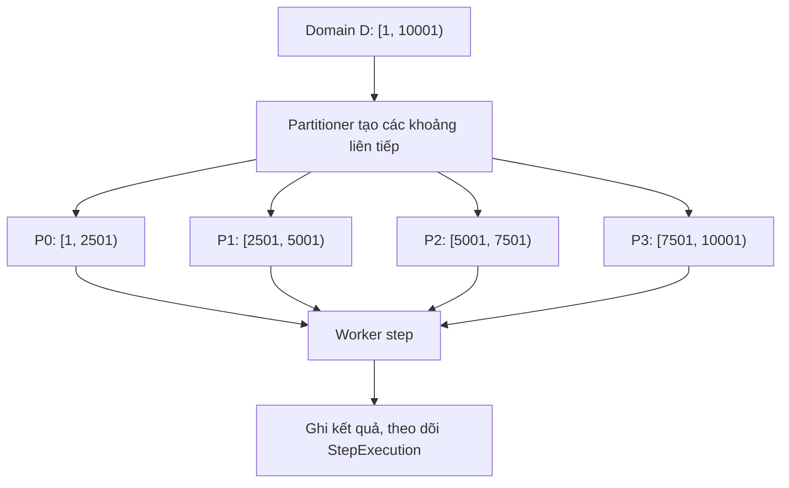

# Anti-pattern: Chia partition chồng lấn trong Spring Batch

## 1. Vấn đề: nhiều worker cùng nhận một phần dữ liệu

**Chia partition chồng lấn** xảy ra khi từ hai partition trở lên được giao xử lý ít nhất một bản ghi, tệp hoặc đơn vị công việc giống nhau trong cùng phạm vi xử lý. Mỗi worker có thể chạy đúng logic riêng của mình, nhưng cả job vẫn cho ra kết quả sai vì **quy tắc phân công dữ liệu** đã sai.

Trong Spring Batch, hiện tượng này thường xuất hiện khi tăng tải bằng `PartitionStep`, `TaskExecutorPartitionHandler` hoặc remote partitioning. Một `Partitioner` tạo ra các `ExecutionContext` để mô tả vùng dữ liệu của từng worker. Framework quản lý tên partition, trạng thái thực thi, transaction và restart, nhưng **không kiểm tra tự động rằng các vùng dữ liệu trong các context không giao nhau**.

Đây là một anti-pattern đáng chú ý của module `SPRING_BATCH_SCALING_OPERATIONS`: khi mở rộng workload dữ liệu lớn bằng multi-threaded step, parallel steps, partitioning hoặc xử lý phân tán, độ chính xác của ranh giới dữ liệu quan trọng ngang với throughput. Nếu tăng số thread mà không kiểm chứng tính độc lập của partition, hệ thống có thể chạy nhanh hơn nhưng tạo duplicate, lock contention, kết quả tổng hợp sai và khó restart.

Sau bài này, bạn có thể:

- Nhận diện các kiểu chồng lấn theo ID, thời gian, file, offset và điều kiện truy vấn.
- Phát biểu và kiểm tra hai bất biến **không chồng lấn** và **bao phủ đầy đủ**.
- Viết `Partitioner` chia khoảng khóa theo quy ước **đầu đóng, cuối mở** `[startInclusive, endExclusive)`.
- Phát hiện chồng lấn trước khi chạy; đối soát sau khi chạy; đánh giá ảnh hưởng tới transaction, retry, restart và tài nguyên.
- Phân biệt lỗi phân vùng với việc chủ ý xử lý cùng một bản ghi nhiều lần trong những giai đoạn nghiệp vụ khác nhau.

> **Phiên bản:** ví dụ minh họa dùng API **Spring Batch 5.x**, Java 17+ và SQL phổ biến. API Spring Batch 6.x có thay đổi package; cần đối chiếu tài liệu phiên bản thực tế nếu áp dụng trên 6.x.

## 2. Dấu hiệu nhận biết và mức độ nguy hiểm

Giả sử bảng `orders` có ID từ `1` đến `10_000`. Ta muốn bốn worker xử lý bốn vùng không trùng nhau. Cách chia sai:

| Partition | Điều kiện lọc | Số ID có thể khớp |
| --- | --- | ---: |
| `partition0` | `id >= 1 AND id <= 2500` | 2.500 |
| `partition1` | `id >= 2500 AND id <= 5000` | 2.501 |
| `partition2` | `id >= 5000 AND id <= 7500` | 2.501 |
| `partition3` | `id >= 7500 AND id <= 10000` | 2.501 |

Các ID `2500`, `5000` và `7500` thuộc **hai partition**. Nếu mọi ID tồn tại đúng một dòng, tổng số lượt đọc là `10.003` thay vì `10.000`. Đây là lỗi **off-by-one** do cả hai cận đều được tính vào khoảng.

```text
ID:           1          2500         5000         7500        10000
partition0:   [-------------]
partition1:                 [-------------]
partition2:                               [-------------]
partition3:                                             [-------------]
                           ^             ^             ^
                     ID bị đọc lặp tại các ranh giới
```

Tùy nghiệp vụ, tác hại khác nhau:

| Kiểu xử lý | Hệ quả nếu một bản ghi có hai owner |
| --- | --- |
| `INSERT` vào bảng có unique key | Một worker có thể gặp lỗi duplicate key |
| `INSERT` vào bảng không có ràng buộc duy nhất | Ghi trùng dữ liệu, có thể không phát hiện ngay |
| `UPDATE amount = amount + x` | Cộng tiền hoặc số liệu hai lần, sai kết quả |
| `UPDATE status = 'DONE'` | Kết quả cuối trông bình thường nhưng đọc/ghi thừa, gây lock contention |
| Gửi email, gọi API, phát sự kiện | Side effect trùng; transaction DB không tự hoàn tác hệ thống bên ngoài |
| Hai worker cùng ghi một file output | Có thể ghi xen kẽ, hỏng thứ tự hoặc hỏng nội dung |
| Tổng hợp số lượng/doanh thu | Double-count các dòng trùng, báo cáo sai |

**Một thao tác idempotent có thể che dấu lỗi**: `UPDATE status = 'DONE'` hoặc upsert có thể cho ra trạng thái cuối đúng, nhưng hai worker vẫn tranh chấp tài nguyên và một phần công việc bị thực hiện lặp. Vì vậy, không thể chỉ nhìn trạng thái cuối của bảng đích để kết luận partition không giao nhau.

## 3. Hai bất biến thiết kế: không chồng lấn và bao phủ

Gọi `D` là tập đơn vị dữ liệu *phải xử lý đúng một lần theo kế hoạch* và `P₀, P₁, ..., Pₙ₋₁` là tập dữ liệu được giao cho các partition.

**Không chồng lấn (disjointness):**

\[
P_i \cap P_j = \varnothing \quad \text{với mọi } i \ne j
\]

**Bao phủ đầy đủ (coverage):**

\[
\bigcup_{i=0}^{n-1} P_i = D
\]

Hai điều kiện đều cần thiết. Không giao nhau nhưng thiếu một khoảng là lỗi **bỏ sót**; bao phủ đủ nhưng có phần trùng là lỗi **xử lý lặp**. Với các khoảng ID đã sắp theo thứ tự tăng, cách kiểm tra đơn giản là:

1. Khoảng đầu bắt đầu bằng cận dưới mong muốn.
2. Mỗi khoảng có `startInclusive < endExclusive`.
3. `endExclusive` của khoảng trước **bằng** `startInclusive` của khoảng kế tiếp.
4. `endExclusive` cuối cùng bằng cận trên mong muốn.

Ưu tiên biểu diễn **đầu đóng, cuối mở**: `[startInclusive, endExclusive)`. Ví dụ bốn khoảng đúng:

| Partition | Khoảng ID | SQL tương ứng |
| --- | --- | --- |
| `partition0` | `[1, 2501)` | `id >= 1 AND id < 2501` |
| `partition1` | `[2501, 5001)` | `id >= 2501 AND id < 5001` |
| `partition2` | `[5001, 7501)` | `id >= 5001 AND id < 7501` |
| `partition3` | `[7501, 10001)` | `id >= 7501 AND id < 10001` |



Quy tắc `a <= id < b` khiến điểm `b` thuộc **khoảng tiếp theo**, không thuộc khoảng trước. Với ID kiểu số nguyên, đây là cách giảm khả năng viết nhầm `<=` tại ranh giới. Lưu ý khoảng `[1, 2501)` bao gồm ID `2500`; `2501` mới bắt đầu khoảng thứ hai.

> Hai bất biến trên kiểm tra **kế hoạch phân công dữ liệu**, không thay thế kiểm tra tính bất biến của tập dữ liệu khi job đang chạy. Ví dụ: nếu mỗi worker truy vấn một snapshot khác nhau trong lúc bản ghi được tạo, sửa hoặc xóa, các khoảng không trùng vẫn có thể không cho kết quả đầy đủ theo cùng một mốc thời gian.

## 4. Các nguyên nhân chồng lấn thường gặp

### 4.1. Lỗi biên: `BETWEEN` và điều kiện `<=`

`BETWEEN x AND y` trong SQL bao gồm **cả hai đầu**. Đoạn sau gây chồng lấn ở ID `2500`:

```sql
-- Partition A
SELECT * FROM orders WHERE id BETWEEN 1 AND 2500;

-- Partition B: SAI vì vẫn lấy id = 2500
SELECT * FROM orders WHERE id BETWEEN 2500 AND 5000;
```

Chọn một quy ước thống nhất. Với cận trên mở, truyền hai tham số và dùng **cùng predicate** cho mọi worker:

```sql
SELECT id, amount
FROM orders
WHERE id >= :startInclusive
  AND id < :endExclusive
ORDER BY id;
```

Không trộn các quy ước nửa đóng và đóng hoàn toàn giữa partitioner, reader và điều kiện ghi. Việc đổi cận trên từ `<=` thành `<` trong một nơi nhưng quên đổi trong nơi khác có thể tạo **khoảng trống**.

### 4.2. Chia theo trang `OFFSET/LIMIT` trên tập dữ liệu biến động

Một worker đọc `OFFSET 0 LIMIT 1000`, worker khác đọc `OFFSET 1000 LIMIT 1000`. Nếu không có `ORDER BY` ổn định hoặc dữ liệu được chèn/xóa/cập nhật khiến thứ tự/tập kết quả thay đổi giữa hai truy vấn, các trang có thể trùng hoặc bỏ sót bản ghi.

Ví dụ: worker A đọc trang đầu theo `created_at`, sau đó một bản ghi mới được chèn ở đầu danh sách. Worker B dùng offset 1000 và gặp lại dòng vốn ở cuối trang A. Với job lớn, ưu tiên phân hoạch theo **khóa bất biến/ID**, hoặc dùng keyset/cursor có watermark và một cách nhìn dữ liệu nhất quán. Chỉ có `ORDER BY` không đủ bảo đảm các trang ổn định nếu dữ liệu vẫn thay đổi.

### 4.3. Mỗi worker tự tính lại `MIN/MAX` hoặc tự lấy trạng thái `NEW`

Giả sử mỗi worker gọi lại `SELECT MIN(id), MAX(id) FROM orders WHERE status='NEW'` rồi tự tạo phạm vi. Khi các worker cập nhật `status` hoặc dữ liệu mới đến, chúng có thể dùng **những snapshot khác nhau**, tạo trùng/gap hoặc làm thay đổi tập mục tiêu trong lúc chạy.

Phân biệt hai trường hợp:

- **Partition theo ID cố định:** chốt cận dưới, cận trên và watermark **một lần** ở đầu job rồi truyền vào `ExecutionContext`; nếu cần snapshot nhất quán, phải có cơ chế phù hợp của database hoặc một tập ID đã materialize.
- **Queue phân phối động:** mọi worker cùng tìm `status='NEW'` cần cơ chế **atomic claim** như cập nhật có điều kiện/row lock (nếu DB hỗ trợ, có thể dùng `FOR UPDATE SKIP LOCKED` trong transaction phù hợp). Đây là kiến trúc lấy việc từ hàng đợi, không được coi là partition theo vùng ID tĩnh.

Chốt `MIN/MAX` chỉ chốt *khoảng khóa*; nó không tự tạo snapshot nhất quán nếu bản ghi trong khoảng vẫn thay đổi trong khi job chạy.

### 4.4. Trùng file, trùng nguồn hoặc trùng khóa logic

Với file partitioning, nếu hai partition cùng trỏ tới một file, hoặc hai đường dẫn khác nhau thực chất là alias/symlink của cùng resource, cả hai có thể xử lý cùng nội dung. Nếu nhiều file khác nhau chứa cùng khóa nghiệp vụ, **partition theo file vẫn không đồng nghĩa bản ghi logic là duy nhất**.

Trước khi chạy, có thể đối chiếu danh sách canonical URI, file version/checksum, khóa nghiệp vụ, manifest và quy tắc dedup. Không dùng tên file để suy luận rằng nội dung giữa các file chắc chắn không giao nhau.

### 4.5. Trùng từ điều kiện thời gian hoặc cách phân vùng hash

Với window thời gian, hai điều kiện `timestamp <= T` và `timestamp >= T` đều chứa mốc `T`. Dùng `[from, to)` bằng cùng timezone và kiểu dữ liệu nhất quán. Đặc biệt cẩn thận khi chuyển đổi local time, DST, precision microsecond/millisecond và biên cuối ngày; tránh chế tác mốc kiểu `23:59:59.999` vì độ chính xác cột có thể khác kỳ vọng.

Với chia theo hash, mỗi bản ghi phải được gán chính xác một bucket qua quy tắc ổn định, ví dụ `Math.floorMod(stableHash(id), partitionCount)`. Các worker phải dùng cùng phiên bản hàm hash và `partitionCount`; không tự thay số bucket giữa một lần restart. Cần kiểm tra cả collision ở khóa nghiệp vụ nếu đó là đơn vị tính duy nhất.

## 5. Spring Batch quản lý gì, và không quản lý gì?

API `Partitioner.partition(int gridSize)` trả về `Map<String, ExecutionContext>`; mỗi key của map là một **tên partition duy nhất**, mỗi value là tham số đầu vào của worker. `gridSize` là gợi ý quy mô, không phải phép kiểm chứng rằng dữ liệu đã được phân đều hoặc các khoảng hợp lệ.

```java
public interface Partitioner {
    Map<String, ExecutionContext> partition(int gridSize);
}
```

Ví dụ `partition0` và `partition1` có tên khác nhau nhưng cùng giá trị `startInclusive=1`, `endExclusive=2501` thì **Spring Batch vẫn không thể suy ra đây là lỗi nghiệp vụ**. Framework nhận các context như các nhiệm vụ hợp lệ. Trạng thái `COMPLETED` chỉ cho biết một `StepExecution` hoàn tất theo logic của worker, không chứng minh các worker đã chia đúng dữ liệu.

`StepExecutionSplitter` có cơ chế khôi phục trạng thái các partition cần chạy lại; tuy nhiên việc restart đúng vẫn cần **ánh xạ tên partition → vùng dữ liệu ổn định** giữa các lần chạy. Đổi `gridSize`, đổi hàm hash, thêm file, hoặc tính lại miền ID từ nguồn biến động có thể khiến cách gán dữ liệu không còn tương thích với metadata trước đó.

Do đó, cần coi thuật toán chia partition là một phần của **hợp đồng dữ liệu**: được kiểm thử, có phiên bản, có log ranh giới, và có thể đối soát với dữ liệu đầu vào.

## 6. Cách viết `Partitioner` không chồng lấn

Giả sử đã chốt miền ID `[1, 10001)`, và muốn chia theo `gridSize`. Mỗi partition nhận một khoảng không rỗng, các khoảng liên tiếp nhau, và worker đọc theo đúng hai cận được truyền. Đoạn Java sau minh họa lớp `Partitioner` độc lập cho **Spring Batch 5.x**:

```java
import java.util.LinkedHashMap;
import java.util.Map;

import org.springframework.batch.core.partition.support.Partitioner;
import org.springframework.batch.item.ExecutionContext;

public final class SafeIdRangePartitioner implements Partitioner {
    private final long startInclusive;
    private final long endExclusive;

    public SafeIdRangePartitioner(long startInclusive, long endExclusive) {
        if (endExclusive <= startInclusive) {
            throw new IllegalArgumentException("Expected a non-empty ID range");
        }
        // Fail fast nếu phép trừ vượt quá miền long.
        Math.subtractExact(endExclusive, startInclusive);
        this.startInclusive = startInclusive;
        this.endExclusive = endExclusive;
    }

    @Override
    public Map<String, ExecutionContext> partition(int gridSize) {
        if (gridSize <= 0) {
            throw new IllegalArgumentException("gridSize must be positive");
        }

        long total = endExclusive - startInclusive;
        int count = (int) Math.min(total, (long) gridSize);
        long base = total / count;
        long remainder = total % count;

        Map<String, ExecutionContext> result = new LinkedHashMap<>();
        long cursor = startInclusive;

        for (int i = 0; i < count; i++) {
            // Những partition đầu có thể nhận nhiều hơn 1 ID.
            long size = base + (i < remainder ? 1L : 0L);
            long next = Math.addExact(cursor, size);

            ExecutionContext ctx = new ExecutionContext();
            ctx.putLong("startInclusive", cursor);
            ctx.putLong("endExclusive", next);
            result.put("partition" + i, ctx);

            cursor = next; // Start tiếp theo = endExclusive trước đó.
        }

        if (cursor != endExclusive) {
            throw new IllegalStateException("Partition coverage mismatch");
        }
        return result;
    }
}
```

Ví dụ sử dụng:

```java
@Bean
public Partitioner orderPartitioner() {
    // Miền khóa đã chốt và được giữ nguyên khi restart.
    return new SafeIdRangePartitioner(1L, 10_001L);
}
```

Đoạn này cố ý giả định miền ID không rỗng. Với miền rỗng, hệ thống cần chính sách riêng: bỏ qua bước và ghi nhận không có dữ liệu, thay vì chia cho 0 hoặc tạo partition giả. Miền cực lớn vượt khả năng biểu diễn bởi hiệu hai `long` cũng phải xử lý bằng một chiến lược khác; hàm khởi tạo trên chủ động báo lỗi.

Thuật toán có các đặc tính:

- `count = min(gridSize, total)` nên không tạo khoảng có độ dài 0 khi số ID ít hơn số thread.
- `base` và `remainder` phân phối chênh lệch tối đa một ID trên các partition.
- `cursor` luôn bằng `endExclusive` của partition trước, nên không có overlap/gap về khoảng số.
- Việc dùng `LinkedHashMap` tạo thứ tự hiển thị ổn định; **chỉ ổn định thứ tự chưa đủ cho restart** nếu miền khóa hoặc số partition thay đổi.

### 6.1. Worker phải dùng đúng ranh giới được truyền

Nếu partitioner tạo khoảng đầu đóng cuối mở, reader cũng phải sử dụng `>=` và `<`. Ví dụ reader JDBC dùng `@StepScope` để mỗi `StepExecution` nhận tham số riêng:

```java
import javax.sql.DataSource;

import org.springframework.batch.core.configuration.annotation.StepScope;
import org.springframework.batch.item.database.JdbcCursorItemReader;
import org.springframework.batch.item.database.builder.JdbcCursorItemReaderBuilder;
import org.springframework.beans.factory.annotation.Value;
import org.springframework.context.annotation.Bean;

@Bean
@StepScope
public JdbcCursorItemReader<Long> orderIdsReader(
        DataSource dataSource,
        @Value("#{stepExecutionContext['startInclusive']}") Long start,
        @Value("#{stepExecutionContext['endExclusive']}") Long end) {

    return new JdbcCursorItemReaderBuilder<Long>()
            .name("orderIdsReader")
            .dataSource(dataSource)
            .sql("SELECT id FROM orders " +
                 "WHERE id >= ? AND id < ? ORDER BY id")
            .preparedStatementSetter(ps -> {
                ps.setLong(1, start);
                ps.setLong(2, end);
            })
            .rowMapper((rs, rowNum) -> rs.getLong("id"))
            .saveState(true)
            .build();
}
```

Đây là ví dụ cấu hình reader, chưa phải toàn bộ job. Cần ghép reader vào worker `Step` có processor/writer và transaction manager phù hợp, sau đó đưa worker vào manager `PartitionStep`. Không đánh dấu chính bean `Step` là `@StepScope`; những thành phần có state hoặc late binding mới cần scope phù hợp.

Nếu SQL thực tế còn lọc `status = 'NEW'`, `tenant_id` hay `event_time`, hãy kiểm chứng mọi worker nhận **cùng chính sách lọc** và một tập dữ liệu được chốt phù hợp. `@StepScope` giải quyết việc truyền đúng tham số theo execution; nó **không tự chứng minh các khoảng không giao nhau**.

## 7. Phát hiện chồng lấn trước khi chạy job

### 7.1. Kiểm tra khoảng ngay sau khi tạo

Với các khoảng được biểu diễn bằng `[startInclusive, endExclusive)`, hai khoảng `A` và `B` giao nhau khi:

\[
A.start < B.end \quad \land \quad B.start < A.end
\]

Hãy kiểm tra tất cả cặp partition trước khi cho phép executor bắt đầu. Nếu có một cặp vi phạm, **fail fast** và không giao công việc cho worker. Với vài nghìn partition, có thể sắp xếp theo `start` rồi kiểm tra các khoảng kề nhau để tránh kiểm tra từng cặp.

Pseudo-code:

```text
sort(partitions, by=startInclusive)
assert first.startInclusive == expectedStart
cursor = expectedStart
for each partition:
    assert partition.startInclusive == cursor
    assert partition.startInclusive < partition.endExclusive
    cursor = partition.endExclusive
assert cursor == expectedEndExclusive
```

Kiểm tra `start == cursor` đồng thời phát hiện cả **chồng lấn** (start quá nhỏ) và **lỗ hổng** (start quá lớn). Đây là kiểm tra mạnh hơn chỉ khẳng định số lượng partition bằng `gridSize`.

### 7.2. Kiểm tra từ bảng manifest khoảng

Nếu kế hoạch partition được lưu vào một bảng/staging ví dụ `planned_partition(run_id, partition_name, start_id, end_exclusive)`, có thể chạy truy vấn đối chiếu **trước khi** mở các worker:

```sql
-- Trả về các cặp khoảng chồng lấn, theo cùng một run_id.
SELECT a.partition_name AS partition_a,
       b.partition_name AS partition_b
FROM planned_partition a
JOIN planned_partition b
  ON a.run_id = b.run_id
 AND a.partition_name < b.partition_name
 AND a.start_id < b.end_exclusive
 AND b.start_id < a.end_exclusive
WHERE a.run_id = :runId;
```

Kết quả mong đợi là **0 dòng**. Với bảng đã sắp thứ tự, tiếp tục kiểm tra lỗ hổng:

```sql
SELECT partition_name, start_id, end_exclusive,
       LAG(end_exclusive) OVER (
           ORDER BY start_id, end_exclusive
       ) AS previous_end
FROM planned_partition
WHERE run_id = :runId
ORDER BY start_id, end_exclusive;
```

Kiểm tra trong ứng dụng: các khoảng có `start_id < end_exclusive`; `start_id` của mỗi dòng sau bằng `previous_end`; biên đầu và cuối khớp miền mong muốn. Nếu dùng kiểu phân vùng theo file hoặc hash thì thay phép kiểm tra khoảng số bằng kiểm tra tính duy nhất của **resource identity** hoặc giá trị **owner(record)**.

### 7.3. Các trường hợp phải thử

Một bộ kiểm tra thuật toán nên bao gồm:

| Tập đầu vào | `gridSize` | Điều mong đợi |
| --- | ---: | --- |
| `[1, 10001)` | 4 | Bốn khoảng đủ 10.000 ID, không giao |
| `[1, 11)` | 3 | Ba khoảng có kích thước 4, 3, 3 hoặc phân phối hợp lệ tương đương |
| `[1, 4)` | 8 | Ba khoảng, mỗi khoảng có một ID |
| `[-5, 5)` | 4 | Xử lý được ID âm và ranh giới 0 |
| `[10, 11)` | 1 | Một khoảng duy nhất |
| Miền rỗng | Bất kỳ | Từ chối hoặc xử lý rõ theo chính sách |
| `gridSize <= 0` | 0/âm | Báo lỗi đầu vào |

Các phép thử cần kiểm tra **tập ID thực tế được phân công**, không chỉ số partition và tổng độ dài. Tổng độ dài các khoảng có thể bằng kích thước miền dù một đoạn bị xử lý hai lần và đoạn khác bị bỏ sót, vì vậy phải kiểm tra cả overlap và coverage.

## 8. Quan sát và đối soát sau khi chạy

Trong Spring Batch, một `JobExecution` sẽ có `StepExecution` cho manager và các worker như `workerStep:partition0`, `workerStep:partition1`. Có thể truy vấn metadata:

```sql
SELECT STEP_NAME, STATUS, READ_COUNT, WRITE_COUNT,
       COMMIT_COUNT, ROLLBACK_COUNT
FROM BATCH_STEP_EXECUTION
WHERE JOB_EXECUTION_ID = :jobExecutionId
ORDER BY STEP_NAME;
```

Metadata cho biết công việc đã thực thi và số item đã được đọc/ghi theo từng worker, nhưng **không chứa phép chứng minh về ownership của từng bản ghi**. `READ_COUNT` hoặc `WRITE_COUNT` tăng bất thường là tín hiệu điều tra; số đếm bằng kỳ vọng không đủ chứng minh không có overlap nếu chồng lấn ở một đoạn được bù bằng bỏ sót đoạn khác.

Trong môi trường kiểm chứng, có thể ghi audit riêng `run_id, source_id, partition_name` (mỗi lần xử lý được ghi nhận) để tìm khóa có nhiều owner:

```sql
SELECT source_id,
       COUNT(DISTINCT partition_name) AS owner_count
FROM processing_audit
WHERE run_id = :runId
GROUP BY source_id
HAVING COUNT(DISTINCT partition_name) > 1;
```

Audit cần gắn với **transaction và semantics xử lý** đã thống nhất; retry một chunk bị rollback có thể đọc lại item nhưng không nhất thiết là duplicate đã commit. Nếu muốn phát hiện mọi attempt, log attempt riêng với `StepExecutionId`/`partitionName` rồi phân biệt attempt và commit. Tránh ghi thông tin nhạy cảm của record vào log.

Theo dõi thêm các chỉ số: số bản ghi đầu vào duy nhất, số bản ghi đích duy nhất, số bản ghi bị trùng ở staging, thời gian theo partition, số lần deadlock/lock wait, retry/skip và throughput theo worker. Nếu tăng song song khiến lock contention hoặc duplicate tăng, ưu tiên điều tra thuật toán chia partition trước khi nâng thread pool.

## 9. Ảnh hưởng tới retry, restart và tính nhất quán

### 9.1. Restart không sửa được partition sai

Nếu `partition0` và `partition1` vốn chồng lấn, restart sẽ không tự loại ranh giới trùng. Những partition đã hoàn thành thường không cần chạy lại trên cùng `JobInstance` theo cơ chế restart, nhưng phần dữ liệu bị xử lý hai lần từ lần chạy trước đã có thể ghi ra DB hoặc tác động hệ thống ngoài.

Không tùy tiện sửa logic chia range rồi restart trong cùng `JobInstance` mà không đánh giá metadata cũ. Khi đã đổi `gridSize`, thuật toán chia, watermark, tên partition hay tập input, phải xác định cách xử lý các partition đã `COMPLETED` và dữ liệu đã ghi. Có thể cần lập một job sửa sai/reconciliation hoặc mở `JobInstance` mới với input đã chuẩn hóa.

### 9.2. Transaction không bảo đảm đúng một lần trên toàn job

Mỗi worker/chunk có phạm vi transaction riêng. Hai partition cùng đọc một bản ghi có thể dẫn tới:

- **Tranh chấp khóa:** cả hai update cùng row, làm tăng thời gian chờ hoặc deadlock.
- **Lost update / double update:** hành vi phụ thuộc mức isolation, SQL và thứ tự commit; phép cộng không idempotent có thể bị áp dụng nhiều lần.
- **Duplicate side effect:** gọi API hoặc phát message ngoài transaction không được Spring Batch metadata tự động khử trùng.
- **Số liệu không khớp:** các worker đọc theo snapshot khác nhau; kết quả tổng hợp có thể lệch.

Unique constraint ở DB, upsert, idempotency key, outbox và chính sách retry/skip là **lớp bảo vệ bổ sung**. Chúng không thay thế việc sửa thuật toán chia partition. Một lệnh upsert thành công chỉ chứng minh đích có trạng thái phù hợp, không chứng minh nguồn chỉ được xử lý bởi một worker.

### 9.3. Kế hoạch restart phải giữ nguyên bản sắc dữ liệu

Lưu ranh giới và cách ánh xạ partition theo các tham số **bất biến trong cùng một lần xử lý**: ví dụ `batchId`, snapshot watermark, version của thuật toán chia, miền khóa, thứ tự và tên partition. Với remote partitioning, truyền đúng các context đã chốt đến worker; không để từng node tự quét nguồn và tự suy lại ranh giới.

Khi đầu vào có thể thay đổi, cân nhắc snapshot/manifest cố định, staging có khóa run, hoặc cơ chế claim nguyên tử. Việc chọn công nghệ tùy mục tiêu nhất quán, chi phí storage và yêu cầu restart thực tế.

## 10. Quy trình sửa anti-pattern trong hệ thống đang vận hành

**Bước 1 — Xác định đơn vị ownership.** Đó là ID bản ghi, cặp `(tenantId, orderId)`, file/version, khoảng thời gian hay thông điệp? Cần diễn đạt bằng một khóa duy nhất đủ để xác định công việc phải xử lý đúng một lần.

**Bước 2 — Thu thập kế hoạch partition đang chạy.** Lấy tên worker, cận lọc, SQL, job parameters, số partition và snapshot/version của input từ log hoặc manifest. Nếu cần, ghi riêng một bảng kế hoạch phục vụ đối chiếu.

**Bước 3 — Kiểm tra overlap và gap.** Với khoảng số, dùng công thức ở mục 7. Với file, so trùng canonical URI và identity nội dung; với hash, kiểm chứng `owner(record)` là một hàm xác định duy nhất trên cùng một phiên bản cấu hình.

**Bước 4 — Sửa tại nguồn sinh partition.** Áp dụng khoảng đầu đóng cuối mở, một mốc snapshot và ranh giới cố định; đưa cùng giới hạn vào `ExecutionContext`. Không chỉ thêm `DISTINCT`/upsert ở writer vì cách đó có thể che dấu lỗi điều phối và vẫn tốn tài nguyên.

**Bước 5 — Bổ sung kiểm tra fail fast.** Kiểm chứng các khoảng hoặc danh sách owner **trước khi** giao việc cho executor. Nếu không thể xác định owner tĩnh, dùng cơ chế claim động có transaction/locking rõ ràng.

**Bước 6 — Kiểm chứng dữ liệu và restart.** Chạy trên tập dữ liệu nhỏ có chứa chính các giá trị biên, so sánh output với baseline tuần tự, kiểm tra audit owner và lỗi gián đoạn. Thử restart với input giữ nguyên, rồi thử có thay đổi đầu vào để xác nhận chính sách bảo vệ phát hiện được thay đổi.

**Bước 7 — Đo hiệu năng sau khi đúng dữ liệu.** Tăng `gridSize` và pool theo số connection, CPU, network và disk thực tế; theo dõi contention. Sự cân bằng số lượng item giữa các partition không quan trọng bằng **đúng ownership, khả năng restart và throughput tổng thể**.

## 11. Checklist tự kiểm trước production

- [ ] Đơn vị dữ liệu cần xử lý đúng một lần đã có khóa/identity rõ ràng.
- [ ] Mọi partition thuộc cùng miền/snapshot hoặc manifest đã chốt.
- [ ] Các khoảng tuân theo cùng quy ước `[startInclusive, endExclusive)`.
- [ ] Predicate của reader khớp với ranh giới mà `Partitioner` tạo.
- [ ] Đã kiểm tra **không overlap** và **không gap** trước khi chạy.
- [ ] Tên partition, miền ID và cơ chế gán file/bucket ổn định khi restart.
- [ ] Thành phần có trạng thái riêng được tách qua `@StepScope` khi cần.
- [ ] Writer có ràng buộc dữ liệu và chính sách idempotency/reconciliation phù hợp.
- [ ] Có phép đối soát số item duy nhất và audit để điều tra duplicate.
- [ ] Đã chạy thử với dữ liệu biên, dữ liệu biến động, lỗi worker và restart.

## 12. Kết luận

Partitioning giúp chạy song song hiệu quả khi **mỗi đơn vị dữ liệu có đúng một owner trong một kế hoạch xử lý**. Spring Batch quản lý các `StepExecution` và hỗ trợ điều phối/restart, còn việc chia đúng ranh giới nằm ở `Partitioner`, câu truy vấn reader và hợp đồng dữ liệu của ứng dụng. Với khoảng số, quy ước `[startInclusive, endExclusive)` cộng kiểm tra overlap/coverage là điểm bắt đầu đáng tin cậy. Với file, thời gian, hash hay nguồn động, cần định nghĩa identity và snapshot/claim tương đương.

Hãy sửa overlap trước khi tăng số worker: throughput tăng không có giá trị nếu dữ liệu bị xử lý lặp, bỏ sót hoặc khó khôi phục sau lỗi.

### Tài liệu tham khảo chính thức

- [Spring Batch Reference — Scaling and Parallel Processing (Partitioning)](https://docs.spring.io/spring-batch/reference/scalability.html).
- [Spring Batch 5.2 API — Partitioner](https://docs.spring.io/spring-batch/docs/5.2.6/api/org/springframework/batch/core/partition/support/Partitioner.html).
- [Spring Batch 5.2 API — StepExecutionSplitter](https://docs.spring.io/spring-batch/docs/5.2.6/api/org/springframework/batch/core/partition/StepExecutionSplitter.html).
- [Spring Batch 5.2 Reference — Late Binding of Job and Step Attributes](https://docs.spring.io/spring-batch/reference/5.2/step/late-binding.html).
- [Spring Batch 5.2 API — JdbcCursorItemReaderBuilder](https://docs.spring.io/spring-batch/docs/5.2.6/api/org/springframework/batch/item/database/builder/JdbcCursorItemReaderBuilder.html).
