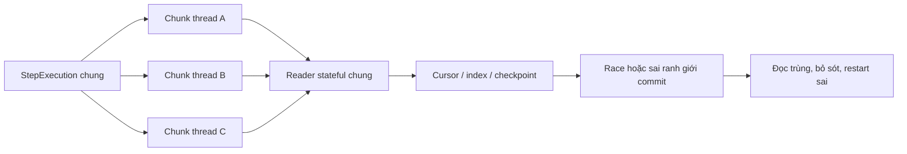
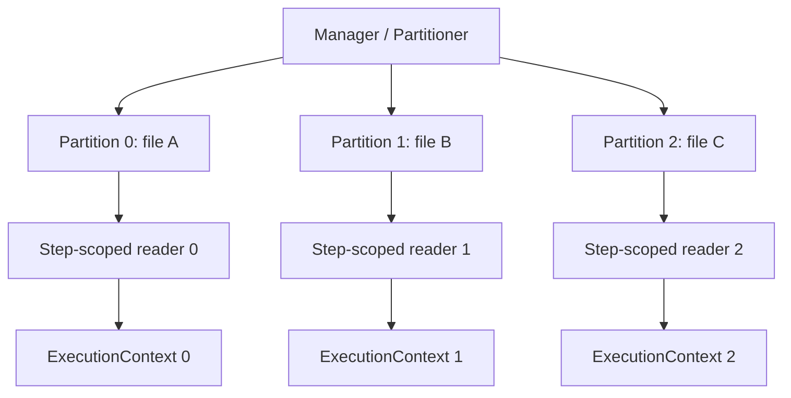

# Anti-pattern: Dùng reader stateful giữa các thread trong Spring Batch

Trong một job Spring Batch xử lý hàng triệu bản ghi, tăng số thread của step thường là cách mở rộng dễ nghĩ đến. Tuy nhiên, nếu các thread **cùng gọi `read()` trên một reader có trạng thái thay đổi** — ví dụ cursor hiện tại, vị trí dòng CSV, số trang đang đọc hoặc checkpoint — ứng dụng có thể đọc trùng, bỏ sót bản ghi, gặp lỗi ngẫu nhiên hoặc restart sai vị trí. Nguy hiểm hơn, job đôi khi vẫn báo `COMPLETED`, trong khi dữ liệu đầu ra đã sai.

Bài này thuộc chương **Anti-pattern** của module **SPRING_BATCH_SCALING_OPERATIONS**: học cách mở rộng workload dữ liệu lớn bằng multi-threaded step, parallel steps, partitioning và xử lý phân tán, đồng thời bảo đảm thread safety, retry/restart, đo nút thắt và vận hành theo tài nguyên thực tế. Trọng tâm là nhận diện và khắc phục **việc chia sẻ reader stateful không an toàn giữa nhiều thread**.

Sau bài này, bạn cần trả lời được ba câu hỏi: (1) trạng thái nào đang bị chia sẻ; (2) reader có thực sự an toàn khi nhiều thread gọi đồng thời và khi restart hay không; (3) nên tuần tự hóa việc đọc, phân vùng reader hay đổi kiến trúc để đạt throughput mong muốn.

## 1. Reader stateful là gì?

Một `ItemReader<T>` trả lần lượt các item cho chunk. Reader **stateful** có trạng thái nội bộ thay đổi theo mỗi lần đọc hoặc sau checkpoint, chẳng hạn:

- Vị trí hiện tại trong tệp, byte offset, dòng đã đọc hoặc iterator.
- Cursor của database và connection/statement/result set đi kèm.
- Trang dữ liệu, chỉ số bản ghi trong trang, khóa của trang tiếp theo.
- Bộ đếm đọc, cờ end-of-input hoặc buffer chưa xử lý.
- `ExecutionContext` dùng để khôi phục khi job restart.

Các trạng thái này có thể hợp lệ trong mô hình **một luồng đọc duy nhất**. Vấn đề xuất hiện khi nhiều thread cùng truy cập một instance, và các bước đọc/sửa trạng thái không được phối hợp đúng.

**`ItemReader` không mặc nhiên thread-safe.** Tính an toàn phụ thuộc implementation và cấu hình cụ thể. `ItemStreamReader` còn có các phương thức `open`, `update`, `close` gắn với vòng đời và khả năng restart; chỉ kiểm tra tính an toàn của `read()` là chưa đủ để chứng minh toàn bộ step chạy đúng.

| Reader / cơ chế | Trạng thái thường có | Câu hỏi khi chia sẻ giữa các thread |
| --- | --- | --- |
| `FlatFileItemReader` | Dòng, bộ đếm, trạng thái đọc tệp | Các thread có giẫm lên vị trí đọc, checkpoint không? |
| `JdbcCursorItemReader` | JDBC cursor, `ResultSet`, connection | Nhiều thread có dùng chung cursor/connection không? |
| `JdbcPagingItemReader` | Vị trí trang, thông tin restart | Phân trang có bị dùng chung sai và trôi dữ liệu không? |
| Custom reader dùng `Iterator`/`List` | Con trỏ hoặc `index` tự tăng | Việc lấy item và tăng vị trí có nguyên tử không? |
| Reader đã được chứng minh thread-safe | Phụ thuộc contract và cấu hình | Có đảm bảo checkpoint, transaction, retry/restart không? |

Không được suy luận chỉ từ tên class rằng “mọi reader loại X luôn hỏng” hay “reader loại Y luôn an toàn”. Khi dùng framework cụ thể, kiểm tra contract, phiên bản Spring Batch và cơ chế state management của reader trong ứng dụng.

## 2. Anti-pattern trông như thế nào?

Ví dụ một reader tự viết dùng chung con trỏ:

```java
import java.util.List;
import org.springframework.batch.item.ItemReader;

// Sai khi nhiều thread cùng gọi read() trên một instance.
public final class UnsafeOrderReader implements ItemReader<Order> {
    private final List<Order> orders;
    private int index = 0;

    public UnsafeOrderReader(List<Order> orders) {
        this.orders = orders;
    }

    @Override
    public Order read() {
        if (index >= orders.size()) {
            return null;
        }
        return orders.get(index++);
    }
}
```

Biểu thức `index++` thực hiện nhiều thao tác (đọc chỉ số cũ, tăng, ghi lại) và **không phải phép tăng nguyên tử**. Giả sử `index = 7`:

| Thời điểm | Thread A | Thread B |
| --- | --- | --- |
| 1 | Đọc `index = 7` | |
| 2 | | Đọc `index = 7` |
| 3 | Ghi `index = 8`, trả item 7 | |
| 4 | | Ghi `index = 8`, trả item 7 |
| 5 | Cả hai đã xử lý cùng item | `index` vẫn chỉ là 8 |

Một số lần chạy sẽ không tạo ra va chạm vì timing tình cờ thuận lợi; các lần khác có thể trùng bản ghi hoặc làm vị trí đọc sai. Kể cả khi thay `index++` bằng `AtomicInteger.getAndIncrement()`, bài toán **độ an toàn khi restart và ranh giới commit** vẫn còn. Một bộ đếm nguyên tử chỉ giải quyết việc phát số thứ tự duy nhất trong bộ nhớ tại thời điểm chạy.

Anti-pattern tương tự xuất hiện khi sử dụng một `FlatFileItemReader` stateful trong **multi-threaded step**:

```java
import org.springframework.batch.core.Step;
import org.springframework.batch.core.repository.JobRepository;
import org.springframework.batch.core.step.builder.StepBuilder;
import org.springframework.batch.item.ItemReader;
import org.springframework.batch.item.ItemWriter;
import org.springframework.core.task.TaskExecutor;
import org.springframework.transaction.PlatformTransactionManager;

// Minh họa cấu hình có rủi ro; không đưa vào production khi reader chưa thread-safe.
Step unsafeStep(
        JobRepository jobRepository,
        PlatformTransactionManager transactionManager,
        TaskExecutor taskExecutor,
        ItemReader<Order> sharedStatefulReader,
        ItemWriter<Order> writer) {

    return new StepBuilder("unsafeImportStep", jobRepository)
            .<Order, Order>chunk(100, transactionManager)
            .reader(sharedStatefulReader)
            .writer(writer)
            .taskExecutor(taskExecutor)
            .build();
}
```

Khi `taskExecutor` cho phép nhiều chunk chạy đồng thời, nhiều thread có thể đi vào reader dùng chung. Việc Spring quản lý reader dưới dạng bean singleton hoặc `@StepScope` không tự biến thao tác đọc stateful thành an toàn với multi-threading.

> **Hiểu đúng `@StepScope`:** một reader step-scoped được gắn với **một `StepExecution`**, không mặc định tạo một reader riêng cho mỗi thread trong **cùng** multi-threaded step. Nhưng trong partitioned step, mỗi partition thường có `StepExecution` riêng, nên reader `@StepScope` có thể được tạo riêng theo partition nếu cấu hình đúng.

## 3. Vì sao lỗi này khó thấy khi chạy thử?

Một reader bị race condition thường không hỏng theo cách nhất quán:

- **Lỗi phụ thuộc lịch thread:** đổi kích thước chunk, số worker, tốc độ DB hay thời gian GC có thể khiến lỗi xuất hiện hoặc biến mất.
- **Throughput vẫn tăng:** nếu mỗi item được xử lý nhanh hơn nhưng một số bị trùng hoặc thiếu, biểu đồ items/giây không đủ chứng minh tính đúng đắn.
- **`READ_COUNT` không chỉ ra danh tính item:** cùng tổng số lần đọc có thể gồm nhiều item trùng nhau, trong khi một số item khác bị bỏ qua.
- **Writer có thể che lỗi:** `UPSERT` hoặc unique constraint khiến số dòng đích có vẻ đúng dù đã đọc/tried-to-write trùng; cần kiểm tra tác động nghiệp vụ và lỗi bị bỏ qua.
- **Restart càng khó:** checkpoint có thể phản ánh tiến độ reader theo một thứ tự khác với các chunk đã commit; điều này phụ thuộc implementation và transaction boundary.
- **Lỗi tài nguyên dễ đánh lạc hướng:** thêm nhiều thread còn gây tranh chấp `ResultSet`, connection pool, file I/O hoặc DB lock.

Ví dụ, batch chạy 5 triệu dòng CSV thành công trong 25 phút với 1 thread. Sau khi cấu hình 8 thread, thời gian còn 9 phút và `JobExecution` vẫn `COMPLETED`. Tuy nhiên, phép đối chiếu theo `orderId` phát hiện 3.000 ID thiếu và 3.000 ID lặp trong raw output. Chỉ dựa vào `COMPLETED`, thời lượng hoặc `READ_COUNT` sẽ bỏ sót sai lệch này.



## 4. Ba lớp an toàn cần phân biệt

Lỗi phổ biến là “đã `synchronized read()` thì reader an toàn hoàn toàn”. Trên thực tế, cần xem ba lớp khác nhau:

1. **Thread safety của một thao tác:** hai lời gọi `read()` đồng thời có lấy nhầm cùng item, phá hỏng cursor hoặc trạng thái bộ nhớ không?
2. **Nhất quán giữa read và commit:** khi các chunk xử lý song song, vị trí đọc được ghi vào `ExecutionContext` có phản ánh đúng các bản ghi đã commit không? Nếu thread xử lý item sau kết thúc trước item trước, checkpoint có thể trở nên khó khôi phục.
3. **Tính đúng đắn end-to-end:** writer có idempotent không, có transaction phù hợp không, retry/skip và API bên ngoài có tạo side effect lặp lại không?

**Chỉ giải quyết lớp 1 chưa đảm bảo lớp 2 và lớp 3.** Trong Spring Batch, `ItemStream.update(ExecutionContext)` và commit chunk là điểm đặc biệt phải kiểm tra dưới concurrency. Không nên hứa hẹn “exactly once” chỉ vì reader có khóa hoặc DB có unique constraint.

| Giải pháp thoạt nhìn có vẻ hợp lý | Nó giải quyết được gì? | Những gì vẫn phải kiểm chứng |
| --- | --- | --- |
| Đặt `volatile` cho `index` | Tăng khả năng thấy giá trị mới giữa thread | Không làm `index++` nguyên tử; không sửa checkpoint |
| Dùng `AtomicInteger` | Cấp index duy nhất trong một tiến trình | Không đảm bảo trạng thái sau rollback/restart |
| Bọc `read()` bằng lock | Ngăn hai lần đọc chạy đồng thời | Vẫn có chunk xử lý/commit lệch thứ tự |
| Dùng `@StepScope` trong cùng step | Gắn reader với `StepExecution` | Các thread của cùng `StepExecution` vẫn có thể dùng chung |
| `saveState(false)` | Tắt việc lưu state cho restart ở một số reader | Không tự biến `read()` thành thread-safe; thường mất khả năng resume |
| Tăng connection pool | Giảm thời gian chờ connection nếu thực sự thiếu | Không sửa tranh chấp cursor/index |

## 5. Cách sửa 1: Giữ một luồng đọc, đưa phần xử lý nặng sang mô hình phù hợp

Nếu reader không an toàn khi dùng chung, lựa chọn dễ kiểm chứng nhất là **không để nhiều thread cùng đọc một instance**. Một chunk-oriented step tuần tự có thể phù hợp khi chi phí xử lý ít hoặc I/O đọc mới là bottleneck.

```java
// Ví dụ Spring Batch 5+: step đọc/ghi tuần tự.
// Không cấu hình taskExecutor cho chunk step này.
return new StepBuilder("sequentialImportStep", jobRepository)
        .<Order, ProcessedOrder>chunk(100, transactionManager)
        .reader(orderReader)
        .processor(orderProcessor)
        .writer(orderWriter)
        .build();
```

Nếu quá trình **processor** tốn CPU hoặc gọi dịch vụ chậm, có thể cân nhắc `AsyncItemProcessor`/`AsyncItemWriter` của Spring Batch Integration để đẩy công việc processor sang executor trong khi luồng đọc được điều phối riêng. Cách này chỉ phù hợp sau khi kiểm tra: tính thread-safe của processor, thứ tự kết quả, timeout, xử lý lỗi của `Future`, ranh giới transaction và cách đo throughput. Không giả định async processing làm cho toàn bộ job hoặc side effects tự động an toàn.

Một lựa chọn khác là chia công việc thành nhiều **parallel steps độc lập** nếu luồng dữ liệu, reader và tài nguyên cho phép mỗi step sở hữu trạng thái riêng. Đây là khác biệt quan trọng giữa *nhiều step độc lập* và *nhiều thread dùng chung một step execution*.

**Đánh đổi:** đọc tuần tự dễ suy luận và restart; nhưng nếu tốc độ reader giới hạn toàn bộ pipeline, tăng thread xử lý không làm throughput vượt khả năng cấp item của reader. Cần đo bottleneck trước khi chọn.

## 6. Cách sửa 2: Partitioning — mỗi partition có reader và checkpoint riêng

Với workload lớn có thể chia thành các miền dữ liệu **không chồng lấn**, partitioning thường là hướng mở rộng bền vững hơn. Mỗi partition có `StepExecution` và `ExecutionContext` riêng; reader được tạo riêng cho từng partition để giữ trạng thái độc lập.

Giả sử dữ liệu tệp được chia thành nhiều file `orders-000.csv`, `orders-001.csv`... Mỗi partition nhận một đường dẫn `inputFile` trong `ExecutionContext`, và worker step tạo reader như sau:

```java
import org.springframework.batch.core.configuration.annotation.StepScope;
import org.springframework.batch.item.file.FlatFileItemReader;
import org.springframework.batch.item.file.builder.FlatFileItemReaderBuilder;
import org.springframework.beans.factory.annotation.Value;
import org.springframework.context.annotation.Bean;
import org.springframework.core.io.FileSystemResource;

@Bean
@StepScope
public FlatFileItemReader<OrderRow> partitionReader(
        @Value("#{stepExecutionContext['inputFile']}") String inputFile) {
    return new FlatFileItemReaderBuilder<OrderRow>()
            .name("partitionOrderReader")
            .resource(new FileSystemResource(inputFile))
            .linesToSkip(1)
            .delimited()
            .names("orderId", "amount")
            .targetType(OrderRow.class)
            .build();
}
```

Trong ví dụ, `OrderRow` là JavaBean có constructor không tham số và property `orderId`, `amount` phù hợp với mapper. `Partitioner` ở manager phải cung cấp `inputFile` **khác nhau** cho mỗi partition; nếu mọi partition nhận cùng một tệp, việc tạo nhiều reader vẫn có thể xử lý trùng toàn bộ input. Tệp phải truy cập được ở nơi worker chạy; trong triển khai phân tán nên dùng nguồn dữ liệu/đường dẫn dùng chung có kiểm soát.

Luồng xử lý kỳ vọng:



Nếu nguồn nằm ở database, có thể partition theo khoảng khóa `[minId, maxId)` hoặc tập khóa độc lập. Ví dụ:

```sql
-- Worker cho partition P, dùng điều kiện biên không giao nhau.
SELECT id, amount
FROM orders
WHERE id >= :minId
  AND id <  :maxId
  AND id <= :snapshotMaxId
ORDER BY id;
```

Ở đây `snapshotMaxId` là cận đã xác nhận tại thời điểm lập kế hoạch, **chưa đủ để tự tạo snapshot nhất quán** nếu bản ghi có thể bị sửa/xóa trong khi chạy. Tùy nghiệp vụ, cần khóa phạm vi theo `businessDate`, watermark, snapshot isolation hoặc cơ chế chụp danh sách khóa. Reader phải dùng truy vấn có thứ tự ổn định và checkpoint phù hợp; tránh phân trang theo `OFFSET` trên tập dữ liệu đang thay đổi.

Cũng cần kiểm tra:

- **Không thiếu và không chồng phạm vi:** hợp của các partition bằng đúng miền input mong đợi; có kiểm tra boundary và khoảng rỗng.
- **Tên partition ổn định khi restart:** các khóa `partition0`, `partition1`... phải gắn với phạm vi dữ liệu tương ứng và phục hồi được khi chạy lại.
- **Reader riêng cho mỗi `StepExecution`:** `@StepScope` được đặt đúng và delegate không vô tình dùng một cursor/buffer singleton khác.
- **Worker và writer chịu tải:** concurrency không vượt giới hạn DB connection, CPU, disk I/O, broker hoặc API hạ nguồn.
- **Idempotency và retry:** partition chạy lại không sinh dữ liệu trùng ngay cả khi lỗi xảy ra sau khi đã gọi external API.

**Không cần ép mỗi thread có reader riêng bằng `ThreadLocal` trong cùng step**: thread pool có thể tái sử dụng thread giữa các chunk, trong khi framework quản lý trạng thái và checkpoint theo `StepExecution`, không theo thread. Partitioning giúp phạm vi sở hữu và checkpoint rõ ràng hơn.

## 7. Cách sửa 3: Đồng bộ việc đọc khi bắt buộc chia sẻ reader

Nếu cần giữ multi-threaded step và reader stateful, có thể tuần tự hóa lời gọi `read()` bằng decorator. Trong Spring Batch có `SynchronizedItemStreamReader` để đồng bộ việc đọc của delegate; cấu hình minh họa:

```java
import org.springframework.batch.item.support.SynchronizedItemStreamReader;
import org.springframework.batch.item.support.builder.SynchronizedItemStreamReaderBuilder;

SynchronizedItemStreamReader<OrderRow> synchronizedReader =
        new SynchronizedItemStreamReaderBuilder<OrderRow>()
                .delegate(flatFileItemReader)
                .build();
```

Decorator giải quyết nguy cơ **hai lời gọi `read()` đồng thời** chạm vào delegate; luồng đọc bị serialize nên throughput đọc không tự tăng theo số thread. Trong bước chunk có concurrency, các item sau khi đọc vẫn có thể xử lý hoặc commit khác thứ tự. Vì thế, **không coi đây là lời đảm bảo về restartability** nếu việc đọc lại một item có thể gây ảnh hưởng; cần test lỗi giữa chunk, rollback và restart. Lớp `ItemStream` còn liên quan `open/update/close`, nên phải hiểu vòng đời và cách reader lưu checkpoint.

Một cách thủ công là tạo wrapper có `synchronized read()`, nhưng nếu reader hỗ trợ `ItemStream` thì wrapper còn phải truyền đúng các lời gọi `open/update/close` theo vòng đời của step. Chỉ viết `synchronized` quanh `read()` rồi mất `ItemStream` có thể làm thay đổi khả năng restart. Ưu tiên decorator phù hợp và kiểm chứng thực tế.

**Nên cân nhắc cách này khi:** dữ liệu chấp nhận cách khôi phục đã được kiểm chứng, chi phí đọc không phải bottleneck và phần xử lý sau đọc mới có lợi từ concurrency. Nếu yêu cầu mỗi item phải được xử lý đúng một lần qua rollback/restart, nên ưu tiên thiết kế có phân vùng độc lập, writer idempotent và quy trình đối soát.

## 8. Không dùng `saveState(false)` như “công tắc sửa race”

Một mẹo dễ gây hiểu nhầm là đặt `saveState(false)` cho `FlatFileItemReader` hoặc reader khác và kết luận đã chạy đa luồng an toàn. Cần phân biệt:

- `saveState(false)` (nếu reader hỗ trợ) vô hiệu hóa việc ghi state của reader vào `ExecutionContext`.
- Nó **không đồng bộ** mọi thao tác trên cursor, chỉ số dòng hay tài nguyên nền.
- Khi job bị dừng giữa chừng và khởi chạy lại, khả năng tiếp tục đúng vị trí có thể mất; cần xem chiến lược phát lại, đối soát và idempotency.
- Trong một số thiết kế chủ ý bỏ checkpoint và có thể đọc lại input an toàn, tắt state là lựa chọn có ý thức; phải mô tả rõ **hành vi restart mong đợi**.

Tương tự, **đổi reader thành singleton/prototype** không tự xử lý race: quan trọng là instance nào thực sự được các thread dùng, và checkpoint nào gắn với instance đó. Việc tạo bean `prototype` nhưng inject **một instance** vào step dùng chung vẫn có thể có vấn đề.

## 9. Ví dụ hậu quả: job thành công nhưng báo cáo thiếu giao dịch

**Bối cảnh giả định:** job import 1 triệu giao dịch từ tệp CSV, dùng `FlatFileItemReader`, chunk size 200 và `TaskExecutor` với 6 thread để xử lý song song. Các giao dịch được gửi tới writer có side effect ghi bảng `settlement_event`.

**Triệu chứng:** sau khi triển khai concurrency, job đôi khi `COMPLETED`, nhưng số khóa giao dịch distinct ở đích nhỏ hơn số khóa đầu vào. Một số lần chạy xuất hiện duplicate key; chạy tuần tự không tái hiện. Khi job `FAILED` giữa chừng rồi restart, số dòng sai khác còn tăng.

**Điều tra cần làm:**

1. Xác định reader bean và instance thật đang được `StepExecution` sử dụng; xem `taskExecutor`, `gridSize`, cấu hình chunk và số thread.
2. Đối chiếu `COUNT(*)`, `COUNT(DISTINCT transaction_id)` và tập khóa giao dịch nguồn/đích; phân biệt bản ghi bị lọc hợp lệ với bản ghi thất lạc.
3. Xem `BATCH_STEP_EXECUTION` theo đúng `JOB_EXECUTION_ID`: `READ_COUNT`, `WRITE_COUNT`, `FILTER_COUNT`, `SKIP_COUNT` (các loại), `ROLLBACK_COUNT`, `COMMIT_COUNT`, `EXIT_CODE`.
4. Đọc exception đầu tiên và log retry/rollback; kiểm tra checkpoint trước và sau sự cố cùng tác động của writer ra bên ngoài transaction.
5. Thử tái hiện trong môi trường cô lập với cùng input và concurrency, sau đó so sánh với chạy tuần tự hoặc thiết kế partition reader riêng.

**Giả thuyết hợp lý:** reader có mutable state dùng chung giữa các chunk; khi các lời gọi đọc xen kẽ, vị trí đọc và checkpoint không bảo toàn ranh giới mong muốn. Đây vẫn là **giả thuyết** cho đến khi có bằng chứng từ cấu hình, log và phép đối chiếu. Duplicate key cũng có thể do dữ liệu đầu vào thực sự trùng, retry side effect hoặc lỗi writer; cần kiểm tra để loại trừ.

**Khắc phục được đề xuất:** tạm thời chạy step tuần tự để bảo đảm correctness trong lúc điều tra, đối soát và bù dữ liệu theo quy trình nghiệp vụ. Sau đó chuyển thành các partition có input tách biệt, reader step-scoped riêng, writer idempotent và kiểm thử restart. Chọn số worker dựa trên hiệu năng đo được cùng ngân sách kết nối DB; không tự tăng pool hoặc retry limit khi chưa rõ nguyên nhân.

## 10. Đo và kiểm thử để chứng minh đã sửa

Test thông thường chỉ chạy một thread, không đủ để phát hiện anti-pattern này. Cần thử cùng input trên nhiều cấu hình và có bất biến kiểm chứng.

| Kịch bản | Cách kiểm tra | Điều kiện đạt |
| --- | --- | --- |
| Baseline một thread | Đọc toàn bộ input và đối soát theo ID | Không thiếu, không trùng ngoài quy tắc nghiệp vụ |
| Tăng concurrency | Lặp nhiều lần ở 2/4/8 thread, chunk nhỏ/lớn | Tập khóa đích khớp baseline, không có sai khác ngẫu nhiên |
| Tăng đan xen thread | Thêm độ trễ nhân tạo trong processor/writer ở môi trường test | Không phá vỡ uniqueness, ordering nếu nghiệp vụ yêu cầu |
| Lỗi giữa chunk | Tiêm exception trước/sau commit và thực hiện restart | Dữ liệu hoàn chỉnh, side effect không trùng |
| Worker dừng đột ngột | Kill một worker ở partition đã có tiến độ | Partition phục hồi theo chính sách; input không bị bỏ sót |
| Dữ liệu lệch partition | Một partition có số lượng bản ghi lớn hơn hẳn các partition khác | Kết quả đúng, không vượt SLA và không gây cạn tài nguyên |
| Input thay đổi trong lúc chạy | Mô phỏng insert/update/delete nếu workload cho phép | Hành vi theo hợp đồng snapshot/watermark đã định nghĩa |

Một số bất biến nên được viết thành truy vấn hoặc kiểm tra tự động:

```sql
-- Tổng số dòng và số khóa duy nhất trong kết quả thô.
SELECT
    COUNT(*) AS total_rows,
    COUNT(DISTINCT order_id) AS distinct_orders
FROM imported_orders
WHERE batch_run_id = :runId;
```

```sql
-- Những khóa xuất hiện nhiều lần trong kết quả của một lần chạy.
SELECT order_id, COUNT(*) AS occurrences
FROM imported_orders
WHERE batch_run_id = :runId
GROUP BY order_id
HAVING COUNT(*) > 1;
```

Hai truy vấn trên chỉ là bước đầu. Cần so sánh cả **tập khóa nguồn trừ tập khóa đích** và ngược lại, có tính đến rule filter/skip hợp lệ; xác nhận checksum hoặc tổng số tiền nếu nghiệp vụ yêu cầu. Nếu writer sử dụng upsert, bảng cuối có thể không lưu được các lần ghi trùng; khi đó cần audit log hoặc event log để thấy side effects.

**Tại sao `READ_COUNT == WRITE_COUNT` chưa đủ?** Nếu reader trả item X hai lần và không trả item Y, số lượng đọc/ghi vẫn có thể bằng nhau. Kiểm chứng correctness phải dựa trên định danh và giá trị nghiệp vụ, không chỉ các bộ đếm tiến độ của framework.

## 11. Runbook khi nghi reader stateful bị chia sẻ

1. **Khoanh vùng:** xác định `JOB_INSTANCE_ID`, `JOB_EXECUTION_ID`, step, danh sách partition và thay đổi concurrency gần thời điểm phát hiện sai lệch.
2. **Giữ bằng chứng:** lưu metadata theo execution, version/config, log exception, executor threads, checkpoint, kết quả đối soát đầu vào/đầu ra. Loại bỏ dữ liệu nhạy cảm trước khi chia sẻ.
3. **Kiểm tra ownership:** reader instance được tạo theo singleton, step scope hay partition? Có delegate, cache, `Iterator` hoặc cursor chung bên trong không?
4. **Đánh giá correctness:** đối soát theo business key, phát hiện duplicate/missing, đánh giá writer có idempotent và external side effects hay không.
5. **Giảm tác động:** nếu chưa chứng minh an toàn, hạn chế concurrency hoặc dừng quy trình theo cơ chế vận hành chính thức; tránh tự restart nhiều lần khi có nguy cơ nhân đôi dữ liệu.
6. **Chọn thiết kế sửa:** dùng reader tuần tự, phân vùng với reader độc lập hoặc decorator đồng bộ có kiểm thử restart, dựa trên bottleneck thực tế.
7. **Diễn tập khôi phục:** thử lỗi giữa chunk, rollback, restart và worker failure với cùng input; xác minh dữ liệu thay vì chỉ dựa vào `BatchStatus.COMPLETED`.
8. **Theo dõi sau sửa:** đo throughput, latency, active workers, DB pool, queue backlog, read/write/skip/rollback và lỗi đối soát; kiểm tra không tái diễn ở tải đỉnh.

Nếu đã có dữ liệu thiếu/trùng ở sản xuất, hành động sửa phải bao gồm **kế hoạch reconcile/compensate** cho tập bản ghi bị ảnh hưởng. Không tự ý chỉnh `BATCH_STEP_EXECUTION` hoặc `ExecutionContext` thủ công để buộc framework “bỏ qua” bản ghi; việc đó có thể làm lịch sử restart và kết quả nghiệp vụ mất nhất quán.

## 12. Quy tắc chọn kiến trúc

| Điều kiện thực tế | Cách tiếp cận ưu tiên | Đánh đổi cần tính |
| --- | --- | --- |
| Input nhỏ, correctness/restart quan trọng, reader rẻ | Step tuần tự, reader stateful một thread | Throughput đọc giới hạn bởi một thread |
| Reader nhẹ nhưng processor tốn tài nguyên | Giữ đọc tuần tự, cân nhắc xử lý processor bất đồng bộ | Phải kiểm tra thread safety và lỗi async |
| Input có thể phân chia theo file/ID/range ổn định | Partitioning, reader riêng theo `StepExecution` | Chi phí chia partition, quản lý skew/restart |
| Bắt buộc giữ shared reader với multi-threaded step | Decorator đồng bộ và kiểm thử restart nghiêm ngặt | Read bị serialize; tính đúng đắn checkpoint phải được chứng minh |
| Cần scale trên nhiều máy | Remote partitioning với worker reader độc lập | Message delivery, idempotency, queue và giám sát phân tán |

Đừng chọn kỹ thuật chỉ vì số thread cao hơn: **throughput có ý nghĩa khi output đúng, restart có thể dự đoán và tài nguyên còn headroom**. Nếu bottleneck ở DB/IO, thêm thread hoặc partition có thể chỉ tăng tranh chấp; hãy đo p95 latency, connection waiting và throughput thực.

## 13. Bài thực hành và câu hỏi kiểm tra

**Tình huống:** một step xử lý 500.000 giao dịch bằng `JdbcCursorItemReader`, chunk size 100. Cấu hình mới thêm `TaskExecutor` 4 thread cho cùng step, reader để `@StepScope`. Job nhanh hơn nhưng trong một lần restart phát hiện ghi trùng vào API bên ngoài. Một đồng nghiệp đề xuất `saveState(false)` và `AtomicInteger` để “sửa dứt điểm”.

Hãy trả lời:

1. Vì sao `@StepScope` chưa chứng minh reader độc lập cho mỗi thread trong step này?
2. `AtomicInteger` giải quyết được rủi ro nào; còn rủi ro gì với JDBC cursor và checkpoint?
3. Vì sao `saveState(false)` không phải giải pháp khôi phục mặc định?
4. Bạn sẽ ưu tiên hai phương án kiến trúc nào và cần đo/test gì trước khi đưa vào production?
5. Làm thế nào xác định API bên ngoài đã nhận trùng cùng giao dịch trong lần restart?

**Gợi ý:** trong một multi-threaded step, các chunk thuộc cùng `StepExecution`, nên có thể dùng chung step-scoped reader. `AtomicInteger` không biến `ResultSet` và transaction/checkpoint thành thread-safe; `saveState(false)` thường làm mất vị trí resume. Nên cân nhắc đọc tuần tự hoặc partition với reader/cursor độc lập và phạm vi dữ liệu không chồng lấn. Kiểm tra bằng thử lỗi/restart, đối soát business key và idempotency key bền vững ở API; không chỉ căn cứ vào số lần gọi hoặc trạng thái `COMPLETED`.

---

**Thông điệp vận hành:** reader stateful dùng chung giữa nhiều thread là một anti-pattern nguy hiểm vì lỗi có thể âm thầm làm sai dữ liệu và chỉ lộ ra khi retry/restart. Khi mở rộng Spring Batch, hãy xác định rõ **ai sở hữu state của reader**, **checkpoint gắn với đơn vị thực thi nào** và **dữ liệu được chứng minh đúng bằng cách nào**. Partitioning với reader riêng hoặc giữ một luồng đọc là những cách làm ranh giới state rõ ràng; mọi phương án concurrency phải được kiểm chứng bằng dữ liệu, failure test và đo tài nguyên.
