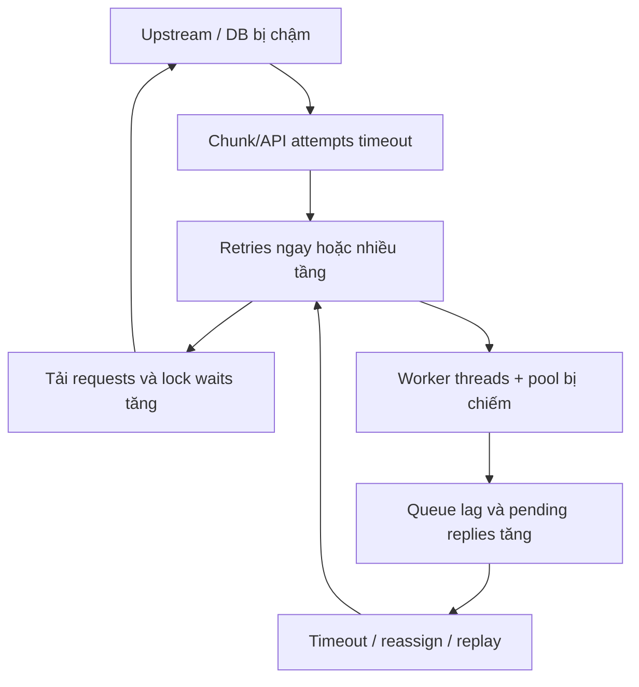
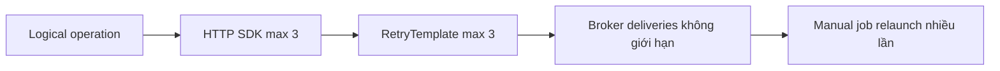
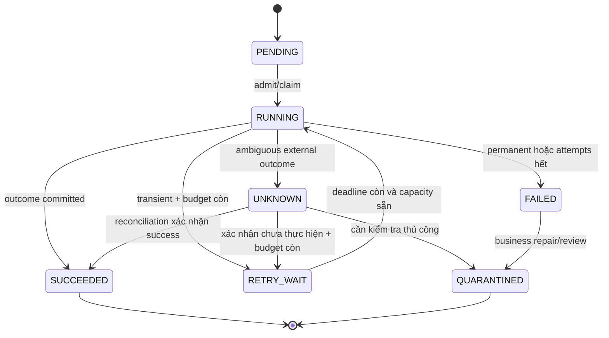
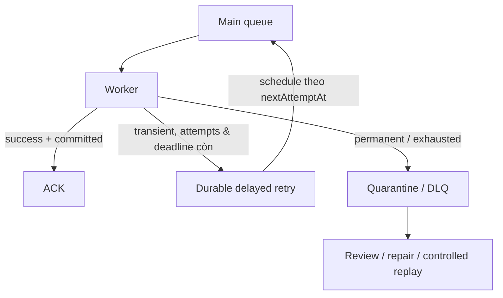
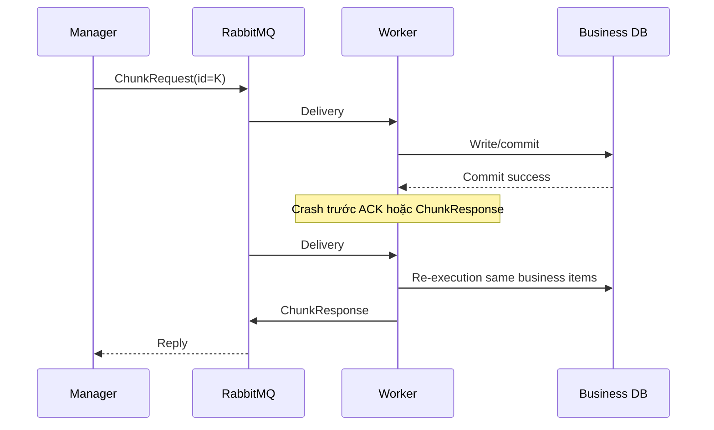

# Không giới hạn retry: anti-pattern gây retry storm và lỗi dữ liệu trong Spring Batch

Một job xử lý 10 triệu giao dịch dùng **Spring Batch remote chunking** với 12 worker Pods. Khi PostgreSQL hoặc API đối tác gặp sự cố trong 3 phút, mọi worker liên tục retry. Một số items bị thử lại ngay trong `ItemProcessor`, các chunks bị rollback và Spring Batch retry, RabbitMQ redeliver những messages chưa ACK, rồi operator tạo `JobInstance` mới khi manager không nhận được replies. Chỉ sau vài phút, hệ thống có hàng chục nghìn attempts cho cùng một tập dữ liệu, connection pool cạn, queue lag tăng, JobRepository ngập các executions khó phân biệt và một số business side effects có nguy cơ lặp lại.

Bài **“Không giới hạn retry”** thuộc chương **Anti-pattern** của module `SPRING_BATCH_SCALING_OPERATIONS`. Trọng tâm là nhận diện và loại bỏ retry vô hạn hoặc retry **hữu hạn theo từng tầng nhưng không có ngân sách toàn tuyến**, khi mở rộng Spring Batch bằng multi-threaded step, parallel steps, partitioning và các mô hình xử lý phân tán.

Ví dụ minh họa dựa trên **Java 17+, Spring Batch 5.2.x, Spring Retry 2.x, Spring AMQP/RabbitMQ và PostgreSQL**. Tên API/metric phụ thuộc phiên bản; những số liệu, SLO và thresholds trong bài là **giả định để học cách thiết kế và thử nghiệm**, không phải benchmark đã thực hiện. Mọi mã cần được tích hợp với `JobRepository`, transaction manager và broker configuration thật trước khi sử dụng.

## 1. Nhận diện anti-pattern

**Retry vô hạn** là việc tiếp tục thử một thao tác khi lỗi mà **không có điểm dừng hữu hạn, thời hạn tổng, phân loại lỗi hoặc lối xử lý cuối cùng rõ ràng**. Nó xuất hiện ngay cả khi vòng lặp không có chữ `while(true)`:

```java
// ANTI-PATTERN: Không được sử dụng trong batch production.
while (true) {
    try {
        externalApi.send(invoice);
        break;
    } catch (Exception ex) {
        // Không giới hạn attempts, không timeout tổng, không phân loại lỗi.
    }
}
```

Một dạng ít hiển nhiên:

```text
HTTP client:         retry 4 attempts mỗi lời gọi
Spring Retry:        retry 4 attempts mỗi operation
RabbitMQ:            requeue không giới hạn
Job restart script:  launch lại bằng parameters mới vô hạn

=> Không có upper bound đáng tin cậy cho tổng effects/requests.
```

**Điểm cốt lõi:** “Không giới hạn retry” không chỉ là **nhiều HTTP requests**. Nó có thể là **vòng lặp nghiệp vụ chưa bao giờ chuyển sang FAILED/quarantine**, làm mất SLA, tích lũy queue, giữ thread và thậm chí nhân đôi tiền/đơn hàng sau một timeout mơ hồ.

## 2. Phân biệt retry, redelivery, replay và restart

| Thuật ngữ | Diễn ra ở đâu? | Đơn vị thử lại | Lỗi thường gặp |
| --- | --- | --- | --- |
| Local retry | `RetryTemplate`, HTTP/JDBC SDK | Một API/DB call | Bỏ quên attempts/deadline |
| Chunk retry | `FaultTolerantStepBuilder` | Item/chunk theo retry state | Không hiểu rollback/buffering |
| Broker redelivery | RabbitMQ/Spring AMQP | Message delivery | NACK/requeue lặp vô hạn |
| Partition reassignment | Remote partitioning | Child `StepExecution`/partition | Hai owners cùng ghi |
| Manager replay | Remote chunking | `ChunkRequest`/items | Commit-before-reply rồi gửi lại |
| Job restart | `JobOperator`/JobRepository | Một `JobInstance` | Nhầm restart với JobInstance mới |
| Manual rerun | Operator/job scheduler | Dataset/business snapshot | Dữ liệu đã xử lý lại không idempotent |

Các lớp trên **không tự chia sẻ cùng một retry counter**. Một limit ở Spring Retry không đếm broker redelivery; broker delivery limit không đếm những lần HTTP SDK tự gọi; `JobRepository` không tự chứng minh external API đã commit hay chưa.

## 3. Hệ quả của retry không giới hạn

- **Retry storm:** requests lỗi được gửi lại nhanh hơn năng lực downstream phục hồi.
- **Thundering herd:** hàng trăm workers cùng thức dậy sau fixed/exponential delay không jitter.
- **Pool starvation:** worker threads ngủ trong backoff hoặc chờ DB connection, không còn slots cho work mới.
- **Unbounded queue:** requests/replies/retry tasks tích lũy, dẫn đến GC pressure hoặc OOM.
- **SLA vô thời hạn:** một step còn `STARTED` mà không có committed progress.
- **Lock/transaction amplification:** deadlock hoặc timeout lại gây rollback và conflict nhiều lần.
- **Poison message loop:** payload sai schema được requeue liên tục thay vì quarantine.
- **Duplicate side effects:** timeout sau business commit rồi retry như thể chưa có gì xảy ra.
- **Operational opacity:** không biết operation là attempt thứ mấy, ai đang owner, đã trả tiền hay chưa.
- **Chi phí hạ tầng:** tăng pods/broker I/O/DB WAL và monitoring cardinality nhưng throughput thành công không tăng.

**Không đánh giá retry chỉ bằng tỷ lệ success của từng attempt.** Phải quan sát **unique business outcomes đã commit, tổng retry amplification, age của work chưa xong và khả năng restart đúng**.

## 4. Sơ đồ vòng phản hồi gây quá tải



Một hệ thống đã bị bão hòa có thể **không còn sức để phục hồi** vì attempts cũ tiếp tục cạnh tranh với work mới. Tăng worker count trong vòng lặp này thường làm tình hình xấu hơn. Ngắt vòng phản hồi cần **giảm nguồn gửi, giới hạn attempts, áp backoff/jitter, giới hạn in-flight và có terminal outcome**.

## 5. Phân loại lỗi trước khi bật retry

| Lỗi | Retry? | Điều kiện cần |
| --- | --- | --- |
| PostgreSQL deadlock / serialization failure | Có, hữu hạn | Transaction rollback đúng; backoff; đo lock contention |
| DB connection reset khi primary failover | Có, hữu hạn | Reconnect, xác định transaction outcome nếu mơ hồ |
| HTTP 429 | Có theo quota/`Retry-After` | Định nghĩa deadline và rate budget |
| HTTP 502/503/504 | Có nếu API contract cho phép | Jitter, max attempts, server recovery |
| HTTP network timeout với GET idempotent | Thường có | Per-attempt timeout và total deadline |
| HTTP timeout sau POST đã có thể commit | **Không retry mù** | Stable idempotency key / outcome lookup |
| HTTP 400/422 do dữ liệu sai | Không mặc định | Quarantine/sửa dữ liệu |
| HTTP 401/403 vì sai quyền | Không retry mù | Fix identity/credentials; audit |
| Missing config, schema incompatibility | Không | Fail fast, sửa deployment |
| Permanent unique constraint violation | Không theo cách thông thường | Kiểm business duplicate và idempotency |
| OOM, thread deadlock, filesystem permissions | Không coi transient item | Fix resource/code/permission và restart hợp lệ |

**Lỗi do cấu hình sai sẽ không tự biến mất khi đợi 100ms.** Đưa `Exception.class` vào danh sách retryable có thể làm một lỗi permanent trở thành một job không bao giờ kết thúc.

## 6. Ambiguous outcome: lỗi client không có nghĩa server chưa làm gì

Ví dụ:

```text
T0: worker POST /charge với operationKey=X
T1: provider commit charge thành công
T2: response TCP bị mất
T3: worker nhận SocketTimeoutException
T4: worker retry với operationKey khác
T5: provider charge lần nữa
```

Điểm nguy hiểm là nhầm **response thất bại** với **business operation thất bại**. Với external payment, email, inventory reservation hoặc event publish, cần phân biệt:

1. **Known failure:** chắc chắn chưa thực hiện effect.
2. **Known success:** đã có receipt/outcome bền vững.
3. **Unknown outcome:** không thể kết luận từ timeout; cần query/reconcile theo stable key.

**Retry an toàn cần cùng idempotency key xuyên attempts**, do downstream áp dedupe hoặc một business ledger riêng làm nguồn sự thật. Nếu downstream không hỗ trợ idempotency, phải thiết kế reconciliation/manual review hoặc compensation phù hợp, không hứa exactly-once chỉ bằng `retryLimit`.

## 7. Tốc độ retry có thể lớn đến mức nào?

Giả sử:

```text
100 original logical operations/s
mọi operation fail ngay
mỗi operation có 4 HTTP attempts

=> 400 outbound attempts/s khi không có backoff/queue effects
=> thêm 300 retry attempts/s ngoài 100 originals/s
```

Với `N` operations/s và `A` attempts per operation:

```text
outbound_attempt_rate ≈ N × A
retry_amplification = outbound_attempts / original_operations
```

Đây là mô hình **định hướng**, giả định tốc độ ổn định và không cộng các layers khác. Nếu 4 attempts của HTTP client lồng dưới 3 attempts của `RetryTemplate`, con số **có thể tới 12 outbound attempts/operation** trước cả broker redelivery; không phải mọi case đều chạm maximum.

Khi throughput đã commit chỉ 20 operations/s nhưng attempts vượt 1.000/s, tối ưu thêm concurrency là sai hướng; phải tìm nguyên nhân lỗi và chặn amplification.

## 8. Không có retry budget tổng thì các giới hạn cục bộ không đủ

Một operation có thể đi qua:



`3 × 3 = 9` chỉ là upper bound của **hai tầng lồng trực tiếp**. Nếu broker requeue vô hạn thì **tổng attempts không có upper bound**. Kể cả khi broker giới hạn, operator có thể vô tình tạo nhiều JobInstances mới và replay cùng snapshot.

Giải pháp không phải đặt mọi layer cùng một con số. Cần chọn **layer sở hữu retry responsibility**, tắt hoặc biết rõ hidden retries, và duy trì một **logical retry budget** xuyên replay/restart khi business yêu cầu.

## 9. Sáu rào chắn của chính sách retry an toàn

1. **Exception/status classification:** chỉ retry lỗi transient có khả năng phục hồi.
2. **Max attempts:** upper bound cho từng retry context.
3. **Total elapsed/deadline:** dừng hoặc defer khi vượt thời gian hợp lý.
4. **Backoff + jitter + `Retry-After`:** tránh đồng bộ requests vào dịch vụ lỗi.
5. **Concurrency/rate budget:** kiểm soát tổng tải trên tất cả worker replicas.
6. **Terminal state:** success, recoverable failure, quarantine/DLQ hoặc fail step/job rõ ràng, có audit và kế hoạch retry ngoài tuyến nếu cần.

Hai điều kiện bất biến đi kèm: **work intent không mất** và **business effect không lặp** qua crash/retry. Một policy “dừng retry” nhưng âm thầm ACK rồi bỏ item là **thay một anti-pattern bằng data loss**.

## 10. State machine thay cho vòng lặp vô hạn



Không cho operation quay về `PENDING` **vô hạn** chỉ vì người vận hành bấm “retry”. Mỗi transition cần có **operation key, attempt count, first-seen timestamp, owner/fencing, last failure category, nextAttemptAt, deadline và audit reason** nếu lưu trong durable work ledger.

## 11. Chọn layer chịu trách nhiệm retry

Trong một thiết kế tốt, phải trả lời: **“Lớp nào sở hữu số lần thử lại và khi hết budget thì điều gì xảy ra?”**

| Hoạt động | Owner retry ưu tiên | Vì sao |
| --- | --- | --- |
| SQL update trong chunk transaction | Spring Batch fault-tolerant step | Gắn rollback và skip/retry với chunk semantics |
| HTTP read idempotent từ processor | Client-layer hoặc một wrapper đã thiết kế | Deadline/`Retry-After` theo API contract |
| External side-effect khó đảo ngược | Business operation orchestrator | Cần idempotency/reconciliation; không retry mù |
| Message chưa thể consume do broker outage | Messaging transport/reconnect policy | Đảm bảo message không mất, tránh redelivery loop |
| Partition worker chết | Job/partition recovery controller | Cần ownership, JobRepository, checkpoint |
| Poison payload lỗi schema | Quarantine/DLQ | Không nên retry lại payload hỏng |

Không nhất thiết chỉ có **một lần retry trên toàn hệ thống**, nhưng phải **biết chính xác** các layers đang lồng nhau. Nếu đặt retry 5 lần tại `ItemProcessor` và lại bật `faultTolerant().retry(Exception.class)`, hãy đo actual API calls và chọn một layer chính. Tắt retry mặc định của SDK khi muốn upper bound rõ.

## 12. Spring Batch 5.2: fault-tolerant chunk với limit hữu hạn

Một `Step` minh họa retry lỗi kết nối DB transient:

```java
import org.springframework.batch.core.Step;
import org.springframework.batch.core.repository.JobRepository;
import org.springframework.batch.core.step.builder.StepBuilder;
import org.springframework.batch.item.ItemProcessor;
import org.springframework.batch.item.ItemReader;
import org.springframework.batch.item.ItemWriter;
import org.springframework.dao.TransientDataAccessException;
import org.springframework.retry.backoff.ExponentialRandomBackOffPolicy;
import org.springframework.transaction.PlatformTransactionManager;

public Step boundedInvoiceStep(
        JobRepository jobRepository,
        PlatformTransactionManager transactionManager,
        ItemReader<Invoice> reader,
        ItemProcessor<Invoice, NormalizedInvoice> processor,
        ItemWriter<NormalizedInvoice> writer) {

    ExponentialRandomBackOffPolicy backoff =
            new ExponentialRandomBackOffPolicy();
    backoff.setInitialInterval(200);
    backoff.setMultiplier(2.0);
    backoff.setMaxInterval(3_000);

    return new StepBuilder("boundedInvoiceStep", jobRepository)
            .<Invoice, NormalizedInvoice>chunk(100, transactionManager)
            .reader(reader)
            .processor(processor)
            .writer(writer)
            .faultTolerant()
            .retry(TransientDataAccessException.class)
            .noRetry(IllegalArgumentException.class)
            .retryLimit(3)
            .backOffPolicy(backoff)
            .build();
}
```

`Invoice`/`NormalizedInvoice` là domain types của ứng dụng; reader/writer phải có transaction và restart semantics phù hợp. `TransientDataAccessException` là nhóm exception Spring JDBC; chỉ retry chúng khi database driver/dialect translate đúng lỗi mục tiêu. Trong job thật có thể cần `RetryListener`, `SkipListener` và step metrics để giải thích failures.

**Không coi `retryLimit(3)` là “mỗi HTTP call tối đa 3 lần trên toàn hệ thống”.** Nó thuộc **step fault-tolerance**, liên quan item/chunk retry state và có thể phối hợp rollback; số calls đến downstream còn chịu tác động bởi processor/writer implementation, HTTP client và broker deliveries. Kiểm số invocations ở lớp thấp nhất bằng integration test.

### 12.1. Chú ý `retryPolicy(...)` và `backOffPolicy(...)`

Theo Javadoc `FaultTolerantStepBuilder` của Spring Batch 5.2, cấu hình `backOffPolicy` có điều kiện tương tác với `retryPolicy` tùy API; **không thêm custom `retryPolicy(...)` rồi mặc định policy backoff vẫn có hiệu lực**. Hãy viết test gây transient exception, ghi actual delays và kiểm builder configuration trên **đúng phiên bản**.

## 13. Retry vô hạn trong processor còn nguy hiểm hơn lỗi step

**Anti-pattern:**

```java
public NormalizedInvoice process(Invoice invoice) {
    for (;;) {
        try {
            return partnerClient.normalize(invoice);
        } catch (RuntimeException ex) {
            // Thậm chí không quay trở lại framework để rollback/fail step.
        }
    }
}
```

Khi processor không bao giờ trả hoặc ném lỗi:

- Spring Batch không thể hoàn thành chunk hay ghi checkpoint.
- `JobOperator.stop` có thể không được xử lý kịp nếu thread mắc kẹt trong loop.
- Hàng loạt threads có thể giữ memory/connection lâu.
- Metrics `StepExecution` có thể cho thấy `STARTED` nhưng không có progress.
- Pod termination có thể giết process giữa side effect.

**Sửa:** để lỗi thoát khỏi processor sau **finite attempts/deadline**, hoặc chuyển sang durable deferred retry khi phù hợp; framework sau đó có thể đánh dấu `FAILED` hoặc thực hiện skip/quarantine theo policy nghiệp vụ.

## 14. Spring Retry 2.x: `RetryTemplate` với attempts hữu hạn

Ví dụ RetryTemplate cho **đúng loại HTTP upstream transient** đã được ứng dụng ánh xạ:

```java
import java.util.Map;
import org.springframework.retry.support.RetryTemplate;
import org.springframework.retry.policy.SimpleRetryPolicy;
import org.springframework.retry.backoff.ExponentialRandomBackOffPolicy;

public final class PartnerRetryPolicy {

    private PartnerRetryPolicy() {}

    public static RetryTemplate build() {
        RetryTemplate template = new RetryTemplate();
        template.setRetryPolicy(new SimpleRetryPolicy(
                4,
                Map.<Class<? extends Throwable>, Boolean>of(
                        TemporaryPartnerException.class, true),
                true,  // traverse causes
                false  // unlisted exceptions không mặc định retry
        ));

        ExponentialRandomBackOffPolicy backoff =
                new ExponentialRandomBackOffPolicy();
        backoff.setInitialInterval(250L);
        backoff.setMultiplier(2.0);
        backoff.setMaxInterval(2_000L);
        template.setBackOffPolicy(backoff);
        return template;
    }
}
```

`TemporaryPartnerException` là exception ứng dụng tự định nghĩa; code mẫu chưa chứa client thật. `SimpleRetryPolicy` ở đây giới hạn **4 attempts bao gồm lần đầu**, tương ứng **tối đa 3 lần thử thêm** trong một `RetryTemplate.execute`. Không thay bản đồ exceptions bằng `Exception.class → true`.

Sử dụng:

```java
RetryTemplate template = PartnerRetryPolicy.build();
PartnerResult result = template.execute(context ->
        partnerClient.lookup(invoiceKey));
```

**Quan trọng:** `RetryTemplate` bounded attempts **không tự đặt per-attempt network timeout, global rate limit, tổng thời gian retry của toàn JobInstance hoặc bảo đảm idempotency**. Client underlying phải có connect/read/request timeouts và policy rõ ràng cho replay.

### 14.1. Mô hình backoff không giới hạn

```java
// SAI: Một policy attempts vô hạn về mặt thiết kế.
// Đừng dùng AlwaysRetryPolicy với production operation.
// template.setRetryPolicy(new AlwaysRetryPolicy());
```

Ngay cả `AlwaysRetryPolicy` kết hợp backoff 30 giây vẫn có thể không bao giờ chuyển operation sang trạng thái terminal. Backoff giảm tốc độ **nhưng không tạo điểm dừng**.

## 15. Attempts limit khác elapsed-time budget

Giả sử 4 attempts, mỗi HTTP call timeout 30 giây và delays lần lượt 1, 2, 4 giây:

```text
Worst-case rough duration
  ≈ (4 × 30 s) + (1+2+4) s
  = 127 s
```

`maxAttempts=4` không có nghĩa operation hoàn tất trong 4 giây. Phải thiết kế:

| Rào chắn | Ví dụ thí nghiệm | Có tác dụng gì? |
| --- | --- | --- |
| Connect timeout | 1s | Không đợi kết nối mãi |
| Per-call response timeout | 5s | Không treo khi server không trả |
| Max attempts | 4 | Không thử vô hạn trong context |
| Backoff max interval | 3s | Không sleep quá dài một khoảng |
| Overall logical deadline | 30s | Không kéo dài quá SLA đã định |
| Durable retry budget | Tổng 7 attempts qua các deliveries | Bound across crash/restart |
| Retention/quarantine deadline | 24h theo business contract | Không giữ poison work vô thời hạn |

Các giá trị chỉ là **mẫu giả định**. Deadline phải tương thích user-facing SLA, job completion window, broker message TTL, worker termination grace và khả năng downstream phục hồi. **Một timeout tính ở caller không bảo đảm operation nền đã dừng**: thread/HTTP call có thể vẫn chạy hoặc server đã commit sau khi client hết hạn.

### 15.1. Tổng elapsed timeout nên kiểm ở đâu?

Với `Spring Retry TimeoutRetryPolicy`, có thể dùng composite retry policy để dừng theo **max attempts và timeout**; tuy nhiên cần integration test các semantics khi thời gian hết ngay giữa một attempt hoặc đang backoff. Một policy kiểm trước attempt kế tiếp **không tự ngắt** một socket read hoặc SQL statement đã chạy. Phải đặt **hard timeouts ở network/database client** và quyết định khi deadline hết thì fail/defer/quarantine ra sao.

## 16. Exponential backoff và jitter không thay thế retry limit

Với delay base `d₀`, multiplier `m` và cap `dmax`:

```text
deterministic delay(k) = min(dmax, d0 × m^k)
k = 0,1,2,... cho các khoảng giữa attempts

d0=250ms, m=2, cap=2000ms
=> 250ms, 500ms, 1000ms, 2000ms, 2000ms, ...
```

Vì `dmax` hữu hạn, nếu retry tiếp tục vô hạn thì tổng thời gian vẫn vô hạn, và API vẫn bị gọi **mãi với chu kỳ khoảng `dmax`**. Nếu 1.000 workers cùng bắt đầu tại `t0`, deterministic schedule có thể tạo retry waves:

```text
t0       1.000 failed calls
t0+250ms ~1.000 retry calls
t0+750ms ~1.000 retry calls
t0+1.75s ~1.000 retry calls
```

Jitter giúp phân tán thời điểm. Nhưng **`ExponentialRandomBackOffPolicy` của Spring Retry random hóa multiplier theo contract riêng**, không tự giống “full jitter” trong thuật toán khác. Test phân phối/bounds theo đúng policy, đừng hardcode một vector delays ngẫu nhiên vào unit test.

## 17. HTTP 429 và `Retry-After`: không retry trước khi server cho phép

HTTP `Retry-After` có thể là **delta-seconds** hoặc HTTP-date. Ví dụ:

```http
HTTP/1.1 429 Too Many Requests
Retry-After: 4
```

Nếu client exponential backoff đề xuất 250ms nhưng upstream yêu cầu 4 giây, caller không nên gửi retry vào 250ms. Một policy có ý nghĩa:

```text
clientDelay = boundedBackoffWithJitter()
serverDelay = validatedRetryAfter()
earliestNextAttempt = now + max(clientDelay, serverDelay)

if earliestNextAttempt > operationDeadline:
    defer to durable retry store or fail/quarantine
else:
    schedule next attempt with bounded concurrency
```

Không thay `Retry-After: 3600` bằng delay 1 giây chỉ vì retry deadline ngắn hơn; nếu business không thể chờ, **dừng operation và giữ intent bền vững** để xử lý theo policy. Test invalid header, HTTP-date, clock skew, timeout và failover.

## 18. Tại sao ngủ trong worker thread có thể tạo nghẽn

Một `RetryTemplate` với blocking backoff thường chờ trên **thread thực hiện callback**. Nếu 32 chunk threads đều chờ 10 giây:

```text
32 active worker slots ngủ
0 slot xử lý công việc mới trong thời điểm đó
JDBC/HTTP resources có thể vẫn bị giữ tùy transaction scope
Queue ready và oldest work age tăng
CPU thấp nhưng throughput cũng thấp
```

Không kết luận “CPU còn rảnh, tăng worker gấp đôi”. Cần xem **thread state, transaction boundaries, JDBC pool pending, heap/chunk payload retention và committed throughput**. Nếu retry phải chờ phút/giờ, cân nhắc **durable delayed retry** tách khỏi active chunk threads, giữ owner/attempt/deadline/reconciliation.

### 18.1. Coi `Thread.sleep` như giải pháp backpressure là sai

`Thread.sleep(1000)` không thay thế rate limit, retry budget hoặc finite admission queue. Trong một `ItemProcessor` đang chạy trong transaction, nó có thể làm transaction kéo dài không cần thiết. Khi nhận interrupt, code phải tôn trọng shutdown/cancellation; không nuốt `InterruptedException` rồi tiếp tục loop vô hạn.

## 19. Concurrency và retry phải dùng cùng resource budget

Giả sử 10 worker Pods, mỗi Pod 8 active chunks và mỗi chunk retry 4 lần:

```text
Concurrent logical operations danh nghĩa = 10 × 8 = 80
Attempts tối đa nếu lỗi đồng loạt = 80 × 4 = 320
```

Đây là **số tổng attempts danh nghĩa qua các operations**, không phải 320 attempts chạy đồng thời nếu mỗi chunk dùng một thread. Nhưng nếu retries được enqueue dưới dạng async tasks độc lập, in-flight attempts có thể vượt worker concurrency nếu không có giới hạn rõ.

Nên có:

- `maxPoolSize`/executor queue capacity hữu hạn.
- JDBC/HTTP connection pools giới hạn và timeouts.
- Broker consumer prefetch và manager pending request window hữu hạn.
- Rate budget **toàn cụm**, không chỉ `Semaphore` trong từng JVM.
- Retry amplification alert và per-logical-operation deadline.
- Rejection/defer path giữ công việc bền vững, không âm thầm drop.

Một `Semaphore(8)` trong mỗi JVM với 10 replicas cho phép tới 80 concurrent operations toàn cụm. Muốn shared quota, dùng distributed rate limiter hoặc phân bổ ngân sách per replica có thể kiểm chứng khi autoscale.

## 20. Hết retry budget phải có outcome minh bạch

Khi transient attempts đã hết, có ít nhất bốn hành động hợp lệ tùy contract:

1. **Fail step/job** với lỗi rõ; `JobRepository` lưu trạng thái để operator điều tra/restart đúng.
2. **Skip** item khi business đã cho phép mất/bỏ qua bản ghi đó, và lưu audit/`SkipListener` thích hợp.
3. **Quarantine/DLQ** với payload/operation key, lý do và quyền replay có kiểm soát.
4. **Defer** sang durable ledger/delayed message có deadline và attempts tiếp theo được quản lý.

Không phải lỗi nào cũng được skip. Một failed payment hoặc invoice phải có terminal business status/compensation/quarantine, **không** biến thành `COMPLETED` bằng cách bỏ qua exception. `RecoveryCallback` trong Spring Retry cũng không được trả một “success object” giả nếu upstream operation chưa thành công.

## 21. RabbitMQ: `NACK(requeue=true)` vô hạn là vòng lặp transport

Một consumer nhận message sai schema và ném exception; listener container có thể trả negative acknowledgement với requeue:

```text
Broker deliver #1 -> worker parse error -> NACK requeue
Broker deliver #2 -> worker parse error -> NACK requeue
Broker deliver #3 -> worker parse error -> NACK requeue
... có thể lặp vô hạn
```

Nếu message lỗi deterministic, lặp lại trên một hoặc nhiều consumers **không tạo ra thông tin mới**. Nó chiếm CPU/network/broker I/O và có thể đẩy work hợp lệ ra sau.

**Chỉ đặt `defaultRequeueRejected=false` không có nghĩa work tự động được cứu.** Với RabbitMQ, reject/nack **không requeue** có thể chuyển sang **dead-letter exchange** khi đã cấu hình DLX/route đúng; nếu không có DLX phù hợp thì message có thể bị loại bỏ. Phải kiểm **bằng test** rằng payload đến DLQ và có owner xử lý.

### 21.1. Redelivery và retry count không tự đồng nhất

RabbitMQ delivery tag thuộc **channel**, không phải một business operation counter. Message được redeliver sau consumer crash, manual requeue, queue policy hoặc connection close. `redelivered` flag cho biết broker đánh dấu delivery đó từng được giao trước, **không cho số attempts toàn tuyến**.

Header `x-death` thường ghi dấu các lần **dead-lettering** ở các broker policies/topologies phù hợp; **không phải counter tin cậy của mọi `basic.nack(requeue=true)`**. Muốn giới hạn logical operations xuyên deliveries và restarts, cần cơ chế attempt count bền vững hoặc broker delivery-limit policy có semantics đã kiểm.

## 22. Spring AMQP: retry finite rồi reject có kiểm soát

Một ý tưởng cấu hình container advice cho listener, **minh họa ở cấp transport**, không phải toàn bộ Spring Batch topology:

```java
import org.aopalliance.aop.Advice;
import org.springframework.amqp.rabbit.config.RetryInterceptorBuilder;
import org.springframework.amqp.rabbit.retry.RejectAndDontRequeueRecoverer;
import org.springframework.context.annotation.Bean;

@Bean
Advice boundedAmqpRetryAdvice() {
    return RetryInterceptorBuilder.stateless()
            .maxAttempts(3)
            .backOffOptions(300, 2.0, 3_000)
            .recoverer(new RejectAndDontRequeueRecoverer())
            .build();
}
```

**Cần gắn advice này vào đúng listener container factory** trong ứng dụng, với queue/DLX/ACK mode đã được thiết kế. Snippet đơn lẻ không khiến mọi Rabbit listener có retry hữu hạn. `RetryInterceptorBuilder` là client-side retry quanh listener invocation; **nó không giới hạn tổng broker deliveries sau crash/reconnect hoặc manual requeue ở tầng khác**.

Hành vi cuối:

1. Lỗi listener được phân loại, retry interceptor thử tối đa số lần cấu hình cho một delivery context.
2. Khi attempts hết, recoverer làm listener trả kết quả lỗi mang semantics **reject, do not requeue**.
3. Broker quyết định dead-letter/drop theo **queue DLX policy** đang áp dụng.
4. Ops kiểm DLQ/operation ledger và đối soát work chưa hoàn thành.

**Không đưa mọi exception vào retry interceptor** rồi để HTTP 400/invalid schema ngủ hàng chục giây. Có thể cần `BinaryExceptionClassifier`, listener error handler, fatal exception strategy và policy riêng để phân loại deterministic failures; test với converter/deserialization failures phát sinh **trước khi** listener body chạy.

## 23. Kiến trúc DLQ và delayed retry cần phân biệt



**DLQ** giữ message chưa xử lý được; **delayed retry queue** dùng để đợi một khoảng thời gian trước lần thử hợp lệ. Trộn hai khái niệm có thể tạo vòng lặp TTL/DLX:

```text
main -> retry queue (TTL) -> main -> retry queue (TTL) -> ...
```

Nếu không có attempts/deadline được kiểm tra ở **nguồn sự thật bền vững**, sơ đồ trên vẫn retry vô hạn, chỉ chậm hơn. Retention, retry queue TTL, DLX routing và publisher confirms cần được kiểm cùng với `JobRepository`.

### 23.1. Không ACK original trước khi bảo đảm durable handoff

Worker nhận message thất bại tạm thời và muốn schedule delayed retry. Nếu nó **ACK original** rồi fail trước khi ghi retry intent bền vững, business work có thể mất. Các lựa chọn phụ thuộc topology:

- Broker dead-letter routing atomic theo broker semantics và queue policy đã xác minh.
- Publish delayed retry với **publisher confirms**, sau đó ACK original theo protocol đã thiết kế.
- Transactional outbox/ledger nếu business database là source of truth, kèm dispatcher/reconciler.

Không có phép thuật atomic transaction mặc định giữa RabbitMQ, PostgreSQL, JobRepository và external API. **Đối soát và idempotency** là bắt buộc khi không có một transaction manager chung bảo vệ mọi side effect.

## 24. Broker delivery-limit có thể hỗ trợ, nhưng không thay business budget

Một số loại queues như **RabbitMQ quorum queues** hỗ trợ delivery limit/poison message handling theo phiên bản và policies. Cần kiểm:

- Queue type/classic hay quorum.
- Broker version và delivery-limit semantics hiện hành.
- Điều gì xảy ra khi limit đạt: dead-letter/drop tùy DLX.
- Policy có được áp đúng queue và không vô tình đổi durability/topology không.
- Sau broker restart/queue migration, counter/delivery count có semantics nào.

Ngay cả khi broker giới hạn 5 deliveries, mỗi delivery có thể chứa **4 Spring Retry attempts × 3 HTTP SDK attempts**. Một logical operation có thể tạo tới **60 network calls trong worst-case nested model**. Do đó broker limit chỉ chặn **một tầng**.

## 25. Remote chunking: retry ba tầng mà manager không nhìn thấy



Nếu writer không idempotent, một chunk đã **commit nghiệp vụ** có thể bị thực thi lại vì mất ACK/reply. Retry vô hạn càng làm tần suất duplicate opportunities tăng.

Trong Spring Batch Integration remote chunking:

- Manager đọc/gom items thành `ChunkRequest`; worker xử lý `ChunkRequest` và phản hồi `ChunkResponse`.
- Manager có pending request/reply tracking và timeout behavior; **timeout không có nghĩa worker đã chết hoặc DB chưa commit**.
- `RemoteChunkingManagerStepBuilder.throttleLimit` (ở phiên bản hỗ trợ) giới hạn **pending requests**, không phải global retries hay broker backlog.
- Khi worker phát lỗi/manager restart, phải theo dõi **chunk identity, operation keys, reply correlation, late/duplicate responses** và JobRepository metadata.

**Đừng cài `while(true)` trong manager để republish pending chunks liên tục.** Manager có thể đang chờ reply của worker đã commit và broker/network mới bị chậm; republish mù làm duplicate business effects.

## 26. Remote partitioning: reassign không phải retry item đơn giản

Một `StepExecutionRequest` thường yêu cầu worker chạy **một partition**, có `ExecutionContext`/step name/ID gắn với shared `JobRepository`. Nếu worker mất kết nối:

1. Manager thấy partition chưa hoàn tất.
2. Worker cũ có thể **vẫn đang ghi DB**, chỉ mất reply channel.
3. JobRepository có thể còn `STARTED` hoặc checkpoint chỉ phản ánh chunk gần nhất.
4. Worker khác được giao lại partition quá sớm có thể **xử lý chồng**.

Đây không phải vấn đề “thêm `retryLimit=10`” là giải quyết. Cần:

- Xác minh liveness và owner cũ đã ngừng hoặc bị **fenced**.
- Kiểm child `StepExecution`, `ExecutionContext` và `BatchStatus`.
- Dùng stable partition names/ranges và immutable input snapshot.
- Đối soát committed outcomes và business idempotency.
- Restart đúng `JobInstance` khi state hợp lệ, không tạo bản sao mới vì muốn “thử lại”.

**Không tự cập nhật `BATCH_STEP_EXECUTION.STATUS` hay `BATCH_JOB_EXECUTION.STATUS` bằng SQL để ép `FAILED` rồi gọi restart** khi chưa biết worker cũ còn sống và transaction đang diễn ra.

## 27. Multi-threaded step và parallel steps: retries cộng dồn theo pool

Trong một Pod với `ThreadPoolTaskExecutor`:

```text
maxPoolSize = 16
queueCapacity = 200
retry backoff = 10s
16 active chunk threads đều sleep
=> queued tasks tăng, throughput committed gần 0
```

Một bounded executor:

```java
import java.util.concurrent.ThreadPoolExecutor;
import org.springframework.scheduling.concurrent.ThreadPoolTaskExecutor;

public ThreadPoolTaskExecutor batchExecutor() {
    ThreadPoolTaskExecutor e = new ThreadPoolTaskExecutor();
    e.setCorePoolSize(4);
    e.setMaxPoolSize(8);
    e.setQueueCapacity(32);
    e.setRejectedExecutionHandler(
            new ThreadPoolExecutor.AbortPolicy());
    e.setThreadNamePrefix("batch-bounded-");
    return e;
}
```

Giới hạn queue không tự bảo đảm business items được lưu. Nếu submit bị `TaskRejectedException`, phải **để step fail/restart theo semantics đúng** hoặc giữ work intent trong durable source, không catch rồi bỏ task.

**Spring Batch `StepExecution` có thể được chia sẻ bởi nhiều chunk threads** trong một multi-threaded step; `@StepScope` không tự tạo reader instance riêng per thread. Reader/writer stateful và mutable retry counters cần thread-safety test. Với parallel steps, mỗi step có retry policy riêng nhưng **cùng cạnh tranh DB/API quotas** — đừng chỉ xem số retries của một step.

## 28. Đổi retry thành delayed work nhưng vẫn không được vô hạn

Một giải pháp cho retry dài là **hoàn trả worker slot**, lưu `nextAttemptAt` trong durable ledger:

```text
logical operation X created at T0
attempt 1 fails: wait until T0+5s
attempt 2 fails: wait until T0+15s
attempt 3 fails: wait until T0+35s
deadline expires: QUARANTINED/FAILED with evidence
```

Ưu điểm: worker không phải ngủ nhiều phút, queue/pool có thể xử lý work khác. Nhưng cần một state machine **có upper bound** cho:

- `attemptCount` xuyên deliveries/restarts.
- `firstSeenAt` và business deadline bất biến.
- `nextAttemptAt`, retry reason và error classification.
- Owner/lease/fencing để tránh hai workers claim đồng thời.
- `SUCCEEDED`/`FAILED`/`QUARANTINED` outcome rõ ràng.
- Replay tool yêu cầu operator/approval, không tự động reset attempts về 0.

Một delayed-retry queue **vô hạn** chỉ đổi hình thức anti-pattern: từ “thử liên tục trong RAM” sang “thử vĩnh viễn trong broker/storage”.

## 29. Một work ledger PostgreSQL minh họa

Đây là **custom application-level ledger** cho những logical operations độc lập. Nó **không thay thế `JobRepository`** và không được tự gắn vào partition recovery của Spring Batch mà không thiết kế integration/chunk checkpoint đầy đủ.

```sql
CREATE TABLE batch_operation_retry (
    operation_key    VARCHAR(180) PRIMARY KEY,
    snapshot_id      VARCHAR(100) NOT NULL,
    state            VARCHAR(20) NOT NULL DEFAULT 'PENDING',
    attempts         INTEGER NOT NULL DEFAULT 0,
    max_attempts     INTEGER NOT NULL DEFAULT 6,
    created_at       TIMESTAMPTZ NOT NULL DEFAULT CURRENT_TIMESTAMP,
    deadline_at      TIMESTAMPTZ NOT NULL,
    next_attempt_at  TIMESTAMPTZ NOT NULL DEFAULT CURRENT_TIMESTAMP,
    owner_id         VARCHAR(100),
    generation       BIGINT NOT NULL DEFAULT 0,
    lease_until      TIMESTAMPTZ,
    last_error_code  VARCHAR(100),
    completed_at     TIMESTAMPTZ,
    CONSTRAINT retry_attempts_nonnegative CHECK (attempts >= 0),
    CONSTRAINT retry_max_positive CHECK (max_attempts > 0),
    CONSTRAINT retry_state_allowed CHECK (
        state IN (
          'PENDING', 'CLAIMED', 'SUCCEEDED',
          'FAILED', 'QUARANTINED', 'UNKNOWN'
        )
    )
);

CREATE INDEX batch_retry_ready_idx
    ON batch_operation_retry(state, next_attempt_at);
```

Khóa `operation_key` phải ổn định xuyên HTTP attempts, broker redelivery và job restart. `attempts` đếm **theo hợp đồng nghiệp vụ đã định** (ví dụ số lần bắt đầu xử lý logical operation), không tự bằng số low-level network calls; nếu SDK retry ẩn thì cần thêm metrics sâu hơn.

### 29.1. Chỉ claim khi còn budget

Mẫu claim PostgreSQL `FOR UPDATE SKIP LOCKED` cho manager/worker custom:

```sql
WITH candidates AS (
    SELECT operation_key
    FROM batch_operation_retry
    WHERE state = 'PENDING'
      AND attempts < max_attempts
      AND next_attempt_at <= clock_timestamp()
      AND deadline_at > clock_timestamp()
    ORDER BY next_attempt_at, operation_key
    LIMIT :claimLimit
    FOR UPDATE SKIP LOCKED
)
UPDATE batch_operation_retry AS op
SET state = 'CLAIMED',
    owner_id = :workerId,
    generation = op.generation + 1,
    lease_until = clock_timestamp() + INTERVAL '2 minutes',
    attempts = op.attempts + 1
FROM candidates AS c
WHERE op.operation_key = c.operation_key
RETURNING op.operation_key, op.attempts, op.max_attempts,
          op.generation, op.deadline_at, op.lease_until;
```

Đặt `claimLimit` theo **worker capacity thật**, ví dụ không quá free permits. Claim transaction phải ngắn; không giữ `FOR UPDATE` lock khi gọi HTTP nhiều phút. Query này **chưa gồm** lease renewal/expiry recovery, failed/unknown reconciliation, terminalization khi deadline qua, transactional outbox hay fencing tại điểm business write. **Không copy nguyên fragment và cho là có hệ thống exactly-once hoàn chỉnh**.

## 30. Lease và fencing: giới hạn retry không đủ để tránh ghi trùng

Giả sử worker A đã claim `operationKey=X, generation=7` nhưng bị network pause. Lease hết, worker B claim generation 8. A tỉnh lại và gửi external effect, B cũng gửi:

```text
T0  A claims X, generation 7
T1  A mất kết nối broker/DB
T2  lease A expired
T3  B claims X, generation 8
T4  A và B đều có thể cố commit X
```

Với DB target cùng hệ thống, có thể dùng **fencing token/generation check** trong transaction và unique business operation key để chỉ owner hợp lệ commit. Nhưng một external API không hỗ trợ fencing/idempotency sẽ không được bảo vệ chỉ bằng local ledger. Phải thiết kế **downstream idempotency key** và outcome query/compensation.

Không retry tự động ngay khi lease hết nếu không biết external operation cũ đã hoàn tất; đưa state sang `UNKNOWN`, reconcile trước hoặc dùng idempotent replay. **Timeout là tín hiệu cần kiểm tra, không phải xác nhận chưa có side effect.**

## 31. Terminalization: một operation hết budget phải được đánh dấu

Nếu chỉ query `WHERE attempts < max_attempts`, operations hết attempts **không còn được claim** nhưng vẫn nằm ở `PENDING`. Đây là một loại **silent stuck work**: job có thể không tiến triển mà queue đã cạn. Cần một bước chuyển trạng thái có audit:

```sql
-- Ví dụ dành cho work ledger custom, chạy định kỳ với ownership phù hợp.
UPDATE batch_operation_retry
SET state = 'QUARANTINED',
    last_error_code = COALESCE(
      last_error_code, 'RETRY_BUDGET_EXHAUSTED')
WHERE state = 'PENDING'
  AND (attempts >= max_attempts
       OR deadline_at <= clock_timestamp())
RETURNING operation_key, attempts, max_attempts,
          deadline_at, last_error_code;
```

**Chú ý:** Query không xử lý `CLAIMED`/`UNKNOWN` vì chúng có owner hoặc ambiguous outcome, cần reconcile/lease process riêng. Khi deadline hết mà một external operation **đã commit nhưng reply mất**, tự gán `FAILED` rồi chạy compensation có thể sai. Thông tin đầu vào cho terminalization phải bao gồm **business outcome** và trạng thái ownership, không chỉ age.

Hãy lưu:

- `lastErrorCategory` và lần nhận lỗi.
- Số attempts cùng lý do terminal.
- `operationKey` và input snapshot/schema version.
- Ai/tác nhân nào cho phép replay sau quarantine.
- Lần đối soát cuối cùng với downstream/broker.

Không tự động reset `attempts=0` mỗi đêm để “cứu việc” khi chưa có quyết định vận hành; reset kiểu đó chỉ tạo **retry vô hạn theo chu kỳ ngày**.

## 32. Idempotent output là điều kiện để retry và restart

Với biến đổi invoice deterministic trong **một database transaction**, ràng buộc unique key là lớp bảo vệ cơ bản:

```sql
CREATE TABLE normalized_invoice (
    snapshot_id       VARCHAR(100) NOT NULL,
    invoice_id        BIGINT NOT NULL,
    normalized_amount NUMERIC(18,2) NOT NULL,
    PRIMARY KEY (snapshot_id, invoice_id)
);

-- Nếu cùng input/snapshot tạo cùng output, retry có thể upsert.
INSERT INTO normalized_invoice (
    snapshot_id, invoice_id, normalized_amount)
VALUES (:snapshotId, :invoiceId, :amount)
ON CONFLICT (snapshot_id, invoice_id)
DO UPDATE SET normalized_amount =
    EXCLUDED.normalized_amount;
```

Điều kiện:

1. `snapshotId`/`invoiceId` là identity ổn định xuyên attempts.
2. Transformation deterministic đối với cùng snapshot.
3. Cùng một dữ liệu không kích hoạt trigger/audit/external effects không idempotent.
4. Transaction manager của writer thực sự bao quát SQL này.
5. `JobRepository`/reader checkpoint và business DB dual-write window đã được đánh giá.

**Upsert không phù hợp mọi nghiệp vụ**: với `balance = balance + amount`, cập nhật lần thứ hai sẽ cộng tiền lần nữa. Với payment API hoặc gửi email, phải dùng operation ledger, conditional transitions hoặc idempotency key ở downstream, có audit và reconciliation.

### 32.1. Idempotency không làm retry vô hạn trở thành tốt

Ngay cả khi duplicate side effects được chặn, một retry loop mãi mãi vẫn giữ queue/threads/DB connections và không có terminal SLA. **Idempotency là lớp bảo vệ tính đúng, không phải lời cho phép retry không giới hạn**.

## 33. Fail, skip và quarantine trong Spring Batch không tương đương

Một Spring Batch `Step` có thể kết thúc:

| Kết quả | Khi nào hợp lý? | Điều không được giả định |
| --- | --- | --- |
| `COMPLETED` | Tất cả work hợp lệ được xử lý theo contract; skips có audit nếu được chấp nhận | External effects tự exactly-once |
| `FAILED` | Lỗi không thể xử lý theo budget, cần điều tra/restart | Input mất vĩnh viễn |
| `STOPPED` | Operator dừng để giữ trạng thái có thể restart hợp lệ | Những external operations đang chạy đều dừng ngay |
| Skipped item | Business cho phép bỏ item cụ thể, có report | Bất kỳ payment/transaction nào cũng được skip |
| DLQ/quarantine | Work không xử lý được ngay, có owner/replay plan | Job được phép báo completed khi business vẫn thiếu |

**Không dùng `skip(Exception.class).skipLimit(Integer.MAX_VALUE)` như cách giấu lỗi retry quá nhiều.** Nếu business không cho phép bỏ mất một invoice, phải fail hoặc quản lý item ở quarantine với SLA, không tăng skip limit cho đẹp biểu đồ.

Một lựa chọn Spring Batch có skip được **phê duyệt cho dữ liệu validation**, không phải external side effects:

```java
// Minh họa trong chuỗi faultTolerant() của StepBuilder:
.skip(InvalidInvoiceException.class)
.skipLimit(20)
```

`InvalidInvoiceException` do ứng dụng định nghĩa. Những exceptions khác vẫn phải fail hoặc đi theo retry policies riêng. Với giao dịch tiền, **đừng chuyển HTTP timeout vào danh sách skip** mà không đối soát downstream đã áp dụng effect hay chưa.

## 34. Job restart phải dùng đúng `JobInstance`

Một job launch bị lỗi tạo `JobExecution` status `FAILED`. Nếu operator muốn **restart** cùng logical input, phải kiểm:

- Identifying `JobParameters` gốc, không sinh timestamp mới trong tập identifying parameters chỉ để tạo run khác.
- `JobRepository`/`ExecutionContext` còn hợp lệ và job restartable.
- Input snapshot, partition plan và step names không đổi ngoài migration đã test.
- Worker cũ/manager cũ không còn quyền ghi hoặc đã được fencing.
- Outputs trước crash được bảo vệ bằng idempotency/reconciliation.

**Anti-pattern scheduler:**

```text
every 1 minute:
    if no COMPLETED job:
        launch job with runId=now()

=> tạo JobInstance mới liên tục cho cùng business snapshot
=> không phải restart; có thể reprocess toàn bộ input từ đầu
```

**Cách sửa:** dùng `JobExplorer`/`JobOperator` để điều tra đúng instance/execution theo workflow được hỗ trợ; chỉ restart sau khi xác minh status, checkpoint, liveness và side effects. Dùng một scheduler controller có idempotent launch key/snapshot guard, không cho nhiều scheduler replicas cùng launch một input.

## 35. Các yếu tố thời gian trong hệ phân tán

Giới hạn theo `System.currentTimeMillis()` giữa producer và worker có thể bị ảnh hưởng bởi **clock skew**. Một timestamp `createdAt` từ producer nhanh 30 giây có thể khiến worker tính age âm:

```text
producerTime = 12:00:30
workerTime   = 12:00:01
calculated age = -29 seconds
```

Đừng âm thầm clamp age về 0 rồi retry tiếp. Với deadline bền vững:

- Đồng bộ clocks (NTP/chrony), theo dõi offset/skew.
- Dùng `clock_timestamp()` của database cho state transitions nếu ledger dựa trên DB clock.
- Dùng `System.nanoTime()` cho elapsed duration **trong cùng process**.
- Không lấy monotonic nanosecond clock từ hai JVM khác nhau để so trực tiếp.
- Test clock jumps/NTP corrections trong policy unit tests.

**Một job kéo dài qua nhiều restart cần một source-of-truth timestamp ổn định**; local retry budget của JVM sẽ bắt đầu lại nếu không ghi bền vững. Tuy vậy deadline không thay idempotency/outcome reconciliation.

## 36. Metrics để phát hiện retry vô hạn

| Metric đề xuất | Loại | Ý nghĩa |
| --- | --- | --- |
| `batch.operation.started` | Counter | Logical operations bắt đầu |
| `batch.operation.succeeded` | Counter | Logical operations xác nhận thành công |
| `batch.operation.quarantined` | Counter | Work vào trạng thái quarantine |
| `batch.retry.attempts` | Counter | Retry attempts thực tại tầng định nghĩa |
| `batch.retry.exhausted` | Counter | Logical retries hết budget |
| `batch.retry.wait` | Timer | Thời gian chờ backoff |
| `batch.operation.elapsed` | Timer | Tổng elapsed time tới final outcome |
| `batch.retry.inflight` | Gauge | Retry operations đang active |
| `batch.work.oldest.pending.age` | Gauge | Độ tuổi operation chờ lâu nhất |
| `batch.worker.active/queued/rejected` | Gauges/counters | Thread pool saturation |
| RabbitMQ `ready/unacked/redelivered` | Gauges/counters | Broker backlog/re-delivery |
| Hikari `pending/active` | Gauges | DB pool pressure |
| `StepExecution.commitCount/rollbackCount` | Metadata | Batch transaction behavior |
| `batch.business.duplicate.suppressed` | Counter | Idempotency tránh duplicate effect |

**Tất cả metric `batch.*` là tên tùy chỉnh của ứng dụng**, không phải mặc định Spring Batch sinh đầy đủ. Spring Batch 5.2 có các timers `spring.batch.job/step/item.read/item.process/chunk.write`; RabbitMQ, Hikari, Micrometer/Actuator có tên exporters riêng tùy version.

Gắn **labels có cardinality thấp**: `flow=invoice`, `role=manager/worker`, `retry_stage=http/chunk/broker`, `error_class=timeout/rate_limited/permanent`. **Không gắn `operationKey`/`jobExecutionId`/`messageId`/`invoiceId` vào Prometheus labels**; giữ chúng trong structured logs/traces có sampling và bảo vệ dữ liệu.

## 37. Tách attempts gốc với attempts retry

Một dashboard chỉ có `http_requests_total` có thể không phân biệt new business demand với retry amplification. Quy ước:

```text
original_operations = số logical operations mới (unique keys)
actual_attempts     = số network/DB calls thật tới downstream
retry_attempts      = actual_attempts - first_attempts (cùng phạm vi)

retry_ratio =
    retry_attempts / (first_attempts + retry_attempts)
```

Nếu HTTP SDK retry ngầm, metric `RetryListener.onError` có thể **không nhìn thấy** những lần gọi ấy. Cần instrumentation ở HTTP client/server boundary, và gắn operation identity trong logs/traces để đối soát.

**Không trừ hai counters có scope không đồng nhất.** `first_attempts` có thể đếm mỗi delivery còn `actual_attempts` đếm mỗi HTTP attempt; metric định nghĩa thiếu rõ ràng sẽ báo retry rate giả.

### 37.1. Ví dụ code đếm lỗi callback Spring Retry

```java
import io.micrometer.core.instrument.Counter;
import io.micrometer.core.instrument.MeterRegistry;
import org.springframework.retry.RetryCallback;
import org.springframework.retry.RetryContext;
import org.springframework.retry.RetryListener;

public final class PartnerRetryMeter implements RetryListener {
    private final Counter callbackErrors;

    public PartnerRetryMeter(MeterRegistry meterRegistry) {
        callbackErrors = Counter.builder("batch.retry.callback.error")
                .tag("flow", "invoice")
                .tag("stage", "partner-http")
                .description("Failed Spring Retry callback invocations")
                .register(meterRegistry);
    }

    @Override
    public <T, E extends Throwable> void onError(
            RetryContext context,
            RetryCallback<T, E> callback,
            Throwable throwable) {
        callbackErrors.increment();
    }
}
```

Đăng ký trên đúng `RetryTemplate`:

```java
RetryTemplate template = PartnerRetryPolicy.build();
template.registerListener(new PartnerRetryMeter(meterRegistry));
```

`onError` đếm **callback failures**, kể cả lỗi cuối, **không phải số retries được lên lịch**, không phải số outbound HTTP attempts nếu SDK retry ẩn, và không chứng minh side effect chưa commit. Tách thêm metrics per-attempt actual network calls và final outcome.

## 38. PromQL mẫu cho retry amplification và backlog

Giả định ứng dụng tự xuất Prometheus counters `batch_retry_attempts_total` và `batch_operation_started_total`:

```promql
sum(rate(batch_retry_attempts_total{flow="invoice"}[5m]))
```

```promql
sum(rate(batch_retry_attempts_total{flow="invoice"}[5m]))
/
clamp_min(
  sum(rate(batch_operation_started_total{flow="invoice"}[5m])),
  1e-9
)
```

Query thứ hai cho **retries trên một original operation trong cửa sổ**, không tự là “% retry”. Trong giai đoạn arrivals giảm nhưng work cũ đang retry, tỷ số có thể vượt 1, điều này hợp lệ theo cách định nghĩa. Muốn **retry share of all attempts** thì mẫu số phải là `original attempts + retry attempts` trong cùng scope/window.

Các alerts cần phối hợp:

```text
WARNING:
  retry_attempt_rate > baseline × threshold
  AND business_committed_rate không tăng tương ứng

CRITICAL:
  oldest_pending_work_age > business SLA
  OR retry_exhausted/quarantine tăng nhanh
  OR broker ready/unacked cùng tăng với pool pending
  OR retry storm trong lúc upstream trả 429/503 liên tục
```

**Không alert chỉ vì `retry rate=0`**: khi workers chết, không có attempts mới. Kết hợp `up`/liveness, oldest age và committed throughput. Bổ sung alert metadata `JobExecution=STARTED` nhưng không có progress quá ngưỡng hợp lý theo workload.

## 39. Đo backoff waits phải tách khỏi processing time

Timer đo toàn `RetryTemplate.execute` bao gồm **HTTP/SQL call duration + backoff waits + listeners**; không được đặt tên là pure backoff. Muốn biết thực tế chờ bao lâu, instrument `Sleeper` hoặc scheduler:

```text
T_operation =
    Σ attempt_durations
    + Σ actual_backoff_waits
    + queue/admission_waits
    + reconciliation/commit_time
```

Khi có blocking backoff, đo actual wait bằng monotonic elapsed clock `System.nanoTime()` trong cùng JVM. Trường hợp sleep bị interrupt, metric phải nêu partial wait, đồng thời **trả interrupt/cancel theo contract**, không lặng lẽ retry tiếp.

Một metrics histogram chỉ lấy samples khi operation hoàn tất sẽ **không thấy** item đang kẹt 3 giờ. Cần thêm **oldest pending age gauge** từ durable work state và no-data policy rõ ràng; “không có sample” không đồng nghĩa “delay bằng 0”.

## 40. Đặt SLO để quyết định retry thành công hay thất bại

Một cấu hình retry tốt phải đạt **cùng lúc**:

| SLO/guardrail | Ví dụ có thể đo | Lý do |
| --- | --- | --- |
| Business correctness | Missing keys = 0, duplicate effects = 0 | Không mất/nhân đôi kết quả |
| Retry upper bound | Attempts ≤ approved budget per logical operation | Không loop mãi |
| Deadline | Completed/deferred/quarantined ≤ deadline | Không vô thời hạn |
| Backpressure | Queue/in-flight bounded, không OOM | Không tích lũy vô hạn |
| Downstream load | Peak attempt rate ≤ quota/approved envelope | Không tự DDoS API/DB |
| Restartability | Valid JobInstance/ExecutionContext | Phục hồi đúng |
| Recovery visibility | Quarantined work có owner, audit, alert | Không bỏ quên |
| Latency | p95/p99 logical completion trong business SLA | Thời gian thực, không chỉ sleep |

**Ví dụ số ngưỡng chỉ được chốt sau load test và hợp đồng downstream.** Một API có quota 100 req/s cần budget khác database nội bộ có khả năng xử lý 10.000 records/s. Thước đo cuối là **committed unique business outcomes**, không phải “requests đã được ACK”.

## 41. Unit test: retry hữu hạn và backoff vector

Test policy không nên ngủ thật: inject fake `Sleeper` để ghi các khoảng chờ trong JUnit 5. Đây là **unit test Spring Retry**, không thay integration test Spring Batch transaction:

```java
import static org.junit.jupiter.api.Assertions.*;

import java.util.ArrayList;
import java.util.List;
import java.util.Map;
import java.util.concurrent.atomic.AtomicInteger;

import org.junit.jupiter.api.Test;
import org.springframework.retry.backoff.ExponentialBackOffPolicy;
import org.springframework.retry.policy.SimpleRetryPolicy;
import org.springframework.retry.support.RetryTemplate;

class BoundedRetryUnitTest {
    static class TemporaryFailure extends RuntimeException {}

    @Test
    void transientFailureHasFiniteAttemptsAndWaits() {
        List<Long> waits = new ArrayList<>();

        ExponentialBackOffPolicy backoff =
                new ExponentialBackOffPolicy();
        backoff.setInitialInterval(100);
        backoff.setMultiplier(2.0);
        backoff.setMaxInterval(250);
        backoff.setSleeper(waits::add);

        RetryTemplate template = new RetryTemplate();
        template.setBackOffPolicy(backoff);
        template.setRetryPolicy(new SimpleRetryPolicy(
                4,
                Map.<Class<? extends Throwable>, Boolean>of(
                        TemporaryFailure.class, true),
                false,
                false));

        AtomicInteger calls = new AtomicInteger();
        TemporaryFailure ex = assertThrows(
                TemporaryFailure.class,
                () -> template.execute(context -> {
                    calls.incrementAndGet();
                    throw new TemporaryFailure();
                }));

        assertNotNull(ex);
        assertEquals(4, calls.get());
        assertEquals(List.of(100L, 200L, 250L), waits);
    }

    @Test
    void permanentErrorIsNotRetried() {
        RetryTemplate template = PartnerRetryPolicy.build();
        AtomicInteger calls = new AtomicInteger();

        assertThrows(IllegalArgumentException.class, () ->
                template.execute(context -> {
                    calls.incrementAndGet();
                    throw new IllegalArgumentException("invalid invoice");
                }));

        assertEquals(1, calls.get());
    }
}
```

`PartnerRetryPolicy.build()` được định nghĩa ở mục 14, và test class cần import/ghép package thực tế. Test dùng **ExponentialBackOffPolicy deterministic**, không phải `ExponentialRandomBackOffPolicy`; random policy phải test bounds/distribution chứ không assert một delay vector cứng.

Nếu test bị treo hơn timeout harness, coi là **FAIL**: một retry loop vô hạn có thể làm CI treo mãi nếu không có watchdog. Dùng `assertTimeoutPreemptively` hoặc `Future.get(timeout)` **cẩn thận với interrupt/thread-local transactions**; tránh test Spring Batch transaction trong thread do framework kiểm soát mà một preemptive timeout bỏ lại work vẫn chạy.

## 42. Integration test: timeout và rollback có làm retry nhiều lần không?

Một integration test Spring Batch cần:

1. `JobRepository` test instance và database transaction manager thật hoặc được container hóa.
2. Immutable input snapshot có logical operation keys.
3. Writer giả lập transient DB failure ở attempt đầu rồi success.
4. `StepExecution` status/rollbackCount/commitCount và reader state đọc lại.
5. Actual SQL/HTTP attempt counters **ở lớp thao tác thật**, không chỉ listener.
6. Business target table có unique constraint/idempotency.
7. Retry limit đạt → `FAILED`/quarantine theo policy đã duyệt.
8. `JobOperator.restart` đúng `JobInstance` nếu failure case cho phép.

**Đặc biệt:** Spring Batch retry stateful/transaction rollback có thể khiến processor/writer được gọi lại theo cách không giống vòng lặp local `RetryTemplate`. Không assert một số writer invocations áp đặt nếu framework điều chỉnh retry/skip/rollback của chunk; đo và đối chiếu với behavior của phiên bản đang chạy.

### 42.1. Nên mock gì, nên dùng thật gì?

| Cấp test | Có thể mock | Cần dùng thật để chứng minh |
| --- | --- | --- |
| Unit retry policy | Exception, `Sleeper`, clock, client | Classification, max attempts, delay vector |
| Step integration | HTTP upstream, một số data fixtures | `JobRepository`, transaction manager, reader/writer semantics |
| DB deadlock test | Không thay bằng mock nếu tuyên bố deadlock correctness | PostgreSQL/Testcontainers và transactions |
| Broker retry | Fake business API | RabbitMQ queue/DLX/ACK/consumer container |
| Full distributed replay | Clock faults/failure proxy có kiểm soát | Manager/worker JVMs, broker, DB, shared repository |

H2/in-memory DB có thể tốt cho unit test DAO, nhưng **không chứng minh đầy đủ** lock/MVCC/deadlock/serialization semantics của PostgreSQL. Một mocked `SocketTimeoutException` cũng không chứng minh server đã hoặc chưa commit external POST.

## 43. Concurrency test: hàng trăm operations cùng gặp lỗi

Nếu chỉ một item thất bại, một policy fixed backoff trông rất đẹp. Khi 100 workers cùng gặp 503:

```text
T0: 100 original operations bắt đầu trong 50ms
T1: tất cả nhận 503
T2: fixed retry sau 250ms -> 100 attempts cùng lúc
T3: upstream vẫn 503 -> thêm 100 attempts
```

Thiết kế test:

- Dùng `CountDownLatch` hoặc barrier để đồng loạt bắt đầu.
- Cho fake upstream trả 503/429 trong cửa sổ ngắn, rồi 200.
- Ghi **server-observed request timestamps** theo bucket 100ms.
- So **fixed**, **exponential deterministic**, **randomized exponential** dưới cùng worker count, input và quota.
- Kiểm `maxAttempts`/deadline per logical operation, không có worker/task leak.
- Kiểm p95/p99 completion, peak concurrent calls và total outbound attempts.
- Đối soát business effects nếu fake upstream có mô phỏng commit-before-timeout.

**Đừng khẳng định jitter luôn giảm tổng attempts**; jitter chủ yếu phân tán lịch, đôi khi làm một số operations gặp thời điểm phục hồi khác nhau. Quan trọng là **peak load, success có deadline và correctness**. Tăng pool size từ 8 lên 128 trong cùng bài test thay đổi thêm biến concurrency, không chỉ policy jitter.

### 43.1. Mẫu bảng đo cần điền số thực

| Biến thể | Workers | Max attempts | Backoff | Peak attempts/100ms | Retry total | P95 logical latency | Unique outcomes đúng |
| --- | ---: | ---: | --- | --- | --- | --- | --- |
| A | 8 | 1 | No retry | Đo | Đo | Đo | PASS/FAIL |
| B | 8 | 4 | Fixed 250ms | Đo | Đo | Đo | PASS/FAIL |
| C | 8 | 4 | Exponential | Đo | Đo | Đo | PASS/FAIL |
| D | 8 | 4 | Exponential + jitter | Đo | Đo | Đo | PASS/FAIL |
| E | 32 | 4 | Exponential + jitter | Đo | Đo | Đo | PASS/FAIL |
| F | 128 | 4 | Exponential + jitter + quota | Đo | Đo | Đo | PASS/FAIL |

Bảng là **mẫu đánh giá**, chưa có số chạy thật. Không điền số giả rồi coi đó là benchmark. Ghi git SHA, Spring Batch/Spring Retry/broker version, Pod CPU/memory, input snapshot, DB schema, HTTP timeout và jitter seed (nếu custom) để tái lập.

## 44. Failure injection: 24 tình huống bóc tách retry vô hạn

Chạy trong **staging/lab cách ly**, với broker/DB/test API có dữ liệu không phải production. Mỗi test có timeout harness, attempt counter và business reconciliation đã định trước.

| # | Fault được tiêm | Điều phải kiểm | Tiêu chí đạt |
| --- | --- | --- | --- |
| 1 | Transient failure một lần rồi success | Actual attempts/waits | Success trong budget |
| 2 | Transient failure luôn xảy ra | Final outcome/max attempts | Hết budget; không treo |
| 3 | Permanent validation error | Classification | Không retry |
| 4 | HTTP 401 do invalid credentials | Auth error path | Fail rõ, không retry storm |
| 5 | HTTP 429 `Retry-After: 3` | Server-observed next attempt | Không retry sớm |
| 6 | HTTP-date trong `Retry-After` | Timezone/clock skew | Scheduling/defer đúng |
| 7 | HTTP 503 trong 10 giây | Retry waves/peak calls | Có jitter và quota |
| 8 | TCP connect timeout | Per-attempt timeout | Finite tổng duration |
| 9 | Socket read timeout sau POST commit | Business side effects | Không double effect |
| 10 | SQL deadlock | Transaction rollback/Retry | Output đúng |
| 11 | PostgreSQL failover | Reconnect/JobRepository | Không loss/replay sai |
| 12 | JDBC pool exhausted | Worker active/pending | Không queue/sleep vô hạn |
| 13 | 128 workers gặp lỗi đồng thời | Peak rate/concurrency | Không vượt quota |
| 14 | Client HTTP SDK tự retry | Low-level call counter | Tổng attempts được biết |
| 15 | RabbitMQ immediate `NACK/requeue` | Redelivery rate | Có terminal DLQ |
| 16 | Schema-poison message | Fatal classification | Quarantine, không loop |
| 17 | Retry queue TTL/DLX cycle | Header/ledger attempts | Bounded rồi terminal |
| 18 | Worker crash trước commit | Transaction & redelivery | Không thiếu work |
| 19 | Worker crash sau commit trước ACK | Duplicate suppression | Một business outcome |
| 20 | Manager mất reply consumer | Pending replies/age | Không republish mù |
| 21 | Remote partition worker timeout nhưng còn ghi | Ownership/lease/fencing | Không concurrent writer trùng |
| 22 | Job restart sau failure | `JobInstance`/ExecutionContext | Resume đúng, không fresh relaunch |
| 23 | Worker clock skew 30 giây | Deadline/age logic | Không reset budget hoặc age âm giả |
| 24 | Long-run 6 giờ nhiều JobInstances | Memory/pending/queue/metrics | Không leaks hoặc retry tăng mãi |

### 44.1. Những trường hợp test phải thất bại rõ

- Một logical operation vượt tổng approved attempts.
- Retry vẫn được lên lịch sau business deadline mà không có deferred policy.
- Permanent failure được thử lại liên tục.
- Broker message hết retry mà **không nằm ở DLQ/ledger/quarantine** theo contract.
- Retry after commit gây duplicate external side effect.
- Worker crash rồi `JobRepository` và output không thể đối soát.
- Queue depth/heap/DB pool pending tăng không có upper bound.
- Không có committed progress nhưng job vẫn báo `COMPLETED` không có audit.

Không coi “ngủ đủ lâu là pass” khi operator không thể biết outcome cuối. **Time-bounded execution + business correctness** là hai nhóm assertion tách biệt.

## 45. Runbook: phát hiện retry storm khi job đang chạy

**Tình huống:** committed items/s giảm từ 30.000 xuống 200, HTTP 503 tăng, RabbitMQ ready/unacked cùng tăng và 24 worker Pods đều CPU thấp nhưng nhiều threads đang `TIMED_WAITING`.

### Bước 1 — Định danh đúng workload và failure

Ghi `JobInstance/JobExecutionId`, step names, partition IDs trong logs, version deployment, worker replicas, broker queues/vhost, database/API endpoint và thời điểm lỗi đầu tiên. Xác định lỗi **transient, permanent hay unknown outcome**; không gom mọi `IOException` thành “network down”.

### Bước 2 — Đo retry amplification và committed throughput

So timeline:

```text
new logical operations/s
actual outbound attempts/s (HTTP/JDBC)
retry callback errors/s
successful business commits/s
broker ready/unacked/redelivered/s
worker active/queued/pending pool
oldest pending business age
```

Nếu retries đang tăng mà success gần 0, việc scale thêm Pods có thể **khuếch đại outage**. Kiểm cả circuit breaker/rate-limiter health và policy `Retry-After` từ server.

### Bước 3 — Chẩn đoán bottleneck thực

| Tín hiệu | Giả thuyết chính | Kiểm tiếp |
| --- | --- | --- |
| HTTP 429 nhiều, attempts cao | Vượt API quota | Rate limit/Retry-After/SDK hidden retry |
| HTTP 503 lặp lại, CPU upstream cao | Service quá tải | Circuit breaker, quota, recovery window |
| DB deadlocks và rollback tăng | Transaction contention | Query/index/lock ordering/chunk size |
| JDBC pending cao, worker threads sleeping | Pool starvation | Connection hold/backoff scope |
| RabbitMQ redeliver rate cao | Transport requeue loop | Listener exception/DLX/recoverer |
| DLQ tăng, main queue giảm | Work được quarantine | Ledger/replay owner, không coi completed |
| Manager pending replies lớn | Reply lag/correlation | Worker commit state, broker reply queue |
| Worker không còn log/metrics | Pod chết hoặc scrape hỏng | Liveness, `up` và broker state |

### Bước 4 — Giảm nguồn retry ở ranh giới an toàn

- Tạm dừng/giảm **new dispatch** tại nơi lưu work intent bền vững.
- Giảm worker concurrency hoặc broker prefetch nếu downstream đã bão hòa.
- Bật/điều chỉnh **finite retry budget, jitter, backoff, circuit breaker/rate quota** theo runbook.
- Không đẩy toàn bộ DLQ về main queue khi server mới hồi phục.
- Không ACK message trước khi original work đã commit hoặc durable retry handoff được xác nhận.
- Không tăng `Integer.MAX_VALUE` cho skip/retry và không thêm `catch(Exception) {}` để “ổn định job”.

### Bước 5 — Khôi phục năng lực downstream và quan sát

Xác nhận DB/API đã hồi phục bằng **bounded canary attempts** và các queries/operations an toàn, không dùng một flood traffic để “test nhanh”. Khi mở dần dispatch, đo p95/p99 logical completion, committed throughput, pool wait, broker lag và retry ratio.

### Bước 6 — Recovery theo JobRepository và business outcome

Kiểm failed/started/stopped steps, `ExecutionContext` checkpoint, broker deliveries, reply correlation và **business outputs đã commit**. Nếu worker cũ có thể còn ghi, không reassign/republish cho đến khi ownership/fencing và idempotency rõ. Một manager timeout không chứng minh worker chưa commit.

### Bước 7 — Đóng incident khi không còn work vô chủ

Đối soát expected vs actual unique business keys, số operations ở `PENDING/CLAIMED/UNKNOWN/QUARANTINED`, duplicate external effects và JobExecution final statuses. Ghi số operations cần manual intervention, owner và deadline. **Không đóng incident chỉ vì attempts/s bằng 0** nếu workers đã chết hoặc work còn kẹt.

## 46. Runbook: quay lại từ một hệ thống đã retry quá nhiều

Nếu đã xảy ra thousands attempts cho cùng operations, không nên lập tức reset counter và chạy lại. Quy trình:

1. **Freeze new work** cho snapshot/range liên quan, vẫn bảo tồn durable messages/ledger.
2. Snapshot **business outcomes** từ DB/provider theo stable operation keys.
3. Xác minh **worker/manager owners** hiện còn chạy hoặc đã bị fenced.
4. Phân loại các operations thành `SUCCEEDED`, `KNOWN_FAILED`, `UNKNOWN`, `QUARANTINED`.
5. Với `UNKNOWN`, tra downstream receipts/idempotency status, tránh republish trước reconciliation.
6. Với work chưa thực hiện và đủ điều kiện, tạo **một kế hoạch controlled replay** có attempts/deadline/quota mới được phê duyệt; giữ audit original history.
7. Thử canary replay ít operations; so expected/actual outcomes và broker/DB/resource metrics.
8. Nâng dần tốc độ, đo retry amplification và business completion.

Nếu operation là payment/finance, **không làm compensation tự động khi chưa biết external outcome**. Nợ kỹ thuật “retry không giới hạn” thường còn che một vấn đề dữ liệu đã phát sinh; remediation phải bao gồm reconciliation, không chỉ thay config.

## 47. Bảng quyết định nhanh: retry, fail, defer hay quarantine?

| Tình huống | Hành động phù hợp | Guardrail |
| --- | --- | --- |
| DB deadlock lần đầu, rollback rõ | Retry hữu hạn | Backoff + transaction scope |
| PostgreSQL primary failover ngắn | Retry reconnect hữu hạn | Per-attempt timeout và JobRepository state |
| API trả `429 Retry-After: 60`, job deadline còn 5s | Defer hoặc fail có chủ đích | Không gọi sớm hơn server yêu cầu |
| API trả 422 payload sai | Quarantine/fail item | Không retry dữ liệu không đổi |
| GET idempotent timeout | Retry nếu deadline còn | Max attempts và rate budget |
| POST payment timeout, chưa có receipt | Reconcile/UNKNOWN | Stable idempotency key |
| RabbitMQ message poisoned | Reject → DLQ theo policy | Kiểm DLX/route, không drop |
| Worker crash trước transaction commit | Redeliver/restart hợp lệ | Checkpoint & source semantics |
| Worker commit xong rồi mất ACK/reply | Idempotent replay sau reconciliation | Không duplicate side effect |
| Partition còn `STARTED` nhưng hết heartbeat | Kiểm liveness/owner trước | Fencing, shared JobRepository |
| Broker backlog vì 24 workers cùng retry | Giảm admission/concurrency | Durable source, backpressure |
| Attempts hết budget nhưng chưa rõ outcome | Terminalize/QUARANTINED/UNKNOWN | Audit + manual owner |

**Fail fast** không có nghĩa bỏ dữ liệu. Nó có nghĩa **không tiếp tục tiêu hao tài nguyên cho lần thử không có ích**, và báo trạng thái thật để recovery sau.

## 48. Những ngộ nhận phổ biến

| Ngộ nhận | Vì sao sai? | Thay bằng |
| --- | --- | --- |
| “Retry vô hạn sẽ thắng lỗi transient cuối cùng” | Deadline/quota có thể hết trước; permanent không khỏi | Finite attempts + deadline |
| “`while(true)` catch-all làm job resilient” | Che lỗi và không cập nhật checkpoint | Exception classification & fail |
| “`Thread.sleep` 30s là đã có bound” | Delay bounded nhưng số lần thử vẫn vô hạn | Retry budget + timeout tổng |
| “Exponential backoff tự ngừng” | Cap hữu hạn vẫn gọi mãi | Max attempts/deadline |
| “Jitter đảm bảo không có retry storm” | Chỉ phân tán, không giới hạn tổng load | Global rate/in-flight budget |
| “Retry count của HTTP SDK bằng của Spring Batch” | Layers lồng nhau | Instrument actual calls |
| “`retryLimit` của step chặn broker redelivery” | Transport lifecycle độc lập | Broker delivery-limit/DLQ/ledger |
| “`x-death` là số `basic.nack(requeue=true)`” | Header gắn dead-letter semantics | Test thật; durable logical counter |
| “`defaultRequeueRejected=false` bảo đảm vào DLQ” | Cần DLX/route/broker config | Verify DLQ delivery |
| “DLQ nghĩa message đã được xử lý thành công” | Work còn thiếu outcome | Quarantine owner/replay |
| “Retry queue TTL luân chuyển là đủ” | Có thể TTL-DLX loop vô hạn | Max attempts/deadline |
| “Response timeout nghĩa POST chưa commit” | Server có thể đã áp effect | Idempotency & reconciliation |
| “Idempotency nghĩa có thể retry vô hạn” | Vẫn lãng phí resources và SLA | Bound retry ngay cả khi idempotent |
| “Bật retry tất cả exceptions cho chắc” | Permanent errors không tự hết | Chỉ retry transient |
| “Skip hết exceptions là hoàn thành” | Silent data loss | Business-approved skip only |
| “Đếm `RetryListener.onError` là đủ” | HTTP SDK retry ẩn | Low-level attempt metrics |
| “Nhiều worker sẽ chữa outage” | Thêm cạnh tranh khi downstream bão hòa | Scale theo committed throughput |
| “`Semaphore` trong mỗi Pod là global limit” | Nhân theo replicas | Shared quota/per-replica allocation |
| “Threads ngủ không dùng CPU thì vô hại” | Giữ slots/memory/connections | Delayed retry + headroom |
| “Queue vô hạn xử lý được mọi burst” | Storage/memory/SLA hữu hạn | Bounded admission |
| “Reset attempts qua restart là retry an toàn” | Tổng attempts vô hạn | Durable attempt ledger |
| “JobParameters mới là restart” | Tạo JobInstance khác | Restart đúng identity |
| “Timeout manager = worker chắc đã chết” | Reply có thể mất sau commit | Ownership & business reconcile |
| “`STARTED` mồ côi thì sửa bảng `BATCH_*` luôn” | Nguy cơ concurrent owners/metadata hỏng | Recovery runbook + fencing |
| “Retry rate về 0 nghĩa outage đã hết” | Workers có thể đã chết | Oldest pending age + committed output |
| “Một transaction DB bảo đảm cả API side effects” | External systems ngoài transaction | Outbox/idempotency/compensation |
| “Không có exception nghĩa operation chắc chắn đúng” | Có thể swallow lỗi, silent drop | Reconciliation keys và status |
| “Tăng timeout vô hạn giúp job hoàn tất” | Có thể treo mãi và chậm phục hồi | Budget theo business SLA |

## 49. Câu hỏi tự kiểm tra

**Câu 1.** Vì sao dùng `while(true)` gọi API với `Thread.sleep(10_000)` trong `catch` vẫn là retry vô hạn?

**Đáp án:** Delay mỗi lần hữu hạn nhưng tổng attempts/thời gian **không có điểm dừng**; worker có thể giữ slot mãi và không cho Spring Batch kết thúc chunk.

**Câu 2.** Với `RetryTemplate` `maxAttempts=4`, có tối đa bao nhiêu lần thử thêm sau attempt đầu?

**Đáp án:** Tối đa 3 retries trong một `RetryTemplate.execute`, với giả định retryable exception và không có layer lồng khác.

**Câu 3.** HTTP SDK retry 3 attempts, Spring Retry wrapper retry 4 attempts, broker redeliver không giới hạn. Tổng outbound attempts có upper bound không?

**Đáp án:** Không. Hai tầng đầu có thể tạo tới 12 attempts trong một broker delivery theo mô hình nested, nhưng broker delivery không giới hạn khiến tổng không có bound.

**Câu 4.** Lỗi HTTP 422 do payload sai schema có nên retry exponential cho tới khi server chấp nhận không?

**Đáp án:** Không mặc định. Payload không tự đổi khi chờ; fail/quarantine để sửa hoặc chuyển quy trình xử lý dữ liệu invalid.

**Câu 5.** Một HTTP POST timeout có chứng minh provider chưa thực hiện payment?

**Đáp án:** Không. Server có thể đã commit, response mất. Phải dùng stable idempotency key và/hoặc truy vấn business outcome trước retry.

**Câu 6.** Vì sao `NACK(requeue=true)` cho poison message có thể gây retry storm?

**Đáp án:** Broker có thể giao lại ngay message deterministic-invalid nhiều lần; mỗi delivery giữ consumer slot và tạo traffic mà không sửa payload.

**Câu 7.** Nếu listener đặt `defaultRequeueRejected=false` nhưng queue không cấu hình DLX, message có chắc vào DLQ?

**Đáp án:** Không. Broker có thể loại bỏ message. Phải thiết kế DLX/routing và test actual DLQ content.

**Câu 8.** Header `x-death` có phải bộ đếm tin cậy cho mọi lần RabbitMQ `basic.nack(requeue=true)` không?

**Đáp án:** Không. Nó liên quan dead-lettering; logical attempt budget xuyên mọi deliveries/restarts cần cơ chế riêng hoặc broker policy có contract rõ.

**Câu 9.** Một operation được replay sau worker restart và `RetryTemplate` tạo context mới. Có thể chỉ dựa vào maxAttempts cục bộ để giới hạn tổng toàn đời operation?

**Đáp án:** Không. Local context mất qua crash. Dùng durable operation ledger/deadline hoặc transport policy có scope thích hợp.

**Câu 10.** Manager remote chunking không thấy reply sau 30 giây. Có nên phát lại chunk ngay?

**Đáp án:** Không vô điều kiện. Worker có thể đã commit. Kiểm broker/worker/business outcome, correlation và idempotency rồi mới quyết định.

**Câu 11.** Remote partition worker mất heartbeat nhưng vẫn còn process chạy DB transaction. Reassign có nguy cơ gì?

**Đáp án:** Hai owners xử lý cùng partition, cạnh tranh locks hoặc ghi trùng. Cần liveness/ownership/fencing và idempotent effects.

**Câu 12.** HTTP 429 có `Retry-After: 60` nhưng job SLA chỉ còn 5 giây. Có nên retry sau 5 giây để “kịp deadline”?

**Đáp án:** Không. Phải defer/fail có kiểm soát hoặc chọn hành động theo business contract, không vi phạm server hint bằng cách gọi sớm.

**Câu 13.** 20 threads đang ngủ trong backoff, CPU rất thấp, Hikari pending tăng. Có kết luận máy còn rảnh để tăng concurrency?

**Đáp án:** Không. Threads/pool slots có thể bị giữ; cần xem DB transaction scope, queue age, memory và committed throughput.

**Câu 14.** `RetryListener.onError` tăng 100 nhưng HTTP server nhận 400 requests. Vì sao có thể khác?

**Đáp án:** HTTP SDK hoặc các tầng lồng bên trong callback có thể thực hiện nhiều actual calls; phải đo network boundary, không coi listener count là toàn bộ retries.

**Câu 15.** Có nên trả `null` từ processor mỗi khi retries hết để job tiếp tục `COMPLETED`?

**Đáp án:** Chỉ khi **filter/skip theo business contract thật**. Nếu `null` làm mất invoice/payment chưa xử lý mà không báo, đó là silent data loss.

**Câu 16.** Reset `attempts=0` mỗi lần job restart có giữ được retry upper bound không?

**Đáp án:** Không. Nó có thể lặp vô hạn qua nhiều executions; attempts/deadline cần bền vững theo logical operation identity.

**Câu 17.** Queue ready=0, retry attempts/s=0 nhưng còn 5.000 operations `UNKNOWN`. Có thể đóng incident không?

**Đáp án:** Không. Phải reconcile `UNKNOWN` với downstream và có terminal outcomes/quarantine owner; metrics không có activity có thể do workers chết.

**Câu 18.** Vì sao cần kiểm đúng `JobInstance` khi khôi phục sau retry storm?

**Đáp án:** Launch với identifying parameters mới có thể xử lý lại toàn bộ input như một job khác, không phải restart từ checkpoint; có nguy cơ duplicate business effects.

**Câu 19.** Jitter có tự giới hạn số attempts nếu API down một tuần không?

**Đáp án:** Không. Nó chỉ thay thời điểm; vẫn cần attempts, elapsed deadline, rate budget, quarantine hoặc deferred-retry policy hữu hạn.

**Câu 20.** Tiêu chí nào chứng minh anti-pattern retry không giới hạn đã được loại bỏ?

**Đáp án:** Mọi retry stage có bound và owner; broker redelivery/JobInstance recovery có terminal state; không còn queue/memory/pool growth vô hạn; business output đủ/đúng; timeout/crash không tạo duplicate committed effects.

## 50. Checklist thay thế retry vô hạn trước production

- [ ] Liệt kê mọi tầng có thể retry: HTTP SDK, SQL client, RetryTemplate, Spring Batch chunk, RabbitMQ, manager, scheduler.
- [ ] Gán một **logical operation key** ổn định xuyên retries, deliveries, restarts và manual replays.
- [ ] Chỉ phân loại transient errors cụ thể; permanent/config/validation errors không tự retry.
- [ ] `maxAttempts` hữu hạn ở mỗi retry context và actual low-level calls được kiểm.
- [ ] Có **overall logical deadline**/elapsed budget, không chỉ interval cap.
- [ ] Connect/read/request/DB statement timeouts hữu hạn và tương thích shutdown grace.
- [ ] Backoff có cap/jitter, tránh synchronized retries.
- [ ] Xử lý `Retry-After` đúng delta-seconds/HTTP-date và upstream quota.
- [ ] Tổng concurrency/rate budget được áp trên **toàn worker replicas**, không chỉ per JVM.
- [ ] Executor queues, broker prefetch và pending remote chunk requests có giới hạn.
- [ ] Không giữ thread/DB lock/connection ngủ vô hạn trong processor hoặc writer.
- [ ] Retry exhaustion chuyển tới `FAILED`/defer/quarantine theo business contract, không silent drop.
- [ ] RabbitMQ `NACK/requeue`, DLX/TTL/retry queues, delivery-limit được test có terminal state.
- [ ] `x-death`/redelivery flag không bị dùng sai làm global attempt count.
- [ ] Durable attempt/deadline ledger được thiết kế nếu cần bound qua process crash.
- [ ] `UNKNOWN` outcome phải được reconcile trước khi phát lại external effects.
- [ ] Idempotency key / DB unique constraint / conditional update chặn duplicate side effects.
- [ ] Restart đúng `JobInstance`/`ExecutionContext`; manager/worker ownership và fencing rõ ràng.
- [ ] Reader/writer thread safety được kiểm khi multi-threaded/partitioned.
- [ ] Test transient/permanent/ambiguous errors và retry exhausted.
- [ ] Test 1/8/32/128 concurrent operations, fixed/exponential/jitter và retry waves.
- [ ] Test PostgreSQL deadlocks, RabbitMQ redelivery và commit-before-ACK/reply.
- [ ] Test worker/manager crash, broker outage, database failover, no-data metrics.
- [ ] Monitoring có original vs actual attempts, retry errors, exhausted, backlog, oldest age và committed throughput.
- [ ] Metric tags có cardinality thấp; operation IDs vào structured logs/traces.
- [ ] Có runbook pause/admission, rollback policy, DLQ quarantine, controlled replay và audit.
- [ ] Nghiệm thu bằng **unique committed business outcomes**, không chỉ `COMPLETED` hoặc số ACK.

## 51. Tài liệu tham khảo

- [Spring Batch 5.2 — Configuring Retry Logic](https://docs.spring.io/spring-batch/reference/5.2/step/chunk-oriented-processing/retry-logic.html): retryable exceptions trong fault-tolerant chunk processing.
- [Spring Batch 5.2 — FaultTolerantStepBuilder Javadoc](https://docs.spring.io/spring-batch/docs/5.2.x/api/org/springframework/batch/core/step/builder/FaultTolerantStepBuilder.html): `retry`, `noRetry`, `retryLimit`, `skipLimit`, `backOffPolicy`.
- [Spring Batch 5.2 — Batch Processing and Transactions](https://docs.spring.io/spring-batch/reference/5.2/transaction-appendix.html): stateful retry, rollback, transaction/chunk recovery.
- [Spring Batch 5.2 — Scaling and Parallel Processing](https://docs.spring.io/spring-batch/reference/5.2/scalability.html): multi-threaded step, local/remote partitioning và remote chunking.
- [Spring Batch 5.2 — Restart](https://docs.spring.io/spring-batch/reference/5.2/step/chunk-oriented-processing/restart.html): `JobInstance`/`ExecutionContext` và reader restart.
- [Spring Batch 5.2 — Advanced Metadata Usage](https://docs.spring.io/spring-batch/reference/5.2/job/advanced-meta-data.html): `JobExplorer`, `JobOperator` và operational recovery.
- [Spring Retry 2.x — RetryTemplate](https://docs.spring.io/spring-retry/docs/current/apidocs/spring.retry/org/springframework/retry/support/RetryTemplate.html): retry context, callbacks, listeners.
- [Spring Retry 2.x — SimpleRetryPolicy](https://docs.spring.io/spring-retry/docs/current/apidocs/spring.retry/org/springframework/retry/policy/SimpleRetryPolicy.html): bounded attempts và exception classification.
- [Spring Retry 2.x — ExponentialBackOffPolicy](https://docs.spring.io/spring-retry/docs/current/apidocs/spring.retry/org/springframework/retry/backoff/ExponentialBackOffPolicy.html): exponential backoff, cap, `Sleeper`.
- [Spring Retry 2.x — ExponentialRandomBackOffPolicy](https://docs.spring.io/spring-retry/docs/current/apidocs/spring.retry/org/springframework/retry/backoff/ExponentialRandomBackOffPolicy.html): randomized multiplier và concurrency behavior.
- [Spring Retry 2.x — TimeoutRetryPolicy](https://docs.spring.io/spring-retry/docs/current/apidocs/spring.retry/org/springframework/retry/policy/TimeoutRetryPolicy.html): time-based retry policy semantics.
- [Spring AMQP — Reference](https://docs.spring.io/spring-amqp/reference/): consumer/listener retry advice, recoverer, requeue và error handling.
- [RabbitMQ — Consumer Acknowledgements and Publisher Confirms](https://www.rabbitmq.com/docs/confirms): ACK/NACK, at-least-once redelivery, publisher confirms.
- [RabbitMQ — Dead Letter Exchanges](https://www.rabbitmq.com/docs/dlx): DLX/DLQ routing và dead-letter behavior.
- [RabbitMQ — Quorum Queues](https://www.rabbitmq.com/docs/quorum-queues): delivery limits và poison-message handling.
- [RabbitMQ — Time-to-Live and Expiration](https://www.rabbitmq.com/docs/ttl): message TTL và delayed retry caveats.
- [RabbitMQ — Consumer Prefetch](https://www.rabbitmq.com/docs/consumer-prefetch): bounded unacked window.
- [PostgreSQL — SELECT](https://www.postgresql.org/docs/current/sql-select.html): `FOR UPDATE SKIP LOCKED` cho durable claims.
- [PostgreSQL — INSERT](https://www.postgresql.org/docs/current/sql-insert.html): `ON CONFLICT` và idempotent DB writes.
- [Micrometer — Counters](https://docs.micrometer.io/micrometer/reference/concepts/counters.html): attempt/error counters.
- [Micrometer — Timers](https://docs.micrometer.io/micrometer/reference/concepts/timers.html): elapsed time và distribution metrics.
- [Prometheus — Histograms and Summaries](https://prometheus.io/docs/practices/histograms/): histogram aggregation và p95/p99.
- [HTTP Semantics RFC 9110 — Retry-After](https://www.rfc-editor.org/rfc/rfc9110.html#name-retry-after): delta-seconds, HTTP-date và server retry hints.

**Ghi nhớ:** **Không giới hạn retry** làm một lỗi tạm thời có thể trở thành sự cố kéo dài, tốn tài nguyên và nguy cơ ghi trùng. Trong Spring Batch phân tán, phải tính **cả retry tại HTTP/DB client, chunk step, broker redelivery, manager/worker recovery và JobInstance restart**. Cách thay thế an toàn là **phân loại lỗi, finite attempts + deadline, backoff/jitter/Retry-After, global rate/concurrency budget, durable work intent, terminal failure/quarantine, idempotency và reconciliation**. Một policy đạt yêu cầu không chỉ khiến job ngừng retry đúng lúc mà còn đảm bảo **mọi logical business operation có trạng thái có thể kiểm tra, không mất dữ liệu, không nhân đôi side effects và có thể restart đúng checkpoint khi phục hồi**.
