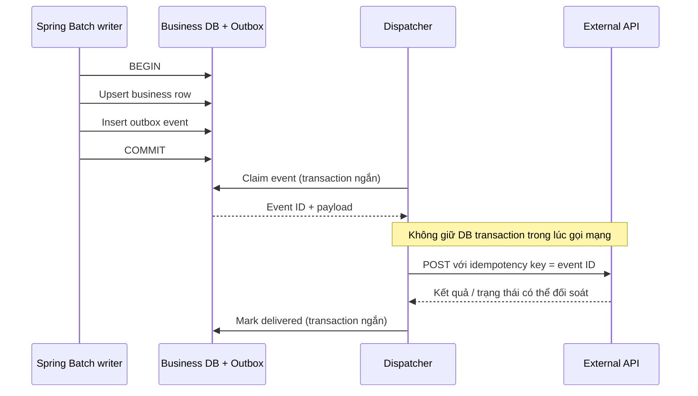
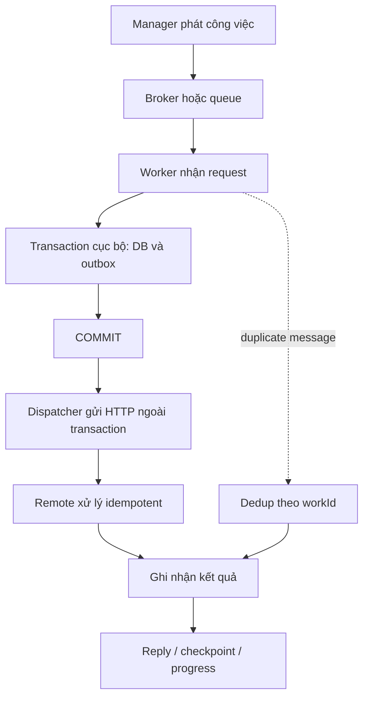

# Anti-pattern: Giữ transaction qua network trong Spring Batch

Một Job đối soát xử lý hàng triệu giao dịch bằng Spring Batch. Trong mỗi chunk, ứng dụng cập nhật cơ sở dữ liệu, gọi HTTP API để xác nhận giao dịch, chờ API trả về rồi mới commit. Khi API bình thường, Job có vẻ đúng. Khi mạng chậm hoặc dịch vụ bên ngoài giảm tốc, số kết nối database bị chiếm giữ tăng, lock tồn tại lâu, chunk timeout, retry lặp lại và các step song song bắt đầu chờ nhau. Tăng số thread hoặc thêm worker lúc này có thể khiến hệ thống tệ hơn.

Đó là anti-pattern **giữ transaction qua network**: mở một transaction cục bộ, thực hiện thao tác mạng có độ trễ hoặc kết quả không chắc chắn trong lúc transaction còn mở, rồi kỳ vọng commit/rollback của database cũng quản lý được hành động ở hệ thống bên ngoài.

Bài học nằm trong chương **Anti-pattern** của module **SPRING_BATCH_SCALING_OPERATIONS**, tập trung vào mở rộng Spring Batch với multi-threaded step, parallel steps, partitioning và xử lý phân tán. Người học sẽ nhận diện kiểu thiết kế này, đo tác động đến throughput/lock/pool, hiểu các cửa sổ lỗi của retry/restart, rồi áp dụng transaction ngắn, outbox, inbox, idempotency và chia giai đoạn phù hợp.

## 1. Transaction cục bộ không bao trùm mạng

Một **database transaction** quản lý commit/rollback các thao tác thuộc tài nguyên giao dịch của nó. Lời gọi HTTP, publish message tới broker hay thao tác trên dịch vụ khác có vòng đời riêng. Nếu chúng không tham gia cùng giao thức transaction phân tán được hỗ trợ thực sự, rollback của database **không hoàn tác được** side effect đã xảy ra ở dịch vụ bên ngoài.

Ví dụ:

1. Step mở transaction của database A.
2. Writer cập nhật trạng thái giao dịch trong database A.
3. Writer gọi HTTP API của hệ thống thanh toán B.
4. B xử lý thành công và trả `200 OK`.
5. Database A gặp lỗi khi commit và rollback.
6. Spring Batch retry chunk. Lời gọi tới B được thực hiện lần nữa, có nguy cơ thanh toán hai lần.

Kịch bản ngược cũng có thể xảy ra: B đã xử lý nhưng phản hồi bị mất trên mạng; client thấy timeout và không biết kết quả thật. Retry “để chắc chắn” mà thiếu idempotency có thể tạo bản ghi trùng.

| Tầng | Có thể rollback cùng local DB transaction không? | Điều cần thiết kế |
|---|---|---|
| SQL dùng cùng `DataSource` và `PlatformTransactionManager` thích hợp | Thường có | Transaction boundary, isolation, lock, checkpoint |
| SQL dùng một database khác / transaction manager khác | Không mặc định | Phối hợp hoặc nhất quán cuối cùng, chống ghi trùng |
| HTTP/REST/gRPC tới hệ thống bên ngoài | Không | Idempotency key, timeout, đối soát, bù trừ khi cần |
| Publish/consume message ở broker | Không mặc định | Outbox/inbox, delivery/ack semantics, correlation |
| Remote worker/partition chạy JVM khác | Không | Transaction riêng của worker, work identity, checkpoint/restart |

Thông điệp then chốt: **thời điểm mở transaction, thời điểm gọi mạng và thời điểm commit phải được thiết kế có chủ đích**. Chỉ thêm `@Transactional` cho toàn bộ phương thức không tạo ra tính nguyên tử xuyên nhiều hệ thống.

## 2. Anti-pattern xuất hiện ở đâu trong Spring Batch?

Với chunk-oriented step, một chunk thường được xử lý trong transaction. Nếu reader, processor hoặc writer gọi dịch vụ mạng một cách đồng bộ **bên trong phạm vi transaction của chunk**, thời gian chờ sẽ kéo dài chính transaction đó.

```mermaid
sequenceDiagram
    participant B as Spring Batch Step
    participant DB as Database A
    participant API as HTTP API B
    B->>DB: BEGIN transaction
    B->>DB: UPDATE business data
    DB-->>B: Đã ghi trong transaction
    B->>API: POST /confirm
    Note over B,API: Chờ mạng; transaction A vẫn mở
    API-->>B: 200 OK
    B->>DB: COMMIT
    Note over DB,API: Commit của A không điều khiển kết quả B
```

Trong hệ thống chạy thực tế, kết nối và lock có thể bị giữ tùy thứ tự SQL, isolation và JDBC implementation. Không phải mọi transaction mở đều đang giữ một row lock, nhưng **một transaction đã cập nhật dữ liệu rồi chờ network** là nguồn lock contention rất thường gặp.

Các chỗ dễ gặp:

- `ItemProcessor` gọi REST API để enrich từng bản ghi trong chunk.
- `ItemWriter` cập nhật DB rồi gửi email, gọi API thanh toán hoặc publish message trước commit.
- Listener hoặc callback thực hiện mạng trong cùng thread với commit/rollback của chunk.
- Một `Tasklet` được bọc transaction và vừa giữ khóa vừa đợi hệ thống khác.
- Manager remote chunking/remote partitioning chờ worker trong khi vẫn giữ một transaction nghiệp vụ rộng.
- Phương thức `@Transactional` của service bao cả thao tác DB và HTTP, được Step gọi cho nhiều item.

**Phân biệt hai lỗi khác nhau:** giữ transaction mở trong khi chờ mạng tạo vấn đề lock/pool/timeout; gửi request trước khi commit tạo **cửa sổ bất nhất giữa DB và dịch vụ ngoài**. Chuyển HTTP ra khỏi transaction giảm vấn đề thứ nhất nhưng **chưa tự giải quyết** vấn đề thứ hai.

## 3. Ví dụ mã có lỗi: gọi HTTP ngay trong chunk writer

Ví dụ dưới đây minh họa một writer được gọi bên trong transaction của Step:

```java
import org.springframework.batch.item.Chunk;
import org.springframework.batch.item.ItemWriter;

public class DangerousPaymentWriter implements ItemWriter<Payment> {
    private final PaymentRepository repository;
    private final PaymentGatewayClient gateway;

    public DangerousPaymentWriter(
            PaymentRepository repository, PaymentGatewayClient gateway) {
        this.repository = repository;
        this.gateway = gateway;
    }

    @Override
    public void write(Chunk<? extends Payment> chunk) {
        for (Payment payment : chunk) {
            repository.markProcessing(payment.id());
            // LỖI: chờ API trong khi transaction chunk vẫn mở.
            gateway.capture(payment.id(), payment.amount());
            repository.markCaptured(payment.id());
        }
    }
}
```

Giả sử chunk size bằng 100, API mỗi lần trả về trong 300 ms thì chỉ riêng HTTP đã có thể chiếm khoảng **30 giây cho một chunk** nếu thực hiện tuần tự. Transaction có thể mở lâu hơn nữa vì đọc, xử lý, lock, commit và retry. Nếu API trả chậm 5 giây cho một số item, độ dài transaction biến động mạnh.

Những vấn đề phát sinh:

1. **Giữ tài nguyên:** connection, lock hoặc snapshot kéo dài; transaction khác phải chờ.
2. **Rollback lớn:** một item lỗi gần cuối chunk có thể khiến công việc DB của nhiều item phải làm lại.
3. **Không rollback được API:** gateway đã capture tiền vẫn giữ kết quả dù DB rollback.
4. **Retry trùng:** Spring Batch retry method/chunk hoặc Kubernetes chạy lại Pod có thể gọi gateway lặp.
5. **Khó stop/restart:** Step không đến checkpoint trong lúc HTTP đang chờ.
6. **Không mở rộng tuyến tính:** nhiều thread làm số transaction chờ API và số connection cần thiết cùng tăng.

Đặt timeout cho HTTP rất cần thiết, nhưng **timeout chỉ giới hạn thời gian chờ; không biến lời gọi HTTP thành thành viên của local DB transaction**.

### Biến thể với `@Transactional`

```java
@Transactional
public void settle(Payment payment) {
    repository.updateLedger(payment);
    gateway.capture(payment.id(), payment.amount()); // network
    repository.markSettled(payment.id());
}
```

Nếu annotation này thực sự được áp dụng qua Spring proxy và sử dụng đúng transaction manager, phương thức vẫn chứa cùng anti-pattern. Ngoài ra, `@Transactional` có thể **không tạo transaction mới** khi tự gọi method trong cùng bean theo proxy mode thông thường; phải xác nhận ranh giới transaction thật qua log, trace và cấu hình, không suy luận từ annotation.

## 4. Điều gì xảy ra khi tăng thread hoặc partition?

Giả sử hệ thống có 8 thread xử lý đồng thời. Mỗi chunk chỉ cần **80 ms xử lý database** nhưng còn phải chờ **2 giây gọi HTTP** trong cùng transaction.

```text
Thời gian giữ transaction/chunk (ví dụ xấp xỉ)
= 0,08 s DB + 2,00 s HTTP
= 2,08 s

8 transaction đồng thời chiếm 8 connection trong khoảng chờ đó.
Thông lượng giới hạn bởi 8 worker và thời gian 2,08 s
≈ 8 / 2,08 = 3,85 chunk/giây (trong giả định đơn giản).
```

Nếu tách HTTP ra khỏi transaction, thời gian connection bị giữ có thể giảm còn gần phần SQL thực tế. Điều đó **giải phóng capacity DB**, nhưng thông lượng nghiệp vụ cuối cùng vẫn phụ thuộc vào độ trễ HTTP, số concurrent requests và giới hạn của gateway. Không được suy diễn rằng tách transaction sẽ tự làm HTTP nhanh hơn.

| Thay đổi thiếu đo lường | Hậu quả có thể xảy ra |
|---|---|
| Tăng `throttle/concurrency` từ 8 lên 32 | 32 giao dịch cùng chờ HTTP, pool hoặc DB hết connection |
| Tăng kích thước chunk | Transaction dài, rollback tốn kém, checkpoint thưa |
| Tăng remote partition từ 4 lên 16 worker | Lock, kết nối và API rate limit bị nhân lên toàn cluster |
| Tăng retry ngay trong transaction | Cùng transaction giữ tài nguyên qua nhiều lần backoff |
| Tăng timeout DB để tránh lỗi | Lock giữ lâu hơn và Job không phản hồi stop kịp |

### Nguyên tắc tính tổng tài nguyên

Trong một Pod nhiều thread, connection pool được chia sẻ giữa các Step đang dùng cùng DataSource. Trong remote partitioning, mỗi Pod có thể có connection pool riêng nhưng tất cả cùng kết nối vào một database.

Ví dụ **8 Pod × 12 kết nối/pool = 96 kết nối tối đa về mặt cấu hình**, chưa tính manager, monitoring và ứng dụng khác. Số thực tế phụ thuộc pool có mở đủ connection hay không. Nếu DB chỉ cho phép 80 connection tổng cộng, cách scaling hiện tại có thể làm nghẽn hệ thống trước khi tăng throughput.

Kiểm tra thêm giới hạn CPU, memory, connection quota, rate limit API và transaction timeout; một giá trị `gridSize` hoặc `TaskExecutor` lớn không có ý nghĩa nếu downstream trở thành nút thắt.

## 5. Cửa sổ lỗi: tại sao retry có thể làm sai dữ liệu?

Xét hai trình tự thường gặp.

**Thứ tự A — DB trước, network sau (network vẫn trong transaction):**

```text
BEGIN DB
UPDATE payment=PROCESSING
POST /capture -> remote service ĐÃ capture thành công
COMMIT DB -> lỗi/rollback
Retry chunk -> POST /capture lần nữa
```

**Thứ tự B — DB commit trước, network sau (không có outbox):**

```text
BEGIN DB
UPDATE payment=READY
COMMIT DB -> thành công
JVM crash TRƯỚC khi POST /capture
Không có tác vụ bền vững nào ghi rằng cần POST /capture
```

Thứ tự A có thể **gửi trùng side effect**; thứ tự B có thể **làm mất side effect**. Vì vậy “đưa lời gọi HTTP ra khỏi transaction” là bước tốt để giảm thời gian giữ DB connection, nhưng nếu thao tác ngoài quan trọng, cần cơ chế giao việc có lưu bền vững.

Những cửa sổ lỗi này xuất hiện cả khi không bật retry của Spring Batch: timeout mạng có thể làm client không biết remote đã xử lý chưa; Kubernetes restart container; manager/worker mất kết nối; message broker redeliver. Trong các trường hợp đó, **idempotency, checkpoint và đối soát kết quả** quyết định tính đúng đắn hơn là số lần retry.

## 6. Thiết kế thay thế: Transaction ngắn + Transactional Outbox

Nếu cần cập nhật DB và phát yêu cầu sang một hệ thống ngoài, **transactional outbox** là lựa chọn phổ biến:

1. Trong transaction ngắn, cập nhật dữ liệu nghiệp vụ và ghi một bản ghi **outbox** vào **cùng database, cùng transaction thực sự**.
2. Commit transaction. Spring Batch ghi checkpoint phù hợp với phần việc đã commit.
3. Một dispatcher độc lập chọn outbox event, kết thúc transaction claim, rồi **gọi network bên ngoài transaction**.
4. Nếu hệ thống ngoài xác nhận thành công, dispatcher đánh dấu delivered trong một transaction ngắn khác.
5. Khi lỗi hoặc chết giữa các bước, event có thể được gửi lại; hệ thống nhận dùng **idempotency key** để không áp dụng hiệu ứng nghiệp vụ hai lần.



### Thiết kế bảng outbox mẫu

Ví dụ PostgreSQL (lược giản cho mục đích học tập):

```sql
CREATE TABLE payment_outbox (
    event_id           VARCHAR(120) PRIMARY KEY,
    payment_id         VARCHAR(80) NOT NULL,
    event_type         VARCHAR(60) NOT NULL,
    payload_json       JSONB NOT NULL,
    status             VARCHAR(20) NOT NULL DEFAULT 'NEW',
    attempt_count      INTEGER NOT NULL DEFAULT 0,
    lease_owner        VARCHAR(100),
    lease_token        VARCHAR(100),
    lease_until        TIMESTAMPTZ,
    created_at         TIMESTAMPTZ NOT NULL DEFAULT now(),
    delivered_at       TIMESTAMPTZ
);

CREATE INDEX payment_outbox_ready_idx
    ON payment_outbox (status, lease_until, created_at);
```

Trong giao dịch xử lý một payment, ghi business row và outbox:

```sql
BEGIN;

-- Cập nhật ledger nghiệp vụ với key duy nhất phù hợp.
UPDATE payment_ledger
SET local_status = 'CAPTURE_REQUESTED'
WHERE payment_id = :payment_id;

INSERT INTO payment_outbox (
    event_id, payment_id, event_type, payload_json, status
)
VALUES (
    :deterministic_event_id,
    :payment_id,
    'CAPTURE_PAYMENT',
    CAST(:payload_json AS jsonb),
    'NEW'
)
ON CONFLICT (event_id) DO NOTHING;

COMMIT;
```

`:payment_id`, `:deterministic_event_id` và `:payload_json` là tham số của client SQL, không phải cú pháp chạy độc lập trong `psql`. ID phải được định nghĩa theo **nghiệp vụ** để event của cùng thao tác có cùng key khi chunk được retry, nhưng những thao tác hợp lệ khác nhau vẫn có key khác nhau.

**Điều kiện quan trọng:** Outbox và dữ liệu nghiệp vụ phải tham gia **cùng local transaction thực sự**. Nếu Spring Batch metadata/JobRepository và business database nằm ở hai DataSource độc lập, transaction của writer không tự nhiên trở thành transaction nguyên tử với checkpoint. Cần thiết kế restart/idempotency sao cho dữ liệu đầu ra vẫn đúng nếu checkpoint bị phát lại; không tuyên bố outbox đã khiến cả ba nơi (business DB, JobRepository, API) trở nên atomic.

### Ví dụ `ItemWriter` chỉ ghi DB + outbox

```java
import org.springframework.batch.item.Chunk;
import org.springframework.batch.item.ItemWriter;

public class OutboxPaymentWriter implements ItemWriter<Payment> {
    private final PaymentRepository payments;
    private final OutboxRepository outbox;

    public OutboxPaymentWriter(
            PaymentRepository payments, OutboxRepository outbox) {
        this.payments = payments;
        this.outbox = outbox;
    }

    @Override
    public void write(Chunk<? extends Payment> chunk) {
        for (Payment payment : chunk) {
            payments.upsertCaptureRequested(payment);
            outbox.insertIfAbsent(
                "capture:" + payment.id(),
                payment.id(),
                payment.toCapturePayload()
            );
        }
        // Không gọi HTTP hoặc chờ broker ở đây.
        // Cả hai repository phải dùng cùng transaction manager/DB.
    }
}
```

Đây là ví dụ phần lõi của writer; `Payment` và hai repository là kiểu ứng dụng tự định nghĩa, chưa phải chương trình chạy độc lập. Với chunk-oriented step có transaction, các thao tác ghi DB được commit ở boundary của framework. Nếu `upsertCaptureRequested` và `insertIfAbsent` sử dụng transaction khác nhau, outbox **mất tính nguyên tử**.

### Dispatcher claim bền vững, gửi ngoài transaction

Một dispatcher đơn giản có thể:

```java
public void dispatchOne() {
    // Transaction ngắn: claim với lease/token chống nhiều worker nhận trùng.
    ClaimedEvent event = transactionTemplate.execute(tx ->
        outbox.claimOne(workerId, clock.instant().plusSeconds(60))
    );
    if (event == null) {
        return;
    }

    // Không giữ DB transaction trong lúc network I/O.
    remoteGateway.capture(
        event.payload(),
        event.eventId(),      // Idempotency-Key
        Duration.ofSeconds(5)
    );

    // Transaction ngắn khác: xác nhận event theo claim token hiện hành.
    transactionTemplate.executeWithoutResult(tx ->
        outbox.markDelivered(event.eventId(), event.claimToken())
    );
}
```

Ví dụ minh họa ranh giới giao dịch, giả định đã có `TransactionTemplate`, `outbox`, `remoteGateway`, `clock`, `workerId` và các kiểu ứng dụng liên quan. Trong production cần thêm:

- **Claim nguyên tử** và lock/lease, chẳng hạn cập nhật status + token trong một transaction hoặc áp dụng `SELECT ... FOR UPDATE SKIP LOCKED` theo quy tắc PostgreSQL. Không đọc `NEW` rồi gửi trước khi claim.
- **Lease duration và timeout** được thiết kế tương ứng; nếu lease hết trước khi HTTP trả về, worker khác có thể gửi lại, vì vậy remote idempotency vẫn bắt buộc.
- **Fencing token** hoặc so sánh `lease_token` tại lúc mark delivered để worker cũ không ghi đè trạng thái của worker đã nhận quyền mới.
- **Retry có giới hạn và backoff**, phân biệt timeout/5xx có thể retry với lỗi nghiệp vụ 4xx, đưa event bất thường vào trạng thái cần điều tra.
- **Truy vấn trạng thái ở remote** khi client timeout nhưng kết quả có thể đã thành công. Gửi lại vẫn phải giữ nguyên idempotency key.
- **Quan sát backlog và tuổi event**, cảnh báo khi dispatcher đứng yên hoặc event chuyển poison/dead-letter.

Một lỗi sau khi API thực hiện thành công nhưng trước lúc `markDelivered` khiến event được gửi lại. Đó là hành vi có thể dự đoán trong mô hình **at-least-once delivery**; mục tiêu là *effectively-once theo nghiệp vụ* nhờ idempotency và đối soát, không phải giả định mạng chỉ gửi đúng một lần.

## 7. Biến thể phù hợp: staging, inbox và orchestration

Outbox không phải cấu trúc duy nhất. Chọn theo hướng dữ liệu và yêu cầu business:

| Mô hình | Khi phù hợp | Điều kiện an toàn |
|---|---|---|
| **Staging + Step riêng** | Đọc/biến đổi dữ liệu trước, sau đó Step khác gọi API ngoài | Lưu key và state bền vững; restart không gửi thiếu/trùng |
| **Outbox + dispatcher** | DB thay đổi và cần phát sự kiện/yêu cầu ngoài | Insert outbox cùng transaction DB, idempotent receiver |
| **Inbox/dedup ở consumer** | Broker có thể redeliver request | Ghi nhận message ID/processing result theo transaction phù hợp |
| **Saga/compensation** | Nhiều hệ thống phải phối hợp các bước không cùng transaction | Bù trừ rõ ràng, trạng thái orchestration bền vững |
| **Remote partitioning** | Chia range dữ liệu cho worker độc lập | Mỗi worker transaction cục bộ, partition key ổn định, checkpoint đúng |
| **Phê duyệt/đối soát thủ công** | Side effect không tự bù trừ, rủi ro cao | Truy vết theo key, giới hạn retry tự động |

### Staging hai giai đoạn

Thay vì gọi HTTP cho từng item khi đang ghi transaction, Step A lưu danh sách yêu cầu vào bảng staging với trạng thái `PENDING`; Step B hoặc một service dispatcher đọc staging, gọi API ngoài transaction và cập nhật kết quả ở transaction riêng.

Điều này làm mỗi transaction ngắn hơn và giúp theo dõi yêu cầu nào còn tồn đọng. Tuy nhiên, nếu Step B thất bại sau khi remote xử lý mà trước khi ghi nhận kết quả, vẫn cần idempotency hoặc API truy vấn trạng thái để tiếp tục đúng.

### Inbox tại phía nhận

Nếu bạn kiểm soát worker nhận message, có thể ghi dấu `message_id` cùng hiệu ứng nghiệp vụ trong **một local transaction**:

```sql
-- Pseudocode SQL: một transaction ở database của consumer
BEGIN;
INSERT INTO processed_message (message_id)
VALUES (:message_id)
ON CONFLICT (message_id) DO NOTHING;
-- Chỉ áp dụng business update nếu vừa insert mới thành công.
COMMIT;
```

Trong ứng dụng thật, phải kiểm tra kết quả insert **ngay trong cùng transaction** rồi mới thay đổi nghiệp vụ. Chỉ dùng `ON CONFLICT DO NOTHING` mà vẫn cập nhật dữ liệu vô điều kiện sẽ **không chống được trùng**. Nếu consumer cần gọi thêm một API khác, tầng API đó vẫn cần cơ chế idempotency tương ứng.

### Giao dịch phân tán / XA có phải lối tắt?

XA/two-phase commit chỉ phù hợp khi **tất cả tài nguyên thực sự hỗ trợ tham gia phối hợp giao dịch**, hệ thống chấp nhận được độ phức tạp, timeout và xử lý in-doubt transaction. Một HTTP API thông thường không trở thành XA participant chỉ bằng `@Transactional`, và nhiều hệ thống broker/cloud service không cung cấp kiểu bảo đảm atomic với database mà bạn kỳ vọng.

Đối với workload batch phân tán lớn, thường nên dùng transaction cục bộ ngắn + sự kiện bền vững + idempotency/compensation hơn là kéo dài distributed lock qua nhiều node. Nếu chọn XA, phải có kế hoạch kiểm tra coordinator failure, recovery log và giới hạn throughput thực tế.

## 8. Retry, skip, restart: giữ đúng semantics của Spring Batch

Spring Batch cung cấp retry/skip/rollback theo Step và transaction policy. Các khả năng này **không tự biến HTTP thành thao tác có thể rollback**.

### Retry trong transaction là điểm nguy hiểm

Nếu mã gọi API thất bại hoặc timeout, retry ngay trong chunk có thể kéo dài thời gian giữ DB connection, lock và tăng số lượng yêu cầu chưa biết kết quả ở remote. Khi cần retry:

- Giới hạn thời gian kết nối, thời gian đọc và tổng deadline của mỗi request.
- Retry có **backoff và trần số lần**, tránh tạo retry storm lên API đang quá tải.
- Chỉ retry các lỗi được xác định có thể phục hồi; phân biệt lỗi nghiệp vụ với lỗi vận hành.
- Bảo toàn **cùng idempotency key** cho các lần thử của cùng thao tác.
- Dùng circuit breaker/rate limiter khi cần, nhưng không coi chúng là cơ chế transaction.
- Ưu tiên thực hiện retry ở **dispatcher ngoài transaction nghiệp vụ**, với state retry được lưu bền vững.

### Skip không có nghĩa side effect đã được hoàn tác

Nếu writer gọi gateway thành công cho item rồi gặp lỗi DB, cấu hình `skip(Exception.class)` có thể làm Step tiếp tục và che mất việc remote đã xử lý. Skip chỉ nên được áp dụng theo rule nghiệp vụ rõ ràng, với khả năng đối soát. Không coi log “skipped 1 item” là bằng chứng không có dữ liệu bên ngoài.

### Restart phải xét checkpoint và side effect

`JobRepository`/`ExecutionContext` giúp Spring Batch biết Step/chunk nào đã commit theo cơ chế framework. Sau crash, một số thao tác ngoài transaction có thể đã hoàn tất dù checkpoint chưa được lưu. Vì thế:

1. Định danh ổn định cho bản ghi, partition và external operation.
2. Writer/upsert và outbox insert chịu được replay của chunk.
3. Không tự tạo `run.id` mới chỉ để tránh `JobExecutionAlreadyRunningException`; instance mới có thể đọc lại toàn bộ dữ liệu.
4. Với metadata `STARTED` còn sót sau OOM/SIGKILL, xác minh không còn worker cũ trước khi recovery; không sửa bừa trạng thái repository.
5. Kiểm thử tình huống kill đúng lúc commit, sau commit nhưng trước ack, giữa lúc HTTP timeout và trong khi các partition khác vẫn chạy.

Outbox giảm cửa sổ mất công việc ngoài DB, nhưng không miễn trừ nhu cầu **reader/writer thread safety** hoặc **định danh partition ổn định**.

## 9. Ảnh hưởng tới từng chiến lược scaling

### Multi-threaded step

Một JVM có thể xử lý nhiều chunk đồng thời. Nếu mỗi chunk giữ transaction qua HTTP, số connection và lock bị giữ có thể tăng gần theo số thread đang active. Reader/writer stateful còn có nguy cơ race condition, checkpoint không nhất quán hoặc xử lý lại dữ liệu.

Điều chỉnh nên thực hiện cùng lúc:

- Ước lượng tổng transaction/connections đang hoạt động, timeout và API concurrency.
- Đảm bảo ItemReader/ItemWriter thread-safe hoặc có phạm vi state riêng.
- Không mở rộng thread pool nếu pool database hoặc API đã nghẽn.
- Đo thời gian transaction riêng với thời gian network, không chỉ tổng Job duration.

### Parallel steps

Hai Step khác nhau có thể dùng cùng DB và cùng các bảng nghiệp vụ. Nếu Step A giữ lock qua HTTP, Step B phải chờ và cả Job có vẻ bị stuck. Có thể tách các bước phụ thuộc bằng staging/outbox hoặc phân chia phạm vi update rõ ràng, đồng thời xác định thứ tự/transition trong Job flow.

### Local/remote partitioning

Mỗi partition cần **work identity** riêng, transaction cục bộ và checkpoint. Tăng số partition làm số request API/DB tăng; giữ network bên trong transaction của từng partition có thể tạo lock contention trên toàn cluster.

Trong remote partitioning, **manager không thể rollback transaction của worker chỉ vì một reply mất trên broker**. Worker có thể đã commit nhưng manager chưa nhận được kết quả. Vì vậy cần identity ổn định của partition, dữ liệu output idempotent và giao thức xác nhận/recovery.

### Remote chunking

Remote chunking trao đổi chunk qua broker; manager/worker có nhiệm vụ transaction khác nhau. Việc gửi request, chờ reply và commit kết quả có thể bị ngắt ở bất kỳ điểm nào; **đừng suy diễn rằng một transaction DB duy nhất bao trùm cả broker, manager và worker**.

Nếu broker redeliver vì consumer chết sau khi commit mà trước khi ack, worker phải có idempotency hoặc dedup. Nếu reply bị mất, manager không được tự suy ra worker chưa xử lý. Khi cần đồng bộ trạng thái, dùng message ID/correlation, kết quả bền vững và đối soát.



Sơ đồ mô tả một **kiến trúc được đề xuất**, không phải chi tiết triển khai mặc định của mọi Spring Batch remote chunking flow. Thứ tự ack/reply/checkpoint phải được định nghĩa theo broker và storage cụ thể; tránh gửi reply `COMPLETED` trước khi nghiệp vụ thực sự đạt điểm hoàn tất đã chọn.

## 10. Chẩn đoán anti-pattern trong production

Khi Job giảm tốc hoặc stuck, cần phân biệt network bottleneck với DB lock và GC. Thu thập đồng thời:

| Chỉ số | Dấu hiệu nghi ngờ | Cách xác minh |
|---|---|---|
| Transaction duration p95/p99 | Tăng cùng độ trễ HTTP | Trace cùng request/step và thời điểm mở/commit transaction |
| DB connection pool active/pending | Pool active gần max, nhiều thread chờ | HikariCP metrics, thread dump |
| Database lock wait và transaction age | Transaction mở lâu, lock blocking tăng | DB activity/lock view, xác định transaction owner |
| HTTP latency, timeout, rate limit | API chậm hoặc 429/5xx tăng | Client metrics, correlation ID, retry count |
| Chunk duration và commit interval | Ít checkpoint, chunk kéo dài | `StepExecution` counts + lịch sử latency |
| Broker lag / in-flight / redelivery | Worker không ack, reply mất | Broker console/metrics, DLQ |
| CPU throttling / GC / memory | Thread chậm dù API bình thường | Container metrics và JVM GC metrics |
| Dữ liệu trùng/thiếu | Side effect không khớp metadata | Đối soát theo business key và operation ID |

Với PostgreSQL, một truy vấn chỉ đọc có thể giúp xác định transaction cũ và các session đang chờ:

```sql
SELECT
    pid,
    application_name,
    state,
    wait_event_type,
    wait_event,
    now() - xact_start AS transaction_age,
    pg_blocking_pids(pid) AS blocking_pids,
    left(query, 240) AS sql_sample
FROM pg_stat_activity
WHERE datname = current_database()
  AND xact_start IS NOT NULL
ORDER BY xact_start;
```

Kết quả cần gắn với log và trace: query hiện tại của transaction không chứng minh thread có đang gọi HTTP hay không. Kết nối `idle in transaction` dài bất thường là manh mối; thread dump và distributed tracing giúp biết thread đang chờ đâu. Không tự kết thúc backend DB trên production chỉ dựa vào tuổi transaction vì có thể rollback công việc hợp lệ.

### Cách kiểm chứng bằng tracing

Gắn các span/metric có correlation key như `jobExecutionId`, `stepExecutionId`, `partitionKey`, `chunkId`/business key khi thích hợp. Quan sát thứ tự:

```text
transaction.begin  t = 00:00:00.000
db.update          t = 00:00:00.015
http.request       t = 00:00:00.040
http.response      t = 00:00:05.040
transaction.commit t = 00:00:05.060
```

Nếu transaction duration gần bằng HTTP latency, nhiều khả năng network đang nằm trong boundary. Sau refactor, trace mong muốn:

```text
transaction.begin  t = 00:00:00.000
db.update+outbox   t = 00:00:00.020
transaction.commit t = 00:00:00.045
dispatcher.claim   t = 00:00:00.080  (transaction ngắn)
http.request       t = 00:00:00.100  (không có transaction DB mở)
http.response      t = 00:00:05.100
dispatcher.mark    t = 00:00:05.130  (transaction ngắn)
```

Các mốc là số **minh họa**. Cần chú ý security khi gắn trace: không ghi mật khẩu, token, payload thẻ thanh toán hoặc dữ liệu nhạy cảm vào span.

## 11. Tình huống thực tế: 10 triệu bản ghi và API đối soát

Một hệ thống xử lý 10 triệu item ban đêm với 8 worker, mỗi worker dùng pool tối đa 12 connection. Mỗi chunk 200 item. Code cũ cập nhật 200 dòng ledger, sau đó gọi API đối soát cho từng item trước commit. API bình thường 100 ms, nhưng giờ cao điểm tăng lên 1 giây/item.

**Hiện tượng:** Khi API chậm, một chunk có thể chờ tới khoảng 200 giây chỉ riêng HTTP tuần tự. 8 worker cùng giữ transaction và nhiều lock. Job bị chậm, pool pending tăng, một số Step `STOPPING` lâu vì chưa hoàn tất chunk; retry tạo thêm yêu cầu API. Tăng worker lên 16 làm DB/APIs chịu tải thêm mà không giải quyết gốc.

**Thiết kế lại:**

1. Step đọc và chuẩn hóa item; writer trong local transaction ghi ledger cùng outbox event có `event_id` ổn định cho mỗi yêu cầu đối soát.
2. Commit chunk. Trạng thái Step phản ánh **đã chuẩn bị yêu cầu đối soát bền vững**, chưa phải API ngoài đã hoàn tất.
3. Dispatcher độc lập claim outbox theo batch nhỏ, gửi API với số concurrent requests/rate limit được kiểm soát, không giữ DB transaction qua network.
4. API hỗ trợ idempotency key; nếu timeout, dispatcher tra trạng thái theo key khi có khả năng, hoặc retry cùng key.
5. Dispatcher cập nhật kết quả, đẩy event lỗi cần can thiệp sang dead-letter trạng thái và phát metrics backlog.
6. Job orchestration quyết định khi nào dữ liệu **đối soát hoàn tất thực sự** (ví dụ Step tiếp theo chờ trạng thái mọi yêu cầu) thay vì lấy việc Step chuẩn bị outbox thành `COMPLETED` nghiệp vụ.

Nếu outbox có 10 triệu event, không nhất thiết phải giữ toàn bộ trong RAM. Dispatcher phân trang/claim theo thứ tự và index phù hợp; theo dõi backlog/retention/cleanup, bảo đảm scale consumer không vượt API rate limit. Sizing dựa vào throughput thực đo của dispatcher và downstream, không dựa vào CPU rảnh của Batch manager.

### Đánh giá hai mục tiêu khác nhau

| Mục tiêu | Trước refactor | Sau refactor |
|---|---|---|
| Transaction DB ngắn | Không đạt vì chờ HTTP | Đạt nếu chỉ ghi ledger/outbox |
| API xử lý nhanh hơn | Không tự động | Không tự động; cần concurrency/rate limit phù hợp |
| Không mất yêu cầu sau DB commit | Có nguy cơ trong cách gọi network tùy thứ tự | Outbox bền vững cùng transaction DB |
| Không nhân đôi side effect khi replay | Không được bảo đảm | Có thể bảo đảm theo nghiệp vụ nếu API/idempotency chuẩn |
| Restart an toàn | Khó vì checkpoint và HTTP lệch nhau | Dễ đối soát hơn nhờ ID và state bền vững |
| Job status phản ánh hoàn tất thực | Có thể bị hiểu nhầm | Phải định nghĩa ranh giới `prepared` và `delivered` rõ ràng |

## 12. Cách kiểm thử để chứng minh đã loại bỏ anti-pattern

Một benchmark chỉ báo “Job chạy nhanh hơn” là chưa đủ; cần kiểm tra tính đúng và độ bền trong các điểm lỗi:

1. **Network chậm:** giả lập API latency 50 ms, 500 ms, 5 giây; đo transaction age, pool pending và throughput.
2. **Timeout không biết kết quả:** API xử lý thành công nhưng cố tình làm mất response. Dispatcher phải retry/tra cứu theo cùng operation ID, không tạo side effect mới.
3. **Crash sau DB commit, trước dispatch:** khởi động lại, event outbox vẫn còn và được gửi.
4. **Crash sau remote success, trước markDelivered:** event được gửi lại; remote dedup/idempotency tạo đúng kết quả nghiệp vụ.
5. **Hai dispatcher cạnh tranh:** cùng claim event; phải có claim token/lease, và kiểm tra trùng thông qua khóa nghiệp vụ.
6. **Chunk retry / partition restart:** phát lại chunk ở vị trí bất kỳ; business row/outbox không được nhân đôi.
7. **Scale 1 → 4 → 8 → 16 worker:** xem TPS thực, DB connections, lock waits, retry, API 429/5xx và backlog.
8. **Shutdown graceful:** dừng worker/dispatcher giữa lúc network đang chờ; không còn transaction mở quá hạn và việc chưa hoàn tất có thể tiếp tục.

**Tiêu chí PASS mẫu:**

| Kiểm tra | Mục tiêu |
|---|---|
| Transaction age p99 | Gần thời gian SQL, không tăng tuyến tính theo độ trễ HTTP |
| DB connection pool | Không bị giữ bão hòa bởi client chờ API |
| Kết quả nghiệp vụ | Một hiệu ứng logic cho mỗi operation ID hợp lệ |
| Outbox backlog | Được xử lý sau crash/restart; có ngưỡng cảnh báo khi quá hạn |
| Worker/partition restart | Không bỏ sót hoặc xử lý trùng về mặt nghiệp vụ |
| Timeout/retry | Bounded, có backoff và có đủ thông tin đối soát |
| Audit | Theo dõi được Job/Step/partition/event/remote operation ID |

Không dùng “gửi đúng một request ở test không lỗi” để kết luận exactly-once. Bài kiểm thử bắt buộc phải có tình huống **remote xử lý thành công nhưng xác nhận bị mất**, vì đó là lúc idempotency thật sự được kiểm chứng.

## 13. Checklist review code trước production

1. Xác định mọi HTTP/gRPC/JMS/Kafka/database khác được gọi trong reader, processor, writer, listener và Tasklet.
2. Truy vết nơi transaction bắt đầu/commit; đo thời gian mở thực tế, không chỉ xem `@Transactional`.
3. Không chờ network không xác định thời hạn khi đang giữ transaction nghiệp vụ hoặc DB lock.
4. Tách phần phát side effect quan trọng bằng outbox/staging bền vững hoặc workflow có state rõ ràng.
5. Với outbox, business write và event insert phải thật sự nằm cùng transaction cục bộ.
6. Định danh duy nhất operation/event/work partition, chống trùng ở receiver hoặc đích nghiệp vụ.
7. Thiết lập timeout, retry/backoff, rate limit và circuit breaker theo đặc điểm downstream.
8. Chọn chunk size, thread pool, connection pool và số Pod từ phép đo; kiểm tra tổng tải lên DB/API.
9. Kiểm thử crash tại các điểm trước/sau DB commit, remote success, broker ack và checkpoint.
10. Đảm bảo JobRepository, StepExecution và ExecutionContext có thể phục hồi; giữ identity của JobInstance khi restart.
11. Phân biệt trạng thái **đã tạo yêu cầu** với **đã hoàn tất hành động ngoài hệ thống** trong metrics, dashboard và SLA.
12. Có runbook điều tra khi outbox không thoát backlog, partition đứng chờ hoặc remote trả kết quả không xác định.

**Kết luận:** Giữ một database transaction mở trong khi chờ network thường làm tăng thời gian chiếm connection/lock, giảm throughput và khuếch đại lỗi khi tăng song song Spring Batch. Chuyển sang **transaction cục bộ ngắn + giao việc bền vững + idempotency/reconciliation** giúp tách nút thắt dữ liệu khỏi nút thắt mạng, đồng thời giữ được khả năng restart của Job khi container, broker hoặc dịch vụ bên ngoài gặp sự cố.
