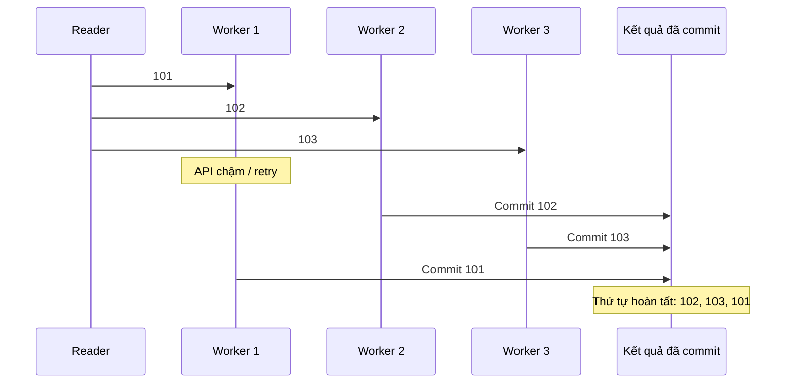

# Rely vào thứ tự hoàn tất ngẫu nhiên

## 1. Bản chất anti-pattern

Trong một job Spring Batch chạy tuần tự, người phát triển thường thấy bản ghi được đọc, xử lý và ghi theo cùng một thứ tự. Khi chuyển sang **multi-threaded step, parallel steps, partitioning hoặc xử lý phân tán**, kết quả quan sát được có thể khác hẳn: công việc bắt đầu trước chưa chắc kết thúc trước. **Anti-pattern “rely vào thứ tự hoàn tất ngẫu nhiên”** xuất hiện khi nghiệp vụ suy ra thứ tự, tính đầy đủ hoặc điểm khôi phục từ thời điểm task, chunk, partition hay worker kết thúc.

Ví dụ: job xử lý đơn hàng theo `order_id` tăng dần. Lập trình viên lấy ID của bản ghi vừa xử lý xong cuối cùng làm `lastProcessedId`, rồi dùng ID đó để bỏ qua dữ liệu trong lần restart tiếp theo. Với nhiều luồng, ID hoàn tất cuối cùng có thể nhỏ hơn ID đã xử lý trước đó; nghiêm trọng hơn, bản ghi đã qua `ItemProcessor` chưa chắc đã được commit. Cách làm này có thể bỏ sót dữ liệu hoặc tạo kết quả trùng lặp.

Trong phạm vi **SPRING_BATCH_SCALING_OPERATIONS**, yêu cầu mở rộng throughput phải đi cùng tính đúng đắn khi chạy song song, retry, restart và vận hành. Có thể tăng mức song song mà vẫn giữ đúng nghiệp vụ nếu xác định rõ **thứ tự nào thực sự cần được đảm bảo** và xây dựng cơ chế đồng bộ/ghi nhận trạng thái tương ứng.

## 2. Phân biệt các loại “thứ tự”

| Loại thứ tự | Ý nghĩa | Có thể dựa vào khi chạy song song? |
| --- | --- | --- |
| Thứ tự nguồn | Thứ tự hàng do truy vấn hoặc file cung cấp; SQL chỉ xác định thứ tự khi có `ORDER BY` phù hợp. | Dùng để xác định thứ tự *đọc* trong phạm vi reader; không tự động thành thứ tự hoàn tất. |
| Thứ tự bắt đầu | Task/chunk nào được scheduler cấp tài nguyên trước. | Không đảm bảo thứ tự kết thúc; còn tùy thread pool, I/O, khóa và retry. |
| Thứ tự xử lý xong | Lời gọi `ItemProcessor`/worker nào trả về trước. | Không chứng minh dữ liệu đã được writer ghi và commit. |
| Thứ tự commit | Transaction nào commit thành công trước. | Có thể khác thứ tự đọc/xử lý; còn phụ thuộc cấu hình step và transaction. |
| Thứ tự phát sự kiện | Message/API call nào được gửi hoặc nhận trước. | Phụ thuộc transport, partition/key, retry và cơ chế consumer; không mặc nhiên là thứ tự nghiệp vụ toàn cục. |
| Thứ tự nghiệp vụ | Ví dụ: giao dịch của cùng một tài khoản phải áp dụng theo số phiên bản tăng dần. | Phải được bảo đảm bằng thiết kế: phân luồng theo khóa, tuần tự hóa, ràng buộc phiên bản hoặc giai đoạn sắp xếp. |

**Quy tắc cốt lõi:** “Đã chạy trước”, “đã trả về trước”, “đã commit trước” và “đứng trước trong nghiệp vụ” là bốn khái niệm khác nhau. `ORDER BY` ở đầu vào không thể tự ép các chunk đang chạy đồng thời commit theo đúng thứ tự đó.

## 3. Tình huống gây lỗi trong Spring Batch

Giả sử một step đọc đơn hàng `101`, `102`, `103` theo `ORDER BY order_id`. Hệ thống dùng nhiều worker để tính phí, gọi dịch vụ bên ngoài và ghi kết quả.

| Đơn hàng | Bắt đầu | Lý do chậm/nhanh | Xử lý xong (minh họa) |
| --- | --- | --- | --- |
| `101` | Đầu tiên | Gọi API chậm, phải retry | Sau cùng |
| `102` | Thứ hai | Dữ liệu đã cache | Đầu tiên |
| `103` | Thứ ba | Tính toán đơn giản | Thứ hai |



Đây chỉ là **một lịch thực thi có thể xảy ra**, không phải trình tự commit mà Spring Batch luôn tạo ra. Nếu lấy “ID hoàn tất cuối” làm cursor, kết quả là `101`, mặc dù `102` và `103` đã xong. Nếu lấy “ID lớn nhất từng đi qua processor” là `103`, vẫn có nguy cơ `102` hoặc `103` chưa commit hay transaction đã rollback. Cả hai biến thể đều không đủ để xác định an toàn tập bản ghi cần restart.

Anti-pattern xuất hiện dưới nhiều hình thức:

- **Multi-threaded step:** nhiều chunk cùng chạy với `TaskExecutor`; chunk đến sau có thể ghi xong trước chunk đến trước.
- **Parallel flows/steps:** hai nhánh được thực thi song song; không thể giả định nhánh khai báo trước sẽ hoàn tất trước. Nếu một bước cần kết quả của bước khác, phải khai báo phụ thuộc rõ ràng trong job flow.
- **Local/remote partitioning:** mỗi partition có `StepExecution`, tốc độ và số lần retry riêng. `partition3` hoàn tất trước `partition1` không hàm ý dữ liệu của partition đó có thứ tự nghiệp vụ thấp hơn/cao hơn.
- **Remote chunking và message processing:** thời điểm message đến hoặc phản hồi về không tự định nghĩa thứ tự nghiệp vụ; cơ chế broker có thể chỉ bảo đảm thứ tự trong những phạm vi nhất định.
- **Retry/restart:** một task chậm có thể bị retry sau khi task khác đã xong; dữ liệu đã xử lý trong bộ nhớ không đồng nghĩa với kết quả được commit bền vững.

## 4. Mã gây lỗi: dùng “bản ghi hoàn tất cuối” làm checkpoint

Đoạn mã sau minh họa một `ItemProcessor` có thể được nhiều luồng gọi. Nó lưu ID của bản ghi vừa chạy xong và dự định dùng ID đó làm điểm bắt đầu cho lần tiếp theo:

```java
class OrderProcessor implements ItemProcessor<Order, ProcessedOrder> {
    private final AtomicReference<Long> lastProcessedId = new AtomicReference<>();

    @Override
    public ProcessedOrder process(Order order) {
        ProcessedOrder result = calculate(order); // Có thể gọi API, chậm hoặc retry
        lastProcessedId.set(order.id());          // Sai nếu dùng làm checkpoint
        return result;
    }

    Long lastProcessedId() {
        return lastProcessedId.get();
    }
}
```

`AtomicReference` chỉ bảo đảm thao tác cập nhật biến là nguyên tử; nó **không** bảo đảm ID tăng dần và **không** liên kết thao tác cập nhật với transaction của `ItemWriter`. Đổi sang `synchronized`, `volatile`, `ConcurrentLinkedQueue` hay `AtomicLong` không giải quyết sai lầm về ngữ nghĩa. Ngay cả phép `max(id)` cũng không chứng minh rằng *mọi ID nhỏ hơn* đã được commit: có thể có lỗ hổng do thất bại, lọc dữ liệu hoặc partition khác chưa hoàn tất.

Một biến thể cũng nguy hiểm là giữ `List` kết quả theo thứ tự callback đến, rồi ghi ra file báo cáo hoặc gửi thông báo ngay khi “worker cuối” báo xong. Thứ tự trong danh sách khi đó phản ánh lịch chạy thực tế, không phản ánh khóa nghiệp vụ; callback ở processor cũng có thể xảy ra trước khi chunk commit.

## 5. Thiết kế đúng theo loại yêu cầu

### 5.1. Không cần thứ tự: xử lý độc lập và ghi kết quả có khóa

Nếu từng đơn hàng có thể xử lý độc lập, thiết kế đầu ra theo **khóa ổn định** (`batch_id`, `order_id`) và đảm bảo ghi lại an toàn khi retry/restart:

```sql
-- Phác thảo schema: lưu kết quả theo khóa nghiệp vụ
CREATE TABLE order_processing_result (
    batch_id        VARCHAR(80) NOT NULL,
    order_id        BIGINT NOT NULL,
    result_amount   DECIMAL(18, 2) NOT NULL,
    status          VARCHAR(20) NOT NULL,
    PRIMARY KEY (batch_id, order_id)
);
```

Sử dụng một `batch_id` ổn định qua các lần restart của cùng đợt xử lý. Writer phải xử lý được trường hợp ghi lại một khóa đã tồn tại theo chính sách nghiệp vụ (ví dụ upsert có điều kiện, đối chiếu trạng thái hoặc phát hiện bản ghi đã hoàn tất). **Không** dựa vào thứ tự insert hoặc timestamp để quyết định bản ghi nào là “cuối”.

Khi muốn tạo báo cáo theo `order_id` sau khi bước xử lý thành công, hãy đọc tập kết quả đã commit và sắp xếp rõ ràng:

```sql
SELECT order_id, result_amount, status
FROM order_processing_result
WHERE batch_id = :batchId
ORDER BY order_id ASC;
```

Thứ tự được xác định ở bước xuất báo cáo. Nếu cần đảm bảo *đủ* dữ liệu, so sánh tập khóa đầu vào dự kiến với tập khóa đầu ra, xử lý bản ghi bị skip theo chính sách và chỉ xuất bản khi các bước đầu vào cần thiết đã kết thúc thành công. Việc đếm số hàng đơn thuần có thể chưa đủ khi đầu vào có khóa trùng hoặc có bản ghi bị lọc.

### 5.2. Có phụ thuộc giữa các bước: khai báo trình tự trong job

Nếu `publishSummaryStep` phải đợi kết quả của `processOrdersStep`, cho hai step chạy tuần tự trong job flow:

```java
@Bean
Job orderBatchJob(
        JobRepository jobRepository,
        Step processOrdersStep,
        Step publishSummaryStep) {

    return new JobBuilder("orderBatchJob", jobRepository)
            .start(processOrdersStep)
            .next(publishSummaryStep)
            .build();
}
```

`processOrdersStep` vẫn có thể sử dụng partitioning hoặc một cấu hình đa luồng đã được kiểm tra thread safety. Điểm quan trọng là **summary chỉ bắt đầu theo luồng job sau khi step xử lý hoàn tất với kết quả cho phép đi tiếp**; bên trong step xử lý, không được suy ra thứ tự hoàn tất giữa các item/chunk. Với `Flow` chạy qua `.split(...)`, hãy đặt bước tổng hợp ở **sau điểm đồng bộ các nhánh** nếu bước đó cần kết quả của mọi nhánh. Nếu muốn có ràng buộc “B sau A”, khai báo A rồi B trong cùng một flow phụ thuộc; vị trí khai báo hai flow chạy song song không tạo ra ràng buộc ấy.

### 5.3. Bắt buộc đúng thứ tự trong một thực thể: tuần tự theo khóa

Ví dụ giao dịch trên cùng `account_id` phải được áp dụng theo `sequence_no`. Có thể phân phối các tài khoản độc lập sang nhiều partition/worker, nhưng **bên trong từng tài khoản** phải xử lý tuần tự theo `sequence_no`. Một chiến lược là định tuyến mọi giao dịch của một tài khoản về cùng partition và duy trì xử lý đơn luồng có thứ tự trong partition đó; giữ ánh xạ partition ổn định khi restart hoặc có cơ chế di chuyển trạng thái an toàn.

```text
partition = floorMod(stableHash(accountId), partitionCount)

Partition 0: account A -> A#1 -> A#2 -> A#3  (tuần tự)
Partition 1: account B -> B#1 -> B#2        (tuần tự)
                         ^ hai partition có thể chạy song song ^
```

Đây là quy tắc định tuyến ở mức thiết kế, không phải một bảo đảm có sẵn của `Partitioner`. **Chỉ hash theo khóa chưa đủ** nếu worker step vẫn chạy nhiều chunk của cùng tài khoản đồng thời hoặc nguồn đọc không có thứ tự xác định. Có thể dùng số phiên bản, optimistic locking, uniqueness constraint và logic kiểm tra số kế tiếp để bảo vệ invariant ở tầng dữ liệu. Khi toàn bộ đầu ra phải có **một thứ tự tổng duy nhất**, hãy tạo một giai đoạn xuất/áp dụng tuần tự sau khi các partition hoàn tất, hoặc chọn kiến trúc tuần tự ngay từ đầu nếu thứ tự quan trọng hơn throughput.

### 5.4. Restart và checkpoint: ghi trạng thái theo đơn vị công việc đã commit

Spring Batch sử dụng `JobRepository`, `StepExecution` và `ExecutionContext` cho metadata thực thi và khả năng restart. Thiết kế reader/writer phải phù hợp với mô hình đó:

- Với **partitioning**, mỗi partition nên có phạm vi dữ liệu tách biệt, xác định được từ tham số (`minId`, `maxId`, khóa phân vùng...) và reader có trạng thái riêng; theo dõi kết quả từng partition bằng metadata của step, không bằng biến `lastFinishedPartition` dùng chung.
- Với **multi-threaded step**, xác minh `ItemReader`, `ItemWriter`, `ItemStream` và các bean dùng chung là thread-safe; một reader có state chỉ phù hợp tuần tự có thể đọc sai khi nhiều luồng cùng gọi. `SynchronizedItemStreamReader` có thể tuần tự hóa việc đọc nhưng cần đánh giá riêng khả năng restart: một thứ tự đọc được khóa không biến thứ tự commit thành tuần tự.
- Với **chunk transaction**, checkpoint hợp lệ phải gắn với dữ liệu đã được commit và cơ chế restart thực tế; ID “đã đi qua processor” chưa phải checkpoint. Không tự đặt `lastProcessedId = max(id)` để thay thế metadata hoặc giả định mọi ID nhỏ hơn đã hoàn tất.
- Với **tác dụng phụ ngoài database** (HTTP, queue, email...), rollback transaction của chunk không tự hoàn tác cuộc gọi ngoài. Áp dụng idempotency key, transactional outbox hoặc quy trình đối soát phù hợp để retry không tạo tác dụng phụ trùng.

Nếu nguồn dữ liệu thay đổi trong khi job chạy, chỉ định snapshot/cửa sổ dữ liệu, khóa nghiệp vụ và chiến lược phân trang phù hợp; dựa vào `OFFSET` trên tập kết quả đang bị cập nhật có thể làm trượt hoặc lặp bản ghi. Ranh giới partition và thứ tự đọc ổn định cần được xác định cho bài toán cụ thể.

## 6. Mẫu quyết định kiến trúc

| Nhu cầu nghiệp vụ | Cách tiếp cận phù hợp | Điều cần kiểm chứng |
| --- | --- | --- |
| Chỉ cần xử lý đủ các bản ghi độc lập | Multi-threaded step/partitioning; writer idempotent theo khóa | Không mất/trùng kết quả khi retry, restart; reader/writer thread-safe |
| Muốn xuất file được sắp xếp | Xử lý song song, sau đó đọc dữ liệu đã commit với `ORDER BY` và xuất file | Chỉ xuất sau khi tất cả nguồn bắt buộc hoàn tất; đối soát tập khóa |
| Có quan hệ phụ thuộc giữa steps | `.start(stepA).next(stepB)` hoặc flow có dependency rõ | `stepB` không chạy khi `stepA` chưa đạt trạng thái đi tiếp theo thiết kế |
| Cần tuần tự theo `customerId`/`accountId` | Gom theo khóa và tuần tự hóa trong khóa, xử lý các khóa độc lập song song | Không có hai worker cùng áp dụng số thứ tự tiếp theo của một khóa |
| Cần thứ tự toàn cục tuyệt đối tại điểm ghi | Dùng bước ghi/áp dụng tuần tự hoặc sequencer có kiểm soát | Throughput, latency và điểm nghẽn của bộ tuần tự |
| Xử lý phân tán có thể giao lại công việc | Định danh công việc ổn định, dedupe/idempotency, đối soát kết quả | Giao lại không tạo hai hiệu ứng nghiệp vụ hoặc bỏ sót |

## 7. Cách phát hiện và kiểm chứng

**Dấu hiệu trong code review** thường là các biến `lastProcessedId`, `lastCompleted`, `latestFinishedPartition`, `AtomicReference` dùng như cursor, danh sách kết quả được append bởi nhiều worker rồi xuất luôn, hoặc downstream step tiêu thụ trạng thái của nhánh đang chạy song song mà không có dependency. Kiểm tra cả callback/listener như `afterProcess`, `afterChunk`, `afterStep`: mỗi callback cung cấp tín hiệu ở **một ranh giới riêng**; không được coi mọi tín hiệu là “toàn bộ job đã commit xong”.

Để tái hiện lỗi, tạo một bộ dữ liệu có khóa tăng dần, cố ý làm chậm khóa nhỏ, tạo lỗi tạm thời cho một chunk/partition và chạy với nhiều worker. Kiểm tra kết quả qua khóa nghiệp vụ, không so sánh theo thời điểm log:

1. **Chạy song song:** cho các chunk hoàn tất theo thứ tự khác đầu vào. Đầu ra vẫn phải đúng về nội dung; nếu cần trình tự thì phải có thứ tự xác định ở điểm tiêu thụ.
2. **Lỗi và retry:** tạo thất bại tạm thời ngay trước ghi/commit, sau đó retry. Không được xuất hiện bản ghi mất hoặc hiệu ứng nghiệp vụ trùng ngoài chính sách đã định.
3. **Dừng và restart:** dừng job khi một số partition đã commit, một số chưa. Khởi động lại cùng đợt xử lý và đối chiếu tập khóa kỳ vọng với tập khóa đã commit.
4. **Điều kiện tài nguyên:** thay đổi kích thước thread pool, độ trễ I/O và số worker. Kết quả nghiệp vụ phải nhất quán dù thứ tự log hoàn tất thay đổi.
5. **Phụ thuộc các bước:** xác minh bước tổng hợp không khởi động trước khi toàn bộ bước nguồn bắt buộc thành công; xử lý trạng thái `FAILED`, `STOPPED` và skip theo quy tắc job.

Ví dụ invariant có thể đo bằng SQL (điều chỉnh bảng nguồn và điều kiện lọc cho dự án thực tế):

```sql
-- Tìm khóa đầu vào thuộc đợt xử lý nhưng chưa có kết quả
SELECT o.order_id
FROM orders o
LEFT JOIN order_processing_result r
       ON r.order_id = o.order_id
      AND r.batch_id = :batchId
WHERE o.batch_id = :batchId
  AND r.order_id IS NULL;
```

Truy vấn phải trả về **0 hàng** khi chính sách nghiệp vụ yêu cầu mọi đơn hàng đều có kết quả. Với đơn hàng được phép skip, cần ghi nhận trạng thái skip bền vững và đưa trạng thái đó vào phép đối soát thay vì coi tất cả đều thất bại.

Các chỉ số nên quan sát gồm số item đã đọc/ghi/skip theo `StepExecution`, số partition `COMPLETED`/`FAILED`, lỗi retry, số khóa đầu ra thiếu/trùng, độ trễ từng partition và thời gian chờ tại bước tổng hợp. Metric “worker nào xong đầu tiên/cuối cùng” hữu ích để chẩn đoán hiệu năng, nhưng không phải căn cứ quyết định thứ tự nghiệp vụ.

## 8. Những hiểu lầm thường gặp

- **“Reader có `ORDER BY`, nên Writer chắc chắn ghi có thứ tự.”** `ORDER BY` chỉ xác định thứ tự hàng truy vấn; một step xử lý đồng thời vẫn có thể hoàn tất chunk khác thứ tự đó.
- **“Đổi `ArrayList` thành collection thread-safe là đủ.”** Collection thread-safe ngăn lỗi truy cập đồng thời nhưng không tạo ra business ordering hay transaction boundary.
- **“Lấy `MAX(id)` làm checkpoint sẽ giải quyết việc hoàn tất ngược.”** `MAX` không phát hiện khoảng trống; ID lớn đã xong không chứng minh mọi ID trước đó đã commit.
- **“Partition cuối hoàn tất nghĩa là cả job đã xong.”** Từng partition chỉ phản ánh phạm vi của nó; cần kết quả tổng hợp của các bước/partition bắt buộc.
- **“Retry chỉ làm job chậm, không đổi kết quả.”** Nếu có side effect thiếu idempotency, retry có thể tạo kết quả trùng; nếu có logic dựa thứ tự, retry có thể làm sai trình tự.
- **“Tăng pool size chỉ ảnh hưởng hiệu năng.”** Độ song song có thể bộc lộ lỗi dữ liệu chia sẻ, checkpoint và phụ thuộc ngầm; tăng throughput phải đi kèm xác minh invariant.

## 9. Checklist trước khi đưa vào vận hành

- [ ] Đã xác định nghiệp vụ cần *không thứ tự*, *thứ tự theo khóa* hay *thứ tự toàn cục*.
- [ ] Không dùng thời điểm hoàn tất task/chunk/partition để suy ra vị trí checkpoint hoặc tính đầy đủ.
- [ ] Reader, processor, writer và listener dùng chung đã được rà soát thread safety và khả năng restart.
- [ ] Mọi phạm vi partition có quy tắc phân chia ổn định, không chồng lặp ngoài chủ đích; trạng thái restart phù hợp cách phân chia đó.
- [ ] Writer có chính sách idempotency/uniqueness rõ ràng; side effect bên ngoài có cơ chế chống ghi lại không mong muốn.
- [ ] Các bước phụ thuộc được khai báo trong job flow; phần xuất báo cáo chỉ chạy khi điều kiện hoàn tất đã đáp ứng.
- [ ] Đã test đảo thứ tự hoàn tất, retry, crash/restart và chạy với nhiều cỡ thread pool/partition.
- [ ] Có đối soát tập khóa đã commit và cảnh báo cho bản ghi thiếu, trùng, hoặc partition lỗi.

**Ghi nhớ:** tăng song song làm lịch hoàn tất biến động. Spring Batch cung cấp các cấu trúc step, flow, transaction và restart để quản lý công việc; **thứ tự nghiệp vụ chỉ được bảo đảm khi thiết kế quy định và kiểm chứng nó ở đúng ranh giới**. Hãy để các công việc độc lập chạy đồng thời, đồng thời cố định thứ tự ở nơi nghiệp vụ thực sự yêu cầu.
