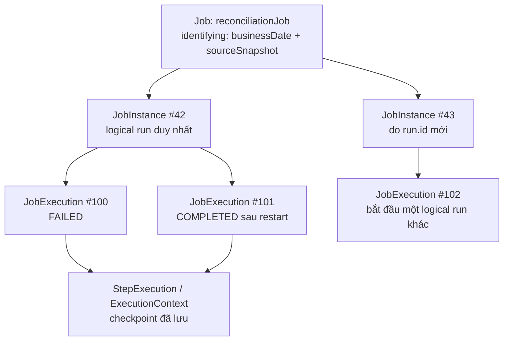
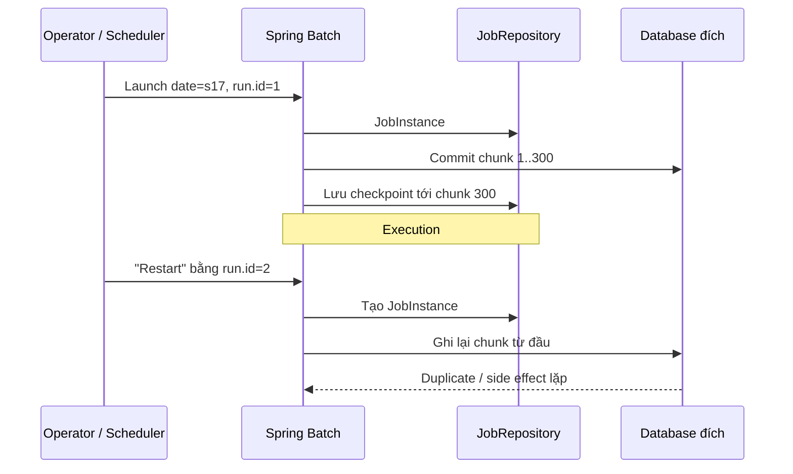
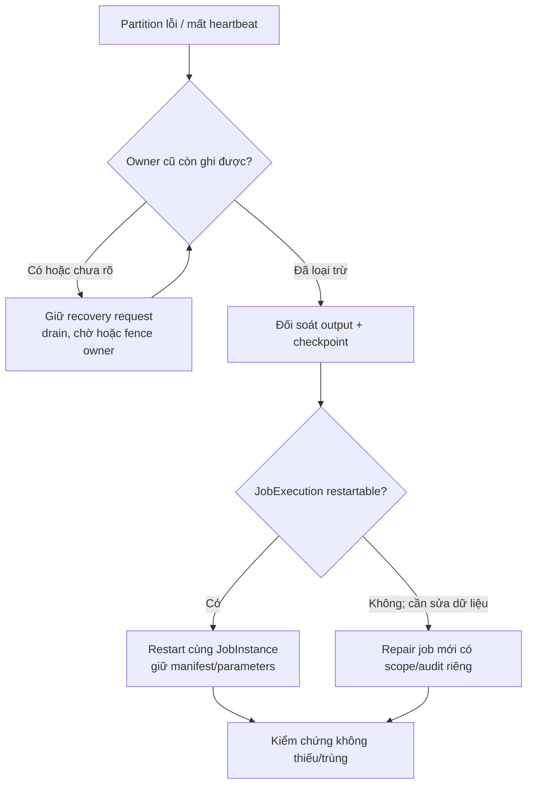

# Anti-pattern: Restart bằng cách tạo JobInstance mới trong Spring Batch

## 1. Tình huống: một lần chạy lỗi bị biến thành công việc mới

Trong module **SPRING_BATCH_SCALING_OPERATIONS**, chúng ta mở rộng Spring Batch để xử lý dữ liệu lớn bằng multi-threaded step, parallel steps, partitioning và các mô hình phân tán. Khi workload chạy hàng giờ, có nhiều chunk đã commit và nhiều partition đã hoàn tất, **restart an toàn** là một phần của thiết kế kiến trúc, không chỉ là thao tác vận hành sau sự cố.

Một anti-pattern dễ gặp là: job thất bại, operator hoặc scheduler tăng `run.id`/gán một timestamp mới, rồi gọi lại `JobLauncher`. Lệnh chạy mới khởi động thành công nên được xem như đã “restart”. Thực ra, nếu thay **identifying `JobParameters`**, Spring Batch tạo **`JobInstance` mới**: hệ thống có thể không sử dụng checkpoint và lịch sử step của logical run cũ.

Giả sử một job đối soát 12 triệu giao dịch chia thành 12 partition. Lần chạy đầu có 11 partition `COMPLETED`, partition cuối `FAILED` sau khi commit được 300.000 giao dịch. Operator tạo `run.id=2` để chạy lại. Kết quả có thể là:

- Cả 12 partition lại được cấp việc, thay vì chỉ xử lý phần còn thiếu của partition lỗi.
- Writer gặp lỗi unique key, hoặc tệ hơn tạo thêm giao dịch/notification ở hệ thống đích không có cơ chế deduplication.
- JobRepository hiển thị một `JobInstance` cũ `FAILED` và một instance mới `COMPLETED`, khiến việc đối soát cùng một yêu cầu nghiệp vụ trở nên mơ hồ.
- Chi phí CPU, database connection, I/O, queue và thời gian chạy tăng mạnh; nhiều worker tranh tài nguyên với các job đang xử lý.
- Nguyên nhân lỗi ban đầu vẫn chưa được giải quyết. Nếu đó là lỗi logic dữ liệu, chạy instance mới chỉ lặp lại vấn đề.

**Mục tiêu bài học:** nhận diện anti-pattern, hiểu chính xác sự khác nhau giữa restart và new run, chọn quy trình khôi phục có kiểm soát, và chứng minh rằng các lần thử lại không gây thiếu/trùng dữ liệu.

## 2. Nền tảng: JobInstance, JobExecution và checkpoint

Ba khái niệm dễ bị nhầm:

| Khái niệm | Định danh / vòng đời | Ý nghĩa trong vận hành |
| --- | --- | --- |
| **`JobInstance`** | Được xác định bởi `jobName` và tập **identifying `JobParameters`** | Đại diện một logical job, ví dụ đối soát ngày 26/11 cho bộ dữ liệu cụ thể |
| **`JobExecution`** | Một lần cố gắng thực thi `JobInstance` | Một instance có thể có nhiều execution sau các lần restart |
| **`StepExecution` + `ExecutionContext`** | Metadata trạng thái step, commit, vị trí đọc và thông tin restart khi được lưu đúng | Giúp step tiếp tục từ checkpoint phù hợp |

Hình dung:



**Restart đúng** nghĩa là tạo `JobExecution` mới cho **cùng `JobInstance`** khi trạng thái và cấu hình cho phép. Các bước đã hoàn tất có thể được bỏ qua, những bước thất bại có thể chạy tiếp từ trạng thái được lưu. **Chạy một `JobInstance` mới** là một yêu cầu nghiệp vụ khác, dù dùng cùng `Job` class và đọc lại cùng file dữ liệu.

Ví dụ:

| Lần chạy | `jobName` | Identifying parameters | Instance | Execution | Diễn giải |
| --- | --- | --- | --- | --- | --- |
| Lần đầu | `reconciliationJob` | `date=2026-11-26`, `snapshot=s17` | `#42` | `#100` | Chạy đầu, lỗi |
| Restart đúng | `reconciliationJob` | `date=2026-11-26`, `snapshot=s17` | `#42` | `#101` | Tiếp tục logical job cũ |
| Anti-pattern | `reconciliationJob` | `date=2026-11-26`, `snapshot=s17`, `run.id=2` | `#43` | `#102` | Job mới, lịch sử checkpoint khác |

Lưu ý: `JobParameters` có cờ **identifying** theo từng tham số. Chỉ giá trị identifying tham gia định danh `JobInstance`; tham số non-identifying có thể khác giữa các execution nhưng điều đó **không đồng nghĩa** dữ liệu nguồn, cấu hình và hành vi restart được phép thay đổi tùy ý.

## 3. Mẫu code sai: tăng run.id để vượt qua trạng thái lỗi

Ví dụ này minh họa anti-pattern, **không nên triển khai**:

```java
// SAI: Cùng một request nghiệp vụ nhưng luôn tạo định danh JobInstance mới.
JobParameters parameters = new JobParametersBuilder()
    .addString("businessDate", "2026-11-26", true)
    .addString("sourceSnapshot", "s17", true)
    .addLong("run.id", System.currentTimeMillis(), true)
    .toJobParameters();

jobLauncher.run(reconciliationJob, parameters);
```

Vì `run.id` là identifying và đổi mỗi lần gọi, mỗi lần nhận lại request có thể trở thành một `JobInstance` khác. Nếu retry phát sinh do timeout, mất ACK hoặc một worker restart, hệ thống sẽ tạo thêm công việc hoàn toàn mới.

Một biến thể phổ biến:

```java
@Bean
Job reconciliationJob(JobRepository repository, Step processingStep) {
    return new JobBuilder("reconciliationJob", repository)
        .incrementer(new RunIdIncrementer())
        .start(processingStep)
        .build();
}
```

`RunIdIncrementer` **không tự động làm mọi lần gọi `JobLauncher.run(...)` trở thành job mới**. Nó được dùng khi cơ chế gọi chủ động lấy bộ tham số kế tiếp, chẳng hạn `JobOperator.startNextInstance(...)` ở các phiên bản hỗ trợ API đó. Anti-pattern nằm ở việc dùng chức năng **khởi tạo instance kế tiếp** để thay cho **restart execution thất bại**.

Các dấu hiệu trong code và vận hành:

- Xử lý `JobInstanceAlreadyCompleteException`, `JobExecutionAlreadyRunningException` hoặc `JobRestartException` bằng cách cộng `run.id` rồi gọi lại.
- Khi gặp lỗi, scheduler tăng timestamp hoặc UUID trong identifying parameters mà không xét logical request.
- Code catch tất cả lỗi của `JobLauncher.run` và luôn launch một instance mới.
- Các job chạy cùng ngày có nhiều `JobInstance` khác nhau nhưng cùng source snapshot, cùng tập bản ghi đầu ra.
- Dashboard báo nhiều instance `COMPLETED` cho một yêu cầu, trong khi instance gốc vẫn `FAILED`/`STARTED`.

**Không có bảo đảm exactly-once chỉ từ JobRepository**. Kho metadata giúp điều phối restart nhưng không thay thế ràng buộc unique, idempotency và đối soát ở hệ thống đích.

## 4. Vì sao tạo JobInstance mới khiến checkpoint bị bỏ qua?

Trong chunk-oriented step, Spring Batch có thể ghi tiến độ tại các ranh giới transaction vào `StepExecution` và `ExecutionContext`. Với reader/writer hỗ trợ `ItemStream` và được cấu hình lưu state, framework có thể phục hồi vị trí đọc, trạng thái step và dữ liệu phụ trợ cho cùng `JobInstance`.

Một instance mới không kế thừa mặc định `StepExecution` của instance cũ. Kết quả: những bước trước đã `COMPLETED` có thể chạy lại, reader có thể quay về đầu và partitioner có thể tạo lại đầy đủ danh sách partition.



Đây là một *mô hình rủi ro*, không khẳng định mọi writer luôn ghi trùng: nếu đích có unique key và UPSERT hợp lý, dữ liệu có thể không bị nhân đôi. Nhưng việc tạo instance mới vẫn có thể gây hao tài nguyên, tạo retry không dự kiến, hoặc làm sai audit/đếm số lần chạy.

### Cần hiểu ranh giới transaction

Ngay cả với **restart đúng**, một item vẫn có thể được đọc/ghi lại nếu:

1. Writer đã gửi side effect sang API ngoài nhưng process chết trước khi lưu checkpoint.
2. Dữ liệu nghiệp vụ và Batch metadata dùng transaction manager khác nhau, không commit nguyên tử.
3. Reader không lưu vị trí hoặc không bảo đảm thứ tự và dữ liệu nguồn ổn định.
4. Worker xử lý partition gửi reply nhưng manager mất kết nối, không ghi nhận kết quả.

Vì vậy restart đúng là điều kiện cần để tận dụng checkpoint, còn **idempotency và khả năng đối soát dữ liệu** là điều kiện bổ sung để vận hành an toàn.

## 5. Ví dụ đúng: giữ danh tính và restart cùng JobInstance

Thiết kế một `requestId` nghiệp vụ ổn định: cùng yêu cầu luôn ánh xạ về cùng logical run. Với job đối soát theo ngày và snapshot:

```java
JobParameters parameters = new JobParametersBuilder()
    .addString("requestId", requestId, true)
    .addString("businessDate", businessDate, true)
    .addString("sourceSnapshot", sourceSnapshotId, true)
    .toJobParameters();

JobExecution execution = jobLauncher.run(reconciliationJob, parameters);
```

Đoạn code là ví dụ cách **khởi chạy hoặc chạy lại cùng instance qua cùng identifying parameters**, không phải toàn bộ service điều phối. Trong thực tế phải kiểm tra trạng thái trước khi gọi và xử lý các ngoại lệ race/terminal. `requestId`, `businessDate` và `sourceSnapshotId` phải lấy từ request đã lưu bền vững, không được thay đổi theo thời gian retry.

Đối với execution đã thất bại, một cơ chế rõ nghĩa hơn là:

```java
// Đã xác minh execution này thuộc request cần phục hồi, status restartable,
// owner cũ không còn chạy và step/reader/writer hỗ trợ restart.
Long newExecutionId = jobOperator.restart(failedExecutionId);
```

`JobOperator.restart(...)` yêu cầu framework restart job từ **execution trước đó**; API, kiểu dữ liệu trả về và tập exception có thể khác theo phiên bản Spring Batch. Phải xác định `failedExecutionId` qua `JobExplorer`/kho metadata và validate permission/ownership, không nhận tùy tiện một ID từ người gọi.

Không gọi `JobOperator.startNextInstance(...)` khi ý định là **khôi phục instance cũ**: tính năng đó dành cho **instance tiếp theo**, thường gắn với `JobParametersIncrementer`. Việc có một API launch mới tiện dụng không làm thay đổi phân biệt logical run.

### Chính sách theo trạng thái execution

| Trạng thái Spring Batch | Hướng xử lý |
| --- | --- |
| `COMPLETED` | Trả lại kết quả cũ cho cùng request; chỉ chạy mới khi nghiệp vụ tạo logical request mới có chủ đích. |
| `FAILED` | Kiểm tra nguyên nhân, checkpoint, khả năng restart và owner rồi restart cùng instance nếu hợp lệ. |
| `STOPPED` | Có thể restart khi job/step cho phép, sau khi đảm bảo đã dừng thật. |
| `STARTING`, `STARTED`, `STOPPING` | Không khởi động execution song song; xác minh process, task, trạng thái và xử lý dừng/stale execution theo runbook. |
| `UNKNOWN`, `ABANDONED` | Cách ly, điều tra và xác định chính sách xử lý riêng; không ép restart bừa bãi. |

Một `JobInstance` đã hoàn tất thường không cho chạy lại bình thường với cùng identifying parameters. Nếu caller báo `JobInstanceAlreadyCompleteException`, đó có thể là **bằng chứng cần tra kết quả cũ** chứ không phải lý do tăng `run.id`.

## 6. Kịch bản chi tiết: restart partition thất bại

Giả sử `reconciliationJob` cho `requestId=rc-20261126`, snapshot `s17`, tạo manifest 12 partition:

| Partition | Trạng thái execution đầu | Dữ liệu đã ghi |
| --- | --- | --- |
| `p-00` đến `p-10` | `COMPLETED` | Đủ theo phạm vi, đã commit |
| `p-11` | `FAILED` | Commit được một phần, chunk sau rollback |

Nếu khởi động instance mới:

- Mỗi partition có thể được coi như công việc lần đầu; 11 partition hoàn tất cũng có thể được điều phối lại.
- Phân vùng mới được tính theo dữ liệu nguồn hiện hành có thể khác phạm vi cũ nếu dataset đã tăng.
- Các key nghiệp vụ đã ghi có thể tạo duplicate/conflict; một thao tác có tác dụng ngoài DB có thể bị gọi lần nữa.
- Việc kiểm toán “job gốc đã hoàn tất hay chưa?” không có câu trả lời đơn nhất.

Với restart cùng instance, trong cấu hình partitioning hỗ trợ restart, Spring Batch dựa vào metadata `StepExecution` và `ExecutionContext` để nhận ra phần đã hoàn thành và quyết định phần nào chạy tiếp. Tuy nhiên điều này chỉ đáng tin nếu **partition name, worker step name, tập partition, snapshot và context vẫn tương thích**.

Nên giữ một partition manifest bất biến cho logical run:

```yaml
# Manifest do ứng dụng quản lý, không phải file YAML của Spring Batch.
requestId: rc-20261126
sourceSnapshot: s17
partitionVersion: v1
partitions:
  - key: p-00
    fromId: 1
    toIdExclusive: 1000001
  - key: p-01
    fromId: 1000001
    toIdExclusive: 2000001
  # ... các partition tiếp theo
  - key: p-11
    fromId: 11000001
    toIdExclusive: 12000001
```

Khi restart, `Partitioner` nên dùng **cùng manifest được chốt**. Đừng tự đổi `gridSize`, tính lại `MAX(id)` rồi sinh tên/range mới cho các partition của instance cũ. Với remote partitioning, manager và worker phải cùng hiểu step identity/context; với multi-threaded step, mỗi reader/writer cần an toàn đa luồng hoặc có instance/state riêng.

### Anti-pattern liên quan: “rerun một partition” bằng instance mới

Tạo một JobInstance mới với filter `partition=p-11` có thể phù hợp **chỉ khi đó thực sự là một repair job riêng**, được đặt tên, định danh và audit là yêu cầu xử lý mới. Không gọi nó là restart chuẩn của logical job gốc: kết quả mới không tự làm `JobInstance` cũ chuyển `COMPLETED`, và có thể cần quy trình bù dữ liệu/hợp nhất kết quả.

## 7. Tác động trong remote chunking và remote partitioning

Khi Spring Batch scale ra nhiều tiến trình, việc tạo instance mới còn có thể làm chồng lấn quyền sở hữu công việc.

### Remote partitioning

Manager A mất heartbeat từ worker cũ ở partition `p-11`. Manager hoặc scheduler vội tạo JobInstance mới. Worker cũ có thể **vẫn đang ghi DB** dù mất kết nối manager. Một worker mới nhận partition của instance mới và cùng ghi vùng dữ liệu đó.

Các rủi ro:

- Có hai chủ thể thao tác cùng khóa nghiệp vụ mà không có coordination.
- Reply muộn của worker cũ có thể tới sau khi logical job mới đã tiến triển.
- `StepExecution` của instance cũ và mới đều có thể ghi trạng thái nhưng không giải thích được tác dụng phụ ở đích.
- Thao tác requeue partition khi không có fencing tạo ra split-brain.

Giải pháp phải bắt đầu bằng **owner/lease/fencing**. Một lease hết hạn chưa đủ khi worker cũ có thể tiếp tục ghi; cần xác nhận worker cũ bị loại trừ khỏi đường ghi hoặc dùng fencing token được hệ thống đích kiểm tra trong transaction.



### Remote chunking

Trong remote chunking, một chunk có thể được worker ghi thành công nhưng reply/ACK thất lạc. Scheduler tạo instance mới và gửi toàn bộ tập dữ liệu lại, làm khả năng side effect lặp tăng mạnh. Durable broker chỉ bảo đảm message được lưu/giao theo cấu hình, **không tự chứng minh exactly-once ở dữ liệu đích**.

Cần sử dụng correlation ID bền vững, idempotency key ổn định theo logical item/chunk, ACK theo giao thức và đối soát reply trễ. Khi manager đổi phiên bản giữa lần lỗi và restart, giữ khả năng đọc message/`ExecutionContext` cũ trước khi reassign.

## 8. Idempotency: chốt an toàn ở ranh giới ghi

Một restart cùng instance vẫn có thể thử lại chunk; vì vậy writer phải chịu được lặp theo chính sách nghiệp vụ.

Ví dụ bảng kết quả có ràng buộc:

```sql
-- Lược đồ minh họa; tên cột/kiểu dữ liệu theo ứng dụng.
CREATE TABLE reconciliation_result (
    request_id       VARCHAR(100) NOT NULL,
    transaction_id   BIGINT NOT NULL,
    result_value     DECIMAL(18, 2) NOT NULL,
    processed_at     TIMESTAMP NOT NULL,
    PRIMARY KEY (request_id, transaction_id)
);
```

Với database hỗ trợ UPSERT, writer có thể sử dụng quy tắc:

```sql
-- Cú pháp minh họa theo PostgreSQL; chỉ phù hợp nếu ghi lặp
-- cùng logical request phải có cùng kết quả nghiệp vụ.
INSERT INTO reconciliation_result (
    request_id, transaction_id, result_value, processed_at
) VALUES (
    :request_id, :transaction_id, :result_value, CURRENT_TIMESTAMP
)
ON CONFLICT (request_id, transaction_id)
DO UPDATE SET result_value = EXCLUDED.result_value;
```

Nếu kết quả cho cùng request **không được thay đổi**, nên phát hiện sai khác hoặc chọn chính sách `DO NOTHING` có đối soát, thay vì âm thầm ghi đè giá trị. Với ghi tiền, phát hành hóa đơn, gửi email, thanh toán hoặc tích hợp không hỗ trợ transaction chung, phải dùng khóa nghiệp vụ, idempotency endpoint, outbox/inbox hoặc quy trình compensation thích hợp.

**Đừng dùng `JobExecutionId` mới làm khóa dedup duy nhất** nếu yêu cầu là không xử lý lặp cùng một transaction nghiệp vụ giữa các lần restart: mỗi restart tạo `JobExecution` khác nhau. Cũng không nên lấy `run.id` tăng dần làm khóa dedup cho cùng một logical request, vì chính nó làm mất khả năng nhận biết bản ghi trùng.

Đối với audit, nên lưu cả `requestId`, `jobInstanceId`, `jobExecutionId`, `attemptId` và output version theo vai trò riêng, tránh nhầm định danh logical job với định danh lần thử.

## 9. Khi nào tạo JobInstance mới lại là đúng?

Không phải việc tạo instance mới luôn sai. Nó **đúng** khi có một yêu cầu nghiệp vụ mới hoặc một lần xử lý lại có chủ đích với hợp đồng kết quả khác.

| Ý định | Định danh phù hợp | Chiến lược |
| --- | --- | --- |
| Job cũ `FAILED`, muốn tiếp tục phần chưa xong | **Cùng** identifying params, cùng JobInstance | Restart có kiểm tra trạng thái, checkpoint và owner |
| Caller timeout nhưng job thực tế `COMPLETED` | Cùng `requestId`, trả lại kết quả đã lưu | Không launch thêm |
| Chạy đối soát cho **ngày khác** | Business date/snapshot mới là identifying | JobInstance mới |
| Chạy lại một ngày với **nguồn dữ liệu đã thay đổi có chủ đích** | `sourceVersion` hoặc `requestId` mới theo hợp đồng nghiệp vụ | New run có đối soát kết quả cũ và version output |
| Sửa công thức tính cho một phần kết quả đã `COMPLETED` | `repairId`, scope và logic version mới | Repair job riêng; không giả làm restart |
| Dữ liệu lỗi không restartable, cần chạy lại toàn bộ | New run chỉ sau khi có policy bù trừ/xóa hoặc version output an toàn | Rerun có kiểm soát, không tự động vì exception |

Nói cách khác, khi tạo instance mới, hệ thống phải trả lời được: **đây là yêu cầu nào, kết quả nào là nguồn sự thật, dữ liệu cũ xử lý ra sao và ai/điều gì cho phép thực thi lại?**

### Cẩn trọng với JobParameters non-identifying

Không nên dùng một tập identifying parameters quá ít như chỉ `businessDate` khi thực tế một ngày có nhiều nguồn hoặc vùng cần chạy riêng. Ngược lại, không nên biến mọi tham số kỹ thuật như timestamp, pod ID, attempt ID hay manager version thành identifying. Tập định danh phải phản ánh **logical run bất biến**; những thông số triển khai có thể đặt trong audit/ledger. Thay `sourceUri` ở non-identifying parameters để trỏ sang nguồn khác khi restart có thể làm checkpoint sai dù JobInstance không đổi.

## 10. Thiết kế launcher và scheduler tránh anti-pattern

Một launcher production nên có **request ledger** bền vững, với unique constraint theo `requestId`, lưu identifying parameters và liên kết tới `JobInstance`/`JobExecution`. Khi nhận lại cùng request do retry HTTP, scheduler hoặc broker:

1. Tìm request đã tiếp nhận. Nếu chưa có, tạo bản ghi mới và chốt identifying parameters/source snapshot.
2. Tra trạng thái execution gần nhất từ `JobExplorer`/`JobRepository` (và ownership ở hệ phân tán).
3. Nếu đang chạy hợp lệ, trả trạng thái hiện tại, **không launch instance khác**.
4. Nếu `COMPLETED`, trả kết quả gốc; nếu `FAILED`/`STOPPED`, xét policy restart, checkpoint và side effect.
5. Nếu trạng thái stale hoặc chưa rõ, đưa vào recovery queue có lock/lease, cảnh báo và đối soát.
6. Chỉ khởi tạo logical run mới khi nhận được request nghiệp vụ mới có định danh rõ ràng.

Pseudocode:

```text
onRequest(requestId):
    request = ledger.findOrCreateAtomically(requestId, immutableParameters)
    execution = repository.findLatestExecution(request.jobInstanceIdentity)

    if execution == COMPLETED:
        return priorResult(requestId)
    if execution is actively owned:
        return currentStatus(requestId)
    if execution == FAILED or execution == STOPPED:
        assertRestartPolicyAndDataSafety()
        withDurableRecoveryClaim(requestId):
            restartSameJobInstance()
        return acceptedRecovery()
    if execution is STARTED/STOPPING but owner missing:
        quarantineAndReconcileStaleExecution()
        return recoveryPending()
    return manualReview()
```

Các lời gọi trên là **pseudocode ứng dụng**, không phải method mặc định tên `findOrCreateAtomically` hay `restartSameJobInstance` của Spring Batch. Cần điều phối race giữa các replica launcher, xác thực trạng thái từ JobRepository và dùng cơ chế claim/unique constraint thực tế.

Không ACK request/message đầu vào khi chỉ mới ghi vào RAM. Nếu request đã được chấp nhận, cần có bản ghi bền vững và reconciler để khôi phục trường hợp process chết ngay sau khi launch hoặc trước khi nhận phản hồi.

## 11. Trạng thái STARTED mắc kẹt: không dùng instance mới để lách

Một pod bị kill có thể làm `JobExecution` vẫn hiện `STARTED` hoặc `STOPPING`, mặc dù process thực tế đã chết. Nếu gọi restart ngay, Spring Batch có thể từ chối vì repository cho rằng execution vẫn chạy. Một cách “lách” phổ biến là tạo `run.id` khác; đây chính là tình huống nguy hiểm nhất.

Runbook xử lý:

- Xác nhận JobInstance, execution ID, trạng thái trong repository, log cuối, thời gian cập nhật và vị trí checkpoint.
- Đối chiếu trạng thái pod, JVM, broker, worker/partition owner, lease và hệ thống đích; thiếu heartbeat **chưa** có nghĩa worker không ghi được.
- Đóng admission hoặc dispatch trùng; đảm bảo owner cũ bị dừng/fenced trước khi recovery.
- So sánh output đã commit với checkpoint; ghi nhận các side effect không nằm trong transaction của Batch metadata.
- Thực hiện **stale-execution recovery** theo phiên bản framework và công cụ/runbook được tổ chức hỗ trợ, có audit; không cập nhật SQL thủ công như thao tác mặc định.
- Sau khi trạng thái hợp lệ và có quyền sở hữu duy nhất, restart cùng `JobInstance` khi framework cho phép.

`JobOperator.stop(executionId)` là yêu cầu **dừng hợp tác**, không tự kill được mọi job ở process khác. `JobOperator.restart(executionId)` không nên được gọi với execution vẫn thật sự đang chạy. Với trạng thái `UNKNOWN`/`ABANDONED`, cần quy trình chuyên biệt chứ không chuyển tùy tiện sang `FAILED`.

## 12. Phát hiện anti-pattern trong metadata và dashboard

Các dấu hiệu quan sát:

| Dấu hiệu | Câu hỏi cần điều tra |
| --- | --- |
| Nhiều JobInstance của cùng một ngày/snapshot, chỉ khác `run.id` | Có dùng launch-next-instance để “retry” không? |
| Instance mới chạy lại mọi partition đã hoàn thành | Có mất tên partition/context hoặc đổi instance không? |
| `writeCount` tăng nhưng số bản ghi đích không tăng | Writer có đang conflict/UPSERT lặp dữ liệu không? |
| Duplicate API side effect hoặc outbound message tăng sau restart | Khóa idempotency có vô tình gắn với `run.id`/execution ID không? |
| Instance cũ `FAILED` mãi, instance mới `COMPLETED` | Ai xác nhận logical request đã hoàn tất và instance cũ được giải quyết thế nào? |
| DB pool/queue lag tăng đột biến sau lỗi | Có nhiều instance cùng xử lý tập dữ liệu không? |
| JobInstance mới có source snapshot khác nhưng cùng `requestId` | Yêu cầu có bị đổi dữ liệu nguồn giữa các lần thử không? |

Ví dụ truy vấn **chỉ đọc** để quan sát lịch sử (schema/cột phụ thuộc phiên bản Spring Batch và database):

```sql
SELECT ji.JOB_INSTANCE_ID,
       ji.JOB_NAME,
       ji.JOB_KEY,
       je.JOB_EXECUTION_ID,
       je.STATUS,
       je.EXIT_CODE,
       je.START_TIME,
       je.END_TIME
FROM BATCH_JOB_INSTANCE ji
JOIN BATCH_JOB_EXECUTION je
  ON je.JOB_INSTANCE_ID = ji.JOB_INSTANCE_ID
WHERE ji.JOB_NAME = :job_name
ORDER BY ji.JOB_INSTANCE_ID DESC, je.JOB_EXECUTION_ID DESC;
```

`JOB_KEY` giúp thấy các instance khác nhau nhưng không tự giải thích tham số nào đã thay đổi; cần đọc identifying parameters bằng API chính thức hoặc bảng metadata tương ứng với version. Khi ghép với request ledger, có thể xác định một yêu cầu nghiệp vụ bị tách làm nhiều instance ngoài ý muốn.

Metric nên theo dõi: số accepted request chưa terminal, JobInstance count trên mỗi nhóm logical request, JobExecution theo `BatchStatus`, restart attempts, số partition `COMPLETED` bị xử lý lại ngoài dự kiến, duplicate-key conflict, chunk rollback, throughput, DB connections và queue lag. Với metrics, tránh dùng mọi `requestId` làm label có cardinality lớn; để chi tiết trong log/tracing/audit.

## 13. Kiểm thử để ngăn tái diễn

Thử nghiệm thực tế cần tạo đúng tình huống **đã có checkpoint rồi lỗi**. Chạy tất cả test trên nguồn dữ liệu có snapshot cố định và đầu ra có khóa nghiệp vụ để đo không thiếu/trùng.

| Test | Cách thực hiện | Tiêu chí pass |
| --- | --- | --- |
| Retry request trùng | Gửi cùng `requestId` đồng thời từ hai launcher | Một logical JobInstance; không có hai execution cùng ghi |
| Crash giữa chunk | Kill worker sau vài lần commit | Restart cùng instance, đầu ra hoàn chỉnh, không side effect trùng |
| 11 partition hoàn tất, 1 partition lỗi | Restart failed execution | Không chạy lại 11 partition ngoài ý định; partition lỗi resume an toàn |
| Mất reply sau commit | Chặn broker reply rồi cho retry | Duplicate reply/request không làm nhân đôi kết quả |
| Job đã `COMPLETED` nhưng client timeout | Gửi lại cùng request | Trả kết quả cũ; không sinh `run.id` mới |
| Pod chết, metadata `STARTED` | Mô phỏng worker crash không graceful | Không tạo JobInstance để lách; recovery có đối soát/fencing |
| Nguồn dữ liệu thay đổi | Thêm bản ghi sau khi đã checkpoint | Restart dùng snapshot/manifest cũ, không lẫn dữ liệu mới |
| Hai worker cùng tranh partition | Giả lập lease hết hạn dù worker cũ còn ghi DB | Fencing chặn overlap; không double write |
| Writer HTTP trả timeout sau khi xử lý | Gửi lại item | Idempotency key ổn định, side effect chỉ được áp dụng theo policy |
| Reprocess có chủ đích | Tạo repair request với output version mới | Có JobInstance mới đúng nghĩa, audit/compensation rõ và không nhầm restart |
| Tải cao khi lỗi | Nhiều job/partition cùng retry | Retry budget, DB pool và worker concurrency vẫn trong giới hạn |

**Bất biến quan trọng cần assert tự động:**

1. Một logical `requestId` chỉ ánh xạ đến một `JobInstance` khi đang làm **restart**, ngoại trừ reprocess/repair được khai báo rõ.
2. Các lần restart có thể tăng **`JobExecution`**, nhưng không làm tăng `JobInstance` cho cùng logical run.
3. Tập partition và source snapshot của logical run không thay đổi qua restart.
4. Không có hai owner còn quyền ghi cùng partition tại một thời điểm.
5. Dữ liệu đích hoàn tất đúng tập khóa nghiệp vụ, không có gap hoặc side effect trùng ngoài policy.
6. Mỗi accepted request hoặc có kết quả terminal hoặc trạng thái recovery có thể truy vết; không bị bỏ quên ở trạng thái in-memory.

Một kiểm tra có giá trị lớn trong CI là tạo một run cố ý fail sau checkpoint, rồi gọi đúng **cơ chế retry dùng ở production**. Xác nhận `jobInstanceId` không đổi, `jobExecutionId` thay đổi, kết quả chính xác và không có duplicate side effect. Nếu test chỉ kiểm tra job cuối `COMPLETED`, nó có thể bỏ sót hoàn toàn anti-pattern.

## 14. Runbook xử lý sự cố đã lỡ tạo nhiều JobInstance

Khi phát hiện scheduler đã tạo nhiều instance cùng logical request, ưu tiên **giữ dữ liệu và ngăn xử lý chồng lấn**:

1. **Khoanh vùng:** tra request ledger, JobRepository, source snapshot, output keys, các instance/execution và worker owner liên quan.
2. **Chặn phát sinh mới:** tạm dừng auto-increment `run.id`/launch retry, khóa admission theo logical request; không xóa metadata để che lỗi.
3. **Kiểm soát worker:** xác định process, in-flight chunk, partition và lease; drain/fence những owner không còn được phép ghi.
4. **Đối soát side effect:** so sánh nguồn và đích theo business key; ghi nhận duplicate, gap, external effect và transaction chưa rõ kết quả.
5. **Chọn nguồn sự thật:** xác định JobInstance gốc, execution cần phục hồi hoặc repair run sẽ chịu trách nhiệm hoàn tất; ghi quyết định vận hành.
6. **Khôi phục:** nếu instance gốc restartable, dùng recovery chuẩn; nếu dữ liệu đã bị tác động ngoài giao dịch, thực hiện dedup/compensation/repair theo policy nghiệp vụ.
7. **Xác minh:** chạy checksum/count theo phạm vi, kiểm tra không còn owner trùng, trạng thái terminal và audit đầy đủ.
8. **Ngăn tái diễn:** sửa launcher, giữ identifying parameters cố định, bổ sung tests và cảnh báo. Chỉ mở lại auto-retry khi cơ chế mới đã được kiểm chứng.

Không tùy tiện xóa `BATCH_*` rows của JobInstance dư để “làm sạch” vì có thể phá liên kết lịch sử hoặc khiến job chạy lại không kiểm soát. Với tác dụng phụ không thể đảo ngược như thanh toán hoặc email, cần cơ chế đối soát và bù trừ riêng; một `JobExecution` báo `COMPLETED` không hoàn tác được chúng.

## 15. Những nhầm lẫn cần ghi nhớ

| Phát biểu sai | Vì sao sai | Điều đúng hơn |
| --- | --- | --- |
| “Cứ tăng `run.id` là restart.” | Identifying parameter mới tạo JobInstance khác | Restart cùng identifying parameters hoặc từ failed execution ID |
| “Job mới chạy xong thì job cũ coi như xong.” | Metadata và checkpoint của job cũ vẫn riêng | Cần đối soát logical request và trạng thái từng instance |
| “Chạy lại cùng file dữ liệu sẽ tự bỏ qua bản ghi cũ.” | Reader mới có thể đọc từ đầu; writer không mặc định dedup | Checkpoint + idempotency + snapshot cố định |
| “Có `JobRepository` nên tất cả external side effect exactly-once.” | DB transaction không tự bao trùm HTTP/broker/payment | Dùng idempotency/outbox và kiểm chứng đích |
| “`COMPLETED` mà muốn chạy lại thì chỉ việc đổi timestamp.” | Có thể tạo kết quả lặp ngoài ý định | Tạo new business run/repair có contract và audit |
| “Metadata còn `STARTED` nên phải tạo instance khác.” | Process có thể vẫn sống hoặc metadata stale | Fencing và stale-execution recovery trước khi restart |
| “Đổi `gridSize` không liên quan đến restart.” | Nếu partitioner tính lại tên/range thì có thể bỏ sót/trùng | Pin manifest/partition name cho logical run cũ |
| “Một JobExecutionId mới chứng minh xử lý lại an toàn.” | Execution mới là bình thường khi restart; phải giữ JobInstance | Đối chiếu instance identity, checkpoint và output |

## 16. Checklist thiết kế và vận hành

- [ ] Đã định nghĩa logical `requestId`, identifying `JobParameters` và điều kiện tạo **run mới**.
- [ ] Retry một request không tự sinh timestamp/UUID/`run.id` identifying khác.
- [ ] Có unique constraint/request ledger để chống hai launcher đồng thời nhận cùng logical request.
- [ ] `JobRepository` bền vững và có cơ chế đọc trạng thái execution, checkpoint, partition.
- [ ] Restart được gọi trên **cùng JobInstance**, và chỉ khi trạng thái/ownership cho phép.
- [ ] Không dùng `startNextInstance` hoặc `RunIdIncrementer` làm đường khôi phục job thất bại.
- [ ] Reader/writer hỗ trợ restart, xử lý `ExecutionContext` đúng và dữ liệu nguồn có snapshot/watermark cố định.
- [ ] Multi-threaded step/partitioner giữ thread safety, partition name và manifest bất biến qua restart.
- [ ] Remote worker có fencing/lease/ownership và giao thức ACK/reply/dedup rõ ràng.
- [ ] Writer bảo vệ idempotency cho database và cả hệ thống ngoài transaction của Batch metadata.
- [ ] Có runbook cho `STARTED`/`STOPPING` stale, `UNKNOWN`, crash và rollback mà không sửa trực tiếp metadata tùy tiện.
- [ ] Đã kiểm thử crash sau commit, mất reply, request lặp, partition lỗi và new run có chủ đích.
- [ ] Sau phục hồi, có đối soát output, kiểm tra không trùng business key và lưu audit đầy đủ.

## 17. Kết luận

**Restart bằng cách tạo `JobInstance` mới là anti-pattern** khi mục tiêu thật sự là tiếp tục một logical job đã thất bại. Nó phá ranh giới giữa **lần chạy nghiệp vụ** và **lần thử thực thi**, làm checkpoint cũ không được tận dụng đúng cách, có thể chạy lại toàn bộ step/partition và tạo side effect lặp trong hệ thống phân tán.

Trong Spring Batch, hãy giữ nguyên identifying parameters, xác minh trạng thái `JobExecution`, dùng cơ chế restart của framework trên cùng `JobInstance`, bảo vệ partition ownership và thiết kế writer idempotent. Chỉ tạo `JobInstance` mới khi có yêu cầu nghiệp vụ mới hoặc repair/reprocess được xác định rõ, có đối soát và audit. Đó là nền tảng để vận hành workload lớn có khả năng retry/restart mà vẫn kiểm soát tính đúng dữ liệu và tài nguyên.
