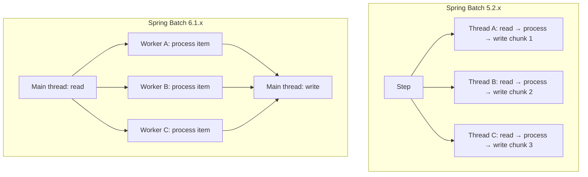
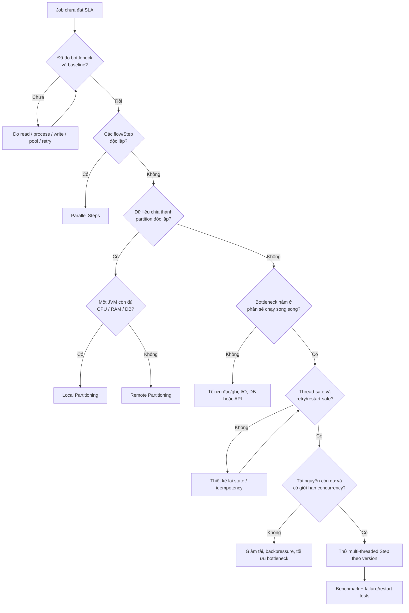

# Khi nào dùng multi-threaded Step trong Spring Batch?

Một batch job xử lý 20 triệu bản ghi mất bốn giờ. Người vận hành muốn giảm xuống một giờ. Có thể tăng số thread, nhưng **tăng concurrency chỉ có ích khi phần công việc được chạy song song là nút thắt thực sự, các component chịu được đồng thời và tài nguyên phía sau còn dư**. Nếu database đã chạm giới hạn I/O, API đích đang trả `429` hoặc reader giữ trạng thái không an toàn, tăng thread có thể khiến job chậm hơn và khó restart hơn.

Đây là bài học **Khi nào dùng multi-threaded Step** thuộc chương **Ma trận lựa chọn** của module **SPRING_BATCH_SCALING_OPERATIONS**. Bài đưa ra tiêu chí quyết định giữa multi-threaded step, parallel steps, local chunking, local/remote partitioning và remote chunking, gắn với phép đo nút thắt, thread safety, retry/restart, cách vận hành và giới hạn tài nguyên. Trọng tâm là **chọn phương án nhỏ nhất giải quyết đúng bottleneck**, sau đó kiểm chứng bằng dữ liệu.

> **Lưu ý về phiên bản:** Spring Batch **5.2.x** và **6.1.x** có khác biệt quan trọng về cơ chế multi-threaded step. Trong 5.2.x, các chunk có thể được đọc, xử lý và ghi trên các luồng khác nhau. Theo tài liệu 6.1.x, reader và writer của multi-threaded step vẫn chạy tuần tự trên thread chính, còn các lời gọi `ItemProcessor` có thể chạy song song trên worker threads. Không dùng ma trận quyết định hoặc code cấu hình của phiên bản này để suy diễn hành vi của phiên bản kia. Các ví dụ dưới đây ghi rõ phiên bản.

## 1. Câu trả lời nhanh: khi nào đáng chọn?

**Multi-threaded Step phù hợp nhất khi:**

1. Các item có thể xử lý độc lập, không cần thứ tự xử lý/hoàn tất chặt chẽ.
2. Có một bước với nhiều item, và **phần chạy song song được trong phiên bản đang dùng** chiếm phần lớn thời gian.
3. Processor cùng các dependency được chia sẻ không có race condition; đối với 5.2.x, reader và writer cũng phải được kiểm tra đặc biệt.
4. Có tài nguyên thực sự còn trống: CPU, connection pool, băng thông I/O, quota API, lock và khả năng ghi đích.
5. Có cơ chế giới hạn số công việc đang chạy/đang chờ; retry, rollback và restart đã được thử nghiệm.
6. Muốn tận dụng thêm năng lực **trong cùng một JVM**, không cần vận hành broker hoặc cụm worker phân tán.

**Chưa nên chọn** nếu job tuần tự đã đạt SLA, nếu bottleneck nằm ở một công đoạn vẫn tuần tự, nếu kết quả bắt buộc giữ thứ tự tuyệt đối, hoặc nếu việc chia dữ liệu thành những partition độc lập mới là cách tận dụng song song an toàn. Đặc biệt với 6.1.x, một writer rất chậm thường là lý do **không** chọn multi-threaded step để giải quyết writer bottleneck.

## 2. Phải biết mình đang dùng Spring Batch phiên bản nào

Từ "multi-threaded step" giữ nguyên nhưng ranh giới song song thay đổi theo phiên bản; điều này tác động trực tiếp tới khả năng tăng throughput, yêu cầu thread safety và transaction.

| Câu hỏi | Spring Batch 5.2.x | Spring Batch 6.1.x |
| --- | --- | --- |
| Công việc song song chủ yếu ở đâu? | Các **chunk** được thực hiện bằng những thread khác nhau, gồm các giai đoạn read/process/write của từng chunk | Các lời gọi **`ItemProcessor`** chạy song song; read/write được thực hiện tuần tự bởi thread chính |
| Component cần xem xét chia sẻ | Reader, processor, writer, listeners và dependencies trong cùng step | Processor và dependencies chia sẻ; reader/writer được gọi tuần tự theo mô hình được mô tả trong tài liệu 6.1 |
| Transaction | Chunk được xử lý trong mô hình transaction của step; phải kiểm thử tương tác đa luồng | Spring transaction gắn với thread; processor trên worker thread **không tham gia trực tiếp** transaction chunk trên thread chính |
| Nếu bottleneck là writer | Có thể hưởng lợi trong điều kiện writer/data store hỗ trợ ghi song song | Multi-threaded step không song song hóa writer; cân nhắc local chunking/partitioning |
| Cấu hình | `StepBuilder...chunk(size, transactionManager)...taskExecutor(...)` | `StepBuilder...chunk(size).transactionManager(transactionManager)...taskExecutor(...)` |
| `throttleLimit(...)` | Deprecated từ 5.0; tài liệu đề nghị `RepeatOperations` tùy chỉnh với bounded executor nếu cần thay thế | Không bê nguyên cách throttle trong ví dụ 5.2 sang 6.1; kiểm tra API và scheduler thực tế |

**Mô hình minh họa** (các hình dưới đây lược giản việc điều phối và transaction):



Trong **6.1.x**, một processor truy cập database với propagation `MANDATORY` có thể thất bại nếu nó giả định transaction chunk của thread chính đã có sẵn ở thread xử lý. Nếu processor cần transaction riêng, phải thiết kế transaction phù hợp và đánh giá hệ quả commit/rollback; nếu cần xử lý **nguyên chunk** đồng thời trong transaction riêng, hãy xem **local chunking** (tính năng được giới thiệu ở Spring Batch 6.0), trong đó delegate `ChunkProcessor` phải tự đảm trách phần fault tolerance/transaction tương ứng.

## 3. Đo bottleneck trước khi thêm luồng

Đặt câu hỏi: một item mất thời gian ở đâu? Phân loại thời gian thành **read**, **process**, **write**, **commit/repository**, **chờ tài nguyên** và **retry**. Đo với dữ liệu đại diện, cùng cấu hình transaction và đủ thời lượng để loại trừ startup/cache warm-up.

| Dấu hiệu từ baseline | Diễn giải cần kiểm tra | Hướng ưu tiên |
| --- | --- | --- |
| `process` chiếm phần lớn, CPU còn lõi rảnh | Processor có thể song song hóa nếu độc lập và thread-safe | **Multi-threaded step**, nhất là 6.1.x |
| `process` chủ yếu gọi API và chờ I/O | Có thể tăng in-flight có kiểm soát nếu quota cho phép | Multi-threaded step + giới hạn concurrency/rate, timeout |
| Reader/query mất nhiều thời gian, kết nối DB chờ lâu | Thêm thread xử lý không chữa được nguồn đọc | Tối ưu query/index, paging; cân nhắc partition theo khóa |
| Writer/commit là nút thắt | Phải xem writer và DB có chịu ghi song song không | Batch write, tối ưu transaction, local chunking/partitioning khi phù hợp |
| Hai phần xử lý độc lập thuộc các `Step` khác nhau | Không cần chia item trong cùng step | **Parallel steps** |
| Dữ liệu chia được thành dải ID/file/ngày độc lập | Mỗi partition có thể tự đọc và checkpoint | **Local partitioning**, rồi cân nhắc remote partitioning |
| Một JVM hết RAM/CPU dù downstream còn sức | Giới hạn máy, không chỉ thiếu thread | Remote partitioning/remote chunking tùy ranh giới đọc dữ liệu |
| API đích trả nhiều `429`/`503` hoặc DB lock tăng | Downstream đã quá tải | Giảm tốc phát, backpressure, retry backoff; chưa tăng thread |

### Một phép tính giới hạn tăng tốc

Giả sử bước xử lý tuần tự mất khoảng **100 ms/item**, trong đó đọc 10 ms, xử lý 75 ms, ghi 15 ms. Nếu chỉ 75% thời gian có thể song song hóa, mô hình gần đúng theo định luật **Amdahl** cho `N` worker:

```text
Speedup(N) ≤ 1 / ((1 - p) + p/N)

p = 0,75
N = 4: speedup ≤ 1 / (0,25 + 0,75/4) ≈ 2,29 lần
N = 8: speedup ≤ 1 / (0,25 + 0,75/8) ≈ 2,91 lần
N → ∞: trần lý thuyết 4 lần (khi 25% không song song)
```

Đây là **ước lượng đầu tiên**, không phải cam kết benchmark: thực tế có pipeline overlap, overhead điều phối, GC, connection wait và biến động latency. Trong 6.1.x, phân tích này nhắc rằng xử lý song song không làm giai đoạn đọc/ghi tuần tự biến mất. Trong 5.2.x, kết quả còn phụ thuộc khả năng đọc/ghi đồng thời và mức tranh chấp trên shared state.

Một phép ước lượng khác là `throughput ≈ số tác vụ đồng thời / latency tác vụ` **chỉ khi hệ thống ổn định và đủ việc**. Chẳng hạn 8 worker xử lý trung bình 0,2 giây/item có năng lực lý thuyết khoảng 40 item/giây ở giai đoạn đó; writer chỉ ghi được 25 item/giây thì throughput toàn job vẫn không thể vượt trần writer. Không dùng công thức này như lý do tăng worker vô hạn.

## 4. Ma trận quyết định: multi-threaded step hay mô hình khác?

Ma trận dưới đây là định hướng **trước khi đo thử nghiệm**. Mỗi hàng mô tả một tình huống có thể gặp; lựa chọn cuối cùng phải dựa trên số đo và phiên bản Spring Batch.

| Tình huống chính | Multi-threaded Step | Hướng thay thế đáng cân nhắc | Lý do quyết định |
| --- | --- | --- | --- |
| Processor nặng CPU; item độc lập; nhiều core; read/write nhanh | **Rất phù hợp** | Local partitioning nếu dữ liệu có ranh giới sẵn | Ít thành phần hạ tầng, mở rộng được đúng phần chậm |
| Processor gọi I/O chậm nhưng downstream còn quota | **Phù hợp có điều kiện** | Local chunking/remote chunking | Phải giới hạn in-flight và tránh retry storm |
| Reader stateful không thread-safe, dùng 5.2.x | **Cần thận trọng** | Reader wrapper đồng bộ nếu reader đủ nhanh; partitioning | Shared reader có thể gây trùng/bỏ sót item |
| Writer chậm, dùng 6.1.x | **Không giải quyết bottleneck** | Local chunking hoặc partitioning | Writer của multi-threaded step vẫn tuần tự |
| Cần xử lý nguyên chunk trong transaction riêng, dùng 6.1.x | **Không phải lựa chọn tự nhiên** | Local chunking có delegate quản lý transaction | Processor chạy worker thread không kế thừa transaction chunk |
| Dữ liệu tách được thành dải khóa/file độc lập | **Có thể dùng**, nhưng không ưu tiên mặc định | Local/remote partitioning | Phạm vi và checkpoint từng partition rõ hơn |
| Hai nhánh ETL độc lập, mỗi nhánh là step riêng | **Không cần** | Parallel steps | Tách công việc theo flow thay vì tạo concurrency trong một step |
| Một JVM không còn tài nguyên, cần thêm máy | **Không đủ** | Remote partitioning/remote chunking | Multi-threaded step chỉ tận dụng tài nguyên của một JVM |
| Đòi thứ tự kết quả hoặc side effect phụ thuộc item trước | **Thường không phù hợp** | Tuần tự, phân vùng có thứ tự cục bộ + bước sắp xếp/tổng hợp | Concurrency phá giả định về thứ tự và trạng thái liên item |
| Bước hiện tại đạt SLA và vận hành ổn | **Chưa cần** | Giữ tuần tự, đo giám sát | Tránh thêm độ phức tạp không có lợi ích được chứng minh |

**Ba câu hỏi loại trừ sớm:**

1. **Bottleneck có nằm trong phần sẽ chạy song song không?** Nếu không, đừng chọn chỉ vì step xử lý nhiều item.
2. **Có thể chạy cùng một item nhiều lần và nhiều item đồng thời mà kết quả vẫn đúng không?** Nếu chưa, hãy sửa thiết kế thread safety/idempotency trước.
3. **Tài nguyên chung có chịu được concurrency mới không?** Nếu downstream đang bão hòa, giới hạn phát mới quan trọng hơn thêm worker.

## 5. So sánh cách scale theo ranh giới công việc

Một quyết định tốt bắt đầu từ việc chọn **đơn vị nào có thể thực thi độc lập**: item, chunk, partition, step hay cả process.

| Cách scale | Đơn vị chạy song song | Hạ tầng | Ưu điểm | Đổi lại |
| --- | --- | --- | --- | --- |
| **Multi-threaded step (5.2.x)** | Chunk trong một step | Một JVM + executor | Thay đổi ít, không cần phân vùng dữ liệu | Reader/writer/processor dùng chung phải được kiểm tra; tranh chấp transaction/tài nguyên |
| **Multi-threaded step (6.1.x)** | Các lời gọi processor | Một JVM + executor | Thích hợp khi processor là đoạn chậm, reader/writer giữ đơn giản | Reader/writer vẫn tuần tự; processor worker thread không kế thừa transaction chunk |
| **Parallel steps** | Nhiều step/flow độc lập | Một JVM + executor | Phản ánh các nhiệm vụ riêng biệt, cấu trúc job rõ | Không tự chia một step lớn thành nhiều phần |
| **Local chunking (6.0+)** | Chunk đưa tới delegate trong nhiều thread | Một JVM + executor | Có thể đẩy xử lý cả chunk sang worker thread | Delegate chịu trách nhiệm transaction/fault tolerance; cần kiểm tra lifecycle executor |
| **Local partitioning** | `StepExecution` theo partition | Một JVM + `TaskExecutorPartitionHandler` | Ranh giới dữ liệu, context, checkpoint cho mỗi partition | Cần `Partitioner` đúng, tránh vùng dữ liệu giao nhau |
| **Remote partitioning** | `StepExecution` theo partition ở nhiều process | Broker/channel + repository chung + workers | Dễ thêm máy, mỗi worker tự đọc/ghi phạm vi được giao | Thêm điều phối, message, quan sát, version và vận hành phân tán |
| **Remote chunking** | Chunk gửi từ manager sang worker khác | Broker + workers + reply/commit design | Khi manager đọc nhanh, xử lý/ghi ở worker nặng | Manager có thể nghẽn tại reader, message chứa dữ liệu, phức tạp delivery/idempotency |

Đừng dùng remote chunking chỉ vì muốn chạy trên nhiều máy: nếu **reader** đã là nút thắt, manager đơn lẻ vẫn là giới hạn. Ngược lại, nếu dữ liệu có phân vùng rõ và từng worker có thể tự query, **remote partitioning** thường dễ phân bổ công suất đọc hơn. Cả hai vẫn yêu cầu đánh giá bảo đảm giao message, retry/restart và tác dụng phụ.

## 6. Cấu hình thử nghiệm cho Spring Batch 5.2.x

Ví dụ dưới đây tạo một step xử lý chunk kích thước 100 và gắn executor có số thread hữu hạn. Đây là **khung cấu hình minh họa cho 5.2.x**; giả định đã có các bean reader, processor, writer, JobRepository và transaction manager.

```java
@Bean
public ThreadPoolTaskExecutor batchTaskExecutor() {
    ThreadPoolTaskExecutor executor = new ThreadPoolTaskExecutor();
    executor.setCorePoolSize(4);
    executor.setMaxPoolSize(4);
    executor.setQueueCapacity(8);
    executor.setThreadNamePrefix("batch-chunk-");
    executor.initialize();
    return executor;
}

@Bean
public Step importStep(
        JobRepository jobRepository,
        PlatformTransactionManager transactionManager,
        ItemReader<InputRow> reader,
        ItemProcessor<InputRow, OutputRow> processor,
        ItemWriter<OutputRow> writer,
        @Qualifier("batchTaskExecutor") TaskExecutor taskExecutor) {

    return new StepBuilder("importStep", jobRepository)
            .<InputRow, OutputRow>chunk(100, transactionManager)
            .reader(reader)
            .processor(processor)
            .writer(writer)
            .taskExecutor(taskExecutor)
            .build();
}
```

`InputRow`/`OutputRow` đại diện cho model nghiệp vụ; import của các class Spring được lược bỏ. Cần xem cấu hình **`throttleLimit` mặc định và cơ chế `RepeatOperations`** của 5.2.x: tài liệu cho biết `throttleLimit` đã deprecated từ 5.0 và đề xuất dùng `StepBuilder#stepOperations` với một `RepeatOperations` tùy chỉnh dựa trên executor có queue hữu hạn khi muốn thay thế cơ chế throttle mặc định. Chỉ khai báo `setQueueCapacity(8)` không có nghĩa bản thân Spring Batch sẽ xử lý hết các tình huống queue đầy an toàn. Phải kiểm thử reject/timeout/fail, cancellation và restart.

### Điều kiện để ví dụ 5.2.x đúng

- Kiểm tra Javadoc và hành vi đồng thời của **reader, processor, writer, listener** và các dependency dùng chung. Nhiều reader/writer stateful không thích hợp để nhiều thread gọi trực tiếp.
- Nếu `ItemReader` không an toàn luồng, có thể cân nhắc `SynchronizedItemStreamReader` hoặc đồng bộ đoạn `read()`; nhưng việc đồng bộ có thể làm reader thành nút thắt và **không tự bảo đảm restart đúng** nếu thứ tự đọc/commit thay đổi.
- Không dựa vào thứ tự item hoặc chunk khi chạy đồng thời. Nếu nghiệp vụ cần thứ tự, phải định nghĩa cách tạo output/ghép lại theo khóa.
- Đặt kích thước pool trong giới hạn DB connections, I/O, quota API và bộ nhớ. Nhiều chunk có thể đang xử lý/rollback cùng lúc.
- Sau khi tăng số thread, thử lỗi giữa chunk, retry/skip, restart và so khớp **tập dữ liệu đã commit**, không chỉ kiểm tra job đạt `COMPLETED`.

## 7. Cấu hình thử nghiệm cho Spring Batch 6.1.x

Theo tài liệu 6.1.x, `TaskExecutor` hỗ trợ gọi `ItemProcessor` trên worker threads; reader/writer vẫn đi qua thread chính. Đoạn cấu hình sau thay đổi API giao dịch so với 5.2.x:

```java
@Bean
public Step transformStep(
        JobRepository jobRepository,
        PlatformTransactionManager transactionManager,
        ItemReader<InputRow> reader,
        ItemProcessor<InputRow, OutputRow> processor,
        ItemWriter<OutputRow> writer,
        @Qualifier("batchTaskExecutor") TaskExecutor taskExecutor) {

    return new StepBuilder("transformStep", jobRepository)
            .<InputRow, OutputRow>chunk(100)
            .transactionManager(transactionManager)
            .reader(reader)
            .processor(processor)
            .writer(writer)
            .taskExecutor(taskExecutor)
            .build();
}
```

`batchTaskExecutor` có thể dùng bean pool hữu hạn đã khai báo trong ví dụ 5.2.x; cơ chế gọi processor và xử lý kết quả khác với 5.2.x. Vì transaction gắn với thread, **processor worker thread không nằm trong transaction chunk của thread chính**. Do vậy:

- Tốt nhất processor thực hiện kiểm tra/tính toán/biến đổi **không có tác dụng phụ**; đầu vào và dependency phải an toàn khi gọi đồng thời.
- Nếu processor tự mở transaction hoặc gọi dịch vụ bên ngoài, cần phân biệt rõ thời điểm commit và điểm có thể retry sau lỗi; tránh ghi trùng bằng idempotency key/unique constraint/outbox phù hợp.
- Không trông chờ `TransactionSynchronizationManager` hoặc một `@Transactional(propagation = MANDATORY)` trong processor nhận transaction ở thread chính.
- Nếu reader hoặc writer là bottleneck, chọn phương án khác. Không kết luận 8 thread processor tương đương 8 writer.
- Việc đổi API hoặc nâng cấp framework phải được kiểm chứng bằng test tích hợp; không chỉ chạy lại benchmark rồi giả định semantics cũ.

**Ví dụ processor không trạng thái** cho cả hai phiên bản:

```java
record RawOrder(long id, BigDecimal gross, BigDecimal discount) {}
record NetOrder(long id, BigDecimal net) {}

public final class NetOrderProcessor
        implements ItemProcessor<RawOrder, NetOrder> {

    @Override
    public NetOrder process(RawOrder item) {
        BigDecimal net = item.gross().subtract(item.discount());
        if (net.signum() < 0) {
            throw new IllegalArgumentException("Invalid discount: " + item.id());
        }
        return new NetOrder(item.id(), net);
    }
}
```

`BigDecimal` là bất biến, biến `net` là cục bộ và mỗi lời gọi tạo một kết quả riêng. Đây là ví dụ dễ song song hóa **về mặt processor**; nhưng tính đúng đắn của cả job vẫn phụ thuộc reader/writer, transaction và nguồn dữ liệu. `@StepScope` **không mặc định tạo một processor riêng cho mỗi worker thread** trong cùng `StepExecution`.

## 8. Ngân sách tài nguyên và backpressure trước khi tăng concurrency

Không nên chọn số thread bằng cách lấy số bản ghi chia cho một con số cố định. Hãy lập ngân sách cho tài nguyên **dùng chung**, bao gồm các job chạy cùng lúc và ứng dụng trực tuyến trên cùng hạ tầng.

| Tài nguyên | Câu hỏi cần trả lời | Rủi ro khi vượt giới hạn |
| --- | --- | --- |
| CPU/core | Processor CPU-bound? Còn core thực tế sau khi dành cho OS và dịch vụ khác? | Context switch nhiều, CPU saturation, GC tăng |
| DB connection pool | Mỗi task đồng thời giữ bao nhiêu connection, trong bao lâu? | Chờ pool, timeout, lock giữ lâu |
| API quota | Tối đa request/giây và request đồng thời toàn cụm là bao nhiêu? | `429`/`503`, retry storm |
| RAM | Mỗi chunk và item tạm chiếm bao nhiêu bộ nhớ, có bao nhiêu chunk in-flight? | Queue phình, GC, OOM |
| Writer/downstream | DB có chịu thêm transaction/write contention không? | Throughput đứng yên, deadlock/rollback |
| JobRepository | Tốc độ ghi metadata/checkpoint và số step/chunk tác động ra sao? | Metadata trở thành bottleneck |

**Ví dụ ngân sách:** DB chỉ dành được tổng cộng 20 kết nối cho nhóm workload đang xét, các service khác cần giữ ít nhất 8, mỗi chunk worker tiêu thụ tối đa 1 kết nối ở một thời điểm. Mức trần suy ra từ DB là khoảng `20 − 8 = 12` worker đồng thời **trên toàn bộ các process cùng chia sẻ ngân sách kết nối đó**, chưa trừ chi phí metadata và connection khác. Nếu API đích chỉ chịu được 6 request đồng thời, giới hạn thực có thể là 6 hoặc thấp hơn. Đây là ước lượng đầu vào để đo, không phải số phải áp dụng bất biến.

Mỗi khi tăng thread, đo cả **số việc đã phát, số việc đang chờ, số việc đã commit**. Pool 4 worker với queue 8 chỉ đặt sức chứa cho executor, không tự tạo cơ chế backpressure an toàn giữa reader/step và producer. Khi queue đầy, phải định nghĩa rõ chờ, reject hoặc fail có thể restart; không được nuốt lỗi làm mất item. Với remote chunking/partitioning, ranh giới tương tự nằm ở broker queue, prefetch, consumer concurrency và tốc độ manager phát message.

## 9. Thread safety, retry và restart là điều kiện được duyệt trước

Tăng concurrency thay đổi lịch thực thi; những lỗi vốn bị che khuất trong step tuần tự có thể xuất hiện dưới tải thật.

| Hạng mục | Câu hỏi kiểm chứng |
| --- | --- |
| `ItemProcessor` | Có field `currentItem`, counter không nguyên tử, formatter/cache mutable, shared `EntityManager` hoặc side effect không idempotent không? |
| `ItemReader` (đặc biệt 5.2.x) | Cursor/paging/checkpoint có chịu được nhiều lời gọi đồng thời và rollback không? Có bỏ sót/đọc trùng item không? |
| `ItemWriter` (đặc biệt 5.2.x) | Dùng chung buffer/batch state có an toàn không? Concurrent updates gây lost update, deadlock, ghi sai thứ tự không? |
| Transaction | Phần xử lý nào nằm trong transaction, phần nào không, nhất là processor trên worker threads của 6.1.x? |
| Retry/skip | Một item có thể được `process` lại sau lỗi/rollback không? Có tác dụng phụ bị thực hiện hai lần không? |
| Restart | Sau khi JVM chết, reader context/partition progress có thể khôi phục và đầu ra không trùng không? |
| Side effect phân tán | DB unique constraint, idempotency key, outbox hoặc deduplication đã được thử khi redelivery chưa? |
| Ordering | Có yêu cầu thứ tự toàn cục không? Nếu có, đặt ở bước sort/merge có thể kiểm chứng không? |

Ví dụ cần tránh:

```java
public class UnsafeProcessor implements ItemProcessor<RawOrder, NetOrder> {
    private RawOrder current; // Shared mutable state

    @Override
    public NetOrder process(RawOrder item) {
        current = item;
        // Luồng khác có thể gán current trước khi câu lệnh sau chạy.
        return new NetOrder(current.id(), current.gross());
    }
}
```

Với hai item A/B, kết quả của A có thể mang ID hoặc gross của B. `volatile` không làm các thao tác kết hợp thành nguyên tử. Đưa trạng thái item thành biến cục bộ và trả object mới thường là cách sửa ít tốn kém hơn bao quanh toàn bộ `process()` bằng `synchronized` (đồng bộ toàn bộ sẽ triệt tiêu lợi ích song song ở processor).

**Quy tắc:** một processor thread-safe **không đồng nghĩa** toàn step thread-safe, và step thread-safe **không đồng nghĩa** retry/restart-safe. Nếu cần giữ trạng thái nghiệp vụ giữa các item, cân nhắc lưu trong cơ chế có transaction và khóa phù hợp hoặc thiết kế theo partition thay vì field của singleton.

## 10. Quy trình thử nghiệm để ra quyết định

### Bước 1 — Đặt mục tiêu có thể đo

Ví dụ: xử lý 2 triệu bản ghi trong không quá 45 phút; đầu ra đúng 2 triệu ID hợp lệ, không trùng; API lỗi dưới 0,1%; DB connection wait p95 dưới 100 ms; không tăng latency của workload trực tuyến quá mức ngân sách cho phép. Mục tiêu tính đúng đắn và độ tin cậy phải rõ **trước** khi so throughput.

### Bước 2 — Chạy baseline tuần tự

Ghi lại tổng thời gian, item/giây **commit thành công**, read/process/write latency, CPU, heap/GC, DB pool utilization, locks, API quota, retries, skips, rollbacks và `JobRepository` writes. Lưu kích thước dữ liệu, commit interval, cấu hình máy và phiên bản để tái lập.

### Bước 3 — Tăng mức đồng thời có kiểm soát

Thử 2, 4, 8 worker hoặc mức phù hợp với máy. Chỉ đổi **một biến chính** mỗi lần; giữ cùng dataset, chunk size, policy retry, warm-up và quota. Với 5.2.x, theo dõi contention ở reader/writer; với 6.1.x, theo dõi processor và nút thắt tuần tự read/write.

### Bước 4 — So sánh bằng bảng kết quả

Bảng sau chỉ là **số liệu giả định** để minh họa cách đọc, không phải benchmark Spring Batch:

| Thread processor | Thời gian job | Throughput commit | DB pool wait p95 | Retry | Diễn giải |
| ---: | ---: | ---: | ---: | ---: | --- |
| 1 | 60 phút | 556 item/s | 4 ms | 0,01% | Baseline |
| 2 | 35 phút | 952 item/s | 8 ms | 0,02% | Tăng tốc tốt |
| 4 | 24 phút | 1.389 item/s | 25 ms | 0,02% | Lợi ích còn rõ |
| 8 | 23 phút | 1.449 item/s | 160 ms | 0,30% | Gần trần; tranh chấp và lỗi tăng |

Nếu SLA là 30 phút, mức 4 thread có thể là lựa chọn tốt hơn mức 8: chênh lệch thời gian rất nhỏ nhưng pool wait và retry tăng mạnh. Không chọn cấu hình lớn nhất chỉ vì throughput tốt hơn vài phần trăm trong một lần thử.

### Bước 5 — Thử điều kiện lỗi

- Chủ động để một chunk fail ở writer, retry processor, timeout API và restart job; kiểm tra output theo ID/giá trị sau commit.
- Gây chậm database/worker để xác minh queue không tăng vô hạn và executor không nuốt reject.
- Dừng ứng dụng ở giữa job và chạy lại bằng đúng `JobParameters`/quy trình restart phù hợp; kiểm tra idempotency.
- Với partitioning, kiểm tra partition boundaries không chồng nhau và các `StepExecution` được khôi phục đúng.
- Kiểm tra ordering nếu nghiệp vụ yêu cầu; **`BatchStatus.COMPLETED` một mình không chứng minh kết quả đúng**.

## 11. Bốn tình huống quyết định cụ thể

### Tình huống A: chuẩn hóa dữ liệu nặng CPU

Job đọc 3 triệu bản ghi từ file, mỗi item cần chuẩn hóa chuỗi và tính hàm băm. Reader và writer nhanh; processor chiếm khoảng 85% CPU time trên một core, máy còn 7 core rảnh. Item độc lập, không cần thứ tự xuất file.

**Quyết định:** thử multi-threaded step trước, nhất là với 6.1.x, vì phần được song song hóa chính là processor. Giữ processor không trạng thái, chạy thử 2/4/8 thread, đo throughput commit, CPU/GC và thứ tự đầu ra nếu consumer có ràng buộc. Nếu writer trở thành nút thắt sau khi tăng worker, tiếp tục tối ưu writer hoặc đổi mô hình; không cố tăng thread processor mãi.

### Tình huống B: import từ database với reader chậm

Job đọc bảng 50 triệu dòng bằng query thiếu index, read chiếm 70% thời gian, process rất nhẹ. Người quản lý đề nghị tăng processor thread từ 4 lên 32.

**Quyết định:** chưa chọn multi-threaded step để xử lý vấn đề. Trên 6.1.x, đọc vẫn tuần tự; trên 5.2.x, một shared reader/cursor có thể tạo contention hoặc lỗi đồng thời. Ưu tiên xem execution plan, index, paging, partition theo khóa và snapshot dữ liệu trước. Nếu có thể chia theo dải ID độc lập, local partitioning thường tạo ra ranh giới đọc/checkpoint rõ hơn.

### Tình huống C: 12 worker gọi API có quota 100 request/giây

Một item cần gọi API bên thứ ba; 4 worker hiện đã gần 100 request/giây và thỉnh thoảng nhận `429`. Đề nghị dùng 24 thread để xử lý backlog.

**Quyết định:** tốc độ phát đã đạt quota, nên tăng concurrency có thể khiến retry storm. Cần rate limiter/backpressure trên **toàn số JVM chia sẻ quota**, concurrency bound, timeout và retry backoff. Tối ưu batch API/caching nếu phù hợp; chỉ scale worker sau khi chứng minh API hoặc chính sách quota cho phép. Dù `ItemProcessor` thread-safe, tác dụng phụ khi retry vẫn phải idempotent.

### Tình huống D: cần song song ghi dữ liệu theo phân vùng

Job xử lý báo cáo của 24 khu vực; mỗi khu vực có tập khóa độc lập và một destination table phân vùng. Nút thắt nằm ở write/commit, còn processor rất nhẹ.

**Quyết định:** ưu tiên **partitioning** theo khu vực (local khi một JVM còn tài nguyên, remote khi cần thêm máy) và kiểm soát lock/connection. Nếu dùng 6.1.x, multi-threaded step chỉ tăng concurrency processor nên không giải quyết trực tiếp writer. Với 5.2.x cũng phải chứng minh writer thread-safe và database chịu được ghi đồng thời trước khi so sánh.

## 12. Sơ đồ lựa chọn nhanh



Sơ đồ là điểm khởi đầu, không phải luật cứng: partitioning có thể phù hợp ngay cả khi item độc lập và processor nặng; local chunking phù hợp hơn multi-threaded step 6.x nếu cần thực thi **cả chunk** trong transaction của delegate. Khi cần tách xử lý sang máy khác nhưng manager vẫn đọc nhanh, remote chunking cũng là ứng viên. Quyết định phải xét độ phức tạp hạ tầng, chi phí vận hành và yêu cầu nhất quán của dữ liệu.

## 13. Checklist trước khi duyệt multi-threaded step

- [ ] Đã xác nhận Spring Batch **5.2.x, 6.1.x hoặc phiên bản cụ thể** và cơ chế song song thật sự của phiên bản đó.
- [ ] Baseline tuần tự chưa đạt SLA; bottleneck nằm trong phần có thể song song hóa.
- [ ] Mỗi item độc lập hoặc có cơ chế đồng bộ/trật tự có thể chứng minh; không phụ thuộc vào thứ tự hoàn tất ngẫu nhiên.
- [ ] Processor và dependencies thread-safe; với 5.2.x, reader/writer/listener cũng được đánh giá kỹ.
- [ ] Với 6.1.x, đã xem lại transaction boundary của processor trên worker thread.
- [ ] CPU, DB connection pool, API quota, RAM, broker và JobRepository còn ngân sách tài nguyên.
- [ ] Có giới hạn số task đang chạy, queue hữu hạn và chính sách xử lý khi đầy.
- [ ] Retry/skip/rollback/restart đã kiểm thử bằng cách đối chiếu dữ liệu commit theo khóa, không chỉ trạng thái job.
- [ ] Đã benchmark nhiều mức thread, chọn mức đạt SLA với biên an toàn cho workload khác.
- [ ] Đã đối chiếu với parallel steps, partitioning, local chunking và remote chunking trước khi chốt kiến trúc.

**Nguyên tắc lựa chọn:** dùng multi-threaded step khi nó song song hóa **đúng công đoạn đang chậm** trên tài nguyên còn dư, với correctness và restart được kiểm chứng. Nếu bottleneck ở khâu vẫn tuần tự, dữ liệu đã có ranh giới partition rõ, hoặc cần thêm nhiều máy, một mô hình khác có thể giải quyết vấn đề tốt hơn.

## Tài liệu tham khảo chính thức

- [Spring Batch 5.2 — Scaling and Parallel Processing](https://docs.spring.io/spring-batch/reference/5.2/scalability.html): multi-threaded step kiểu chunk, yêu cầu đồng thời với reader/writer, `throttleLimit` deprecated và các mô hình partitioning.
- [Spring Batch 6.1 — Scaling and Parallel Processing](https://docs.spring.io/spring-batch/reference/scalability.html): processor đa luồng, reader/writer tuần tự, transaction thread-bound, local chunking và các cách scale.
- [Spring Batch — Chunk-oriented Processing](https://docs.spring.io/spring-batch/reference/step/chunk-oriented-processing.html): chunk, reader/processor/writer và ranh giới ghi dữ liệu.
- [Spring Batch — Configuring Skip Logic](https://docs.spring.io/spring-batch/reference/step/chunk-oriented-processing/configuring-skip.html): retry/skip khi lỗi đọc, xử lý hoặc ghi và việc có thể gọi lại processor.
