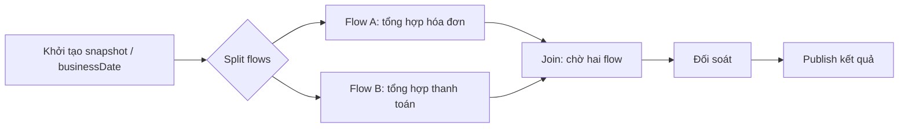
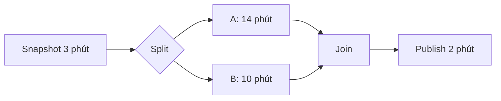
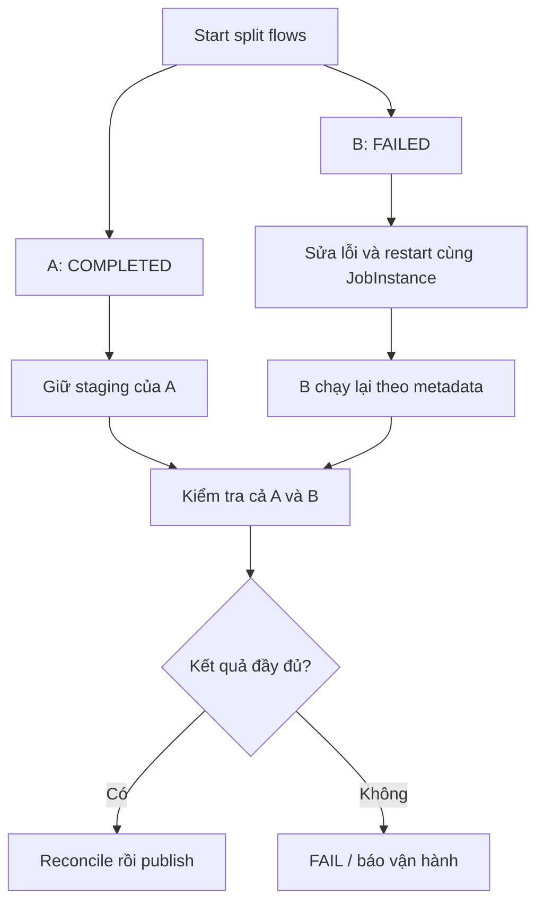

# Khi nào dùng parallel Steps trong Spring Batch?

## Mục tiêu học tập

Trong module **SPRING_BATCH_SCALING_OPERATIONS**, chúng ta lựa chọn cách mở rộng Spring Batch theo workload thực tế: multi-threaded step, parallel steps, partitioning hoặc mô hình phân tán; đồng thời đo nút thắt, bảo đảm thread safety, retry/restart và vận hành an toàn. Bài thuộc chương **Ma trận lựa chọn** này giải quyết một quyết định kiến trúc cụ thể: **khi nào nên chạy nhiều step song song thay vì chạy tuần tự hoặc chia một step thành nhiều worker?**

Sau bài học, bạn có thể:

- Nhận diện các step có thể chạy đồng thời dựa trên quan hệ phụ thuộc dữ liệu, transaction và tài nguyên.
- Sử dụng `Flow`, `split(TaskExecutor)` và điểm hội tụ để triển khai parallel steps trong Spring Batch.
- Phân biệt parallel steps với multi-threaded step, local/remote partitioning và remote chunking.
- Ước lượng hiệu quả từ thời gian đường găng (critical path), overhead và mức bão hòa tài nguyên.
- Thiết kế restart, idempotency, thread safety, giám sát và kiểm thử trước khi dùng trong production.

> **Nguyên tắc quyết định:** Chọn **parallel steps** khi **nhiều công đoạn nghiệp vụ khác nhau, có thể thực thi độc lập**, và chạy chúng đồng thời giúp giảm thời gian hoàn thành job mà tài nguyên vẫn đủ. Nếu chỉ có **một công đoạn phải chia nhiều phần dữ liệu**, lựa chọn cần xem xét là multi-threaded step hoặc partitioning. Nếu một bước cần kết quả từ bước khác, hai bước đó phải giữ thứ tự phụ thuộc hoặc thiết kế lại điểm đồng bộ.

## 1. Parallel steps là gì?

Một Spring Batch `Job` thường chứa các `Step` theo thứ tự:

```text
extract -> normalize -> reconcile -> publish
```

Nhưng có những công đoạn không cần chờ nhau. Ví dụ job chốt sổ cuối ngày phải chuẩn bị **bảng tổng hợp hóa đơn** và **bảng tổng hợp thanh toán** từ cùng mốc dữ liệu. Hai công đoạn có thể chạy đồng thời; chỉ khi cả hai thành công mới bắt đầu đối soát.



Với Spring Batch, **parallel steps** thường được cấu hình bằng các `Flow` độc lập kết nối bằng `split(TaskExecutor)`. Mỗi nhánh chứa một hoặc nhiều `Step`; các nhánh được lên lịch thực thi đồng thời theo khả năng của `TaskExecutor`. Trong một nhánh, các step vẫn có thể chạy tuần tự.

Cần phân biệt rõ:

- `split` tạo **song song giữa các flow chứa step** trong cùng job; nó không tự chia một step thành nhiều phân vùng.
- Mỗi step có một `StepExecution` và metadata, commit, skip/retry, exit status riêng.
- Cơ chế split phối hợp các flow và chờ chúng kết thúc để xác định bước tiếp theo; thời gian bắt đầu/hoàn thành từng nhánh **không được bảo đảm theo tên flow**.
- Song song là mục tiêu cấu hình; mức chạy đồng thời thực tế phụ thuộc số thread của executor, CPU, I/O, DB connection pool và các giới hạn khác.

### Ví dụ hai nhánh độc lập

Giả sử xử lý ngày nghiệp vụ `2026-11-25`:

| Nhánh | Công việc | Đọc | Ghi | Phụ thuộc |
| --- | --- | --- | --- | --- |
| A | Tổng hợp hóa đơn theo cửa hàng | Snapshot `invoice` | `invoice_summary_stage` | Snapshot đầu vào |
| B | Tổng hợp thanh toán theo cửa hàng | Snapshot `payment` | `payment_summary_stage` | Snapshot đầu vào |
| C | Đối soát chênh lệch | Hai bảng staging từ A và B | `reconciliation_stage` | **Cần A và B thành công** |
| D | Công bố báo cáo | `reconciliation_stage` | Báo cáo cuối | **Cần C thành công** |

A và B là ứng viên parallel steps tốt vì không cần kết quả của nhau và ghi ra hai nơi độc lập. C, D nằm sau điểm hội tụ.

## 2. Bộ câu hỏi chọn parallel Steps

Trước khi thay `start(stepA).next(stepB)` thành luồng song song, trả lời lần lượt:

| Câu hỏi | Tín hiệu **phù hợp** | Tín hiệu cần đổi cách làm |
| --- | --- | --- |
| **1. Hai công đoạn có độc lập dữ liệu không?** | Cùng đọc snapshot bất biến, hoặc dùng các đầu vào riêng | B cần đầu ra chưa hoàn chỉnh của A |
| **2. Có xung đột ghi không?** | Ghi bảng, file, partition hoặc business key riêng | Cùng cập nhật một tập row, một file append hay một external account |
| **3. Có phụ thuộc thứ tự nghiệp vụ không?** | Thứ tự hoàn thành A/B không ảnh hưởng kết quả | B phải xảy ra sau A để giữ sequence hay trạng thái |
| **4. Mỗi step có thời gian đủ đáng kể không?** | Các nhánh chạy nhiều phút/giờ, overhead nhỏ | Step vài mili giây, thêm thread không có lợi |
| **5. Tài nguyên có dư địa không?** | CPU, I/O, DB pool hoặc hệ thống ngoài chưa bão hòa | Đã đầy connection pool, đợi DB lock hoặc quota API |
| **6. Có thể retry/restart độc lập không?** | Output theo run key, writer idempotent, có checkpoint | Một nhánh tạo side effect không thể lặp lại |
| **7. Có thể quan sát riêng từng nhánh không?** | Có metric, log và cảnh báo theo `StepExecution` | Không thể biết nhánh nào chậm hoặc lỗi |
| **8. Có điểm hội tụ rõ không?** | Có step downstream chỉ chạy khi dữ liệu hai nhánh hợp lệ | Publish trong một nhánh khi nhánh kia còn dang dở |

Nếu các câu 1–3 không đạt, **không nên song song hóa trực tiếp**. Hãy tách pha tính toán độc lập khỏi pha commit hoặc chọn xử lý tuần tự. Nếu câu 4–5 không đạt, phân tích nút thắt trước: thêm concurrency có thể làm chậm toàn job.

### Các dấu hiệu chọn rất tốt

- Báo cáo có nhiều nhóm chỉ số độc lập, sau đó gộp thành một bản tổng hợp.
- Cùng một snapshot đầu vào được dùng bởi các phép tính độc lập, mỗi phép tính có output riêng.
- Nạp dữ liệu từ các hệ thống nguồn khác nhau vào những staging table tách biệt.
- Có những luồng con gồm nhiều step tuần tự nội bộ nhưng độc lập với các luồng con khác.

### Các dấu hiệu không phù hợp

- Step B sử dụng dữ liệu do A ghi dở và yêu cầu kết quả chính xác từng giao dịch.
- Một bảng nóng chịu nhiều lock; hai nhánh cùng UPDATE những hàng giống nhau.
- API downstream có rate limit nghiêm ngặt đã sử dụng hết.
- Toàn bộ thời gian job nằm trong **một** step nặng; tăng số nhánh không giúp chia workload của step đó.
- Yêu cầu commit toàn cục theo thứ tự giữa A và B, nhưng kiến trúc không có cơ chế điều phối.

## 3. Ma trận chọn mô hình scaling

| Mô hình | Đơn vị công việc chạy đồng thời | Khi nên chọn | Rủi ro chính |
| --- | --- | --- | --- |
| **Sequential steps** | Một step theo luồng phụ thuộc | Quy trình có thứ tự nghiệp vụ chặt, khối lượng nhỏ | Thời gian chờ tích lũy |
| **Parallel steps** | **Các flow/step nghiệp vụ khác nhau** | A và B độc lập, có thể làm đồng thời rồi join | Ghi đè dữ liệu, tài nguyên chung, thất bại một nhánh |
| **Multi-threaded step** | Nhiều chunk/đơn vị xử lý trong **cùng một step** | Một step gồm item độc lập, reader/writer phù hợp concurrency | Thread safety, ordering, checkpoint |
| **Local partitioning** | Nhiều `StepExecution` con của **cùng một worker step** trên một JVM | Một dataset chia được thành các vùng độc lập | Phân vùng lệch tải, tranh chấp DB, restart |
| **Remote partitioning** | Nhiều worker step trên nhiều process/máy | Dataset chia vùng rõ và cần mở rộng qua nhiều host | Messaging, metadata dùng chung, idempotency |
| **Remote chunking** | Chunks gửi từ manager để worker xử lý | Manager chịu trách nhiệm đọc, cần phân tán xử lý chunk | Throughput tại manager, thứ tự/retry message |

**Quy tắc nhận diện nhanh:**

- “Tôi có **hai công đoạn độc lập**, mỗi công đoạn có logic khác nhau.” → Cân nhắc **parallel steps**.
- “Tôi có **một công đoạn ETL rất lớn** và muốn nhiều worker xử lý cùng logic trên các phần dữ liệu.” → Cân nhắc **partitioning**.
- “Tôi có **một step** đã thread-safe và muốn tận dụng thread trong một JVM.” → Cân nhắc **multi-threaded step**.
- “Tôi cần **công đoạn Y sau khi X hoàn thành**.” → Duy trì phụ thuộc hoặc dựng flow split/join chỉ ở các phần độc lập.

Các mô hình không loại trừ nhau. Có thể có hai flow chạy song song, và mỗi flow bên trong dùng partitioning. Tuy nhiên phải **tính tổng concurrency**, tổng pool kết nối, memory và số worker qua mọi lớp; lồng concurrency không có kế hoạch dễ gây oversubscription.

## 4. Cấu hình parallel Steps bằng split flows

Ví dụ Java dưới đây nhắm tới **Spring Batch 5.2.x** (Spring Framework 6.x); ứng dụng cần khai báo các bean `Step` nghiệp vụ, `JobRepository` và hạ tầng transaction phù hợp.

### 4.1. Tạo hai flow độc lập

```java
@Configuration
class DailyClosingJobConfig {

    @Bean
    Flow invoiceFlow(
            @Qualifier("invoiceSummaryStep") Step invoiceSummaryStep) {

        return new FlowBuilder<SimpleFlow>("invoiceFlow")
                .start(invoiceSummaryStep)
                .build();
    }

    @Bean
    Flow paymentFlow(
            @Qualifier("paymentSummaryStep") Step paymentSummaryStep) {

        return new FlowBuilder<SimpleFlow>("paymentFlow")
                .start(paymentSummaryStep)
                .build();
    }

    // Các bean Step ở trên có thể được xây dựng bằng StepBuilder
    // với chunk-oriented processing hoặc tasklet riêng.
}
```

Hai flow có tên riêng và chứa step độc lập. Có thể nối thêm `.next(anotherStep)` trong từng flow nếu nội bộ nhánh cần nhiều bước tuần tự. Tên step phải duy nhất theo ý nghĩa trong job để metadata và restart rõ ràng.

### 4.2. Cấu hình executor có giới hạn

```java
@Bean
TaskExecutor closingFlowExecutor() {
    ThreadPoolTaskExecutor executor = new ThreadPoolTaskExecutor();
    executor.setCorePoolSize(2);
    executor.setMaxPoolSize(2);
    executor.setQueueCapacity(2);
    executor.setThreadNamePrefix("closing-flow-");
    executor.initialize();
    return executor;
}
```

Hai nhánh cần tối thiểu hai thread thực thi để có thể chạy đồng thời. `ThreadPoolTaskExecutor` giới hạn số flow đang thực thi và tránh tạo thread vô hạn. Nếu mỗi nhánh bên trong còn phân vùng nhiều worker, cần ngân sách tài nguyên riêng cho toàn bộ cấu trúc.

### 4.3. Split, join và công đoạn phía sau

```java
@Bean
Flow parallelPreparationFlow(
        @Qualifier("invoiceFlow") Flow invoiceFlow,
        @Qualifier("paymentFlow") Flow paymentFlow,
        @Qualifier("closingFlowExecutor") TaskExecutor executor) {

    return new FlowBuilder<SimpleFlow>("parallelPreparationFlow")
            .split(executor)
            .add(invoiceFlow, paymentFlow)
            .build();
}

@Bean
Job dailyClosingJob(
        JobRepository jobRepository,
        @Qualifier("parallelPreparationFlow") Flow preparationFlow,
        @Qualifier("reconcileStep") Step reconcileStep,
        @Qualifier("publishStep") Step publishStep) {

    return new JobBuilder("dailyClosingJob", jobRepository)
            .start(preparationFlow)
            .next(reconcileStep)
            .next(publishStep)
            .end()
            .build();
}
```

`reconcileStep` được đặt **sau** kết quả split; đây là điểm hội tụ về logic, nơi chỉ nên xử lý khi các nhánh cung cấp kết quả hợp lệ. Luồng tuyến tính bình thường sẽ không đi tiếp trên lỗi step, nhưng nếu cấu hình transition như `on("*")`, `end()`, `fail()` hoặc `stop()` theo cách riêng thì phải kiểm tra lại exit status; đừng giả định mọi biến thể flow đều tự chặn publish.

> **Ranh giới ví dụ:** Đây là code mô tả orchestration, cần import Spring Batch/Spring Integration phù hợp nếu dùng, và các bean `invoiceSummaryStep`, `paymentSummaryStep`, `reconcileStep`, `publishStep` do ứng dụng triển khai. Không thể chạy nguyên đoạn khi chưa có datasource, transaction manager, JobRepository và logic xử lý dữ liệu.

### 4.4. Cùng một input snapshot, output tách biệt

Để hai nhánh đọc cùng ngày kinh doanh mà không thấy dữ liệu biến động khác nhau, đưa `businessDate`, `snapshotId` hoặc watermark vào **identifying JobParameters** (theo chính sách job), và cung cấp cho các step khi cần.

Ví dụ minh họa cách nhận tham số trên một bean scope của step:

```java
@Bean
@StepScope
Tasklet invoiceSummaryTasklet(
        @Value("#{jobParameters['businessDate']}") String businessDate,
        InvoiceSummaryService service) {

    return (contribution, chunkContext) -> {
        service.buildSummaryForDate(businessDate);
        return RepeatStatus.FINISHED;
    };
}
```

`InvoiceSummaryService` là service nghiệp vụ giả định. Nếu một tasklet thực hiện nhiều giờ và viết từng phần ngoài transaction của tasklet, cần chia thành chunk, checkpoint hoặc cơ chế idempotent. Không coi một lời gọi service là có retry/restart hoàn hảo chỉ vì nằm trong `Tasklet`.

Hai flow phải có quy ước riêng cho output, ví dụ:

- `invoice_summary_stage(run_key, shop_id, amount, ...)`.
- `payment_summary_stage(run_key, shop_id, amount, ...)`.

Cột `run_key` xác định lần xử lý logic (ổn định trên restart); khóa duy nhất tương ứng giúp UPSERT an toàn. `reconcileStep` chỉ đọc dữ liệu của cùng `run_key` và xác minh số lượng, tổng tiền, nguồn dữ liệu và độ đầy đủ trước khi publish.

## 5. Kiểm tra độc lập dữ liệu và vấn đề transaction

Độc lập nghĩa là **nhánh A có thể chạy trước, sau hoặc cùng lúc với B mà kết quả được chấp nhận vẫn như nhau**, dưới cùng tập dữ liệu đầu vào.

### 5.1. Đọc chung thường dễ hơn ghi chung

Nếu A và B chỉ đọc cùng snapshot bất biến, concurrency thường an toàn về ngữ nghĩa. Tuy nhiên hai truy vấn nặng vẫn có thể cạnh tranh CPU, buffer cache, disk và connection pool. Nếu input đang thay đổi, mỗi nhánh có thể thấy trạng thái khác nhau dù xử lý “độc lập” trên giấy.

Cần chọn một trong các chính sách nhất quán phù hợp:

1. Dùng dữ liệu đã chốt hoặc bảng snapshot bất biến theo `snapshotId`.
2. Dùng watermark như `event_id <= maxIdAtStart`, đồng thời xác định cách xử lý update/delete và dữ liệu đến muộn.
3. Nếu đòi snapshot giao dịch xuyên nhánh, thiết kế đúng khả năng isolation/temporal snapshot của datastore; **hai connection/transaction riêng không mặc nhiên cùng một database snapshot**.

### 5.2. Ghi chung là điểm dễ lỗi

| Tình huống | Rủi ro | Phương án |
| --- | --- | --- |
| A và B cùng UPDATE row `customer_summary` | Lock contention, deadlock, lost update nếu thiết kế sai | Tách staging hoặc dùng optimistic locking/transaction đúng |
| A và B cùng append file `report.csv` | Record xen kẽ, thứ tự không ổn định, khó rollback | Mỗi nhánh ghi file riêng, bước merge/publish sau join |
| A và B cùng gọi API có side effect | Rate limit, tác động trùng hoặc thứ tự đảo | Idempotency key, điều phối/giới hạn concurrency |
| A tạo dữ liệu, B muốn đọc ngay | B có thể đọc trước khi A commit | Giữ B ở downstream sau join hoặc dependency phù hợp |
| Hai nhánh ghi cùng bảng nhưng key không giao nhau | Có thể an toàn logic, vẫn cần kiểm tra index/DB load | Ràng buộc khóa và kiểm thử concurrent writes |

**Không có transaction toàn cục tự động bao trùm tất cả parallel steps.** Mỗi step/chunk thường commit transaction của mình. Nếu A đã commit, B thất bại, transaction A **không được tự rollback**. Vì thế nên thiết kế **staging → validate → publish** hoặc có quy trình bù trừ (compensation) rõ ràng. Cách này cũng giúp restart rẻ hơn khi một nhánh hoàn thành rồi.

### 5.3. Thread safety và scope

Mỗi `StepExecution` có metadata riêng, nhưng singleton bean mà hai nhánh cùng dùng vẫn có thể chứa trạng thái mutable dùng chung:

```java
// Minh họa anti-pattern: không an toàn nếu hai step gọi đồng thời.
@Component
class BadCounterService {
    private long processed = 0;

    void increment() {
        processed++; // Read-modify-write, có thể mất cập nhật.
    }
}
```

Ưu tiên service không giữ mutable per-run state; lưu thông tin theo `JobParameters`/`ExecutionContext`, tạo state phù hợp scope hoặc dùng cấu trúc đồng bộ khi thực sự cần. **`@StepScope`** giúp cấp đối tượng cho từng `StepExecution` khi dùng đúng ngữ cảnh. Với job-scoped beans trong kịch bản có thread do executor quản lý, cần kiểm tra phạm vi hỗ trợ và khả năng truyền context của phiên bản cụ thể; tránh thiết kế dựa vào thread-local không được bind.

Đặc biệt, khi hai flow cùng gọi external client, connection pool hoặc rate limiter, cần thread safety và giới hạn tải tại **client dùng chung**, không chỉ tại Step.

## 6. Lợi ích hiệu năng: phải đo critical path

Nếu có hai nhánh độc lập A và B, ước tính lý tưởng:

- Thực thi tuần tự: `T_sequential ≈ T_A + T_B + T_other`.
- Thực thi song song: `T_parallel ≈ max(T_A, T_B) + T_other + T_overhead`.

`T_other` gồm công đoạn chung trước split và sau join. `T_overhead` gồm tạo/lên lịch thread, tải DB tăng, đồng bộ, metadata và cạnh tranh tài nguyên. Đây là mô hình **ước lượng**, không phải SLA đảm bảo.

### Ví dụ số liệu

Job chốt sổ có:

- Chuẩn bị snapshot: 3 phút.
- Flow A tổng hợp hóa đơn: 14 phút.
- Flow B tổng hợp thanh toán: 10 phút.
- Đối soát và publish: 2 phút.

| Trường hợp | Công thức | Thời gian ước tính |
| --- | --- | --- |
| Chạy tuần tự | `3 + 14 + 10 + 2` | **29 phút** |
| Parallel, overhead 0,3 phút | `3 + max(14, 10) + 2 + 0,3` | **19,3 phút** |
| Parallel nhưng tranh chấp DB làm A=18, B=16 phút | `3 + max(18, 16) + 2 + 0,3` | **23,3 phút** |

Ở điều kiện thứ hai, tốc độ cải thiện khoảng `29 / 19,3 ≈ 1,50` lần; trường hợp DB bão hòa, cải thiện chỉ `29 / 23,3 ≈ 1,24` lần. Nếu cạnh tranh tài nguyên khiến mỗi nhánh chậm hơn nữa, song song có thể **tệ hơn tuần tự**.

### Đường găng và giới hạn Amdahl

Parallel steps chỉ rút ngắn phần công việc **có thể chạy đồng thời**. Nếu job có 50 phút dùng cho bước tuần tự bắt buộc và chỉ 10 phút là hai nhánh có thể parallel, tối ưu nhánh đó không thể tạo tăng tốc lớn. Xác định đường găng trên sơ đồ phụ thuộc trước khi thêm concurrency.



Đường găng ở đây là `Snapshot → A → Join → Publish`. Làm B nhanh từ 10 xuống 5 phút gần như không rút ngắn job, vì A vẫn mất 14 phút. Nếu cần cải thiện thêm, tối ưu A hoặc chia nhỏ A bằng partitioning nếu dữ liệu cho phép.

### Ước lượng ngân sách tài nguyên

Không suy luận “2 flow = cần 2 DB connections” cho mọi trường hợp; một step có thể dùng connection cho reader, writer, metadata hoặc các thành phần ngoài. Hãy đo mức tiêu thụ đỉnh của từng flow rồi xét cả số job cùng chạy:

```text
PeakConnectionsNeeded ≳
    ConcurrentJobs × Sum(PeakConnectionsOfConcurrentFlows)
    + JobRepositoryAndInfrastructureConnections
    + SafetyMargin
```

Ví dụ hai flow cùng peak 6 connection khi chạy riêng, chạy hai job đồng thời có thể cần khoảng **24 connection cho phần nghiệp vụ**, chưa tính metadata và dự phòng. Pool limit 16 sẽ khiến flow chờ nhau dù còn CPU. Công thức là **ước lượng để lập budget**, cần xác minh bằng active/pending connection thực tế.

## 7. Failure semantics, restart và idempotency

Một split flow thường chờ các nhánh kết thúc và tổng hợp `FlowExecutionStatus` trước khi đi tiếp theo quy tắc transition. Khi A thất bại, B **có thể đã commit hoặc vẫn chạy đến khi hoàn tất**; không có cơ chế rollback đồng loạt mọi nhánh.

### Các trường hợp cần xử lý

| Trường hợp | Điều xảy ra thường gặp | Thiết kế an toàn |
| --- | --- | --- |
| A thành công, B thất bại | Job có thể FAILED, dữ liệu A đã ghi | Giữ staging A, restart B theo metadata và logic idempotent |
| Worker A chết giữa chunk | Transaction chunk chưa commit rollback; checkpoint tùy reader/writer | ItemStream, transaction rõ ràng và restart test |
| A gọi API thành công nhưng chết trước khi lưu metadata | Restart có thể gọi lại API | Idempotency key hoặc outbox |
| Dữ liệu vào đổi giữa hai lần chạy | A và B có thể xử lý hai snapshot khác nhau | Chốt input bằng `JobParameters`/snapshot |
| B hoàn thành trước A | Join vẫn phải đợi A để đi tiếp | Không publish trực tiếp trong B |
| Hai job cùng ngày chạy đồng thời | Đụng khóa dữ liệu, trộn staging/output | Unique key theo run, khóa điều phối và quy tắc launch |
| Flow có transition tùy biến | Có thể kết thúc với status không như người đọc DSL kỳ vọng | Kiểm thử mọi exit status và đường `on(...)` |

**Restart đúng danh tính:** Với Spring Batch, job instance được nhận diện qua tên job và **identifying JobParameters**. Muốn restart instance lỗi, dùng cùng identifying parameters theo cơ chế launch/restart của phiên bản; đặt một tham số identifying mới tùy tiện có thể tạo job instance khác. Các step đã hoàn tất thường được bỏ qua trong restart mặc định, trừ khi thiết lập như `allowStartIfComplete(true)`. Không dựa vào hành vi này để thay thế idempotency tại hệ thống ngoài.

**Dữ liệu công bố:** Tách việc tính toán và publish nếu có khả năng một nhánh thất bại. Publish file qua tên tạm rồi đổi tên/pointer sau khi kiểm tra đầy đủ; thao tác “atomic” cụ thể phụ thuộc filesystem/object store. Với dữ liệu DB, dùng staging + trạng thái `ready` hoặc batch manifest để consumer không đọc kết quả dở dang.

### Sơ đồ phục hồi



Sơ đồ mang tính định hướng; thực tế việc một step được chạy lại hay bỏ qua còn phụ thuộc `StepExecution`, `JobRepository`, `allowStartIfComplete` và các transition đã cấu hình.

## 8. Khi nào nên *không* dùng parallel Steps?

### Trường hợp 1: Một step duy nhất mới là nút thắt

Job chỉ có `importCustomerStep` mất 90 phút và `publishStep` mất 1 phút. Không có hai công đoạn độc lập đủ lớn để split. Cần profile reader/processor/writer, kiểm tra DB/API, sau đó cân nhắc multi-threaded step hoặc partitioning.

### Trường hợp 2: Nguồn dữ liệu đã bão hòa

A mất 15 phút, B mất 15 phút khi chạy riêng nhưng cả hai đều quét full table lớn trên một DB đã sát I/O limit. Chạy song song có thể khiến A và B cùng mất 28 phút, lock wait tăng và job chỉ tiết kiệm 2 phút hoặc thậm chí chậm hơn. Tối ưu query/index, pre-aggregation hoặc thay đổi lịch chạy trước khi tăng concurrency.

### Trường hợp 3: Side effect có thứ tự toàn cục

A cập nhật số dư, B áp phí dựa trên số dư mới; B phải thấy kết quả A commit. Hai flow này có phụ thuộc nên phải chạy theo quan hệ `A → B` hoặc tách phần tính toán trước rồi thực hiện commit theo thứ tự.

### Trường hợp 4: Shared output khó rollback

A và B cùng append trực tiếp vào một CSV hay đối tượng lưu trữ duy nhất. Nếu một nhánh lỗi, file có thể dở dang hoặc các hàng xen kẽ. Thiết kế file riêng + merge/publish thường hợp lý hơn.

### Trường hợp 5: Overhead vượt lợi ích

Một flow mất 200 ms, flow kia 300 ms nhưng init resource, spawn thread, lock và theo dõi tốn thời gian gần tương đương. Giữ tuần tự thường đơn giản và không thiệt về throughput có ý nghĩa.

## 9. Chọn phương án qua một ví dụ thực tế

Bài toán: mỗi đêm ngân hàng phải tạo báo cáo giao dịch của ngày, tổng hợp phí và gửi bảng đối soát. Tốc độ hiện tại 70 phút, SLA 45 phút.

Các công đoạn đo được:

| Công đoạn | Thời gian hiện tại | Phụ thuộc |
| --- | --- | --- |
| Chốt snapshot dữ liệu | 5 phút | Bắt đầu job |
| Tổng hợp giao dịch | 28 phút | Snapshot |
| Tổng hợp phí | 25 phút | Snapshot |
| Đối soát | 8 phút | Cần cả hai tổng hợp |
| Publish báo cáo | 4 phút | Cần đối soát |

Tổng tuần tự là `5 + 28 + 25 + 8 + 4 = 70` phút. Nếu A và B độc lập, song song lý tưởng còn `5 + max(28,25) + 8 + 4 = 45` phút, **vừa đúng SLA nhưng không có dự phòng**. Chỉ cần overhead hoặc contention 1–2 phút là vượt SLA.

Đề xuất triển khai:

1. **Đo trước** connection pool, DB I/O, CPU, read/commit latency ở A và B, xác nhận dữ liệu hai nhánh không xung đột.
2. **Tạo split** cho hai flow tổng hợp; cả hai ghi staging riêng, cùng `snapshotId` và `run_key`.
3. **Đặt reconcile ở sau join**, kiểm tra đủ đầu vào, đối soát tổng tiền/count và chỉ publish khi pass.
4. **Benchmark** với mức concurrency 2; theo dõi có khiến mỗi nhánh chậm đáng kể hay không.
5. **Tối ưu nhánh đường găng** tổng hợp giao dịch (28 phút), ví dụ cải tiến index hoặc partition nếu đo cho thấy dataset có thể chia vùng và DB còn tải.
6. **Đặt mục tiêu vận hành có biên**, chẳng hạn dưới 40 phút ở p95 để có headroom so với SLA 45 phút; chạy thử với phân bố dữ liệu thực tế và thời điểm cao tải.

Ví dụ cho thấy parallel steps có thể là quyết định đúng nhưng **không đủ** nếu SLA quá sát thời gian đường găng. Không hứa rằng cứ tăng flow hoặc thread sẽ có tốc độ tuyến tính.

## 10. Checklist kiểm thử và vận hành

### Kiểm thử tính đúng

- [ ] Chạy tuần tự và song song trên cùng snapshot; so sánh checksum, record count, tổng tiền và tập khóa nghiệp vụ.
- [ ] Cố tình cho B xong trước A; xác minh reconcile/publish không bắt đầu quá sớm.
- [ ] Gây lỗi giữa chunk của A hoặc B; restart với cùng identifying JobParameters, xác minh không trùng side effect.
- [ ] Thử hai job đồng thời với `run_key` khác nhau; xác minh tách biệt staging/output.
- [ ] Mô phỏng deadlock, timeout và API rate limit; kiểm tra retry có giới hạn, backoff và trạng thái job.
- [ ] Kiểm tra các custom exit status, transition và nhánh STOPPED/FAILED để không vô tình publish dữ liệu dở dang.

### Kiểm thử hiệu năng

- [ ] Thu baseline thời gian từng step và toàn job ở chế độ tuần tự.
- [ ] So sánh 1, 2 và nhiều hơn 2 flow *chỉ khi có thêm công đoạn độc lập*; quan sát CPU, memory, GC, DB pool active/pending, DB lock wait.
- [ ] Đo p50/p95/p99 tổng thời gian job, không chỉ latency của một worker.
- [ ] Kiểm tra tải khi nhiều job cùng lịch chạy, số connection tối đa và quota của service ngoài.
- [ ] Kiểm tra thời gian publish/reconcile sau join: đây có thể là nút thắt mới khi hai nhánh được tăng tốc.
- [ ] Xác nhận metrics theo `jobName`, `stepName`, `JobExecutionId`, `StepExecutionId`, `run_key`; không gắn ID có độ phân biệt quá cao vào mọi time series metric nếu gây bùng nổ cardinality.

### Chỉ báo vận hành

| Chỉ báo | Khi tăng bất thường cần kiểm tra |
| --- | --- |
| Một flow lâu hơn p95 lịch sử | Skew dữ liệu, plan SQL, mạng/API, DB contention |
| Thời gian join/barrier kéo dài | Nhánh chậm nhất, step treo, timeout, retry |
| Active DB connection sát giới hạn | Tổng concurrency, pool sizing, query giữ connection lâu |
| DB deadlock/lock wait tăng | Ghi chung dữ liệu, transaction quá rộng |
| Lỗi restart/duplicate | Checkpoint, business idempotency, job instance/run key |
| Đầu ra có partial data | Publish quá sớm, thiếu bước validate, thiếu unique constraint |

## 11. Ma trận quyết định cuối cùng

| Điều kiện quan sát được | Có nên dùng parallel Steps? | Bước tiếp theo |
| --- | --- | --- |
| Hai hoặc nhiều công đoạn khác nhau, độc lập, cùng đọc snapshot ổn định và ghi output riêng | **Có, ưu tiên thử nghiệm** | Dùng `split(TaskExecutor)`, join và benchmark |
| Hai công đoạn độc lập nhưng cùng dùng DB đã bão hòa | **Chưa chắc** | Profile/giảm I/O trước; benchmark dưới tải thật |
| Step B cần kết quả đã commit của A | **Không chạy A và B cùng lúc** | Giữ dependency `A → B` |
| Chỉ một step ETL nặng cần chia dataset | **Không phải lựa chọn đầu tiên** | Multi-threaded step hoặc partitioning |
| Các flow độc lập nhưng phải gộp một output có thứ tự | **Có, kèm bước merge** | Ghi riêng/staging và merge sau join |
| Các công đoạn gọi API bên ngoài không idempotent | **Chưa nên đưa production** | Bổ sung idempotency/compensation rồi đánh giá lại |
| Nhiều công đoạn độc lập nhưng mỗi step cực ngắn | **Thường không cần** | Giữ tuần tự và tránh overhead |
| Mỗi flow dùng partitioning nhiều worker | **Có thể, nếu đo đủ tài nguyên** | Tính tổng concurrency và giới hạn mọi pool |

**Kết luận thực hành:** Khi chọn kiến trúc scaling, hãy bắt đầu từ **đồ thị phụ thuộc công việc** và **số đo nút thắt**. Parallel steps phù hợp nếu nhiều flow độc lập thật sự có thể tiến triển đồng thời. Thiết kế hoàn chỉnh phải gồm điểm join, staging/publish an toàn, quản lý retry/restart, ngân sách tài nguyên và quan sát production. `split` là công cụ điều phối song song; nó không tự giải quyết dữ liệu phụ thuộc, transaction phân tán hay lỗi kinh doanh.

## Tài liệu tham khảo

- [Spring Batch Reference — Scaling and Parallel Processing](https://docs.spring.io/spring-batch/reference/scalability.html): parallel steps và split flows, multi-threaded steps, partitioning.
- [Spring Batch Reference — Configuring a Step](https://docs.spring.io/spring-batch/reference/step/chunk-oriented-processing.html): step, chunk và transaction.
- [Spring Batch Reference — Controlling Step Flow](https://docs.spring.io/spring-batch/reference/step/controlling-flow.html): conditional flow, split và luồng điều khiển.
- [Spring Batch 5.2 API — FlowBuilder](https://docs.spring.io/spring-batch/docs/5.2.x/api/org/springframework/batch/core/job/builder/FlowBuilder.html): `split`, `add` và `build`.
