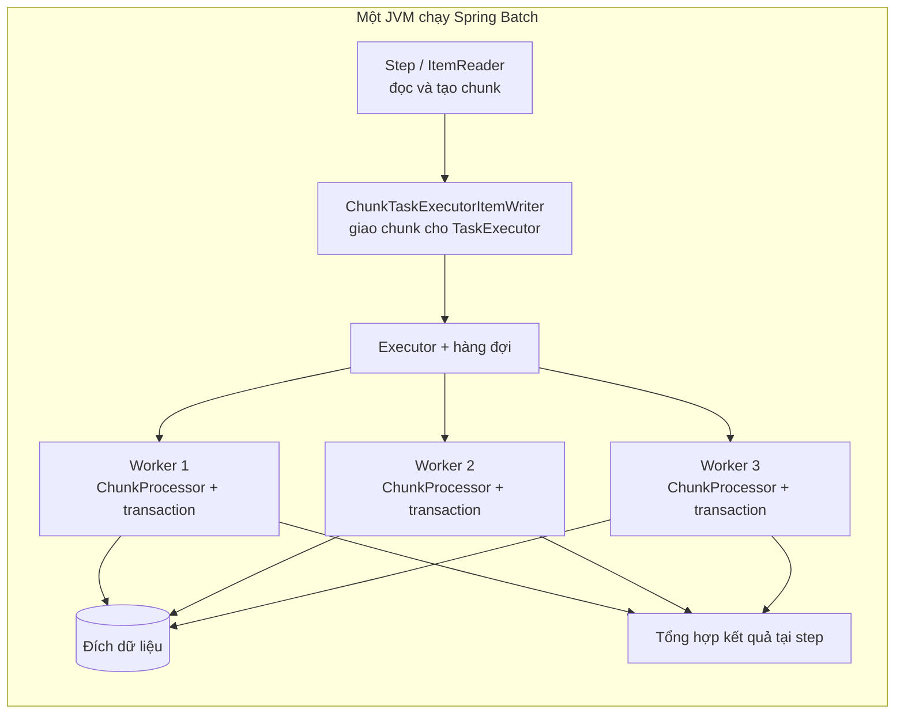
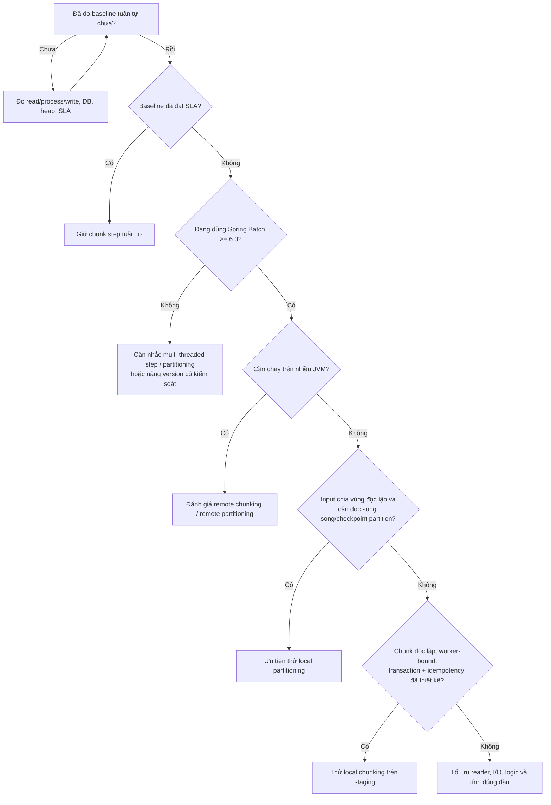
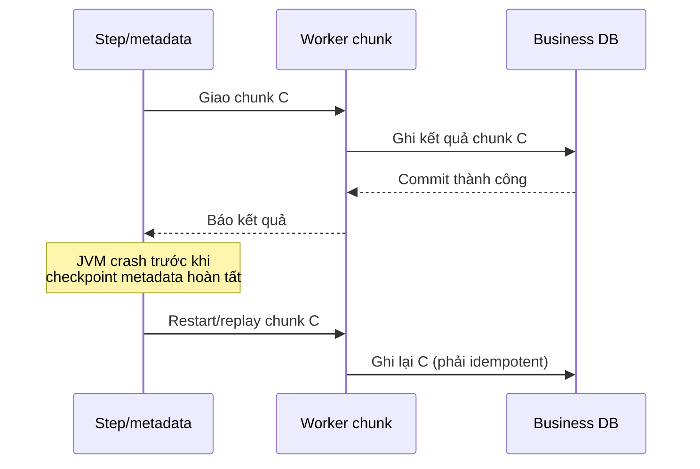

# Khi nào dùng local chunking trong Spring Batch?

> **Chương:** Ma trận lựa chọn  
> **Phạm vi:** `SPRING_BATCH_SCALING_OPERATIONS` — lựa chọn cách mở rộng Spring Batch cho workload dữ liệu lớn; cân nhắc multi-threaded step, parallel steps, partitioning, xử lý phân tán, an toàn luồng, retry/restart và khả năng vận hành theo tài nguyên thực tế.
>
> **Phiên bản được đề cập:** Local chunking là tính năng riêng được giới thiệu từ **Spring Batch 6.0**. Các ví dụ `ChunkTaskExecutorItemWriter` ở đây theo Spring Batch 6.x; cần kiểm tra API của phiên bản đang dùng trước khi áp dụng.

## Mục tiêu học tập

Sau bài này, bạn có thể:

1. Giải thích local chunking là gì, phân biệt nó với chunk-oriented step chạy tuần tự và `multi-threaded step`.
2. Dùng ma trận quyết định để nhận ra loại workload được lợi từ local chunking và khi nào nên chọn local partitioning, parallel steps hoặc remote chunking.
3. Hiểu chính xác trách nhiệm của `ChunkTaskExecutorItemWriter`, `ChunkProcessor`, `TaskExecutor` và `TransactionTemplate`.
4. Ước lượng giới hạn tốc độ, thread pool, queue, heap và kết nối CSDL từ số liệu đo.
5. Đặt tiêu chí nghiệm thu về tính đúng đắn khi retry, restart, worker lỗi, crash và điều phối nhiều chunk.

## 1. Thuật ngữ: local chunking không chỉ là xử lý theo chunk trên một máy

Trong Spring Batch, **chunk-oriented processing** cơ bản đọc từng item, tùy chọn chuyển đổi bằng `ItemProcessor`, gom một nhóm item và ghi bằng `ItemWriter` theo một commit interval. Mặc định, một chunk-oriented step có thể chạy tuần tự trong một thread. Việc `chunk(200)` chỉ đặt quy mô xử lý/commit, **không tự tạo song song**.

Từ **Spring Batch 6.0**, **local chunking** (local chunking of step) có nghĩa hẹp và cụ thể hơn: các chunk được chuyển cho nhiều **worker thread trong cùng một JVM** thông qua `ChunkTaskExecutorItemWriter` và `TaskExecutor`. Mỗi worker sử dụng `ChunkProcessor` để xử lý chunk được nhận; step điều phối và tổng hợp kết quả. Không cần message broker hoặc một ứng dụng worker chạy ở máy khác.



**Ba khái niệm dễ nhầm:**

| Khái niệm | Điều gì diễn ra? | Có song song? |
|---|---|---|
| Chunk step tuần tự | `ItemReader` → `ItemProcessor` → `ItemWriter`, xử lý từng chunk và commit tuần tự. | Không, trừ khi tự cấu hình cơ chế khác. |
| Multi-threaded step trong tài liệu Spring Batch 6.x | Dùng `TaskExecutor` trên step để chạy `ItemProcessor` đồng thời; đọc và ghi item vẫn được điều phối tuần tự bởi thread chính. | Có, chủ yếu ở xử lý item. |
| **Local chunking của Spring Batch 6.x** | `ChunkTaskExecutorItemWriter` gửi **cả chunk** cho `ChunkProcessor` chạy trên worker thread; delegate có thể quản lý transaction riêng. | Có, ở cấp chunk. |

Đây là lý do local chunking có ý nghĩa khi việc xử lý/ghi của **mỗi chunk** tốn thời gian và có thể độc lập với chunk khác, nhưng bạn vẫn muốn giữ một tiến trình triển khai.

## 2. Khi nào chọn local chunking?

Local chunking phù hợp nhất khi **năm điều kiện** sau cùng đúng.

1. **Các chunk độc lập về nghiệp vụ.** Một chunk có thể xử lý, ghi, retry mà không cần chờ kết quả tuần tự từ chunk trước. Ví dụ chuẩn hóa đơn hàng theo ID rồi upsert từng bản ghi; thứ tự hoàn tất không quan trọng.
2. **Đủ việc ở phía worker.** Thời gian xử lý/ghi mỗi chunk lớn hơn đáng kể thời gian giao chunk, gom kết quả và quản lý thread. Có thể là CPU-bound (tính toán, mapping phức tạp) hoặc I/O-bound có nhiều thao tác độc lập.
3. **Đọc dữ liệu không phải nút thắt không thể vượt.** Local chunking vẫn cần nguồn cung cấp chunk; nếu reader đang chiếm gần hết wall time, tăng worker khó giúp ích.
4. **Một JVM có đủ tài nguyên và một miền triển khai là đủ.** Bạn có core CPU, RAM, DB connections hoặc quota API chưa dùng hết; không nhất thiết cần scale across nodes.
5. **Có thể kiểm soát transaction và xử lý lại ở mức worker chunk.** `ChunkProcessor` được thiết kế có transaction riêng và idempotency; nhóm vận hành kiểm thử được tình huống worker lỗi giữa chừng.

### Các dấu hiệu nên cân nhắc

- Đo thấy reader tạo chunk nhanh hơn writer xử lý; hàng đợi công việc có thể khai thác song song.
- Các chunk ghi vào những khóa/bản ghi độc lập, không tranh chấp một global lock hay một tài nguyên đơn lẻ.
- Bài toán cần tránh middleware và vận hành nhiều process, nhưng một step tuần tự không đạt cửa sổ SLA.
- Logic cần transaction quanh thao tác ghi/biến đổi *trên worker thread*; local chunking cho phép delegate chủ động thiết lập transaction.
- Tăng kích thước chunk không còn cải thiện đáng kể, trong khi profiling cho thấy nhiều core còn rảnh.

### Các dấu hiệu không nên chọn

- **Spring Batch trước 6.0:** Không có `ChunkTaskExecutorItemWriter` chính thức theo cơ chế local chunking này. Cân nhắc chunk step tuần tự, multi-threaded step hoặc local partitioning theo API của phiên bản nguồn, hoặc lập kế hoạch nâng cấp.
- **Thứ tự bắt buộc:** Ví dụ ghi sổ cái đòi hỏi mọi cập nhật theo timestamp và số dư phụ thuộc item trước; các chunk hoàn tất không theo thứ tự dễ phá vỡ bất biến.
- **Reader hoặc nguồn duy nhất đã bão hòa:** DB scan/network đã dùng hết năng lực; đẩy thêm nhiều writer có thể làm tổng throughput giảm.
- **Một đích ghi bị khóa tuần tự:** Dù có 8 worker, tất cả vẫn phải đợi cùng table lock, một file hoặc một API quota thấp.
- **Cần mở rộng qua nhiều máy:** Local chunking không tự chuyển việc sang host khác; remote chunking/remote partitioning phù hợp hơn nếu có yêu cầu chịu tải đa node.
- **Cần checkpoint/restart độc lập cho từng vùng dữ liệu:** Local partitioning tạo `StepExecution` riêng theo partition và thường thuận tiện hơn với input có thể chia thành các khoảng ID, file hay tenant rõ ràng.
- **Chưa xử lý được at-least-once side effects:** Nếu crash sau khi worker ghi thành công nhưng trước khi metadata được checkpoint, chạy lại có thể gây ghi trùng. Trước hết phải có idempotency/deduplication thích hợp.

## 3. Ma trận quyết định giữa các mô hình

| Tiêu chí | Chunk tuần tự | Multi-threaded step (6.x) | **Local chunking (6.x)** | Local partitioning | Remote chunking |
|---|---|---|---|---|---|
| Tổ chức công việc | Một step theo chunk tuần tự | `ItemProcessor` chạy song song, read/write vẫn điều phối ở thread chính | **Worker thực hiện `ChunkProcessor` của mỗi chunk** | Chia input thành các partition và chạy các step riêng | Manager đọc, gửi chunk qua middleware tới các process khác |
| Phân tán nhiều JVM | Không | Không | **Không** | Có thể local hoặc remote tùy `PartitionHandler` | Có |
| Công sức triển khai | Thấp | Thấp–vừa | **Vừa: phải quản lý delegate, worker transaction và executor** | Vừa–cao: partitioner, scope, phân chia dữ liệu | Cao: messaging, workers, monitoring |
| Data reader | Một reader | Một reader thread chính trong mô hình 6.x | **Một nguồn cấp chunk được điều phối trong step** | Reader riêng theo partition nếu thiết kế phù hợp | Manager đọc và phân phối item |
| Đơn vị chia việc | Item/chunk lần lượt | Xử lý item | **Chunk** | Step execution cho từng partition | Chunk ở process từ xa |
| Transaction/fault tolerance | Framework quản lý chunk khi cấu hình đúng | Cần lưu ý transaction của processor trong worker | **Delegate `ChunkProcessor` phải tự quản lý transaction/retry/skip** | Mỗi worker step được cấu hình transaction/retry riêng | Cần phối hợp xử lý lỗi và giao nhận message |
| Lợi thế đặc trưng | Đơn giản, dễ debug/restart | Tận dụng CPU ở xử lý item | **Xử lý/ghi nhiều chunk đồng thời, không cần broker** | Đọc song song, checkpoint theo partition | Scale ngang, tách tài nguyên manager và worker |
| Khi ưu tiên | Đã đạt SLA hoặc cần thứ tự | Tốn thời gian ở processor, writer nhanh | **Tốn thời gian ở phần work của chunk, nguồn đọc còn dư năng lực** | Input chia vùng rõ, muốn đọc nhiều nguồn cùng lúc | Cần nhiều JVM, worker đắt đỏ, mạng/messaging chấp nhận được |

*Lưu ý phiên bản:* Bảng mô tả hành vi multi-threaded step theo tài liệu Spring Batch **6.x**. Không suy rằng chi tiết threading này giống mọi phiên bản 4.x/5.x.

### Cây quyết định



Cây này là bộ lọc ban đầu, không thay thế benchmark. Một hệ thống có thể thỏa nhiều nhánh; chỉ nghiệm thu bằng dữ liệu thật mới quyết định cấu hình cuối cùng.

## 4. Ví dụ cấu hình local chunking bằng Spring Batch 6.x

Ví dụ: đọc các đơn hàng chưa tổng hợp, mỗi chunk khoảng 200 đơn; worker ghi nhiều đơn độc lập vào CSDL. Các bean `ItemStreamReader<Order>`, `JdbcBatchItemWriter<Order>`, `JobRepository` và transaction manager đã được cấu hình riêng. `Order` là kiểu dữ liệu nghiệp vụ minh họa.

### 4.1. Pool worker có giới hạn

```java
@Configuration
class LocalChunkingConfig {

    @Bean("localChunkExecutor")
    ThreadPoolTaskExecutor localChunkExecutor() {
        ThreadPoolTaskExecutor executor = new ThreadPoolTaskExecutor();
        executor.setCorePoolSize(4);
        executor.setMaxPoolSize(4);
        executor.setQueueCapacity(8);
        executor.setThreadNamePrefix("local-chunk-");
        executor.setWaitForTasksToCompleteOnShutdown(true);
        executor.setAwaitTerminationSeconds(120);
        // Spring quản lý initialize/shutdown cho bean.
        return executor;
    }

    @Bean("localChunkWriter")
    ChunkTaskExecutorItemWriter<Order> localChunkWriter(
            @Qualifier("localChunkExecutor") ThreadPoolTaskExecutor executor,
            ChunkProcessor<Order> workerChunkProcessor) {
        return new ChunkTaskExecutorItemWriter<>(workerChunkProcessor, executor);
    }

    @Bean
    Step localChunkStep(
            JobRepository jobRepository,
            @Qualifier("batchTransactionManager")
                PlatformTransactionManager batchTransactionManager,
            ItemStreamReader<Order> orderReader,
            @Qualifier("localChunkWriter")
                ChunkTaskExecutorItemWriter<Order> localChunkWriter) {

        return new StepBuilder("localChunkStep", jobRepository)
                .<Order, Order>chunk(200)
                .transactionManager(batchTransactionManager)
                .reader(orderReader)
                .writer(localChunkWriter)
                .build();
    }
}
```

Điểm khác biệt với multi-threaded step: không gọi `.taskExecutor(executor)` trên `StepBuilder` để mong có local chunking; `TaskExecutor` được cấp cho **`ChunkTaskExecutorItemWriter`** để chạy các `ChunkProcessor`.

Pool có bốn worker và queue tám task chỉ là tham số thử nghiệm, **không** phải giá trị chuẩn. Nếu có nhiều job cùng chạy, tổng mức đồng thời là tổng các pool thực tế; phải tính chung heap, DB pool và quota dịch vụ.

### 4.2. Delegate quản lý transaction và lỗi trong worker

```java
@Bean
ChunkProcessor<Order> workerChunkProcessor(
        JdbcBatchItemWriter<Order> jdbcWriter,
        @Qualifier("businessTransactionManager")
        PlatformTransactionManager businessTransactionManager) {

    TransactionTemplate workerTransaction =
            new TransactionTemplate(businessTransactionManager);

    return (chunk, contribution) -> {
        try {
            workerTransaction.executeWithoutResult(status -> {
                try {
                    // Thực thi trong transaction gắn với worker thread.
                    jdbcWriter.write(chunk);
                } catch (Exception ex) {
                    throw new IllegalStateException(
                            "Khong the ghi chunk don hang", ex);
                }
            });

            // Chỉ ghi nhận thành công sau khi callback transaction kết thúc.
            contribution.incrementWriteCount(chunk.size());
            contribution.setExitStatus(ExitStatus.COMPLETED);
        } catch (RuntimeException ex) {
            contribution.setExitStatus(
                    ExitStatus.FAILED.addExitDescription(ex));
            throw ex; // Không giấu lỗi để step báo thành công giả.
        }
    };
}
```

**Giới hạn của ví dụ:** Đây là cấu hình tối giản: delegate chỉ ghi chunk và **fail cả chunk** khi lỗi. Muốn retry/backoff/skip/chunk scanning phải thiết kế và kiểm thử chúng **trong `ChunkProcessor` delegate**. Tài liệu Spring Batch 6.x nêu rõ `ChunkTaskExecutorItemWriter` và driving step **không** tự thực hiện các chính sách fault tolerance đó thay cho delegate. Worker executor cũng có lifecycle riêng do ứng dụng quản lý.

`TransactionTemplate` tạo transaction trong thread thực thi callback. Không thể giả định transaction của step ở thread điều phối tự lan sang worker: transaction context trong Spring gắn với thread. Nếu writer gọi API ngoài CSDL, transaction JDBC không thể tự rollback side effect ở API đó.

Dùng transaction manager đúng với `DataSource` mà `JdbcBatchItemWriter` thao tác. Nếu job repository và CSDL nghiệp vụ nằm ở các giao dịch khác nhau, **không mặc định atomic** giữa cập nhật metadata và ghi kết quả. Chuẩn bị idempotency hoặc cấu hình transaction phân tán khi nghiệp vụ thực sự cần.

### 4.3. Thiết kế đầu ra idempotent

Với bảng kết quả có định danh nghiệp vụ `order_id`, một mẫu PostgreSQL là:

```sql
-- Ví dụ DDL nghiệp vụ; không phải schema metadata của Spring Batch.
CREATE TABLE order_projection (
    order_id BIGINT PRIMARY KEY,
    calculated_amount NUMERIC(18, 2) NOT NULL,
    business_date DATE NOT NULL
);

-- Việc chạy lại cùng order_id cập nhật cùng một kết quả.
INSERT INTO order_projection(order_id, calculated_amount, business_date)
VALUES (:orderId, :calculatedAmount, :businessDate)
ON CONFLICT (order_id)
DO UPDATE SET
    calculated_amount = EXCLUDED.calculated_amount,
    business_date = EXCLUDED.business_date;
```

`ON CONFLICT` là cú pháp riêng của PostgreSQL; thiết kế khóa và câu lệnh tương đương tùy DBMS. Upsert chỉ an toàn khi phép tính có tính xác định với input phiên bản đã chốt. Với nghiệp vụ cộng dồn số dư, tạo thanh toán hoặc phát sự kiện, chỉ upsert theo ID có thể chưa đủ: cần khóa dedup/event ID, outbox hoặc ledger có thể phát hiện replay.

## 5. Hiệu năng: khi nào song song có lợi thật?

### 5.1. Đo nút thắt trước

Tách thời gian thành:

- `T_read`: thời gian đọc và chuẩn bị chunk, bao gồm query, deserialize và overhead điều phối.
- `T_work`: thời gian xử lý/ghi một chunk tại worker, bao gồm I/O, transaction và retry.
- `T_commit/metadata`: ghi checkpoint, cập nhật `StepExecution` và `ExecutionContext`.
- `T_queue`: chờ executor vì bận, từ chối task hoặc thread starvation.

Điểm cần đo là **throughput toàn job** (items/s, wall time) cùng latency p50/p95/p99 của chunk; chỉ xem CPU utilization không đủ. Đồng thời đo SQL pool active/idle/wait, DB lock time, GC pause, heap usage, thread state và lỗi optimistic locking/retry.

Từ năng lực lý tưởng, nếu nguồn đọc cung cấp tối đa `R` item/s, mỗi worker xử lý `W` item/s và có `P` worker, năng lực tối đa chịu ràng buộc:

```text
throughput_thực_tế <= min(R, P × W, năng_lực_DB/API)
```

Đây là *trần ước lượng*, chưa trừ dispatch, transaction, contention, GC và rollback. Nếu reader chỉ tạo 1.200 item/s mà bốn worker tổng khả năng 2.000 item/s, tăng lên tám worker vẫn khó vượt trần 1.200 item/s.

Một ví dụ thứ hai theo Amdahl: đo baseline thấy 20% thời gian là phần tuần tự, 80% có thể chia đều cho worker. Với bốn worker:

```text
speedup_lý_tưởng = 1 / (0,20 + 0,80 / 4) = 2,5 lần
```

Thực tế thường thấp hơn do tranh chấp DB/locks, queuing, tạo object và transactional overhead.

### 5.2. Chunk size và queue ảnh hưởng heap

Gọi `C` là số item/chunk, `P` là số worker, `Q` là queue capacity và `S` là kích thước dữ liệu một item ở bộ nhớ. Một xấp xỉ sơ bộ cho phần item đang chờ và đang xử lý là:

```text
M_chờ_và_xử_lý ≈ (P + Q) × C × S
```

Ví dụ `P=4`, `Q=8`, `C=200` và một item chiếm trung bình `2 KiB`: phần dữ liệu item thô có thể đạt khoảng `4,7 MiB`; object graph, danh sách, serializer, buffering của reader/writer và GC làm mức dùng heap thực lớn hơn. Cần đo heap trong stress test thay vì tin giá trị này như giới hạn cứng.

Chunk quá nhỏ gây nhiều transaction/dispatch; chunk quá lớn gây chậm checkpoint, heap tăng, retry cả cụm tốn kém và kéo dài lock. Không có “chunk size tối ưu” cố định. Nên chạy ma trận kích thước như `50, 200, 500` cùng các mức pool `1, 2, 4, 8` và giữ dữ liệu, phần cứng, connection pool nhất quán khi so sánh.

### 5.3. Đừng cấp worker nhiều hơn tài nguyên phụ thuộc

- CPU-bound: bắt đầu quanh số core còn trống và theo dõi giới hạn container CPU quota, GC và context switches.
- I/O-bound: có thể thử nhiều worker hơn core **nếu** DB/API chưa bị bão hòa và có cơ chế backpressure.
- JDBC: nếu bốn worker đồng thời mở bốn transaction và một thread điều phối cũng cần kết nối, pool `maxPoolSize=4` có thể gây chờ hoặc deadlock tùy đường đi. Cần đo **tổng** demand và chừa headroom cho metadata/health/ứng dụng khác.
- Executor: queue không nên vô hạn; theo dõi active threads, queue depth, rejected tasks, thời gian chờ và shutdown drain. Không mặc định rằng executor từ chối task sẽ tự được retry an toàn.
- Đích ghi: nếu mỗi chunk cập nhật cùng một aggregate row hoặc index nóng, thêm worker thường làm tăng lock contention.

## 6. Thread safety, thứ tự và transaction

### Đọc tuần tự không có nghĩa phần còn lại an toàn theo mặc định

Local chunking tách phần cấp chunk và phần xử lý trên worker. Những object truy cập trong `ChunkProcessor` thường được **chia sẻ giữa các thread**, vì vậy:

- Tránh singleton chứa mutable fields như `currentOrder`, `buffer`, `lastProcessedId` hoặc `SimpleDateFormat` dùng chung không đồng bộ.
- Giữ mỗi chunk và kết quả biến đổi trong biến cục bộ; dùng component thread-safe hoặc factory tạo instance theo worker nếu cần.
- Không lưu trạng thái xử lý tiến độ bằng static counter thay cho metadata của Spring Batch.
- Đảm bảo logic nghiệp vụ và writer không phụ thuộc vào **thứ tự hoàn tất chunk**. Chunk 5 có thể ghi trước chunk 4.
- Với JDBC writers, kiểm tra cấu hình, transaction manager, tham số binding và thread safety của bất kỳ delegate tùy chỉnh nào, không suy ra an toàn chỉ từ tên class.

### Transaction và restart là nơi phải thận trọng nhất

Trong local chunking, transaction ở thread điều phối **không tự bao phủ** thao tác chạy trong worker thread. Delegate phải quyết định ranh giới commit và rollback. Có thể xảy ra:



Không được tuyên bố **exactly once** chỉ nhờ có transaction hoặc `JobRepository`. Hãy làm rõ business key, replay behavior, idempotency của writer, và thứ tự cập nhật metadata. Khi crash ở bất kỳ điểm nào giữa commit nghiệp vụ và checkpoint, job phải có đường phục hồi đáng tin.

**Retry và skip** cũng phải được thiết kế theo lỗi:

| Lỗi | Hướng xử lý gợi ý |
|---|---|
| Deadlock/timeout DB tạm thời | Retry có giới hạn và backoff trong delegate; kiểm soát rollback trước retry. |
| Validation của một item bị lỗi xác định | Có chính sách skip/dead-letter được audit, không skip cả chunk âm thầm. |
| Lỗi nguồn dữ liệu hoặc hỏng serialization | Fail rõ ràng, lưu thông tin chẩn đoán; không lập lại vô hạn. |
| JVM mất giữa hai commit | Restart và đối soát item đã ghi; idempotency bảo vệ trước replay. |
| Worker báo lỗi nhưng manager vẫn `COMPLETED` | Test để phát hiện lỗi bị nuốt hoặc `StepContribution`/`ExitStatus` tổng hợp không đúng. |

## 7. Checklist thử nghiệm trước khi chọn kiến trúc

Chạy các phép đo dưới đây **trên môi trường clone/staging với dữ liệu đại diện**. Giữ một bản baseline chunk tuần tự để có số đối chiếu.

| Phép thử | Thiết lập và kỳ vọng |
|---|---|
| Baseline tuần tự | Ghi lại tổng thời gian, items/s, DB CPU/locks, heap, số connection và lỗi. |
| Scaling curve | Chạy 1, 2, 4, 8 worker với chunk size cố định; đo speedup thật và kiểm tra bão hòa. |
| Tuning chunk size | Thử 50, 200, 500 item/chunk ở pool tốt nhất; đo transaction/s, p95, heap và rollback cost. |
| Queue pressure | Đẩy input nhanh hơn worker; đo queue depth, rejection, memory và hành vi backpressure. |
| Correctness | So sánh bộ ID, tổng tiền, checksum/count giữa baseline và local chunking; không duplicate/missing. |
| Thứ tự | Cố tình làm một chunk chậm hơn chunk sau; xác minh kết quả nghiệp vụ không lệ thuộc thứ tự hoàn tất. |
| Transaction rollback | Ép một chunk bị SQLException sau một số thao tác; đảm bảo transaction của worker rollback đúng. |
| Restart sau crash | Ngắt JVM sau khi một số worker commit, khởi chạy lại **cùng JobInstance** theo chính sách restart; so sánh DB đầu ra với baseline. |
| Retry/skip | Gây lỗi tạm thời, lỗi dữ liệu không cứu được; kiểm tra số lần thử, backoff, trạng thái cuối và dữ liệu quarantine. |
| Shutdown | Dừng job có kiểm soát và shutdown worker pool; xác minh không còn thread/connection treo và các task còn dang dở được ghi nhận đúng. |
| Tải hỗn hợp | Chạy cùng lúc job khác dùng DB/pool chung; xác minh local chunking không làm hệ thống còn lại vượt SLA. |

Định nghĩa điều kiện **GO** trước benchmark, ví dụ: cải thiện wall time ít nhất 25% trên workload đại diện; checksum/count hoàn toàn trùng; không duplicate khi fault injection; p95 chunk latency, DB lock waits, heap và số connections dưới ngưỡng của hệ thống. Con số 25% ở đây chỉ là **ngưỡng minh họa** cho một nhóm kỹ thuật, không phải mức Spring Batch bảo đảm.

Dừng thử hoặc **NO-GO** nếu hiệu năng cải thiện không đủ bù rủi ro, dữ liệu phụ thuộc thứ tự, mất khả năng restart an toàn hoặc contention tăng mạnh. Giữ chunk step tuần tự là lựa chọn hợp lệ khi nó đáp ứng SLA.

## 8. Tình huống áp dụng

**Bài toán:** Mỗi đêm đọc 2 triệu đơn hàng và tính giá cuối cùng. Mỗi order độc lập; nguồn đọc PostgreSQL đã có index theo `business_date, id`; kết quả là upsert theo `order_id`. Hệ thống chỉ có một pod 8 vCPU/16 GiB RAM, DB cho phép tối đa 12 connection dành cho batch.

**Đo baseline giả định:**

- Chunk step tuần tự xử lý 400 order/s; SLA cần hoàn thành trong 90 phút (ít nhất khoảng 371 order/s nếu không có overhead).
- Reader có thể cấp 2.000 order/s, còn worker writer/transform là phần tốn thời gian.
- Có 6 vCPU chưa bị các workload khác chiếm; không yêu cầu xử lý trên nhiều pod.

**Quyết định:** Chưa cần local chunking chỉ vì có workload 2 triệu đơn — baseline 400 order/s cho thời gian lý tưởng 2.000.000 / 400 ≈ 83,3 phút, *đã đạt* SLA 90 phút nếu số đo thực tế ổn định và tính đủ thời gian khởi động/cleanup. Giữ mô hình tuần tự là phương án nhẹ hơn.

Nếu benchmark production-like cho thấy thời gian thực tế 110 phút do peak load, hoặc SLA được hạ xuống 45 phút, local chunking là ứng viên tốt: item độc lập, reader còn dư năng lực, một JVM có tài nguyên. Thử pool 2 và 4 worker, chunk 200, queue 8; đo DB lock waits, connection pool và correctness trước khi tăng tiếp. Nếu throughput chạm trần 2.000 order/s tại reader, thêm worker không giải quyết được.

**Biến thể phải chọn khác:** Nếu các order cần đọc theo 16 tenant độc lập, reader là nút thắt, và cần retry từng tenant không đọc lại tenant đã complete, **local partitioning** thường phù hợp hơn. Nếu tính toán cần hàng chục node vì CPU của một pod không đủ, cân nhắc **remote chunking** hoặc **remote partitioning** với kế hoạch điều phối và idempotency.

## 9. Lỗi quyết định thường gặp

- **Nhầm `.chunk(500)` với parallelism:** Commit interval 500 không tạo thêm worker.
- **Nhầm `.taskExecutor(...)` của step với local chunking:** Trong Spring Batch 6.x, cách cấu hình và phần nào chạy trên worker khác nhau; cần kiểm tra đúng kiểu execution.
- **Quên version:** Dán cấu hình `ChunkTaskExecutorItemWriter` vào project 5.x rồi coi lỗi biên dịch là vấn đề dependency nhỏ.
- **Nghĩ fault tolerance do driving step lo hết:** Delegate local chunking phải quản lý transaction/retry/skip; kiểm thử thật thay vì chỉ thấy `COMPLETED` một lần.
- **Tăng pool và queue vô hạn:** Heap tăng, DB pool cạn, phần lớn thời gian nằm ở queue/locks thay vì làm việc.
- **Dùng singleton writer có state thay đổi theo chunk:** Race conditions chỉ xuất hiện khi tải cao, rất khó tái hiện.
- **Không tính retry sau commit:** Worker ghi thành công nhưng metadata chưa checkpoint có thể dẫn đến replay.
- **Dùng tốc độ trung bình che mất tail latency:** p99, thời gian chờ connection và chunk chậm nhất có thể quyết định wall time.
- **Chọn local chunking khi bottleneck ở reader:** Worker nhàn rỗi, hệ thống phức tạp thêm nhưng SLA không cải thiện.

## 10. Câu hỏi tự kiểm

1. **Spring Batch 5.2 có thể dùng ngay `ChunkTaskExecutorItemWriter` không?** Không. Local chunking theo API này được giới thiệu từ 6.0; cần đối chiếu version và cân nhắc kỹ nâng cấp.
2. **Vì sao local chunking hợp với writer cần transaction ở worker thread?** Vì `ChunkProcessor` trực tiếp sở hữu transaction trong worker, thay vì dựa vào transaction thread điều phối.
3. **Nếu writer tốn 90% thời gian nhưng DB đã bão hòa, có nên tăng từ 4 lên 16 worker?** Chưa. Tăng worker có thể làm lock/connection waits xấu hơn; cần đo tổng capacity và sửa bottleneck của đích ghi.
4. **Nếu hai chunk ghi cùng một aggregate row theo thứ tự bắt buộc?** Local chunking không phù hợp nếu không tái thiết kế consistency, phân nhóm dữ liệu hoặc tuần tự hóa cập nhật tương ứng.
5. **Nếu worker commit nhưng JVM chết trước checkpoint thì sao?** Chunk có thể chạy lại khi restart; kết quả ghi phải có cơ chế idempotency/deduplication và được đối soát.
6. **Khi nào local partitioning tốt hơn?** Khi input có thể tách theo khoảng ID/file/tenant, cần nhiều reader chạy song song và checkpoint/restart riêng cho từng partition.

## Tài liệu tham khảo

- [Spring Batch 6.1 — Scaling and Parallel Processing, mục Local Chunking](https://docs.spring.io/spring-batch/reference/scalability.html): định nghĩa local chunking, `ChunkTaskExecutorItemWriter`, `ChunkProcessor` và trách nhiệm transaction/fault tolerance.
- [Spring Batch 6.0 — Scaling and Parallel Processing](https://docs.spring.io/spring-batch/reference/6.0/scalability.html): điểm xuất hiện tính năng từ 6.0; đối chiếu multi-threaded step, parallel steps, partitioning và remote chunking.
- [Spring Batch — Chunk-oriented Processing](https://docs.spring.io/spring-batch/reference/step/chunk-oriented-processing.html): read/process/write, chunk boundary và commit interval.
- [Spring Batch — Configuring a Step](https://docs.spring.io/spring-batch/reference/step/chunk-oriented-processing/configuring.html): transaction manager, metadata checkpoint và nguy cơ khi repository/business DB không dùng chung transaction.
- [Spring Batch — Configuring a Step for Restart](https://docs.spring.io/spring-batch/reference/step/chunk-oriented-processing/restart.html): restart policy và quản lý step state.

> **Quy tắc chọn:** Chỉ dùng local chunking khi benchmark cho thấy **xử lý/ghi từng chunk là phần có thể song song hóa**, một JVM còn tài nguyên, mỗi chunk xử lý độc lập và đường transaction/retry/restart đã được chứng minh bằng fault injection. Nếu baseline đã đủ SLA hoặc nguồn đọc/đích ghi mới là giới hạn, ưu tiên tối ưu tại đúng nút thắt.
