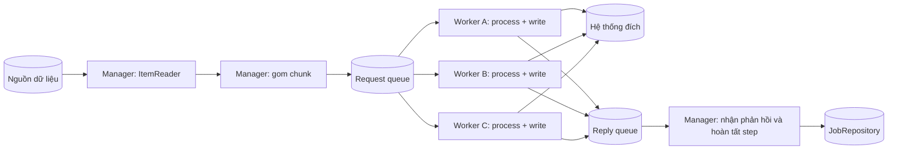
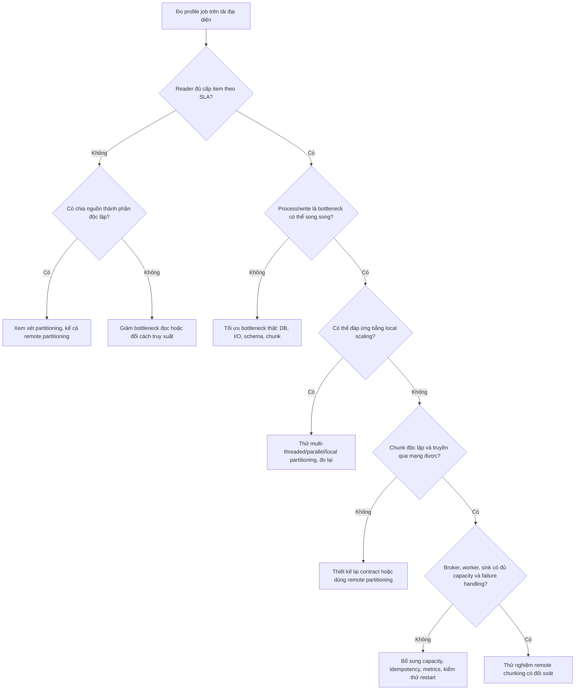
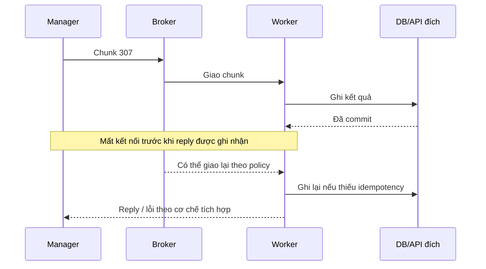

# Khi nào dùng remote chunking trong Spring Batch?

Trong hệ thống Spring Batch xử lý dữ liệu lớn, một câu hỏi thường xuất hiện khi job vượt SLA là: **có nên đẩy chunk sang các worker ở máy khác để tăng tốc không?** Remote chunking có thể giúp khi việc đọc dữ liệu tương đối nhanh, trong khi xử lý hoặc ghi kết quả tốn nhiều CPU, I/O hay phải gọi dịch vụ bên ngoài. Nhưng việc thêm worker và message broker cũng kéo theo độ trễ mạng, tải serialization, retry, khả năng phát lại message và chi phí vận hành.

Bài này thuộc chương **Ma trận lựa chọn** của module **SPRING_BATCH_SCALING_OPERATIONS** — học cách mở rộng Spring Batch bằng multi-threaded step, parallel steps, partitioning và các mô hình phân tán, đồng thời kiểm soát thread safety, retry/restart, bottleneck và tài nguyên thực tế. Mục tiêu là ra được **quyết định có bằng chứng** về thời điểm nên dùng remote chunking, khi nào nên chọn kỹ thuật khác, cùng điều kiện để triển khai an toàn.

## 1. Remote chunking hoạt động như thế nào?

**Remote chunking** là mô hình Spring Batch trong đó **manager** đọc item và tạo các chunk; các **worker** ở tiến trình hoặc máy khác nhận chunk qua messaging middleware, thực hiện phần xử lý/ghi và gửi phản hồi về manager. Trong mô hình phổ biến với Spring Batch Integration:

- **Manager step** sở hữu `ItemReader`, tạo các nhóm item theo chunk, gửi yêu cầu xử lý qua request channel và nhận kết quả từ reply channel.
- **Worker** nhận nội dung chunk, chạy `ItemProcessor` (nếu có) và `ItemWriter` tương ứng, sau đó phản hồi kết quả/xử lý lỗi theo hợp đồng tích hợp.
- **Message broker** hoặc hạ tầng Spring Integration kết nối manager với nhiều worker; tùy adapter, có queue, routing, ack, redelivery, timeout và cơ chế xử lý message lỗi.
- **JobRepository** lưu trạng thái Spring Batch của job/step phía manager; worker remote chunking không mặc nhiên tạo một `StepExecution` riêng cho mỗi chunk như trong partitioning.



Ví dụ: một reader tuần tự đọc các giao dịch theo ID ổn định, gửi từng chunk 100 giao dịch vào request queue. Mười worker đồng thời tính phí, kiểm tra quy tắc và ghi dữ liệu. Manager tiếp tục cấp chunk trong giới hạn điều phối; nó cần biết chunk nào thành công hoặc thất bại để quản lý tiến độ. **Thứ tự worker hoàn thành chunk có thể khác thứ tự manager đọc chúng.**

Các bước bên trong worker có thể chạy trong transaction riêng với manager. Vì vậy, một thao tác đã commit ở hệ thống đích và một phản hồi đã được manager ghi nhận là **hai sự kiện phân tán**. Thiết kế phải chịu được tình huống xảy ra lỗi ở giữa.

## 2. Điều kiện có lợi nhất: một reader cấp dữ liệu đủ nhanh, phần sau đọc có thể chạy song song

Remote chunking đáng cân nhắc khi **đồng thời** đáp ứng phần lớn các điều kiện:

1. **Đọc tuần tự không phải nút thắt chính.** Một manager có thể cấp item nhanh hơn tốc độ toàn pipeline mong muốn hoặc đủ nhanh để nuôi các worker; reader không cần mở rộng thành nhiều bản sao.
2. **Processor/writer chiếm phần lớn thời gian.** Các thao tác tính toán, làm giàu dữ liệu hoặc gọi dịch vụ có thể phân phối độc lập theo chunk.
3. **Item và chunk có thể vận chuyển qua mạng.** Dữ liệu có dạng serializable, payload không quá lớn và có hợp đồng schema/version rõ ràng.
4. **Các chunk có thể xử lý độc lập.** Không đòi hỏi một worker giữ toàn bộ state của job, không lệ thuộc nghiêm ngặt vào thứ tự commit giữa các chunk.
5. **Có đủ năng lực hạ tầng.** Worker, broker, hệ thống đích và quota tài nguyên có thể chịu đồng thời lớn hơn mà không biến DB/API downstream thành bottleneck.
6. **Có kế hoạch lỗi phân tán.** Retry/redelivery, idempotency, timeout, restart, phản hồi thất lạc và message độc hại được xử lý có kiểm soát.
7. **Lợi ích throughput bù được độ phức tạp.** Hệ thống có nhu cầu scale qua nhiều tiến trình/máy, năng lực giám sát và vận hành broker/worker.

Trường hợp điển hình: input nằm trong một snapshot tệp hoặc query ổn định có thể đọc ở tốc độ cao; mỗi bản ghi phải trải qua phép tính CPU nặng hoặc nhiều lời gọi I/O độc lập; nhiều worker có thể xử lý song song mà không giẫm lên state chung.

**Không nên chọn remote chunking chỉ vì job có nhiều dữ liệu.** Một job đọc rất chậm từ database sẽ không nhanh hơn chỉ nhờ chuyển khâu xử lý sang worker: manager vẫn phải đọc, đóng gói và gửi *mọi item*.

## 3. Ma trận lựa chọn: remote chunking hay kỹ thuật mở rộng khác?

| Tiêu chí | Multi-threaded step | Parallel steps | Local partitioning | Remote partitioning | Remote chunking |
| --- | --- | --- | --- | --- | --- |
| Đơn vị được chạy đồng thời | Nhiều chunk trong một step | Nhiều step/flow độc lập | Partition/worker step cùng tiến trình | Partition/worker step trên các tiến trình khác nhau | Chunk được manager gửi cho worker |
| Nơi đọc dữ liệu | Reader của step; phải xử lý thread safety | Reader riêng theo step | Reader thường riêng theo partition | Reader riêng ở worker partition | **Reader tập trung ở manager** |
| Nơi process/write | Cùng tiến trình | Cùng tiến trình | Cùng tiến trình | Worker từ xa | **Worker từ xa** |
| Cần broker? | Không bắt buộc | Không bắt buộc | Không bắt buộc | Thường cần middleware/điều phối phân tán, tùy triển khai | **Thường cần request/reply messaging** |
| Dữ liệu đi qua mạng | Không cần vì scaling nội bộ | Không cần vì scaling nội bộ | Không cần giữa worker local | Chủ yếu thông tin partition/range, worker tự đọc dữ liệu | **Nội dung item/chunk** |
| Giới hạn reader trung tâm | Có thể có, tùy reader | Không chung một reader bắt buộc | Có thể scale đọc theo partition | Có thể scale đọc theo worker | **Có; manager reader có thể thành nút thắt** |
| Phù hợp nhất khi | Có ích từ concurrency trong một step, thành phần an toàn | Có nhiều luồng nghiệp vụ độc lập | Có thể chia input thành partition trên một máy | Input chia được, cần scale cả read/process/write | Đọc đủ nhanh; process/write nặng, cần worker phân tán |
| Chi phí vận hành | Thấp đến trung bình | Thấp đến trung bình | Trung bình | Cao | Cao |

Bảng mô tả mô hình điển hình. Khả năng thread safety, restart và chính sách message phụ thuộc implementation; **không kỹ thuật nào tự động mang lại exactly-once effects** trên mọi tài nguyên ngoài transaction.

### Các tín hiệu chọn hoặc loại nhanh

| Quan sát trong đo đạc | Hướng ưu tiên | Lý do |
| --- | --- | --- |
| Reader cấp 8.000 item/s, xử lý tổng chỉ 900 item/s; CPU worker bão hòa | **Xem xét remote chunking** | Đưa process/write sang nhiều worker có thể tăng throughput |
| Reader chỉ cấp 600 item/s, mục tiêu 2.000 item/s | **Đừng mặc định chọn remote chunking** | Manager reader vẫn giới hạn kết quả |
| Dataset chia được thành ID ranges/files không giao nhau, cần nhiều worker tự đọc | **Remote partitioning** | Phân tán cả giai đoạn đọc, chỉ gửi mô tả partition |
| Nhiều bước độc lập có thể chạy đồng thời trong một JVM | **Parallel steps** | Ít hạ tầng hơn, không cần vận chuyển item |
| Xử lý nặng nhưng đủ tài nguyên trên một máy, reader/writer có thể kiểm chứng an toàn | **Xem xét local scaling trước** | Tránh overhead broker và bảo trì worker phân tán |
| Mỗi item quá lớn hoặc chứa dữ liệu khó vận chuyển | **Cân nhắc partition theo nguồn hoặc chia nhỏ payload** | Chi phí network, serialization và broker storage có thể quá cao |
| Output buộc commit đúng thứ tự toàn cục | **Xem lại yêu cầu thiết kế** | Worker hoàn thành ngoài thứ tự; cần serialization hoặc quy trình reorder |
| Sink không idempotent, retry có thể gây giao dịch không thể hoàn tác | **Chưa đủ điều kiện triển khai** | Redelivery/restart có thể lặp side effect |

## 4. Quy trình quyết định từng cửa



Hãy dùng sơ đồ như **chuỗi kiểm tra**, không phải thuật toán thay thế benchmark. Dù local scaling đủ cho tải hiện tại, remote chunking vẫn có thể hợp lý nếu yêu cầu vận hành bắt buộc tách workload/process khỏi manager. Ngược lại, nếu worker remote đã có nhưng broker phải đẩy payload nhiều gigabyte, partitioning có thể kinh tế hơn.

### Gate A — Đo nút thắt thật

Trước khi chọn kiến trúc, cần đo trên dữ liệu đại diện:

- Thời gian read, process, write mỗi item/chunk; p50/p95/p99 cho thao tác chậm.
- Throughput ở input/output, số item được đọc thành công, filter/skip/retry/rollback.
- CPU, memory, GC, disk và network trên manager; DB pool và lock wait trên sink.
- Queue depth, active worker/concurrency (nếu đã có), thời gian chờ API ngoài.
- Tỉ lệ thời gian đọc so với toàn bộ job; SLA và sai số/khoảng tải đỉnh.

Nếu bottleneck nằm ở database do contention hoặc API có rate limit cố định, việc tăng worker có thể làm lỗi nặng hơn. Chỉ gọi là khả năng scale khi đã đo được throughput tăng mà tính đúng đắn dữ liệu giữ nguyên.

### Gate B — Kiểm tra tính độc lập của chunk

Các worker thường hoàn thành không theo thứ tự. Thiết kế thuận lợi nếu `process(item)` là deterministic hoặc có đầu vào bất biến và thao tác `write` không đòi hỏi trạng thái toàn cục. Ví dụ tính checksum độc lập từng file hoặc chuẩn hóa từng giao dịch bằng khóa nghiệp vụ. Nếu cần xử lý lần lượt theo cùng tài khoản hoặc đảm bảo thứ tự sự kiện, phải thiết kế affinity/ordering riêng hoặc dùng mô hình khác.

Cần làm rõ **cùng một item được nhận lại sau retry có thể ghi trùng không**; và nếu hai chunk đụng cùng khóa, unique constraint, transaction isolation và cách giải quyết xung đột hoạt động thế nào.

### Gate C — Chứng minh tính phù hợp với hạ tầng

Dự trù broker throughput, độ lớn từng message, số lần serialization, queue retention, timeout, backpressure, số worker, connection pool và hạn mức API. Tính toán cả **trường hợp worker chậm hoặc chết** để queue không tăng vô hạn. Một cụm worker lớn không có ích nếu sink hoặc broker là tài nguyên chung không thể scale.

## 5. Ví dụ tính sizing trước khi quyết định

Giả sử một job có **2.000.000 item** cần hoàn tất trong **25 phút** (1.500 giây). Đây là số liệu giả định để minh họa phép tính, không phải benchmark của Spring Batch.

**Throughput tối thiểu theo SLA**:

```text
required_rate = total_items / deadline_seconds
              = 2,000,000 / 1,500
              ≈ 1,333 item/s
```

Kết quả đo ở tải thử nghiệm:

| Chỉ số | Số đo giả định | Hàm ý |
| --- | ---: | --- |
| Reader manager bền vững | 5.000 item/s | Đủ cao hơn mục tiêu |
| Một worker process + write | 200 item/s | Cần nhiều worker chạy đồng thời |
| Khả năng ghi đích ở cấu hình hiện tại | 1.800 item/s | Có headroom so với mục tiêu, nhưng không nhiều |
| Trung bình serialized item | 1 KiB | Mỗi item được chuyển qua broker |
| Chunk size thử nghiệm | 100 item | Khoảng 100 KiB payload/chunk, chưa tính envelope |
| Tỉ lệ retries | Gần 0 trong baseline | Khi lỗi cần tính thêm traffic |

Số worker lý thuyết tối thiểu nếu throughput gần tuyến tính:

```text
workers_min = ceil(required_rate / per_worker_rate)
            = ceil(1,333 / 200)
            = 7 workers
```

**Bảy worker là cận dưới**, chưa bao gồm overhead, độ lệch tải, retry và sự cạnh tranh tài nguyên. Có thể thử **9–10 worker**, đo lại p95 throughput và DB pool; không khẳng định cứ tăng lên 10 là đạt 2.000 item/s. Nếu nhiều worker cùng ghi vào một DB, năng lực 1.800 item/s là trần gần đúng cho workload hiện tại.

Ở tốc độ mục tiêu khoảng 1.333 item/s với 100 item/chunk, manager phải gửi khoảng **13,3 chunk/giây**. Với 1 KiB/item, payload thô khoảng **1,3 MiB/giây** qua request path, chưa kể metadata, mã hóa, phản hồi và redelivery. Phải kiểm thử với payload thực tế, nhất là khi item chứa chuỗi dài hoặc đối tượng lồng nhau.

Một cách ước lượng nhanh:

```text
rate_effective ≤ min(
    rate_reader_manager,
    rate_manager_serialization_and_dispatch,
    total_rate_workers,
    rate_broker,
    rate_downstream_sink
)

rate_workers_ideal ≈ worker_count × sustained_rate_per_worker
rate_messages ≈ rate_items / chunk_size
```

Các đại lượng phải đổi về **cùng đơn vị item/s** để so sánh; rate broker tính theo message/s cần quy đổi theo kích thước và số item mỗi message. `rate_workers_ideal` chỉ là xấp xỉ khi các worker không giẫm lên tài nguyên chung. Mọi phép tính cần kiểm tra bằng load test; không dùng nó để cam kết SLA.

**Trường hợp quyết định đổi hướng:** nếu benchmark reader manager chỉ đạt **800 item/s** thì remote chunking một manager không đạt mục tiêu 1.333 item/s, dù có 20 worker. Khi input có thể partition bằng key range/file, remote partitioning hoặc tối ưu truy vấn/đọc là hướng hợp lý hơn.

## 6. Thiết kế ranh giới manager–worker

Remote chunking không chỉ là “đưa processor vào queue”. Cần xác định rõ **quyền sở hữu dữ liệu và trạng thái**:

| Thành phần | Sở hữu / chịu trách nhiệm | Rủi ro cần khống chế |
| --- | --- | --- |
| Manager reader | Thứ tự đọc, trạng thái reader, việc phát chunk | Manager là điểm nghẽn; reader khó restart hoặc đọc lại khác thứ tự |
| Request channel + broker | Chuyển chunk đến worker theo cấu hình | Message thất lạc, redelivery, backlog, quá tải, sai version |
| Worker processor | Business transformation / enrichment | Thread safety, biến thiên dữ liệu ngoài, timeout, resource sharing |
| Worker writer | Side effects ghi DB, object storage hoặc API | Ghi trùng, commit một phần, xung đột giữa chunk |
| Reply channel | Thông báo chunk hoàn tất hoặc lỗi cho manager | Reply chậm, mất reply, manager restart hoặc correlation thất bại |
| JobRepository | Trạng thái `JobExecution`/`StepExecution` | Metadata không phản ánh mọi side effect ở tài nguyên ngoài |
| Quan sát và đối soát | Chứng minh tiến độ và dữ liệu đúng | Có thể `COMPLETED` nhưng kết quả sai |

Trong mô hình phổ biến, reader chạy trên manager, còn processor/writer chạy trên worker. Nếu muốn **worker tự đọc** theo partition ID/range, đó là thiết kế *remote partitioning*, không phải remote chunking. Phân biệt này quyết định lượng dữ liệu phải đi qua mạng, cách phân phối tải và cơ chế restart.

### Mô tả message và thông tin tương quan

Spring Batch Integration có hợp đồng message riêng cho request/reply; **không thay thế tùy tiện payload nội bộ của framework** bằng JSON sau. Đây chỉ là *mẫu bản ghi telemetry nghiệp vụ* có thể bổ sung tại các điểm giám sát:

```json
{
  "jobExecutionId": 15240,
  "stepName": "remoteProcessingStep",
  "chunkCorrelationId": "15240:remoteProcessingStep:chunk-307",
  "workerId": "worker-04",
  "eventType": "CHUNK_FINISHED",
  "itemCount": 100,
  "attempt": 2,
  "durationMs": 1780,
  "status": "SUCCESS"
}
```

Mục đích là tra cứu **chunk nào được gửi, worker nào nhận, số lần retry, khi nào reply được nhận**. Cách gắn correlation ID phải tương thích với Spring Integration adapter/version đang dùng; khi retry/restart có thể thay đổi định danh vật lý của message, nên cần thêm business key để đối soát dữ liệu độc lập với message ID. Không log toàn bộ payload nhạy cảm chỉ để tìm sự cố.

## 7. Failure semantics: redelivery, restart và đúng dữ liệu

Trong hệ thống phân tán, thứ tự các sự kiện thường không thể gom vào **một transaction ACID duy nhất** giữa manager, broker, DB writer và API ngoài. Một tình huống tiêu biểu:

1. Manager đọc 100 item, gửi chunk sang request channel.
2. Worker nhận chunk, processor/writer thực thi và commit kết quả vào DB.
3. Trước khi manager nhận hoặc ghi nhận reply, kết nối bị ngắt hoặc worker/manager chết.
4. Broker/adapter có thể phát lại message hoặc manager gửi lại công việc, tùy cấu hình phục hồi.
5. Nếu writer không idempotent, 100 item có thể bị ghi lặp dù lần xử lý ban đầu đã commit.



**Không thể mặc định remote chunking cung cấp exactly-once effect cho mọi writer.** Cấu hình broker có thể hỗ trợ các mức độ bảo đảm giao message khác nhau, nhưng việc một message chỉ được xử lý logic một lần xuyên qua DB/API là một bài toán end-to-end. Phải thiết kế và thử nghiệm với phiên bản middleware và transaction boundary thật.

### Idempotency cần gắn với nghiệp vụ

Với thao tác ghi DB, một lựa chọn là đặt unique constraint trên khóa nghiệp vụ và thao tác insert/upsert **trong cùng transaction ghi**, theo quy tắc hợp nhất có xác định. Với API ngoài, dùng idempotency key được hệ thống đích chấp nhận hoặc outbox/compensation nếu thích hợp.

Ví dụ khóa ổn định:

```text
settlement:{businessDate}:{transactionId}:{operationType}
```

Không nên dùng `jobExecutionId` hoặc ID message phát sinh tùy lần chạy làm thành phần duy nhất của khóa chống lặp: restart có thể tạo `JobExecution` mới và redelivery có thể có message ID khác, trong khi tác vụ nghiệp vụ vẫn là cùng một.

Idempotent *không có nghĩa* được lờ mọi lỗi duplicate. Khi gặp cùng business key nhưng payload khác, cần quy tắc xác định conflict/phiên bản và cảnh báo để không âm thầm ghi đè dữ liệu đúng.

### Restart và checkpoint

Manager `ItemReader` cần đọc ổn định để có thể phát lại những item còn thiếu sau lỗi. Kiểm tra reader có được checkpoint theo `ExecutionContext` đúng contract không, thứ tự đọc có deterministic không, dữ liệu nguồn có bị thay đổi trong lúc job chạy không. Trường hợp worker đã commit mà manager chưa ghi nhận, quy trình restart cần chịu được phát lại chunk. Khi sử dụng API ngoài transaction, phải đối soát side effects thực tế thay vì chỉ tin `BATCH_STEP_EXECUTION`.

Không chỉnh sửa thủ công `ExecutionContext` hoặc trạng thái trong JobRepository để “bỏ qua chunk bị treo”; thao tác này có thể biến một lỗi có thể khôi phục thành mất dữ liệu không phát hiện.

## 8. Backpressure và giới hạn đồng thời

Nếu manager có thể phát 5.000 item/s nhưng worker và hệ thống đích chỉ xử lý 1.500 item/s, queue sẽ tăng khoảng **3.500 item/s tương đương**, chưa kể retry. Với chunk size 100, đó là khoảng 35 chunk/s tích tụ. Trong 10 phút có thể tăng khoảng **21.000 message chunk**, tương đương 2,1 triệu item nằm chờ; dung lượng broker và thời gian phục hồi sẽ trở thành rủi ro.

Vì vậy, phải có cơ chế kiểm soát inflight và tốc độ phát phù hợp hạ tầng:

- Giới hạn số chunk request chưa nhận phản hồi, với timeout có phân biệt task chậm và mất worker.
- Điều chỉnh số worker, prefetch, concurrency và kích thước queue theo thông số thực tế của broker/adapter.
- Áp dụng rate limit/flow control tại manager hoặc worker nếu hệ thống đích có quota cố định.
- Theo dõi ready messages và in-flight/unacked riêng; không tính mọi message chưa ack là “chưa được xử lý”.
- Có chính sách retry với backoff và giới hạn số lần; phân loại lỗi vĩnh viễn để chuyển sang xử lý lỗi phù hợp, ví dụ dead-letter queue.
- Đặt ngân sách kết nối DB/API; nhiều worker không được cùng chiếm hết connection pool của các workload khác.

Chiến lược cụ thể thay đổi theo middleware và cách kết nối Spring Integration. Không dùng duy nhất một phép đo queue depth để suy ra trạng thái Spring Batch; nên ghép với `StepExecution`, số request/reply, thời gian xử lý từng chunk và dữ liệu đầu ra.

## 9. Chunk size, payload và serialization

`chunkSize` trong remote chunking vừa là **đơn vị giao việc** vừa tác động mạnh tới kích thước request. Nếu chọn quá nhỏ, số message/s, overhead ack và chi phí serialization tăng. Nếu quá lớn, thời gian xử lý một chunk, độ trễ phát hiện lỗi, dung lượng message và chi phí replay tăng.

| Cấu hình | Lợi ích | Rủi ro |
| --- | --- | --- |
| Chunk nhỏ | Phân phối việc mịn, phát hiện lỗi sớm | Nhiều message, overhead lớn |
| Chunk lớn | Ít message hơn, amortize overhead | Payload lớn, worker giữ bộ nhớ nhiều, redelivery tốn kém |
| Worker concurrency cao | Tăng thông lượng nếu tác vụ độc lập | Vượt DB/API quota, contention, retry storm |
| Worker concurrency thấp | Dễ giữ resource headroom | Có thể không đáp ứng SLA |
| Format serialization giàu schema/version | Dễ triển khai phiên bản tương thích | Cần kiểm tra compatibility và chi phí encode/decode |

Hãy đo **serialized bytes thực tế của p95/p99 chunk**, thay vì chỉ lấy kích thước item trung bình. Cần kiểm thử giới hạn message của broker, chính sách nén, object graph phức tạp, tương thích schema khi rolling deployment và việc che dữ liệu nhạy cảm trong log.

Đối với item quá lớn (ảnh, tài liệu, binary hoặc object graph nặng), có thể gửi **tham chiếu tới dữ liệu bất biến** thay vì payload đầy đủ nếu hợp đồng ứng dụng cho phép; nhưng điều này thay đổi chi phí đọc sang worker và cần quản lý vòng đời dữ liệu tham chiếu. Khi mỗi worker phải tự đọc toàn bộ miền dữ liệu riêng, remote partitioning thường là mô hình rõ ràng hơn.

## 10. Quan sát và tiêu chí nghiệm thu production

Một lần chạy `COMPLETED` chưa đủ chứng minh kiến trúc tốt. Dashboard nên giúp trả lời ba câu hỏi: *chậm ở đâu, dữ liệu đúng không, có phục hồi được không?*

| Nhóm | Chỉ số | Dùng để |
| --- | --- | --- |
| Manager | `read_rate`, thời gian read, CPU, memory | Phát hiện manager reader/serialization bottleneck |
| Dispatch | Chunk sent/s, bytes/s, số chunk chưa có reply | Thấy chênh lệch tốc độ phát và hoàn tất |
| Broker | Ready, in-flight/unacked, redelivery, DLQ, message age | Phân biệt backlog với worker đang xử lý |
| Worker | Active workers, duration/chunk, error/retry, CPU/GC | Đo khả năng scale và skew |
| Sink | DB pool pending/active, lock wait, API p95, rate-limit | Xác định tài nguyên đích đang giới hạn throughput |
| Spring Batch | `JobExecution`/`StepExecution`, read/write/skip/rollback | Quan sát vòng đời batch và xử lý lỗi |
| Dữ liệu | Missing/duplicate business keys, checksum/tổng nghiệp vụ | Chứng minh correctness sau chạy và restart |

Thiết lập alert dựa trên điều kiện kết hợp, chẳng hạn: backlog tăng liên tục, worker active gần bằng 0 và job vẫn `STARTED`; hoặc tỷ lệ reply giảm kéo dài trong khi request vẫn được phát. Ngưỡng phải dựa trên thời gian xử lý chunk bình thường, cold start và SLA thật.

**Bộ nghiệm thu gợi ý trước triển khai:**

1. Chạy baseline một máy và phiên bản remote chunking trên cùng snapshot input; đối soát business key và giá trị đầu ra.
2. Đo throughput tăng ở các mức 1, 2, 4, 8, 12 worker và chỉ ra điểm bão hòa (manager, broker hay sink).
3. Kill worker khi đang xử lý chunk; xác nhận redelivery/restart không làm thiếu hoặc trùng dữ liệu.
4. Gây mất reply sau khi writer commit trong môi trường kiểm thử; xác nhận idempotency và chiến lược khôi phục.
5. Khởi động worker dùng phiên bản payload cũ/mới theo kịch bản rollout; xác nhận tương thích hoặc từ chối an toàn.
6. Gây chậm DB/API hoặc mất broker tạm thời; quan sát backpressure, timeout, DLQ và cách phục hồi.
7. Tắt/giảm worker để phát sinh backlog, đo bộ nhớ broker và thời gian xả queue khi scale lại.
8. Xác minh dashboard/runbook tìm được một chunk bằng correlation ID và gắn lại được với dữ liệu nghiệp vụ.

Đánh giá trên **tải đủ dài** để thấy GC, pool exhaustion, database locks và tình huống retry chồng nhau; benchmark vài trăm item sạch thường không đại diện production.

## 11. Tình huống thực tế: cân nhắc remote chunking cho enrichment dữ liệu

**Bối cảnh giả định:** job `customerEnrichment` đọc 6 triệu khách hàng từ snapshot dữ liệu ổn định, làm giàu thông tin bằng phép tính và API nội bộ, sau đó ghi kết quả vào DB. Một manager đọc khoảng 4.000 item/s, trong khi giai đoạn process/write chỉ đạt 650 item/s trên một máy. SLA yêu cầu hoàn tất 6 triệu item trong 2 giờ (trung bình **834 item/s**).

Phân tích sơ bộ:

- Reader đủ cấp item vượt SLA; **không cần scale đọc ngay**.
- Processor và lời gọi API chiếm phần lớn thời gian; từng item độc lập theo customer ID.
- API có quota tổng cộng 1.500 request/s và DB đạt khoảng 1.200 bản ghi/s dưới tải thử; trần hệ thống thấp hơn reader.
- Item serializable và payload nhỏ; broker đã có khả năng HA, đo được backlog và dead-letter.
- Đã có unique key theo customer ID + phiên bản enrichment; writer có quy tắc update idempotent.

**Quyết định hợp lý:** chạy proof-of-concept remote chunking với vài worker, đặt global rate limit cho API ở dưới quota, đo throughput tới ngưỡng 834 item/s và kiểm tra headroom. Tiếp tục mở worker chỉ khi bottleneck chưa chuyển sang API/DB. Nếu cùng workload có thể hoàn thành ổn định bằng một local step với ít chi phí hơn, lựa chọn local vẫn hợp lệ.

**Khi dữ kiện thay đổi:** nếu snapshot reader chỉ đọc 450 item/s hoặc 6 triệu customer phải được chia theo vùng và worker cần truy xuất nguồn tại chỗ, remote partitioning sẽ phù hợp hơn. Nếu enrichment phải theo thứ tự thay đổi của từng customer, cần thiết kế ràng buộc order/affinity hoặc cơ chế tổng hợp khác trước khi bật worker đồng thời.

## 12. Những anti-pattern dễ dẫn tới chọn sai

**1. “Dữ liệu lớn thì cứ remote chunking.”** Quy mô input không chứng minh process/write là bottleneck. Hãy profile toàn pipeline và đo tốc độ manager.

**2. “Nhiều worker luôn nhanh hơn.”** Worker mới có thể làm quá tải sink, tăng lock contention hoặc chạm rate limit API. Quan sát throughput hiệu dụng và số lỗi, không chỉ CPU tổng.

**3. “Có broker nên không mất hay trùng dữ liệu.”** Message delivery và nghiệp vụ ghi kết quả có ranh giới transaction riêng. Thử failure sau commit trước reply và kiểm tra idempotency.

**4. “Manager chỉ cần đọc nhanh, state của reader không quan trọng.”** Checkpoint, thứ tự đọc và khả năng replay của reader quyết định restart; snapshot input nên ổn định và có quy tắc nhận diện job rõ.

**5. “Gửi cả entity JPA/đối tượng lớn vào queue.”** Đối tượng có lazy proxy, trường nhạy cảm, không tương thích version hoặc graph quá lớn có thể hỏng serialization và vận hành. Dùng DTO rõ ràng, nhỏ, có version.

**6. “Worker nào cũng có StepExecution riêng.”** Remote chunking chủ yếu phân tán công việc theo chunk do manager gửi; **remote partitioning** mới phân tán các worker step execution/partition theo mô hình tương ứng. Sai mô hình quan sát sẽ dẫn tới câu lệnh truy vấn metadata thiếu dữ liệu.

**7. “Chỉ cần tăng timeout khi worker chậm.”** Timeout dài có thể giữ request treo lâu hơn và phóng to backlog. Điều tra CPU, DB, API, redelivery, concurrency và message age trước khi điều chỉnh.

**8. “Chunk lớn giúp giảm overhead nên luôn tốt.”** Broker có giới hạn payload; khi lỗi, chunk lớn gây replay dài và dùng thêm RAM. Chọn bằng benchmark p95/p99 và chính sách failure.

## 13. Mẫu ghi nhận quyết định kiến trúc

Khi nhóm chọn hoặc từ chối remote chunking, nên ghi một **decision record** ngắn có thể kiểm chứng:

```markdown
# ADR: Remote chunking cho [job-name]

## Mục tiêu
- Khối lượng đầu vào / deadline:
- Throughput yêu cầu (item/s), SLA và tiêu chí correctness:

## Bằng chứng hiện tại
- Reader rate / process rate / write rate:
- CPU, memory, DB pool, API limit, chunk size:
- Dữ liệu có thể partition theo file/range/key không?
- Tính độc lập item, ordering, schema và độ lớn payload:

## Các phương án
- Sequential / multi-threaded step:
- Parallel steps:
- Local / remote partitioning:
- Remote chunking:
- Chi phí hạ tầng, độ phức tạp, restart và rủi ro:

## Quyết định và điều kiện
- Phương án chọn:
- Giới hạn worker, inflight, broker, API/DB quota:
- Bảo đảm idempotency, retry, DLQ, restart:
- Monitoring + runbook + ownership:

## Thử nghiệm / tiêu chí nghiệm thu
- Baseline:
- Load test + failure injection:
- Reconciliation:
- Rollback criteria và điều kiện từ bỏ quyết định:
```

Tài liệu này giúp đội vận hành biết **vì sao** chọn remote chunking và **khi nào** cần đánh giá lại: chẳng hạn input tăng gấp đôi, reader trở thành bottleneck hoặc DB đạt mức giới hạn sớm hơn tính toán.

## 14. Bài thực hành: chọn đúng chiến lược

Cho ba workload giả định sau:

| Workload | Reader rate | Process/write hiện tại | Yêu cầu | Đặc điểm input |
| --- | ---: | ---: | ---: | --- |
| A — Chuẩn hóa giao dịch | 4.500 item/s | 700 item/s | 1.200 item/s | Item độc lập, DTO nhỏ, có idempotency |
| B — Quét dữ liệu lịch sử | 500 item/s | 2.500 item/s | 2.000 item/s | Chia được theo `businessDate` và ID range |
| C — Phát hành lệnh thanh toán | 2.500 item/s | 900 item/s | 1.100 item/s | API đích không có idempotency và không cho phép ghi trùng |

Hãy trả lời:

1. Workload nào là **ứng viên tốt** cho remote chunking? Cần đo tài nguyên đích nào trước khi thử?
2. Với B, vì sao tăng số worker remote chunking không giải quyết được yêu cầu throughput? Kiến trúc nào đáng thử?
3. Với C, dù reader nhanh và processor chậm, vì sao chưa nên bật retry/redelivery trong remote chunking trước khi đổi contract?
4. Với A, chọn chunk size và số worker ban đầu thế nào để tìm điểm bão hòa mà không mặc định throughput tăng tuyến tính?
5. Nếu worker đã ghi xong nhưng reply mất, bạn sẽ chứng minh không có duplicate side effects thế nào?

**Gợi ý đối chiếu:** A là ứng viên nhờ reader dư công suất và payload độc lập; kiểm tra broker, CPU worker, DB/API quota, retries và thử scaling nhiều mức. B bị giới hạn bởi reader 500 item/s; nên tối ưu truy vấn hoặc cân nhắc partitioning để worker đọc các miền riêng. C cần idempotency key/constraint hoặc cơ chế nghiệp vụ chống trùng và phương án đối soát trước khi cho phép redelivery. Với A, thử chunk size vừa phải và vài worker, đo p95 chunk duration, serialized bytes, backpressure và throughput theo từng mức. Trường hợp reply mất phải được thử bằng fault injection, đối chiếu khóa nghiệp vụ và side effects của hệ thống đích; `BatchStatus.COMPLETED` không thay thế bằng chứng đó.

---

**Nguyên tắc ra quyết định:** dùng remote chunking khi **manager đọc đủ nhanh, chi phí process/write có thể chia độc lập trên nhiều worker, dữ liệu chunk truyền qua mạng hợp lý, tài nguyên đích còn sức chứa và khả năng retry/restart đã được chứng minh an toàn**. Nếu chính việc đọc cần phân tán, hãy ưu tiên đánh giá partitioning; nếu local scaling đã đáp ứng SLA thì cân nhắc chi phí bổ sung của broker và vận hành. Mọi lựa chọn trong `SPRING_BATCH_SCALING_OPERATIONS` phải được xác nhận bằng throughput thực đo, failure test và đối soát dữ liệu.
