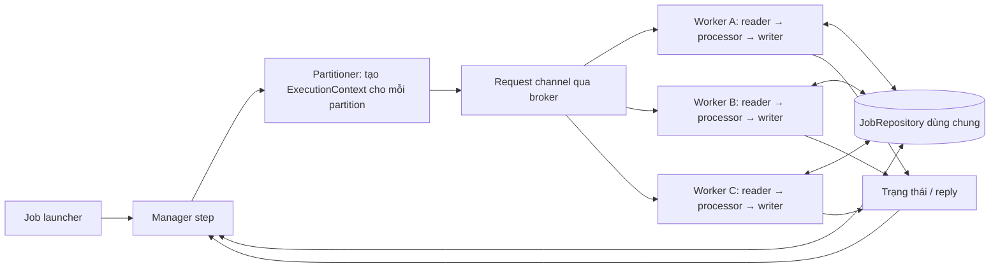
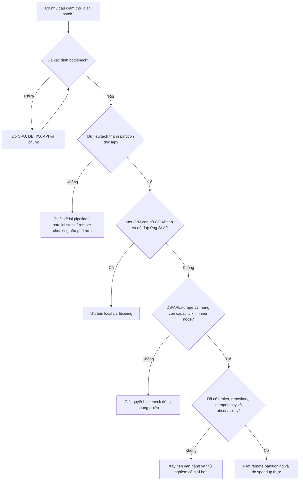
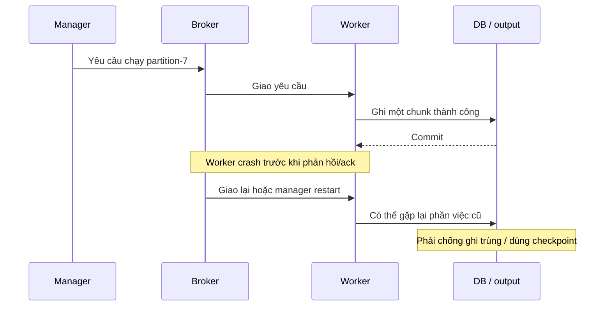

# Khi nào dùng remote partitioning trong Spring Batch?

## 1. Bài toán ra quyết định

**Remote partitioning** là một lựa chọn mở rộng Spring Batch khi một bước xử lý dữ liệu có thể chia thành nhiều phần **độc lập**, mỗi phần chạy như một worker step trên tiến trình hoặc máy khác. Manager phân chia công việc, gửi yêu cầu thực thi tới các worker và tổng hợp trạng thái qua `JobRepository`. Worker tự đọc, xử lý và ghi dữ liệu trong phạm vi partition được giao.

Trong chương **Ma trận lựa chọn** của module `SPRING_BATCH_SCALING_OPERATIONS`, mục tiêu là chọn kiến trúc theo **nút thắt thực tế, tính độc lập của dữ liệu, yêu cầu thread safety, retry/restart và chi phí vận hành**. Remote partitioning phù hợp khi năng lực của một tiến trình hoặc một máy thực sự là giới hạn và các partition có thể chạy độc lập; nó không tự động giải quyết một database đang quá tải, một API có rate limit chung hoặc thuật toán cần trạng thái toàn cục.

Sau bài này, bạn cần trả lời được:

- Khi nào multi-threaded step hoặc local partitioning là đủ, và khi nào cần thêm worker ở máy khác?
- Cần chứng minh những điều kiện nào trước khi phân tán một step?
- Nên chia partition theo ID, thời gian, tenant, shard hay file như thế nào để không trùng hoặc mất dữ liệu?
- Manager, worker, message broker và `JobRepository` phối hợp ra sao khi gặp lỗi, retry và restart?
- Phải đo những gì để biết remote partitioning thật sự có lợi hơn chi phí vận hành của nó?

## 2. Remote partitioning hoạt động ra sao?



Các thành phần chính:

1. **Manager step** chạy trong job chính, sử dụng `Partitioner` để xác định các phần việc và tạo `StepExecution` tương ứng.
2. **`ExecutionContext` của partition** chứa tham số nhỏ gọn như `minId`, `maxIdExclusive`, `tenantId` hoặc URI file; không nhất thiết chứa payload dữ liệu.
3. **`PartitionHandler` hỗ trợ giao việc từ xa** thông qua Spring Batch Integration và kênh truyền request/reply trên Spring Integration, RabbitMQ, JMS hoặc một adapter thích hợp.
4. **Worker** nhận yêu cầu, lấy thông tin `StepExecution` liên quan và thực thi worker step. Mỗi worker có reader, processor, writer và transaction của chính mình.
5. **`JobRepository` dùng chung và bền vững** lưu tiến độ và kết quả của các `StepExecution`, cho phép manager theo dõi trạng thái và xử lý restart theo ngữ nghĩa Spring Batch.

Điểm cần nhớ: manager thường chuyển **chỉ thị thực thi partition**, không gửi từng bản ghi nghiệp vụ qua broker. Worker có quyền truy cập nguồn dữ liệu tương ứng để tự đọc và ghi. Đây là khác biệt cơ bản so với **remote chunking**.

## 3. Điều kiện bắt buộc trước khi chọn

Hãy coi đây là các cổng kiểm tra thiết kế. Nếu một cổng chưa đáp ứng, cần sửa thiết kế trước khi tăng số worker.

| Điều kiện | Cách kiểm chứng | Nếu chưa đáp ứng |
|---|---|---|
| **Chia dữ liệu thành tập không giao nhau** | Mỗi bản ghi thuộc đúng một partition; truy vấn range hoặc danh sách file có tiêu chí rõ | Nguy cơ xử lý trùng hoặc bỏ sót; cần thiết kế lại partitioner |
| **Có thể xử lý độc lập** | Worker không cần state mutable của worker khác; kết quả không phụ thuộc thứ tự toàn cục | Dùng xử lý tuần tự, nhiều bước hoặc giai đoạn reduce/merge riêng |
| **Nút thắt có thể được phân tán** | CPU/heap/I/O trên một máy là giới hạn; DB/API chung vẫn có dư capacity | Nếu DB/API đã bão hòa, thêm worker thường làm tình hình xấu hơn |
| **Worker truy cập được dữ liệu** | Network, credential, locality, schema/version và quyền truy cập nhất quán | Cần điều chỉnh vị trí dữ liệu hoặc kiến trúc truyền dữ liệu |
| **Có cơ chế chống trùng và restart** | Retry partition không gây side effect lặp; checkpoint và khóa nghiệp vụ ổn định | Không nên giao việc xa khi dữ liệu đầu ra chưa idempotent |
| **Vận hành phân tán được** | Broker đáng tin cậy, `JobRepository` bền vững, quan sát được từng partition, triển khai worker | Cân nhắc local partitioning trước |

Một ví dụ **phù hợp**: tổng hợp 80 triệu sự kiện đã được chia theo ngày hoặc tenant, mỗi partition tự đọc shard dữ liệu và ghi kết quả theo khóa duy nhất. Job một máy không đủ CPU, trong khi kho dữ liệu và database đích vẫn còn khả năng phục vụ nhiều truy vấn/transaction song song.

Một ví dụ **không phù hợp**: một job có phần lớn thời gian chờ cùng một API chỉ cho phép 200 request/giây trên toàn tài khoản. Mở thêm 20 worker không vượt được giới hạn API, lại tăng số request 429 và retry storm.

## 4. Ma trận lựa chọn kiến trúc

| Tiêu chí | Single-thread step | Multi-threaded step | Parallel steps | Local partitioning | **Remote partitioning** | Remote chunking |
|---|---|---|---|---|---|---|
| Phạm vi thực thi | Một luồng | Nhiều luồng trong một step | Nhiều step song song trong một JVM | Nhiều partition trong một JVM | Nhiều partition trên nhiều JVM/máy | Manager đọc/chia chunk, worker xử lý chunk từ xa |
| Phân chia dữ liệu | Không bắt buộc | Cần reader và xử lý tương thích concurrency | Theo logic các step riêng | Cần `Partitioner` | Cần `Partitioner` | Chunk được tạo từ reader ở manager |
| Chịu giới hạn CPU/heap một máy | Có | Vẫn có | Vẫn có | Vẫn có | **Có thể vượt giới hạn máy đơn** | Có thể chuyển tải xử lý khỏi manager |
| Số bản ghi đi qua broker | Không | Không | Không | Không | Thường chỉ request/reply theo partition | Thường là dữ liệu từng chunk và phản hồi |
| Độ phức tạp triển khai | Thấp | Trung bình | Trung bình | Trung bình | Cao | Cao |
| Phù hợp nhất | Tải nhỏ, thứ tự quan trọng | I/O-bound hoặc CPU còn dư trong một JVM | Các công đoạn độc lập | Dữ liệu chia được, một máy còn đủ | **Dữ liệu chia được, cần nhiều node** | Reader tập trung, processor/writer có thể chuyển xa |
| Điểm rủi ro | Thời gian dài | Thread safety | Tranh chấp tài nguyên | Skew, reader state | Broker, version worker, restart phân tán | Manager thành nút thắt, volume message lớn |

**Gợi ý chọn theo mức tăng độ phức tạp:** đo job tuần tự → tối ưu SQL và chunk → cân nhắc multi-threaded hoặc parallel steps → cân nhắc local partitioning nếu dữ liệu chia được → chỉ chuyển sang remote partitioning khi năng lực một JVM thực sự thiếu và hệ thống đã có khả năng vận hành nhiều node.



### Phân biệt remote partitioning và remote chunking bằng một câu hỏi

**Ai sở hữu quá trình đọc dữ liệu?** Với remote partitioning, mỗi worker có thể có reader riêng và đọc đúng vùng dữ liệu của nó. Với remote chunking, manager thường đọc các item, tạo chunk rồi gửi các chunk qua middleware cho worker. Nếu dữ liệu nằm trong nhiều shard mà worker có thể đọc trực tiếp, remote partitioning tránh chuyển hàng triệu item qua manager. Nếu nguồn chỉ có một reader tập trung nhưng phần xử lý nặng nằm ở downstream, remote chunking có thể phù hợp hơn.

## 5. Tính lợi ích: remote partitioning có nhanh hơn không?

Giả sử job tuần tự mất `T1` và các partition chạy trên `W` worker. Tổng thời gian gần đúng là:

\[
T_W \approx T_{startup} + \max_{w=1..W}\left(\sum_{p \in P_w} T_p\right) + T_{coordination} + T_{contention}
\]

Trong đó `P_w` là tập partition được worker `w` xử lý. Các đại lượng bao gồm thời gian khởi động/khám phá worker, xử lý partition, truyền request/reply, truy cập repository, tranh chấp database và các thao tác kết thúc job. Công thức là mô hình tư duy để ước lượng, không phải cam kết thời gian.

Các chỉ số cần theo dõi:

\[
Speedup = \frac{T_1}{T_W}, \qquad Efficiency = \frac{Speedup}{W}
\]

Hiệu suất `Efficiency` thấp khi worker nhàn rỗi, chia partition không cân bằng hoặc tài nguyên dùng chung bão hòa. Ví dụ giả định cùng một workload và cùng điều kiện hạ tầng:

| Worker đồng thời | Thời gian hoàn thành | Speedup so với 1 worker | Nhận xét |
|---:|---:|---:|---|
| 1 | 240 phút | 1,00× | Mốc đo ban đầu |
| 4 | 85 phút | 2,82× | Có lợi rõ rệt |
| 8 | 70 phút | 3,43× | Lợi ích tăng chậm |
| 16 | 72 phút | 3,33× | Có dấu hiệu tranh chấp tài nguyên |

Trong tình huống này, 16 worker không phải lựa chọn tốt nhất. Hãy kiểm tra pool kết nối, throughput DB, disk IOPS và tỷ lệ partition chậm trước khi tăng số worker tiếp. Các số liệu ở bảng **chỉ minh họa**, phải được thay bằng benchmark thực tế.

### Khi tăng node nhưng vẫn không nhanh

- **Database chung là nút thắt:** nhiều worker cùng quét bảng khiến I/O saturation và lock contention.
- **Nguồn dữ liệu nằm xa worker:** network và chuyển payload chiếm phần lớn thời gian.
- **Partition quá nhỏ:** chi phí khởi tạo, ghi metadata và message lớn so với thời gian xử lý.
- **Partition quá lệch:** 15 worker xong sớm nhưng một partition còn chạy hàng giờ.
- **Có bước đồng bộ cuối:** phần merge, sort toàn cục hoặc xuất file duy nhất vẫn tuần tự.
- **Retry tăng theo concurrency:** nhiều worker gặp timeout cùng lúc rồi đồng loạt gửi lại.

Vì thế, quyết định scale phải dựa vào **thời gian job kết thúc, kết quả nghiệp vụ và chi phí tài nguyên**, chứ không chỉ số message/giây hay số thread đang chạy.

## 6. Chọn khóa partition và chiến lược chia dữ liệu

Một partition tốt có **ranh giới rõ, tên ổn định, quy mô đủ lớn để bù overhead, nhưng đủ nhỏ để cân bằng tải và restart có ích**.

| Khóa phân vùng | Khi nên dùng | Rủi ro cần xử lý |
|---|---|---|
| Dải ID `[fromId, toId)` | Bảng có khóa số, truy vấn range được index hỗ trợ | ID thưa, dữ liệu mới xuất hiện, chênh lệch lượng bản ghi mỗi range |
| Khoảng thời gian `[from, to)` | Log/sự kiện theo ngày/giờ, dữ liệu bất biến | Dữ liệu đến muộn, timezone, chồng lấn mốc biên |
| Tenant hoặc account | Nghiệp vụ có ranh giới tenant độc lập | Skew khi tenant lớn vượt xa tenant khác |
| File/object shard | Nguồn nhiều file trên storage | File quá lớn, file thay đổi trong lúc job chạy, thứ tự xử lý |
| Physical shard/DB partition | Hệ thống lưu trữ đã phân tán | Worker phải đến đúng shard, chi phí cross-region |
| Manifest các ID cố định | Cần replay/audit, chọn mẫu bất thường | Tạo manifest và lưu danh sách ổn định tốn công |

### Ví dụ phân chia dải ID trong Spring Batch 5.x

Đoạn code sau mô tả `Partitioner` thuần; phần gửi request tới remote worker được cấu hình riêng qua Spring Batch Integration. Mỗi dải có cận dưới bao gồm và cận trên không bao gồm để tránh trùng ở biên.

```java
import java.util.LinkedHashMap;
import java.util.Map;

import org.springframework.batch.core.partition.support.Partitioner;
import org.springframework.batch.item.ExecutionContext;

public class IdRangePartitioner implements Partitioner {
    private final long fromInclusive;
    private final long toExclusive;

    public IdRangePartitioner(long fromInclusive, long toExclusive) {
        if (toExclusive < fromInclusive) {
            throw new IllegalArgumentException("Invalid range");
        }
        this.fromInclusive = fromInclusive;
        this.toExclusive = toExclusive;
    }

    @Override
    public Map<String, ExecutionContext> partition(int gridSize) {
        if (gridSize <= 0) {
            throw new IllegalArgumentException("gridSize must be positive");
        }

        Map<String, ExecutionContext> result = new LinkedHashMap<>();
        long total = Math.subtractExact(toExclusive, fromInclusive);
        if (total == 0) return result;

        long width = total / gridSize + (total % gridSize == 0 ? 0 : 1);
        int index = 0;
        for (long from = fromInclusive; from < toExclusive;) {
            long to = from + Math.min(width, toExclusive - from);
            ExecutionContext context = new ExecutionContext();
            context.putLong("fromId", from);
            context.putLong("toIdExclusive", to);
            result.put("partition-" + index++, context);
            from = to;
        }
        return result;
    }
}
```

Reader của worker phải dùng **chính cặp cận** từ step execution context, ví dụ:

```sql
SELECT id, customer_id, amount
FROM orders
WHERE id >= :fromId AND id < :toIdExclusive
ORDER BY id;
```

Bean reader có thể khai báo `@StepScope` để nhận `#{stepExecutionContext['fromId']}` và `#{stepExecutionContext['toIdExclusive']}` theo partition. Dùng reader có khả năng restart và lưu `ExecutionContext` phù hợp. Đoạn code minh họa Spring Batch **5.x**: ở Spring Batch 6, một số package infrastructure/item đã được tổ chức lại, vì vậy cần đối chiếu API theo phiên bản thực tế trước khi sao chép nguyên các import.

**Quan trọng:** giá trị `fromInclusive`, `toExclusive`, `gridSize` và cách đặt tên partition phải ổn định qua một lần job restart. Không lấy cận trên động từ `MAX(id)` ở mỗi lần restart rồi thay đổi tập dữ liệu của một `JobInstance` đang dang dở. Với nguồn vẫn cập nhật, cần snapshot, watermark hoặc manifest đã chốt; với ID thưa và dữ liệu lệch, chia theo thống kê/khối lượng thực thay vì chỉ chia đều khoảng số.

### Đừng dùng offset pagination trên một tập đang thay đổi

Nếu nhiều worker dùng `OFFSET ... LIMIT ...` trên tập dữ liệu đồng thời được insert/delete hoặc cập nhật điều kiện lọc, các trang có thể trôi, khiến trùng hoặc mất bản ghi. Chọn keyset/range có index và ranh giới cố định. Với danh sách partition đặc biệt, lưu manifest gồm danh sách business ID, cho mỗi ID thuộc đúng một partition.

## 7. `gridSize`, số partition và concurrency khác nhau như thế nào?

Ba khái niệm dễ bị nhầm:

- **Số partition (`P`)** là số phần việc `Partitioner` thực sự tạo ra. Nó quyết định độ mịn và tính cân bằng, đồng thời ảnh hưởng số `StepExecution` và overhead quản lý.
- **`gridSize`** là giá trị manager truyền để định hướng số partition mong muốn hoặc hạn mức giao việc, tùy implementation của partition handler. Nó không phải một lời bảo đảm có đúng từng ấy worker hoạt động.
- **Worker concurrency (`W`)** là số partition chạy đồng thời trên toàn worker fleet, phụ thuộc số process, executor thread, broker prefetch và tài nguyên. Thường nên có `P >= W` để worker có thể nhận phần việc tiếp theo khi xong.

Ví dụ có 24 partition và 6 worker, mỗi worker xử lý 1 partition cùng lúc: lý tưởng sẽ có khoảng 4 lượt công việc, nhưng các partition không đều và thời gian retry có thể làm tổng thời gian dài hơn. Nếu chỉ tạo 3 partition cho 12 worker, ít nhất 9 worker sẽ không có partition để chạy đồng thời.

Để chọn kích thước:

1. Benchmark thời gian một partition đại diện; chọn kích thước đủ lớn để chi phí network và `JobRepository` không thống trị.
2. Chọn số partition lớn hơn concurrency dự kiến một mức hợp lý để tránh worker nhàn rỗi, nhưng không tạo hàng triệu partition quá nhỏ.
3. Chia theo **khối lượng xử lý** thay vì chỉ độ dài khoảng ID nếu số bản ghi hoặc chi phí xử lý lệch nhiều.
4. Giới hạn concurrency bằng capacity của DB, API và storage. Ví dụ 10 worker mỗi worker có pool 8 kết nối có thể tạo nhu cầu tối đa 80 kết nối chỉ từ batch; cần để đủ tài nguyên cho ứng dụng khác.
5. Giữ snapshot các tham số phân vùng và tên partition để các lần restart có kết quả nhất quán.

## 8. Triển khai manager/worker: những thành phần phải có

Trong Spring Batch Integration, một thiết kế remote partitioning thường dùng manager-side `MessageChannelPartitionHandler` hoặc builder hỗ trợ remote partitioning và worker-side handler tiếp nhận `StepExecutionRequest`. Tên factory/builder, phương thức cấu hình channel và package phụ thuộc phiên bản Spring Batch; cần chọn đúng bộ API cùng phiên bản thay vì trộn ví dụ 5.x và 6.x.

```text
Manager JVM
  Job / manager step
    ├── Partitioner: tạo partitionName -> ExecutionContext
    ├── PartitionHandler: phát StepExecutionRequest
    ├── outbound channel -> durable transport
    └── inbound reply/JobRepository -> tổng hợp partition status

Broker / Spring Integration
  request destination (durable, retry/dead-letter có kiểm soát)
  reply destination (định tuyến và correlation rõ ràng)

Worker JVM (có thể nhiều replica)
  inbound request -> StepExecutionRequestHandler
    └── worker step
         ├── @StepScope ItemReader từ ExecutionContext
         ├── ItemProcessor (nếu có)
         └── ItemWriter + transaction
  outbound reply -> manager
```

Checklist cấu hình bắt buộc:

| Thành phần | Yêu cầu kiểm tra |
|---|---|
| `JobRepository` | Manager và worker trỏ đến cùng kho metadata bền vững; schema, version và transaction phù hợp |
| `JobExplorer`/step lookup | Worker lấy đúng `JobExecution`/`StepExecution`; manager truy xuất trạng thái chính xác |
| Broker và Spring Integration | Request/reply routing, correlation, durable delivery, timeout và hành vi redelivery được cấu hình rõ |
| Worker step | Tên step nhất quán với yêu cầu từ manager; bean step-scoped nhận đúng partition context |
| Security | Worker chỉ truy cập đúng DB/bucket/shard và credential cần thiết; dữ liệu gửi trên channel được bảo vệ |
| Quan sát | Có `jobExecutionId`, `stepExecutionId`, partition name và trace/campaign ID trong log/metric |
| Vòng đời triển khai | Version manager/worker/protocol tương thích; rollout worker được phối hợp với job đang chạy |

`ExecutionContext` nên chứa những tham số có thể tuần tự hóa và nhỏ gọn; tránh gửi nguyên file, dữ liệu nhạy cảm hoặc object không ổn định qua version. Sự tồn tại của broker chưa tự bảo đảm exactly-once: một request có thể được gửi lại khi crash xảy ra giữa commit và ack.

## 9. Retry, restart và dữ liệu đầu ra không trùng

Remote partitioning có **hai lớp lỗi**:

1. Lỗi trong worker step: reader/process/write có thể retry hoặc skip theo cấu hình step và rollback chunk. `StepExecution` phản ánh tiến độ và trạng thái.
2. Lỗi hạ tầng phân phối: manager, worker hoặc broker có thể mất kết nối, trả reply muộn, gửi lại request hoặc restart khi partition đang chạy.

Vì vậy cần phân biệt *retry một item/chunk* với *khởi động lại partition*, và với *restart toàn job*. Khi job được restart, Spring Batch có thể chạy lại những partition chưa hoàn tất theo metadata; điều này đòi hỏi **tên partition và vùng dữ liệu phải ổn định**. Việc worker đã ghi được đầu ra nhưng chưa kịp lưu trạng thái hoàn tất là một tình huống có thể gây lặp.



Những biện pháp cần kết hợp:

- **Checkpoint qua `ExecutionContext`** của reader/step, chỉ cập nhật trạng thái gắn với transaction bền vững tương ứng.
- **Idempotent writer** dựa trên khóa nghiệp vụ, unique constraint hoặc `UPSERT` có điều kiện; tránh side effect không thể rollback trong processor.
- **Outbox/transactional boundary** cho việc phát event hoặc gọi hệ thống ngoài có yêu cầu giao hàng tin cậy. Transaction của DB không tự bao phủ RabbitMQ/Kafka hay REST.
- **Phạm vi partition cố định** và kiểm tra `StepExecution` trước khi xử lý lại request đã cũ; không tự ý xóa metadata để ép rerun.
- **Retry có giới hạn** và exponential backoff kèm jitter nếu nhiều worker cùng chạm một dependency đang lỗi.
- **Đối soát cuối**: tổng số bản ghi hợp lệ của đầu vào bằng số bản ghi đã thành công cộng số bản ghi bị từ chối hợp lệ; số lần gửi request không phải số item xử lý thành công.

Nếu yêu cầu nghiệp vụ thực sự cần thứ tự xử lý toàn cục, các partition độc lập không bảo đảm được thứ tự đó. Cần một pha merge/sort/aggregate riêng hoặc chọn kiến trúc khác.

## 10. Quan sát và xử lý khi worker chậm hoặc mất kết nối

Mỗi partition cần có log gắn được với `jobExecutionId`, `stepExecutionId`, `partitionName`, `workerId`, `traceId`. Chỉ xem trạng thái tổng `JobExecution` là chưa đủ để tìm một partition gây tail latency.

| Chỉ số | Câu hỏi vận hành |
|---|---|
| Partition `STARTING`/`STARTED`/`COMPLETED`/`FAILED` | Phần việc nào đang chạy, thành công hoặc chờ khắc phục? |
| Partition duration p50/p95/max | Có skew khiến một partition kéo dài cả job không? |
| `readCount`, `writeCount`, `skipCount`, rollback count | Worker nào lỗi dữ liệu, rollback hoặc ghi ít bất thường? |
| Broker request/reply lag, redelivery, DLQ | Yêu cầu bị tồn đọng, mất reply hay phát lại không? |
| DB pool usage, lock wait, IOPS, query latency | Có tăng worker quá mức chịu tải của DB không? |
| CPU/heap/GC, network throughput của worker | CPU-bound hay chờ mạng, có worker quá tải không? |
| Throughput đầu ra và tổng thời gian job | Scale có thật sự đạt SLA/chi phí chấp nhận được không? |

**Khi worker biến mất:** kiểm tra metadata `StepExecution` và việc xử lý đang diễn ra trước khi phát lại thủ công. Một reply bị mất **không chứng minh** việc ghi của worker thất bại. Cần kết hợp trạng thái repo, heartbeat/timeout của transport, idempotency và cách restart của Spring Batch Integration. Không coi mọi timeout đều an toàn để chạy lại không giới hạn.

**Khi một partition rất chậm:** xem thống kê cardinality, chi phí dữ liệu và tài nguyên worker. Nếu partition thường xuyên lệch, hãy thay đổi cách tạo partition **ở lần job mới** hoặc có quy trình quản lý checkpoint được kiểm soát; không thay đổi tùy tiện partition range của `JobInstance` đang restart.

## 11. Bài toán thực tế: đối soát giao dịch nhiều tenant

Một công ty xử lý 40 triệu giao dịch mỗi đêm, chia theo `tenantId` và `transactionId`. Job hiện tại chỉ chạy trên một JVM, gần hết CPU trong khi database đọc/ghi còn dư năng lực. SLA yêu cầu kết thúc trước 06:00.

Thiết kế thử nghiệm:

1. Chụp snapshot hoặc watermark để khóa tập giao dịch thuộc kỳ đối soát; tạo manifest phân vùng bất biến.
2. Phân nhóm tenant lớn thành nhiều dải transaction ID, tenant nhỏ được gom thành partition phù hợp; mỗi giao dịch thuộc đúng một partition.
3. Manager gửi tên partition và vị trí dữ liệu tới broker; worker truy vấn trực tiếp nguồn bằng `@StepScope` reader.
4. Mỗi worker ghi kết quả đối soát với unique key `(period, tenantId, transactionId)` hoặc cơ chế đồng nhất phù hợp; restart sẽ không nhân đôi bản ghi.
5. Benchmark 1, 4, 8 và 16 worker với cùng snapshot, kiểm tra cả thời gian job và mức dùng database.
6. Chọn concurrency thấp nhất đáp ứng SLA với headroom vận hành, rồi kiểm thử crash worker, mất reply và restart job.

Nếu CPU của worker giảm khi tăng từ 8 lên 16 nhưng DB lock wait và p99 query tăng mạnh, giới hạn thực tế có thể đã chuyển sang DB. Khi đó tối ưu index, cách ghi và phân vùng vật lý quan trọng hơn việc thêm worker.

### Hai phản ví dụ cần cân nhắc giải pháp khác

**Phản ví dụ 1 — Một file tuần tự không thể chia:** một file nén duy nhất phải được giải nén và parse theo thứ tự, parser giữ trạng thái phụ thuộc các dòng trước. Remote partitioning không tạo ra các mảnh dữ liệu độc lập. Có thể tách/chuẩn hóa file ở giai đoạn trước rồi mới phân vùng, hoặc giữ reader tập trung và cân nhắc remote chunking nếu phần tính toán phía sau đủ nặng.

**Phản ví dụ 2 — Ghi một kết quả tổng hợp toàn cục:** tất cả item cùng cập nhật một hàng counter hoặc một file kết quả chung. Nếu đưa cho nhiều worker, lock và tranh chấp I/O tăng. Nên dùng partial aggregation từng partition rồi thực hiện reduction cuối cùng có kiểm soát.

## 12. Checklist trước khi quyết định triển khai

Hãy điền bảng này từ kết quả đo thực tế thay vì đánh giá theo cảm giác:

| Câu hỏi | Bằng chứng cần thu | Quyết định nếu câu trả lời là “không” |
|---|---|---|
| Tải đã đủ lớn để phần thời gian xử lý vượt đáng kể overhead điều phối? | Profiling job, chunk time, partition time | Giữ đơn giản hoặc dùng local partitioning |
| Phạm vi mỗi partition rõ và không chồng lấn? | SQL range, manifest, test partition coverage | Thiết kế lại partition key |
| Có thể thêm năng lực CPU/heap/I/O độc lập? | Resource profile và benchmark scale-up/scale-out | Tối ưu một node trước |
| DB/API/storage dùng chung có đủ headroom? | Pool saturation, rate limit, p95 latency, IOPS | Giải quyết tài nguyên chung trước |
| Worker cùng truy cập được nguồn và đích? | Connectivity/security/schema test | Điều chỉnh data locality hoặc kiến trúc |
| Retry/restart không nhân đôi tác động nghiệp vụ? | Failure injection, unique key, outbox/dedup | Bổ sung idempotency và checkpoint |
| Có vận hành broker, repository và worker fleet ổn định? | Dashboard, alert, rollout, runbook | Chọn phương án ít thành phần hơn |
| Pilot cho thấy lợi ích đủ bù chi phí? | Speedup, chi phí/node, lỗi, SLA, thời gian xử lý | Chưa mở rộng production |

**Quy tắc quyết định:** remote partitioning thường đáng chọn khi **đồng thời** thỏa ba nhóm điều kiện: (1) dữ liệu chia được và xử lý độc lập; (2) bottleneck chủ yếu thuộc tài nguyên có thể mở rộng ngang, trong khi các dependency dùng chung còn capacity; (3) hệ thống đã có hoặc sẵn sàng đầu tư vào broker, `JobRepository` chia sẻ, idempotency, quan sát và vận hành worker. Thiếu một trong ba nhóm, ưu tiên giải quyết nguyên nhân trước.

## 13. Câu hỏi ôn tập và bài tập thiết kế

1. Vì sao job I/O-bound trên cùng một database đã 100% IOPS không nên chuyển thẳng sang remote partitioning?
2. Trong remote partitioning và remote chunking, dữ liệu nào được truyền qua broker, và reader thực tế chạy ở đâu?
3. `gridSize = 20` có đồng nghĩa 20 worker đang chạy không? Điều gì quyết định concurrency thực tế?
4. Bạn sẽ chia 2 triệu giao dịch có ID thưa và một số tenant lớn hơn phần còn lại 100 lần như thế nào để tránh skew?
5. Sau khi worker ghi thành công nhưng mất reply, manager có thể thấy tình trạng gì? Thiết kế nào tránh ghi trùng khi request bị gửi lại?
6. Những metric nào cho thấy thêm worker không còn giúp tăng speedup?
7. Nếu partitioner đổi range ở lần restart, nguy cơ gì xuất hiện trong `ExecutionContext` và đầu ra?

**Bài tập:** một job xử lý 120 file parquet độc lập trên object storage, trong đó 6 file lớn chiếm 70% tổng bytes. Hãy đề xuất manifest partition, cách đặt tên ổn định, `gridSize`/worker concurrency ban đầu, reader có thể restart, idempotent writer, cơ chế xử lý file quá lớn, và dashboard phân biệt throughput với tail latency. Giải thích tại sao số file và kích thước file cần được cân nhắc đồng thời khi phân chia partition.

## 14. Ghi nhớ

- Remote partitioning là **phân phối các step độc lập**, worker đọc dữ liệu tại nơi có thể truy cập; broker thường mang yêu cầu điều phối, khác remote chunking mang dữ liệu chunk.
- Quyết định phụ thuộc bottleneck đo được, khả năng chia dữ liệu, năng lực các dependency dùng chung và chi phí vận hành nhiều JVM.
- Tên partition, `ExecutionContext`, snapshot đầu vào và khóa idempotency phải ổn định để restart và redelivery không gây bỏ sót hoặc nhân đôi kết quả.
- Tối ưu bằng **speedup thực, tail latency, saturation và correctness**. Số worker lớn hơn hoặc grid size lớn hơn không đương nhiên làm job nhanh hơn.
- Khi remote partitioning chưa có lợi, local partitioning, parallel steps, multi-threaded step hoặc cải thiện truy vấn/database có thể đạt SLA với kiến trúc đơn giản hơn.
