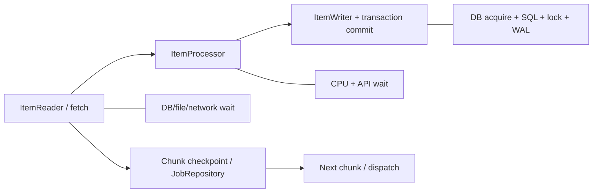
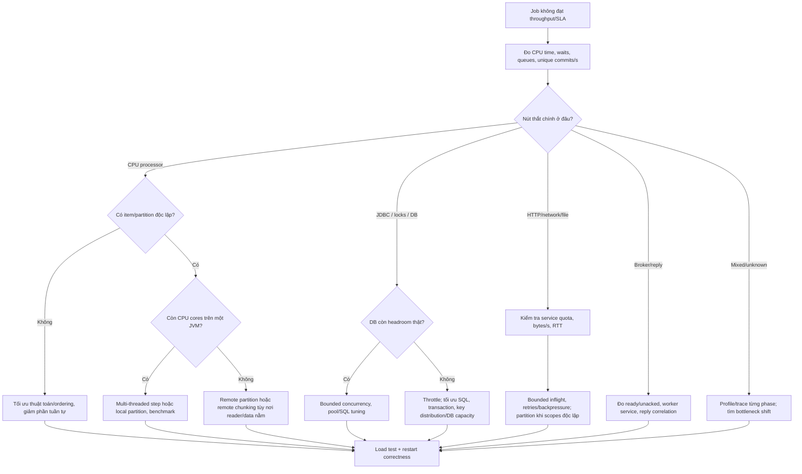
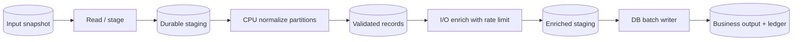
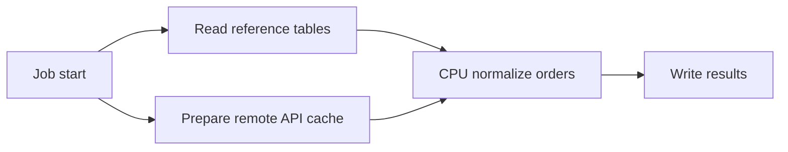
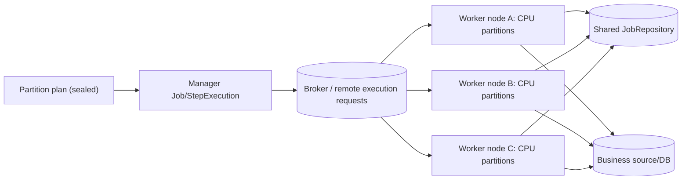

# Chọn theo CPU hay IO: ma trận quyết định mở rộng Spring Batch đúng nút thắt

## 1. Bài toán: thêm worker nhưng Job không nhanh hơn

Một Job Spring Batch đọc 20 triệu bản ghi, chuẩn hóa dữ liệu rồi ghi PostgreSQL. Phiên bản ban đầu chạy một thread mất 90 phút. Đội triển khai tăng `TaskExecutor` lên 16 threads và thêm 8 worker pods; Job vẫn chạy 85–95 phút, trong khi `HikariCP pending`, database lock wait và số lần rollback tăng mạnh. Ở một Job khác, 8 threads giúp thời gian giảm từ 120 phút xuống 20 phút vì xử lý JSON/regex thực sự sử dụng nhiều CPU và từng partition độc lập.

Hai kết quả trái ngược xuất phát từ cùng một nguyên tắc: **mở rộng theo tài nguyên đang giới hạn thông lượng**, không theo số lượng dữ liệu hay số threads muốn sử dụng. Một workload **CPU-bound** cần thêm CPU, tối ưu thuật toán hoặc phân phối công việc tính toán; một workload **I/O-bound** có thể hưởng lợi từ concurrency để che thời gian chờ, nhưng sẽ dừng tăng tốc khi chạm giới hạn database, mạng, broker, API hoặc storage.

Bài thuộc chương **Ma trận lựa chọn** trong module `SPRING_BATCH_SCALING_OPERATIONS`. Mục tiêu module là mở rộng Spring Batch với workload dữ liệu lớn bằng **multi-threaded step, parallel steps, partitioning và những cách xử lý phân tán**, học cách đo nút thắt, giữ **thread safety, retry/restart** và chọn kiến trúc theo tài nguyên thực tế. Vì thế câu hỏi “chọn theo CPU hay IO” là **điểm khởi đầu của quyết định kiến trúc và vận hành**, không phải công thức cố định “CPU thì dùng X, I/O thì dùng Y”.

### Sau bài này, bạn có thể

1. Phân biệt **CPU-bound, I/O-bound, mixed workload** và trường hợp nghẽn do tranh chấp tài nguyên.
2. Đo thời gian **CPU thực**, thời gian chờ, throughput hữu ích, CPU throttling, JDBC connection acquire, database locks, broker queue và network latency.
3. Dùng Amdahl's Law, Little's Law và mô hình **service demand / bottleneck throughput** để dự báo giới hạn của concurrency.
4. Chọn có điều kiện giữa **single-threaded chunk**, **multi-threaded step**, **parallel flows**, **local partitioning**, **remote partitioning** và **remote chunking**.
5. Ước lượng số threads, worker pods, chunk size, connection pools và in-flight requests như **giả thuyết cần benchmark**, không làm theo “magic numbers”.
6. Thiết kế Java Spring Batch 5.2 đúng transaction, reader/writer scope, partition ownership và restart.
7. Benchmark, giám sát, quyết định scale up/down và xử lý overload mà không mất/trùng dữ liệu.

> **Phạm vi tham chiếu:** Spring Batch **5.2.x**, Spring Framework 6.x, Spring Boot 3.x, Java 17+, Micrometer, JDBC/PostgreSQL và Spring Integration khi dùng remote workers. Các con số CPU/IO, thời gian, throughput trong bài là **mô hình và ví dụ minh họa**, không phải phép đo trên môi trường của người học. Cần kiểm chứng tương thích API/driver/framework với phiên bản dự án thật.

## 2. CPU-bound và I/O-bound là gì trong một Batch Step?

### 2.1. CPU-bound

Một workload **CPU-bound** khi tốc độ xử lý bị giới hạn chủ yếu bởi **CPU compute capacity** mà việc tăng parallelism (trong giới hạn tài nguyên) làm CPU utilization cao hơn và tăng throughput, ít nhất cho tới khi các cores đạt giới hạn.

Ví dụ:

- Parse/normalize XML/JSON phức tạp trên lượng dữ liệu lớn, sau khi đã cache hoặc localize input.
- Chạy regex, validation nhiều quy tắc, mapping object graphs, encryption/compression.
- Tính toán aggregate hay thuật toán số học thuần CPU với input đã được đọc đủ nhanh.
- Xử lý mỗi item độc lập, không cần chờ remote DB/API lâu.

Dấu hiệu:

- `process CPU utilization` cao sát CPU quota/capacity **và** CPU time/item đáng kể.
- Phần lớn sampled stacks tiêu thụ CPU tại `ItemProcessor`/codec.
- Thêm threads dưới số cores khả dụng giúp tăng useful throughput; sau đó lợi ích giảm do contention/GC.
- JDBC acquire/SQL/network wait thấp so với compute time; downstream chưa bão hòa.

**CPU utilization cao chưa tự chứng minh processor là bottleneck.** CPU cũng có thể bận với GC, serialization, broker client, busy-spin hoặc metrics overhead. Phải xác định **CPU hữu ích** và service demand thực tế.

### 2.2. I/O-bound

Một workload **I/O-bound** khi nhiều thời gian của worker trôi qua trong **chờ đọc/ghi hoặc một tài nguyên bên ngoài**:

- Đọc/ghi JDBC, chờ connection từ HikariCP, lock wait, WAL/fsync.
- HTTP/gRPC gọi dịch vụ ngoài với p95/p99 cao và rate limits.
- Đọc S3/object storage, NFS, file system có độ trễ/throughput hữu hạn.
- Publish/consume message từ JMS/RabbitMQ/Kafka, chờ reply/correlation.
- Chờ network RTT hoặc thread pool executor điều phối I/O khác.

Dấu hiệu:

- CPU process thấp/không bão hòa nhưng `wall-clock` cho mỗi item lớn.
- Threads thường `WAITING`/`TIMED_WAITING`/blocked trong JDBC, sockets, locks hoặc pool.
- In-flight requests tăng, pending connections/queue wait tăng.
- Concurrency ban đầu có thể giúp che latency, nhưng tới ngưỡng sẽ khiến **latency, retries và backlog** cùng tăng.

**I/O-bound không có nghĩa “cứ thêm threads vô hạn”.** Khi bottleneck là DB locks, IOPS hay API quota, tăng concurrency thường **kéo dài hàng đợi** mà không tăng capacity.

### 2.3. Mixed workload

Một Batch Step có thể chứa CPU và I/O nối tiếp:

```text
Read JDBC 20ms
  → Deserialize/validate 8ms CPU
  → Enrich external API 70ms wait
  → Map/filter 12ms CPU
  → JDBC write + commit 25ms
```

Trong ví dụ giả định, mỗi item có **20ms CPU** và **115ms I/O/wall wait** nếu xử lý tuần tự. Có thể cần nhiều requests in-flight để giữ CPU busy, **nhưng** API/DB phải đủ capacity. Kịch bản khác có processor CPU 100ms và I/O 10ms, tối ưu theo CPU có thể phù hợp hơn.

Thêm nữa, bottleneck **di chuyển** theo:

- Số worker và threads.
- Phân phối kích thước items/chunks.
- Cache hit/miss, query plans và input skew.
- Thời điểm các services khác dùng chung DB/API.
- Broker replication, storage load và GC pressure.

Vì thế phân loại CPU/IO phải dựa trên **cửa sổ đo cụ thể**, có repeat và có thể thay sau tuning.

### 2.4. Latency khác throughput

- **Latency/item**: thời gian từ khi item được nhận tới khi xử lý xong (cần định nghĩa boundary).
- **Throughput**: số items/chunks/logical operations được xử lý mỗi giây.
- **Useful throughput**: **logical operations đúng và đã commit duy nhất** trên business side, không cộng retry/redelivery/restart attempts.
- **Makespan/job duration**: thời gian toàn JobInstance từ scheduler/admission đến business completion; có thể có thời gian chờ ở cuối vì một hot partition.

Một cấu hình tăng throughput nhưng làm p99 latency của requests khác tăng hoặc mất restartability chưa chắc là lựa chọn tốt.

## 3. Không chỉ nhìn CPU%: cách đo để phân loại đúng

### 3.1. Tách thời gian theo ranh giới



Đo **thời gian chạy ở mỗi boundary**, kèm queue/acquire wait bên trong. Chỉ đo `ItemWriter.write()` không tự bao gồm thời gian DB commit hoặc metadata transaction sau đó. Chỉ đo `ItemProcessor.process()` có thể gộp cả chờ HTTP và tính toán CPU; cần phân rã tiếp nếu muốn quyết định scale.

### 3.2. Một bảng phân loại nhanh

| Tín hiệu | CPU-bound khả dĩ | I/O-bound khả dĩ | Cần điều tra thêm |
| --- | --- | --- | --- |
| Worker CPU theo quota | Cao | Thấp/trung bình | GC hoặc CPU throttling có thể giả nghẽn |
| CPU time / wall time trong handler | Cao | Thấp | Nếu processor gọi HTTP, wall lớn không phải CPU |
| Threads `RUNNABLE` | Nhiều đang sử dụng CPU | Có thể ít | RUNNABLE đôi khi đang native syscall tùy JVM/platform |
| Hikari pending/acquire p95 | Thấp | Có thể cao | Pool too small hoặc DB chậm/locks |
| DB lock wait/IO latency | Thấp | Có thể cao | Hot keys, connection pressure, slow query |
| Executor queue age | Có thể tăng khi cores đầy | Có thể tăng khi workers block | Phân biệt dispatcher vs worker |
| Broker ready/unacked/reply pending | Thấp nếu không dùng broker | Có thể cao | Request và reply có thể nghẽn khác nhau |
| Scaling threads 1→2→4→8 | Tăng tới cores | Tăng tới downstream capacity | Đo cả throughput lẫn p99/errors |
| GC pause/allocation | Có thể cao do CPU mapping | Có thể cao do large buffers | Tăng threads làm heap pressure |
| Useful commits/s | Tăng khi CPU thêm và DB còn headroom | Tăng đến mức DB/API capacity | Đếm đúng deduplicated commits |

**Không được suy “CPU thấp → I/O bottleneck cần nhiều threads”** nếu workload đang đợi scheduler, bị backpressure có chủ đích, một partition có serial ordering hoặc JobRepository đang không phát công việc.

### 3.3. Phân biệt queue wait và service time

Đặt:

\[
T_{\mathrm{response}} =
T_{\mathrm{admission}}+
T_{\mathrm{queue}}+
T_{\mathrm{service}}+
T_{\mathrm{accounting}}
\]

- `Admission`: trước khi producer/executor/broker nhận công việc.
- `Queue`: đợi được chọn chạy; có thể nằm trong executor queue, broker ready, prefetch buffer.
- `Service`: worker thực thi CPU/I/O, kết thúc transaction/business effect.
- `Accounting`: manager nhận response, persist metadata/ack/reply.

Một job chậm vì `queue wait` **không đồng nghĩa** bản thân `ItemProcessor` chậm. Đo từ lúc submit đến lúc start và từ start đến commit; nếu middleware nhiều hops, thêm correlation/spans theo từng queue.

### 3.4. CPU của container khác CPU host

Trong Kubernetes:

- `CPU usage cores` có thể là 1 core nhưng pod chỉ được quota 1 core; `cpu% trên host` có thể trông thấp.
- `CFS throttling` làm threads chờ CPU quota dù node còn tài nguyên.
- `requests/limits`, node contention và autoscaling khác nhau ảnh hưởng throughput.
- Một container có 2 vCPU quota không nên tạo 32 CPU-bound workers rồi kỳ vọng 16× throughput.

Đo **process CPU**, **container CPU quota/throttled time**, `availableProcessors` trong JVM theo cấu hình container, host contention và GC. **Không suy số cores khả dụng chỉ từ Java thread count**.

## 4. Công thức hữu ích, nhưng không có “magic number”

### 4.1. CPU parallelism giới hạn bởi số cores

Với một thuật toán có phần tuần tự `s` và `N` workers, Amdahl's Law cho giới hạn lý tưởng:

\[
S(N)\leq \frac{1}{s+\frac{1-s}{N}}
\]

Ví dụ `s=0.15` thì ngay cả với `N=16`:

\[
S(16)\leq \frac{1}{0.15+0.85/16}\approx 4.92
\]

Đây là **upper bound** trong mô hình đơn giản, chưa trừ serialize, memory bandwidth, synchronization, coordinator, DB, broker, GC và queueing. Trong Spring Batch, phần tuần tự có thể là single-threaded reader/manager, shared writer lock, metadata update, một partition nóng hoặc final aggregation.

### 4.2. Little's Law cho công việc đang xử lý

Ở trạng thái ổn định, cùng population:

\[
L=\lambda W
\]

`L` là số requests/items trung bình đang trong một hệ thống, `λ` là throughput hoàn tất, `W` là thời gian trung bình trong hệ thống. Ví dụ API p95 chưa đủ để dùng Little's Law; cần **mean** latency và trạng thái gần ổn định.

Nếu trung bình mỗi remote request cần 200 ms và muốn duy trì 100 requests/s, số request in-flight trung bình theo mô hình xấp xỉ là **20**. Đó không phải “20 threads bắt buộc”: worker có thể hỗ trợ async/concurrent I/O, có batching; và API có thể chỉ nhận tối đa 30 requests/s.

### 4.3. Công thức threads ~ cores × (1 + wait/compute)

Một heuristic cho blocking I/O tasks:

\[
N_{\mathrm{threads}}\approx
N_{\mathrm{CPU}}\left(1+\frac{T_{\mathrm{wait}}}{T_{\mathrm{compute}}}\right)
\]

Ví dụ 4 cores, CPU 10 ms và wait 40 ms mỗi task cho ước lượng **20 threads** để che chờ, **nếu** các tasks độc lập, downstream chịu nổi concurrency và bottleneck chưa chuyển.

Nhưng công thức này **không áp dụng máy móc** khi:

- Có JDBC pool chỉ cho 8 connections hoặc API quota 10 req/s.
- DB row locks khiến wait tăng theo concurrency.
- Chunk transaction giữ connection trong lúc gọi API lâu.
- Work có ordering/partition scope độc quyền.
- Heap, memory bandwidth hoặc broker in-flight đã tới trần.
- Một phần work thực hiện asynchronous/nonblocking I/O, không giữ một thread mỗi request.

Heuristic chỉ là **điểm xuất phát cho load-test matrix**, phải kẹp theo ngân sách tài nguyên.

### 4.4. Tốc độ hữu ích bị giới hạn bởi tầng nhỏ nhất

Một pipeline nối tiếp với năng lực tối đa:

```text
Reader source        18,000 items/s
CPU processor        12,000 items/s
JDBC writer           5,000 items/s
Broker/reply          9,000 items/s
```

Khi các tầng phải xử lý cùng population, throughput ổn định tối đa xấp xỉ:

\[
\mu_{\mathrm{pipeline}}\leq
\min(\mu_{\mathrm{reader}},\mu_{\mathrm{CPU}},
\mu_{\mathrm{writer}},\mu_{\mathrm{broker}})
\]

Trong ví dụ writer 5.000 items/s là giới hạn. Tăng CPU workers từ 12.000 lên 24.000 items/s sẽ **không** làm pipeline đạt 24.000; backlog và DB contention có thể tăng.

Đó là cách hiểu **bottleneck shift**: sau khi tối ưu writer lên 10.000 items/s, broker 9.000 có thể thành trần kế tiếp.

### 4.5. “Utilization sát 100%” là vùng rủi ro queueing

Khi đến gần công suất bão hòa, một biến thiên nhỏ trong arrival/service time có thể làm **queueing latency tăng rất mạnh**, đặc biệt với tail distribution và shared locks.

Đối với I/O, không tối ưu để `Hikari active=max` hoặc broker workers chạy 100% kéo dài mà không có headroom. Hãy tìm **knee point**: điểm tăng concurrency bắt đầu mang lại rất ít useful throughput nhưng làm p95/p99 latency, retries và tài nguyên tăng nhanh.

## 5. Mô hình workload: cùng một Job có thể đổi bottleneck theo pha

Một Job điển hình:


Nếu chỉ có một Step xử lý tất cả, wall-clock là hỗn hợp CPU/I/O. Có ba cách tiếp cận:

1. **Giữ một chunk Step và đo/điều chỉnh concurrency có giới hạn** khi correctness và checkpoint cho phép.
2. **Tách thành các Steps theo phase** (staging → enrich → commit) để điều chỉnh resources cho mỗi phase, nhưng phải tính latency/disk cho intermediate data và restart.
3. **Partition theo phạm vi dữ liệu** để mỗi worker tự đọc/ghi phạm vi riêng, rồi scale pods khi data sources và ownership cho phép.

Không có một lựa chọn “tốt nhất” phổ quát; cần xem **bottleneck thật, độc lập của tasks, dữ liệu trung gian, số DB connections, latency target và khả năng restart**.

## 6. Ma trận lựa chọn: CPU, I/O và ràng buộc kiến trúc

Bảng này là **ma trận sàng lọc ban đầu**, không phải quy tắc tự động:

| Kiểu workload và ràng buộc | Lựa chọn nên thử trước | Lựa chọn thử khi lớn hơn | Điều kiện quan trọng |
| --- | --- | --- | --- |
| Input nhỏ, dễ xử lý, SLA thoải mái | **Single-threaded chunk step** | Tune reader/writer/chunk size | Đơn giản, restart rõ ràng |
| CPU nặng, item độc lập, một JVM còn cores | **Multi-threaded step** hoặc local partitioning | Remote partitioning | Thread-safe reader/writer; CPU quota và heap đủ |
| CPU nặng, cần nhiều nodes, dữ liệu chia được thành ranges/files | **Remote partitioning** | Scale workers theo partitions | Partition plan ổn định, business writer idempotent |
| CPU nặng ở processor, reader tập trung, workers không tự đọc input | **Remote chunking** khi phù hợp | Worker consumers với broker | Manager read throughput và request/reply overhead không là bottleneck |
| Nhiều Steps độc lập theo chức năng | **Parallel flows/steps** | Remote hóa từng step nếu thật cần | Không có dependency dữ liệu, DB capacity chung đủ |
| I/O JDBC chậm vì pool nhỏ nhưng DB dư headroom | Pool/concurrency tuning **có đo** | Local partitioning | Tính **tổng** connections, not just per pod |
| I/O JDBC chậm do locks/IO/DB saturation | **Tối ưu SQL/index/transaction**, throttle | Sharding/partition theo keys sau thiết kế | Thêm workers có thể gây hại |
| I/O external API với latency lớn, service có quota | **Bounded concurrency** và retry/backpressure | Split remote workers/async nếu được phép | Quota, idempotency, rate limits |
| I/O file/object storage, nhiều files độc lập | **Partition theo file/resource** | Remote partitioning | File stability/snapshot, IO throughput và checkpoint |
| One hot partition, ordering/single owner | Tối ưu hot query/algorithm | Repartition **run sau** hoặc algorithm change | Không giao trùng scope đang chạy |
| Broker request/reply p99 lớn | Phân rã middleware/worker/reply | Tune prefetch, request size, reply handler | Không tự scale worker khi reply/DB nghẽn |
| CPU và I/O cùng có chi phí lớn | **Đo từng phase**, bounded pipeline | Tách steps/partition theo resource budgets | Tránh quá nhiều in-flight, checkpoint khó |

**CPU-bound** thường hướng tới **tăng compute parallelism ở nơi dữ liệu và logic độc lập**. **I/O-bound** thường hướng tới **che latency có giới hạn hoặc tăng capacity ở chính I/O service**. Hai nhóm dùng chung một giới hạn: **không thể scale vượt tài nguyên thấp nhất trong pipeline**.

### 6.1. Ma trận theo chi phí và độ phức tạp

| Kiến trúc | Chi phí điều phối | Mức phân tán | Restart/correctness cần chú ý |
| --- | --- | --- | --- |
| Single-threaded chunk | Thấp | Một JVM/StepExecution | Checkpoint/transaction đơn giản nhất |
| Multi-threaded step | Thấp–trung bình | Một JVM/nhiều threads | Reader/writer shared state; concurrency/chunk order |
| Parallel steps | Trung bình | Một JVM/nhiều flows | Step dependencies và DB/resource contention |
| Local partitioning | Trung bình | Một JVM/nhiều StepExecutions | Phạm vi disjoint, partition naming, gridSize |
| Remote partitioning | Cao | Nhiều JVM/nodes | Dispatch, shared repository, ownership, fencing |
| Remote chunking | Cao | Manager + worker pool qua broker | Manager bottleneck, request/reply correlation, ACK, idempotency |

Mức độ phức tạp không chỉ là số classes: broker clustering, operational metrics, monitoring DLQ, failures giữa DB commit và reply, rollout đa phiên bản, RPO/RTO đều có chi phí.

### 6.2. Sơ đồ quyết định



**Nhánh hỏi “CPU hay I/O” không có câu trả lời chỉ dựa trên một số CPU%.** Nhiều threads đang `RUNNABLE` nhưng CPU throttled là một vấn đề cấp CPU quota; nhiều threads blocked vào cùng DB row là một vấn đề **serialization/locking** dù JDBC thuộc I/O.

## 7. CPU-bound: các cách scale có hiệu quả

### 7.1. Tăng worker threads trong giới hạn CPU

Giả sử processor dành 5 ms CPU/item. Một core lý tưởng chỉ xử lý khoảng 200 items/s chưa tính overhead. Với bốn cores, upper bound CPU thuần là khoảng 800 items/s nếu các items độc lập, thread scheduling hoàn hảo và không có công việc khác.

**Tăng threads từ 4 lên 32 trên pod được cấp 4 vCPU không tạo thêm 28 cores.** Nó có thể gây:

- Context switches và synchronization overhead.
- Giao tranh shared mutable state/queues.
- CPU throttling, allocation rate/GC tăng.
- Memory locality/cache misses.
- Tăng thời gian giữ `ItemReader`/`ItemWriter` hoặc DB transaction.

Bắt đầu benchmark 1/2/4/8 threads với **CPU available=4**, xem throughput và efficiency. Nếu ở 4 threads CPU đã fully utilized và throughput không tăng ở 8, chọn tối ưu processor hoặc **thêm CPU/nodes với partitioning** thay vì thêm threads mù quáng.

### 7.2. Tối ưu compute trước hoặc song song với scale

Những hướng thường hiệu quả:

- Profile `ItemProcessor` bằng JFR/async-profiler hoặc Java CPU profiler được phê duyệt.
- Tránh regex compilation lại mỗi item, parse nhiều lần, reflection/object mapping lặp.
- Giảm allocations/boxing, copy payload không cần thiết, serialize qua lại nhiều lần.
- Kiểm tra contention từ static caches, synchronized shared state và logging mỗi item.
- Phân biệt CPU hữu ích với GC/codec/cryptography/metrics overhead.
- Đánh giá vectorization/batching cho thuật toán có thể gộp.

Nếu CPU profiling cho thấy 50% thời gian trong JSON mapping, scale nodes chỉ là một phần: **giảm deserialize một lần ở manager và deserialize lại ở worker** có thể tiết kiệm compute + broker bytes.

### 7.3. Khi chọn multi-threaded step?

Hợp lý khi:

- Item-level work độc lập, không phụ thuộc processing order.
- `ItemReader`/`ItemProcessor`/`ItemWriter` tương thích concurrency hoặc được scope/decorate an toàn.
- Một JVM có nhiều cores và DB/input không là bottleneck.
- Có thể chứng minh restart không đọc trùng/làm sai checkpoints.

Không nên nếu reader có shared cursor không thread-safe và không có cách an toàn để giao công việc. **Single `StepExecution` với nhiều threads khác** với mỗi thread có StepExecution riêng; checkpoint granularity và semantics cần kiểm chứng.

### 7.4. Khi chọn local/remote partitioning?

Nếu input có thể chia thành **phạm vi không chồng lấn**, partitioning thường giúp quản lý độc lập:

```text
source orders_snapshot_2026_11_26
  partition0000: id [0,  250000)
  partition0001: id [250000, 500000)
  partition0002: id [500000, 750000)
  partition0003: id [750000,1000000)
```

- Mỗi partition được giao `ExecutionContext` riêng và worker step có checkpoint riêng.
- Local partitioning chạy trên một JVM, không yêu cầu message broker.
- Remote partitioning cho phép thêm CPU ở nhiều JVM/nodes, **nếu** nguồn dữ liệu, business writer, JobRepository và mạng chịu được.

Nếu các ranges dùng cùng một DB primary đã chạm CPU/IO, remote workers **không giúp** chỉ vì compute phân tán. Tối ưu partition key theo locality và lock collision; tránh hai partitions cùng ghi một hot aggregate.

### 7.5. Khi cân nhắc remote chunking cho CPU-bound processor?

Remote chunking có lợi khi:

- Manager có thể đọc/serialize input nhanh hơn workers xử lý.
- CPU nặng chủ yếu ở processor/worker.
- Worker không cần tự truy cập source/reader; phân phối chunks linh hoạt cho consumers.
- Broker request/reply/durability cost chấp nhận được.

Nhưng:

- **Manager ItemReader** vẫn là single/một số producer path; có thể thành bottleneck.
- `ChunkRequest<T>` lớn tăng serialization, broker memory/disk và network.
- Reply correlation/ACK failure window khiến business writer phải idempotent.
- Worker scaling bị giới hạn bởi DB writer, broker, reply channel và manager checkpoint.

**Không mặc định CPU-bound ⇒ remote chunking.** Nếu source có thể partition theo file/range và worker tự đọc, **remote partitioning** thường loại bỏ manager read bottleneck và giảm traffic items qua broker.

## 8. I/O-bound JDBC: tại sao thêm threads đôi khi chậm hơn?

### 8.1. Ba loại chờ trong JDBC

| Chờ | Quan sát | Điều cần sửa |
| --- | --- | --- |
| **Connection acquisition** | Hikari pending, acquire p95 tăng | Pool budget, worker count, transaction lifetime |
| **Query/IO** | Slow SQL, bytes read/write, disk IO, query plans | Index/paging/batching, storage throughput |
| **Lock/commit** | `pg_blocking_pids`, lock wait, WAL/fsync/commit p95 | Partition key, transaction/lock order, contention |

Chúng đều có thể làm Java threads **WAITING**, nhưng cách sửa khác hẳn:

- Pool pending dù DB có headroom: điều chỉnh pool/concurrency hợp lý.
- Slow query vì thiếu index: tăng threads chỉ tạo thêm slow queries.
- Lock hot row: nhiều workers làm **nhiều transactions đứng chờ cùng khóa**.

### 8.2. JDBC pool là ngân sách toàn hệ

Ví dụ:

```text
DB max_connections = 200
Reserve for admin/other services = 100
Budget cho batch = 100 connections

10 worker pods * Hikari maxPoolSize=20 = 200 possible
→ cấu hình có thể vượt budget 100
```

**Không nhất thiết 10 pods lập tức mở 200 connections**, nhưng risk budget là 200. Nếu JobRepository dùng pool riêng hoặc có read/write DataSources riêng, phải cộng thêm. Để giữ budget 100, có thể chọn 10 pods × 8 connections và dự trù manager/admin/other overhead, rồi benchmark.

Không phân bổ 100% max_connections cho batch; DB cần headroom để phục vụ ứng dụng khác, failover và vận hành.

### 8.3. Vì sao Hikari pending cao cần phân tích thêm?

Hikari pending tăng khi caller phải chờ một connection. Nhưng có ít nhất ba giả thuyết:

1. Pool nhỏ hơn nhu cầu hợp lý và DB còn năng lực.
2. Transactions giữ connections lâu vì SQL/lock/external API wait.
3. Quá nhiều worker tasks được admit so với business DB capacity.

Nếu chỉ tăng pool từ 10 lên 30 khi SQL đã giữ lock 10 giây, có thể làm số transactions chờ DB tăng gấp ba mà useful commits/s không đổi. Xem **connection usage time** và `pg_stat_activity` trước khi chỉnh.

### 8.4. Chọn chunk size khi writer là I/O bottleneck

Chunk nhỏ:

- Nhiều transaction commits/context updates.
- Có thể giảm peak memory và lock hold time.
- Replay window nhỏ hơn nếu chunk thất bại.

Chunk lớn:

- Giảm commit overhead nếu database hỗ trợ batching tốt.
- Có thể cải thiện writer throughput trong trường hợp cost-per-commit lớn.
- Tăng transaction/lock duration, WAL, rollback cost và memory pressure.

**Không có chunk size tối ưu chung cho PostgreSQL/JMS.** Benchmark ở các mức 50/200/500/1.000 dựa trên item bytes, DB locks, commit p95/p99, throughput hữu ích và restart cost. Nếu tăng chunk size khiến connection usage time cao hơn nhiều, throughput có thể **giảm**.

### 8.5. Partition theo DB key và hotspot

Partition key là lựa chọn quan trọng hơn số threads. Ví dụ bảng giao dịch có 90% dữ liệu thuộc một tenant lớn:

- Chia 10 partitions theo `tenantId` có thể tạo **một hot partition** chi phối makespan.
- Chia theo hash của `transactionId` có thể phân tải nhưng vi phạm thứ tự xử lý/aggregation per tenant.
- Chia theo range ID trong một snapshot cố định có thể giữ scope ổn định nhưng phải kiểm tra skew và index.

Thiết kế partition theo **business invariants + data distribution + DB index locality + restart stability**. Không thay scope của JobInstance đang chạy tùy ý vì dễ gây overlap/gap.

## 9. I/O-bound HTTP/API: concurrency, quota và idempotency

Một `ItemProcessor` gọi 3 dịch vụ REST để enrich mỗi bản ghi có thể tốn vài trăm milliseconds dù CPU local rất thấp.

### 9.1. Không lấy latency làm capacity

Ví dụ:

```text
Average API response time       200 ms
Service upstream quota          100 requests/s
Average item needs              2 API requests
Business max sustainable rate   <= 50 items/s
```

Ngay cả khi dùng 100 worker threads, quota upstream vẫn chặn tốc độ xấp xỉ **50 items/s** trước khi tính retries. Little's Law gợi ý khoảng 20 requests in-flight để đạt 100 req/s nếu latency trung bình 200 ms và hệ ở steady state; **không phải** cứ đặt 20 là upstream sẽ bảo đảm 100 req/s, hay 200 in-flight sẽ đạt 1.000 req/s.

Nếu API trả `429 Too Many Requests`, hãy giảm admission và tôn trọng `Retry-After` khi phù hợp, dùng bounded exponential backoff/jitter; không kích hoạt 32 retries ngay lập tức khiến thundering herd.

### 9.2. Giữ DB transaction ngắn

Antipattern phổ biến:

```text
BEGIN DB transaction
  acquire DB connection
  call remote HTTP API (up to 10s)
  update DB
COMMIT
```

Trong khi chờ HTTP, transaction có thể giữ DB connection/locks, làm các threads khác thiếu JDBC resources. Với Spring Batch chunk Step, chính xác **transaction boundary của ItemReader/ItemProcessor/ItemWriter** phụ thuộc framework/cấu hình; cần xác định HTTP có nằm trong transaction hay không, vì mặc định chunk transaction thường bao phủ read/process/write của chunk.

Một lựa chọn kiến trúc:

1. Tách enrich/staging phase ra khỏi write transaction, hoặc cache pre-fetched results có quy tắc replay.
2. Đảm bảo external call có **idempotency key** nếu có side effect.
3. Trong writer, batch DB write trong transaction ngắn với results đã được xác minh.

Nhưng khi tách phases, phải quản lý **durable intermediate data** và recovery: không đặt transient in-memory stage giữa JobInstances rồi giả định restart sẽ còn.

### 9.3. Chọn bounded concurrency thay vì mở hàng trăm threads

```text
API quota                100 req/s
API max concurrent       30
Worker JVMs              5
Proposed per-JVM inflight max = 5
Cluster total inflight   25 (<= 30)
```

Đây là **budget ví dụ**. Nếu scale pods từ 5 lên 10 mà mỗi pod vẫn 5 in-flight, cluster total = 50 > API limit 30. Cần **shared admission limiter/rate limiter** hoặc policy phân bổ mới, không chỉ config trong từng pod.

Khi request timeout, không mặc định external operation chưa thực hiện. Nếu remote API có side effect, cần **stable business operation ID**, server-side deduplication hoặc workflow compensation.

### 9.4. Blocking vs asynchronous I/O

Nếu workload dành 95% thời gian chờ remote API và worker library hỗ trợ async I/O, một cấu trúc **bounded async pipeline** có thể giảm số Java threads đang chờ. Nhưng:

- Spring Batch chunk transaction vẫn cần **commit/checkpoint ở ranh giới đúng**.
- `AsyncItemProcessor`/`AsyncItemWriter` có semantics và limits riêng; không tự chuyển framework thành một nonblocking event loop.
- `Future`/`CompletableFuture` có thể tích tụ trong heap nếu producer không bounded.
- Ordering, exception propagation, retries và `ExecutionContext` phải được test.

Đừng ghép một `@Async` vào `ItemWriter` rồi trả về ngay trước khi DB commit: Step có thể báo success/commit checkpoint khi business side effect chưa hoàn tất.

## 10. I/O-bound file/object storage: băng thông, độ trễ và partitioning

### 10.1. Latency-bound khác bandwidth-bound

Với object storage:

- Đọc nhiều file nhỏ có thể bị giới hạn bởi **request overhead/latency**.
- Đọc vài file rất lớn có thể bị giới hạn bởi **network bandwidth, server throughput hoặc disk throughput**.
- Nhiều readers song song giúp che latency ở các requests nhỏ, nhưng có thể đụng API quotas hoặc saturate network.

Nếu một host có network budget xấp xỉ 1 Gbit/s (lý tưởng ~125 MB/s trước overhead), 100 threads cùng tải từ object storage **không làm host đạt 1 GB/s**. Cần đo bytes/s, p95 request latency, throttling và retries.

### 10.2. Partition theo file

Ví dụ manifest bất biến:

```text
fileA.csv (1.2 GiB)
fileB.csv (800 MiB)
fileC.csv (100 MiB)
fileD.csv (50 MiB)
```

Mỗi file là một logical partition nếu files độc lập và có version/snapshot. Nhưng data skew rất lớn: pA có thể chiếm đa số makespan. Nếu cần split một file, phải chia theo **record boundaries**, format-specific offsets và checkpoint; không cắt một CSV/compressed file bằng byte offset bất kỳ mà bỏ qua quoted newlines/multibyte characters.

### 10.3. File consistency và restart

Một reader restart từ offset N chỉ đúng khi source file/object version không đổi. Nếu file bị overwrite, cùng offset có thể trỏ sang record khác; cần version ID/ETag/checksum hoặc immutable URI trong manifest.

Khi có ghi ra files:

- Stage output trong path theo `runId/partitionId/attempt` để tránh hai owners ghi đè.
- Chỉ **publish/rename/commit manifest** sau khi kiểm chứng đầy đủ.
- Nếu object storage rename không atomic theo provider, cần atomic manifest/pointer commit hoặc idempotent reconciliation.
- Đối chiếu số records/checksums, không coi `WRITE_COUNT` là số bytes đã publish durable.

## 11. Mixed CPU/I/O: khi nào tách stages có lợi?

Một Step vừa parse JSON nặng vừa gọi API vừa ghi DB có thể gặp hiện tượng **thread bị giữ** trong khi chờ remote I/O. Muốn tối ưu, ta có thể tách những phases có resource budget khác nhau:



Ưu điểm:

- CPU normalization scale theo cores; API enrichment giới hạn bởi quota riêng.
- DB writes có thể commit theo batch, không giữ transaction khi HTTP wait.
- Restart mỗi phase riêng, biết work nào đã hoàn thành/đối soát.
- Có thể cấp worker pool chuyên biệt cho CPU và I/O.

Chi phí:

- Thêm đọc/ghi staging, storage và operational cost.
- Phải quản lý schema/version của intermediate data, retention và data privacy.
- E2E latency có thể tăng do materialization.
- Nếu partitions không thống nhất snapshot, có nguy cơ dữ liệu không nhất quán.

**Chỉ tách phase khi bottleneck và SLA chứng minh có lợi**, không dựng thêm broker/storage vì “microservices là scalable”.

### 11.1. Parallel steps không tự tạo pipeline streaming

Spring Batch có thể chạy **parallel flows/steps** trên executor nếu chúng **độc lập về dữ liệu/phụ thuộc**. Nhưng hai steps có quan hệ `extract → transform` mà transform cần đầu ra extract đầy đủ không thể chạy song song bằng cách đơn giản đặt `split()`; cần staging và dependency/ordering được thiết kế.

Nếu một pipeline có hai công đoạn làm trên cùng item nhưng kết quả item trước phải bảo đảm commit trước công đoạn sau, dùng queues/staging phải thiết kế delivery/acknowledgement và recovery, không chỉ chuyển flow thành parallel bằng một nút.

### 11.2. Kiến trúc vẫn phải trả lời “ai sở hữu item?”

Với mỗi logical operation:

- Ai tạo/claim nó?
- Nó thuộc JobInstance/manifest/partition nào?
- Có bao nhiêu workers được phép xử lý đồng thời?
- Khi worker chết, checkpoint/ledger nào xác nhận đã hoàn tất?
- Nếu Phase B bắt đầu trước Phase A hoàn tất, làm sao không xử lý partial input?
- Nếu receiver đọc cùng record hai lần, side effect có idempotent không?

Nếu không trả lời được, việc tăng throughput kỹ thuật có thể tạo **mất/trùng nghiệp vụ**.

## 12. Java Spring Batch 5.2: baseline và multi-threaded Step có giới hạn

Ví dụ sau minh họa cách chuyển một chunk Step từ single-thread sang multi-threaded step **có ThreadPoolTaskExecutor riêng**. DTO, reader và writer là ứng dụng tự định nghĩa; quan trọng là lựa chọn concurrency và lifecycle.

### 12.1. Cấu hình executor với số threads hữu hạn

```java
// BatchExecutorConfig.java
package example.batch.scaling;

import org.springframework.context.annotation.Bean;
import org.springframework.context.annotation.Configuration;
import org.springframework.scheduling.concurrent.ThreadPoolTaskExecutor;

@Configuration
public class BatchExecutorConfig {

    @Bean("batchChunkExecutor")
    public ThreadPoolTaskExecutor batchChunkExecutor() {
        ThreadPoolTaskExecutor executor =
                new ThreadPoolTaskExecutor();
        executor.setThreadNamePrefix("batch-chunk-");
        executor.setCorePoolSize(4);
        executor.setMaxPoolSize(4);
        executor.setQueueCapacity(16);
        executor.setWaitForTasksToCompleteOnShutdown(true);
        executor.setAwaitTerminationSeconds(60);
        return executor; // Spring quản lý initialize/shutdown bean.
    }
}
```

Đây là **cấu hình thí nghiệm CPU 4 vCPU**, không phải khuyến nghị mặc định 4 threads. `setWaitForTasksToCompleteOnShutdown(true)` hỗ trợ graceful completion ở mức executor; **không chứng minh** business transaction, broker ACK, JobRepository state hoặc toàn bộ remote workers đã kết thúc. Cần Kubernetes termination grace period và stop/restart policy phù hợp.

### 12.2. StepBuilder và `taskExecutor`

```java
// CpuBoundStepConfig.java
package example.batch.scaling;

import org.springframework.batch.core.Step;
import org.springframework.batch.core.configuration.annotation.StepScope;
import org.springframework.batch.core.repository.JobRepository;
import org.springframework.batch.core.step.builder.StepBuilder;
import org.springframework.batch.item.ItemProcessor;
import org.springframework.batch.item.ItemReader;
import org.springframework.batch.item.ItemWriter;
import org.springframework.beans.factory.annotation.Qualifier;
import org.springframework.context.annotation.Bean;
import org.springframework.context.annotation.Configuration;
import org.springframework.core.task.TaskExecutor;
import org.springframework.transaction.PlatformTransactionManager;

@Configuration
public class CpuBoundStepConfig {

    @Bean
    public Step cpuStep(
            JobRepository jobRepository,
            PlatformTransactionManager transactionManager,
            ItemReader<RawRecord> reader,
            ItemProcessor<RawRecord, NormalizedRecord> processor,
            ItemWriter<NormalizedRecord> writer,
            @Qualifier("batchChunkExecutor")
            TaskExecutor chunkExecutor) {
        return new StepBuilder("cpuStep", jobRepository)
                .<RawRecord, NormalizedRecord>chunk(
                        200, transactionManager)
                .reader(reader)
                .processor(processor)
                .writer(writer)
                .taskExecutor(chunkExecutor)
                .build();
    }
}
```

**Đây là snippet wiring**, `RawRecord`/`NormalizedRecord` và các ItemReader/Processor/Writer beans cần được ứng dụng định nghĩa. Để hoạt động đúng với multi-threaded step:

- Reader phải xử lý shared state an toàn hoặc dùng chiến lược reader/partition khác.
- Processor không được giữ mutable state dùng chung ngoài synchronization/idempotency phù hợp.
- Writer không được chia sẻ non-thread-safe buffers hoặc transactional resources sai.
- Tính thứ tự xử lý/commit chunks có thể khác với single thread; không dựa vào global FIFO khi framework không cam kết.
- Checkpoint và restart phải được thử sau crash giữa chunks.

Không chỉ thêm `.taskExecutor(...)` rồi mặc định `JdbcCursorItemReader` dùng chung thread-safe hoặc `ExecutionContext` không có race. Cơ chế synchronized reader có thể sửa race nhưng cũng có thể thành bottleneck tuần tự.

### 12.3. Reader example: phân biệt safe input assignment và shared cursor

Một `ListItemReader`/custom in-memory reader có mutable index không đương nhiên thread-safe. Nếu test CPU compute bằng một lượng input nhỏ cố định, có thể tạo `AtomicInteger` index:

```java
// InMemoryAtomicReader.java (diagnostic, not a restartable reader)
package example.batch.scaling;

import java.util.List;
import java.util.concurrent.atomic.AtomicInteger;
import org.springframework.batch.item.ItemReader;

public final class InMemoryAtomicReader<T>
        implements ItemReader<T> {
    private final List<T> items;
    private final AtomicInteger index = new AtomicInteger();

    public InMemoryAtomicReader(List<T> immutableItems) {
        this.items = List.copyOf(immutableItems);
    }

    @Override
    public T read() {
        int n = index.getAndIncrement();
        return n < items.size() ? items.get(n) : null;
    }
}
```

**Chỉ dùng minh họa kỹ thuật gán input trong benchmark/learning**. Reader này **không persist cursor trong `ExecutionContext`**, do đó **không restart-safe**; nhiều threads có thể lấy item trước, một chunk khác commit trước, nên chỉ lưu index cao nhất cũng không đủ chứng minh không mất item khi crash. Với production workload có restart requirement, ưu tiên **partition theo stable ranges/file keys**, hoặc một reader/queue claim protocol có checkpoint/idempotency được kiểm chứng.

### 12.4. Gắn một Step benchmark CPU-only

Để quyết định CPU scaling, tạo một `ItemProcessor` thuần chức năng không I/O, writer `no-op` **trong môi trường benchmark cô lập**, rồi đo throughput và CPU. Nhưng **không dùng kết quả CPU-only làm throughput cuối của production**, vì business writer/JDBC/broker còn cần tài nguyên.

So sánh bốn runs:

```text
A: single thread, production reader, no-op processor, no-op writer
B: single thread, production reader, CPU processor, no-op writer
C: 4 threads, production reader, CPU processor, no-op writer
D: 4 threads, production reader, CPU processor, real JDBC writer
```

- A chậm → reader/source bottleneck.
- B chậm hơn A rõ và CPU high → CPU processor đáng kể.
- C cải thiện với CPU high và read source ổn → có cơ sở scale CPU.
- D không tăng so C, Hikari/DB wait cao → bottleneck chuyển sang writer/DB.

Từng run phải dùng **input snapshot tương đương**; no-op writer chỉ dùng để cô lập bottleneck, **không được dùng để báo job business hoàn tất**.

## 13. Parallel steps: khi cả CPU và I/O có những bước độc lập

**Parallel flows/steps** chạy hai hoặc nhiều StepExecutions độc lập song song. Chúng khác **multi-threaded step** (nhiều threads cho chunks trong một StepExecution) và **partitioning** (một worker step được nhân thành StepExecutions theo các scopes dữ liệu).

Ví dụ job có:



Nếu `Read reference tables` và `Prepare remote API cache` thực sự không phụ thuộc, có thể chạy hai flow song song; thời gian pha chuẩn bị từ `T_A+T_B` lý tưởng gần `max(T_A,T_B)` thay vì tổng.

### 13.1. Tại sao không thể parallel hóa mọi Step?

Không được chạy parallel khi:

- Step B dùng output chưa commit của Step A nhưng không có coordination/staging.
- Hai steps cùng update một aggregate/row với ordering requirement.
- Hai steps cạnh tranh DB pool/storage bão hòa khiến từng step chậm hơn.
- Checkpoint/restart chưa xác định nếu một flow thất bại và flow kia đã publish.
- Một Step dùng trạng thái global mutable không thread-safe.

Parallel flows thường phù hợp với **độc lập nghiệp vụ** hơn là “CPU hay I/O” đơn thuần. Nếu hai phases dùng chung DB IO budget đang đầy, chạy song song có thể tăng makespan do contention.

### 13.2. Ví dụ Java Spring Batch 5.2 `split(TaskExecutor)`

```java
// ParallelPreparationJobConfig.java
package example.batch.scaling;

import org.springframework.batch.core.Job;
import org.springframework.batch.core.Step;
import org.springframework.batch.core.job.builder.FlowBuilder;
import org.springframework.batch.core.job.builder.JobBuilder;
import org.springframework.batch.core.job.flow.Flow;
import org.springframework.batch.core.repository.JobRepository;
import org.springframework.beans.factory.annotation.Qualifier;
import org.springframework.context.annotation.Bean;
import org.springframework.context.annotation.Configuration;
import org.springframework.core.task.TaskExecutor;

@Configuration
public class ParallelPreparationJobConfig {

    @Bean
    public Job prepareAndNormalizeJob(
            JobRepository jobRepository,
            Step loadReferenceStep,
            Step warmCacheStep,
            Step normalizeStep,
            @Qualifier("preparationExecutor")
            TaskExecutor preparationExecutor) {

        Flow referenceFlow = new FlowBuilder<Flow>("referenceFlow")
                .start(loadReferenceStep)
                .build();

        Flow cacheFlow = new FlowBuilder<Flow>("cacheFlow")
                .start(warmCacheStep)
                .build();

        Flow splitFlow = new FlowBuilder<Flow>("preparationSplit")
                .split(preparationExecutor)
                .add(referenceFlow, cacheFlow)
                .build();

        return new JobBuilder(
                "prepareAndNormalizeJob", jobRepository)
                .start(splitFlow)
                .next(normalizeStep)
                .end()
                .build();
    }
}
```

Snippet giả định `loadReferenceStep`, `warmCacheStep`, `normalizeStep` và `preparationExecutor` là beans có sẵn; nó chỉ minh họa **topology**. Đảm bảo dependency trong code project thật, transactional outcomes và retry/restart của các flows được test trên framework version mục tiêu.

### 13.3. Resource budgeting cho parallel flows

Nếu flow A cần 4 CPU cores và flow B cần 20 JDBC connections, việc chạy song song có thể tốt khi node/DB còn đủ. Nhưng nếu flow A cũng giữ 20 connections để đọc, tổng concurrent demand có thể vượt pool budget. **Thay vì “mỗi Step tự cấu hình 16 connections”, hãy tính budget toàn Job và cluster.**

## 14. Local partitioning: tách CPU work theo phạm vi dữ liệu

Local partitioning dùng manager Step và `PartitionHandler` trong **một JVM**, tạo worker `StepExecution` cho từng logical partition. Điểm mạnh so với multi-threaded step:

- Mỗi partition có `ExecutionContext` riêng, ví dụ `minId/maxId`, file path hoặc tenant.
- Reader/processor/writer có thể là **step-scoped instance**, tránh shared cursor giữa threads.
- Có thể thấy tiến độ/trạng thái/retry của từng partition trong JobRepository.
- Phù hợp khi cần partition ownership và restart theo scope.

Nhược điểm:

- Metadata/partition planning overhead.
- Tất cả workers chia sẻ CPU/heap/IO của **một JVM**.
- Nếu partition count rất lớn hoặc nhiều snapshots, JobRepository có nhiều StepExecutions.
- Nếu một partition có 90% dữ liệu, tăng `gridSize` không tự chia lại scope đó an toàn.

### 14.1. Ví dụ partition theo range ổn định

Một `Partitioner` nên tạo **tên và phạm vi lặp lại được**. Với một input snapshot gồm các ID trong `[0, 1_000_000)`, chia thành bốn logical ranges:

```java
// FixedRangePartitioner.java
package example.batch.scaling;

import java.util.LinkedHashMap;
import java.util.Map;
import java.util.Set;
import java.util.LinkedHashSet;
import org.springframework.batch.core.partition.support.Partitioner;
import org.springframework.batch.core.partition.support.PartitionNameProvider;
import org.springframework.batch.item.ExecutionContext;

public final class FixedRangePartitioner
        implements Partitioner, PartitionNameProvider {

    private final long startInclusive;
    private final long endExclusive;
    private final int partitionCount;

    public FixedRangePartitioner(long startInclusive,
                                 long endExclusive,
                                 int partitionCount) {
        if (startInclusive < 0 ||
                endExclusive <= startInclusive ||
                partitionCount < 1 ||
                partitionCount > endExclusive - startInclusive) {
            throw new IllegalArgumentException("Invalid fixed ranges");
        }
        this.startInclusive = startInclusive;
        this.endExclusive = endExclusive;
        this.partitionCount = partitionCount;
    }

    @Override
    public Map<String, ExecutionContext> partition(int gridSize) {
        // gridSize is a scheduling hint, not a change to the
        // sealed logical partition plan for this JobInstance.
        Map<String, ExecutionContext> result =
                new LinkedHashMap<>();
        long length = endExclusive - startInclusive;
        long base = length / partitionCount;
        long remainder = length % partitionCount;
        long cursor = startInclusive;

        for (int i = 0; i < partitionCount; i++) {
            long partSize = base + (i < remainder ? 1 : 0);
            long stop = cursor + partSize;
            ExecutionContext context = new ExecutionContext();
            context.putLong("range.minInclusive", cursor);
            context.putLong("range.maxExclusive", stop);
            result.put(name(i), context);
            cursor = stop;
        }
        return result;
    }

    @Override
    public Set<String> getPartitionNames(int gridSize) {
        Set<String> names = new LinkedHashSet<>();
        for (int i = 0; i < partitionCount; i++) {
            names.add(name(i));
        }
        return names;
    }

    private static String name(int index) {
        return String.format(
                java.util.Locale.ROOT, "partition%04d", index);
    }
}
```

**Quan trọng:** `partitionCount`, `startInclusive`, `endExclusive` và input snapshot phải **được chốt theo JobInstance**. Nếu cấu hình constructor thay đổi ở restart mà `PartitionNameProvider` trả names khác, framework có thể không khôi phục scope đúng. Trong hệ thật, đọc plan đã version hóa từ manifest/JobParameters đã kiểm soát, không lấy values mới từ `workerCount` sau một rolling deploy.

Đoạn code chia **không gian số ID**, không đảm bảo mỗi range có cùng số rows. Nếu IDs có gaps/skew, hãy thống kê histogram hoặc chia theo stable manifest; không thay range giữa job đang chạy.

### 14.2. Reader step-scoped theo partition context

```java
// Fragment ở @Configuration
@Bean
@StepScope
public JdbcPagingItemReader<RawRecord> rangeReader(
        DataSource dataSource,
        @Value("#{stepExecutionContext['range.minInclusive']}")
        Long from,
        @Value("#{stepExecutionContext['range.maxExclusive']}")
        Long to) {

    return new JdbcPagingItemReaderBuilder<RawRecord>()
            .name("rangeReader")
            .dataSource(dataSource)
            .selectClause("SELECT id, raw_payload")
            .fromClause("FROM source_record")
            .whereClause("WHERE id >= :fromId AND id < :toId")
            .sortKeys(Map.of("id", Order.ASCENDING))
            .parameterValues(Map.of("fromId", from, "toId", to))
            .rowMapper((rs, row) ->
                    new RawRecord(
                            rs.getLong("id"),
                            rs.getString("raw_payload")))
            .pageSize(200)
            .build();
}
```

Imports của fragment gồm `JdbcPagingItemReader`, `JdbcPagingItemReaderBuilder`, `Order`, `DataSource`, `@Bean`, `@StepScope`, `@Value` và `Map`. `RawRecord` là record ứng dụng (ví dụ `record RawRecord(long id,String rawPayload){}`). Query dùng named parameters và giả định `id` là key duy nhất/ổn định.

**Dù `@StepScope` giúp có reader instance cho từng worker StepExecution, restart safety vẫn phụ thuộc dữ liệu nguồn/ordering/row mapper/checkpoint**. Nếu source rows đổi trong lúc run, keyset/paging restart có thể đọc lại hoặc bỏ records. Chốt snapshot/transaction model; không chỉ dựa vào page number.

### 14.3. Gắn local partition manager với `TaskExecutorPartitionHandler`

```java
// Fragment ghép vào @Configuration
@Bean
public Step localPartitionManager(
        JobRepository jobRepository,
        Step partitionWorkerStep,
        FixedRangePartitioner partitioner,
        @Qualifier("partitionTaskExecutor")
        TaskExecutor executor) {

    TaskExecutorPartitionHandler handler =
            new TaskExecutorPartitionHandler();
    handler.setTaskExecutor(executor);
    handler.setStep(partitionWorkerStep);
    handler.setGridSize(4);

    return new StepBuilder(
            "localPartitionManager", jobRepository)
            .partitioner(
                    partitionWorkerStep.getName(), partitioner)
            .partitionHandler(handler)
            .build();
}
```

Imports tương ứng: `Step`, `JobRepository`, `StepBuilder`, `TaskExecutorPartitionHandler`, `TaskExecutor`, `@Qualifier` và `@Bean`. Các beans `partitionWorkerStep`, `partitioner`, `partitionTaskExecutor` được cấu hình ở chỗ khác.

`handler.setGridSize(4)` là **hint concurrency/planning**; bản `FixedRangePartitioner` trên sử dụng `partitionCount` cố định để giữ logical scopes. Nếu muốn tăng số worker threads từ 4 lên 8, không được tùy tiện đổi partitionCount của **JobInstance đang restart**; chỉ thay **scheduling resources** theo runbook sau khi xác minh ownership.

### 14.4. Đo hiệu quả local partitioning

Benchmarks nên đo:

- Tổng `completed logical partitions`/s và `unique committed operations`/s.
- Latency start→finish của từng partition.
- Executor submit-to-start delay, active threads, queue, rejections.
- CPU cores used, GC, heap, JDBC pending/acquire, DB locks.
- Mức skew: p50/p95/max partition duration và estimated remaining work.
- Restart với một partition FAILED và các partitions đã COMPLETED.

Nếu mọi partitions đều tranh một DB hot row, local partitioning không “CPU scale” được. Nếu một partition chiếm 80% work, khác biệt giữa `gridSize=4` và `gridSize=8` có thể rất ít.

## 15. Remote partitioning: khi một JVM không còn đủ CPU hoặc data-locality

Ở remote partitioning, manager phát **partition execution requests** đến workers nằm ở nhiều JVM/nodes. Mỗi worker thực thi phạm vi nguồn của mình và cập nhật `JobRepository` theo cấu hình; một số topology dùng replies, một số dùng `JobRepository` polling.



### 15.1. Remote partitioning thường hợp CPU khi nào?

- Input được chia thành file/range/hash buckets **ổn định và disjoint**.
- Mỗi worker có thể **tự đọc** dữ liệu trong phạm vi, không bắt manager serialize từng item.
- Processor CPU heavy, thêm nodes thực sự thêm CPU cores.
- Network chủ yếu truyền **partition context/metadata**, không truyền mọi records.
- Database/file storage đủ throughput và có connection budget cho tổng workers.

Khi I/O chính là database đã nghẽn, remote partitioning **chỉ di chuyển compute**, không tăng tốc DB. Nếu source storage có data locality (sharded datasets, object partitions), remote workers gần nguồn có thể giảm network, nhưng phải đo placement thực tế.

### 15.2. Những điều khiến remote partitioning phức tạp hơn

| Ranh giới | Cần thiết kế |
| --- | --- |
| Dispatch | Durable request, lease/ownership, retry khi worker fail |
| Metadata | JobRepository shared, transaction isolation, checkpoint |
| Input | Snapshot/version, stable partition names/ranges |
| Writer | Idempotency, unique operation IDs, out-of-scope reject |
| Failover | Old worker fencing, stale StepExecution, duplicate owner |
| Resource | Tổng CPU/heap/DB connections, broker requests, network |
| Deployment | Manager/worker compatibility, message schema, graceful drain |
| Observability | Start delay, commit progress, worker heartbeat, reply |

Đừng dùng Kubernetes replica count như bằng chứng có đúng một worker cho một partition. Broker redelivery/manager restart có thể giao lại, và old worker có thể vẫn đang ghi khi network bị partition. **Fencing/idempotency ở resource** vẫn cần.

### 15.3. Chọn số logical partitions khác số running workers

Ví dụ một manifest có **64 partitions** nhưng chỉ **8 worker slots**:

- Plan có 64 scopes và tên cố định.
- Broker/handler phân phối dần trong tối đa 8 slots, tùy cơ chế dispatch.
- Khi một worker chết, chỉ những scopes chưa hoàn tất cần recovery.
- Có thể tăng số slots từ 8 lên 12 theo config an toàn nếu DB/API budget cho phép, nhưng **không đổi 64 scopes thành 128 ngay khi restart**.

Số partitions quá ít làm workers nhàn rỗi; quá nhiều partitions làm overhead JobRepository/dispatch/metadata tăng. Cần benchmark **granularity vs skew vs recovery cost**.

## 16. Remote chunking: lựa chọn linh hoạt nhưng chịu thêm broker overhead

Remote chunking thường đặt `ItemReader` ở manager, gửi `ChunkRequest<T>` qua middleware đến workers, workers xử lý/ghi và trả `ChunkResponse`. Nó có thể cân bằng số chunks linh hoạt hơn static partition scopes, nhưng tạo thêm transport/serialization và một coordinator path.

### 16.1. Khi phù hợp

- Manager reader đọc từ nguồn **không dễ partition** hoặc cần global sequencing.
- CPU-heavy processor/transform có thể outsource đến worker consumers.
- Worker không cần tự truy cập source; chấp nhận shipping item payloads.
- Broker và reply path được đo, provision đủ và có durable delivery.
- Có idempotency khi request bị redeliver/response bị mất.

### 16.2. Khi không phù hợp

- Item payload cực lớn, serializing từng chunk qua broker tốn CPU/network/disk hơn tính toán.
- Manager reader đã chạm throughput limit, dù thêm workers không tăng producer rate.
- Worker phải đọc nhiều dữ liệu bổ sung từ DB đang bão hòa; broker chỉ thêm một queue.
- Strict global ordering khó duy trì khi multiple consumers xử lý out of order.
- Không có khả năng xử lý **commit then reply lost** mà không double side effect.

### 16.3. Công thức kiểm tra capacity sơ bộ

Giả sử:

```text
Source reader             8,000 items/s
Chunk size                200 items/request
Manager dispatch rate     <= 40 requests/s
Broker request+reply      <= 100 requests/s
Worker aggregate CPU      <= 25,000 items/s
Business DB writer        <= 15,000 items/s
```

**Manager reader 8.000 items/s là bottleneck đầu**, nên thêm worker nodes không khiến hệ vượt 8.000 items/s. Nếu nâng source reader lên 20.000, DB writer 15.000 trở thành bottleneck tiếp.

Đây là **capacity-budget example**, không phải “200 items/chunk ⇒ 40 requests/s luôn đúng”: chunks có thể nhỏ hơn, input records khác output, retries/redeliveries làm broker deliveries khác logical chunks.

### 16.4. Đặc biệt chú ý reply channel

Ngay cả khi worker đã commit DB, manager vẫn có thể pending vì:

- Reply channel/broker queue nghẽn.
- Reply consumer concurrency thấp.
- Correlation state không match/expired.
- Manager JobRepository update bị block/optimistic lock.
- Reply schema phiên bản mới không được manager cũ đọc.

**Không đo mọi request→reply RTT và gọi đó là broker latency.** RTT gồm worker CPU, DB commit và reply accounting. Tách producer send, broker ready/pre-fetch, listener entry, service, reply, manager account bằng tracing/metrics.

## 17. Instrumentation: đo CPU time và wall time trong processor

Để phân loại CPU/I/O, cần hiểu **CPU time consumed by thread** khác với **elapsed/wall time**. `System.nanoTime()` đo elapsed trong **một JVM**, còn `ThreadMXBean.getCurrentThreadCpuTime()` đo CPU time của thread khi JVM hỗ trợ và cho phép. Phần chênh **không phải chỉ thuần I/O**: nó có thể bao gồm lock waits, scheduler pause, GC safepoints, time slicing và I/O waits.

### 17.1. Ví dụ `ItemProcessor` decorator dùng Micrometer

```java
// CpuVsWallProcessorProbe.java
package example.batch.scaling;

import io.micrometer.core.instrument.MeterRegistry;
import io.micrometer.core.instrument.Timer;
import java.lang.management.ManagementFactory;
import java.lang.management.ThreadMXBean;
import java.util.concurrent.TimeUnit;
import org.springframework.batch.item.ItemProcessor;

public final class CpuVsWallProcessorProbe<I, O>
        implements ItemProcessor<I, O> {

    private final ItemProcessor<I, O> delegate;
    private final ThreadMXBean threads =
            ManagementFactory.getThreadMXBean();
    private final Timer wallTimer;
    private final Timer cpuTimer;

    public CpuVsWallProcessorProbe(
            ItemProcessor<I, O> delegate,
            MeterRegistry registry) {
        this.delegate = delegate;
        this.wallTimer = Timer.builder(
                    "batch.processor.wall.duration")
                .tag("stage", "normalize")
                .publishPercentileHistogram()
                .register(registry);
        this.cpuTimer = Timer.builder(
                    "batch.processor.cpu.duration")
                .tag("stage", "normalize")
                .register(registry);
    }

    @Override
    public O process(I item) throws Exception {
        boolean cpuSupported =
                threads.isCurrentThreadCpuTimeSupported()
                && threads.isThreadCpuTimeEnabled();

        long beforeWall = System.nanoTime();
        long beforeCpu = cpuSupported
                ? threads.getCurrentThreadCpuTime()
                : -1L;
        try {
            return delegate.process(item);
        } finally {
            long elapsedWall =
                    System.nanoTime() - beforeWall;
            wallTimer.record(
                    elapsedWall, TimeUnit.NANOSECONDS);

            if (cpuSupported && beforeCpu >= 0L) {
                long afterCpu = threads.getCurrentThreadCpuTime();
                if (afterCpu >= beforeCpu) {
                    cpuTimer.record(
                            afterCpu - beforeCpu,
                            TimeUnit.NANOSECONDS);
                }
            }
        }
    }
}
```

**Quan trọng:** `ThreadMXBean` CPU time được hỗ trợ/enable tùy JVM; nếu không có, `cpuTimer` không ghi sample. Không gắn label `itemId`, `requestId` hoặc `stepExecutionId` lên từng sample. Per-item timers có overhead; nên benchmark overhead, dùng sampling nếu processor rất nhẹ, không đo 10 triệu items bằng remote network telemetry synchronous.

### 17.2. Đọc kết quả đúng

Giả định 100.000 items:

| Stage | Mean wall | Mean CPU | Nhận xét |
| --- | ---: | ---: | --- |
| JSON mapping | 12 ms | 11 ms | Chủ yếu CPU |
| HTTP enrich | 150 ms | 3 ms | Chủ yếu wait/network, cần xem quota |
| JDBC lookup | 80 ms | 2 ms | Chờ DB/network/lock/pool, cần tách |
| Regex/validation | 25 ms | 24 ms | CPU heavy |

**Các giá trị là giả định**, không phải kết quả benchmark. Dù `wall-CPU≈147ms` ở HTTP enrich, không được gọi toàn bộ 147ms là “network latency”; scheduling/locks/GC cũng nằm trong đó. Muốn tách remote wait, cần client HTTP/JDBC instrumentation.

### 17.3. CPU time của một thread khác CPU utilization của pod

- CPU time của processor decorator đo chi phí trong đoạn code đo của **một thread**.
- CPU utilization của JVM/container đo tổng CPU của tất cả threads, bao gồm GC, networking, logging và executor overhead.
- `ProcessCpuTime` đo CPU tích lũy cả process trên một số JVM, nhưng phải chia theo elapsed/cores để diễn giải utilization.
- Khi container CPU throttled, wall time tăng mà CPU time có thể giữ nguyên.

Do đó hãy đọc **cả sample profile và cgroup/container CPU metrics** trước khi kết luận CPU-bound.

### 17.4. Micrometer chỉ là một phần

Spring Batch 5.2 có các nhóm metric `spring.batch.job`, `spring.batch.step`, `spring.batch.item.read`, `spring.batch.item.process`, `spring.batch.chunk.write` khi MeterRegistry/observation được cấu hình phù hợp. Chúng hữu ích cho **thời gian tại các operations**, nhưng không tự phân biệt CPU time với I/O wait hoặc cung cấp business unique commits.

Cần bổ sung:

| Metric ứng dụng/tài nguyên | Loại | Mục đích |
| --- | --- | --- |
| `batch.processor.cpu.duration` | Timer | Ước lượng CPU demand tại processor |
| `batch.processor.wall.duration` | Timer | Processing elapsed time |
| `batch.job.unique.commits` | Counter | Useful throughput (business-ledger-backed) |
| `batch.job.remaining.operations` | Gauge | ETA nếu manifest sealed |
| `batch.executor.start.delay` | Timer | Executor queue/admission |
| `batch.executor.rejected` | Counter | Không giấu work bị reject |
| `batch.jdbc.acquire.duration` | Timer | JDBC pool wait |
| `batch.jdbc.lock.wait` | Timer nếu instrument được | DB lock cost |
| `batch.middleware.request.age` | Timer | Producer-to-listener age có clock caveat |
| `batch.middleware.reply.pending` | Gauge | Manager outstanding work |
| `batch.partition.scope.violation` | Counter | Phạm vi partition sai |
| `batch.job.reconciliation.missing` | Gauge | Correctness incident |

Đây là **tên metrics đề xuất**, không phải tất cả đã được Spring Batch phát mặc định. Với Prometheus phải kiểm tra exporter naming convention, histogram buckets và cardinality.

## 18. Đọc CPU, I/O, pool và backpressure trên dashboard

### 18.1. Dashboard theo tầng

```text
Run/JobInstance/Snapshot
  Job ETA, SLA margin, unique commits/s, status
  Reader  items/s / bytes/s / source latency
  Processor CPU ms/item + wall ms/item + worker CPU quota/throttle
  Writer  JDBC acquire p95 + SQL/commit p95 + lock waits
  Executor active/max + queue depth/oldest age + rejections
  Broker ready/unacked + request age + reply pending + DLQ
  Partitions PENDING/RUNNING/COMPLETED/FAILED + skew/critical path
  Correctness missing/duplicate business effects
```

Nếu chỉ có dashboard `CPU=30%`, bạn không biết đó là 30% host CPU hay 30% CPU quota, cũng không biết workers đang blocked DB hay không được dispatch. Cần đặt **tài nguyên và business progress cạnh nhau**.

### 18.2. Performance counters có thể gây hiểu lầm

Một `StepExecution` có thể ghi `READ_COUNT=100.000`, `WRITE_COUNT=80.000`. Có thể:

- 20.000 items đã được processor **filter** hợp lệ.
- 20.000 đã skip theo policy được phê duyệt.
- 20.000 chưa được checkpoint hoặc writer commit chưa cập nhật metadata.
- Reader trả duplicates trong replay sau restart.

Không suy ra **20.000 items bị mất** chỉ từ chênh lệch read/write. Đối chiếu `FILTER_COUNT`, skip counts, transaction commits và **business operation ledger/manifest**.

### 18.3. Cảnh báo dựa trên tình trạng thực thay vì một ngưỡng

Mẫu pseudo-policy:

```text
CPU saturation:
  processor CPU time/item high
  AND container CPU quota utilization high
  AND useful commits/s plateaus as threads increase

DB saturation:
  JDBC pool pending/acquire p95 high
  AND DB lock/IO/commit latency elevated
  AND adding workers does not increase unique commits/s

External API saturation:
  API 429/503 or rate-limit wait rising
  AND inflight/outstanding requests growing

Queue saturation:
  admitted rate > completed rate sustained
  AND oldest pending age growing

Correctness:
  manifest-to-ledger missing or duplicate effects > allowed limit
```

Đây là **quy tắc minh họa**, không phải file alert manager hợp lệ. Cần hiệu chỉnh theo dataset/service SLO và tránh các cảnh báo giả khi batch cố ý nghỉ giữa hai windows hoặc source đã hết input.

### 18.4. Tránh high-cardinality tags

Tags có thể chọn: `jobName`, `stepType`, `environment`, `workerPool`, `outcome`, `payloadSizeBand`.

Tránh đưa từng `itemId`, `partitionId`, `stepExecutionId`, `jobExecutionId`, tenant/key cardinality lớn vào mọi Micrometer meter/Prometheus series. Dùng **per-partition drilldown API/JobRepository** hoặc logs/traces có retention để điều tra cụ thể.

### 18.5. Monitoring freshness

Số liệu đến từ JobRepository, Prometheus, broker và business ledger có thể **không cùng thời điểm**. Gắn `observedAt`, `sourceWatermark`, replica lag và sample count; không tô CPU=0 hoặc queueAge=0 khi exporter đang down và không có sample.

## 19. PostgreSQL/JDBC: SQL để tìm I/O bottleneck thật

Các SQL tiếp theo minh họa **PostgreSQL**, yêu cầu quyền truy vấn metadata phù hợp. Chạy bằng **role read-only** và filter để không tạo thêm pressure trên production DB.

### 19.1. `pg_stat_activity`: phân biệt lock, I/O và chờ client

```sql
SELECT application_name,
       state,
       wait_event_type,
       wait_event,
       COUNT(*) AS sessions,
       MIN(xact_start) AS oldest_transaction_started_at
FROM pg_stat_activity
WHERE datname = current_database()
GROUP BY application_name, state, wait_event_type, wait_event
ORDER BY sessions DESC, application_name;
```

`wait_event_type='Lock'` cho biết đang đợi lock; `'IO'` cho biết loại chờ I/O theo PostgreSQL version; `'Client'` có thể là DB chờ client, không chứng minh DB overload. `idle in transaction` lâu cần xem vì giữ snapshot/locks/resources.

**Không dùng `pg_stat_activity.query` raw lên dashboard rộng quyền** vì câu SQL có thể chứa literal/secrets. Chỉ khi cần và có RBAC mới lấy câu truy vấn cụ thể đã redact.

### 19.2. `pg_blocking_pids`: tìm transaction gây lock wait

```sql
SELECT waiting.pid AS waiting_pid,
       waiting.application_name AS waiting_app,
       waiting.wait_event,
       blocker.pid AS blocker_pid,
       blocker.application_name AS blocker_app,
       blocker.xact_start AS blocker_transaction_start
FROM pg_stat_activity waiting
CROSS JOIN LATERAL unnest(
    pg_blocking_pids(waiting.pid)
) AS blocked_by(pid)
JOIN pg_stat_activity blocker
  ON blocker.pid = blocked_by.pid
WHERE waiting.datname = current_database()
ORDER BY blocker.xact_start NULLS LAST;
```

**Đây là query chẩn đoán, không phải license để `pg_terminate_backend`.** Dừng session đang giữ transaction có thể rollback lớn, gây retries và ảnh hưởng các ứng dụng khác. Phối hợp DB owner và recovery policy.

### 19.3. `pg_stat_database`: kiểm tra transaction/recovery pressure

```sql
SELECT datname,
       numbackends,
       xact_commit,
       xact_rollback,
       deadlocks,
       blks_read,
       blks_hit,
       temp_files,
       temp_bytes
FROM pg_stat_database
WHERE datname = current_database();
```

Các counters thường **tích lũy từ khi reset stats**, nên cần lấy **delta/rate giữa hai snapshot**, không nhìn tổng `xact_commit=1000000` rồi suy hiện tại nhanh. `blks_hit` cao có thể là cache hiệu quả, nhưng không chứng minh SQL rẻ nếu CPU/locks vẫn là bottleneck.

### 19.4. SQL đọc StepExecution khi so CPU vs I/O

```sql
SELECT se.STEP_NAME,
       se.STEP_EXECUTION_ID,
       se.STATUS,
       se.READ_COUNT,
       se.WRITE_COUNT,
       se.FILTER_COUNT,
       se.COMMIT_COUNT,
       se.ROLLBACK_COUNT,
       se.LAST_UPDATED,
       se.START_TIME
FROM BATCH_STEP_EXECUTION se
WHERE se.JOB_EXECUTION_ID = :jobExecutionId
ORDER BY se.STEP_NAME, se.STEP_EXECUTION_ID;
```

`:jobExecutionId` là named parameter của client/DAO, không phải cú pháp raw `psql`. Nếu table prefix/schema được custom thì dùng tên thực tế. Từ **hai snapshots cùng StepExecutionId**, tính `ΔREAD_COUNT/Δt`, `ΔWRITE_COUNT/Δt` và `ΔROLLBACK_COUNT/Δt`.

**Không cộng `READ_COUNT` của các JobExecution attempts qua restart** rồi gọi đó là unique items. Metadata cũng có thể cập nhật muộn khi chunk dài hoặc DB failover; nếu needed, kết hợp worker heartbeat, business ledger và source watermarks.

### 19.5. Thử nghiệm tối ưu DB một cách an toàn

Nếu muốn so trước/sau index/query rewrite:

1. Snapshot dataset và reproduce trên staging theo plan/scale tương đương.
2. Phân tích `EXPLAIN`, `pg_stat_statements` (nếu được cài), SQL duration, actual row distribution.
3. Đổi **một** index/query strategy; đánh giá write amplification và lock overhead.
4. Chạy worker concurrency matrix, có p95/p99 lock/commit latency.
5. Xác minh output ledger và restart/failover.
6. Production rollout theo DB change policy; không chạy intrusive DDL/debug trong incident mà chưa được phép.

## 20. Benchmark để quyết định CPU hay I/O: không suy từ cảm giác

Một quyết định kiến trúc phải có **baseline và phép thử tăng tải**. Chỉ một số `wall-clock Job=45 minutes` không cho biết phải mua thêm cores hay tối ưu DB.

### 20.1. Chốt measurement contract

```yaml
experimentId: spring-batch-cpu-io-matrix-v1
job: normalizeOrders
framework: spring-batch-5.2
input:
  manifestId: immutable-orders-v7
  expectedUniqueOperations: 2000000
  distribution: fixed-snapshot
output:
  businessLedger: normalized_orders_v7
  verifyUniqueCommitted: true
comparison:
  baseline: single-thread
  candidates:
    - chunk-multithread
    - local-partition
    - remote-partition
    - remote-chunk
controlled:
  - data-snapshot-and-schema
  - transaction-and-ack-policy
  - business-validation
  - query-indexes
  - cloud-network-placement
report:
  - unique-committed-operations-per-second
  - job-wall-clock-and-deadline-margin
  - cpu-time-vs-wall-time-per-operation
  - container-cpu-and-throttling
  - jdbc-pool-pending-and-db-locks
  - executor-queue-age
  - broker-request-and-reply-age
  - retry-rollback-skip-and-timeout-counts
  - restart-correctness-and-recovery-duration
```

Đây là **tài liệu đặc tả thí nghiệm minh họa**, không phải config mà Spring Batch tự hiểu. `expectedUniqueOperations` phải có nguồn xác thực từ manifest, không chỉ `READ_COUNT` của một attempt.

### 20.2. Thiết kế các nhóm chạy cô lập

| Nhóm | Thay đổi | Giữ cố định | Mục đích |
| --- | --- | --- | --- |
| **B0** | Single-thread baseline | Input snapshot/SQL/transaction | Đo tổng đầu tiên |
| **B1** | CPU-only processor workload | Reader, no-op benchmark writer | Xác định compute demand |
| **B2** | Reader-only / cheap processor | Source snapshot | Xác định source/data fetch bottleneck |
| **B3** | Writer-only / staged input | DB data shape/index | Xác định JDBC/commit throughput |
| **B4** | 1/2/4/8 threads | Dataset, CPU limits, DB pool | Tìm CPU scaling/knee point |
| **B5** | 4/8/16 local partitions | Same sealed plan distribution | So granularity/skew/overhead |
| **B6** | Remote partition 2/4/8 workers | Same logical partitions | Xác minh scale-out compute & DB pressure |
| **B7** | Remote chunking same business logic | Durable broker and reply | Đo manager/broker overhead |
| **B8** | 20/100/500/1000 items/chunk | Correctness/transaction semantics | Tìm commit overhead vs lock/replay |
| **B9** | JDBC pool 4/8/16 per worker | Cluster DB budget | Xác định acquire vs DB overload |
| **B10** | CPU quota 1/2/4 cores | Same code/input | Xác định CPU-bound thật |
| **B11** | API latency/quota synthetic | Rate & concurrency | Phân biệt wait-hiding với service limit |
| **B12** | Worker/broker/DB fault | Same plan & ledger | Xác minh restart/correctness |

**Không cần chạy mọi tổ hợp Cartesian** (thousands of tests). Sàng lọc từng biến có kiểm soát, rồi tập trung vào các tương tác quan trọng: `threads × DB pool`, `chunk size × lock wait`, `workers × broker reply` và `CPU quota × GC`.

### 20.3. Warmup, steady state, saturation và drain

Các pha tối thiểu:

1. **Cold start**: ghi riêng JIT, class loading, container startup, Hikari initialization, broker/TLS handshakes.
2. **Warmup**: chạy tới khi JVM, caches và connections ổn định.
3. **Steady state**: đủ lâu để đo p95/p99 throughput/latency.
4. **Ramp-up**: tăng offered load/concurrency từng bậc.
5. **Saturation bounded**: chủ động tìm trần và cơ chế overload, có stop conditions.
6. **Drain**: ngừng admission, đo thời gian hoàn tất backlog.
7. **Recovery**: kiểm thử crash/restart và business ledger correctness.

Ở mỗi pha, báo **offered, accepted, completed, timed out, rejected, in-flight**. Nếu load generator là closed-loop, nó tự giảm offered rate khi response chậm; phải đánh dấu, không tuyên bố hệ đạt target open-loop rate.

### 20.4. Kết quả ví dụ: CPU-bound

Giả định node có quota 4 CPU cores, business DB còn headroom:

| Threads | CPU cores used | Useful items/s | Efficiency so với 1 thread | Observed bottleneck |
| ---: | ---: | ---: | ---: | --- |
| 1 | 0.9 | 200 | 1.0× | CPU single worker |
| 2 | 1.8 | 390 | 1.95× | CPU |
| 4 | 3.7 | 760 | 3.8× | CPU gần đầy |
| 8 | 4.0 | 780 | 3.9× | CPU quota + context switches |
| 16 | 4.0 | 755 | 3.78× | Contention/GC |

Đây là **mock data**. Nếu trend thực tương tự, thử thêm **CPU cores/nodes hoặc tối ưu processor**; tăng threads trên cùng pod quá 4 không phải giải pháp.

### 20.5. Kết quả ví dụ: JDBC I/O-bound

Giả định DB có budget thấp và SQL lock contention:

| Worker threads | CPU utilized | Useful rows/s | Hikari pending | DB lock wait p95 |
| ---: | ---: | ---: | ---: | ---: |
| 2 | 25% | 1.000 | 0 | 20 ms |
| 4 | 35% | 1.900 | 0 | 30 ms |
| 8 | 45% | 2.200 | 5 | 180 ms |
| 16 | 40% | 2.050 | 30 | 1.200 ms |
| 32 | 35% | 1.700 | 90 | 3.500 ms |

Kết luận hợp lý: sweet spot gần 4–8 threads **trong cấu hình giả định**; tăng threads từ 8 lên 32 khiến throughput giảm do contention. Trước khi tăng worker pods, cần tối ưu SQL/transaction, connection budget và partition ownership.

### 20.6. Định lượng scaling efficiency

Với throughput `X(N)` tại `N` workers:

\[
\mathrm{Speedup}(N)=\frac{X(N)}{X(1)}
\]

\[
\mathrm{Efficiency}(N)=\frac{X(N)}{N\,X(1)}
\]

Với workload CPU-only và 4 workers, throughput tăng từ 200 lên 760 items/s → `speedup=3.8`, `efficiency≈95%`. Nhưng khi thêm remote nodes, `N` là “worker count”, mỗi worker có thể có CPU cores khác; phải normalise theo **allocated cores/actual resource cost** nếu so cost efficiency.

### 20.7. Không đánh tráo correctness để có throughput đẹp

Một run có:

```text
Broker deliveries/s     5,000
READ_COUNT attempt/s    4,500
Unique correct commits  1,000/s
DLQ/retries increasing
```

Không được báo “throughput 5.000 items/s”. Broker deliveries và read attempts có thể bao gồm **redelivery/replay**, còn logical effects chỉ 1.000/s. Nếu đã phát sinh duplicate/missing effects, benchmark **không đạt** bất kể p99 latency hay speedup.

### 20.8. Độ chính xác thống kê

- Với p99 cần nhiều observations và repetitions, không kết luận từ 20 chunks.
- Phân biệt p99 của **completed requests** với deadlines của timed-out/unprocessed work.
- Không cộng p99 read + p99 process + p99 write thành p99 của chunk.
- Khi dataset heterogeneity lớn, phân nhóm theo tenant/file size/payload band.
- Cẩn thận caches/warmup, JVM GC và DB buffer cache giữa các runs; dùng randomised run order nếu phù hợp.
- Có confidence/variance, nêu rõ dataset và thời điểm từng run.

## 21. Các ca quyết định thực tế: chọn giải pháp nào?

Các tình huống bên dưới là **case studies giả định**, hướng đến cách suy nghĩ dựa trên bằng chứng thay vì một đáp án cứng.

### 21.1. Case A: Processor CPU 95%, DB chỉ 20%

```text
Single node: CPU quota=4 cores
CPU processor: 95% of CPU samples
DB pool pending: 0
JDBC p95: 15 ms
Unique commits: 1,800/s
8 threads vs 4: almost no improvement
```

**Kết luận:** CPU có vẻ là bottleneck. Nếu processor thuần deterministic/independent và source có ranges:

1. Profile CPU hot spots trước; giảm allocations/algorithmic cost.
2. Dùng local partitioning để kiểm tra throughput tối ưu trên 4 cores.
3. Nếu SLO cần hơn 4 cores, thử remote partitioning với 2 nodes × 4 cores.
4. Đo DB/JobRepository/broker headroom khi tăng nodes, tránh bottleneck shift.

**Không chọn** 32 threads trong pod 4-core. Nếu source không thể partition mà manager đọc nhanh, remote chunking có thể là candidate, nhưng phải benchmark overhead.

### 21.2. Case B: CPU 20%, Hikari pending 50, DB locks cao

```text
CPU worker low
Hikari active=max all pods
DB lock wait p99=6s
Hot table receives updates for same accountId
Retry/rollback increasing
```

**Kết luận:** I/O/locking contention, có thể do partition key sai. Throttle upstream và giảm in-flight; kiểm tra SQL/lock order và data distribution. Nếu tất cả partitions cùng update một account balance, thêm remote workers làm tình hình tệ hơn.

**Kiến trúc cần nghĩ lại:** partition theo aggregate ownership/tenant nếu business ordering cho phép, hoặc dùng staging+reduce phase có xử lý cập nhật tổng hợp một owner duy nhất.

### 21.3. Case C: HTTP enrich p95 500ms, quota 80 req/s

```text
CPU per item=5ms
API wait per item≈500ms
Each item uses 2 API requests
Remote API quota=80 req/s
Workers 20→40 gives more 429, useful throughput unchanged
```

**Kết luận:** I/O-rate-limited bởi external API. Thực hiện bounded global rate limit, cache batch lookups hợp lệ, backoff/jitter và idempotency. Tăng CPU nodes không giúp vượt quota. Nếu workload cho phép, tách enrich phase với staging để không giữ DB transaction trong lúc chờ API.

### 21.4. Case D: Hàng nghìn files độc lập, nhiều files nhỏ

```text
10,000 small files; read latency 80ms/file
CPU compute 1ms/file
Object storage can serve multiple parallel GETs
No strict ordering among files
```

**Kết luận:** I/O latency-bound với work items độc lập. Partition theo **manifest file identities**, bounded parallel readers và checkpoint theo file/version. Local partition trước, remote partition khi network/IO/storage capacity đủ. Không shard file bằng raw byte ranges nếu định dạng không cho safe restart.

### 21.5. Case E: Job có 40 partitions, 39 xong, 1 hot partition

```text
Completed partitions=39/40 (97.5%)
Remaining hot partition=3,000,000 rows
Hot partition rate=500 rows/s
Estimated remaining=100 minutes
7 workers idle
```

**Kết luận:** bottleneck là **skew/serial ownership**, không nhất thiết CPU hay I/O. Nếu range cố định theo JobInstance, không tự tạo workers mới trên cùng scope. Dùng query/index optimization và thiết kế split plan tốt hơn ở **run mới** hoặc dùng subpartition algorithm có protocol checkpoint mới được thiết kế rõ.

### 21.6. Case F: Broker request nhanh nhưng manager reply pending

```text
Worker service p95=80ms
Broker request ready≈0
Manager pending replies rises
Reply listener queue age p95=5s
Business DB already committed many chunks
```

**Kết luận:** reply channel/manager accounting là bottleneck. Tăng worker CPUs có thể chỉ đẩy thêm replies vào queue. Instrument reply handler, correlation map, Spring Integration channel type, JobRepository metadata latency; bảo vệ idempotent writer vì timeout không chứng minh rollback.

### 21.7. Case G: Tăng workers từ 8 lên 16, throughput giảm

```text
CPU cores allocated total: doubled
Useful throughput: 10,000→8,500 items/s
DB lock wait: 50ms→400ms
JDBC pool pending: 0→80
Broker redelivery: low
```

**Kết luận:** bottleneck đã **chuyển** sang DB, hoặc concurrency làm lock conflicts tăng. Giảm admission/concurrency, profile DB; dùng cost per useful operation để tránh chọn cấu hình đắt hơn và chậm hơn.

### 21.8. Case H: CPU high nhưng useful commits thấp do GC

```text
CPU quota=8 cores, process CPU high
GC consumes 35% CPU time
Chunk size increased 200→5,000
Heap after GC near limit
DB acquire normal
```

**Kết luận:** CPU metrics high nhưng nhiều cycles không tạo business output. Tối ưu allocation, chunk/payload sizes, caching và heap/GC settings. Thêm threads có thể tăng heap pressure. Khôi phục checkpoint ổn định nếu thay chunk strategy.

### 21.9. Case I: Parallel flows cùng đọc DB làm cả hai chậm

```text
Flow A: 40 min sequential
Flow B: 30 min sequential
Expected parallel: <= 40 min
Observed parallel: 65 min
DB IO saturated, queries compete on same disks
```

**Kết luận:** Parallelism tăng tranh chấp DB; “độc lập dữ liệu” không có nghĩa “độc lập tài nguyên”. Giới hạn concurrency hoặc chuyển lịch/thực hiện data-local staging, tối ưu IO budget.

### 21.10. Case J: Không cần scale vì source ingestion là trần

```text
Reader single endpoint=2,000 records/s max
Processor capacity=12,000 records/s
Writer capacity=10,000 records/s
Worker CPU under 20%
```

**Kết luận:** Tăng CPU/remote chunks không giúp. Nếu source cho phép snapshot partitioning, dùng remote workers tự đọc source ranges hoặc staging multi-reader. Nếu API bắt buộc tuần tự vì cursor/global ordering, chấp nhận source limit hoặc thay source contract, không tạo concurrency vi phạm ordering.

## 22. Chọn kiến trúc phải qua cổng restart, ordering và data correctness

Mục tiêu chính của Spring Batch không chỉ là xử lý nhanh mà còn là **xử lý lại có kiểm soát sau failure**. Scaling làm tăng số execution contexts, transactions, in-flight requests và các điểm có thể crash; vì vậy một lựa chọn tăng throughput nhưng phá checkpoint là không đạt.

### 22.1. Ba dạng identity phải giữ rõ

| Identity | Vai trò | Điều cần cố định |
| --- | --- | --- |
| **JobInstance** | Logical run theo job name + identifying JobParameters | Input snapshot/manifest và business output contract |
| **StepExecution/partition name** | Attempt/scope một step trong một job execution | Tên partition, checkpoint/reader restart semantics |
| **Business operation ID** | Một hiệu ứng nghiệp vụ duy nhất | Stable qua retry, rechunk, worker reassignment, restart |

Nếu worker bị chuyển từ local sang remote hoặc chunks được chia lại, **business operation ID không được thay** chỉ vì JobExecutionId/request message ID thay. Ngược lại, một JobInstance mới có thể cố ý xử lý lại dữ liệu theo business policy; output target/ledger phải xử lý version hoặc dedup đúng.

### 22.2. Crash window quan trọng

```text
Worker reads item → process → business database COMMIT
                                   |
                                   |  process crashes here
                                   V
No JobRepository checkpoint / no ChunkResponse / no broker ACK

Manager sees timeout or stale progress.
Business side effect may ALREADY exist.
```

Đây là điểm cốt lõi khiến **“timeout ⇒ chưa commit” là suy luận sai**. Khi scale remote chunking/partitioning, một request có thể được giao lại sau broker/JVM failure. Nếu writer áp dụng `balance += delta` một lần nữa, dữ liệu sai dù CPU throughput cao.

### 22.3. Ledger idempotency trong cùng DB transaction

Các bảng minh họa PostgreSQL **thuộc ứng dụng**, không phải Spring Batch:

```sql
CREATE TABLE batch_operation_ledger (
    run_manifest_id VARCHAR(120) NOT NULL,
    operation_id VARCHAR(120) NOT NULL,
    canonical_payload_hash VARCHAR(128) NOT NULL,
    committed_at TIMESTAMPTZ NOT NULL
        DEFAULT CURRENT_TIMESTAMP,
    PRIMARY KEY (run_manifest_id, operation_id)
);

CREATE TABLE business_balance (
    account_id BIGINT PRIMARY KEY,
    balance_minor BIGINT NOT NULL
);
```

Một transaction xử lý một operation:

```text
BEGIN
  INSERT ledger(runManifestId, businessOperationId, canonicalHash)
      ON CONFLICT DO NOTHING

  If inserted:
      UPDATE business_balance SET balance_minor = balance_minor + delta
      (same transaction)
  Else:
      Verify stored canonicalHash matches this operation;
      if it differs, FAIL/AUDIT
      else NO-OP duplicate
COMMIT
```

**Marker và business side effect phải cùng transaction**, hoặc có một protocol idempotency/outbox/compensation tương đương nếu writer gọi external API/khác database. Chỉ có unique index trên ledger nhưng cập nhật balance **trước khi kiểm tra conflict** là không đủ.

Nếu dùng `run_manifest_id` trong ledger, phải quyết định liệu cùng event ở một run mới được phép tạo effect lần nữa. Với event payment chỉ được charge một lần **toàn hệ**, idempotency key có thể phải bỏ run ID hoặc dùng key toàn nghiệp vụ. Contract đó không thể suy từ Spring Batch.

### 22.4. Checkpoint theo partition

Một `ExecutionContext` của partition có thể chứa:

```text
input.snapshot = immutable-orders-v7
range.minInclusive = 250000
range.maxExclusive = 500000
reader.lastCommittedKey = 302199
```

Trong restart, **không tự đổi range/ordering/snapshot** khi worker image hoặc concurrency thay đổi. Nếu source updates giữa run, offset/page checkpoint có thể không còn tham chiếu đúng record. Dùng immutable input hoặc source snapshot/watermark có nghĩa.

### 22.5. `PartitionNameProvider` và số partitions cố định

Tên partition ổn định giúp Spring Batch tái liên hệ StepExecutions cũ khi restart. Nhưng nếu `gridSize` bị hiểu là “mỗi lần chạy lại chia số buckets theo workers hiện tại”, cùng JobInstance có thể có plan khác và reader scope khác.

Trong ví dụ `FixedRangePartitioner`, `partitionCount` là logical plan đã chốt, còn `gridSize` chỉ là scheduling hint. Hệ thống thực nên persist manifest có plan version và fingerprint để **phát hiện thay đổi scope**, không chỉ dựa vào constructor arguments trong binary mới.

### 22.6. Ordering là một constraint độc lập với CPU/IO

Ví dụ transactions cùng `accountId` phải apply theo event sequence. Hai workers cùng account có thể chạy 2× CPU nhưng thứ tự/total balance sai nếu updates không commutative hoặc có validation phụ thuộc prior state.

Lựa chọn:

- Key-based partition ownership cho một account; các accounts khác có thể chạy song song.
- Global order bằng single thread/serialized stage nếu nghiệp vụ yêu cầu.
- Event log/sequence kiểm tra thứ tự, reject/requeue out-of-order theo business policy.
- Associative/commutative reduce chỉ khi phép toán thật sự cho phép.

**Không phá thứ tự chỉ vì một thuật toán được đánh giá là CPU-bound**. CPU-bound cho biết cách sử dụng tài nguyên, không cho phép bỏ business invariants.

## 23. Kiểm thử lựa chọn và khôi phục theo failure mode

### 23.1. JUnit kiểm tra partition coverage và tên ổn định

Test này kiểm tra **logic của class `FixedRangePartitioner`** ở mục 14. Nó không thay thế integration test với JobRepository:

```java
// FixedRangePartitionerTest.java
package example.batch.scaling;

import java.util.Map;
import java.util.Set;
import org.junit.jupiter.api.Test;
import org.springframework.batch.item.ExecutionContext;
import static org.junit.jupiter.api.Assertions.*;

class FixedRangePartitionerTest {

    @Test
    void coversRangeWithoutOverlapAndKeepsNamesAcrossGridHints() {
        FixedRangePartitioner partitioner =
                new FixedRangePartitioner(0, 10, 4);

        Map<String, ExecutionContext> plan =
                partitioner.partition(8);

        assertEquals(4, plan.size());
        assertEquals(
                Set.of("partition0000", "partition0001",
                       "partition0002", "partition0003"),
                plan.keySet());
        assertEquals(partitioner.getPartitionNames(1),
                     partitioner.getPartitionNames(128));

        long expectedStart = 0L;
        for (ExecutionContext context : plan.values()) {
            assertEquals(expectedStart,
                    context.getLong("range.minInclusive"));
            long next =
                    context.getLong("range.maxExclusive");
            assertTrue(next > expectedStart);
            expectedStart = next;
        }
        assertEquals(10L, expectedStart);
    }
}
```

Với input thực, bổ sung test **source IDs không liên tục**, duplicate/out-of-scope records, skew, restart trên JobRepository thật và thử worker cũ còn sống sau network partition. Test tên/range thôi chưa chứng minh JDBC reader thực thi đúng boundaries hay business ledger không bị ghi trùng.

### 23.2. Ma trận kiểm thử CPU/I/O và tính đúng

| Test | Cách tạo tình huống | Quan sát | Tiêu chí đạt |
| --- | --- | --- | --- |
| 1. Baseline | Single thread, stable input | CPU/wall, useful rate | Đủ expected effects |
| 2. Processor CPU heavy | Tăng pure compute | CPU time, worker cores | CPU-bound được nhận diện |
| 3. CPU quota low | Giảm container cores | Throttled time, throughput | Không nhầm throttling với DB wait |
| 4. Excess threads | 4→8→32 threads/4 cores | Context switch, GC, useful rate | Nhận diện knee point |
| 5. GC pressure | Large DTO/allocation | GC CPU, heap, p99 | Không kết luận processor cần CPU nếu GC là gốc |
| 6. JDBC pool small | Giảm max connections | Hikari pending/acquire | Throttle/pool budget đúng |
| 7. DB lock contention | Two partitions hot account | pg locks, commit latency | Không tăng writers lên vô hạn |
| 8. Missing index | Reader query scan nhiều | Query plan, read time | Phân loại I/O source |
| 9. API slow | Inject latency 500ms | Wall vs CPU, inflight | Bounded concurrency |
| 10. API 429 | Throttle downstream | Retry/backoff, useful rate | Tuân thủ quota, no storm |
| 11. Object storage burst | Nhiều small files | Request age, bytes/s | Bounded readers/IO budget |
| 12. Network bandwidth saturated | Large payload chunks | Network bytes, broker pending | Tránh remote chunk overhead |
| 13. Executor queue huge | core nhỏ, queue lớn | Start delay, active/core | Không nhầm maxPool với actual concurrency |
| 14. Executor rejected | Pool+queue đầy | Rejections vs delivered | Không silently drop tasks |
| 15. Partition skew | Một range chứa 90% records | Max partition time, ETA | Hot partition được phát hiện |
| 16. Partition overlap | Hai scopes trùng ID | Ledger duplicates/out-of-scope | Fail test/alert, không accept |
| 17. Parallel flows contend | Hai steps cùng DB resource | DB wait, makespan | Thấy resource sharing |
| 18. Remote worker crash before commit | Kill worker giữa chunk | Rollback, retry, ledger | Không partial incorrect effect |
| 19. Crash after business commit | Kill trước reply/ACK | Redelivery/correlation | No double business effect |
| 20. Broker reply lost | Block reply channel | Pending, timeouts, ledger | Reconcile unknown outcome |
| 21. Broker restart | Persistent request in-flight | RTO, redelivery | Không mất logical work |
| 22. JobRepository unavailable | Stop metadata DB | Checkpoints/restart | Không báo false success |
| 23. DB failover async replica | Switch business DB primary | RPO gap, ledger | Repair/reconcile correctly |
| 24. Old worker still alive | Network partition + reassignment | Fencing epoch, scope ownership | One owner or idempotent effect |
| 25. Restart checkpoint | Fail+restart same JobInstance | Context IDs, missing/duplicates | Resume đúng manifest |
| 26. Message schema change | Mixed manager/worker versions | Deserialize/reply errors | Wire/restart compatibility |
| 27. Long chunk | CPU loop 15min before commit | Metadata stale, heartbeat fresh | Không auto-kill healthy worker |
| 28. Low cardinality metrics | 10k partitions | Prometheus series budget | Monitoring không bão hòa |
| 29. Collector down | Tắt telemetry exporter | Data freshness/no data | Business job không hỏng vì metrics |
| 30. End-to-end full run | Production-like data and durability | Wall-clock + ledger + resources | Correct effects, meets SLO |

**Không inject lỗi trên production queue/database** chỉ để đo điểm giới hạn. Dùng staging có dữ liệu tổng hợp, broker/DB cô lập, failure scopes rõ và khả năng dọn tài nguyên sau test.

### 23.3. Khi một test performance không đạt

Nếu thí nghiệm tăng threads cho throughput thấp hơn:

1. Ghi rõ offered/accepted/processed/unique committed numbers.
2. Lấy CPU profiles, DB lock/acquire wait, queue age, GC/heap, broker replies.
3. Đánh giá bottleneck đã chuyển hay producer không gửi đủ work.
4. Lặp lại với cùng input snapshot và controlled variables.
5. Trả cấu hình về mức baseline nếu không cải thiện SLA/correctness.

Nếu failure test xuất hiện **duplicate/missing effects**, cấu hình không đạt dù speedup cao. Cần sửa writer/ownership/recovery trước khi tune.

### 23.4. Điều kiện kết thúc một bài benchmark

```text
Inputs = immutable and fully enumerated
Execution plan = stable/manifest sealed
All accepted logical operations = outcome accounted
Missing operations = 0, except approved skips
Unexpected/duplicate business effects = 0
No orphan request/reply or unsafe old owner
JobRepository restart states are consistent
Performance report includes CPU/IO resource and p95/p99/errors
Final configuration has rollback and monitoring plan
```

**Không coi `BatchStatus.COMPLETED` một mình là bằng chứng exactly-once business effect** nếu databases/brokers/external APIs có transaction boundaries độc lập.

## 24. Runbook quyết định khi Job chậm: đo → phân loại → điều chỉnh

Một runbook giúp tránh “scale vì nóng ruột”. Mỗi hành động phải gắn với **giả thuyết, bằng chứng và điều kiện rollback**.

### 24.1. Trong 5 phút đầu: nhận diện và chốt population

1. Xác định `jobName`, `JobInstanceId`, `JobExecutionId`, `workerStepName` và input manifest/snapshot.
2. Đọc business deadline và **useful commits/s**, remaining operations/critical partition ETA, không chỉ `READ_COUNT`.
3. Kiểm tra độ mới của JobRepository, broker metrics, worker heartbeat và ledger. Nếu replica lag, không kết luận worker stalled chỉ từ một timestamp.
4. Chụp snapshot CPU quota/throttling, process CPU, GC, Hikari active/pending, DB locks, executor queue, broker ready/unacked/reply.
5. Ghi recent deploy/config changes: số worker pods, `core/max/queueCapacity`, chunk size, DB pool, schema message, API quota.

**Không** mở 20 worker pods chỉ dựa vào CPU usage 30% hoặc queue depth > 0.

### 24.2. Phút 5–15: phân loại bottleneck

| Dấu hiệu đồng thời | Phân loại ưu tiên | Bước tiếp theo |
| --- | --- | --- |
| CPU time/item cao, cores fully utilized, DB/queues khỏe | CPU compute-bound | Profile processor, benchmark cores/partition |
| CPU usage high nhưng GC consumes much CPU | JVM allocation/GC | Profile allocations, chunk/payload sizes |
| CPU throttle high, host CPU nhìn thấp | CPU quota-limited | Xem pod limits, node sizing |
| CPU thấp, Hikari pending high, DB locks high | JDBC locking/acquire-bound | Throttle, kiểm tra blockers, transaction |
| CPU thấp, HTTP p95/429 high | External API I/O-bound | Global limiter, backoff, batching/cache |
| CPU thấp, reader bytes/s fixed ceiling | Source/network bandwidth-bound | Data locality/source capacity |
| Executor active core nhỏ, queue age high | Executor queue configuration | Core/max/queue policy |
| Broker ready/unacked high, worker idle | Transport/delivery/consumer setup | Check prefetch/listener concurrency |
| Worker commit nhanh, reply pending high | Reply/manager-bound | Reply flow/correlation/JobRepository |
| Một partition giữ phần lớn work | Skew/serial ownership | Tune hot partition, redesign plan for next run |
| Retry attempts high, unique commits low | Retry storm/unknown commit | Error classification, idempotency |
| Metadata old nhưng worker heartbeat fresh | Long chunk/observability lag | Check thread state, commit budget |

Nếu không khớp một nhóm nào, dùng **traces/thread dumps/DB snapshots** và tránh kết luận sớm. CPU-bound và I/O-bound có thể **đồng thời** ở các steps khác nhau.

### 24.3. Phút 15–30: can thiệp nhỏ có thể đảo ngược

**CPU-bound:**

- Tăng cores hoặc worker count **một nấc nhỏ** nếu source/writer/DB còn headroom.
- Nếu chỉ có một pod, thử tăng local threads tối đa gần số cores còn hiệu quả.
- Xác minh throughput trên **committed unique items** và không tăng GC/race.

**I/O-bound JDBC:**

- Giảm outstanding tasks trước nếu DB quá tải.
- Đánh giá connection pool toàn cluster; tăng pool chỉ khi DB thực sự còn capacity.
- Phối hợp DB owner tối ưu SQL/index/locking/transaction; tránh DDL không được phê duyệt trong incident.

**I/O-bound HTTP/object store:**

- Rate-limit/backoff/jitter theo downstream budget.
- Kiểm tra caching/dedup/bulk APIs nếu semantics cho phép.
- Giới hạn concurrency toàn cluster, không chỉ mỗi pod.

**Broker/reply-bound:**

- Kiểm tra request/reply flows, prefetch, consumer concurrency, pending correlations.
- Giảm producer rate khi reply channel nghẽn.
- Không purge request/reply queues hoặc auto-ACK sớm để có “đồ thị đẹp”.

### 24.4. Nếu việc tối ưu không hiệu quả

Sau mỗi canary/tuning step, so:

```text
Before vs after:
  unique correct business commits/s
  job ETA and SLA margin
  CPU useful work / CPU throttled / GC
  DB active/pending/acquire/locks
  executor pending/rejected
  broker ready/unacked/reply pending
  retry/rollback/skip rates
  missing/duplicate effects
```

Nếu useful rate không tăng nhưng DB/broker p99 hoặc errors tăng, **rollback concurrency** và kiểm tra lại giả thuyết. Không đổi chunk size, connection pool, partition count và retry policy **cùng lúc**, nếu muốn biết yếu tố nào có tác dụng.

### 24.5. Stop/restart không phải thao tác tăng tốc

Nếu cần stop vì không thể đạt deadline:

1. Không đồng nhất `JobOperator.stop(...)` return với toàn bộ worker đã dừng.
2. Đợi/verify `STOPPING→STOPPED` theo lifecycle, worker threads/process và remote in-flight state.
3. Xác minh old owners đã **fenced**, không còn cùng scope ghi DB.
4. Xác nhận JobInstance identifying parameters, input snapshot, partition names và `ExecutionContext` restart-compatible.
5. Đối soát business commits đã xảy ra trước timeout/crash, đặc biệt remote chunking.
6. Restart qua framework lifecycle phù hợp; không tạo JobInstance mới bằng runTimestamp chỉ để bypass trạng thái.

Không chạy SQL sửa `BATCH_JOB_EXECUTION`/`BATCH_STEP_EXECUTION` tùy tiện để buộc job restart. Metadata là state về transaction/checkpoint và audit, không phải một queue status đơn giản.

### 24.6. Khi kết thúc incident

Chỉ đóng khi:

- Business data outcomes được account đủ theo immutable input/manifest.
- Có giải thích có bằng chứng cho bottleneck và biện pháp đã được đo.
- Throughput/ETA đã phục hồi hoặc có kế hoạch business được phê duyệt cho phần chưa hoàn tất.
- Không còn unsafe worker owners, unaccounted replies, DLQ chưa xử lý, missing/duplicate effects.
- Config version, timeline, owner, follow-up tests và rollback plan đã ghi lại.

## 25. Anti-pattern khi chọn theo CPU hay I/O

| Anti-pattern | Vấn đề | Cách đúng |
| --- | --- | --- |
| **CPU 20% ⇒ thêm 20 threads** | Workers có thể bị block DB/API, scheduler hoặc ordering | Đo CPU time/wall/queue/locks trước |
| **CPU 100% ⇒ scale CPUs ngay** | GC/throttling/busy-loop có thể chiếm CPU | CPU profiler và resource quota |
| **N_threads = cores × (1+wait/CPU) cho mọi job** | Bỏ qua DB pools/quota/hotlocks/ordering | Xem như heuristic, benchmark và kẹp budgets |
| **Amdahl dùng để dự báo tuyệt đối** | Bỏ qua broker, DB, GC, overhead | Treat as upper bound |
| **Cộng p99 các spans thành p99 tổng** | Percentiles không cộng/trừ trực tiếp | Đo end-to-end per request |
| **Tăng `maxPoolSize` nhưng giữ queue khổng lồ** | Executor thường queue trước khi mở threads vượt core | Hiểu core→queue→max |
| **Dùng `DiscardPolicy` để khỏi bị queue nghẽn** | Mất work âm thầm | Bounded admission + explicit reject/retry |
| **Thấy pool pending nên tăng Hikari max không kiểm DB** | DB connection/lock pressure tăng | Tổng cluster budget, SQL/lock analysis |
| **Tăng worker count khi DB đã locked** | Tăng wait, deadlock, rollbacks | Giảm concurrency; sửa data/key/SQL |
| **Remote chunking luôn tốt cho CPU** | Manager reader và broker có thể là bottleneck | So với remote partitioning theo source topology |
| **Remote partitioning luôn tốt cho I/O** | DB/API quota không tăng theo số pods | Resource budget, source throughput và headroom |
| **Chia partition theo số pods hiện tại** | Restart plan đổi khi autoscaling | Stable logical scopes theo JobInstance |
| **Dùng `gridSize` làm completion denominator** | Partitioner có thể tạo số entries khác | Sealed manifest/actual plan |
| **Chia range mà không đo skew** | Một hot partition quyết định makespan | Histogram/data-aware partitioning |
| **Thay partition bounds khi worker fail** | Overlap/gap, mất checkpoint | Plan version + fencing + controlled repair |
| **Dùng chung mutable reader giữa threads** | Race, lost/duplicate items | StepScope/partition readers hoặc protocol an toàn |
| **Dùng synchronized reader rồi kỳ vọng 16×** | Synchronized read có thể serialize input | Đo reader bottleneck, partition source |
| **Đổi chunkSize 200→10000 trong incident** | GC/locks/replay window lớn | Thử có controlled benchmark và restart plan |
| **Gọi HTTP trong DB transaction dài** | Giữ connections/locks khi chờ network | Durable stage, shorten TX khi phù hợp |
| **@Async writer trả về trước khi commit** | Step checkpoint sớm, loss sau crash | Writer completion đồng bộ với transaction |
| **Broker queue depth bằng 0 ⇒ worker nhanh** | Messages prefetched/unacked/reply pending | Đọc ready+unacked+age+reply |
| **Trừ p99 echo RTT khỏi real RTT để ra DB p99** | Populations và distributions khác | Instrument spans cùng request |
| **Đếm retries/deliveries là unique throughput** | Double-count business operations | Stable operation IDs và ledger |
| **Assume timeout ⇒ DB rollback** | Commit-before-reply-loss vẫn có thể xảy ra | Reconciliation/idempotent replay |
| **Job COMPLETED ⇒ dữ liệu chắc đủ** | External side effects/async failover có thể lệch | Manifest-to-ledger reconciliation |
| **Tăng concurrency trong blue/green không check old owner** | Duplicate partition ownership | Fencing/lease enforce ở resource |
| **Chỉ benchmark với input 100 rows** | Không thấy memory/DB/broker saturation | Production-like distribution, steady test |
| **Dùng JVM CPU% nhưng không check cgroup quota** | Kết luận sai về headroom | CPU quota/throttling và process CPU |
| **Bỏ qua timeout/rejection khi tính p99** | Survivor bias | Report completed and censored outcomes |
| **Đưa itemId/jobExecutionId vào metric tags** | Cardinality explosion | Bounded tags, drilldown logs/traces |
| **Thay đổi năm biến cùng lúc** | Không xác định causal effect | A/B theo một biến, manifest/runbook |
| **Tăng resources mà không đo cost per useful item** | Scaling đắt hơn, throughput không tăng | Normalize theo CPU-hours, DB cost, correct commits |

### 25.1. Bảy câu hỏi phản biện trước khi scale

1. **Đang chậm ở boundary nào**: reader, CPU processor, DB writer, executor queue hay broker/reply?
2. **Có CPU time profile và wall time cùng boundary không**, hay chỉ nhìn container CPU%?
3. **Tổng resource budget** của tất cả pods, DB connections, broker in-flight và external API quotas là bao nhiêu?
4. **Tasks có thực sự độc lập** về dữ liệu, ordering, transaction và partition ownership?
5. **Độ trễ có giảm khi tăng concurrency không**, hay queue/retries chỉ tăng?
6. **Restart/failover có bảo đảm không mất/trùng effect không**, kể cả crash sau commit trước reply?
7. **Cấu hình mới có cải thiện cost/SLO hữu ích không**, hay chỉ làm CPU utilization trông đẹp?

Nếu chưa trả lời được các câu quan trọng, quyết định scale nên là **thí nghiệm có giới hạn**, không phải production-wide rollout.

## 26. Checklist chọn kiến trúc theo CPU hay I/O

### 26.1. Định nghĩa workload và mục tiêu

- [ ] Có input manifest/snapshot bất biến hoặc nguồn dữ liệu có watermark/consistency contract rõ.
- [ ] Có `jobName`, JobInstance/JobExecution, StepExecution và business operation identities.
- [ ] Định nghĩa throughput là **unique correctly committed operations/s**, phân biệt attempts/deliveries.
- [ ] Có business deadline, baseline wall-clock, cost budget và acceptable p95/p99 latency.
- [ ] Phân biệt **compute-bound, JDBC-bound, network/API-bound, file/storage-bound, broker/reply-bound**.
- [ ] Đo theo ít nhất hai snapshots/windows, không kết luận từ một sample.
- [ ] Có dữ liệu representative về bytes/item, items/chunk, file sizes, data skew, hot keys và error rate.
- [ ] Nếu input có strict ordering, ghi rõ phạm vi ordering không được phá.

### 26.2. Chứng cứ CPU

- [ ] CPU time/item hoặc sampled CPU stacks xác định processor/codec/GC cost.
- [ ] Wall time của handler được đo bằng clock monotonic trong cùng JVM.
- [ ] Có container CPU quota, throttling, host contention và allocated cores.
- [ ] Biết `process CPU%` có bao gồm GC, networking, logging/telemetry.
- [ ] Đo threads 1→2→4→8 hoặc theo cores thực, có điểm knee/saturation.
- [ ] Kiểm tra throughput với same input và DB/source headroom.
- [ ] Tối ưu thuật toán/allocations nếu CPU 100% nhưng phần compute hữu ích thấp.
- [ ] Không chia sẻ mutable cursor/cache/ItemProcessor state không thread-safe giữa worker threads.

### 26.3. Chứng cứ I/O

- [ ] Hikari active/idle/pending/acquire latency được theo dõi theo từng DataSource.
- [ ] Tổng DB connections của tất cả worker pods/manager có budget và headroom.
- [ ] DB lock waits/blocking sessions, query plans, IOPS, WAL/commit p95 được đo khi có dấu hiệu nghẽn.
- [ ] Reader/source bytes/s, network RTT/bandwidth và storage API throttling được đo.
- [ ] External API rate limits, in-flight requests, 429/503, p95/p99 và retries được đo.
- [ ] Broker ready/unacked/prefetch, request and reply queues/correlation được đo nếu dùng messaging.
- [ ] Executor core/max/queueCapacity, activeCount, oldest pending và rejected tasks được đo.
- [ ] Queue time khác service time, producer send API khác broker persistence và worker DB commit.
- [ ] Dùng bounded admission/backpressure; không thêm threads vượt downstream quotas.

### 26.4. Chọn topology Spring Batch

- [ ] Có baseline single-thread để so kiến trúc và xác định restart semantics.
- [ ] Multi-threaded step chỉ dùng khi reader/writer/processor và checkpoint đủ thread-safe.
- [ ] Parallel flows thực sự **độc lập dữ liệu**, không cùng tranh một resource đã bão hòa.
- [ ] Local partitioning có phạm vi disjoint/stable, StepScope reader, partition names/contexts không đổi.
- [ ] Remote partitioning dùng khi worker tự đọc source và scale-out compute/data locality có lợi.
- [ ] Remote chunking dùng khi manager reader/transport/reply không chặn workload và worker processor phù hợp.
- [ ] Số logical partitions được quyết định bởi plan/manifest, không đổi tùy ý theo replica count khi restart.
- [ ] Với skew/hot partition, có phương án optimization hoặc repartition ở run mới được thiết kế.
- [ ] Chunk size được chọn theo commit overhead, lock lifetime, GC/memory và replay window.
- [ ] Config worker threads, JDBC pools, broker consumers/prefetch và global API limit được tính trên **toàn cluster**.
- [ ] Nếu tách CPU và I/O phases, có durable intermediate state, schema/version và recovery contract.

### 26.5. Correctness, retry/restart và deployment

- [ ] Item/partition scope ownership được kiểm chứng trước và sau scaling.
- [ ] Writer có business operation ID bền qua retry/rechunk/restart.
- [ ] Local DB ledger và business effect atomic khi có thể; external side effects có idempotency/outbox/compensation.
- [ ] Có test crash **trước** và **sau** business commit, đặc biệt mất reply/ACK.
- [ ] `ExecutionContext` checkpoint/reader/source ordering hỗ trợ restart đúng input snapshot.
- [ ] Không tạo JobInstance mới bằng identifying timestamp chỉ vì muốn restart.
- [ ] Remote old worker được xác minh dừng/fenced trước khi giao lại scope.
- [ ] Broker request/reply/DLQ còn outstanding được drain/reconcile, không purge.
- [ ] Mixed manager/worker versions có compatibility contract cho message schema và checkpoint.
- [ ] Khi scale/down, graceful shutdown và termination budget đủ cho chunks/transactions.
- [ ] Sau run hoặc recovery, manifest-to-ledger reconciliation không có unexpected missing/duplicate effects.

### 26.6. Benchmark và vận hành

- [ ] Experiment manifest ghi code, framework/DB/broker versions, resources, parameters, input snapshot.
- [ ] Test warmup/steady-state/ramp-up/saturation/drain với stop conditions.
- [ ] Có CPU-only, reader-only, writer-only và full business path tests để cô lập bottleneck.
- [ ] Mỗi thử nghiệm thay một biến chính hoặc có factorial design được xác định trước.
- [ ] Report p50/p95/p99, sample count, timeouts, retries, rejections và accepted/inflight counts.
- [ ] Không cộng/trừ quantiles của những tầng khác nhau.
- [ ] Không giấu work chưa start hoặc đã bị reject khỏi báo cáo.
- [ ] Có biểu đồ scaling efficiency, useful commits/core-hour, DB usage, broker cost và SLA margin.
- [ ] Có synthetic failure tests cho worker/DB/broker, old owner và reader checkpoint.
- [ ] Monitoring có bounded cardinality và freshness, không làm bottleneck mới.
- [ ] Cấu hình chọn cuối có canary, rollback thresholds, owner và runbook khi chậm.

## 27. Tổng kết: CPU hay I/O là phép đo, không phải một nhãn vĩnh viễn

**Chọn theo CPU hay I/O** là một quyết định dựa trên **service demand, thời gian chờ, năng lực downstream, correctness và cơ chế restart**. Với Spring Batch:

1. **CPU-bound:** ưu tiên tối ưu processor, tận dụng cores còn dư bằng multi-threaded step hoặc local partitioning, scale-out bằng remote partitioning khi có stable scopes; cân nhắc remote chunking nếu manager reader và messaging path đủ năng lực.
2. **I/O-bound:** phân biệt chờ JDBC connection, DB locks/IO, HTTP/API quota, file/object storage, broker queue và reply; dùng bounded concurrency để che latency khi còn headroom, nhưng không vượt capacity downstream.
3. **Mixed:** đo từng phase và cân nhắc tách resource pools/steps/staging khi có lợi thực tế; tránh giữ DB transactions lâu trong lúc chờ network, và bảo vệ checkpoint qua các ranh giới mới.
4. **Skew/ordering:** một hot partition hoặc khóa nghiệp vụ phải giữ thứ tự có thể quyết định makespan, bất kể số CPU cores hay worker pods.
5. **Reliability:** chỉ chọn cấu hình khi throughput là **unique correct business output**, restart/failover có thể recover mà không mất/trùng và chi phí vận hành hợp lý.

Một cách ghi nhớ:

> **Đừng hỏi “CPU hay I/O thì nên dùng bao nhiêu threads?” trước khi biết bottleneck đang ở đâu. Hãy hỏi “tăng một đơn vị tài nguyên/concurrency có làm tăng đúng số công việc đã commit không, với chi phí và rủi ro gì?”**

Khi có baseline, ma trận lựa chọn, kiểm thử tải và manifest-to-ledger reconciliation, nhóm vận hành có thể chọn giữa single-process, multi-threaded step, parallel flows, local/remote partitioning và remote chunking **theo bằng chứng**, thay vì chọn giải pháp có nhiều worker nhất.

### Tài liệu tham khảo chính thức

- [Spring Batch 5.2 — Scaling and Parallel Processing](https://docs.spring.io/spring-batch/reference/5.2/scalability.html) — multi-threaded step, parallel flows, remote chunking, partitioning.
- [Spring Batch 5.2 — Multi-threaded Step](https://docs.spring.io/spring-batch/reference/5.2/scalability.html#multithreadedStep) — `TaskExecutor` và lưu ý reader/writer thread safety.
- [Spring Batch 5.2 — Partitioning](https://docs.spring.io/spring-batch/reference/5.2/scalability.html#partitioning) — `Partitioner`, `PartitionHandler` và restart.
- [Spring Batch 5.2 — Late Binding / `@StepScope`](https://docs.spring.io/spring-batch/reference/5.2/step/late-binding.html) — binding `stepExecutionContext` vào reader/writer.
- [Spring Batch 5.2 — Meta-Data Schema](https://docs.spring.io/spring-batch/reference/5.2/schema-appendix.html) — JobInstance/JobExecution/StepExecution, checkpoint metadata.
- [Spring Batch 5.2 — Monitoring and Metrics](https://docs.spring.io/spring-batch/reference/5.2/monitoring-and-metrics.html) — `spring.batch.*` và Micrometer.
- [Spring Batch 5.2 — Chunk-Oriented Processing](https://docs.spring.io/spring-batch/reference/5.2/step/chunk-oriented-processing.html) — read/process/write transaction boundaries.
- [Spring Batch 5.2 — Retry Logic](https://docs.spring.io/spring-batch/reference/5.2/step/chunk-oriented-processing/retry-logic.html) — lỗi transient và retry policy.
- [Spring Batch 5.2 — `TaskExecutorPartitionHandler` API](https://docs.spring.io/spring-batch/docs/5.2.x/api/org/springframework/batch/core/partition/support/TaskExecutorPartitionHandler.html) — local partition handling.
- [Spring Framework 6.2 — `ThreadPoolTaskExecutor` API](https://docs.spring.io/spring-framework/docs/6.2.14/javadoc-api/org/springframework/scheduling/concurrent/ThreadPoolTaskExecutor.html) — core/max/queueCapacity, lifecycle.
- [Java SE 17 — `ThreadMXBean`](https://docs.oracle.com/en/java/javase/17/docs/api/java.management/java/lang/management/ThreadMXBean.html) — CPU time per thread.
- [Java SE 17 — `ThreadPoolExecutor`](https://docs.oracle.com/en/java/javase/17/docs/api/java.base/java/util/concurrent/ThreadPoolExecutor.html) — worker pool behavior và rejection.
- [Micrometer — Timers](https://docs.micrometer.io/micrometer/reference/concepts/timers.html) — duration/latency histograms, percentiles.
- [Micrometer — Gauges](https://docs.micrometer.io/micrometer/reference/concepts/gauges.html) — queue/concurrency gauges.
- [Spring Boot 3.4 — Metrics](https://docs.spring.io/spring-boot/3.4/reference/actuator/metrics.html) — Actuator, JVM, HikariCP và Prometheus metrics.
- [HikariCP — Configuration](https://github.com/brettwooldridge/HikariCP#gear-configuration-knobs-baby) — pool budget, maximumPoolSize, connectionTimeout.
- [PostgreSQL — Monitoring Statistics](https://www.postgresql.org/docs/current/monitoring-stats.html) — `pg_stat_activity`, `pg_stat_database`, DB waits.
- [PostgreSQL — Explicit Locking](https://www.postgresql.org/docs/current/explicit-locking.html) — lock contention/deadlocks.
- [PostgreSQL — `pg_blocking_pids`](https://www.postgresql.org/docs/current/functions-info.html) — blocking transactions.
- [Spring Integration — Messaging Channels](https://docs.spring.io/spring-integration/reference/channel.html) — direct/queue/executor channels và asynchronous handoffs.
