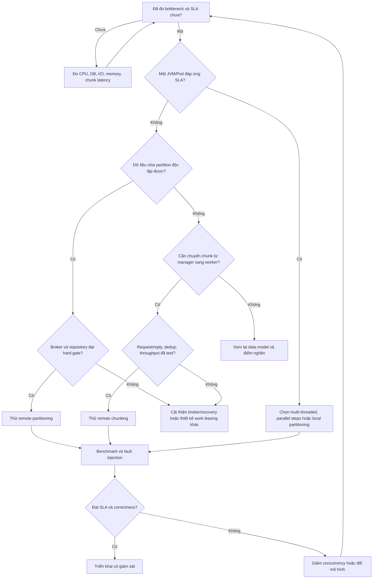
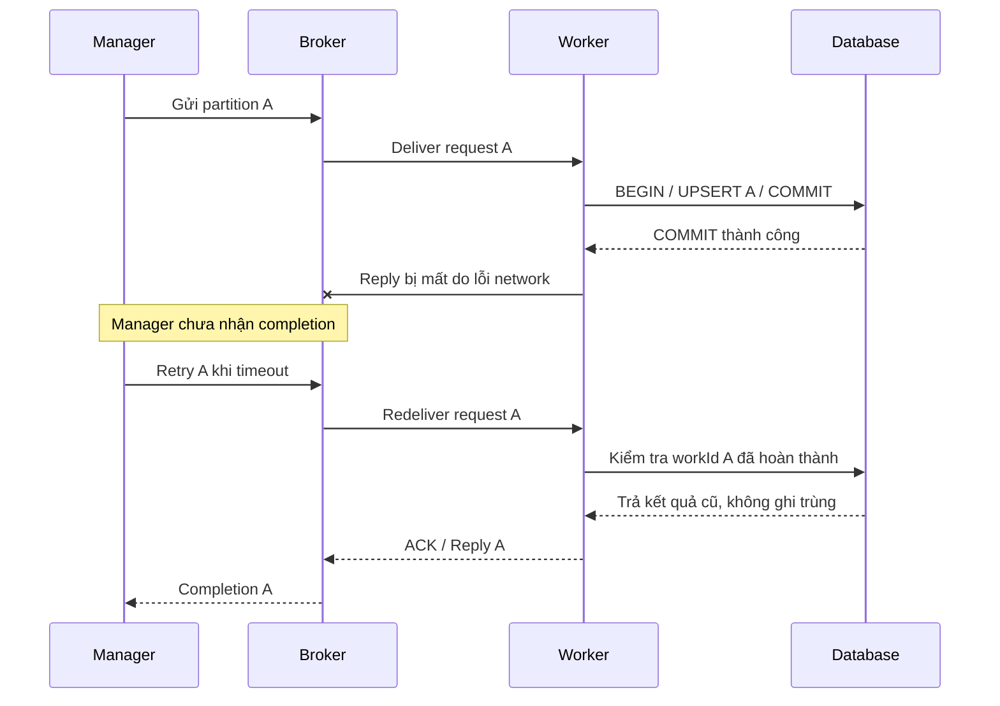

# Ma trận lựa chọn scaling Spring Batch theo độ tin cậy middleware

Khi cần xử lý 50 triệu bản ghi mỗi đêm, nhóm phát triển thường bắt đầu bằng câu hỏi: “Dùng multi-threaded step, partitioning hay remote chunking để nhanh hơn?”. Câu trả lời không chỉ phụ thuộc CPU và số worker. Nếu kiến trúc phân tán dùng message broker có khả năng mất message, chậm phản hồi hoặc không redeliver đúng cách, việc thêm worker có thể biến một Job đang chạy chậm thành hệ thống **kẹt JobExecution, xử lý trùng hoặc bỏ sót dữ liệu**.

Bài học thuộc chương **Ma trận lựa chọn** của module **SPRING_BATCH_SCALING_OPERATIONS**. Mục tiêu là xây dựng cách lựa chọn kiến trúc Spring Batch dựa trên **độ tin cậy đã được kiểm chứng của middleware**, đồng thời xét thread safety, giới hạn tài nguyên, transaction, retry/restart, khả năng quan sát và chi phí vận hành. Các lựa chọn gồm multi-threaded step, parallel steps, local partitioning, remote partitioning và remote chunking.

Điểm cần nhớ ngay từ đầu: **middleware đáng tin cậy không có nghĩa mọi item chỉ được xử lý đúng một lần**. Độ bền message, xác nhận, giao dịch database và hiệu ứng nghiệp vụ thuộc các lớp khác nhau; phải thiết kế và kiểm thử từng lớp.

## 1. Middleware làm gì trong kiến trúc scaling?

Ở đây, *middleware* chủ yếu chỉ hệ thống trung gian truyền công việc và phản hồi giữa manager và worker: message broker, queue, topic, adapter của Spring Integration và các cơ chế truyền nhận liên quan. Database chứa `JobRepository` cũng là một phụ thuộc quan trọng, nhưng vai trò khác broker: nó lưu metadata Job/Step/ExecutionContext để kiểm soát lifecycle và restart.

| Kiến trúc | Công việc qua middleware | Thành phần quyết định tiến độ | Rủi ro nếu middleware lỗi |
|---|---|---|---|
| Single-threaded step | Không cần broker để phân phối Step | Một Step trong JVM | Không có rủi ro message giữa các worker; vẫn có rủi ro DB/I/O |
| Multi-threaded step | Không bắt buộc dùng broker | Executor cùng JVM, nhiều chunk | Thread safety, transaction, CPU/connection contention |
| Parallel steps | Không bắt buộc dùng broker | Flow/Split trong JVM | Các Step tranh tài nguyên với nhau |
| Local partitioning | Không bắt buộc dùng broker | Manager và worker Step trong cùng JVM | Pool/heap/metadata; một JVM chết ảnh hưởng nhiều partition |
| Remote partitioning | Request giao `StepExecution` và phản hồi qua middleware | Manager, worker, `JobRepository` | Request/reply thất lạc, phân vùng chồng lấn, kết quả đã commit nhưng manager chưa biết |
| Remote chunking | Chunk request/reply qua middleware | Manager đọc/chia chunk; worker xử lý và ghi | Message chunk mất/trùng, reply thất lạc, checkpoint và hiệu ứng bên ngoài lệch nhau |

Với remote partitioning, mỗi worker thường chạy một Step gần như hoàn chỉnh, có transaction/checkpoint tại worker và truy cập `JobRepository` dùng chung theo thiết kế. Với remote chunking, manager thường sở hữu reader và điều phối chunk; worker xử lý phần chunk được gửi qua messaging. Vì vậy **remote chunking thường chuyển nhiều dữ liệu qua broker hơn**, còn remote partitioning chủ yếu chuyển lệnh thực thi partition và thông tin phản hồi. Kết luận này cần được kiểm tra theo triển khai thực tế: payload/serializer lớn có thể làm băng thông trở thành nút thắt ở cả hai.

### Ba ranh giới phải tách biệt

1. **Giao vận:** broker nhận, giữ, phát, xác nhận và có thể redeliver message.
2. **Xử lý:** worker thực hiện transaction, gọi API, ghi bảng nghiệp vụ hoặc phát sự kiện khác.
3. **Điều phối và trạng thái:** manager và `JobRepository` đánh dấu StepExecution, chunk/partition nào hoàn tất, thất bại, có thể restart.

Không thể lấy một ACK ở tầng 1 để suy ra tầng 2 đã commit và tầng 3 đã ghi checkpoint. Ngược lại, việc worker commit thành công không bảo đảm reply đến manager. Mọi mô hình phân tán đều phải nêu rõ điểm mà hệ thống coi một đơn vị công việc là hoàn thành.

## 2. Đánh giá “độ tin cậy middleware” bằng bằng chứng nào?

Độ tin cậy không chỉ là uptime của broker. Một cluster broker đạt availability cao vẫn có thể cấu hình queue không bền vững, acknowledgment quá sớm hoặc correlation header bị mất do adapter/serializer.

| Tiêu chí | Câu hỏi cần trả lời | Cách xác minh |
|---|---|---|
| **Durability** | Message đã được xác nhận gửi có còn sau khi broker/pod khởi động lại không? | Test restart broker, disk/node failure, publisher confirms và cơ chế lưu bền |
| **Delivery/ack** | Khi worker chết trước/sau commit, message được phát lại như thế nào? | Kill worker ở nhiều điểm; theo dõi ack/nack, offset, redelivery |
| **High availability** | Mất một node broker có mất khả năng nhận/phát message không? | Failover test, đo recovery time, kiểm tra replica/quorum |
| **Ordering** | Có bảo đảm thứ tự nào, trên queue/partition/key nào? | Gửi request xen kẽ, chạy nhiều consumer và so sánh thứ tự |
| **Correlation** | Reply có quay về đúng chunk/partition dù retry và đổi worker? | Test requestId, correlationId, reply headers, timeout |
| **Backpressure** | Khi worker chậm, manager/queue phản ứng thế nào? | Đo queue depth, unacked, consumer lag, memory/disk |
| **DLQ và replay** | Message lỗi vĩnh viễn được cô lập, truy vết và replay có kiểm soát không? | Gây poison message, kiểm tra policy, replay và dedup |
| **Observability** | Có đo lag, backlog, throughput, retry, dead-letter, broker state không? | Dashboard, alert, trace theo JobExecution/partition |
| **An toàn rollout** | Manager và worker cũ/mới đọc được payload/header còn tồn không? | Contract test giữa version, broker message fixture |
| **Khả năng vận hành** | Có runbook, owner trực, backup, quota và capacity không? | Diễn tập incident, khôi phục node và dữ liệu |

**Durable queue khác durable message.** Ví dụ với RabbitMQ, độ bền của queue và chế độ persistent của message cần được cấu hình/đánh giá cùng chính sách replication và publisher confirms. Với Kafka, durability phụ thuộc replication, producer acknowledgment, cấu hình topic, retention và cơ chế commit offset. Với JMS, mức persistence, session acknowledgment và transaction do provider và adapter quyết định. Không áp chung một lệnh cấu hình cho mọi broker.

Đặc biệt, các thuật ngữ “at-most-once”, “at-least-once” và “exactly-once” cần ghi rõ phạm vi:

- **At-most-once delivery:** có thể mất công việc nếu không xử lý được; hạn chế duplicate nhưng không phù hợp khi mất dữ liệu là không thể chấp nhận.
- **At-least-once delivery:** message có thể gửi lại; worker phải chịu được duplicate. Đây là điểm xuất phát thực tế của nhiều hệ thống batch phân tán.
- **Exactly-once trong phạm vi broker/stream processor:** có thể áp dụng cho một số workflow/transaction được broker hỗ trợ; **không suy ra exactly-once từ broker sang bất kỳ database hoặc HTTP API ngoài nào**.

Nếu người cung cấp middleware nói “không mất message”, cần hỏi **sau điểm xác nhận nào**, dưới lỗi gì, khi còn bao nhiêu node, và dữ liệu có thể phục hồi sau bao lâu. Một cam kết uptime 99,9% tự nó không trả lời những câu hỏi này.

## 3. Phân mức độ tin cậy để ra quyết định

Phân mức dưới đây là **khung đánh giá nội bộ**, không phải cấp chứng nhận chính thức của RabbitMQ, Kafka, JMS hoặc Spring Integration.

| Mức | Điều kiện thực tế | Hướng kiến trúc ưu tiên |
|---|---|---|
| **M0 — Chưa được kiểm chứng** | Không có thử nghiệm mất node/message; chỉ thấy broker hoạt động trong happy path; thiếu cảnh báo và runbook | Single-thread, multi-threaded step, parallel steps hoặc local partitioning nếu tài nguyên một node còn đáp ứng |
| **M1 — Có khôi phục nhưng còn lỗ hổng** | Có persistence và retry cơ bản; chưa chứng minh failover, correlation, dedup hoặc replay đúng | Giữ công việc trong phạm vi quản lý có checkpoint bền; thử nghiệm có giới hạn cho worker phân tán, chưa dùng cho tác vụ không thể đối soát |
| **M2 — Bền vững và quan sát được** | Đã chứng minh durable publish/consume, redelivery, timeout, DLQ, metrics và recovery khi worker/broker lỗi | Có thể cân nhắc remote partitioning; remote chunking cần thêm kiểm chứng request/reply và side effect |
| **M3 — Đã kiểm chứng toàn đường đi** | Test cả manager/worker restart, mất reply, message trùng, restart đúng JobInstance, schema rollout, DB/API idempotency; có SLO/runbook | Có cơ sở chọn remote partitioning hoặc remote chunking theo profile dữ liệu và tài nguyên |

Mức M3 **không có nghĩa không bao giờ lỗi**. Nó cho biết nhóm có bằng chứng rằng hệ thống chịu và phục hồi được các failure mode đã định nghĩa, với thời gian RTO, giới hạn mất dữ liệu RPO và kết quả nghiệp vụ phù hợp. Độ tin cậy thực tế luôn phụ thuộc cấu hình và quy trình vận hành tại thời điểm chạy.

### Điều kiện bắt buộc trước khi cân nhắc phân tán

Trước khi chấm điểm, kiểm tra các *hard gate* sau:

1. Có **JobRepository bền vững**, truy cập đúng từ manager/worker, schema hỗ trợ phiên bản đang chạy.
2. Có **định danh ổn định** cho JobInstance, StepExecution, partition hoặc chunk; không tự đổi `run.id` để né guard về Job đang chạy.
3. Có chính sách **idempotency, dedup hoặc đối soát** khi message redeliver sau commit.
4. Có thể xác minh request/reply và timeout qua middleware thật; không chỉ test `DirectChannel` trong một JVM.
5. Có cách **dừng nhận việc mới, drain, restart và xác định owner cũ đã chết** trước khi phát lại công việc.
6. Có giới hạn tải cho broker, database và dịch vụ đích; số worker không được tăng vô hạn.

Nếu một điều kiện trọng yếu chưa đạt, nên hoàn thiện cơ chế đó trước khi đưa workload quan trọng sang mô hình từ xa. Việc tăng đồng thời tài nguyên và độ phức tạp phân tán không thay thế cơ chế phục hồi.

## 4. Ma trận chọn kiến trúc theo mức tin cậy và nhu cầu mở rộng

Ma trận ưu tiên sau giúp **lọc lựa chọn**, không phải chứng nhận rằng một kiến trúc luôn nhanh hơn kiến trúc khác.

| Bối cảnh | Multi-threaded / parallel steps | Local partitioning | Remote partitioning | Remote chunking |
|---|---|---|---|---|
| Middleware M0, một JVM có thể xử lý kịp SLA | **Ưu tiên** nếu thread-safe và đủ tài nguyên | **Ưu tiên** nếu dữ liệu chia range tốt | Chưa phù hợp nếu dựa vào broker đó | Chưa phù hợp |
| Middleware M1, cần nhiều CPU trên một node | **Khả thi** | **Ưu tiên** khi partition độc lập | Chỉ thử có giới hạn, cần khắc phục reliability gap | Tránh cho workload không thể phát lại an toàn |
| Middleware M2, cần nhiều node, dữ liệu phân vùng được | Hạn chế bởi tài nguyên một JVM | Hạn chế bởi một JVM | **Ứng viên mạnh** nếu repository và worker đủ an toàn | Chỉ chọn nếu việc gửi chunk qua broker có lợi và reply path được chứng minh |
| Middleware M3, input ở manager và writer nằm trên worker | Không tận dụng worker đa node | Không tận dụng worker đa node | Phù hợp nếu worker tự đọc phần dữ liệu được giao | **Ứng viên** nếu chuyển chunk qua broker đáp ứng throughput/latency |
| Middleware M3, partition có dữ liệu độc lập và kích thước lớn | Có thể không đủ node | Có thể không đủ node | **Thường ưu tiên** vì message chỉ điều phối phạm vi | Có thể tạo băng thông/serialization lớn không cần thiết |
| Broker có downtime kéo dài, nhưng DB đáng tin cậy | Thường dễ vận hành hơn | Thường dễ vận hành hơn | Cần queue bền, timeout dài và cơ chế recovery đã thử | Rất nhạy với backlog/chunk reply; cân nhắc lại |
| Yêu cầu hoàn thành đúng dữ liệu, không có idempotency/reconciliation | Chưa an toàn nếu Step có side effect ngoài transaction | Chưa an toàn khi restart | **Chưa đạt điều kiện** | **Chưa đạt điều kiện** |

**Điểm phân biệt quan trọng:** Remote partitioning vẫn cần độ tin cậy của middleware. Việc mỗi worker có transaction riêng làm giảm lượng payload chuyển qua broker nhưng **không tự chống được mất request, reply hay phân công trùng**. Local partitioning cũng không tự động an toàn nếu reader/writer không thread-safe hoặc partition range chồng lấn.

### Luồng quyết định



Một giải pháp “work leasing qua database” có thể được xem xét khi không muốn phụ thuộc broker, nhưng đó là **thiết kế điều phối riêng**: phải quản lý atomic claim, lease expiration, fencing token, phân vùng, tránh hai worker xử lý cùng dữ liệu và recovery. Không mặc nhiên coi nó là remote partitioning có sẵn của Spring Batch.

## 5. Tại sao ACK và commit không thể dùng thay nhau?

Một worker nhận message qua broker rồi thực hiện transaction ở database. Thứ tự ACK và commit quyết định cửa sổ lỗi.

| Thứ tự | Khi crash xảy ra | Rủi ro |
|---|---|---|
| **ACK trước commit** | Broker coi message đã hoàn thành, DB chưa commit | **Mất công việc** nếu không có nguồn phát lại khác |
| **Commit rồi ACK** | DB commit thành công, ACK chưa đến broker | Broker có thể **redeliver**; worker cần idempotency |
| **Commit DB, gửi reply rồi crash** | Broker/manager có thể chưa nhận hoặc chưa ghi trạng thái | Manager chờ, xử lý lại hoặc hiểu thiếu kết quả |
| **Gửi reply trước commit** | Manager nghĩ xong nhưng DB rollback | Sai trạng thái, có thể bỏ sót |

Không có một thứ tự đơn giản nào tạo ra atomic commit xuyên broker và database trong mọi hệ thống. Với thiết kế at-least-once, hướng phổ biến là **commit dữ liệu và dấu vết xử lý bền vững trước khi xác nhận hoàn tất**, sau đó chịu được redelivery bằng idempotency và dedup. Nếu dùng broker transaction/XA hoặc công nghệ stream processing có hỗ trợ transaction, phải đọc kỹ **phạm vi bảo đảm** và kiểm thử với database nghiệp vụ thực.

Ví dụ về cửa sổ mất phản hồi:



Sơ đồ là thiết kế idempotent được mong muốn, không phải hành vi tự động của mọi adapter hoặc worker Spring Batch. Worker phải có cơ chế nhận diện work ID, trạng thái commit và cách phát lại reply phù hợp.

## 6. Cách thiết kế idempotency bền vững

Để hỗ trợ retry, mỗi đơn vị công việc phải có **khóa định danh ổn định**. Với remote partitioning, ví dụ sử dụng `JobInstance ID + step name + partition name` hoặc key nghiệp vụ tương đương, nhưng phải cân nhắc trường hợp cùng partition được phép có nhiều lần chạy hợp lệ. Với remote chunking, cần định danh chunk/request từ protocol và idempotency ở **từng hiệu ứng nghiệp vụ** nếu message chứa nhiều item.

Ví dụ bảng kết quả đã áp dụng của một worker PostgreSQL:

```sql
CREATE TABLE processed_work (
    work_id         VARCHAR(160) PRIMARY KEY,
    business_key    VARCHAR(120) NOT NULL,
    processed_at    TIMESTAMPTZ NOT NULL DEFAULT now()
);
```

Phác thảo xử lý trong **một local transaction**:

```sql
BEGIN;

INSERT INTO processed_work (work_id, business_key)
VALUES (:work_id, :business_key)
ON CONFLICT (work_id) DO NOTHING;

-- CHỈ chạy business UPDATE/INSERT khi lượt INSERT ở trên
-- thật sự tạo dòng mới. Nếu work_id đã tồn tại,
-- đọc trạng thái đã commit và bỏ qua hoặc trả kết quả cũ.

COMMIT;
```

Ở đây, `:work_id` và `:business_key` là bind parameters. **Đoạn SQL trên cố ý là pseudocode giao dịch**; nếu luôn chạy câu lệnh update bất kể insert có tạo dòng mới hay không, nó **không chống trùng**. Trong ứng dụng thật phải kiểm tra số dòng affected hoặc dùng cơ chế `INSERT ... RETURNING`, cùng isolation/locking phù hợp, và thực hiện business update trong chính transaction đó.

Một số điều kiện khác:

- Unique key phải trỏ đúng **hiệu ứng nghiệp vụ** cần có đúng một lần. Nếu dùng ID ngẫu nhiên mới cho mỗi retry, cơ chế chống trùng vô hiệu.
- Với payment/API bên ngoài, idempotency chỉ nằm trong DB của worker là chưa đủ nếu remote đã xử lý rồi worker chết trước khi lưu dấu. Cần **remote idempotency key**, outbox hoặc khả năng truy vấn/đối soát trạng thái.
- Với các thao tác không idempotent, phải định nghĩa compensation hoặc quy trình xét duyệt trước khi tự động retry.
- Cần lưu kết quả hoặc checksum thích hợp để phát hiện cùng work ID nhưng payload thay đổi giữa các lần chạy.
- Cần chính sách retention cho bảng dedup ít nhất tương xứng với **cửa sổ replay có thể xảy ra**; xóa dấu xử lý trước khi message được phát lại có thể tạo duplicate muộn.

**Không mở transaction DB qua thời gian chờ broker/network.** Ghi nhận kết quả trong transaction ngắn, commit rồi mới xác nhận/gửi reply theo thiết kế. Nếu cần phát message gắn với thay đổi DB, cân nhắc transactional outbox; outbox cũng thường có khả năng phát lại nên consumer vẫn phải idempotent.

## 7. Những tình huống lỗi cần tính vào ma trận

| Tình huống | Dấu hiệu quan sát | Phản ứng/recovery cần được thử |
|---|---|---|
| Publisher crash **trước** broker xác nhận | Không rõ request đã được lưu hay chưa | Retry theo stable request ID, không tạo partition trùng |
| Broker nhận nhưng crash trước khi ghi bền | Message mất khi thiết lập durability sai | Test persistent publish, confirms, replica/quorum |
| Worker crash trước khi commit DB | Request được nhận nhưng dữ liệu chưa commit | Redelivery và rollback đúng, checkpoint không nhảy sai |
| Worker crash sau commit, trước ACK | Database đã thay đổi, message có thể phát lại | Idempotency/dedup hoặc truy vấn trạng thái theo work ID |
| Reply thất lạc | Manager `STARTED`/`STOPPING` lâu, worker có thể đã xong | Query JobRepository/work status, replay reply/timeout hợp lệ |
| Broker partition hoặc network split | Manager/worker không nhìn thấy nhau, có retry trễ | Deadline, fencing/lease nếu có, xác minh owner trước khi chạy lại |
| Poison message | Một request lỗi mãi, retry liên tục | Bounded retry, DLQ, phân loại lỗi và replay có kiểm soát |
| Queue backlog lớn | Job duration tăng, broker disk/memory pressure | Backpressure, giới hạn in-flight, tăng worker khi downstream còn capacity |
| Trộn worker cũ/mới trong rollout | Không deserialize được payload, header correlation mất | Version contract, drain/blue-green, thử payload cũ |
| JobRepository tạm mất | Worker có thể đã commit nhưng metadata chưa cập nhật | Giám sát repository, restart có đối soát, không sửa status mù quáng |

### Cẩn thận với liveness và trạng thái `STARTED`

Sau sự cố, metadata `BATCH_JOB_EXECUTION.STATUS='STARTED'` có thể vẫn tồn tại dù manager/worker cũ đã chết. Không tự đổi status sang `FAILED` rồi chạy lại khi chưa xác minh rõ các worker cũ, transaction, message in-flight và side effect. Với remote partitioning, cần kiểm tra **từng StepExecution**. Với remote chunking, kiểm tra cả message chưa ACK và reply chưa được gom.

Stop một Job qua `JobOperator.stop(executionId)` là **yêu cầu bất đồng bộ**, không bảo đảm mọi worker đã ngừng ngay lập tức. Nếu hệ thống đang mất broker, manager có thể chưa truyền được tín hiệu dừng. Quy trình restart phải có bằng chứng rằng không còn executor xử lý cùng work ID.

## 8. Ma trận failure mode theo kiểu middleware

Tên sản phẩm không tự quyết định reliability; đánh giá dưới đây chỉ chỉ ra **điểm cần kiểm tra** khi triển khai:

| Middleware | Điều kiện để dùng an toàn | Những điều dễ bỏ sót |
|---|---|---|
| **RabbitMQ/AMQP** | Durable/quorum queue hoặc cơ chế HA phù hợp, persistent message, publisher confirm, consumer manual ack, dead-letter/retry policy | Queue bền nhưng message không persistent; ACK trước commit; requeue vô hạn; TTL/DLQ khiến request thất lạc với manager |
| **Kafka** | Replication/producer acks, offset commit theo checkpoint, retention đủ dài, partition key/order đã xác định, retry và DLQ phù hợp | Offset commit trước khi DB commit; lag quá retention; Kafka transaction không bao phủ DB/API ngoài |
| **JMS provider** | Persistent delivery, transaction/ack session phù hợp, failover và redelivery có bằng chứng, correlation headers nhất quán | Mất JMS header mapping ở adapter, rollback/redelivery khác giữa provider, selector/reply destination sai |
| **In-memory channel** | Chỉ dùng nội bộ một process khi có thể chấp nhận mất in-flight message lúc process crash | Không có durability xuyên restart; không thay broker phân tán |
| **HTTP request/reply tự xây** | Request ID bền vững, timeout, retry, idempotency, tracking completion và queue/work store riêng | HTTP 200/timeout không đại diện commit nghiệp vụ, không có cơ chế giao việc bền vững mặc định |

Với Spring Integration, cần kiểm tra **header mapping**: `correlationId`, `sequenceNumber`, `sequenceSize` hoặc các header của protocol phải tồn tại ở cả hai phía broker. Khi nâng phiên bản adapter/JMS, có thể xuất hiện lỗi aggregator không ghép reply dù worker đã hoàn thành. Do đó test trực tiếp channel trong một JVM chưa đủ để phê duyệt remote chunking hoặc remote partitioning.

Chỉ định nghĩa lựa chọn khi có **độ tin cậy của cấu hình đang sử dụng**, không chỉ “broker này nổi tiếng là bền vững”. Một broker không có replica hoặc disk đầy có thể đáng tin cậy thấp hơn một hệ thống tưởng như đơn giản nhưng được vận hành và diễn tập chặt chẽ.

## 9. Chấm điểm có trọng số sau khi vượt các điều kiện bắt buộc

Không nên chọn hệ thống phân tán chỉ vì bảng ưu nhược điểm mang tính định tính. Sau khi ứng viên vượt các *hard gate* ở mục 3, có thể dùng bảng chấm điểm từ **0 đến 5** theo kết quả benchmark và fault injection. Mức 5 biểu thị đáp ứng tốt hơn yêu cầu cụ thể, không phải “phương án hoàn hảo”.

Ví dụ một doanh nghiệp cần xử lý dữ liệu trên nhiều node, đã đo rằng một JVM không đạt SLA, đồng thời có broker đạt M3:

| Tiêu chí | Trọng số | Local partitioning (điểm) | Remote partitioning (điểm) |
|---|---:|---:|---:|
| Throughput đáp ứng SLA | 25% | 2 | 5 |
| Recoverability và tính đúng dữ liệu | 30% | 4 | 5 |
| Dễ vận hành/runbook | 15% | 5 | 3 |
| Số phụ thuộc hạ tầng và độ ổn định | 20% | 5 | 3 |
| Độ linh hoạt khi cần tăng worker | 10% | 4 | 5 |
| **Điểm có trọng số** | **100%** | **3,85/5** | **4,30/5** |

Phép tính:

```text
Score = Σ(weight_i × score_i)

Local  = 0,25×2 + 0,30×4 + 0,15×5 + 0,20×5 + 0,10×4
       = 3,85

Remote = 0,25×5 + 0,30×5 + 0,15×3 + 0,20×3 + 0,10×5
       = 4,30
```

**Diễn giải đúng:** Trong tình huống giả định, remote partitioning được chọn để thử production vì vượt điều kiện bắt buộc và có tổng điểm cao hơn. Nếu broker thực tế chỉ đạt M0, remote partitioning **bị loại trước khi chấm điểm**, dù các mục throughput dự kiến cao. Trọng số phải xuất phát từ mục tiêu nghiệp vụ; một hệ thống thanh toán cần trọng số correctness/recoverability lớn hơn một pipeline thử nghiệm có thể chạy lại từ đầu.

Không tự chấm điểm độ tin cậy bằng “có cấu hình retry”. Các mức điểm phải có bằng chứng: log chaos test, thời gian phục hồi thực tế, tỷ lệ duplicate, data reconciliation và năng lực đội vận hành.

### Phải tính cả chi phí điều hành

Remote partitioning/chunking cần quan sát broker, manager, worker, `JobRepository`, database, message schema và hoạt động của từng deployment. Nếu chỉ một nhóm nhỏ vận hành, độ phức tạp này có thể vượt lợi ích throughput. Có thể chấp nhận Job chạy dài hơn đôi chút nhưng đơn giản, restart được và đáp ứng SLA.

## 10. Ví dụ sizing để thấy ảnh hưởng của middleware

Một Job phải xử lý **24 triệu bản ghi trong 4 giờ**, mỗi remote partition worker đạt khoảng **250 item/giây** trên dữ liệu đại diện. Database có hạn mức kết nối và broker có giới hạn message throughput.

Thông lượng tối thiểu:

```text
24.000.000 / (4 × 60 × 60) ≈ 1.667 item/giây

Số worker lý thuyết = ceil(1.667 / 250) = 7 worker
Nếu thử 9 worker  → công suất lý thuyết = 9 × 250 = 2.250 item/giây
```

Đây **chỉ là ước lượng tuyến tính**. Nếu 9 worker tạo lock contention, bị CPU throttling hoặc tăng độ trễ API, throughput thực có thể thấp hơn 7 worker. Nếu mỗi worker cấu hình pool 10 connection, tổng tối đa cấu hình riêng của nhóm đã là **90 kết nối**, chưa tính manager và ứng dụng khác. Phải đo số kết nối active/pending thực tế.

So sánh lượng dữ liệu qua middleware:

**Remote partitioning:** Manager thường phát request điều phối partition; worker tự đọc phần dữ liệu của mình từ nguồn chung. Nếu chỉ gửi partition bounds, metadata có thể nhỏ hơn rất nhiều payload 24 triệu item. Tuy nhiên, số lượng partition có thể lớn hơn số worker: ví dụ 90 partition được phân cho 9 worker nhằm cân bằng dữ liệu skew, với điều kiện định danh và checkpoint luôn ổn định khi restart.

**Remote chunking:** Giả sử một chunk chứa 500 item, payload đã serialize trung bình 2 KiB/item, chưa kể header/overhead:

```text
24.000.000 / 500 = 48.000 chunk requests
500 × 2 KiB ≈ 1.000 KiB payload mỗi request (~0,98 MiB)
48.000 × 1.000 KiB ≈ 45,8 GiB request payload một lượt
Nếu duy trì 1.667 item/giây:
1.667 × 2 KiB ≈ 3,26 MiB/giây dữ liệu request thuần
```

Tổng truyền thực tế còn có framing, metadata, request/reply, replica traffic, retry và serialization overhead. Dung lượng này chưa nói broker đủ tải hay không: phải đo **message size limit, disk/network throughput, độ trễ publish→consume→reply, batch size và số in-flight chunk**. Nếu một item chứa object lớn, remote chunking có thể chuyển dữ liệu nhiều lần không cần thiết so với remote partitioning.

### Một phép tính trực giác về xác suất lỗi

Giả sử *để minh họa* mỗi message có xác suất độc lập `p = 0,00001` bị mất hoặc cần xử lý sự cố không tự phục hồi. Sau 100.000 message, xác suất gặp **ít nhất một** trường hợp là:

```text
P(ít nhất 1 lỗi) = 1 - (1 - p)^N
                 = 1 - (1 - 0,00001)^100.000
                 ≈ 63,2%
```

Đây **không phải** ước tính độ tin cậy của một broker cụ thể. Lỗi thực tế có tương quan, nhiều lớp retry che được lỗi tạm thời và không phải mọi request đều có cùng rủi ro. Ví dụ chỉ giúp thấy rằng ngay cả tỷ lệ lỗi thấp cũng có thể gây nhiều incident ở workload có rất nhiều message. Vì thế remote chunking cần kiểm chứng redelivery và dedup nghiêm ngặt khi số chunk lớn.

## 11. Thiết kế backpressure để broker không biến thành nút thắt

Giả sử manager có thể đọc và gửi 20.000 item/giây nhưng tất cả worker chỉ ghi ổn định 8.000 item/giây. Nếu không giới hạn tốc độ phát, queue sẽ tăng khoảng 12.000 item/giây, có thể lấp đầy disk/buffer và làm Job thiếu khả năng phục hồi.

Các biện pháp:

- **Giới hạn in-flight:** manager không phát vô hạn request đang chờ reply. Dùng giới hạn concurrency/queue và lưu trạng thái của công việc đang chờ.
- **Điều tiết consumer:** thiết lập prefetch, consumer concurrency hoặc poll batch phù hợp; không để một consumer giữ hàng nghìn message mà chưa commit.
- **Giới hạn kích thước payload:** tránh chunk lớn vượt max message size hoặc làm một retry lãng phí thời gian.
- **Bảo vệ downstream:** tổng worker × số transaction DB/HTTP request đồng thời phải nằm trong ngưỡng đo được.
- **Retry có backoff:** không requeue lập tức một poison message vô hạn làm các request bình thường đói tài nguyên.
- **Theo dõi queue age:** queue depth một mình không đủ; backlog 1.000 message có thể bình thường ở một hệ thống và gây trễ SLA ở hệ khác.
- **Giữ metadata bền vững:** khi dừng/rollout, cần biết các request nào đã giao, đã hoàn tất, đã timeout và có thể phát lại.

Trong remote chunking, nếu worker xử lý nhanh nhưng reply aggregator của manager chậm, request vẫn có thể tích tụ dù broker request queue đã rỗng. Do đó phải quan sát **cả đường request lẫn reply**.

## 12. Chiến lược nâng cấp middleware và worker

Tính tương thích của manager/worker là một phần của độ tin cậy. Có thể sử dụng broker HA nhưng vẫn làm mất các reply khi nâng thư viện Spring Integration khiến header correlation không được map đầy đủ.

Một trình tự phát hành có thể dùng:

1. Xác định version thực tế của Spring Batch, Spring Integration, broker adapter và serializer ở manager và **từng worker image**.
2. Thu thập danh sách JobInstance đang chạy, partition chưa hoàn tất và message tồn đọng trước khi phát hành.
3. Thử message fixture của bản cũ với worker/manager bản mới. Kiểm tra payload, header, correlation, ack, lỗi và retry.
4. Với các thay đổi lớn về protocol/schema, **drain workflow cũ** rồi triển khai đồng bộ; hoặc blue-green với queue/consumer group/metadata tách bạch khi kiến trúc cho phép.
5. Nếu bắt buộc chạy chung phiên bản cũ và mới trong rolling deployment, chỉ cho phép sau khi thử contract hai chiều và đảm bảo cả hai cùng hiểu message đang nằm trong broker.
6. Khởi động canary với số partition/chunk giới hạn, theo dõi backlog, unmatched reply, duplicate, throughput, database lock và JobRepository.
7. Chuẩn bị rollback cho **message, serializer và metadata**, không chỉ rollback container image.

### Kiểm soát partition identity khi thay số worker

Một JobInstance đang chạy dở với 8 partition không nên được phân lại thành 32 range chồng lên dữ liệu cũ chỉ vì deployment mới có thêm Pod. Phải bảo toàn partition name/range đã lưu, hoặc hoàn tất/đối soát trước khi thay thuật toán partition. Tăng **số worker phục vụ** các partition đang có có thể phù hợp hơn thay danh tính của chúng.

### Không đồng nhất restart của Kubernetes với restart của Spring Batch

Kubernetes có thể tạo Pod mới sau sự cố, nhưng Pod mới không tự động resume đúng `JobExecution`. Muốn khôi phục đúng cần xác định JobParameters định danh, trạng thái repository, execution đang dở và những phần việc đã commit. Với JobRepository còn `STARTED` do crash, cần một runbook xác minh old worker đã chết, side effects và metadata trước khi cho chạy lại; thay `run.id` để tạo JobInstance mới có thể nhân đôi dữ liệu.

## 13. Bộ kiểm thử độ tin cậy tối thiểu trước production

**Đừng chỉ chạy integration test bằng channel trong memory.** Test nên đi qua chính broker, adapter, serializer, JobRepository và database mà hệ thống định dùng. Testcontainers hoặc môi trường staging có cấu hình gần production có thể hỗ trợ, nhưng một container broker đơn lẻ không chứng minh failover của cluster HA.

| Kịch bản fault injection | Cách tạo lỗi (staging) | Điều kiện PASS |
|---|---|---|
| Manager chết sau khi publish | Kill manager giữa request và phản hồi | Không mất partition/chunk; restart đúng JobInstance và không ghi trùng |
| Worker chết trước DB commit | Kill worker trong transaction | Transaction rollback/không tạo dữ liệu bán phần; request được xử lý lại |
| Worker chết sau commit trước ACK | Tiêm lỗi đúng ranh giới | Redelivery không nhân đôi side effect |
| Reply thất lạc | Chặn reply channel hoặc làm mất consumer reply | Manager không đánh dấu hoàn tất sai; có recovery khi worker đã commit |
| Broker mất một node | Failover node có kiểm soát | Request đã xác nhận không mất ngoài ngưỡng đã công bố; hệ thống phục hồi trong RTO |
| Broker restart | Dừng/khởi động theo kịch bản | Message durable còn nguyên và được xử lý lại hợp lệ |
| Poison message | Payload sai schema hoặc lỗi nghiệp vụ cố định | Bounded retry, DLQ/incident, không block cả queue |
| Thêm worker khi đang chạy | Scale 2→4→8 worker | Không phân công trùng, throughput/lag phù hợp với DB và broker |
| Manager cũ + worker mới | Chạy contract test theo ma trận version | Request/reply, headers, checkpoint và error path còn hợp lệ |
| Thiếu DB hoặc JobRepository | Tạm ngắt repository | Không tự đánh dấu success giả; recovery nhất quán sau khi repository quay lại |
| API bên ngoài timeout sau khi thành công | Server xử lý rồi bỏ response | Retry với cùng idempotency key, kết quả nghiệp vụ chỉ xảy ra một lần |

Sau mỗi test, đối soát **key nghiệp vụ đầu vào với đầu ra** và `StepExecution`/`ExecutionContext`, không dừng ở việc Pod `Running` hoặc Job `COMPLETED`. Nếu dùng API không hỗ trợ idempotency, phải có khả năng tra cứu và đối soát hoặc quy trình xử lý thủ công trước replay.

### Mẫu tiêu chí chấp nhận

```text
Giới hạn lỗi dữ liệu hợp lệ: 0 bản ghi thiếu hoặc trùng theo business key
Tỷ lệ message chưa xác định trạng thái sau recovery: 0
RTO cho worker crash: <= 10 phút (ví dụ)
RTO cho broker failover: <= 5 phút (ví dụ)
Backlog drain: hoàn tất trước SLA ban đêm
Thời gian chờ một message: có deadline và cơ chế xử lý quá hạn
```

Các RTO ở trên chỉ là **ví dụ để nhóm tự điền từ yêu cầu kinh doanh**. Không tuyên bố đạt RPO=0 hoặc exactly-once khi chưa có bằng chứng từ thử nghiệm và đối soát đầy đủ.

## 14. Bốn tình huống ra quyết định

### Tình huống A: Broker chưa có HA, một Pod đủ SLA

Nhóm đang chạy 4 triệu bản ghi mỗi đêm. Một Pod với 8 thread xử lý hết trong 70 phút, SLA cho phép 120 phút. Broker hiện tại chỉ chạy một instance, queue cấu hình in-memory và chưa có thử nghiệm restart.

**Quyết định:** Ưu tiên giữ processing trong một JVM và tối ưu reader/writer, transaction, executor hoặc local partitioning nếu cần. Đo CPU, I/O và connection pool để bảo đảm chạy ổn định. Chưa có lý do đủ mạnh để chuyển dữ liệu sang remote chunking và chịu thêm failure mode message.

**Điều kiện thay đổi quyết định:** SLA thắt chặt hoặc một node không còn đủ tài nguyên, đồng thời broker được cải thiện và chứng minh độ bền/recovery.

### Tình huống B: Dữ liệu có range độc lập, broker M2/M3

Job nhập 24 triệu item, dữ liệu chia được theo `customer_id` hoặc khoảng khóa không giao nhau. Worker cần nhiều CPU/DB bandwidth, manager có thể phân việc bằng các request nhỏ. Broker đã thử redelivery, failover và các execution được lưu bền vững.

**Quyết định:** Thử **remote partitioning** trước vì worker tự đọc phạm vi dữ liệu, hạn chế chuyển toàn bộ item qua middleware. Kiểm tra skew, phân chia range, idempotency writer, JobRepository và rollback một partition bị kill.

**Rủi ro còn lại:** Nếu partition lớn không cân bằng, tăng worker không giúp partition cuối nhanh hơn. Cần đo độ phân bố và có thiết kế chia range phù hợp ngay từ đầu.

### Tình huống C: Reader chỉ có thể chạy tập trung, cần worker xử lý

Một nguồn dữ liệu độc quyền cho phép duy nhất một reader kết nối; processor cần nhiều CPU và writer nằm ở worker. Broker có durability, request/reply correlation, consumer retry và backpressure đã kiểm thử trên message cỡ thực tế.

**Quyết định:** Cân nhắc **remote chunking**. Manager đọc theo chunk, worker xử lý và phản hồi. Đặt giới hạn số chunk in-flight, kiểm thử worker chết sau commit trước ACK, timeout reply và xử lý redelivery.

**Rủi ro còn lại:** Nếu serialized item lớn, broker băng thông/latency có thể giới hạn tốc độ trước CPU. Benchmark payload thực và cân nhắc thay đổi data locality hoặc mô hình partition nếu có thể.

### Tình huống D: Broker sẵn sàng cao, API nghiệp vụ không có idempotency

Nhóm muốn chuyển sang 20 remote worker để gửi yêu cầu tạo giao dịch qua HTTP. Broker có cluster HA, confirm, manual ack và DLQ. API bên ngoài không cung cấp idempotency key hoặc cách tra trạng thái khi timeout.

**Quyết định:** Chưa thể phê duyệt tự động retry/replay cho giao dịch không thể ghi trùng. Độ tin cậy broker chỉ giải quyết message transport, **không giải quyết “remote đã xử lý nhưng response mất”**. Cần thỏa thuận idempotency/lookup với API, hoặc thiết kế reconciliation và kiểm soát thao tác chưa chắc chắn trước khi đưa vào production.

## 15. Quan sát, cảnh báo và runbook khi middleware suy giảm

Hệ thống chỉ được coi là vận hành được nếu có thể phát hiện và xử lý lỗi trước khi hết SLA. Dashboard nên liên kết **JobExecution ID, StepExecution/partition name, message correlation ID và business key** (ở mức không lộ dữ liệu nhạy cảm) để nhìn được đầu-cuối.

| Lớp | Metrics/cảnh báo ưu tiên | Hành động khi bất thường |
|---|---|---|
| Spring Batch | Job duration, read/write/commit, rollback, retry, `STARTED/STOPPING` quá lâu | So sánh progress theo partition, xác minh old worker |
| Request queue | Publish confirm failures, unacked, queue age, retry, DLQ | Dừng tăng producer, kiểm tra broker và consumer |
| Reply path | Reply latency, unmatched correlation, timeout, orphan replies | Đối chiếu commit tại worker, kiểm tra header mapping |
| Broker cluster | Node availability, replica/quorum health, disk/memory, network, rebalance | Thực hiện runbook failover, giảm tải nếu cần |
| Worker | Active/idle threads, in-flight chunks, JVM heap/GC, CPU throttling | Điều chỉnh concurrency dựa trên bottleneck |
| Database | Active connections, pool pending, lock waits, transaction duration | Giảm tải/throttle worker, điều tra truy vấn |
| Nghiệp vụ | Output reconciliation, duplicate key, missed key, external side effects | Dừng replay không an toàn, xử lý theo operation ID |

Một runbook khi Job kẹt vì middleware nên đi theo trình tự:

1. **Nhận diện:** Xác định đúng JobInstance và execution đang bị ảnh hưởng, partition/chunk nào không phản hồi.
2. **Khoanh vùng:** Tạm ngừng phát thêm work cùng scope nếu cần; tránh retry storm khi broker xuống cấp.
3. **Chụp bằng chứng:** Broker request/reply queue, dead-letter, metadata StepExecution, worker logs, CPU/DB metrics.
4. **Kiểm tra owner:** Worker còn sống/đang commit hay đã chết? Có message đã giao nhưng chưa ACK không?
5. **Khôi phục transport:** Xử lý broker HA/connection/consumer theo runbook, nhưng không tự replay độc lập với metadata.
6. **Đối soát:** Với từng work ID chưa rõ trạng thái, xác minh kết quả DB/API và checkpoint.
7. **Resume/restart:** Tiếp tục đúng JobInstance, giữ partition identity, idempotency và giới hạn worker phù hợp.
8. **Đóng incident:** Kiểm chứng output đầy đủ, không trùng, cập nhật RTO, sơ đồ nguyên nhân và các cảnh báo cần bổ sung.

Đặc biệt, không dùng việc metadata `STARTED` lâu làm lý do tự đánh dấu `FAILED`. Manager có thể đang mất reply trong khi worker đã commit thành công. Xử lý sai tình huống này có thể gây trùng giao dịch dù broker đã sẵn sàng trở lại.

## 16. Bài tập thực hành: Chọn kiến trúc với dữ kiện có kiểm chứng

Bạn có Job ETL xử lý 18 triệu item trong cửa sổ 3 giờ. Một Pod có 6 thread đạt 900 item/giây, DB còn capacity, CPU gần 100%. Dữ liệu có thể chia thành 36 partition độc lập. Nhóm có hai lựa chọn hạ tầng:

- **Phương án X:** Broker một node, queue chưa được xác minh persistence; không có DLQ/replay runbook; monitor chỉ có CPU và độ dài queue.
- **Phương án Y:** Broker nhiều node đã kiểm thử failover, durable message, ack/redelivery, DLQ, correlation, có tracing manager/worker; writer idempotent, JobRepository bền vững và đã thử restart.

**Bước 1 — Tính mục tiêu**

```text
18.000.000 / (3 × 60 × 60) ≈ 1.667 item/giây
Pod hiện tại: 900 item/giây, chưa đáp ứng SLA
Nếu có thể mở rộng tuyến tính: 2 Pod × 900 = 1.800 item/giây
Nhưng phải benchmark DB/broker và dành headroom khi retry/failover.
```

**Bước 2 — Chọn kiến trúc**

Với X, chưa đủ căn cứ chuyển workload không thể mất dữ liệu sang remote partitioning/chunking dựa trên broker đó. Có thể thử tăng CPU cho một Pod, chia Step song song trong JVM hoặc cải thiện middleware rồi đo lại; một JVM vẫn có thể thiếu tài nguyên để đạt SLA.

Với Y, **remote partitioning** là ứng viên hợp lý vì dữ liệu có 36 partition độc lập và worker có thể tự đọc. Bắt đầu 2–3 worker, benchmark partition skew, throughput, DB pool, queue age; nếu cần thử 4–6 worker. Tách mục tiêu “thêm worker” khỏi việc thay danh tính của 36 partition khi Job đang chạy.

**Bước 3 — Câu hỏi kiểm chứng**

1. Khi worker chết ngay sau khi ghi DB nhưng trước khi gửi reply, có partition nào được ghi hai lần không?
2. Nếu manager mất kết nối 2 phút, broker và JobRepository bảo toàn những gì?
3. Nếu một partition mất 20 phút còn phần còn lại 2 phút, tăng worker có giúp hoàn thành SLA không?
4. Khi dữ liệu có 18 triệu item, memory/connection của mỗi worker và tổng cluster là bao nhiêu?
5. Nếu phải rollback phiên bản worker, serializer và dữ liệu checkpoint hiện có có tương thích không?

### Tiêu chí nghiệm thu

| Hạng mục | PASS khi |
|---|---|
| Quyết định dựa trên dữ liệu | Có đo baseline, bottleneck và số worker cần thiết |
| Middleware | Chứng minh publish/ack/redelivery, failover và correlation |
| Correctness | Đối soát được đủ 18 triệu business key, không duplicate |
| Restart | Giữ JobParameters, partition name/range và checkpoint |
| Tải hệ thống | Broker/DB/API còn headroom, không xuất hiện retry storm |
| Runbook | Có thể tìm execution kẹt, khôi phục và xác minh kết quả |

## 17. Checklist trước khi chốt kiến trúc scaling

1. Biết CPU/IO/DB/broker đang là bottleneck thật sự; đã đo throughput ở dữ liệu đại diện.
2. Đánh giá middleware bằng durability, ACK/redelivery, HA, ordering, DLQ, backpressure, observability và fault injection.
3. Xác định mức M0–M3 theo bằng chứng, không theo thương hiệu broker hoặc một con số uptime.
4. Chọn local scaling khi một JVM đáp ứng SLA; thử distributed scaling khi thực sự cần nhiều node hoặc data locality khác.
5. Nếu dùng remote partitioning, có partition identity độc lập, JobRepository dùng chung và worker có transaction/checkpoint an toàn.
6. Nếu dùng remote chunking, đo request/reply bandwidth, correlation, in-flight limit và độ bền chunk message.
7. Định nghĩa ACK/commit/reply ordering, idempotency key và khả năng xử lý response bị mất.
8. Giữ thời gian transaction ngắn; tránh chờ broker/HTTP trong transaction đang giữ lock.
9. Tính tổng resources của worker Pod, DB pool, broker quota và API rate limit khi tăng song song.
10. Kiểm tra restart đúng JobInstance sau Pod/broker failure; không tạo JobInstance mới để che stuck metadata.
11. Test crash trước/sau commit và ACK, reply thất lạc, broker restart/failover, poison message và rolling deploy.
12. Có dashboard/runbook đo RTO, backlog, Job duration, dữ liệu thiếu/trùng và cách đối soát.

Một kiến trúc scaling được chọn đúng khi **middleware có thể bảo toàn hoặc phục hồi công việc theo giao thức đã chứng minh, Spring Batch biết chính xác phần nào cần tiếp tục và dữ liệu đầu ra vẫn đúng sau mọi lỗi được đưa vào kiểm thử**. Nếu chưa có bằng chứng đó, tối ưu scaling trong một JVM hoặc củng cố middleware thường là quyết định vận hành an toàn hơn việc tăng số worker từ xa.
