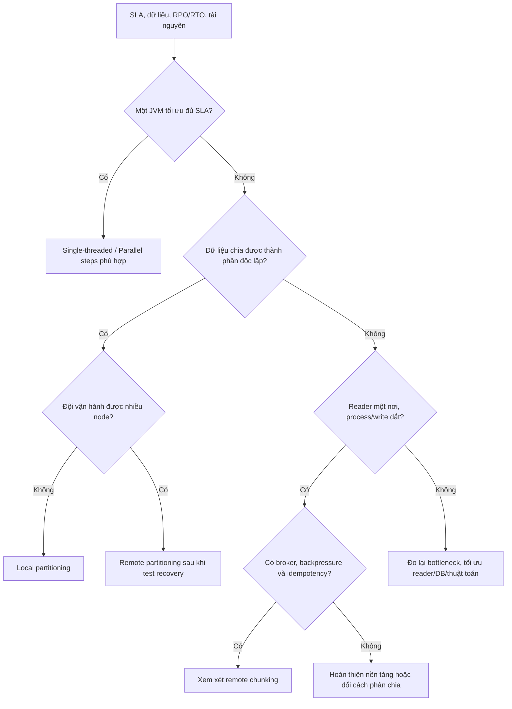

# Chọn mô hình Spring Batch scaling theo khả năng vận hành

## 1. Vì sao khả năng vận hành phải là tiêu chí lựa chọn?

Khi mở rộng Spring Batch cho workload dữ liệu lớn, câu hỏi thường được đặt ra là: “Nên dùng **multi-threaded step**, **parallel steps**, **partitioning** hay mô hình phân tán?”. Tuy nhiên, giải pháp có throughput cao nhất trong một lần benchmark chưa chắc là giải pháp phù hợp để chạy production hằng ngày. Đội ngũ phải còn đủ khả năng **quan sát, dừng, khôi phục, triển khai, điều tra và đối soát** khi một job chạy qua đêm gặp sự cố.

Trong module **SPRING_BATCH_SCALING_OPERATIONS**, việc lựa chọn kiến trúc cần đồng thời đáp ứng các mục tiêu: tăng thông lượng dữ liệu, xác định đúng nút thắt, bảo đảm thread safety, thực thi retry/restart an toàn, và vận hành phù hợp với tài nguyên thực tế. Bài “**Chọn theo khả năng vận hành**” thuộc chương **Ma trận lựa chọn** xây dựng một phương pháp ra quyết định dựa trên năng lực của hệ thống và đội trực vận hành.

**Nguyên tắc đầu tiên:** chọn phương án ít phức tạp nhất **đạt SLA và các yêu cầu an toàn dữ liệu đã được kiểm chứng**. Nếu một single-threaded step tối ưu truy vấn đã hoàn thành trong cửa sổ cho phép, không nhất thiết phải triển khai broker và remote worker. Nếu workload cần phân tán qua nhiều node, chi phí hạ tầng, giám sát và xử lý sự cố phải được tính ngay từ khâu thiết kế.

### Một ví dụ để đặt vấn đề

Cùng một yêu cầu “xử lý 30 triệu giao dịch mỗi đêm trong 3 giờ” có thể dẫn đến các lựa chọn khác nhau:

- **Nhóm A** vận hành một ứng dụng JVM, có database đủ mạnh, có metrics và lịch chạy nhưng chưa có người trực broker: có thể phù hợp với **local partitioning** nếu dữ liệu chia theo key an toàn.
- **Nhóm B** đã có Kubernetes, broker, distributed tracing, dashboard theo worker và quy trình khôi phục từng partition: có thể xem xét **remote partitioning** khi một JVM không đủ CPU/RAM.
- **Nhóm C** chưa xác nhận reader/writer thread-safe hoặc chưa có cơ chế chống ghi trùng: cần **sửa tính đúng đắn trước khi thêm concurrency**, bất kể số máy có sẵn.

Sự khác biệt nằm ở **năng lực vận hành được chứng minh**, không chỉ ở số CPU hay số replica có thể tạo ra.

## 2. Các năng lực vận hành phải đánh giá

Khả năng vận hành không phải một nhãn chung “team có DevOps”. Cần đánh giá các năng lực kiểm chứng được.

| Năng lực | Câu hỏi phải trả lời được | Bằng chứng thực tế |
| --- | --- | --- |
| **Quan sát job và step** | Có biết job execution nào chậm/lỗi, bước nào bị kẹt? | Dashboard cho `JobExecution`, `StepExecution`, read/write/rollback count và duration |
| **Truy vết đến worker** | Có nối được partition/chunk với thread, pod, instance, broker message? | Log mang `jobExecutionId`, `stepExecutionId`, partition ID, worker ID, correlation ID |
| **Khôi phục có kiểm soát** | Worker chết giữa chunk thì ai restart? dữ liệu đã commit tới đâu? | Runbook stop/restart, drill failure, checklist đối soát và idempotency |
| **Bảo vệ tài nguyên** | Ai giới hạn thread, DB connections, queue in-flight và autoscaling? | Pool budgets, max concurrency, backpressure, capacity benchmark |
| **Triển khai và rollback** | Có thể nâng phiên bản worker mà không làm hỏng job đang chạy? | Quy trình drain/stop, compatibility test, rollback đã thử |
| **Vận hành hạ tầng** | Ai chịu trách nhiệm broker, Kubernetes, DB, secret, networking? | Owner, SLO, alert routing, quyền thao tác, lịch trực |
| **Chẩn đoán phụ thuộc** | Có phân biệt lỗi ứng dụng với database, broker, API nguồn? | DB wait/lock/latency; consumer lag, DLQ; resource/connection metrics |
| **Đáp ứng khi sự cố** | Ai được gọi, trong bao lâu, khi nào phải ngừng nhận việc? | On-call rota, severity, escalation, thực hành game day |
| **Tính đúng đắn nghiệp vụ** | Có phát hiện mất/trùng bản ghi sau retry hay restart không? | Reconciliation, unique key, idempotency, audit trail, kiểm thử tình huống lỗi |

Ví dụ, có thể đọc log từng pod chưa đủ để kết luận “đã sẵn sàng remote partitioning”. Khi có 200 partition trên 20 pod, operator phải tìm được **partition nào chưa hoàn thành**, biết nó đã commit bao nhiêu, và phục hồi mà không chạy trùng dữ liệu.

Không chấm các năng lực chỉ dựa trên việc “đã cài monitoring”. Điểm đạt cần bằng chứng từ **một cuộc diễn tập lỗi** và một lần khôi phục thành công.

## 3. Khả năng vận hành tối thiểu theo từng mô hình

Các mô hình chính của Spring Batch có trách nhiệm vận hành khác nhau:

| Mô hình | Khi nào đáng xem xét | Điều kiện tối thiểu để vận hành an toàn | Chi phí vận hành nổi bật |
| --- | --- | --- | --- |
| **Single-threaded step** | Job tuần tự vẫn đạt SLA; hoặc cần giữ thứ tự nghiêm ngặt | Log job/step, retry/restart, backup metadata, đối soát output | Thấp nhất; một đường xử lý dễ quan sát |
| **Parallel steps** | Nhiều step/flow độc lập có thể chạy cùng lúc | Theo dõi từng step, xác minh dependency giữa flow, ngân sách tài nguyên chung | Điều phối nhánh, kiểm tra completion/failure của các flow |
| **Multi-threaded step** | Item xử lý độc lập, reader/processor/writer đáp ứng thread safety | Kiểm thử state/checkpoint khi nhiều thread, theo dõi executor và DB pool | Thread race, thứ tự xử lý, khó truy ra item/chunk gây lỗi |
| **Local partitioning** | Chia dữ liệu theo range/key/file được, một JVM vẫn đủ tài nguyên | Partition key ổn định, `StepExecution` riêng, kế hoạch restart từng partition, đo skew | Partition skew, DB contention, nhiều trạng thái step hơn |
| **Remote partitioning** | Local partitioning đã đạt giới hạn một host hoặc cần phân bố nhiều node | Manager/worker observability, broker/RPC, quản lý worker lifecycle, correlation IDs, retry/restart và version compatibility | Mạng/broker, deployment đa instance, orphan worker, autoscaling |
| **Remote chunking** | Một manager đọc nhanh, processor/writer đắt đỏ, cần phân phối chunk động | Message transport đáng tin cậy, backpressure, correlation, ack/retry/DLQ, idempotent writer | Đảm bảo xử lý lại, quản lý in-flight messages, manager bottleneck |
| **Remote step execution** *(tùy phiên bản)* | Cần đặt nguyên một step trên môi trường/host khác | Theo dõi request/reply, tương thích version, worker discovery, metadata và failure recovery | Điều phối step từ xa và giao tiếp liên tiến trình |

**Mô tả không phải mức độ ưu tiên cố định:** một multi-threaded step dùng reader không thread-safe có thể rủi ro hơn local partitioning dùng Step-scoped reader riêng trên mỗi partition. Chọn theo **đặc tính dữ liệu và thiết kế state** thực tế.

Với **remote chunking**, Spring Batch có manager đọc và gửi chunk để worker xử lý; manager có thể trở thành nút thắt nếu chi phí đọc cao. Với **partitioning**, manager tạo các `StepExecution` phân vùng và worker thực thi các đơn vị công việc. Mô hình này có ý nghĩa khi phạm vi dữ liệu chia được rõ ràng. Cả hai cần kiểm chứng xử lý lại và tác dụng phụ ngoài giao dịch, không thể chỉ dựa vào trạng thái `COMPLETED`. 

### Một sơ đồ trách nhiệm



Sơ đồ là hướng dẫn khảo sát ban đầu, không thay thế quyết định bằng các tiêu chí bắt buộc ở phần sau. **Parallel steps** chỉ có ích khi các step thật sự độc lập; không nên chạy đồng thời các bước có phụ thuộc dữ liệu.

## 4. Phân cấp mức trưởng thành vận hành

Có thể dùng bốn cấp để trao đổi trong thiết kế. Đây là **thang tham khảo do bài học đề xuất**, không phải phân loại chính thức của Spring Batch.

| Cấp | Năng lực thực tế | Mô hình nên ưu tiên khảo sát | Điều kiện để lên cấp |
| --- | --- | --- | --- |
| **L0 — Vận hành cơ bản** | Chạy job theo lịch, kiểm tra log và status thủ công; restart cần can thiệp trực tiếp | Single-threaded, tối ưu SQL/chunk, parallel steps đơn giản có dependency rõ | Dashboard job/step, backup và restart drill |
| **L1 — Kiểm soát một JVM** | Có metric, structured log, thread/pool monitoring, cảnh báo, thử failure/restart | Multi-threaded step được chứng minh an toàn; local partitioning | Quan sát partition, tài nguyên, xử lý dữ liệu lệch/duplicate |
| **L2 — Vận hành nhiều instance** | Có central logs, correlation ID, giới hạn replica/consumer, owner broker/cluster, runbook từ xa | Remote partitioning khi cần phân bố CPU/RAM | Game day mất worker/manager, rollout, broker outage và đối soát |
| **L3 — Phục hồi phân tán có kiểm chứng** | Có SLO, tracing, DLQ/redelivery monitoring, autoscaling theo capacity, audit/idempotency được thử | Remote partitioning, remote chunking, nhiều job/cluster quy mô lớn | Duy trì định kỳ chaos drill, cost/capacity, policy thay đổi schema/version |

Không bắt đội ngũ “đạt L3 mới được dùng phân tán” trong mọi trường hợp; thay vào đó, **phải đáp ứng toàn bộ điều kiện tối thiểu của mô hình được chọn**. Một nhóm nhỏ có broker managed service, logging và runbook tốt vẫn có thể vận hành remote partitioning nếu đã thử các tình huống hỏng quan trọng.

Nâng cấp hệ thống monitoring không tự động nâng mức trưởng thành: cần xác nhận một người trực thật sự có thể **phát hiện, khoanh vùng, quyết định và phục hồi**.

## 5. Các cổng bắt buộc trước khi chấm điểm phương án

Không được dùng điểm tổng hợp để hợp thức hóa một phương án **vi phạm điều kiện an toàn**. Hãy thực hiện các cổng sau theo thứ tự:

1. **Tính đúng đắn:** reader/writer có thể chạy song song an toàn? Nếu một chunk bị xử lý lại, có mất hoặc tạo trùng dữ liệu không? Có external side effect nào không idempotent?
2. **Khả năng chia việc:** nguồn dữ liệu có partition key ổn định, range không chồng lấn, reader độc lập, hoặc workload xử lý được qua message? Có yêu cầu thứ tự toàn cục không?
3. **Giới hạn tài nguyên:** database, broker, API downstream, mạng và CPU còn headroom? Có cơ chế giới hạn concurrency, pool size, in-flight và retry?
4. **Khả năng khôi phục:** đã thử crash giữa transaction/commit, mất worker và restart bằng metadata hiện có? Có ai được phép dừng job và thực hiện recovery?
5. **Quan sát và trách nhiệm:** log/metric có liên kết job, step, partition, worker, message? Có owner và SLA xử lý sự cố?
6. **Tương thích triển khai:** manager/worker, schema `JobRepository`, `ExecutionContext`, serializer và giao thức message phù hợp; có rolling/rollback procedure được kiểm chứng?

Nếu cổng quan trọng chưa đạt, kết quả không phải “điểm thấp” mà là **chưa được đưa vào danh sách phương án khả thi**. Chẳng hạn, một lựa chọn remote chunking có broker nhưng không thể theo dõi redelivery và không có idempotency cho API bên ngoài cần được hoàn thiện trước triển khai.

Một số tiêu chí là ràng buộc của nghiệp vụ, ví dụ “tuyệt đối không phát sinh giao dịch tài chính trùng” hoặc “file phải giữ đúng thứ tự dòng”. Chúng phải được đưa vào thiết kế reader, writer, partition và reconciliation từ đầu.

## 6. Ma trận lựa chọn theo khả năng vận hành

Bảng dưới là một ma trận **định tính** nhằm chỉ ra mức trách nhiệm tăng thêm, chưa phải kết quả benchmark.

Ký hiệu:

- **T** — thấp, tương đối đơn giản để triển khai và vận hành.
- **V** — vừa, cần kiểm thử và dashboard chuyên biệt.
- **C** — cao, cần hạ tầng/quy trình vững.
- **R** — rất cao, nhiều điểm phát sinh sự cố liên thành phần.

| Khía cạnh vận hành | Single-threaded | Parallel steps | Multi-threaded step | Local partition | Remote partition | Remote chunk |
| --- | :---: | :---: | :---: | :---: | :---: | :---: |
| Quản lý concurrency và tài nguyên | T | V | C | V | C | C |
| Chẩn đoán lỗi đến đúng đơn vị xử lý | T | V | C | V | C | R |
| Bảo đảm checkpoint/restart | V | V | C | V | C | R |
| Quan sát DB/pool/lock contention | V | V | C | C | C | C |
| Vận hành broker/network | T | T | T | T | C | R |
| Rollout và tương thích giữa worker | T | T | T | T | C | C |
| Xử lý message retry/redelivery/DLQ | T | T | T | T/C* | C* | R |
| Tăng/giảm số worker ở nhiều node | — | — | — | — | C | C |

*Remote partitioning có thể dùng nhiều kiểu `PartitionHandler`/transport. Broker-specific concerns phụ thuộc thiết kế thực tế; local partitioning không sử dụng broker. “—” nghĩa là mô hình này không tự giải quyết việc scale qua nhiều node.*

Mức độ trong bảng thể hiện **khối lượng vận hành thường gặp**, không phải mức throughput. Remote partitioning có thể nhanh hơn local khi cần CPU của nhiều máy; nó cũng có thể chậm hơn do database/queue bottleneck. Benchmark trên workload thật vẫn là bắt buộc.

### Chọn theo yêu cầu điển hình

| Tình huống | Phương án ưu tiên khảo sát | Vì sao |
| --- | --- | --- |
| Job hoàn thành trước hạn, lỗi dễ xử lý | Giữ single-threaded | Tránh tăng bề mặt sự cố |
| Nhiều step không phụ thuộc lẫn nhau | Parallel steps | Độ phức tạp nhỏ, dễ tách metric từng step |
| Xử lý từng item tốn CPU, stateless, có cách bảo đảm checkpoint | Multi-threaded step hoặc local partitioning | Tận dụng một JVM, không cần broker |
| Dataset chia theo key/time range, cần restart từng phần | Local partitioning | `StepExecution` riêng cho mỗi partition |
| Local partitioning đạt giới hạn RAM/CPU một node, DB và broker còn dư | Remote partitioning | Phân bố workload, vẫn giữ đơn vị partition |
| Manager đọc nhanh, công việc processor/writer đắt, cần xử lý chunk linh hoạt | Remote chunking | Phân phối chunk động; đánh đổi vận hành message |
| DB đã bão hòa, query lock wait cao | Không tăng concurrency trước | Scale thêm worker có thể làm throughput giảm |
| Yêu cầu thứ tự nghiêm ngặt/toàn cục | Tuần tự hoặc thiết kế lại phân vùng có trình tự | Concurrency có thể đảo thứ tự |

## 7. Chấm điểm có trọng số sau khi qua các cổng

Đối với nhiều phương án đều đáp ứng điều kiện bắt buộc, dùng một bảng điểm giúp quyết định được ghi nhận minh bạch. Công thức:

\[
\mathrm{Score}(a)=\frac{\sum_{i=1}^{n} w_i\,s_{i,a}}{\sum_{i=1}^{n} w_i}
\]

Trong đó `w_i` là trọng số (tính bằng %), `s_{i,a}` là điểm của phương án `a` ở tiêu chí `i` từ **1 — kém** tới **5 — tốt**. Điểm cao nghĩa là **phù hợp hơn với điều kiện hiện tại**, không có nghĩa công nghệ ấy luôn tốt hơn.

### Ví dụ giả định

Một công ty có job import theo dải ID, hiện chạy trên một JVM 16 vCPU với database dùng chung. SLA 90 phút nhưng single-threaded mất 150 phút. Đội vận hành có metric/job dashboard, chưa có on-call broker. Kiểm thử xác nhận phân vùng theo dải ID và tính idempotency của writer. Các phương án được chấm:

| Tiêu chí | Trọng số | Single-threaded | Multi-threaded | Local partition | Remote partition |
| --- | ---: | ---: | ---: | ---: | ---: |
| Phù hợp ngân sách DB | 20 | 5 | 4 | 4 | 2 |
| Restart an toàn | 25 | 5 | 2 | 4 | 4 |
| Quan sát/điều tra | 20 | 5 | 4 | 4 | 2 |
| Khả năng vận hành hiện có | 20 | 5 | 4 | 4 | 2 |
| Đủ headroom để đạt SLA | 15 | 2 | 3 | 4 | 5 |
| **Điểm có trọng số / 5** | **100** | **4,55** | **3,35** | **4,00** | **2,95** |

**Cách sử dụng:** single-threaded có điểm 4,55 nhưng **không đạt cổng SLA**, nên bị loại. Remote partitioning chưa có quy trình broker/worker incident được kiểm chứng nên cũng chưa đủ điều kiện triển khai. Trong hai phương án còn lại, **local partitioning** có điểm 4,00, phù hợp để làm proof-of-concept và benchmark tiếp.

Các điểm chỉ minh họa cách ra quyết định; muốn dùng trong dự án phải dựa vào khảo sát, số liệu và kết quả thử failure cụ thể. Thay đổi năng lực on-call hoặc workload có thể làm thứ hạng thay đổi.

Không quy kết “một dòng điểm thấp là rủi ro không đáng kể” khi đó là ràng buộc pháp lý hoặc mất dữ liệu. Các điều kiện không được phép vi phạm vẫn là **hard gate**, không cộng bù bằng điểm ở lĩnh vực khác.

## 8. Ngân sách tài nguyên là điều kiện vận hành

Một mô hình scale an toàn phải xác định **số việc đồng thời thực tế**, không chỉ số worker được cấu hình. Nút thắt có thể ở CPU, database, storage, message broker hoặc API đối tác.

### 8.1. Tính trần connection DB sơ bộ

Giả sử:

- `C_max`: trần kết nối của một database/endpoint.
- `C_reserve`: dự phòng cho admin, failover và peak.
- `C_online`: ngân sách cho các dịch vụ khác.
- `C_manager`: manager, `JobRepository` và dịch vụ điều phối nếu cùng endpoint.
- `W`: replica worker tối đa, `P`: pool size tối đa mỗi worker tới endpoint đó.

Điều kiện an toàn sơ bộ:

\[
W \times P + C_{\mathrm{online}} + C_{\mathrm{manager}} + C_{\mathrm{reserve}} \le C_{\mathrm{max}}
\]

Ví dụ database giới hạn 120 connections, dành 20 dự phòng, 55 cho dịch vụ online và 10 cho manager; còn **35 connections** cho worker. Mỗi pod có `maximumPoolSize=8`, nên trần theo connection là `floor(35/8)=4` pod, chưa xét CPU, lock hay các `DataSource` khác.

Đây chỉ là giới hạn theo **slot**: nhiều pool, nhiều job hoặc nhiều ứng dụng cùng kết nối phải được tính chung. Ngay cả khi tổng connection thấp hơn trần, worker vẫn có thể vượt khả năng DB vì truy vấn chậm, lock contention hoặc IOPS.

### 8.2. Giới hạn đồng thời ở các tầng

```text
Nguồn dữ liệu -> Manager / Scheduler
                     | max active partitions / in-flight chunks
                     v
                 Worker replicas (maxReplicas)
                     | consumerConcurrency / executorSize
                     v
                 Connection pools (maxPoolSize)
                     |
                     v
                 Database / API downstream (actual capacity)
```

Cần xác định trần của **từng tầng**, theo dõi queue và độ trễ chờ. Với remote chunking, tăng số consumer chỉ hữu ích nếu manager tạo được đủ chunk và downstream xử lý được. Với remote partitioning, `gridSize`, số partition và concurrency của worker là các khái niệm khác nhau.

**Không dùng autoscaling theo queue depth đơn lẻ** khi queue dài vì database đang nghẽn; scale thêm có thể tạo retry storm. Cần kết hợp tín hiệu năng lực downstream hoặc ngưỡng ổn định do benchmark xác định. Backpressure và bounded retry giúp hệ thống chậm lại có kiểm soát khi tới trần.

## 9. Observability yêu cầu theo mô hình được chọn

Không nên ra quyết định triển khai nếu người trực không thể trả lời “việc đang kẹt ở đâu và từ lúc nào?”.

### 9.1. Bộ metric chung

| Nhóm | Ví dụ metric/câu hỏi |
| --- | --- |
| Kết quả job | Số job thành công/thất bại, thời lượng so với SLA, thời điểm lần chạy cuối |
| Tiến độ step | Read/write/filter/skip/commit/rollback count; throughput theo thời gian |
| Concurrency | Thread executor active/queued, partition active/completed/failed, worker count |
| Phụ thuộc DB | Pool active/idle/pending, connection acquire latency, query p95, lock wait, DB CPU/I/O |
| Khả năng phục hồi | Số lần restart, retry, độ dài backlog cần replay, duplicate/reconciliation discrepancy |
| Phân tán | Queue age/lag, consumer count, broker ack/timeout/redelivery/DLQ, worker heartbeat |

Không có một tập metric tên giống nhau cho mọi Spring Batch/Spring Boot/Micrometer version. Xác minh instrumentation thực tế, đặt dashboard và alert trên metric **được xuất ra**, tránh chép cấu hình prometheus không tồn tại.

### 9.2. Khóa tương quan cho mỗi bản ghi log

```text
timestamp=2026-11-26T02:18:00Z level=ERROR
jobName=nightlySettlement jobExecutionId=171
stepName=settlementWorker:partition05 stepExecutionId=902
workerId=worker-pod-12 messageId=task-48017
event=chunk_failed exception=SQLTransientConnectionException
```

Đây là mẫu log minh họa, các trường phải do ứng dụng/instrumentation cung cấp. Với multi-threaded step, bổ sung thread name; với remote worker, thêm message/partition ID và delivery attempt. Không log raw dữ liệu thanh toán, credential hoặc payload chứa thông tin nhạy cảm.

**Ngưỡng cảnh báo:** chọn dựa trên SLA, baseline và hành vi từng step. Không coi `LAST_UPDATED` trong `JobRepository` là heartbeat liên tục; một step xử lý chunk dài có thể không cập nhật metadata một lúc. Muốn phát hiện worker process ngừng sống, cần thêm runtime health hoặc heartbeat độc lập.

## 10. Restart và tính nhất quán: năng lực quyết định mô hình

Các lựa chọn scaling chỉ hữu ích khi thất bại có thể được phục hồi theo đúng nghiệp vụ.

### Các câu hỏi bắt buộc

1. **Checkpoint ở đâu?** `StepExecution`/`ExecutionContext`, offset file, keyset ID hay hệ thống nghiệp vụ riêng? Với partitioning, từng partition có context/step execution ra sao?
2. **Chunk commit thế nào?** Transaction reader/writer và JobRepository có cùng transaction boundary không? Nếu khác, có cửa sổ đã ghi output nhưng metadata chưa cập nhật không?
3. **Retry có thể lặp tác dụng phụ nào?** Database upsert, gửi email, gọi API, publish event, tạo file... Có idempotency key và unique constraint không?
4. **Thất bại đến từ đâu?** Process killed, lost broker message, duplicate message, network timeout, DB deadlock, manager crash, worker OOM?
5. **Ai thực hiện restart?** Theo đúng `JobInstance` và identifying parameters? Có worker cũ đang tiếp tục xử lý dải dữ liệu không?
6. **Làm sao chứng minh hoàn tất?** So sánh output với expected count, hash, tổng tiền, nghiệp vụ đối soát và audit records.

Với **multi-threaded step**, reader và `ExecutionContext` dùng chung có thể không bảo đảm checkpoint đúng thứ tự; cần kiểm thử trên implementation cụ thể. Với **partitioning**, mỗi `StepExecution` thường có trạng thái riêng giúp khoanh vùng và restart từng phần nhưng phải giữ phân vùng dữ liệu ổn định. Với **remote chunking**, cần xử lý redelivery/timeout và giữ writer idempotent; tính “exactly once” end-to-end không tự xuất hiện chỉ nhờ broker hoặc framework.

### Drill lỗi tối thiểu

| Kịch bản | Điều cần chứng minh |
| --- | --- |
| Worker chết ngay trước commit | Phần chưa commit được xử lý lại an toàn |
| Worker chết sau khi gọi API ngoài transaction | Tác dụng phụ không bị tạo trùng ngoài quy tắc nghiệp vụ |
| Mất kết nối DB/broker tạm thời | Retry giới hạn, backoff, không tạo tải khuếch đại |
| Manager restart khi còn partition chạy | Không có hai worker cùng ghi một phạm vi dữ liệu ngoài ý muốn |
| Partition lệch nhiều dữ liệu | Tiến độ được giám sát, không làm hàng loạt partition chờ vô thời hạn |
| Deploy phiên bản mới giữa job | Có chính sách drain/stop và tương thích metadata/message |
| Retry vượt giới hạn/DLQ có message | Có quy trình quyết định replay, điều tra và audit |

Nếu chưa vượt qua drill quan trọng, hãy giữ mô hình đơn giản hơn hoặc hoàn thiện năng lực khôi phục trước khi go-live.

## 11. Năng lực triển khai, rollback và phân quyền

Chọn mô hình phân tán đồng nghĩa chọn **một tập thay đổi vận hành**:

- **Tương thích phiên bản:** manager và worker cần cùng hiểu partition keys, message payload, serializer và `ExecutionContext`. Nâng Spring Batch major version có thể ảnh hưởng metadata và restart của job lịch sử; cần kiểm tra migration guide theo version cụ thể.
- **Drain/stop có kiểm soát:** dừng phát công việc mới, chờ chunk/partition đang chạy hoàn tất hoặc chuyển sang trạng thái có thể phục hồi, sau đó triển khai worker/manager theo kịch bản.
- **Rollback:** khôi phục binary mà không khôi phục schema/metadata tương ứng có thể khiến bản cũ không đọc được dữ liệu mới; cần kế hoạch backup và restore được thử.
- **Quyền thao tác:** operator có thể xem log và trạng thái, dừng job, chỉnh giới hạn worker; quyền chỉnh metadata hoặc xóa message phải được bảo vệ. Không khuyến khích cập nhật trực tiếp `BATCH_*` để “mở khóa” restart.
- **Ownership:** ai quản trị autoscaler, database pool, broker DLQ, dashboard và on-call? Các giao diện chạy qua nhiều team cần quy định escalation.

**Chi phí vận hành thường bị bỏ sót** gồm: môi trường staging có broker/DB tương đương, kiểm thử lỗi định kỳ, runbook, log retention, chi phí trực sự cố, khả năng khôi phục dữ liệu, và đào tạo người trực. Đánh giá tổng chi phí sở hữu, không chỉ tiền compute của worker.

## 12. Quy trình lựa chọn và đưa vào production

Một phương án có thể được đưa qua 6 bước, với đầu ra cụ thể mỗi bước.

### Bước 1 — Đo baseline và chỉ rõ nút thắt

Chạy job hiện tại trên dữ liệu đại diện; ghi tổng thời gian, throughput records/s, CPU JVM, GC, SQL latency, DB pool wait, locks, storage I/O và lỗi. Phân tích thời gian đọc/xử lý/ghi, thời gian chờ và chi phí commit. Không chọn partitioning khi vấn đề thực là query N+1 hoặc DB hết connection.

### Bước 2 — Ghi yêu cầu cứng

Ghi SLA/độ lệch được phép, RPO/RTO khi hỏng job, độ nhất quán, giới hạn DB/API, thứ tự dữ liệu, khối lượng tăng trưởng, yêu cầu audit và lịch cửa sổ batch. Xác định rõ job có được dừng, retry, skip hay chạy lại hay không.

### Bước 3 — Đánh giá năng lực vận hành

Thu thập bằng chứng cho dashboard, logs, telemetry, owner, restart drill, broker/DB operation và compatibility/rollback. Nếu khả năng còn thiếu, chuyển thành công việc kỹ thuật có người phụ trách; không chỉ ghi “risk accepted” rồi scale production.

### Bước 4 — Dựng proof-of-concept nhỏ

Chọn 1–2 phương án đạt cổng và có tính độc lập dữ liệu rõ ràng. Thử các mức concurrency có giới hạn, dùng cùng dataset và tiêu chí nghiệp vụ. Với partitioning, kiểm thử cả partition lớn hơn hẳn phần còn lại.

### Bước 5 — Benchmark và diễn tập lỗi

Đo throughput, p95/p99 latency, resource cost, retry/rollback, database headroom và mức ảnh hưởng lên service khác. Cố ý làm chết một worker và mất kết nối downstream rồi chạy lại; so sánh dữ liệu đầu ra, kiểm tra phát hiện lỗi và thời gian hồi phục.

### Bước 6 — Triển khai theo từng mức

Đặt cấu hình ban đầu thận trọng, giới hạn worker/pool/backpressure; mở rộng dần khi số liệu xác nhận. Gắn alert và on-call, có khả năng rollback về mức concurrency thấp hơn hoặc dừng nhận việc. Sau sự cố, cập nhật ma trận năng lực dựa trên bài học thực tế.

### Cổng chấp nhận đề xuất

Một lựa chọn chỉ được đưa vào production khi:

- Đạt SLA với dataset và tải downstream đại diện.
- Không làm cạn tài nguyên DB/API/middleware hoặc làm ứng dụng online mất SLA.
- Có dashboard, alert, log tương quan và owner rõ ràng.
- Đã thử stop/restart, kill worker và xử lý duplicate/redelivery.
- Có phương án triển khai, khôi phục và rollback kiểm thử được.
- Có tiêu chí kiểm tra tính đúng đắn của output, không chỉ `BatchStatus.COMPLETED`.

## 13. Ba tình huống ra quyết định

### Tình huống A — Nhóm vận hành một JVM, job I/O nhiều

Một job đọc 8 triệu dòng từ DB nguồn và ghi sang DB đích trong 2 giờ 20 phút, SLA 3 giờ. Database đang dùng gần hết connection ở giờ cao điểm; đội có log và restart cơ bản, chưa có queue/broker.

**Lựa chọn:** giữ single-threaded hoặc tối ưu JDBC batching, SQL, indexing, chunk size trước. Lợi ích tốc độ của remote worker không cần thiết để đạt SLA, trong khi DB đã gần bão hòa.

**Khi đánh giá lại:** thời lượng job vượt SLA liên tục, dữ liệu tăng, SQL đã được tối ưu và benchmark chỉ ra downstream có headroom; lúc đó thử local partitioning trên một tập dữ liệu có biên chia rõ.

### Tình huống B — Có partition key ổn định và hỗ trợ quan sát step

Job tính phí theo dải `accountId`, chạy 6 giờ trên một JVM 16 CPU, SLA 2 giờ. Database còn headroom, chia thành 8–16 dải có index và mỗi dải xử lý độc lập; có dashboard `StepExecution`, alert rollback và runbook restart.

**Lựa chọn:** thử **local partitioning** trên 4, 6, 8 concurrent partitions, xác minh tốc độ và skew. Cấu hình pool theo ngân sách DB, giữ reader/writer theo step scope phù hợp và kiểm thử một partition chết giữa chừng.

**Khi nâng lên remote:** local đã chạm trần CPU/RAM một máy, workload thực sự tiếp tục scale theo số core, và đội có on-call/giám sát cho worker đa node.

### Tình huống C — Xử lý media bằng dịch vụ ngoài, nhiều message chậm

Manager đọc nhanh danh sách file; mỗi item phải gọi dịch vụ chuyển đổi ảnh/video tốn thời gian. Đội đã vận hành broker, có consumer metrics, retry/DLQ, backpressure và idempotency key. Một JVM bị giới hạn CPU/throughput của dịch vụ ngoài.

**Lựa chọn cần đánh giá:** **remote chunking**, bởi thời gian xử lý lớn hơn thời gian đọc và việc chia chunk động có thể hữu ích. Phải xác định quota của API ngoài, bảo vệ kết quả khi worker nhận lại message và kiểm tra manager không thành bottleneck.

**Điều không được bỏ qua:** nếu API có rate limit nghiêm ngặt, tăng 30 consumer thay vì 5 consumer có thể làm tỷ lệ 429/retry tăng mạnh. Bám vào capacity của downstream và điều khiển in-flight thực tế.

## 14. Anti-pattern khi chọn theo công nghệ thay vì năng lực vận hành

| Anti-pattern | Rủi ro | Thay bằng |
| --- | --- | --- |
| “Có Kubernetes thì dùng remote partitioning” | Cluster không tự cung cấp checkpoint/recovery | Chọn phân tán khi single JVM không đủ và quy trình worker đã được thử |
| “Tăng worker đến khi CPU đạt 100%” | DB, I/O hoặc API có thể bão hòa trước CPU | Benchmark end-to-end và ngân sách downstream |
| “Broker đảm bảo exactly-once” | Duplicate/redelivery hoặc side effect ngoài transaction vẫn có thể xảy ra | Idempotency, ack/retry design và đối soát |
| “Reader thread-safe vì có @StepScope” | Scope phù hợp không thay thế kiểm thử trạng thái dùng chung | Kiểm tra concurrency, state và checkpoint trên đúng topology |
| “Completed là output chắc chắn đúng” | Dữ liệu mất/trùng có thể không đổi batch status | Business reconciliation |
| “Điểm tổng cao nhất thì chọn” | Một hard gate an toàn hoặc SLA chưa đạt | Loại phương án không đáp ứng trước khi chấm điểm |
| “Scale out sẽ tự khử data skew” | Một partition lớn/hot key vẫn giữ cả job | Thiết kế partition, xử lý skew và đo phân bố |
| “Cứ restart là ổn” | Worker cũ còn chạy, metadata checkpoint không phản ánh side effect | Runbook cô lập worker, idempotency và restart drill |
| “Một dashboard có nghĩa đã vận hành được” | Không có on-call hoặc quyền thao tác kịp thời | Game day và escalation thực tế |

## 15. Mẫu Decision Record dùng khi review kiến trúc

Khi chốt lựa chọn, ghi một tài liệu ngắn có thể review và được cập nhật sau mỗi lần vận hành:

| Trường | Nội dung cần điền |
| --- | --- |
| Job và workload | Tên job, input size, phân bố dữ liệu, mức tăng trưởng |
| SLO/SLA | Thời gian phải hoàn thành, yêu cầu RPO/RTO, mức gián đoạn chấp nhận được |
| Baseline | Throughput, duration, bottleneck, DB CPU/I/O/lock/pool metrics |
| Hard gates | Idempotency, ordering, checkpoint, dữ liệu chia được, downstream capacity |
| Ứng viên | Single-threaded, multi-threaded, parallel steps, local/remote partition, remote chunk |
| Bằng chứng năng lực | Log correlation, dashboard, broker/DB owner, restart drill, rollout/rollback |
| Ngân sách tài nguyên | Worker/threads/pool/in-flight tối đa; DB/API headroom |
| Kết quả kiểm thử | Thời lượng, throughput, p95/p99, rollback/retry, failure recovery, reconciliation |
| Quyết định và giới hạn | Mô hình chọn, cấu hình ban đầu, lý do và giới hạn concurrency |
| Điều kiện đánh giá lại | Volume tăng, DB đổi, nhóm on-call thay đổi, SLA mới, sự cố lặp lại |
| Owner và ngày review | Người chịu trách nhiệm vận hành và chu kỳ benchmark lại |

Ví dụ một câu quyết định đủ rõ: “Chọn **local partitioning 6 task đồng thời** vì benchmark trên 12 triệu bản ghi hoàn thành trong SLA, DB pool pending thấp, test kill một partition cho phép restart đúng, đội trực có dashboard theo `StepExecution`. Tạm thời không dùng remote partitioning do chưa có cơ chế bảo trì broker và quy trình rollout đa phiên bản”.

Câu này tốt hơn “chọn partitioning vì scale tốt” vì chứa **bằng chứng, điều kiện và người chịu trách nhiệm**.

## 16. Bài tập tự đánh giá

### Bài tập 1 — Có thể scale ngay không?

Một job thường mất 75 phút, SLA 60 phút. Đội muốn tăng từ 4 lên 20 worker. DB đang 95% CPU, pool connection acquisition p95 tăng; chưa đo sự kiện rollback hay lock waits.

**Gợi ý đáp án:** chưa đủ điều kiện tăng worker. Bước tiếp theo là xác nhận nguyên nhân DB CPU cao, xem SQL plan, truy vấn nặng, lock/I/O và khả năng cải thiện throughput ở mức concurrency hiện tại. Cần capacity budget và benchmark theo nấc. Tăng worker có thể làm DB nghẽn hơn và kéo dài job.

### Bài tập 2 — Hai phương án cùng đạt SLA

Một job chia được thành 10 partition. Local partitioning 6 threads hoàn thành trong 45 phút, remote partitioning 12 pod hoàn thành trong 40 phút. SLA là 60 phút; đội có on-call JVM/DB nhưng broker chưa có owner.

**Gợi ý đáp án:** local partitioning là lựa chọn hợp lý hơn nếu đã thử restart và đo đủ headroom. Năm phút rút ngắn chưa đủ bù cho năng lực broker và incident response còn thiếu. Nếu dữ liệu tăng làm local không còn đạt SLA, hoàn thiện vận hành broker và đánh giá remote trong lần review tiếp theo.

### Bài tập 3 — Lỗi khi một worker chết

Trong remote chunking, worker đã gọi API thanh toán thành công nhưng chết trước khi manager nhận phản hồi. Broker giao lại message và worker mới gọi API lần nữa. Framework có tự đảm bảo thanh toán chỉ thực hiện một lần không?

**Gợi ý đáp án:** không thể dựa vào Spring Batch hoặc broker để đảm bảo đúng một tác dụng phụ bên ngoài transaction. Cần idempotency key theo transaction nghiệp vụ, kiểm tra kết quả đã tồn tại, cấu hình retry/ack hợp lý và quy trình đối soát. Mô hình chỉ nên go-live khi đã thử được tình huống này.

## 17. Checklist trước khi chốt mô hình

- [ ] Baseline với dữ liệu đại diện và nút thắt đã được đo.
- [ ] SLA/RPO/RTO, ordering, audit và giới hạn nghiệp vụ được xác định.
- [ ] Mọi phương án còn xét đều vượt qua các hard gate về tính đúng đắn.
- [ ] Đã tính connection/pool/CPU/I/O/API và headroom của downstream.
- [ ] Có dashboard job, step, partition, worker và broker tương ứng với mô hình.
- [ ] Có log correlation đủ để truy ra lỗi trong một lần chạy.
- [ ] Retry/restart đã được thử với crash trước/sau commit, timeout và redelivery.
- [ ] Có idempotency/reconciliation, đặc biệt với external side effects.
- [ ] Đã kiểm thử partition skew, thread safety và transaction boundaries khi liên quan.
- [ ] Có on-call, runbook, quyền thao tác, rollback và version compatibility plan.
- [ ] Benchmark chứng minh đáp ứng SLA mà không gây hại service dùng chung DB.
- [ ] Quyết định được ghi vào Decision Record, có owner và điều kiện đánh giá lại.

## Tài liệu tham khảo

- [Spring Batch Reference — Scaling and Parallel Processing (6.0)](https://docs.spring.io/spring-batch/reference/6.0/scalability.html): multi-threaded step, parallel steps, remote chunking, partitioning và remote step execution.
- [Spring Batch Reference — Scaling and Parallel Processing (5.2)](https://docs.spring.io/spring-batch/reference/5.2/scalability.html): lựa chọn mô hình, partitioning và các lưu ý phiên bản.
- [Spring Batch Reference — Frequently Asked Questions](https://docs.spring.io/spring-batch/reference/6.0/faq.html): khuyến nghị thận trọng khi sử dụng concurrency và câu hỏi thread-safe reader.
- [Spring Batch Reference — Configuring a Step](https://docs.spring.io/spring-batch/reference/step/chunk-oriented-processing/configuring.html): transaction boundary, `JobRepository` và ảnh hưởng tới restart/idempotency.
- [Spring Batch Reference — Metadata Schema](https://docs.spring.io/spring-batch/reference/6.0/schema-appendix.html): `JobExecution`, `StepExecution` và `ExecutionContext`.

**Thông điệp cuối:** chọn mô hình scaling là chọn cả **cơ chế xử lý** lẫn **khả năng vận hành khi cơ chế đó thất bại**. Một kiến trúc phù hợp cho Spring Batch dữ liệu lớn phải đạt throughput cần thiết, giữ dữ liệu đúng khi retry/restart, không vượt ngân sách hạ tầng và cho phép đội trực phát hiện–xử lý–khôi phục trong thời gian cam kết. Khi những điều kiện đó thay đổi, hãy cập nhật ma trận lựa chọn bằng số liệu và diễn tập thực tế.

