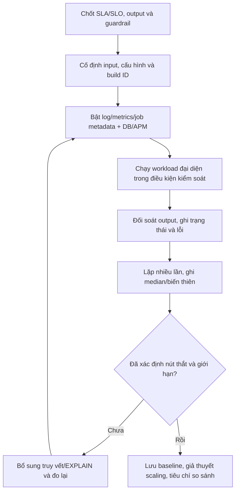

# Đã đo baseline trước scaling — Checklist production cho Spring Batch

## 1. Vì sao phải có baseline trước khi mở rộng?

**Baseline** là tập số đo có thể lặp lại của job trong cấu hình hiện tại, trên một workload và môi trường được mô tả rõ ràng. Đây là mốc để xác định job đang chậm ở đâu, có cần mở rộng hay không và một thay đổi scaling thật sự cải thiện được bao nhiêu. Nếu chỉ nhìn thời gian chạy cuối cùng mà không biết khối lượng dữ liệu, tình trạng database, số lần retry hoặc tải nền, một lần chạy nhanh hơn chưa chắc là do kiến trúc tốt hơn.

Trong module `SPRING_BATCH_SCALING_OPERATIONS`, ta học mở rộng Spring Batch bằng **multi-threaded step, parallel steps, partitioning, remote chunking và remote partitioning**. Mỗi mô hình sử dụng tài nguyên theo cách khác nhau. Đo baseline trước khi chọn mô hình giúp tránh trường hợp tăng worker trong khi nút thắt thực sự là một câu SQL chậm, connection pool đã cạn hoặc hệ thống đích giới hạn tốc độ ghi.

Ví dụ: một job xử lý 3 triệu giao dịch trong 40 phút. Yêu cầu nghiệp vụ là hoàn tất trong 25 phút. Ý tưởng đầu tiên có thể là thêm tám worker, nhưng nếu 70% thời gian job nằm ở truy vấn database và database đã dùng gần hết I/O, thêm worker dễ làm query chậm hơn. Baseline phải trả lời **cái gì đang chậm, chậm bao nhiêu, ở tài nguyên nào và khi thay đổi thì đo thành công bằng cách nào**.

> **Điều kiện chấp nhận trước scaling:** Có một kết quả baseline gắn với phiên bản ứng dụng, workload, cấu hình concurrency, thời gian bắt đầu/kết thúc, số lượng bản ghi, chỉ số lỗi và tài nguyên hạ tầng; có thể chạy lại, đối soát tính đúng đắn và so sánh công bằng với phương án scaling.

## 2. Phân biệt baseline, benchmark và SLA/SLO

| Khái niệm | Ý nghĩa | Ví dụ |
| --- | --- | --- |
| **Baseline** | Kết quả đo của cấu hình hiện tại trong điều kiện kiểm thử xác định. | 3.000.000 giao dịch, 1 worker, median runtime 2.410 giây. |
| **Benchmark** | Quy trình/thí nghiệm dùng để so sánh các cấu hình bằng cùng quy tắc đo. | So sánh 1/2/4/8 worker trên cùng tập input và cùng giới hạn tài nguyên. |
| **SLA** | Cam kết dịch vụ với bên sử dụng/khách hàng, thường gắn thời hạn và hậu quả nếu vi phạm. | File kết quả phải sẵn sàng trước 06:00. |
| **SLO** | Mục tiêu vận hành có thể đo và quản lý nội bộ. | Ít nhất 99% các lần chạy ngày thường hoàn tất trong 25 phút. |
| **Guardrail** | Điều kiện không được vượt khi tối ưu hiệu năng. | DB CPU duy trì dưới ngưỡng đã thỏa thuận, không phát sinh dữ liệu trùng, error rate không tăng. |

Khi đo, cần ghi **thời gian chờ trước khi job bắt đầu** tách khỏi **thời gian JobExecution thực thi**. Với một lịch batch có deadline, cả hai có thể quan trọng, nhưng chỉ tối ưu phần chạy step không giải quyết được việc scheduler khởi chạy quá trễ.

Các chỉ số nền:

```text
Job duration (giây) = thời điểm kết thúc - thời điểm bắt đầu

Job throughput (item/giây) =
    số item đầu vào xử lý thành công theo định nghĩa nghiệp vụ / thời gian đo (giây)

Speedup(N) = T_baseline / T_N

Hiệu suất song song(N) = Speedup(N) / N

Error rate = số bản ghi thất bại theo định nghĩa / tổng số bản ghi được thử xử lý

SLA headroom = thời hạn cho phép - thời gian hoàn thành thực tế
```

**Chọn một mẫu số nhất quán.** `readCount`, `processSkipCount`, `writeCount` và số dòng đầu ra không luôn bằng nhau: processor có thể trả về `null` để lọc item; một writer có thể gộp nhiều bản ghi nguồn thành một kết quả. Phải ghi rõ throughput tính theo **số bản ghi nguồn đã đọc**, **số bản ghi đã xử lý hợp lệ** hay **số đầu ra nghiệp vụ**. Không dùng lại cùng tên "throughput" cho các đại lượng khác nhau.

## 3. Chốt điều kiện thí nghiệm để baseline so sánh được

Trước khi chạy phép đo, ghi rõ các yếu tố ảnh hưởng hiệu năng.

| Nhóm điều kiện | Phải lưu lại | Nếu không lưu sẽ gây nhầm lẫn gì? |
| --- | --- | --- |
| Phần mềm | Git commit/build ID, Java/Spring Batch/Spring Boot version, JVM flags, phiên bản JDBC driver. | Thay đổi code hoặc runtime bị nhầm thành lợi ích của scaling. |
| Workload | Số bản ghi, khoảng thời gian dữ liệu, phân bố theo partition/key, cỡ payload, tỷ lệ item lỗi/lọc, dữ liệu lệch. | Job mới nhanh hơn chỉ vì dữ liệu ít hơn hoặc dễ xử lý hơn. |
| Job | Job name/JobInstance, tham số đầu vào, chunk size, page/fetch size, retry/skip/backoff, transaction isolation. | Thay đổi phạm vi hay ngữ nghĩa xử lý làm thời gian không còn tương đương. |
| Concurrency | Thread pool, `gridSize`, số worker replica, số listener consumer, queue prefetch. | Không biết tài nguyên song song thực tế đã sử dụng. |
| Database | Loại/phiên bản DB, index, thống kê, kích thước bảng, connection pool, replication, cache warm/cold. | Query plan khác hoặc DB đang bận làm lệch kết quả. |
| Hạ tầng | CPU/memory limit, disk/IOPS, network, broker, autoscaling, các workload chạy chung. | Thí nghiệm thiếu tài nguyên hoặc được ưu tiên tài nguyên khác. |
| Hệ thống phụ thuộc | Rate limit dịch vụ ngoài, thời gian đáp ứng API, độ trễ mạng, tình trạng cache. | Nghẽn phía downstream bị quy nhầm cho Spring Batch. |
| Cách đo | Đồng hồ, dashboard, sampling interval, khoảng warm-up, cách xác nhận hoàn tất. | So sánh lệch cửa sổ thời gian hoặc bỏ sót lỗi. |

Nếu job ghi dữ liệu, mỗi lần benchmark cần **khôi phục dataset/staging hoặc dùng run ID và output tách biệt**; không chạy lại vô điều kiện lên production nếu tác động nghiệp vụ có thể trùng. Khi chuyển sang dữ liệu production, ưu tiên quan sát các lần chạy có sẵn và thiết kế phép thử có kiểm soát theo chính sách vận hành.

### Quy tắc để một baseline đáng tin

1. **Giữ workload đại diện:** gồm bản ghi nhỏ/lớn, dữ liệu lỗi, partition lớn/nhỏ, tác vụ gọi API và mùa cao điểm nếu có.
2. **Giữ cấu hình hiện tại làm đối chứng:** ghi rõ job chạy một worker hay đã song song; "trước scaling" không đồng nghĩa mặc định một thread.
3. **Tách warm-up:** JVM JIT, connection pool và DB cache có thể khác nhau giữa lần chạy đầu và các lần sau. Ghi cả cold-start khi cold-start là một phần SLA.
4. **Chạy nhiều lần đủ để thấy biến thiên:** ví dụ 3–5 lần với workload tái lập, hoặc dùng nhiều lần chạy lịch thực tế. Median giúp bớt ảnh hưởng outlier; p95/p99 của thời gian **mỗi job** cần nhiều quan sát hơn để có ý nghĩa.
5. **Ghi nhận tải nền:** đặc biệt khi DB, broker và API dùng chung với dịch vụ khác.
6. **Đối soát độ đúng:** throughput tăng mà mất hoặc trùng item không đạt yêu cầu.

## 4. Đo những gì, ở đâu?

### 4.1. Tầng Job và Step của Spring Batch

`JobRepository` lưu metadata của `JobExecution` và `StepExecution`. Dữ liệu này hữu ích cho baseline, nhưng cần ghép với số liệu tài nguyên vì một step chậm có thể đang chờ DB, broker, mạng hoặc downstream.

| Metric | Nguồn đo khả dụng | Câu hỏi cần trả lời |
| --- | --- | --- |
| Job start/end/duration, trạng thái kết thúc | `JobExecution`, scheduler, logs | Job đạt SLA không? Có chờ trước lúc chạy không? |
| Step duration và phân bổ thời gian | `StepExecution`, timer/observation, logs | Step nào chiếm nhiều thời gian nhất? |
| `readCount`, `writeCount` | `StepExecution` | Đã đọc/ghi bao nhiêu item theo counters Spring Batch? |
| `filterCount`, các skip count | `StepExecution` | Item bị lọc/bỏ qua theo chính sách có phù hợp kỳ vọng không? |
| `commitCount`, `rollbackCount` | `StepExecution` | Transaction có rollback hoặc commit quá thường xuyên không? |
| Lỗi, retry, timeout | Listener, logs có cấu trúc, client/DB metrics | Lỗi xuất hiện ở đọc, xử lý, ghi hay phụ thuộc bên ngoài? |
| Chunk/item latency p50/p95/p99 | Timer của chunk/item qua Micrometer hoặc instrument phù hợp | Độ trễ cao nhất nằm ở giai đoạn nào? |
| Số partition hoàn tất/thất bại, phân bố runtime | Metadata từng worker `StepExecution` | Có một partition kéo dài làm cả job chờ không? |

**Chú ý cách hiểu counter:** `readCount` không phải tất cả số dòng SQL driver fetch; `writeCount` không nhất thiết là số dòng DB thực sự bị thay đổi; `commitCount` không luôn bằng số chunk dữ liệu thành công theo cách tính đơn giản, vì còn transaction/metadata/reader đặc thù. Retry có thể làm gọi processor/writer nhiều lần nhưng không tương ứng với cùng số item thành công.

Trong các ứng dụng có Micrometer/Spring Boot Actuator, có thể quan sát một phần metric Spring Batch có sẵn; **tên metric, tag và mức tự động instrument phụ thuộc phiên bản Spring Batch, Spring Boot và cấu hình**. Hãy kiểm tra registry thực đang xuất metric gì. Nếu thiếu thời gian đọc/ghi riêng, thêm listener hoặc instrumentation có kiểm soát; không kết luận "xử lý chậm" chỉ từ tổng duration của step.

### 4.2. JVM, hệ điều hành và container

| Metric | Dấu hiệu cần nhìn | Ảnh hưởng tới quyết định |
| --- | --- | --- |
| CPU usage/throttling | CPU liên tục cao hoặc container bị throttling. | Processor có thể cần thêm core/worker hoặc giảm contention. |
| Heap, allocation rate, GC pauses | Heap tăng, pause dài, OOM, allocation quá cao. | Chunk/page lớn hoặc buffering quá mức; thêm thread có thể làm xấu hơn. |
| Runnable/blocking threads | Nhiều thread BLOCKED/WAITING, executor queue tăng. | Lock, thread starvation hoặc tài nguyên downstream là nút thắt. |
| I/O disk/network | Băng thông sát giới hạn, latency tăng. | Tăng parallel read có thể chỉ tăng cạnh tranh. |
| File descriptors / socket / connection | Tăng gần trần hoặc leak theo thời gian. | Cần sửa rò rỉ và giới hạn pool trước khi scale. |

Các chỉ số sử dụng tài nguyên cần gắn với **thời điểm job chạy**. Lấy CPU trung bình cả ngày có thể che mất spike 15 phút dẫn tới job trễ.

### 4.3. Database nguồn và đích

- **Query latency p50/p95/p99**, số query/giây, số dòng quét so với số dòng trả về, execution plan và index usage.
- **Connection pool:** số kết nối active/idle/pending, thời gian đợi connection, timeout và trần kết nối toàn database.
- **DB CPU, IOPS, disk latency, memory/cache hit**, lock wait, deadlock, slow query, log/WAL pressure và replica lag nếu có đọc từ replica.
- **Read throughput/Write throughput** tại DB; tách DB nguồn và DB đích nếu chúng khác nhau.
- **Transaction duration/rollback** khi tăng `chunkSize` hoặc số worker, vì batch lớn dễ giữ lock lâu hơn.

Nên so sánh query plan và thời gian của một truy vấn đại diện trước khi thử parallel read. Một full table scan chạy tám lần đồng thời có thể gây tải nặng hơn rất nhiều so với tối ưu index/range trước.

### 4.4. Broker và remote workers nếu job phân tán

Với **remote chunking** hoặc **remote partitioning**, baseline phải bao gồm cả:

- Queue depth, tuổi message cũ nhất, request publish/consume rate, reply rate và reply lag.
- Số message bị redelivery, dead-letter, ack timeout, lỗi correlation.
- Số worker hoạt động thực tế, concurrency mỗi worker, thời gian bận/chờ và độ lệch giữa các worker.
- Round-trip time manager → broker → worker → broker → manager, khi có thể đo.
- Network throughput, message payload size, serialize/deserialize latency và giới hạn broker.

Chỉ đo CPU của manager rồi khẳng định job "không tốn CPU" sẽ bỏ sót phần tính toán đang diễn ra ở worker. Trong remote chunking, manager vẫn là nơi đọc nguồn; nếu reader là bottleneck, tăng remote worker không loại bỏ trần đó.

## 5. Một cách instrument Spring Batch để lưu baseline

Ví dụ dưới đây dùng API `StepExecutionListener` thường gặp ở **Spring Batch 5.x**, ghi một bản tóm tắt khi step kết thúc. Việc đo duration dùng `System.nanoTime()` trong cùng tiến trình để tránh lệch múi giờ hoặc đồng hồ hệ thống; một listener dùng lại cho nhiều partition bảo vệ dữ liệu thời gian bắt đầu bằng `ConcurrentHashMap`.

```java
import java.util.concurrent.ConcurrentHashMap;
import java.util.concurrent.ConcurrentMap;
import org.slf4j.Logger;
import org.slf4j.LoggerFactory;
import org.springframework.batch.core.ExitStatus;
import org.springframework.batch.core.StepExecution;
import org.springframework.batch.core.StepExecutionListener;

public class BaselineStepListener implements StepExecutionListener {
    private static final Logger log =
            LoggerFactory.getLogger(BaselineStepListener.class);

    private final ConcurrentMap<Long, Long> startedNanos =
            new ConcurrentHashMap<>();

    @Override
    public void beforeStep(StepExecution execution) {
        if (execution.getId() != null) {
            startedNanos.put(execution.getId(), System.nanoTime());
        }
    }

    @Override
    public ExitStatus afterStep(StepExecution execution) {
        Long started = execution.getId() == null
                ? null
                : startedNanos.remove(execution.getId());

        double elapsedSeconds = started == null
                ? Double.NaN
                : (System.nanoTime() - started) / 1_000_000_000.0;

        double readRate = elapsedSeconds > 0
                ? execution.getReadCount() / elapsedSeconds
                : Double.NaN;

        log.info(
            "baseline jobExecutionId={} stepExecutionId={} step={} " +
            "status={} read={} write={} filter={} " +
            "readSkip={} processSkip={} writeSkip={} " +
            "commit={} rollback={} elapsedSeconds={} readPerSecond={}",
            execution.getJobExecution().getId(),
            execution.getId(),
            execution.getStepName(),
            execution.getStatus(),
            execution.getReadCount(),
            execution.getWriteCount(),
            execution.getFilterCount(),
            execution.getReadSkipCount(),
            execution.getProcessSkipCount(),
            execution.getWriteSkipCount(),
            execution.getCommitCount(),
            execution.getRollbackCount(),
            elapsedSeconds,
            readRate
        );

        return null; // Không thay đổi ExitStatus của step.
    }
}
```

Đăng ký listener vào worker step (ví dụ `new StepBuilder(...).<Input,Output>chunk(...).reader(...).writer(...).listener(baselineStepListener).build()`). Trong local partitioning, mỗi `StepExecution` con có ID và counter riêng; trong remote chunking, cần quan sát cả manager và worker thay vì nghĩ một listener của manager phản ánh mọi thời gian remote.

Giới hạn của ví dụ:

- `elapsedSeconds` đo khoảng từ callback `beforeStep` tới `afterStep`; không bao gồm thời gian chờ scheduler, khởi động ứng dụng và có thể khác duration mà repository ghi cho step.
- `readPerSecond` lấy readCount/chạy step, là một **tỷ lệ tổng hợp**. Nó không chỉ riêng thời gian thực thi SQL hay throughput nghiệp vụ sau lọc.
- `System.nanoTime()` chỉ so sánh được trong cùng JVM. Không lấy nanoTime của manager trừ nanoTime của worker trên máy khác.
- Cần thêm timer cho đọc/xử lý/ghi, query và API để thấy nút thắt sâu hơn. Với metrics có gắn tag, tránh dùng `jobExecutionId`/ID bản ghi làm **metric label** có cardinality không giới hạn; giữ ID chi tiết trong log hoặc trace.

Nếu framework phiên bản đang sử dụng đã cung cấp metrics tương ứng qua Micrometer, ưu tiên tận dụng chúng và chỉ instrument phần thực sự thiếu, tránh ghi trùng và làm tăng overhead.

## 6. Quy trình lấy baseline có thể tái lập



**Bước 1 — Chốt mục tiêu:** ghi SLA theo đồng hồ thực tế, ví dụ "chạy sau 02:00 và file hoàn tất trước 03:00"; xác định số lượng và tính đúng của output. Đồng thời chốt giới hạn an toàn của DB CPU/IO, replica lag, queue backlog, mức lỗi và quota API.

**Bước 2 — Ghi dữ liệu/cấu hình:** dùng input snapshot hoặc bộ fixture tái lập. Chụp thông số chunk/page/fetch, số thread/partition/replica, DB pool, phiên bản ứng dụng, SQL plan và số lượng item theo nhóm. Nếu thí nghiệm chạy trực tiếp trên production, ghi rõ các yếu tố không thể cố định, ví dụ load nền.

**Bước 3 — Thiết lập quan sát:** metadata Job/Step, structured log, JVM/host, connection pool, DB slow queries, broker/worker nếu có, và timestamp cùng múi giờ thống nhất. Chọn khoảng lấy mẫu đủ nhỏ để thấy peak; tránh khiến monitoring tự trở thành nguồn tải đáng kể.

**Bước 4 — Chạy baseline:** giữ cấu hình hiện tại. Ghi tổng duration, counters và phân bố latency theo bước; quan sát diễn biến tài nguyên theo thời gian, thay vì chỉ một ảnh chụp sau khi job hoàn tất.

**Bước 5 — Đối soát kết quả:** so sánh số item kỳ vọng/đã đọc/đã ghi/bị lọc/bị skip; kiểm tra khóa trùng và kết quả nghiệp vụ. Lưu failure/skip reasons, không chỉ "COMPLETED" là coi như dữ liệu chính xác.

**Bước 6 — Lặp và lưu bằng chứng:** ghi mỗi run thành một dòng, nêu rõ run nào cold/warm. Báo median và khoảng biến thiên; dùng p95/p99 cho latency item/chunk khi đủ mẫu. Gắn dashboard, log, commit hash và dữ liệu đầu vào với bản ghi thí nghiệm.

**Bước 7 — Ra quyết định:** chỉ thử một thay đổi chính mỗi lượt (ví dụ tăng thread, rồi chỉnh chunkSize), so sánh với cùng baseline và kiểm tra guardrail. Nếu cấu hình thay đổi đồng thời cả query, số worker và pool, sẽ rất khó biết yếu tố nào giúp hoặc gây hại.

## 7. Ví dụ phân tích số liệu baseline

Giả sử một job đọc và ghi **3.000.000 item** bằng một worker; cùng build, cùng dữ liệu snapshot, cùng hạ tầng. Ba lần chạy cho kết quả giả định:

| Lần đo | Thời gian (giây) | Throughput theo readCount | Read/write | Trạng thái |
| --- | ---: | ---: | --- | --- |
| 1 | 2.420 | ~1.240 item/s | 3.000.000 / 3.000.000 | COMPLETED |
| 2 | 2.390 | ~1.255 item/s | 3.000.000 / 3.000.000 | COMPLETED |
| 3 | 2.410 | ~1.245 item/s | 3.000.000 / 3.000.000 | COMPLETED |

Median runtime là **2.410 giây (40 phút 10 giây)**; throughput theo median xấp xỉ **1.245 item/giây**. Mục tiêu hoàn tất trong **25 phút (1.500 giây)**, tức cần ít nhất **2.000 item/giây**, tương đương tốc độ cao hơn khoảng **1,61 lần** baseline nếu số lượng input không đổi và không có overhead mới.

Giả sử dashboard còn cho thấy:

- CPU của JVM chỉ 35–45%, GC pause thấp.
- DB nguồn dùng nhiều I/O, một số truy vấn read có p95 tăng mạnh theo tải.
- Connection pool có lúc chờ lấy connection; writer ít khi phải đợi.
- Ở đầu job, database query đáp ứng tốt; về cuối job, một câu phân trang theo OFFSET sâu chạy ngày càng chậm.

**Giả thuyết đáng kiểm thử** lúc này là query/pagination và DB I/O đang giới hạn phần đọc. Việc tăng thread đơn thuần chưa phải lựa chọn đầu tiên: cần lấy `EXPLAIN`, xem index, sort key, phương pháp paging và đo riêng thời gian query. Nếu sau khi tối ưu query, DB có đủ headroom, có thể thử partitioning để nhiều reader đọc các range rời nhau.

Ngược lại, nếu database còn dư tài nguyên nhưng processor bận CPU tới giới hạn của một core, có thể cân nhắc multi-threaded step, parallel steps hoặc phân tán công việc tùy mức độc lập của dữ liệu. **Một chỉ số đơn lẻ không chứng minh nguyên nhân**: CPU thấp cũng có thể do lock, I/O, rate limit hoặc thread đang chờ.

### Đặt kỳ vọng bằng mô hình đơn giản

Nếu thực sự có một phần xử lý không thể song song chiếm tỷ lệ `s` trong tổng thời gian, định luật Amdahl cho giới hạn lý thuyết:

```text
Speedup tối đa theo N worker = 1 / (s + (1 - s) / N)

Ví dụ: s = 0,35; N = 4
Speedup tối đa = 1 / (0,35 + 0,65 / 4) ≈ 1,95
Thời gian tốt nhất xấp xỉ = 2.410 / 1,95 ≈ 1.235 giây
```

Đây là ví dụ minh họa, giả định phần song song phân phối hoàn hảo và không có thêm overhead. Trong thực tế, broker, database contention, kết nối, lock và lệch partition có thể làm lợi ích thấp hơn. Không suy trực tiếp tỷ lệ `s` chỉ từ tỷ trọng thời gian SQL/processor mà chưa xem chúng chồng lấp và tranh chấp tài nguyên thế nào.

## 8. Từ baseline đến lựa chọn scaling phù hợp

| Dấu hiệu trong baseline | Cần xác minh tiếp | Hướng giải pháp đáng thử |
| --- | --- | --- |
| Processor chiếm CPU, DB và I/O còn dư | Stateful processor? Thứ tự xử lý có bắt buộc? | Multi-threaded step, nhiều instance xử lý, hoặc remote chunking nếu cần scale ngoài JVM. |
| Có nhiều nhóm nghiệp vụ/step độc lập | Phụ thuộc dữ liệu, transaction và lịch chạy của từng step | Parallel steps/flows. |
| Reader SQL chậm nhưng DB còn khả năng phục vụ nhiều truy vấn | Có khóa phân vùng, index range, dữ liệu ổn định và partition cân tải? | Local/remote partitioning với reader riêng cho mỗi phân vùng. |
| Manager remote chunking đọc chậm, worker rảnh | Request queue trống, read rate chạm trần? | Tối ưu reader hoặc đổi sang partitioning; tăng worker xử lý không mở rộng reader manager. |
| Writer/DB đích chậm, lock nhiều | Batch write, index, isolation, transaction time và pool | Tối ưu writer/DB; giới hạn concurrency; chỉ scale nếu DB chịu được tải. |
| Broker backlog tăng, worker CPU cao | Độ trễ reply, DLQ/redelivery, payload, worker quota | Tăng worker hợp lý và giới hạn outstanding requests. |
| API ngoài bị 429/timeout | Rate limit, retry storm, latency p95/p99, quota | Rate limiting/backoff/bulkhead; không nhân worker vô hạn. |
| GC, heap hoặc connection pool có dấu hiệu quá tải | Memory per chunk, retained objects, leak, concurrent requests | Giảm page/chunk/concurrency hoặc sửa quản lý tài nguyên trước khi scale. |
| Một vài partition chạy lâu vượt trội | Phân bố item theo range, hot key, skew | Chia lại phân vùng, chọn partition key khác hoặc tăng độ mịn có kiểm soát. |

Trước mỗi thử nghiệm scaling, viết một giả thuyết có thể bác bỏ, chẳng hạn: "Tăng từ 1 lên 4 partition sẽ giảm median duration từ 2.410 xuống dưới 1.500 giây, không tăng số lỗi, không phát sinh duplicate và không làm p95 query latency quá ngưỡng vận hành". Nếu kết quả không đạt, quay lại bằng chứng thay vì tiếp tục tăng thread.

## 9. Checklist production: bằng chứng đã đo baseline

Checklist dưới đây có thể đưa vào review trước khi triển khai thay đổi concurrency/partitioning. Cột "bằng chứng" nên là đường dẫn cụ thể tới dashboard, log, báo cáo SQL, pipeline hoặc tài liệu kiểm thử; tránh chỉ đánh dấu "đã xem".

### 9.1. Định nghĩa mục tiêu và điều kiện

- [ ] Đã ghi **SLA/SLO**, deadline, đơn vị đo, timezone, cửa sổ chạy và khoảng thời gian scheduler chờ.
- [ ] Đã chốt số item đầu vào kỳ vọng, chính sách filter/skip và cách xác nhận output đúng.
- [ ] Đã ghi phiên bản code/dependency/JVM, job parameters và cấu hình concurrency/chunk/page/fetch hiện tại.
- [ ] Đã mô tả input dataset, độ lệch dữ liệu, cutoff/snapshot và các hệ thống phụ thuộc.
- [ ] Đã nêu giới hạn tài nguyên an toàn: DB CPU/IO/pool, broker, API quota, heap và thời gian rollback/recovery.

### 9.2. Đo hiệu năng và tính đúng

- [ ] Đã đo job duration cùng các step duration; phân biệt phần chờ scheduler với phần xử lý.
- [ ] Đã lưu `readCount`, `writeCount`, filter, skip, commit, rollback và trạng thái kết thúc.
- [ ] Đã đo hoặc có bằng chứng xác định nút thắt tại reader, processor, writer, DB, API hay broker.
- [ ] Đã quan sát JVM CPU/GC/heap, thread pool, connection pool, database query latency/locks/IO.
- [ ] Với partitioning/remote worker: đã đo runtime từng partition, worker utilization, queue lag và redelivery nếu áp dụng.
- [ ] Đã kiểm tra output không thiếu/trùng, biết cách xử lý retry và restart trong các lần chạy.
- [ ] Đã đo đủ lần hoặc đủ lịch chạy để thấy biến thiên; ghi rõ cold/warm cache và tải nền.

### 9.3. Khả năng so sánh và quyết định

- [ ] Đã lưu baseline theo run ID, build ID, dữ liệu, thời gian, dashboard/log và ghi chú lỗi.
- [ ] Đã tính throughput cùng một định nghĩa giữa các lần chạy.
- [ ] Đã ghi một hoặc vài giả thuyết bottleneck có số liệu hỗ trợ và bằng chứng truy vấn khi DB liên quan.
- [ ] Đã chọn phương án scaling tương ứng với nút thắt, thay vì chọn theo số CPU/worker có sẵn.
- [ ] Đã xác định tiêu chí **go/no-go**: runtime mục tiêu, correctness, retry/duplicate và các resource guardrail.
- [ ] Đã có cách rollback cấu hình và quy trình xác minh sau deploy bằng cùng metric baseline.

**Mẫu báo cáo baseline tối thiểu:**

```yaml
baseline:
  job: daily-transaction-reconciliation
  runId: baseline-2026-11-26-a
  build: "git:<commit>"
  input:
    source: "snapshot/staging dataset"
    expectedItems: 3000000
    cutoff: "2026-11-25T23:59:59+07:00"
  config:
    workers: 1
    chunkSize: 200
    reader: "JdbcPagingItemReader"
    pageSize: 500
  sampleRuns:
    durationSeconds: [2420, 2390, 2410]
    readCountEachRun: 3000000
    writeCountEachRun: 3000000
    statusEachRun: COMPLETED
  summary:
    medianDurationSeconds: 2410
    baselineItemsPerSecond: 1245
    targetDurationSeconds: 1500
    requiredItemsPerSecond: 2000
  evidence:
    jobExecutionIds: ["<id1>", "<id2>", "<id3>"]
    dashboards: "<link-to-dashboard>"
    queryPlans: "<link-to-query-plans>"
    correctnessReport: "<link-to-reconciliation>"
  hypothesis: "Investigate reader SQL/paging bottleneck first"
  decision: "baseline-recorded; scaling-test-pending"
```

Đây là **mẫu minh họa**, không phải cấu hình Spring Batch. Những dấu `<...>` cần được thay bằng giá trị thật trong báo cáo; không đưa secrets, payload nhạy cảm hoặc thông tin kết nối vào tài liệu.

## 10. Những sai lầm khi tuyên bố "đã đo baseline"

| Sai lầm | Vì sao nguy hiểm | Cách sửa |
| --- | --- | --- |
| Chỉ chụp màn hình runtime của một lần chạy | Không biết số dòng, biến thiên hoặc lỗi ẩn. | Ghi dataset, counters, môi trường và lặp lại số đo. |
| So sánh hai tập dữ liệu khác nhau | Giảm thời gian do ít item, không do tăng concurrency. | Dùng snapshot/manifest và đối chiếu phân bố dữ liệu. |
| Chỉ đo throughput, bỏ qua correctness | Xử lý nhanh nhưng có thể mất hoặc nhân đôi item. | Đối soát khóa/giá trị kết quả và skip/retry. |
| Chỉ đo CPU ứng dụng | DB/broker/API có thể bão hòa trong khi JVM chờ. | Thu thập metric theo toàn đường dữ liệu. |
| Đặt worker bằng số core mà không kiểm tra DB pool | Nhiều thread chờ connection và gây cascade timeout. | Đo active/pending connections, tải DB và giới hạn toàn cụm. |
| Thấy một step chậm rồi kết luận processor chậm | Step gồm cả đọc, chờ, ghi, transaction và remote reply. | Đo thời gian thành phần và correlation giữa các hệ thống. |
| Bỏ qua outlier, retry hoặc phần đuôi p99 | Production thất bại do các lần chạy chậm nhất dù median đẹp. | Theo dõi phân phối, lỗi, timeout và SLA window. |
| Dùng baseline không có build/config ID | Không tái lập được kết quả hoặc phân biệt thay đổi. | Gắn experiment/run/build cùng cấu hình đã thực thi. |
| Tăng cùng lúc workers, chunkSize và index | Không biết thay đổi nào có tác dụng. | Thử một yếu tố chính, có đối chứng và lưu bằng chứng. |

## 11. Tình huống thực hành

Một hệ thống xử lý dữ liệu giá theo ngày có ba step:

- `extractStep`: đọc 8 triệu sản phẩm từ DB nguồn.
- `pricingStep`: tính giá theo quy tắc và gọi một API tra cứu.
- `publishStep`: ghi dữ liệu đã chuẩn hóa vào DB đích.

Job mất 58 phút, SLA 35 phút. Một engineer đề xuất chạy tám worker ngay. Nhóm vận hành đo baseline với các kết quả: `extractStep` 8 phút, `pricingStep` 43 phút, `publishStep` 7 phút; CPU job trung bình 30%, p95 API gần sát timeout và tỷ lệ HTTP 429 tăng mạnh vào giờ cao điểm.

Từ baseline, việc tăng worker tự do có nguy cơ tạo thêm 429 và retry storm. Giải pháp thử đầu tiên nên tập trung đo rate limit thực tế, thời gian chờ API, số request đồng thời cho phép, caching và retry/backoff. Nếu API chấp nhận concurrency bổ sung và CPU còn dư, có thể mở rộng `pricingStep` với **rate limiter tổng** và guardrail; nếu không, thêm worker sẽ không làm job nhanh tương ứng.

**Bài tập tự kiểm tra:**

1. Những bằng chứng nào còn thiếu trước khi chấp nhận baseline (ví dụ số item, error/skip count, API quota, data snapshot)?
2. Nên đo p50/p95/p99 của cuộc gọi API, tổng số HTTP 429 và thời gian retry bằng công cụ nào?
3. Nếu tăng từ 1 lên 4 worker làm thời gian giảm còn 37 phút nhưng HTTP 429 gấp đôi, có nên triển khai production? Vì sao?
4. Hãy viết tiêu chí chấp nhận có thể đo: runtime dưới 35 phút, số sản phẩm đúng bằng đầu vào hợp lệ, rate-limit/timeout không vượt ngưỡng và database giữ trong giới hạn tải.

## 12. Kết luận

Trước khi scaling Spring Batch, phải có **baseline tái lập và có đối soát dữ liệu**, gồm thời gian chạy, throughput, lỗi, các counters Job/Step và tình trạng tài nguyên xuyên suốt database, JVM, broker, network, API. Baseline giúp xác định liệu nút thắt thuộc phần đọc, xử lý, ghi hay điều phối; từ đó mới chọn multi-threaded step, parallel steps, partitioning hoặc mô hình phân tán phù hợp. Một thay đổi scaling chỉ thành công khi cải thiện mục tiêu thời gian **đồng thời** giữ dữ liệu đúng, retry/restart an toàn và không vượt các giới hạn tài nguyên đã thống nhất.

### Tài liệu tham khảo

- [Spring Batch Reference — Scaling and Parallel Processing](https://docs.spring.io/spring-batch/reference/scalability.html)
- [Spring Batch Reference — Monitoring and Metrics](https://docs.spring.io/spring-batch/reference/monitoring-and-metrics.html)
- [Spring Batch Reference — JobRepository](https://docs.spring.io/spring-batch/reference/job/configuring-repository.html)
- [Spring Boot Reference — Metrics](https://docs.spring.io/spring-boot/reference/actuator/metrics.html)
- [Micrometer Reference Documentation](https://docs.micrometer.io/micrometer/reference/)
