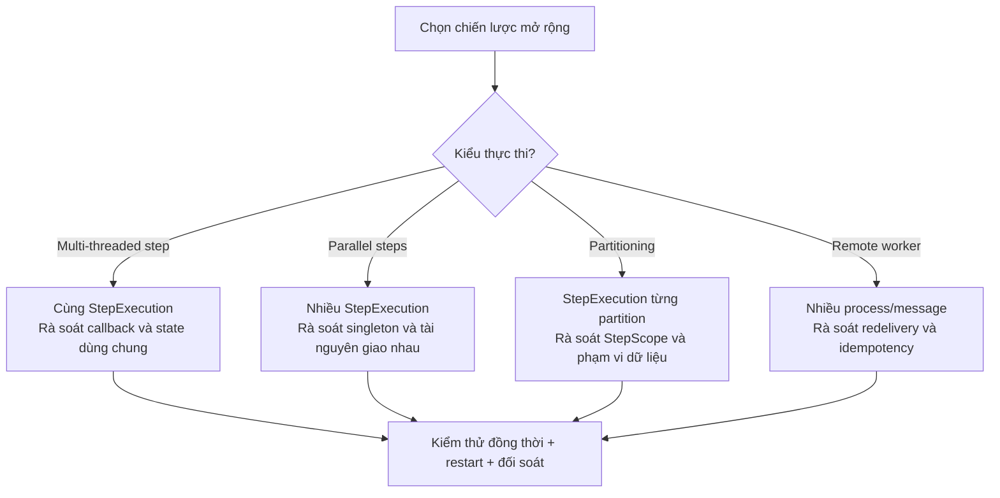

# Đã kiểm tra thread safety trước khi chạy Spring Batch trên production

Một Spring Batch job có thể chạy đúng khi xử lý tuần tự nhưng **đọc sai dữ liệu, mất bản ghi, ghi trùng hoặc không thể restart** khi bật nhiều thread. Lỗi không nhất thiết hiện ra dưới dạng exception: race condition có thể chỉ làm số đếm, thứ tự hoặc checkpoint bị lệch. Vì thế, mục **“Đã kiểm tra thread safety”** trong checklist production chỉ được đánh dấu hoàn tất khi có bằng chứng rằng mọi component và trạng thái chia sẻ đều an toàn trong **kiểu mở rộng thực tế** đang triển khai.

Trong module **SPRING_BATCH_SCALING_OPERATIONS**, workload lớn có thể được mở rộng bằng multi-threaded step, parallel steps, partitioning, remote partitioning hoặc remote chunking. Bài này đưa ra quy trình rà soát, ví dụ Java, phương pháp thử tải và tiêu chí chấp nhận để hệ thống vừa tăng throughput vừa giữ đúng dữ liệu, retry/restart và khả năng vận hành.

## 1. Thế nào là thread safety trong một Batch job?

**Thread-safe** nghĩa là khi nhiều thread truy cập một đối tượng theo đúng contract được hỗ trợ, chương trình vẫn duy trì các bất biến của đối tượng và cho ra kết quả hợp lệ. Trong Spring Batch, điều này cần được xem ở **ba tầng khác nhau**:

1. **Đối tượng Java:** có hay không có biến mutable được nhiều thread đọc/ghi, cấu trúc dữ liệu không an toàn hoặc thư viện không hỗ trợ truy cập đồng thời.
2. **Trạng thái xử lý Batch:** cursor, vị trí file, page offset, `ExecutionContext`, số item đã commit và thông tin restart có được quản lý nhất quán không.
3. **Tài nguyên và side effect:** connection, transaction, file đầu ra, khóa DB, API, message broker và dữ liệu đích có đáp ứng khi nhiều worker cùng hoạt động không.

Có thể **an toàn ở tầng Java nhưng vẫn sai nghiệp vụ**. Ví dụ sử dụng `AtomicLong` để phát sinh số thứ tự giữa 8 thread sẽ tránh race trên biến đếm, nhưng số thứ tự đó không bảo đảm đúng thứ tự đầu vào, bền vững qua crash hoặc đồng nhất với checkpoint. Tương tự, một writer dùng `ConcurrentHashMap` an toàn với thao tác map riêng lẻ vẫn có thể ghi trùng vào database nếu thiếu ràng buộc duy nhất và giao thức retry đúng.

### Ví dụ một lỗi khó phát hiện

Một singleton `ItemProcessor` giữ biến `currentCustomerId` và `runningTotal` để tính tổng từng khách hàng. Với một Step tuần tự, code có thể cho kết quả đúng nếu input được sắp xếp. Khi bật nhiều thread:

- Thread A đặt `currentCustomerId = 100`.
- Thread B đặt `currentCustomerId = 200`.
- Thread A cộng tiền của khách 100 vào tổng đang thuộc khách 200.
- Job vẫn có thể báo `COMPLETED`, nhưng dữ liệu đã sai.

**Cách xử lý đúng** phụ thuộc nghiệp vụ: biến processor thành phép biến đổi độc lập theo item, chia dữ liệu theo khóa khách hàng với ranh giới không chồng lấn, hoặc thực hiện bước tổng hợp được đồng bộ và kiểm soát transaction. Chỉ đặt `synchronized` quanh phương thức có thể che race nhưng biến phần xử lý thành tuần tự, không giải quyết mọi vấn đề về ordering/checkpoint.

## 2. Xác định chính xác mô hình chạy song song

Trước khi audit từng bean, cần trả lời **cái gì đang thực sự chạy đồng thời?** Các mô hình có phạm vi chia sẻ khác nhau.

| Mô hình | Đơn vị chạy đồng thời | Điểm cần kiểm tra |
| --- | --- | --- |
| **Multi-threaded step** | Nhiều chunk trong **cùng một `StepExecution`** | Các callback reader/processor/writer có thể truy cập đồng thời; trạng thái checkpoint và thứ tự xử lý cần kiểm tra đặc biệt |
| **Parallel steps** | Nhiều `StepExecution` của các Step khác nhau | Singleton bean, file, DB table, khóa nghiệp vụ, pool và listener có thể được dùng chung giữa các Step |
| **Local partitioning** | Nhiều worker `StepExecution`, thường trên các thread của cùng JVM | Reader/writer được tạo riêng cho từng partition; không chồng lấn dữ liệu, state/checkpoint độc lập; singleton vẫn có thể dùng chung |
| **Remote partitioning** | Các worker Step chạy trên nhiều process/node | Tính độc lập của worker, giao partition, redelivery, trạng thái JobRepository, side effect và idempotency |
| **Remote chunking** | Chunk được gửi qua message đến các worker | Tác vụ nhận lại, trùng message, thứ tự kết quả, retry và tính an toàn khi nhiều message được xử lý đồng thời |

**Điểm thường bị hiểu sai:** `@StepScope` nghĩa là **một instance theo `StepExecution`**, không phải một instance cho mỗi thread. Với multi-threaded step, nhiều thread có thể cùng sử dụng một bean step-scoped vì chúng thuộc cùng `StepExecution`. Với partitioning, mỗi worker partition thường có `StepExecution` riêng, nên `@StepScope` là cách phù hợp để tạo reader có trạng thái riêng cho từng partition.



Không nên kết luận một component an toàn chỉ vì một lần benchmark 8 thread không ném exception. Thread safety phải được đánh giá bằng **contract của component, thiết kế trạng thái và kiểm thử có đối soát dữ liệu**.

## 3. Lập bản đồ đối tượng và trạng thái chia sẻ

Với mỗi Step, lập bảng kiểm kê cho tất cả bean thuộc tuyến xử lý: `ItemReader`, `ItemProcessor`, `ItemWriter`, `ItemStream`, listener, service, client, transaction helper, cache, logger tùy chỉnh và các thành phần dùng để điều phối.

| Thành phần | Dấu hiệu cần xem | Hướng xử lý thường dùng |
| --- | --- | --- |
| Reader có cursor/offset/page index | `read()` thay đổi vị trí nội bộ; `open/update/close` quản lý checkpoint | Một reader mỗi partition; hoặc sử dụng giải pháp đồng bộ phù hợp sau khi đánh giá giới hạn restart |
| Processor có field mutable | Bộ đếm, bộ tích lũy, parser, collection, biến `lastProcessedId` | Làm stateless; dùng immutable value object hoặc trạng thái riêng theo partition |
| Writer giữ buffer/cache | Danh sách chờ flush, writer file, đối tượng session/connection | Writer an toàn đồng thời hoặc mỗi partition một writer riêng; commit/flush đúng transaction |
| Service singleton | Mutable list/map, mutable formatter, trạng thái tạm theo request | Không giữ state theo item trên singleton; dùng cấu trúc phù hợp và kiểm tra tính nguyên tử của nghiệp vụ |
| Listener/interceptor | Có thể được gọi từ nhiều thread trong Step | Timer/counter an toàn; không ghi field chung thiếu đồng bộ |
| `ExecutionContext` | Chứa offset/last ID hoặc dữ liệu checkpoint | Để lifecycle Batch quản lý; tránh nhiều thread sửa cùng key dựa trên giả định thứ tự |
| Database client | `DataSource` pool thường chia sẻ được; một `Connection` / cursor cụ thể không dùng chung tùy tiện | Mỗi transaction lấy connection phù hợp; kiểm tra pool và isolation |
| File/output destination | Nhiều worker ghi chung file, cùng object key, cùng bảng đích | File riêng theo partition rồi merge, hoặc cơ chế ghi đồng thời được chứng minh an toàn |
| Message/API client | Thư viện client có contract về concurrency; timeout/retry | Xem contract của client, idempotency key, rate limit và giới hạn in-flight |

Trong bảng audit, không chỉ ghi “thread-safe: yes/no”. Cần ghi **tại sao**: class/bean scope, ai gọi, số thread tối đa, field nào mutable, cách xử lý khi crash, và bằng chứng test hoặc tài liệu API. Khi không xác định được contract thread safety của một thư viện, phải coi đó là vấn đề chưa được đóng.

### Câu hỏi bắt buộc cho mỗi component

1. **Ai sở hữu state?** State được tạo cho item, chunk, thread, StepExecution, JobExecution hay toàn ứng dụng?
2. **Có đường ghi từ nhiều thread không?** Bao gồm callback chính, listener, retry, skip, timer và shutdown hook.
3. **Phép biến đổi có phụ thuộc thứ tự không?** Nếu có, mô hình song song có giữ được thứ tự đó không?
4. **State có phải checkpoint không?** Nếu crash sau commit hay rollback, liệu giá trị được ghi vào `ExecutionContext` có còn đại diện đúng?
5. **Transaction bao phủ side effect nào?** DB write, file, HTTP và message có thể thuộc các giao thức commit khác nhau.
6. **Dữ liệu đích có idempotent không?** Khi cùng item/chunk được thực thi lại, kết quả có bị nhân đôi không?

## 4. Phân biệt stateless, immutable và thread-safe

Cách giảm rủi ro hiệu quả nhất là thiết kế đường xử lý như một phép biến đổi **stateless**: dữ liệu đầu ra chỉ phụ thuộc dữ liệu đầu vào và cấu hình bất biến, không phụ thuộc field được viết bởi lời gọi trước.

### Ví dụ processor an toàn khi gọi đồng thời

```java
import java.math.BigDecimal;
import java.time.LocalDate;
import java.time.format.DateTimeFormatter;
import org.springframework.batch.item.ItemProcessor;

record RawOrder(long id, String orderDate, BigDecimal amount) {}
record NormalizedOrder(long id, LocalDate date, BigDecimal amount) {}

public final class NormalizeOrderProcessor
        implements ItemProcessor<RawOrder, NormalizedOrder> {

    // DateTimeFormatter là immutable và dùng đồng thời được.
    private static final DateTimeFormatter DATE_FORMAT =
            DateTimeFormatter.ISO_LOCAL_DATE;

    @Override
    public NormalizedOrder process(RawOrder input) {
        LocalDate date = LocalDate.parse(input.orderDate(), DATE_FORMAT);
        return new NormalizedOrder(
                input.id(),
                date,
                input.amount()
        );
    }
}
```

Mỗi lời gọi tạo giá trị kết quả mới; không có field thay đổi giữa các lần `process()`. `record` và `BigDecimal` trong ví dụ là immutable. Để kết luận toàn bộ processor an toàn, vẫn cần kiểm tra các dependency được gọi bên trong (ví dụ formatter custom, repository hoặc cache).

### Ví dụ anti-pattern

```java
import java.text.SimpleDateFormat;
import java.util.Date;
import org.springframework.batch.item.ItemProcessor;

public final class UnsafeDateProcessor implements ItemProcessor<String, Date> {
    private final SimpleDateFormat parser =
            new SimpleDateFormat("yyyy-MM-dd");

    @Override
    public Date process(String input) throws Exception {
        return parser.parse(input);
    }
}
```

`SimpleDateFormat` có trạng thái mutable và không được thiết kế để dùng chung giữa nhiều thread. Một singleton processor như trên có thể xử lý sai hoặc ném exception bất thường khi chạy đồng thời. Có thể thay bằng `DateTimeFormatter`, hoặc tạo parser độc lập theo lời gọi nếu phù hợp.

**Lưu ý:** `synchronized` chỉ bảo vệ đoạn code được đồng bộ và có thể làm giảm throughput. Nó không tự giải quyết shared mutable state ở dependency khác, tính đúng đắn của transaction, ordering hay checkpoint. `ThreadLocal` có thể tách một số dữ liệu theo thread nhưng dễ gây rò rỉ trạng thái khi thread pool tái sử dụng thread; đồng thời không thay thế `StepExecution` hoặc context của Batch.

## 5. Audit ItemReader và cơ chế checkpoint

Reader là một trong các nguồn lỗi lớn nhất khi bật multi-threaded step vì nhiều implementation giữ trạng thái như cursor, số hàng, số trang hoặc vị trí file.

### 5.1. Đọc tuần tự an toàn không đồng nghĩa đọc song song an toàn

Những điểm cần xem theo implementation thực tế:

- Reader có giữ `ResultSet`/cursor, `currentItemCount` hoặc iterator không?
- Có lời gọi `read()` chồng lấn giữa các thread không?
- `ItemStream.open()`, `update()` và `close()` được gọi khi nào so với các lần `read()`?
- `ExecutionContext` được cập nhật bằng trạng thái nào, và trạng thái đó có phù hợp với **phần dữ liệu đã commit** không?
- Nếu item được đọc trước nhưng chunk chứa nó rollback, restart có thể đọc lại đúng tập item chưa commit không?

Một decorator như `SynchronizedItemStreamReader` có thể tuần tự hóa truy cập `read()` cho delegate phù hợp, nhưng **không được xem là đảm bảo restartability** của multi-threaded step. Thứ tự item đã đọc và thứ tự chunk hoàn tất/commit có thể khác nhau; một checkpoint theo vị trí đọc không nhất thiết mô tả đúng tất cả item đã commit. Tài liệu của Spring Batch cũng cảnh báo về giới hạn restart khi dùng một số reader đồng bộ trong mô hình xử lý này. Cần chứng minh cơ chế restart bằng thử nghiệm lỗi giữa chừng.

### 5.2. Partition reader có trạng thái riêng

Với dữ liệu chia partition không chồng lấn, mỗi worker Step có thể nhận tập đầu vào và reader riêng. Ví dụ Spring Batch 5+:

```java
import javax.sql.DataSource;
import org.springframework.batch.core.configuration.annotation.StepScope;
import org.springframework.batch.item.database.JdbcCursorItemReader;
import org.springframework.batch.item.database.builder.JdbcCursorItemReaderBuilder;
import org.springframework.beans.factory.annotation.Value;
import org.springframework.context.annotation.Bean;

@Bean
@StepScope
public JdbcCursorItemReader<RawOrder> partitionReader(
        DataSource dataSource,
        @Value("#{jobParameters['batchId']}") String batchId,
        @Value("#{stepExecutionContext['bucketId']}") Integer bucketId) {

    return new JdbcCursorItemReaderBuilder<RawOrder>()
            .name("partitionReader")
            .dataSource(dataSource)
            .sql("""
                SELECT id, order_date, amount
                FROM staging_orders
                WHERE batch_id = ? AND bucket_id = ?
                ORDER BY id
                """)
            .preparedStatementSetter(ps -> {
                ps.setString(1, batchId);
                ps.setInt(2, bucketId);
            })
            .rowMapper((rs, rowNum) -> new RawOrder(
                    rs.getLong("id"),
                    rs.getString("order_date"),
                    rs.getBigDecimal("amount")
            ))
            .saveState(true)
            .build();
}
```

Đoạn trên là ví dụ cấu hình bean, giả định `RawOrder` đã được khai báo và phần staging đã có `bucket_id`. `@StepScope` tạo một reader theo từng **worker StepExecution**, nên có state riêng trong local/remote partitioning. Để restart đúng, vẫn phải bảo đảm:

- Phạm vi dữ liệu mỗi bucket **không giao nhau** và bao phủ toàn bộ batch.
- `batchId`, số bucket, quy tắc hash và snapshot dữ liệu không thay đổi khi restart job instance.
- `ORDER BY id` dùng một khóa xác định, duy nhất trong phạm vi được đọc.
- Nguồn dữ liệu không chèn/xóa làm thay đổi vị trí checkpoint khi job đang chạy hoặc restart; nếu không đảm bảo được, cân nhắc checkpoint theo khóa/bảng điều phối công việc.

**Không áp dụng lập luận này cho multi-threaded step chỉ bằng cách thêm `@StepScope`:** nhiều thread trong cùng StepExecution vẫn sử dụng cùng reader.

## 6. Audit ItemProcessor, ItemWriter và listener

### ItemProcessor

Đối với processor, ưu tiên:

- Chỉ sử dụng biến cục bộ trong `process()` và dependency immutable/thread-safe.
- Không giữ `lastItem`, `currentTenant`, buffer hoặc tổng cộng dồn trong singleton processor nếu nhiều thread truy cập.
- Nếu gọi API, giới hạn concurrency, timeout và retry; client có thể hỗ trợ multi-thread nhưng API đích vẫn có rate limit.
- Việc filter bằng cách trả `null` phải độc lập với thứ tự hoặc trạng thái từ lời gọi khác, trừ khi có cơ chế bảo vệ đúng thiết kế.

### ItemWriter

Writer cần được kiểm tra ở cả API Java và side effect:

- Có giữ buffer mutable, writer file, stream hoặc session để nhiều thread dùng chung không?
- Có thể có hai chunk ghi cùng một khóa nghiệp vụ hoặc cùng một đoạn file không?
- Có cơ chế idempotency hoặc unique constraint khi retry sau lỗi không rõ commit thành công?
- Có cấu hình transaction phù hợp với DB, và có side effect nằm ngoài transaction (HTTP, file, queue) không?
- Có đồng bộ writer mà vô tình làm toàn bộ Step trở về tuần tự hoặc tạo lock contention không?

Ví dụ: 8 worker cùng upsert vào bảng tổng hợp theo `account_id` có thể tranh chấp lock hoặc ghi đè logic nếu cập nhật dựa trên giá trị đọc trước đó. Một câu SQL atomic, locking/optimistic locking hoặc phân vùng theo account có thể cần thiết tùy bài toán. `synchronized` trong một JVM không bảo vệ khi worker chuyển sang nhiều JVM.

### Listener và helper

Các callback như `ItemReadListener`, `ItemProcessListener`, `ItemWriteListener` hoặc `ChunkListener` có thể chạy trong các thread liên quan đến xử lý chunk. Tránh ghi vào `ArrayList`, `HashMap`, counter kiểu `long++` hoặc bean singleton mutable không đồng bộ. Khi đo metric, dùng bộ đếm/timer thread-safe của thư viện; không coi bộ đếm tự viết là số liệu có thể khôi phục sau crash.

Một `AtomicLong` dùng cho số lượng callback **có thể đủ an toàn ở mức cộng đếm**, nhưng vẫn chỉ là bộ đếm trong RAM. Nó không phải số item đã commit, không tồn tại sau restart và không thay thế `StepExecution.readCount`, `writeCount` hay dữ liệu đối soát ở đích.

## 7. Phân biệt an toàn của database với an toàn của bean

Trong nhiều ứng dụng Spring, bean `DataSource`/connection pool được dùng chung theo thiết kế; điều này khác với việc **chia sẻ một `Connection`, `ResultSet`, `EntityManager` hoặc cursor mutable cụ thể** giữa các worker.

Một số yêu cầu cần kiểm tra:

| Điểm kiểm tra | Vì sao cần |
| --- | --- |
| Transaction được tạo đúng theo chunk và thread thực thi | Trạng thái transaction thường gắn với context thực thi; không truyền connection/session tùy tiện sang thread khác |
| Mỗi worker dùng reader/cursor độc lập | Tránh tranh chấp vị trí đọc và lifecycle |
| Connection pool đủ cho tổng số Step/worker đang chạy | Nếu cạn pool, tất cả worker có thể chờ hoặc timeout dù code Java thread-safe |
| Lock/isolation phù hợp với nghiệp vụ | Tránh lost update, deadlock và phantom/snapshot khác kỳ vọng |
| Truy vấn có index và phân hoạch dữ liệu rõ ràng | Nhiều worker quét lại cùng dữ liệu có thể làm DB nghẽn |
| Khóa nghiệp vụ/unique constraint ở dữ liệu đích | Hạn chế ghi trùng khi retry/restart hoặc message bị giao lại |

Ví dụ một job có 12 partition đồng thời, mỗi partition dùng một connection để đọc bằng cursor và có thể thêm connection cho transaction ghi hoặc metadata. **Không được mặc định pool 12 connection là đủ**; phải đo số connection đồng thời, thời gian chờ lấy connection và luồng truy cập JobRepository, writer, reader thực tế.

Đặt giới hạn executor, database pool và API concurrency theo tài nguyên chung của ứng dụng. Một code path thread-safe nhưng chạy 200 thread vào database chỉ chịu được 20 connection sẽ gây quá tải chứ không tạo thêm năng lực.

## 8. Kiểm tra theo từng kiến trúc mở rộng

### 8.1. Multi-threaded step

Đây là tình huống cần thận trọng nhất với reader có trạng thái. Những thread chạy chunk khác nhau có thể gọi reader, processor, writer và listener của cùng một StepExecution.

**Tiêu chí kiểm tra:**

1. Reader có hỗ trợ truy cập đồng thời hoặc có cách tuần tự hóa chính xác không?
2. Việc đọc trước một item rồi commit chunk khác trước có làm sai checkpoint không?
3. Writer và processor dùng chung có thật sự reentrant không?
4. Có phụ thuộc vào thứ tự item hay thứ tự commit không?
5. Sau restart, tập item ở đích có đúng khi một số chunk đã commit và một số chunk đang dở?

Nếu không chứng minh được điểm 2 và 5 với reader đang dùng, nên cân nhắc **partitioning theo phạm vi dữ liệu cố định** hoặc một cơ chế phân phối công việc khác có khả năng restart rõ ràng hơn.

### 8.2. Parallel steps

Mỗi Step có StepExecution riêng, nhưng vẫn có thể dùng chung một singleton repository, output file, service hoặc bảng dữ liệu. Các Step cần có phạm vi đầu vào/đầu ra và ràng buộc dữ liệu rõ ràng.

**Ví dụ lỗi:** hai Step cùng ghi một file CSV bằng một writer singleton không có điều phối thứ tự. Có thể xảy ra dòng bị xen kẽ hoặc dữ liệu ghi không hoàn chỉnh. Cách thường dễ kiểm tra hơn là mỗi Step ghi một file riêng, sau đó chạy bước merge khi cả hai hoàn tất thành công.

### 8.3. Local partitioning

Mỗi worker partition nên có reader/writer state riêng, đầu vào không chồng lấn, tên partition ổn định để Spring Batch liên kết trạng thái khi restart.

**Ví dụ:** partition theo `floorMod(hash(orderId), 32)`. 32 bucket là tập công việc logic, còn 8 thread là mức đồng thời. Dù chỉ chạy 8 thread, mỗi bucket cần được ánh xạ nhất quán theo cùng khóa, cùng thuật toán và cùng số bucket xuyên suốt vòng đời job instance.

Kiểm tra một bucket lỗi rồi restart xem chỉ những phần việc cần thiết được xử lý lại và đầu ra không trùng. Việc một item thuộc đúng một partition **không** bảo đảm chỉ có một lần thực thi callback: rollback/retry vẫn có thể chạy lại.

### 8.4. Remote partitioning và remote chunking

Khi chuyển việc sang nhiều JVM:

- Không còn cơ chế `synchronized`/`ReentrantLock` trong một process để bảo vệ dữ liệu ở process khác.
- Message có thể được gửi lại sau timeout hoặc lỗi xác nhận; cần xác định delivery semantics của broker/hệ điều phối.
- Worker phải có cấu hình và logic tương thích, khóa idempotency/unique key rõ ràng.
- Cần giới hạn số message/partition đang xử lý và hàng đợi, quan sát việc nghẽn theo từng worker.
- Trạng thái job/partition và dữ liệu đầu ra phải được kiểm tra sau restart, worker crash hoặc network partition.

**Nguyên tắc:** thread safety ở phạm vi JVM là **điều kiện cần của một số mô hình**, nhưng tính đúng đắn phân tán còn phụ thuộc tính bất biến của dữ liệu, transaction, giao nhận message, idempotency và cách đối soát.

## 9. Chiến lược kiểm thử thread safety trước production

Code review không đủ. Cần kiểm tra các giả định dưới áp lực đồng thời và lỗi chủ động. Thực hiện trên dữ liệu thử đại diện, độc lập với dữ liệu production.

### 9.1. Chuẩn bị bộ dữ liệu có thể đối chiếu

Tạo tập đầu vào cố định với:

- Khóa item duy nhất, phân bố đều và một số khóa “nóng”.
- Bản ghi hợp lệ, bản ghi bị filter, bản ghi phát sinh retry/skip theo chính sách.
- Trường nghiệp vụ có thể tính tổng/checksum độc lập để phát hiện sai lệch.
- Mỗi bản ghi có ID ổn định để biết item nào thiếu, trùng hoặc bị gán sai kết quả.

Kỳ vọng đầu ra cần được tính từ một **oracle độc lập**, chẳng hạn chạy tuần tự đáng tin cậy hoặc phép tính dữ liệu tham chiếu. Không xác nhận đúng dữ liệu chỉ bằng việc `BatchStatus.COMPLETED`.

### 9.2. Chạy các ma trận concurrency

| Lần thử | Điều kiện | Điều cần chứng minh |
| --- | --- | --- |
| Baseline | 1 worker, dữ liệu cố định | Tính đúng đắn và thông lượng tham chiếu |
| Concurrency thấp | 2–4 worker | Kết quả bằng baseline, không xuất hiện lỗi chia sẻ |
| Concurrency mục tiêu | Số thread/partition dự kiến production | Không mất/trùng item, tài nguyên trong giới hạn |
| Burst hoặc cao hơn mục tiêu có kiểm soát | Tăng số tác vụ đồng thời, chờ DB/API | Hệ thống báo quá tải rõ ràng, không phá dữ liệu |
| Retry/rollback | Cố ý lỗi ở processor/writer | Tập dữ liệu đầu ra đúng sau retry theo chính sách |
| Restart | Dừng job/worker giữa chừng rồi chạy lại | Checkpoint và output khớp kỳ vọng |
| Giao lại message | Với kiến trúc phân tán | Tác vụ trùng không sinh side effect trùng |
| Chạy lặp nhiều lần | Khởi động job mới trên snapshot tương đương | Không có lỗi không ổn định, không rò rỉ tài nguyên |

Với test concurrency, nên dùng đồng bộ thời điểm bắt đầu giữa các thread, ví dụ `CountDownLatch` hoặc `CyclicBarrier`, để tăng xác suất các thao tác xảy ra chồng lấn. Các test ngẫu nhiên đơn lẻ **không chứng minh tuyệt đối** không có race; cần kết hợp code review, contract API, test stress lặp và đối soát.

### 9.3. Đối soát kết quả

Giả sử input có N item với khóa duy nhất, K item được filter theo quy tắc và S item bị skip theo chính sách. Với workload đơn giản mỗi item hợp lệ tạo một output, số lượng output kỳ vọng là:

\[
N_{\text{output}} = N - K - S
\]

Công thức chỉ đúng nếu mỗi item được tính một lần vào từng tập, không có thao tác nhân bản/hợp nhất output và không có side effect khác. Đối với ETL có join, aggregate hoặc một input sinh nhiều output, phải định nghĩa quy tắc kiểm tra riêng.

Các số cần đối chiếu:

- Số khóa duy nhất đầu vào và đầu ra; khóa thiếu hoặc khóa không mong đợi.
- Số bản ghi đầu ra trùng khóa nghiệp vụ.
- Tổng lượng tiền/tổng số lượng/checksum theo nhóm.
- `readCount`, `writeCount`, `filterCount`, `skipCount`, `commitCount`, `rollbackCount` của StepExecution, với cách hiểu đúng khi có retry.
- Số lần gọi callback thực tế, số lỗi và retry, đo riêng với số item đã commit.

**Không suy ra thread safety chỉ từ tổng count:** hai item bị hoán đổi hoặc một bản ghi sai giá trị vẫn có thể giữ tổng số hàng đúng.

### 9.4. Tiêm lỗi vào các thời điểm khó

Nên thử lỗi tại nhiều điểm:

1. Sau khi đọc item nhưng trước khi processor kết thúc.
2. Trong lúc writer đang chạy.
3. Sau side effect ngoài transaction nhưng trước khi cập nhật checkpoint.
4. Trước hoặc sau commit của chunk.
5. Khi một partition hoàn thành nhưng partition khác còn chạy.
6. Khi manager, worker JVM hoặc broker mất kết nối.

Với từng thử nghiệm, kiểm tra trạng thái JobRepository, tập dữ liệu cuối cùng và cách restart. Một lỗi chỉ xuất hiện lúc rollback/commit đảo thứ tự thường sẽ bị bỏ sót nếu chỉ chạy đường thành công.

## 10. Đo độ tranh chấp và chi phí của thread safety

Một thay đổi an toàn về mặt đồng bộ có thể làm mất lợi ích mở rộng. Ví dụ khóa toàn bộ `read()` và `write()` trên một monitor duy nhất có thể khiến 16 thread phần lớn đứng chờ.

Các số liệu cần quan sát cùng một khoảng thời gian:

| Chỉ số | Dùng để phát hiện |
| --- | --- |
| Wall-clock và throughput (item/s) | Lợi ích thực khi tăng thread/partition |
| CPU sử dụng, GC pause, allocation rate | CPU saturation hoặc áp lực bộ nhớ |
| Thread state, blocked/waited time, lock contention | Nhiều thread chờ monitor/lock thay vì xử lý |
| Reader/processor/writer latency | Pha nào chiếm thời gian và có tăng khi concurrency tăng |
| Queue wait, active worker, rejected tasks | Backpressure hoặc executor nghẽn |
| DB connection wait, deadlock, lock wait, commit latency | Nút thắt nằm ngoài JVM |
| Retry, skip, rollback, trạng thái restart | Tính đúng đắn khi lỗi và chi phí xử lý lại |
| Data reconciliation (missing/duplicate/mismatch) | Kết quả nghiệp vụ có còn đúng không |

**Phân biệt thời gian cộng dồn với wall-clock:** khi 8 thread cùng chạy, tổng thời gian processor theo từng lời gọi có thể lớn hơn thời gian thực Step hoàn tất. Điều này bình thường; không lấy tổng timer chia wall-clock để suy ra phần trăm thời gian riêng một Step trong mô hình song song.

Nếu throughput không tăng từ 4 lên 8 thread, xem CPU, database, connection pool và lock. Không tự kết luận do Java không thread-safe. Ngược lại, throughput tăng không có nghĩa dữ liệu đúng; phải qua đối soát.

## 11. Mẫu bảng đánh giá production

Dùng bảng này trong review trước khi bật tính năng scaling. Mỗi hàng cần **bằng chứng** có thể xem lại (PR, kết quả test, dashboard, log, tài liệu hoặc truy vấn đối soát). Không ghi PASS chỉ từ nhận định “đã dùng `@StepScope`”.

| Hạng mục | Tiêu chí PASS | Bằng chứng cần lưu |
| --- | --- | --- |
| Mô hình chạy | Đã ghi chính xác kiểu multi-thread/parallel/partition/remote và trần concurrency | Cấu hình Step, executor, sơ đồ topology |
| Reader state | Không chia sẻ state không an toàn; checkpoint sau lỗi vẫn hợp lệ | Code review, test restart khi chunk chưa commit |
| Processor | Stateless hoặc shared state đã được bảo vệ đầy đủ | Review field/dependency, kết quả stress test |
| Writer | Thread-safe theo contract hoặc tách instance; output chống trùng | Code review, unique key, test retry |
| Bean scopes | `@StepScope`/singleton/`@JobScope` được dùng theo đúng đối tượng sở hữu state | Danh sách bean và phạm vi StepExecution thực tế |
| Listener và metric | Không có shared mutable state không an toàn, metric chịu được concurrency | Review listener, log và dashboard |
| Dữ liệu partition | Mỗi item thuộc đúng phạm vi, không chồng lấn, snapshot ổn định | Partition predicate, counts/checksums theo partition |
| Transaction | Không chia sẻ connection/session không an toàn; commit/rollback xác định | Transaction config, kiểm thử lỗi ở ranh giới commit |
| Retry/restart | Chạy lại không làm thiếu/trùng hoặc sai kết quả nghiệp vụ | Báo cáo test crash/restart và đối soát |
| Remote delivery (nếu có) | Duplicate/redelivery có phương án xử lý | Test giao lại message, idempotency design |
| Resource limits | Tổng số worker/pool/connection trong giới hạn đo được | Load test, pool wait, CPU, DB metrics |
| Rollback plan | Có cách ngừng scaling và chạy lại an toàn | Runbook, phương án quay về cấu hình đã xác minh |

### Checklist kiểm tra cuối cùng

- [ ] Đã xác định rõ mọi `StepExecution` và đường gọi callback có thể song song.
- [ ] Đã rà soát mutable field của reader, processor, writer, listener và dependency chia sẻ.
- [ ] Không nhầm `@StepScope` với một instance cho mỗi thread.
- [ ] Mỗi reader có state dùng đúng phạm vi; checkpoint được thử qua rollback/restart.
- [ ] Không chia sẻ tùy tiện `Connection`, `ResultSet`, `EntityManager` hoặc file handle mutable.
- [ ] Writer có giao thức idempotency/unique constraint tương ứng với retry và nguồn message.
- [ ] Đã kiểm tra source partition không chồng lấn và giữ cùng snapshot khi restart.
- [ ] Đã so sánh output với baseline/đặc tả nghiệp vụ tại concurrency mục tiêu.
- [ ] Đã thử chủ động lỗi sau side effect, giữa commit, khi worker crash.
- [ ] Đã đo throughput, lock contention, DB wait, GC và backlog.
- [ ] Có bằng chứng PASS cho từng mục và người phụ trách xác nhận.
- [ ] Đã xác định điều kiện ngừng rollout khi có dấu hiệu sai dữ liệu.

## 12. Điều kiện chặn phát hành và cách xử lý khi phát hiện lỗi

**Không đánh dấu “Đã kiểm tra thread safety” là hoàn tất** nếu còn một trong các dấu hiệu:

- Reader mutable đang được dùng chung giữa nhiều thread mà không có contract an toàn/chưa thử restart.
- Có mutable field trong singleton processor/writer/listener không xác định chủ sở hữu.
- Một số partition có thể xử lý cùng item hoặc cùng khóa ghi mà không có bảo vệ.
- Retry hoặc restart đã tạo dữ liệu trùng/thiếu hoặc làm thay đổi tổng nghiệp vụ.
- Không có khả năng đối soát đầu ra hoặc thiếu log/tracing để truy ra partition bị lỗi.
- Tăng concurrency gây deadlock/timeout kéo dài, hết connection pool hoặc hỏng dữ liệu dưới tải thực.

Khi phát hiện sự cố trong rollout:

1. **Dừng việc nhận thêm job hoặc giảm mức đồng thời** theo runbook và khả năng điều phối.
2. Ghi nhận `jobExecutionId`, StepExecution, cấu hình concurrency, input snapshot và trạng thái dữ liệu đã commit.
3. Đối soát tập dữ liệu đích, xác định phần việc cần xử lý lại; không bấm restart liên tục khi chưa biết writer có idempotent không.
4. Quay về cấu hình an toàn đã được xác minh nếu có thể, xử lý dữ liệu bất nhất theo quy trình nghiệp vụ.
5. Bổ sung test tái hiện, sửa nguyên nhân, thử cả đường thành công và lỗi trước khi rollout lại.

Giảm concurrency là biện pháp hạn chế rủi ro trong lúc xử lý, **không phải bằng chứng** rằng race condition đã được sửa.

## 13. Ví dụ quyết định go/no-go

Một job nhập 10 triệu giao dịch đang chạy với local partitioning: 32 bucket, 8 worker đồng thời. Trước phát hành, nhóm có:

- Reader `@StepScope` riêng cho mỗi partition, dùng `batchId` và `bucketId` cố định; mọi bucket có phạm vi dữ liệu rời nhau.
- Processor stateless; writer thực hiện upsert theo khóa nghiệp vụ duy nhất, đã kiểm tra rollback và retry.
- Test với 1, 4 và 8 worker cho cùng số lượng khóa, cùng checksum nghiệp vụ; không có bản ghi thiếu/trùng.
- Test kill một worker giữa lúc đang ghi, sau restart dữ liệu cuối vẫn khớp baseline.
- Metric cho thấy database pool và lock wait vẫn nằm trong giới hạn vận hành.

Khi các bằng chứng này đúng với code, dữ liệu và cấu hình đang chuẩn bị phát hành, có thể đánh dấu mục thread safety là **PASS có bằng chứng**, đồng thời tiếp tục giám sát trong rollout.

Ngược lại, nếu có một singleton writer giữ `ArrayList` làm buffer dùng chung mà chưa đồng bộ và chưa test crash/restart, thì dù 8 worker chạy nhanh hơn 3 lần, kết luận vẫn là **NO-GO** cho production cho tới khi xử lý và chứng minh tính đúng đắn.

## 14. Câu hỏi tự kiểm tra

1. Tại sao `@StepScope` không tự làm một reader an toàn trong multi-threaded step?
2. Một `AtomicLong` đếm số item đã xử lý có thể thay thế checkpoint Spring Batch không? Vì sao?
3. Parallel steps dùng chung một singleton service giữ field `currentTenant`. Rủi ro nằm ở đâu?
4. Trong partitioning, dữ liệu rời nhau nhưng writer ghi ra API không có idempotency key. Khi worker crash sau side effect, điều gì xảy ra?
5. Một processor dùng `SimpleDateFormat` dạng singleton. Hãy sửa theo hướng stateless và giải thích.
6. Vì sao cần test lỗi giữa lúc commit và so sánh checksum nghiệp vụ, thay vì chỉ xác nhận `BatchStatus.COMPLETED`?
7. Nếu tăng từ 8 lên 16 worker không tăng throughput nhưng DB lock wait tăng, bạn sẽ xử lý vấn đề thế nào?

**Ghi nhớ:** thread safety trong Spring Batch Scaling Operations phải được đánh giá trên **bean, trạng thái Batch, dữ liệu và transaction**, theo đúng mô hình chạy song song đang triển khai. Kết luận “đã kiểm tra” cần có code review, stress/restart test, đối soát dữ liệu và số đo tài nguyên. Chỉ triển khai khi tốc độ cao hơn mà dữ liệu vẫn đúng và có thể phục hồi sau lỗi.
