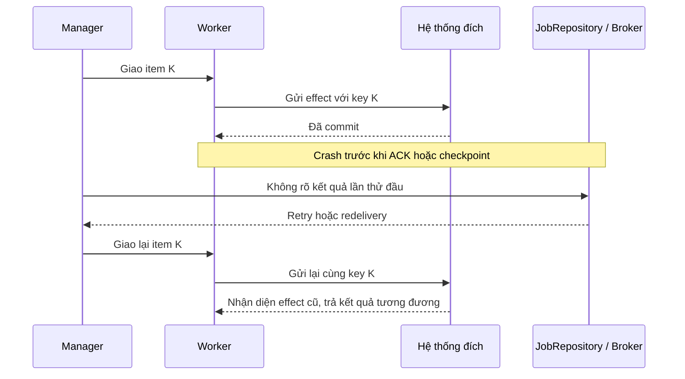
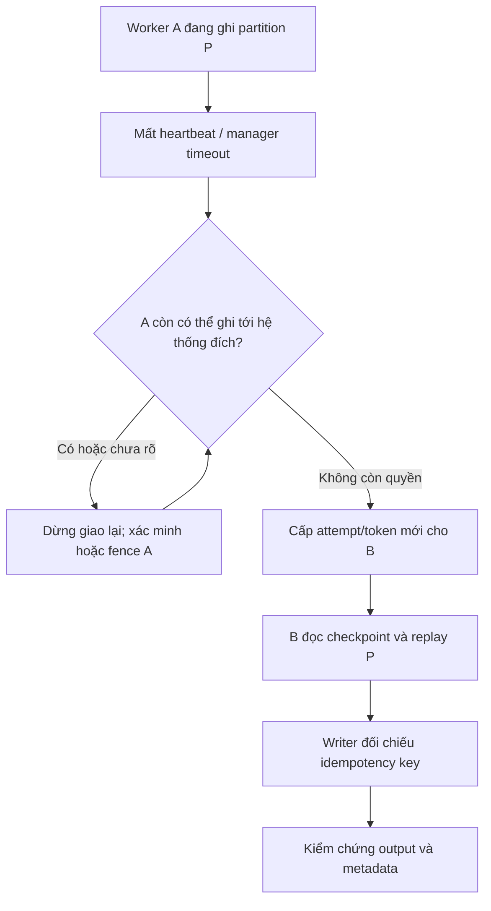

# Production checklist: Đã kiểm tra idempotency trong Spring Batch

## 1. Vì sao đây là điều kiện bắt buộc trước production?

Trong module **SPRING_BATCH_SCALING_OPERATIONS**, Spring Batch được mở rộng để xử lý workload lớn bằng multi-threaded step, parallel steps, partitioning và xử lý phân tán. Mỗi mô hình đều có thể xảy ra retry, restart, redelivery hoặc hai worker cùng tranh một phần việc. Trước khi triển khai, cần chứng minh rằng những lần thực thi lặp này không gây ra tác dụng phụ nghiệp vụ ngoài dự kiến.

**Idempotency** là tính chất mà áp dụng **cùng một thao tác logic nhiều lần** cho kết quả nghiệp vụ tương đương với áp dụng một lần. Với Spring Batch, điều này quan trọng hơn việc job chạy thành công ở happy path: một worker có thể ghi một chunk ra hệ thống ngoài rồi crash trước khi lưu checkpoint. Khi chạy lại, cùng item có thể được writer xử lý lần nữa.

Ví dụ job đối soát 20 triệu giao dịch chia thành 16 partition, commit mỗi 500 bản ghi. Worker ghi nhận kết quả qua API, API đã commit nhưng response bị mất. Worker retry toàn bộ chunk. Nếu API không có cơ chế idempotency hoặc tra soát, một giao dịch có thể được ghi nhận hai lần mặc dù JobRepository vận hành bình thường.

**Điều kiện PASS** của checklist là có bằng chứng:

1. Cùng logical operation được gửi lại nhiều lần, kể cả đồng thời, không tạo tác dụng phụ sai.
2. Cùng idempotency key nhưng payload khác được phát hiện là conflict, trừ khi nghiệp vụ có quy tắc version/correction minh bạch.
3. Restart cùng JobInstance, rollback chunk, broker redelivery và recovery partition không làm dữ liệu đích thiếu/trùng.
4. Đã đối soát dữ liệu đích và external effects, không chỉ xem BatchStatus hoặc readCount/writeCount.
5. Có giám sát, runbook và chính sách khi kết quả một lần ghi không rõ ràng.

Spring Batch lưu trạng thái execution và checkpoint, nhưng không tự đảm bảo exactly-once end-to-end đối với mọi database, API, broker hoặc email. Idempotency phải được xác định và thực thi tại ranh giới từng **business effect**.

## 2. Định nghĩa đơn vị idempotency và khóa nghiệp vụ

Một item có thể tạo nhiều tác dụng phụ: ghi báo cáo, phát event, gửi thông báo. Vì thế cần định nghĩa rõ **cái gì phải chỉ được áp dụng một lần**.

| Khóa/thành phần | Ví dụ | Vai trò |
| --- | --- | --- |
| `requestId` | `reconcile-20261126-s17` | Định danh một logical job; ổn định qua retry |
| `businessId` | `transaction-10345` | Định danh giao dịch nghiệp vụ |
| `effectType` | `UPSERT_RESULT`, `SEND_NOTICE` | Phân biệt các tác dụng phụ |
| `effectVersion` | `1`, `correction-2` | Phân biệt retry và một lần sửa dữ liệu có chủ đích |
| `sourceSnapshot` | `snapshot-s17` | Cố định dữ liệu và bối cảnh tính toán |
| `payloadFingerprint` | Hash của payload chuẩn hóa | Phát hiện cùng key nhưng dữ liệu khác |
| `JobExecutionId`, `attemptId` | ID từng lần chạy | Theo dõi và audit; không dùng làm khóa dedup duy nhất |

Một quy ước có thể là:

```text
idempotencyKey = canonical(requestId, businessId, effectType, effectVersion)
payloadHash = sha256(canonicalBusinessPayload)
```

Đây là hợp đồng ứng dụng, không phải cấu trúc được Spring Batch tự tạo. Cần chuẩn hóa chuỗi, timestamp, số thập phân và thứ tự trường trước khi tính hash; tránh đưa dữ liệu nhạy cảm trực tiếp vào key/log.

**Đừng dùng `JobExecutionId` làm idempotency key**, vì restart tạo JobExecution mới cho cùng JobInstance. Cũng không nên đổi `run.id` identifying theo mỗi attempt: việc đó tạo JobInstance mới và có thể làm mất lợi ích của checkpoint cũ. Tập identifying JobParameters phải phản ánh logical run; các thông số triển khai, worker ID và số lần thử được lưu trong audit.

Phải trả lời được: dedup nằm trong phạm vi một request hay xuyên nhiều request; key tồn tại bao lâu; nếu cùng key mà payload mâu thuẫn, xử lý ra sao; một repair run hợp lệ được version như thế nào.

## 3. Đường đi dẫn đến xử lý lặp

| Tình huống | Nguồn của lần thử lại | Cần kiểm chứng |
| --- | --- | --- |
| Chunk rollback | Transaction lỗi sau read/process | Processor không tạo side effect ngoài giao dịch; writer chịu được retry |
| Retry trong step | Exception transient được retry | Key không đổi, retry budget hữu hạn |
| Job restart | Process chết sau checkpoint đã lưu | Reader khôi phục state, source snapshot ổn định |
| Crash sau external write | API/DB khác đã commit nhưng chưa checkpoint | Idempotency ở đích, đối soát khi timeout |
| Remote chunking | Broker redelivery, ACK/reply bị mất | Message correlation, dedup, durable delivery |
| Remote partitioning | Worker mất heartbeat, partition được giao lại | Fencing/ownership, không double write |
| Multi-threaded step | Hai thread cùng xử lý item, state reader bị race | Thread safety và unique constraint |
| Scheduler gọi lặp | Client timeout sau khi đã launch | Request ledger, cùng JobInstance |
| Manual rerun | Operator thực hiện lại logical work | Phân biệt restart và repair có output version mới |

Một điểm cần đặc biệt thử:



Timeout không chứng minh lần ghi đầu chưa xảy ra. Cơ chế kiểm tra/trả lại kết quả ở đích phải an toàn cả khi lần thử trước **đã commit** lẫn khi nó **chưa commit**.

## 4. Database writer: ràng buộc atomic là lớp bảo vệ chính

Với database có transaction và unique constraint, hãy thiết kế khóa theo **logical effect** chứ không chỉ theo lần thử của step. Ví dụ PostgreSQL:

```sql
CREATE TABLE reconciliation_result (
    request_id       VARCHAR(100) NOT NULL,
    business_id      BIGINT NOT NULL,
    output_version   INTEGER NOT NULL,
    source_hash      VARCHAR(64) NOT NULL,
    amount           NUMERIC(19, 4) NOT NULL,
    processed_at     TIMESTAMPTZ NOT NULL DEFAULT CURRENT_TIMESTAMP,
    PRIMARY KEY (request_id, business_id, output_version)
);

INSERT INTO reconciliation_result (
    request_id, business_id, output_version, source_hash, amount
) VALUES (
    :request_id, :business_id, :output_version, :source_hash, :amount
)
ON CONFLICT (request_id, business_id, output_version)
DO NOTHING;
```

Khóa trên phù hợp khi mỗi logical request được phép tạo một kết quả cho một business ID và output version. Nếu nghiệp vụ yêu cầu không có effect trùng **xuyên nhiều request**, phải chọn khóa/ledger có phạm vi rộng hơn. `ON CONFLICT DO NOTHING` chỉ ngăn ghi thêm hàng trùng, **không** chứng minh nội dung trùng hợp lệ. Khi insert bị conflict, đọc lại record và so sánh `source_hash`, `amount` với giá trị mong muốn; khác nhau phải báo lỗi hoặc quarantine thay vì âm thầm bỏ qua.

Ví dụ logic của một writer chạy trong chunk transaction:

```java
public void write(Chunk<? extends ResultRow> chunk) {
    for (ResultRow item : chunk.getItems()) {
        int inserted = jdbcTemplate.update("""
            INSERT INTO reconciliation_result
              (request_id, business_id, output_version, source_hash, amount)
            VALUES (?, ?, ?, ?, ?)
            ON CONFLICT (request_id, business_id, output_version) DO NOTHING
            """,
            requestId, item.businessId(), outputVersion,
            item.sourceHash(), item.amount());

        if (inserted == 0) {
            ResultRow saved = loadExistingResult(
                requestId, item.businessId(), outputVersion);
            if (!sameBusinessPayload(saved, item)) {
                throw new IllegalStateException("Conflicting idempotency key");
            }
        }
    }
}
```

Đây là **mã minh họa**, trong đó `ResultRow`, `loadExistingResult` và `sameBusinessPayload` là thành phần của ứng dụng. Bản hoàn chỉnh phải khai báo `ItemWriter`, transaction manager, `DataSource` và error policy tương ứng phiên bản Spring Batch; cần thử concurrency ở isolation level của DB thực. Nếu business writer dùng DataSource/transaction khác với JobRepository, không mặc định hai lần commit là nguyên tử.

### Checklist database

- [ ] Unique index/primary key enforce idempotency ngay trong database production.
- [ ] Conflict cùng key nhưng khác payload được phát hiện; không bị coi là retry thành công.
- [ ] Đường ghi, bản ghi dedup và business output commit trong cùng transaction khi kiến trúc cho phép.
- [ ] Không dùng `SELECT exists → INSERT` không khóa làm cơ chế duy nhất: hai worker có thể race.
- [ ] Đã thử deadlock, failover, rollback, concurrent insert và retry dưới isolation level thực.
- [ ] Database không cho phép silently overwrite một kết quả cũ sai chỉ nhờ `ON CONFLICT DO UPDATE` thiếu điều kiện.

## 5. Side effect ngoài transaction: API, email và thanh toán

HTTP/API, object storage và broker ở hệ thống khác không tự tham gia chunk transaction của Spring Batch. Một request có thể thành công ở hệ thống nhận nhưng caller chỉ thấy timeout. Nếu API hỗ trợ idempotency key, luôn gửi **cùng key ổn định** cho cùng effect ở mọi retry:

```http
POST /v1/settlements HTTP/1.1
Idempotency-Key: reconcile-20261126-s17:tx-10345:settlement:v1
Content-Type: application/json

{"transactionId":"tx-10345","amount":"1200.00","currency":"VND"}
```

Đây chỉ là giao thức minh họa. Tên header, thời gian lưu key, xử lý `PENDING`/`COMPLETED` và việc so sánh payload phụ thuộc hợp đồng chính thức của API. Không mặc định API bất kỳ hỗ trợ idempotency hay giữ kết quả mãi mãi.

Nếu provider không hỗ trợ:

- Dùng mã tham chiếu nghiệp vụ bền vững và API tra soát kết quả trước khi retry, có tính tới eventual consistency.
- Dùng transactional outbox để ghi ý định phát sự kiện cùng transaction với dữ liệu nội bộ. Dispatcher vẫn có thể gửi lại; phía nhận nên có inbox/dedup.
- Với tác dụng phụ không thể chống lặp trực tiếp, xây quy trình compensation và manual reconciliation.
- Đưa tác vụ chưa xác định kết quả vào trạng thái chờ đối soát; không tạo idempotency key mới rồi gửi lại ngay.

Đặc biệt, **HTTP 500 hay timeout không đồng nghĩa effect chưa xảy ra**. Với thanh toán, chuyển tiền và email cần kiểm tra outcome ở hệ thống đích theo policy cụ thể, trước khi auto-retry.

## 6. Message broker và remote chunking

Trong remote chunking cần tách bốn trạng thái:

```text
Message đã publish ≠ worker đã nhận
Worker đã nhận ≠ effect đã commit
Effect đã commit ≠ ACK/reply đã về manager
Reply về manager ≠ mọi dữ liệu nghiệp vụ đã được đối soát
```

Kiểm tra đầy đủ:

- [ ] Broker có durable queue/topic và chính sách ACK, redelivery, dead-letter, retention được xác minh.
- [ ] Correlation ID nhận diện chunk/attempt; idempotency key nhận diện business effect và không đổi qua attempt.
- [ ] Worker không ACK trước khi có điểm lưu bền vững thích hợp.
- [ ] Reply trễ hoặc reply trùng không cập nhật đè trạng thái attempt mới.
- [ ] Message cũ được replay qua rolling deployment mà worker/manager còn hiểu schema và serializer.
- [ ] Có giới hạn retry, backoff và cơ chế dừng/quarantine khi payload không hợp lệ.
- [ ] Đã kiểm thử worker commit thành công nhưng mất reply, sau đó broker redeliver.

Không suy luận rằng broker có producer idempotence hoặc transaction thì hiệu ứng lên database/API khác cũng exactly-once. Outbox bảo vệ việc **lưu ý định gửi** cùng một transaction nội bộ, nhưng consumer vẫn phải chấp nhận khả năng message bị phát lại.

## 7. Partitioning, quyền sở hữu và multi-threaded step

Với partitioning, cùng một source row có thể được xử lý bởi hai worker nếu range chồng lấn, manifest thay đổi hoặc manager giao lại partition khi worker cũ vẫn còn sống. Idempotency ở writer có thể giảm hại, nhưng không thay thế **kiểm soát quyền xử lý**.

Đối với mỗi logical job, nên chốt **partition manifest**: partition name, khoảng `[fromId, toIdExclusive)`, source snapshot và version thuật toán chia dữ liệu. Khi restart, `Partitioner` phải trả lại định nghĩa phù hợp với các `StepExecution` cũ. Đừng chia lại theo `MAX(id)` hiện tại hoặc đổi tên partition khi chỉ muốn hoàn tất công việc cũ.

Một lease hết hạn không tự chứng minh worker cũ đã ngừng ghi, ví dụ network ngắt với manager nhưng worker vẫn kết nối được database. Khi cấp quyền mới cho worker B, cần **fencing token** hoặc chứng cứ chắc chắn owner A bị dừng:



Token chỉ là fencing thực sự nếu **đích kiểm tra token trong cùng ranh giới atomic với thao tác ghi**. Kiểm tra token đầu method rồi ghi sau đó vẫn có race. Nếu external API không có fencing, kết hợp idempotency mạnh và thủ tục chấm dứt owner cũ trước khi phân phối lại.

Trong multi-threaded step, `@StepScope` gắn instance với `StepExecution`; nó **không tạo một bean riêng cho từng thread** thuộc cùng step. Reader giữ offset in-memory, writer có buffer mutable hoặc cache dùng chung phải được kiểm chứng thread safety và restartability. Parallel steps có thể cùng viết đến một bảng/dịch vụ nên cần xác định phạm vi khóa dedup giữa các step.

**Checklist phân tán và đa luồng:**

- [ ] Partition manifest và source snapshot giữ nguyên qua restart.
- [ ] Mỗi logical partition chỉ có một owner được quyền ghi; có kiểm thử mất heartbeat, lease timeout và owner cũ trở lại.
- [ ] Writer ở đích kiểm tra idempotency atomic, kể cả khi hai attempt cạnh tranh.
- [ ] Reader/processor/writer có chiến lược state riêng hoặc đồng bộ hóa đúng khi chạy multi-threaded.
- [ ] Worker cũ và mới qua rolling deployment dùng cùng key contract, schema và protocol được hỗ trợ.
- [ ] Không dùng `JobExecutionId` hoặc partition attempt ID mới để đổi idempotency key cho cùng item.

## 8. Input ổn định và tính xác định của processor

Writer idempotent không thể sửa một **logical key bị xác định sai**. Cần kiểm tra dữ liệu đầu vào và cách tính toán:

| Thành phần | Yêu cầu | Ví dụ lỗi |
| --- | --- | --- |
| Reader | Khóa duy nhất, thứ tự đọc ổn định, checkpoint phù hợp | Offset paging trên bảng đang thêm/xóa row khiến đọc thiếu/trùng |
| Snapshot/watermark | Định nghĩa dữ liệu nguồn của logical run không đổi | Restart dùng phiên bản nguồn mới nhưng giữ checkpoint cũ |
| Processor | Tính toán tái lập hoặc có version/effective time rõ | `LocalDateTime.now()` làm amount/expiry khác khi retry |
| Step/ExecutionContext | Key và kiểu checkpoint tương thích khi restart | Đổi tên context field giữa hai deployment |
| Writer | So sánh payload thực với key hiện có | `DO NOTHING` che conflict cùng key nhưng dữ liệu khác |

Nếu reader dùng keyset pagination, hãy dùng sort key ổn định, có tie-breaker và điều kiện snapshot rõ. Đừng tùy ý ghi side effect trong `ItemProcessor`: processor có thể được gọi lại khi retry/rollback, và không nên giả định mỗi item chỉ được `process()` một lần.

Một logical request nên chứa những dữ kiện cần thiết như `businessDate`, `sourceSnapshot` và version thuật toán; giữ chúng ổn định khi restart. Khi nguồn/thuật toán thay đổi có chủ đích, tạo **new business run hoặc repair run có audit** theo hợp đồng, không trá hình bằng việc chạy lại với tham số kỹ thuật khác.

## 9. Ma trận fault injection bắt buộc

Happy-path test chạy hết job một lần **không đủ**. Trước production, cần chủ động tạo các cửa sổ lỗi dễ dẫn tới replay:

| Kịch bản | Cách gây lỗi | Điều kiện PASS |
| --- | --- | --- |
| Duplicate cùng key, cùng payload | Gọi writer/API hai lần cùng operation key | Một effect logic, lần sau no-op hoặc trả kết quả cũ |
| Duplicate cùng key, khác payload | Thay amount/sourceHash của lần thứ hai | Báo conflict/quarantine, không âm thầm ghi đè |
| Concurrent duplicate | Hai process cùng ghi một key đồng thời | Unique/atomic constraint chặn double effect |
| Crash trước commit | Kill worker giữa chunk | Transaction rollback; restart hoàn tất đúng dữ liệu |
| Crash sau effect, trước checkpoint | Giữ external effect đã commit rồi kill process | Retry không tạo tác dụng phụ thứ hai |
| API timeout sau server success | Server commit nhưng client mất response | Retry cùng key; tra soát trả kết quả đúng |
| Mất broker ACK/reply | Chặn reply rồi redeliver chunk | Worker dedup; manager không tính hai lần |
| Worker mất heartbeat | Ngắt manager-worker nhưng vẫn cho worker ghi DB | Owner cũ được fence hoặc chưa giao lại; không double write |
| Job restart sau partition lỗi | Có partition `COMPLETED`, một partition `FAILED` | Cùng JobInstance; partition đã hoàn tất không bị xử lý lại ngoài dự kiến |
| Manual repair | Sửa một phần output đã hoàn tất | Có repair ID/version riêng, scope và audit |
| Dữ liệu nguồn thay đổi | Thêm/sửa row sau checkpoint | Restart vẫn xử lý đúng snapshot hoặc phát hiện drift |
| Dedup TTL hết hạn | Phát lại message trễ gần cửa sổ retention | Key chưa bị xóa trước giới hạn replay đã cam kết |
| Scale cao và retry storm | Tăng concurrency, inject DB timeout | Không vượt budget tài nguyên, kết quả vẫn đúng |
| Rolling deployment | Worker/manager cũ và mới cùng hoạt động | Key contract tương thích, output được đối soát |

Đừng chỉ inject lỗi **trước** external write. Tình huống quan trọng nhất là **effect đã commit nhưng checkpoint/ACK chưa hoàn tất**: khi đó retry là hợp lý dù caller không biết lần trước đã thành công.

### Mẫu kiểm thử tích hợp tái lập

```text
Given:
  requestId = reconcile-20261126-s17
  sourceSnapshot = s17
  10_000 unique businessIds
  4 partition với manifest cố định
  idempotencyKey = (requestId, businessId, effectType, effectVersion)

When:
  launch JobInstance lần đầu
  worker p-02 commit một số chunk
  gây crash sau khi ghi external effect nhưng trước checkpoint
  xác minh/fence owner cũ
  restart đúng JobInstance
  redeliver một số message và retry cùng request từ API

Then:
  JobInstanceId của logical request không đổi
  JobExecutionId có thể thay khi restart
  chỉ một owner hợp lệ xử lý p-02 tại mỗi thời điểm
  đủ 10_000 businessIds được xử lý theo chính sách
  không có duplicate external effect
  conflict khác payload được phát hiện
  Batch metadata khớp với kết quả nghiệp vụ đích
```

Đây là test contract/pseudocode, không phải script mặc định của Spring Batch. Số lượng 10.000 là fixture minh họa; bài kiểm tra tải cần dùng mức song song, pool, transaction latency và số lượng gần production.

## 10. Kiểm chứng bằng dữ liệu đích, không chỉ metadata

Sau mỗi fault test, nhóm kiểm thử cần đối chiếu **business invariants**:

1. **Coverage:** tập business ID đầu ra đúng tập mong đợi theo snapshot; không thiếu và không phát sinh thêm ngoài policy.
2. **Uniqueness:** mỗi logical effect chỉ có một kết quả có hiệu lực; duplicate request được ghi nhận nhưng không áp dụng lại effect.
3. **Payload consistency:** cùng operation key không mang hai payload khác nhau mà bị coi là thành công.
4. **Accounting:** tổng tiền, checksum hoặc tổng hợp nghiệp vụ đúng với nguồn/snapshot và quy tắc tính.
5. **Ownership:** không có hai owner cùng quyền ghi một partition tại một thời điểm.
6. **Recovery:** mọi accepted request hoặc terminal, hoặc có retry/quarantine trạng thái bền vững và người/hệ thống phụ trách.

Ví dụ truy vấn kiểm tra trùng theo khóa nghiệp vụ khi phân tích bảng output **chưa có ràng buộc unique**, hoặc kiểm tra bản sao staging:

```sql
SELECT request_id, business_id, output_version, COUNT(*) AS occurrences
FROM reconciliation_result
GROUP BY request_id, business_id, output_version
HAVING COUNT(*) > 1;
```

Nếu bảng đã có primary key tương ứng, truy vấn sẽ không thấy duplicate trong **bảng đó**, nhưng vẫn phải xác minh không có effect trùng ở bảng khác, outbound event hoặc API ngoài. Đồng thời kiểm tra bản ghi **bị thiếu** bằng anti-join với nguồn snapshot; không kết luận chỉ từ `COUNT(*)` hoặc `writeCount`.

Khi Spring Batch bỏ qua item theo skip policy hoặc processor trả `null` để filter, phải đối chiếu theo chính sách đó, không đòi mọi input luôn sinh output. Những item bị skip/quarantine cần có audit và tổng hợp riêng.

### Bộ bằng chứng nên lưu

- Build/release, phiên bản Spring Batch và DB/broker, cấu hình retry/chunk/partition đã test.
- Identifying `JobParameters`, `jobInstanceId`, execution/partition ID, thời điểm inject lỗi.
- Số lượng unique business effect, checksum/tổng nghiệp vụ và số conflict được chặn.
- Log correlation của API/broker, external effect status, kết quả tra soát và DLQ.
- Resource metrics, recovery time, retry count, số connection, deadlock và timeout.

Không đưa password, token, thông tin cá nhân không cần thiết hoặc payload nhạy cảm vào artifact kiểm thử.

## 11. Quan sát trong production và runbook khi conflict

| Metric / dấu vết | Mục tiêu |
| --- | --- |
| `idempotency_duplicate_total` | Phân biệt retry mong đợi với duplicate tăng bất thường |
| `idempotency_payload_conflict_total` | Phát hiện cùng key nhưng dữ liệu không nhất quán |
| `batch_job_execution` theo `BatchStatus` | Nhận diện lỗi, stuck job, restart quá nhiều |
| `chunk_retry`, `rollback_count`, restart attempts | Xác định nguồn replay |
| Queue redelivery, ACK timeout, reply lag, DLQ | Theo dõi thông điệp có thể thử lại |
| Partition owner, fencing rejection | Nhận diện worker cũ quay lại hoặc split-brain |
| Unique-key violation, DB lock/deadlock, connection pool | Phát hiện contention và chi phí dedup |
| Output unique count, checksum, nghiệp vụ tổng hợp | Đo tính đúng thay vì chỉ completion status |

Đừng dùng toàn bộ `requestId`/`businessId` làm metric label khi cardinality không giới hạn. Dùng structured log/audit có truy vấn theo ID, giữ dữ liệu nhạy cảm đúng phạm vi cho phép.

**Runbook khi cùng key có payload khác hoặc side effect chưa rõ kết quả:**

1. Tạm dừng hoặc giới hạn dispatch của logical scope có nguy cơ ghi sai; giữ request/message bền vững.
2. Tra key, source snapshot, payload hash, effect version và lịch sử các attempt.
3. Đối chiếu `JobRepository` với DB đích/API/broker để biết điều gì đã commit.
4. Xác minh không có worker cũ đang ghi cùng partition; nếu có thì drain/fence trước khi recovery.
5. Nếu chỉ là replay cùng payload, tiếp tục theo chính sách idempotent. Nếu payload khác, quarantine và xác định nguồn sai; nếu là repair có chủ đích, tạo request/version được phê duyệt.
6. Nếu effect chưa rõ, sử dụng giao thức tra soát/compensation của đích thay vì gửi với key mới để “thử lại”.
7. Ghi nhận root cause và bổ sung test trước khi mở lại auto-retry.

## 12. Hiệu năng và retention của cơ chế idempotency

Idempotency cũng có chi phí. Unique index, bảng dedup, payload hashing, API query và transaction contention làm tăng latency, nhất là khi hàng chục worker cùng ghi.

- **Atomic write trước, tối ưu sau:** một `SELECT exists` trước `INSERT` vừa tốn round trip, vừa không loại được race khi thiếu unique constraint/lock.
- **Đo hot-key contention:** một nguồn tạo cùng business ID nhiều lần có thể khiến worker chờ lock; đo p95/p99 commit latency, deadlock và retry.
- **Giữ dedup record đủ lâu:** retention phải bao phủ tuổi thọ job, thời gian restart, broker/DLQ replay và khả năng vận hành. Xóa quá sớm có thể biến event cũ thành effect mới.
- **Phân tầng lưu trữ:** nếu cần dedup lâu, có thể partition/archive theo chính sách, nhưng vẫn phải chặn replay vượt retention hoặc tra kết quả lưu trữ.
- **Tính connection budget:** rolling deployment có thể cho worker cũ và mới hoạt động song song; thêm retry còn tạo tải đột biến.
- **Giới hạn retry:** backoff, jitter, concurrency limit và circuit breaker giúp tránh retry storm; không nên retry vô hạn khi đã phát hiện conflict nghiệp vụ.

Ví dụ 10 worker, mỗi worker có pool tối đa 16 connection, có thể đòi tới 160 connection nếu cùng mở tối đa, chưa kể manager và các hệ thống khác. Nếu DB chỉ cấp ngân sách thấp hơn, job sẽ gặp timeout và retry tạo thêm tải; idempotent writer không giải quyết được quá tải tài nguyên. Cần đo nút thắt thực và chọn mức song song phù hợp.

## 13. Checklist ký duyệt production

Đánh dấu từng mục dựa trên kết quả kiểm thử, tài liệu contract hoặc bằng chứng quan sát; không đánh dấu chỉ vì có cấu hình `retry`.

### Định danh và dữ liệu

- [ ] Mọi logical operation có idempotency key ổn định, duy nhất trong phạm vi nghiệp vụ.
- [ ] Tập identifying `JobParameters` không thay đổi ngoài ý định khi restart.
- [ ] Input có snapshot/watermark hoặc quy tắc thay đổi dữ liệu được kiểm chứng.
- [ ] Cùng key nhưng khác payload phải báo conflict hoặc đi qua business version/repair riêng.
- [ ] Kho dedup/unique key có thời gian lưu bao phủ replay/recovery được cam kết.

### Transaction và side effect

- [ ] Business DB dùng unique/atomic write phù hợp, đã chạy test concurrent duplicate.
- [ ] DB transaction boundary của writer và checkpoint đã được xác minh.
- [ ] API ngoài có idempotency/tra soát hoặc compensation đã được kiểm thử.
- [ ] Outbox/inbox hoặc broker ACK/reply được thiết kế phù hợp với redelivery.
- [ ] Các side effect không thể hoàn tác có quy trình phát hiện và xử lý mơ hồ.

### Scaling và restart

- [ ] Multi-threaded step có reader/processor/writer thread-safe và checkpoint đúng.
- [ ] Partition manifest, context và step name tương thích qua restart.
- [ ] Remote worker có ownership/lease/fencing hoặc quy trình dừng owner cũ chắc chắn.
- [ ] Retry và restart dùng cùng logical run, không tạo `run.id` mới để che lỗi.
- [ ] Có giới hạn concurrency, connection budget, retry budget và cảnh báo overload.

### Kiểm thử và giám sát

- [ ] Đã thử replay cùng payload, khác payload và hai process ghi đồng thời.
- [ ] Đã inject crash trước/sau commit, mất ACK/reply, timeout mơ hồ và worker bị mất heartbeat.
- [ ] Đã đối soát unique output, coverage, số tiền/checksum và external effects.
- [ ] Có metric duplicate/conflict, retry, stale execution, broker redelivery và dữ liệu mismatch.
- [ ] Có runbook, người chịu trách nhiệm, bằng chứng kiểm thử và mức rủi ro còn lại được chấp nhận.

## 14. Quyết định GO / NO-GO theo bằng chứng

| Tình trạng | Đánh giá đề xuất | Lý do |
| --- | --- | --- |
| Fault tests pass; output đúng, recovery và dedup được quan sát | **GO** khi các release gate khác đạt | Có bằng chứng tại các điểm dễ tạo replay |
| Chỉ test happy path, chưa thử crash sau external commit | **NO-GO** | Chưa kiểm tra rủi ro chính |
| Unique constraint có nhưng conflict khác payload vẫn bị coi là success | **NO-GO** | Có thể che giấu dữ liệu sai |
| API ngoài không idempotent và chưa có tra soát/compensation | **NO-GO** nếu effect không được phép lặp | Không có cách xử lý kết quả mơ hồ |
| TTL dedup ngắn hơn DLQ replay window | **NO-GO** | Message cũ có thể gây effect mới |
| Partition được giao lại khi owner cũ vẫn có thể ghi | **NO-GO** cho workload có nguy cơ ghi trùng | Thiếu fencing/ownership |
| Dữ liệu đúng nhưng DB pool và broker cạn tài nguyên khi retry | **NO-GO** cho mức tải hiện tại | Hệ thống không thể phục hồi trong budget |

Tiêu chí trên là hướng dẫn xây **production release gate**, không phải cơ chế kiểm tra sẵn của Spring Batch. Mỗi nghiệp vụ có thể có mức chấp nhận at-least-once, compensation và sự cố khác nhau; quyết định cần ghi rõ phạm vi, điều kiện và người duyệt.

Ví dụ biên bản kiểm chứng:

```yaml
# Artifact kiểm thử nội bộ; không phải file cấu hình Spring Batch.
checklist: production-idempotency
service: SPRING_BATCH_SCALING_OPERATIONS
release: reconciliation-1.8.0
logicalOperation: reconciliation-result
keyContract: requestId+businessId+effectType+effectVersion
sourceSnapshot: s17
dedupRetention: validated-against-replay-window
verifiedScenarios:
  - duplicate-same-payload
  - duplicate-different-payload
  - concurrent-duplicate
  - crash-after-external-commit
  - broker-redelivery
  - partition-fencing
businessReconciliation: PASSED
externalEffectsReconciliation: PASSED
loadAndRecovery: PASSED
decision: GO
evidenceReference: staging-run-id
```

## 15. Những anti-pattern cần loại bỏ

| Anti-pattern | Hậu quả | Thay thế |
| --- | --- | --- |
| “Job COMPLETED thì không thể ghi trùng.” | Metadata không bao phủ mọi side effect ngoài DB | Đối soát ở đích |
| Thêm `run.id` mới mỗi lần job lỗi | JobInstance mới, checkpoint cũ không được tận dụng | Restart cùng logical instance |
| Dùng `JobExecutionId` làm key | Key đổi sau restart | Key theo business operation |
| `SELECT` trước `INSERT` nhưng không có unique | Race giữa các worker | Atomic insert/unique index |
| Bỏ qua mọi `ON CONFLICT` | Che giấu payload không nhất quán | So sánh payload/hash và phát cảnh báo |
| Coi ACK broker là bằng chứng effect đã commit | Có thể mất/nhân đôi việc | Protocol ACK/reply + đối soát |
| Giao lại partition ngay khi timeout | Worker cũ có thể đang ghi | Fencing hoặc xác minh dừng hẳn |
| Tin `@StepScope` tạo instance mỗi thread | Shared state có thể race trong cùng StepExecution | Kiểm thử thread safety |
| Xóa dedup ledger quá sớm | Replay trễ được áp dụng lại | Retention theo replay/recovery |
| Chỉ test duplicate tuần tự | Bỏ qua race/concurrent write | Fault injection nhiều worker |

## 16. Kết luận

**“Đã kiểm tra idempotency”** nghĩa là đội ngũ có bằng chứng rằng retry, restart, redelivery, concurrency và failure recovery không gây tác dụng phụ nghiệp vụ trùng hoặc sai ngoài chính sách. Chìa khóa là định nghĩa đúng logical effect, dùng key ổn định, enforce atomicity tại hệ thống đích, so sánh payload và xác minh dữ liệu thực.

Trong Spring Batch được mở rộng bằng multi-threaded step, parallel steps, partitioning và remote chunking, cần kiểm thử các điểm khó nhất: worker đã ghi thành công nhưng chưa ACK/checkpoint, owner cũ còn sống khi partition được giao lại, và restart trên dữ liệu đã xử lý một phần. Chỉ khi các trường hợp này được chứng minh an toàn cùng với ngân sách tài nguyên và runbook phù hợp, checklist production mới nên được đánh dấu hoàn thành.
