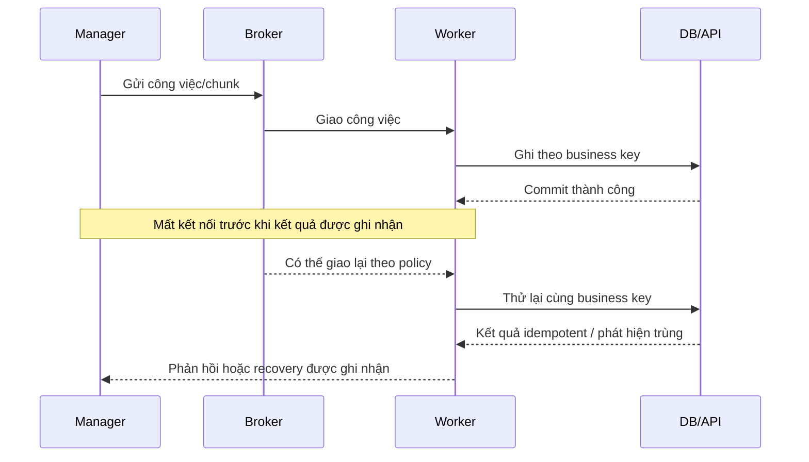

# Checklist production: Đã kiểm tra retry và recovery trong Spring Batch

Một Spring Batch job chạy nhanh trong môi trường kiểm thử chưa chắc vận hành an toàn khi production gặp timeout, deadlock, worker chết, broker phát lại message hoặc người vận hành restart job. Với workload dữ liệu lớn và nhiều luồng/partition, lỗi không chỉ làm job chuyển sang `FAILED`: hệ thống có thể **ghi trùng, bỏ sót, vượt giới hạn retry hoặc khôi phục từ checkpoint không phù hợp**. Vì thế, mục **“Đã kiểm tra retry và recovery”** chỉ được đánh dấu hoàn thành khi nhóm có **bằng chứng thử lỗi, tiêu chí đúng dữ liệu và thao tác khôi phục có thể lặp lại**.

Đây là bài thuộc chương **Checklist production** của module **SPRING_BATCH_SCALING_OPERATIONS**. Phạm vi bao gồm multi-threaded step, parallel steps, local/remote partitioning và mô hình phân tán khi mở rộng Spring Batch cho dữ liệu lớn. Mục tiêu là kết hợp thread safety, retry/restart, quản lý tài nguyên, quan sát vận hành và xác minh đầu ra thành một điều kiện phát hành có thể nghiệm thu.

## 1. “Đã kiểm tra” nghĩa là gì?

Ba cơ chế thường bị gọi chung là “recovery” nhưng cần phân biệt:

| Cơ chế | Khi nào diễn ra? | Tác động và điều kiện |
| --- | --- | --- |
| **Retry** | Lỗi tạm thời xuất hiện trong quá trình xử lý; policy cho phép thử lại | Có giới hạn số lần, backoff và phân loại lỗi; thử lại có thể lặp lại thao tác nghiệp vụ |
| **Skip** | Bản ghi/lỗi nằm trong danh sách được phép bỏ qua theo chính sách | Job có thể hoàn tất dù có item bị bỏ qua; phải audit, giới hạn tỷ lệ và đối soát |
| **Recovery / restart** | Execution đã dừng hoặc thất bại; hệ thống khởi chạy lại theo cơ chế phù hợp | Dựa vào metadata, checkpoint, identifying `JobParameters`, khả năng replay và idempotency |

**Rollback** là hành vi transaction, không đồng nghĩa với retry hoặc restart. Một chunk rollback có thể được thử lại, được skip theo cấu hình hoặc khiến step thất bại; còn việc một transaction database rollback **không đảm bảo** yêu cầu HTTP hoặc message gửi tới hệ thống ngoài cũng được đảo ngược.

Checklist phải kiểm chứng cả hai câu hỏi:

1. **Liveness:** Khi lỗi tạm thời hết, job có thể tiến triển trở lại trong thời gian và tài nguyên chấp nhận được không?
2. **Correctness:** Sau lỗi, retry và restart, tập kết quả có đầy đủ, không trùng side effect và đúng quy tắc nghiệp vụ không?

Một lần chạy `BatchStatus.COMPLETED` chỉ trả lời một phần về vòng đời job; chưa chứng minh correctness.

### Tiêu chí đầu ra của checklist

Để đánh dấu **PASS**, cần có đủ: ma trận lỗi và chính sách tương ứng; cấu hình/phiên bản đã kiểm thử; kết quả fault injection ở các điểm quan trọng; đối soát dữ liệu; bằng chứng quan sát retry, rollback, restart; và runbook được diễn tập. Nếu một phần chưa được kiểm thử hoặc không áp dụng, ghi lý do cụ thể cùng người chấp nhận rủi ro, thay vì tự đánh dấu đã kiểm tra.

## 2. Ma trận phân loại lỗi trước khi đặt retry policy

Không nên cấu hình `retry(Exception.class)` hoặc `retryLimit` lớn cho mọi lỗi. Retry chỉ phù hợp khi lỗi **có khả năng tự hết** hoặc là lỗi có điều kiện có thể thử lại an toàn. Phân loại nên dựa trên exception thực tế, ngữ nghĩa nghiệp vụ và phản hồi từ hệ thống đích.

| Nhóm lỗi | Ví dụ | Hướng xử lý ban đầu | Điều cần xác minh |
| --- | --- | --- | --- |
| **Tạm thời (transient)** | Mất kết nối ngắn, deadlock victim, HTTP 503 có khả năng phục hồi | Retry có giới hạn, backoff/jitter phù hợp | Có thể chạy lại thao tác an toàn; không làm tăng tranh chấp |
| **Rate limit / quá tải** | HTTP 429, pool connection cạn | Backoff theo `Retry-After` nếu có, giới hạn concurrency | Retry không khuếch đại tải; tuân thủ quota |
| **Sai dữ liệu xác định** | Thiếu trường bắt buộc, format sai, business rule không hợp lệ | Fail hoặc skip có kiểm soát, đẩy quarantine | Bản ghi bị skip được lưu dấu vết và được xử lý sau |
| **Lỗi code/cấu hình** | `NullPointerException`, thiếu secret, schema không tương thích | Fail fast, sửa và triển khai lại | Không lặp vô ích; metadata báo lỗi chính xác |
| **Không rõ kết quả phía ngoài** | Timeout sau khi gọi API ghi dữ liệu | Tra cứu trạng thái hoặc retry bằng idempotency key | Không phát sinh thanh toán, email hoặc event lặp |
| **Lỗi hạ tầng kéo dài** | Broker mất kết nối dài, DB down | Circuit breaker/backpressure hoặc fail có kiểm soát | Job có thể stop/restart sau khi hạ tầng hồi phục |

Tên exception như `TransientDataAccessException` chỉ là tín hiệu kỹ thuật. Một driver có thể bọc lỗi qua nhiều lớp; framework/retry classifier phải nhận diện đúng kiểu exception được ném thật. Với API HTTP, phân loại theo response, khả năng idempotent và SLA của dịch vụ, không chỉ theo mã trạng thái.

**Đầu ra yêu cầu:** một bảng riêng của ứng dụng, trong đó mỗi loại lỗi quan trọng được gán **retry / skip / fail**, số lần tối đa, khoảng backoff, tổng thời gian chờ, cách xử lý khi hết lượt và chủ sở hữu.

## 3. Checklist cấu hình retry và skip trong chunk-oriented step

Trong Spring Batch, fault tolerance thường được cấu hình trên chunk step qua `faultTolerant()`. Ví dụ sau minh họa API phong cách Spring Batch 5+; `OrderRecord`, `OrderResult` và `InvalidOrderRecordException` là kiểu ứng dụng cần tự định nghĩa, còn `ItemReader`, `ItemProcessor`, `ItemWriter` là các component được inject:

```java
import org.springframework.batch.core.Step;
import org.springframework.batch.core.repository.JobRepository;
import org.springframework.batch.core.step.builder.StepBuilder;
import org.springframework.batch.item.ItemReader;
import org.springframework.batch.item.ItemProcessor;
import org.springframework.batch.item.ItemWriter;
import org.springframework.dao.TransientDataAccessException;
import org.springframework.retry.backoff.ExponentialBackOffPolicy;
import org.springframework.transaction.PlatformTransactionManager;

Step importOrdersStep(
        JobRepository jobRepository,
        PlatformTransactionManager transactionManager,
        ItemReader<OrderRecord> reader,
        ItemProcessor<OrderRecord, OrderResult> processor,
        ItemWriter<OrderResult> writer) {

    ExponentialBackOffPolicy backoff = new ExponentialBackOffPolicy();
    backoff.setInitialInterval(500L); // milliseconds
    backoff.setMultiplier(2.0);
    backoff.setMaxInterval(5_000L);

    return new StepBuilder("importOrdersStep", jobRepository)
            .<OrderRecord, OrderResult>chunk(200, transactionManager)
            .reader(reader)
            .processor(processor)
            .writer(writer)
            .faultTolerant()
            .retry(TransientDataAccessException.class)
            .retryLimit(3)
            .backOffPolicy(backoff)
            .skip(InvalidOrderRecordException.class)
            .skipLimit(10)
            .build();
}
```

Các giá trị 200, 3, 500 ms và 10 **chỉ là ví dụ**, phải được hiệu chỉnh bằng tải và chính sách nghiệp vụ. Có dependency tương ứng (ví dụ Spring Retry khi dùng backoff policy), và cần xác minh API/behavior theo phiên bản Spring Batch/Spring Retry đang triển khai. Không sao chép ví dụ này như cấu hình production mặc định.

Checklist bắt buộc:

- [ ] **Chỉ retry lỗi đã phân loại.** Xác minh exception được bắt đúng kể cả khi có wrapper; lỗi dữ liệu, code và quyền truy cập không bị retry vô hạn.
- [ ] **Có số lần thử tối đa.** Thử trường hợp vượt ngưỡng và xác minh step chuyển trạng thái theo policy; hiểu đúng giới hạn attempt theo thư viện đang dùng.
- [ ] **Có backoff phù hợp.** Kiểm tra khoảng chờ, tổng ngân sách thời gian và jitter khi nhiều worker có thể retry cùng lúc; không gây retry storm.
- [ ] **Có giới hạn và ghi nhận skip.** Phân biệt `READ_SKIP_COUNT`, `PROCESS_SKIP_COUNT`, `WRITE_SKIP_COUNT`; không lặng lẽ bỏ qua dữ liệu quan trọng.
- [ ] **Đã kiểm tra transaction boundary.** Lỗi ở processor và writer có hành vi rollback/replay khác nhau tùy cấu hình, loại reader và transaction manager.
- [ ] **Không lạm dụng `noRollback`.** Chỉ cấu hình khi chứng minh trạng thái transaction và side effects vẫn nhất quán sau lỗi.
- [ ] **Có đường thoát khi hết retry.** Job fail có lý do rõ, thông báo tới vận hành, giữ dữ liệu cần xử lý bù và runbook khôi phục.

Trong fault-tolerant step, chi tiết số lần processor/writer được gọi lại, cơ chế retry stateful/stateless và chunk reprocessing có thể phụ thuộc transaction và implementation. **Không dựa vào giả định rằng một item chỉ được gọi `process()` hoặc `write()` đúng một lần**. Processor có side effect bên ngoài nên được xem xét lại; ưu tiên biến đổi thuần và đặt ghi có giao dịch/idempotent ở writer.

## 4. Xác minh rollback, checkpoint và ranh giới giao dịch

Chunk processing thường commit theo đơn vị chunk: đọc một nhóm item, xử lý, ghi kết quả, cập nhật metadata/checkpoint theo cơ chế framework và transaction manager. Khi lỗi xảy ra tại các thời điểm khác nhau, điều hệ thống phải làm để phục hồi **không giống nhau**.

| Điểm tiêm lỗi | Cần quan sát | Tiêu chí đúng |
| --- | --- | --- |
| Trước `read()` đầu tiên | Job/step lỗi và có thể restart | Không có item bị đánh dấu đã xử lý khi chưa đọc |
| Giữa khi đọc một chunk | Vị trí reader, state lưu được, rollback | Restart không mất/nhân đôi item ngoài contract |
| Sau `process()` trước `write()` | Số lần processor được gọi lại | Không có side effect ngoài transaction hoặc có idempotency |
| Trong writer trước commit | DB rollback và bộ đếm rollback | Dữ liệu đã rollback không bị coi là hoàn tất |
| **Sau DB commit, trước xác nhận ngoài hệ thống** | State và kết quả bên ngoài có thể khác nhau | Có khả năng phát lại an toàn và đối soát |
| Sau `StepExecution` hoàn tất | Metadata, output, downstream | Không khởi chạy lại ngoài ý muốn |

**Lưu ý quan trọng:** trạng thái một tài nguyên ngoài transaction của step — HTTP API, email, message đã publish — có thể đã thay đổi dù transaction DB bị rollback. Không nói “rollback bảo đảm không trùng” nếu chưa chứng minh tất cả side effects nằm cùng phạm vi transaction hoặc đã được thiết kế idempotent.

Với file reader, cursor reader, paging reader và reader tùy chỉnh, cần kiểm tra cách lưu `ExecutionContext`, tính ổn định của thứ tự dữ liệu, và việc restart có thể đọc lại những item đã phát hành trước đó hay không. `saveState(false)` ở các reader hỗ trợ tùy chọn này thường làm mất checkpoint phục hồi; không sử dụng như mẹo chữa race condition.

### Ví dụ nguyên tắc idempotency

Giả sử writer ghi kết quả giao dịch vào bảng có khóa nghiệp vụ ổn định. Một thiết kế có thể dùng unique constraint theo `(business_date, transaction_id, operation_type)` và thao tác insert/upsert được định nghĩa rõ. Nếu worker hoặc chunk chạy lại, thao tác phải dẫn về **cùng kết quả hợp lệ**. Khi payload khác nhưng business key giống, cần phát hiện xung đột, không âm thầm ghi đè.

```text
Khóa idempotency phù hợp (ví dụ):
settlement:{businessDate}:{transactionId}:{operationType}

Khóa không bền vững qua restart:
settlement:{jobExecutionId}:{transactionId}
```

`JobExecutionId` có thể thay đổi ở lần restart trong cùng `JobInstance`, trong khi thao tác nghiệp vụ vẫn là một. Với API ngoài, dùng idempotency key được API đích hỗ trợ hoặc quy trình tra cứu kết quả/compensation. Nếu hệ thống đích không cung cấp khả năng chống trùng, cần có thiết kế riêng **trước** khi cho phép phát lại tự động.

## 5. Checklist restart theo JobInstance và JobExecution

**Restart** Spring Batch thường tạo một `JobExecution` mới cho **cùng `JobInstance`** nếu lần chạy cũ ở trạng thái và cấu hình cho phép. Các `JobParameters` mang tính identifying xác định `JobInstance`; thay đổi tùy tiện identifying parameters để né lỗi có thể tạo một job instance khác và phá vỡ kế hoạch phục hồi.

Điều kiện phải kiểm tra:

- [ ] **Biết đúng job cần restart.** Ghi rõ `JOB_INSTANCE_ID`, danh sách `JOB_EXECUTION_ID` liên quan và identifying parameters.
- [ ] **Đã xác nhận trạng thái hợp lệ.** Phân biệt `FAILED`, `STOPPED`, `ABANDONED`, `UNKNOWN`; không mặc định mọi execution đều restart được.
- [ ] **Checkpoint thực sự được lưu và đọc lại.** `ExecutionContext` của reader/step có đủ thông tin và được ghi nhất quán theo điểm commit.
- [ ] **Completed step không chạy lại ngoài ý muốn.** Kiểm tra logic step đã `COMPLETED`, cấu hình `allowStartIfComplete` và ý nghĩa nghiệp vụ khi chạy lại.
- [ ] **Input ổn định qua restart.** File, version, query order, watermark và snapshot phù hợp; không dùng `OFFSET` trên tập dữ liệu biến động mà không có bảo đảm ổn định.
- [ ] **Writer xử lý phát lại an toàn.** Kiểm tra cả mất/nhân đôi dữ liệu và side effects ngoài DB.
- [ ] **Không sửa tay bảng metadata để ép trạng thái.** Chỉ can thiệp đặc biệt khi có quy trình khôi phục được đánh giá, sao lưu và đối soát.

Trong production, stop là một yêu cầu để execution dừng có kiểm soát; thời điểm dừng thực tế còn phụ thuộc bước đang chạy và khả năng kiểm tra tín hiệu dừng. Khi mất điện/kill -9, metadata có thể không kịp ghi trạng thái mong muốn. Runbook phải có nhánh nhận diện execution bị kẹt và xử lý theo cơ chế chính thức của phiên bản ứng dụng, **không coi việc tự sửa `BATCH_JOB_EXECUTION` thành `FAILED` là bước mặc định**.

## 6. Đặc thù multi-threaded step, parallel steps và partitioning

Scaling làm thay đổi số nơi lỗi có thể xảy ra và ai sở hữu trạng thái.

| Mô hình | Rủi ro retry/recovery cần thử | Điều kiện nghiệm thu |
| --- | --- | --- |
| **Multi-threaded step** | Reader/cursor stateful dùng chung, chunk commit không cùng thứ tự, processor/writer không thread-safe | Không thiếu/trùng bản ghi khi nhiều chunk chạy và rollback; reader/processor/writer được chứng minh an toàn |
| **Parallel steps** | Các step dùng chung bảng/connection/resource; step phụ thuộc lẫn nhau hoàn tất khác thứ tự | Mỗi flow phục hồi đúng, không ghi chồng và không gây side effect lặp |
| **Local partitioning** | Partition boundary chồng lấn; một worker thất bại trong khi các worker khác hoàn tất | Partition keys ổn định, không giao nhau; restart đúng partition cần làm |
| **Remote partitioning** | Worker mất kết nối, thông điệp dispatch/reply thất lạc, broker redelivery | Worker có checkpoint và idempotency riêng; không mất/ghi trùng khi điều phối lại |
| **Remote chunking** | Manager đọc rồi gửi chunk; worker commit nhưng reply bị mất | Replay/redelivery được xử lý an toàn; chunk correlation và đối soát theo business key |
| **Nhiều job cùng chạy** | Cạn connection pool, lock contention, retry storm liên job | Có giới hạn đồng thời, headroom tài nguyên và policy giảm tải |

**Partition** không đồng nghĩa với **thread**. Trong partitioning, mỗi partition thường gắn với `StepExecution` và `ExecutionContext` riêng. Khi restart cần giữ **ánh xạ giữa tên partition và phạm vi dữ liệu** ổn định. Trong multi-threaded step, `@StepScope` không tự tạo reader riêng cho từng thread dùng chung một `StepExecution`.

Đừng xem `STARTING` là `PENDING` chuẩn của Spring Batch: `BatchStatus` không định nghĩa trạng thái `PENDING`. Để biết partition chưa bắt đầu thực sự do thiếu worker hay do dispatch bị treo, cần đối chiếu `StepExecution`, queue/executor và heartbeat/progress của worker.

## 7. Ma trận fault injection bắt buộc trước release

Để kiểm thử có ý nghĩa, tạo một bộ input bất biến, biết trước số bản ghi và tập business keys. Mỗi kịch bản lưu **mã build, cấu hình, `JobInstance`/execution, thời điểm tiêm lỗi, kết quả retry, kết quả restart và đối soát đầu ra**.

| ID | Lỗi tiêm có kiểm soát | Điều kỳ vọng | Bằng chứng PASS |
| --- | --- | --- | --- |
| F01 | DB deadlock/timeout tạm thời trong writer | Retry có backoff; khi hết lỗi thì hoàn tất | Retry hữu hạn, lỗi/rollback có log, dữ liệu khớp |
| F02 | DB không sẵn sàng lâu hơn ngân sách retry | Step dừng/fail đúng policy; không lặp vô hạn | Trạng thái failure, cảnh báo, backoff/attempt count |
| F03 | Item invalid/vi phạm rule nghiệp vụ | Fail hoặc skip theo policy có giới hạn | Tập item skip được audit; số lượng không vượt ngưỡng |
| F04 | Exception trước commit chunk | Rollback và retry/restart phù hợp | Không thiếu/trùng khóa, không có commit dở |
| F05 | Worker chết giữa chunk | Phân phối/khởi chạy lại an toàn | Worker khôi phục; từng business key có kết quả hợp lệ |
| F06 | Worker commit rồi mất reply/ack | Chấp nhận khả năng redelivery, chống ghi trùng | Duplicate delivery được ghi nhận, không có duplicate effect |
| F07 | Manager chết sau khi dispatch nhiều chunk | Restart tương quan được chunk còn dở | Không mất chunk; queue và repository nhất quán ở mức nghiệp vụ |
| F08 | Cắt broker hoặc mạng tạm thời | Timeout/backpressure, có đường phục hồi | Queue không tăng vô hạn; không mất dữ liệu |
| F09 | Restart khi vài partition đã `COMPLETED` và vài partition `FAILED` | Chạy lại phần cần thiết theo semantics cấu hình | Completed không bị làm lại ngoài ý muốn; output đúng |
| F10 | Đầu vào bị thay đổi giữa lần chạy và restart | Hệ thống chặn hoặc xử lý theo snapshot/watermark | Không âm thầm bỏ sót/thêm item |
| F11 | 2–4 lần lỗi liên tiếp tại cùng item/worker | Đúng retry limit và escalation | Không có retry storm hoặc vòng lặp `FAILED` |
| F12 | Worker/DB bị giới hạn tài nguyên khi scaling | Có backoff hoặc giới hạn concurrency | Không sập hàng loạt; đạt ngưỡng tài nguyên an toàn |

Một số kịch bản không áp dụng cho kiến trúc hiện tại, ví dụ không có broker thì bỏ qua F06–F08 phần broker, nhưng phải ghi **N/A + lý do**. Với DB/side effect quan trọng, F04 và F06 cần được mô phỏng sát ranh giới transaction/ack. Không chỉ bật một exception giả định trong processor rồi kết luận mọi cơ chế phục hồi đã an toàn.

### Mô hình lỗi “commit thành công nhưng reply thất lạc”



Sơ đồ chỉ minh họa một khả năng khi broker/adapter cho phép redelivery. Chính xác cơ chế giao lại, ack và timeout phụ thuộc middleware và cấu hình. Bài kiểm thử phải mô phỏng **hành vi của môi trường thật**, kể cả tình huống manager tạo execution mới sau restart.

## 8. Đối soát dữ liệu: yêu cầu độc lập với BatchStatus

**Đối soát (reconciliation)** nên dựa trên khóa nghiệp vụ, phiên bản/dấu thời gian và giá trị, không chỉ dựa trên tổng `READ_COUNT` hay `WRITE_COUNT`. Hai lần đọc trùng cùng item có thể tạo số lượng tương đương dù thiếu item khác. Unique constraint ở bảng đích cũng có thể che số lần gọi ngoài hệ thống hoặc bị upsert ghi đè.

Bảng chứng cứ đề nghị:

| Kiểm tra | Ý nghĩa | Tiêu chí PASS |
| --- | --- | --- |
| Tập khóa đầu vào hợp lệ so với đầu ra | Phát hiện missing/extra | Khớp hoàn toàn sau khi trừ filter/skip có lý do |
| Khóa trùng và side effect | Phát hiện xử lý lặp | Không có duplicate nghiệp vụ ngoài quy tắc chấp nhận |
| Giá trị/tổng nghiệp vụ/checksum | Phát hiện sai ngầm | Khớp baseline đã được xác nhận |
| Watermark, thời điểm snapshot | Xác định phạm vi input | Phạm vi các lần restart nhất quán |
| Item skip/quarantine | Kiểm soát dữ liệu không xử lý | Có ID, lý do, phương án xử lý hậu kiểm |
| API/message ngoài DB | Bằng chứng độc lập của sink | Không có lệnh/notification/event trùng |
| Kết quả sau worker kill và restart | Kiểm chứng recovery thật | Đúng với baseline sạch và không có tác động tồn đọng |

Ví dụ SQL truy tìm khóa nghiệp vụ ghi lặp trong một bảng kết quả **ghi lịch sử raw events** (điều chỉnh cho schema ứng dụng):

```sql
-- :businessDate là tham số bind, không phải giá trị string nối trực tiếp.
SELECT transaction_id, COUNT(*) AS occurrences
FROM settlement_events
WHERE business_date = :businessDate
  AND event_type = 'SETTLEMENT_APPLIED'
GROUP BY transaction_id
HAVING COUNT(*) > 1;
```

Truy vấn này chỉ kiểm tra duplicate trong bảng đang hỏi. Nếu writer là `UPSERT` không lưu lịch sử, cần đối soát từ audit log, idempotency ledger hoặc hệ thống downstream để biết từng side effect có được gọi nhiều lần. Tính đúng đắn vẫn cần kiểm tra missing keys và giá trị sai.

## 9. Truy vấn metadata để kiểm chứng retry và recovery

Với schema Spring Batch mặc định, ghi nhận **tất cả lần chạy liên quan đến cùng `JobInstance`**:

```sql
SELECT
    je.JOB_EXECUTION_ID,
    je.JOB_INSTANCE_ID,
    je.STATUS,
    je.EXIT_CODE,
    je.START_TIME,
    je.END_TIME,
    je.LAST_UPDATED
FROM BATCH_JOB_EXECUTION je
WHERE je.JOB_INSTANCE_ID = :jobInstanceId
ORDER BY je.JOB_EXECUTION_ID;
```

Theo dõi các step/partition trong một `JobExecution`:

```sql
SELECT
    se.STEP_EXECUTION_ID,
    se.STEP_NAME,
    se.STATUS,
    se.EXIT_CODE,
    se.START_TIME,
    se.END_TIME,
    se.READ_COUNT,
    se.WRITE_COUNT,
    se.FILTER_COUNT,
    se.READ_SKIP_COUNT,
    se.PROCESS_SKIP_COUNT,
    se.WRITE_SKIP_COUNT,
    se.COMMIT_COUNT,
    se.ROLLBACK_COUNT,
    se.LAST_UPDATED
FROM BATCH_STEP_EXECUTION se
WHERE se.JOB_EXECUTION_ID = :jobExecutionId
ORDER BY se.STEP_NAME, se.STEP_EXECUTION_ID;
```

Đây là SQL minh họa, dùng named parameters và prefix `BATCH_`. Nếu hệ thống dùng prefix khác, tên schema khác hoặc client không hỗ trợ named parameters, điều chỉnh cho phù hợp.

**Cách đọc thận trọng:**

- `ROLLBACK_COUNT` tăng giúp định vị step gặp rollback; **không tương đương** chính xác với tổng số retry của tất cả item.
- `READ_SKIP_COUNT`, `PROCESS_SKIP_COUNT`, `WRITE_SKIP_COUNT` phản ánh item bị skip tại các pha tương ứng; kết quả nghiệp vụ còn phải kiểm tra ngoài DB.
- `EXIT_CODE` và `EXIT_MESSAGE` cùng log cho biết nguyên nhân lỗi; đôi khi message bị cắt ngắn, nên giữ trace gốc và correlation ID.
- Kết quả SQL là **snapshot**, có thể thay đổi khi worker cập nhật transaction; tránh suy luận từ một lần đọc metadata.
- Với partition, lọc đúng prefix/tên step của ứng dụng và `JOB_EXECUTION_ID`, tránh cộng nhầm các bước manager, step thường hoặc các lần restart khác nhau.

Trong dashboard, đo thêm retry attempts theo loại lỗi, số worker active, queue ready/unacked, tuổi message, thời gian mỗi chunk, DB pool pending, API 429/5xx, tỉ lệ rollback, các partition không tiến triển và khoảng cách đến SLA.

## 10. Runbook vận hành khi retry đã hết hoặc job cần recovery

Runbook cần ngắn và dùng được khi trực ca. Quy trình tham chiếu:

1. **Xác định phạm vi:** job name, `JOB_INSTANCE_ID`, các `JOB_EXECUTION_ID`, identifying parameters, phiên bản ứng dụng, các step/partition lỗi và dữ liệu liên quan.
2. **Bảo vệ dữ liệu:** nếu tồn tại nguy cơ side effect không idempotent, dừng việc tự động chạy lại theo cơ chế được phê duyệt; lưu trạng thái và bằng chứng trước khi thay đổi.
3. **Phân loại lỗi:** transient, data, code/config, resource exhaustion hay không rõ kết quả side effect; xác nhận hệ thống đích đã nhận xử lý hay chưa.
4. **Kiểm tra tình trạng hiện tại:** `BatchStatus`/exit message, worker/broker health, DB/API availability, backlog, rollback/retry, throughput và input snapshot.
5. **Chọn cơ chế phục hồi:** retry tại runtime nếu policy còn hiệu lực; sửa điều kiện hạ tầng rồi restart nếu execution đủ điều kiện; hoặc quy trình bù trừ khi có side effect/partial commit cần xử lý nghiệp vụ.
6. **Thực hiện qua entrypoint chính thức:** JobOperator/JobLauncher hoặc orchestration do ứng dụng cung cấp, với tham số và quyền hạn đã kiểm chứng; tránh khởi chạy nhiều bản sao của cùng công việc.
7. **Theo dõi tiến độ sau recovery:** so sánh `StepExecution` cũ và mới, xem partition đã hoàn tất, thời gian chờ, throughput và lỗi mới; xác định có stuck partition hoặc retry storm không.
8. **Đối soát đầu ra:** tập business keys, checksum/tổng nghiệp vụ, side effects ngoài transaction, số item skip/quarantine. Chỉ đóng sự cố khi tiêu chí dữ liệu đạt.
9. **Ghi chép và cập nhật runbook:** thời gian phát hiện, nguyên nhân, số lần restart, cách giảm tác động và hành động phòng ngừa.

Các cảnh báo cần người trực ca chú ý: retry lặp dài mà throughput không tăng, rollback tăng cùng lúc DB pool pending cao, worker chết rồi message redelivery dồn dập, hoặc job `COMPLETED` nhưng đối soát dữ liệu sai.

## 11. Mẫu phiếu nghiệm thu production có thể dùng ngay

Đối với mỗi dòng, ghi `PASS`, `FAIL`, `N/A` hoặc `PENDING`; `N/A` phải có lý do kỹ thuật và phạm vi áp dụng. **Không đánh dấu PASS nếu chưa có bằng chứng**.

| Mã | Kiểm tra bắt buộc | Bằng chứng cần lưu | Kết quả |
| --- | --- | --- | --- |
| R01 | Exception được phân loại retry/skip/fail | Danh mục exception + config version | `[ ]` |
| R02 | Retry limit và backoff có giới hạn | Log/metrics tiêm lỗi vượt giới hạn | `[ ]` |
| R03 | Không retry lỗi vĩnh viễn | Test invalid record, lỗi cấu hình | `[ ]` |
| R04 | Skip policy đúng nghiệp vụ và có audit | Item IDs skip, giới hạn skip, reconciliation | `[ ]` |
| R05 | Rollback đúng tại read/process/write boundary | Kết quả F03–F04, DB state | `[ ]` |
| R06 | Reader checkpoint và restart đúng | `ExecutionContext` + test restart | `[ ]` |
| R07 | Idempotency end-to-end | Duplicate delivery/commit-before-reply test | `[ ]` |
| R08 | Worker kill / partition restart an toàn | F05/F09, kết quả theo partition | `[ ]` |
| R09 | Broker outage/redelivery đã thử (nếu dùng) | F06–F08, queue/ack/DLQ metrics | `[ ]` |
| R10 | Không gây cạn DB/API khi retry đồng thời | Load test, pool, 429/5xx, backpressure | `[ ]` |
| R11 | Job restart đúng instance/parameter | `JOB_INSTANCE_ID` và các `JOB_EXECUTION_ID` | `[ ]` |
| R12 | Kết quả sau restart được đối soát | Missing/duplicate/value checks | `[ ]` |
| R13 | Cảnh báo, dashboard và người trực ca rõ | Link dashboard, routing alert, owner | `[ ]` |
| R14 | Runbook stop/restart/compensation đã diễn tập | Biên bản diễn tập, mốc thời gian | `[ ]` |
| R15 | Rollback deployment và tương thích worker | Artifact/version matrix + thử khôi phục | `[ ]` |

Mẫu record chi tiết cho một case:

```yaml
caseId: F06
scenario: "Worker commit thành công nhưng manager không nhận reply"
build: "release-candidate-42"
configuration:
  chunkSize: 200
  workerConcurrency: 6
  retryPolicy: "bounded-with-backoff"
jobInstanceId: 812
jobExecutionIds: [1451, 1452]
evidence:
  - "link-to-fault-injection-log"
  - "link-to-reconciliation-report"
actual:
  redeliveryObserved: true
  missingBusinessKeys: 0
  duplicateBusinessEffects: 0
result: PASS
owner: "batch-platform"
```

Các giá trị trên chỉ để minh họa cách lưu bằng chứng. `PASS` phải dựa trên kết quả kiểm thử thật, không được suy ra từ mẫu.

### Gate để quyết định phát hành

| Kết quả | Quyết định | Ví dụ |
| --- | --- | --- |
| **PASS** | Có thể tiếp tục quy trình release | Tất cả kiểm tra bắt buộc áp dụng được đã có bằng chứng đạt |
| **FAIL / BLOCK RELEASE** | Cần sửa, kiểm thử lại trước release | Restart có thể tạo double charge; thất lạc dữ liệu khi worker kill; retry vô hạn |
| **PENDING** | Chưa có đủ bằng chứng để phê duyệt theo checklist | Chưa tiêm lỗi sau commit, chưa đối soát tập khóa |
| **N/A có lý do** | Không áp dụng cho kiến trúc cụ thể | Không có broker nên thử redelivery qua broker không áp dụng |

Không sử dụng `N/A` để bỏ qua kiểm thử side effects chỉ vì “job hiện chưa từng lỗi”. Những failure mode có tác động dữ liệu lớn phải được chứng minh an toàn trước khi scale lên production.

## 12. Tình huống thực tế: retry storm sau khi tăng số partition

**Bối cảnh giả định:** job tổng hợp 8 triệu giao dịch, chia 16 partition và dùng 8 worker. Sau khi tăng lên 16 worker, DB connection pool giữ nguyên và bắt đầu xảy ra timeout. Writer có retry limit nhưng không có backoff phù hợp. Mỗi worker liên tục thử lại trong lúc DB đã cạn connection, khiến throughput giảm và `ROLLBACK_COUNT` tăng.

Quan sát được (số liệu giả định):

| Chỉ số | Trước tăng concurrency | Sau tăng concurrency |
| --- | ---: | ---: |
| Worker active | 8 | 16 |
| Throughput hoàn tất | 2.000 item/s | 1.100 item/s |
| DB connection chờ | Thấp | Tăng liên tục |
| Timeout trong writer | Hiếm | Tăng mạnh |
| Rollback/5 phút | 6 | 270 |
| Thời gian chờ queue | Ổn định | Tăng |

**Chẩn đoán sơ bộ:** concurrency cao hơn đã làm tranh chấp tài nguyên và retry đồng thời tạo thêm áp lực. Cần kiểm chứng bằng metrics DB pool, lock wait, thời điểm thay đổi cấu hình, exception và log retry; không kết luận chỉ từ việc `ROLLBACK_COUNT` tăng.

**Phục hồi:** giảm concurrency về ngưỡng đã đo an toàn, giới hạn retry và bổ sung backoff, theo dõi DB hồi phục rồi restart các execution có thể restart theo runbook. Sau đó so sánh output theo business key với snapshot nguồn, xác nhận các partition đã hoàn tất không bị xử lý trùng trong lần restart.

**Bài học:** retry là biện pháp chịu lỗi, nhưng nếu không tính vào ngân sách tài nguyên thì có thể **khuếch đại sự cố**. Checklist production phải chứng minh cả tính đúng đắn sau retry lẫn throughput và headroom khi lỗi xảy ra hàng loạt.

## 13. Bài thực hành tự đánh giá

Giả sử job `dailySettlement` dùng remote partitioning và có 12 partition. Tại thời điểm lỗi, 7 partition `COMPLETED`, 3 partition `FAILED`, 2 partition đang `STARTED`. Broker ghi nhận một số message redelivery; writer đã gọi API thanh toán nhưng có lỗi timeout trước khi nhận phản hồi. Một người đề xuất chỉ cần tăng retry limit từ 3 lên 30 và restart bằng `run.id` mới.

Hãy trả lời:

1. Vì sao việc tăng retry limit lên 30 có thể làm tình hình tệ hơn? Những metrics nào cần đối chiếu?
2. Vì sao timeout API có thể là **kết quả không xác định** thay vì “API chưa thực hiện thanh toán”?
3. Nếu thay identifying `run.id`, điều gì xảy ra với `JobInstance` và kế hoạch restart?
4. Cần kiểm tra trạng thái, checkpoint và ownership của những partition nào trước khi restart?
5. Bạn sẽ đối soát dữ liệu và side effects ra sao để chứng minh không có double charge?
6. Những test F01–F12 nào phải được coi là chặn release cho mô hình này và vì sao?

**Gợi ý đối chiếu:** kiểm tra retry storm, rate limit, pool pending và throughput trước khi thay policy; xác minh giao dịch bên API bằng business idempotency key hoặc endpoint tra cứu kết quả; restart dựa trên cùng identifying parameters và cơ chế chính thức thay vì tạo job instance mới; xem cả 12 partition cùng tình trạng dispatch/worker và trạng thái execution; đối soát nghiệp vụ độc lập với trạng thái `COMPLETED`; đặc biệt cần mô phỏng worker chết, message redelivery và commit-but-no-reply.

---

**Điểm cốt lõi:** checklist **“Đã kiểm tra retry và recovery”** chỉ thực sự đạt khi **retry hữu hạn và đúng loại lỗi, rollback/checkpoint nhất quán, restart đúng job instance, redelivery không nhân đôi side effect, hệ thống có thể phục hồi trong ngân sách tài nguyên và kết quả đầu ra được đối soát**. Với Spring Batch mở rộng qua nhiều thread hoặc worker, bằng chứng từ failure test và kiểm tra dữ liệu quan trọng hơn một lần job chạy thành công.
