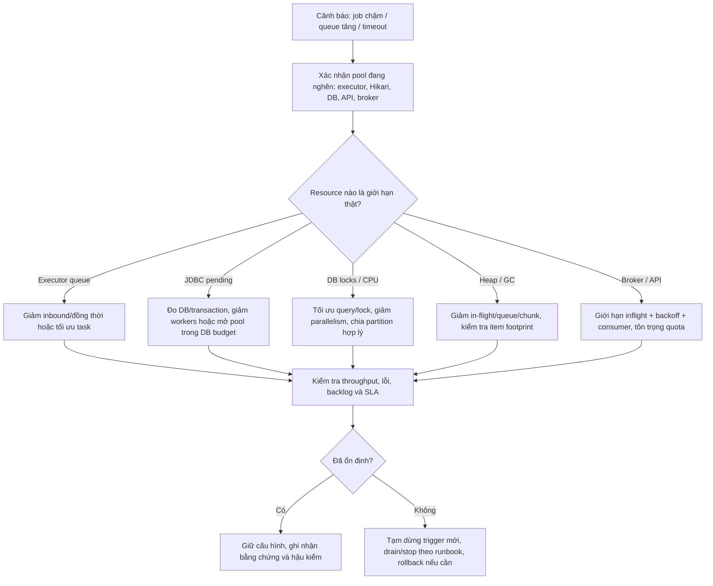

# Đã kiểm tra resource pool — Checklist production cho Spring Batch scaling

> **Chương:** Checklist production  
> **Bài học:** Đã kiểm tra resource pool  
> **Phạm vi:** `SPRING_BATCH_SCALING_OPERATIONS` — mở rộng Spring Batch cho workload dữ liệu lớn qua multi-threaded step, parallel steps, partitioning và xử lý phân tán; đo nút thắt, bảo đảm thread safety, retry/restart, vận hành job và chọn kiến trúc phù hợp với tài nguyên thực tế.

## Mục tiêu học tập

Sau bài học, bạn có thể:

1. Kiểm kê đầy đủ các **resource pool** có thể giới hạn tốc độ hoặc gây sự cố khi Spring Batch mở rộng song song.
2. Tính ngân sách tài nguyên cho **nhiều step, nhiều job, nhiều pod/JVM** chạy đồng thời, có xét đến pool dùng chung và quota của dịch vụ đích.
3. Cấu hình `TaskExecutor`, JDBC connection pool, transaction timeout và hàng đợi có giới hạn; hiểu được quan hệ giữa số worker và lượng việc đang chờ.
4. Đo và kiểm tra bão hòa CPU, heap/GC, JDBC, database lock, thread, network, broker, disk và quota API.
5. Xây dựng **bằng chứng GO/NO-GO trước production**, kèm kịch bản tải, fault injection, retry/restart, giám sát và phương án giảm tải.

## 1. Tại sao phải kiểm tra resource pool trước khi bật song song?

Một job chạy tuần tự xử lý 1.000 item/giây có thể tăng tốc khi thêm worker. Nhưng khi số worker vượt khả năng của connection pool, database hoặc hệ thống downstream, tốc độ thực tế có thể **giảm** dù CPU còn rảnh. Điển hình:

- Một partition worker giữ connection trong transaction và chờ một connection khác để ghi metadata; JDBC pool hết chỗ làm tiến trình chờ lẫn nhau.
- Một executor có queue không giới hạn chấp nhận chunk/partition nhanh hơn tốc độ xử lý; heap tăng dần rồi gặp `OutOfMemoryError`.
- Manager gửi nhiều message cho remote workers, nhưng broker giới hạn inflight deliveries hoặc workers bị chặn bởi quota dịch vụ; backlog và thời gian hoàn thành tăng.
- Tăng số thread đọc cùng bảng lớn gây nhiều query/lock cạnh tranh và giảm throughput của tất cả các job dùng DB đó.
- Tăng số pod mà quên rằng **mỗi pod có một connection pool riêng**, khiến tổng kết nối tới DB vượt ngân sách dù cấu hình một pod có vẻ nhỏ.

Trong Spring Batch, tốc độ đầu cuối còn phụ thuộc `JobRepository` (lưu `JobExecution`, `StepExecution`, `ExecutionContext`), transaction và checkpoint. Chỉ đo thời gian xử lý nghiệp vụ sẽ bỏ sót chi phí lock/metadata/restart.

**Tiêu chí hoàn thành:** Nhóm vận hành có số liệu tải đại diện, biết giới hạn từng pool, chứng minh rằng workload đạt SLA với đủ headroom và đã thử hành vi khi chạm giới hạn. Một cấu hình “không gặp lỗi trong một lần chạy nhỏ” chưa phải bằng chứng đạt.

## 2. Bản đồ các pool phải khảo sát

| Pool / tài nguyên | Tài nguyên được chia sẻ | Dấu hiệu quá tải thường gặp | Cần đo / xác nhận |
|---|---|---|---|
| **TaskExecutor / worker threads** | Thread xử lý chunk, partition, parallel step hoặc task điều phối | Queue dài, bị từ chối task, wall time cao, thread đợi lock/I/O | Core/max threads, active threads, pool size, queue capacity/depth, rejected task, task wait time |
| **JDBC connection pool** (ví dụ HikariCP) | Kết nối từ từng JVM tới business DB và/hoặc Batch metadata DB | `SQLTransientConnectionException`, timeout lấy connection, thread blocked, deadlock ứng dụng | Active/idle/pending, maximum pool size, connection acquisition latency, timeout, rò rỉ connection |
| **Database server / proxy** | `max_connections`, CPU, IOPS, locks, buffer cache, transaction logs, PgBouncer/RDS Proxy | CPU/IO wait tăng, lock waits, deadlock, throughput chững | Connection tổng, active query, long transaction, lock, I/O latency, replication lag, slow query |
| **CPU quota** | Core/vCPU của node, container và các pod chung node | CPU throttling, context switching, processor latency cao | CPU usage + quota, throttled time, run queue, CPU/profile |
| **Heap / GC / native memory** | Item/chunk in flight, queue, reader buffer, thread stack, cache, direct buffer | GC pause tăng, heap pressure, `OutOfMemoryError`, container OOMKilled | Used/max heap, allocation rate, GC pause, RSS, container memory working set |
| **Network / HTTP client pool** | Connection tới REST API, S3/object store, DB proxy, external services | Read/connect timeout, 429/503, giữ thread đợi lâu | Concurrent requests, max connections/route, pending, pool acquisition, latency, rate limit |
| **Broker / remote workers** | Consumer concurrency, broker channels, prefetch, inflight message, worker slots | Lag tăng, redelivery, DLQ, message expired | Backlog, publish/consume rate, unacked, redelivery, queue age, worker saturation |
| **Disk / file descriptors / temp** | File reader/writer, local temp, sort/spill, sockets | `Too many open files`, disk full, I/O timeout | Open FD, filesystem free space, temp growth, disk IOPS, inode count |
| **JobRepository DB** | Metadata tables, sequence, transaction/locks | Slow create/update execution, optimistic lock, stuck `STARTED` | Metadata write latency, connection pool, lock contention, execution count và trạng thái |

Một ứng dụng có thể dùng **cùng một Hikari pool** cho nghiệp vụ và metadata, hoặc **hai pool và hai DB**. Phải đo cấu hình runtime thực tế, không suy từ tên bean. Nếu dùng connection proxy, xác nhận giới hạn **ở cả client pool và proxy/backend**.

## 3. Bước 1 — Lập ngân sách đồng thời toàn hệ thống

### 3.1. Đếm workload có thể chạy cùng lúc, không chỉ số thread trong một step

Ký hiệu:

- `R`: số replica/JVM có thể chạy batch đồng thời.
- `J`: số job đồng thời trên **một** JVM.
- `S_j`: số step đồng thời thuộc job `j` (khi dùng parallel flows/steps).
- `P_{j,s}`: giới hạn worker threads thực tế của step `s` trong job `j`.
- `C_worker`: số connection nghiệp vụ giữ đồng thời trên **một worker** trong tình huống xấu hợp lý.
- `C_control`: connection phục vụ reader, launcher, metadata, kiểm soát và hoạt động khác, có xét đến việc tái sử dụng connection theo transaction.

Ước lượng bước đầu về số worker **có thể cùng tranh chấp tài nguyên**:

```text
worker_concurrency_per_JVM
    <= tổng theo job j đang chạy (tổng theo step s đang chạy của P[j,s])

worker_concurrency_cluster
    <= R * worker_concurrency_per_JVM
```

Với mỗi JDBC pool **riêng biệt**, ước lượng nhu cầu peak bằng cách cộng nhu cầu connection của các luồng có thể **thực sự giữ connection trùng thời điểm**; tránh nhân đôi một connection được tái sử dụng trong cùng transaction:

```text
estimated_connections_per_JVM
    ~= peak_concurrent_workers * connections_held_per_worker
       + additional_concurrent_control_connections
       + safety_headroom

cluster_pool_upper_bound
    = replica_count * pool_maximum_size_per_replica
```

Đây là **mô hình ngân sách**, không phải định luật “mỗi thread luôn dùng một connection”. Worker CPU-only có thể không giữ JDBC connection; một worker có transaction lồng nhau hoặc gọi hai `DataSource` có thể cần nhiều hơn một connection. Đo bằng transaction trace và metrics để hiệu chỉnh.

Ngoài ra, `gridSize` của partitioning là số partition logic được tạo; **không đồng nghĩa** số partition thực thi đồng thời. Concurrency bị chặn bởi worker executor, nguồn dữ liệu, broker hoặc `PartitionHandler` tương ứng. Tương tự, chunk size không phải số thread.

### 3.2. Ví dụ ngân sách cụ thể

Giả sử một cụm xử lý đơn hàng có:

| Thông số | Giá trị giả định |
|---|---:|
| Pod Spring Batch có thể chạy đồng thời | 3 |
| Job đồng thời trên mỗi pod | 2 |
| Mỗi job có 1 step nhiều worker | 6 worker |
| Worker peak mỗi pod | 12 |
| Worker kết nối tới business DB | Tối đa 1 connection giữ đồng thời / worker |
| Connection bổ sung cùng lúc trên một pod | Dự kiến 2 cho metadata/reader/điều phối nếu dùng chung pool |
| Hikari maximumPoolSize đề xuất để **đo thử** | 14 trên mỗi pod |
| Upper bound connection nếu tất cả pool đầy | 3 × 14 = **42** |
| Tổng `max_connections` DB | 100 |
| Connection dành cho dịch vụ khác/DBA/replication/overhead | 30, tùy chính sách DBA |
| Ngân sách còn cho batch | 100 − 30 = **70** |

Theo giả định trên, giới hạn **42 connection cho cả cụm** thấp hơn ngân sách **70**. Tuy nhiên, 14 connection/pod có thể **không đủ** nếu worker giữ nhiều connection, phần metadata có pool riêng, hoặc còn job khác chạy ngoài mô hình. Cần stress test và đo số connection thực tế trong peak, không lấy bảng này làm cấu hình production mặc định.

Nếu tăng replica từ 3 lên 6 mà vẫn cấp 14 connection/pod, upper bound tăng thành **84**, vượt ngân sách batch 70. HPA/autoscaling vì vậy phải cập nhật ngân sách DB cùng với số replica tối đa. `maximumPoolSize=14` là giới hạn **mỗi pool trong mỗi pod**, không phải 14 cho toàn cluster.

### 3.3. Những chỗ dễ bỏ sót trong ngân sách

- Parallel steps dùng nhiều executor khác nhau có thể chạy đồng thời; tổng số worker không bằng max của từng step.
- Local partitioning có một executor điều phối partition; worker step có thể tự mở thêm thread hoặc connection.
- Remote partitioning/remote chunking nhân nhu cầu theo số **worker instance** và mỗi instance có pool độc lập; manager cũng có connection riêng.
- Retry/backoff không nhất thiết nhả connection, lock hoặc thread; cần kiểm tra thực tế transaction scope.
- Shared application pool còn phục vụ health checks, API, scheduler và các job khác.
- Kết nối từ monitoring, migration tool, admin, replica hoặc dịch vụ không thuộc Spring Batch vẫn cần ngân sách.
- Khi ứng dụng dùng cả business DataSource và JobRepository DataSource, hãy lập **hai bảng ngân sách độc lập** rồi đối chiếu với từng server/proxy; không cộng tùy tiện nếu hai pool phục vụ hai DB khác nhau.

## 4. Bước 2 — Chốt cấu hình executor có giới hạn

Spring Framework cung cấp `ThreadPoolTaskExecutor` với `corePoolSize`, `maxPoolSize` và `queueCapacity`. Cơ chế cấp thread theo `ThreadPoolExecutor`: khi đã đủ core threads, task thường vào queue; chỉ sau khi queue đầy mới tăng thêm thread tới max nếu cấu hình cho phép. Vì vậy, đặt `corePoolSize=4`, `maxPoolSize=16` nhưng queue rất lớn **không** có nghĩa sẽ nhanh đạt 16 worker.

Ví dụ minh họa cho một pool worker cố định gồm 6 thread và queue tối đa 12 task:

```java
import java.util.concurrent.ThreadPoolExecutor;
import org.springframework.context.annotation.Bean;
import org.springframework.context.annotation.Configuration;
import org.springframework.scheduling.concurrent.ThreadPoolTaskExecutor;

@Configuration
class BatchWorkerPoolConfiguration {

    @Bean("batchWorkerExecutor")
    ThreadPoolTaskExecutor batchWorkerExecutor() {
        ThreadPoolTaskExecutor executor = new ThreadPoolTaskExecutor();

        // Chỉ là giá trị thử nghiệm; thay bằng kết quả benchmark và quota.
        executor.setCorePoolSize(6);
        executor.setMaxPoolSize(6);
        executor.setQueueCapacity(12);
        executor.setThreadNamePrefix("batch-worker-");

        // Thất bại rõ ràng khi không thể nhận thêm việc.
        executor.setRejectedExecutionHandler(
            new ThreadPoolExecutor.AbortPolicy()
        );

        // Đóng cửa nhận việc mới, chờ task đang chạy theo lifecycle.
        executor.setWaitForTasksToCompleteOnShutdown(true);
        executor.setAwaitTerminationSeconds(120);

        return executor; // Bean lifecycle do Spring quản lý.
    }
}
```

`ThreadPoolTaskExecutor` có thể được truyền cho step executor, `TaskExecutorPartitionHandler` hoặc thành phần local chunking tùy mô hình và phiên bản Spring Batch. **Đừng dùng một bean executor ở nhiều nơi rồi mặc định mỗi nơi có 6 thread**: khi dùng chung, đó là một pool 6 worker cạnh tranh nhau; khi tạo nhiều bean riêng, tổng số worker có thể tăng lên.

**Yêu cầu production đối với executor:**

- Chọn giới hạn core/max, queue và số instance bằng số liệu tải. Chỉ tăng khi downstream còn năng lực.
- Bảo đảm task bị reject **không bị bỏ qua âm thầm**. Tính đúng đắn đòi hỏi step/job biết việc nào không được thực thi và có cơ chế fail/retry/restart đúng.
- Đo queue wait, task duration và active worker. Queue luôn đầy là dấu hiệu downstream chậm, **không** phải lý do tăng queue vô hạn.
- Xác định thời gian shutdown cho job dài: `awaitTerminationSeconds` không bảo đảm tác vụ dài đã hoàn tất, đặc biệt khi pod bị `SIGKILL` sau grace period.
- Không đặt `CallerRunsPolicy` chỉ để “khỏi bị reject” mà không đo tác động; task có thể chuyển sang chạy trong thread điều phối, thay đổi latency, thread ownership và throughput.
- Với multi-threaded step, ItemReader/ItemWriter và các delegate được dùng đồng thời phải an toàn luồng hoặc có cơ chế đồng bộ phù hợp. Synchronization có thể biến reader thành nút thắt.
- Với local chunking theo Spring Batch 6.x, cần cấu hình transaction/retry trong `ChunkProcessor` worker; không giả định transaction ở thread điều phối tự chuyển sang worker.

### Phân biệt các cách cấu hình theo phiên bản

Spring Batch 5.x sử dụng các cơ chế multi-threaded step truyền thống, partitioning và remote chunking; kể từ 6.0, Spring Batch có thêm cách local chunking thông qua `ChunkTaskExecutorItemWriter`. Cách gắn `TaskExecutor` và phần việc nào chạy trên thread phải kiểm tra bằng **API đúng version**. `throttleLimit` từng có trong cấu hình multi-threaded step đã bị đánh dấu deprecated từ Spring Batch 5.0; không dùng nó như thay thế cho việc đặt giới hạn pool/queue và đo thực tế.

## 5. Bước 3 — Kiểm tra JDBC pool và transaction

### 5.1. Cấu hình tham khảo với Spring Boot + HikariCP

Khi Spring Boot dùng HikariCP cho `spring.datasource`, có thể cấu hình:

```yaml
spring:
  datasource:
    hikari:
      pool-name: batch-business-db
      maximum-pool-size: 14
      minimum-idle: 4
      connection-timeout: 30000 # milliseconds
      validation-timeout: 5000 # milliseconds

management:
  endpoints:
    web:
      exposure:
        include: health,info,metrics,prometheus
```

Đây là ví dụ cho **pool mặc định**; nếu ứng dụng tự tạo nhiều `DataSource`, các thuộc tính `spring.datasource.hikari` có thể **không tự áp dụng** cho các pool custom. Khi đó phải cấu hình từng bean (`HikariConfig`/`HikariDataSource` hoặc `@ConfigurationProperties`) và đo pool theo **tên thực tế**.

Không sao chép số 14 từ ví dụ nếu chưa đo. Đặc biệt, `minimumIdle` là số connection *nhàn rỗi mục tiêu*; `maximumPoolSize` là giới hạn cho connection pool đó. Cần hiểu chính sách mạng/DB idle timeout, max lifetime và proxy timeout của môi trường để tránh dùng connection hết hạn. Không kéo dài connection timeout vô hạn chỉ để che đi tình trạng thiếu pool.

### 5.2. Các kiểm tra bắt buộc cho JDBC

| Hạng mục | Câu hỏi nghiệm thu |
|---|---|
| Giới hạn từng pool | `maximumPoolSize` của business DB và repository DB có đủ cho peak contention thực tế không? |
| Giới hạn cluster | Tổng max connection của tất cả pod, thêm service khác và DBA reserve, có ở dưới ngân sách server/proxy không? |
| Acquisition latency | Trong peak, p95/p99 chờ lấy connection có ổn định? Có pending threads và timeout không? |
| Transaction lifecycle | Connection có được nhả sau commit/rollback không? Có transaction treo hoặc bị giữ trong lúc gọi API chậm không? |
| Transaction timeout | DB statement timeout, Spring transaction timeout, network timeout và retry/backoff có quan hệ hợp lý không? |
| Metadata repository | `JobRepository` dùng pool và transaction manager nào? Có lock contention khi nhiều worker cập nhật `StepExecution` không? |
| Long-running reader | Cursor/streaming reader có giữ connection lâu suốt step không? Ảnh hưởng lên headroom ra sao? |
| Nested / multiple DataSource | Một worker có thể cần connection đồng thời từ nhiều pool, hoặc yêu cầu thêm connection khi transaction propagation khác? |
| Lỗi DB | Có test khi DB chậm, cạn connection, failover? Job fail rõ, chờ giới hạn và restart hợp lệ? |

Việc tăng `maximumPoolSize` không làm database mạnh lên. Nếu DB CPU, disk, buffer hoặc lock đã tới giới hạn, thêm connection thường tăng thời gian chờ và tail latency. Connection pool phải được điều chỉnh cùng với query plan, index, batching, transaction scope và tài nguyên DB.

### 5.3. Một phép kiểm tra thực tế trên PostgreSQL

Ví dụ dưới đây chỉ áp dụng khi có quyền truy vấn `pg_stat_activity`. Đổi lọc `application_name` theo cách đặt tên kết nối của hệ thống:

```sql
SELECT
    application_name,
    state,
    wait_event_type,
    wait_event,
    COUNT(*) AS connections
FROM pg_stat_activity
WHERE datname = current_database()
  AND application_name LIKE 'batch-%'
GROUP BY application_name, state, wait_event_type, wait_event
ORDER BY connections DESC;
```

Đo cả khi idle, khi peak và lúc rollback/retry. Đếm session phía DB không thay thế metrics **pending acquisition** tại Hikari pool: một worker có thể đang chờ lấy connection và vì thế **không xuất hiện** như một DB session mới. Với proxy/pooling trung gian, hãy đo cả kết nối client và backend.

## 6. Bước 4 — CPU, heap, GC và tài nguyên hệ điều hành

### 6.1. CPU phải tính theo quota thực tế

Ví dụ pod bị giới hạn `cpu: "2"` vẫn có thể nhìn thấy nhiều core trên node; đặt 16 worker CPU-bound có thể gây CPU throttling và context switching. Với I/O-bound có thể cần nhiều thread hơn core, nhưng số thread hợp lý vẫn bị chặn bởi pool kết nối, API quota và mức tiêu thụ heap.

Ghi lại tại tải đại diện: CPU utilization, CPU throttled time của container, run queue, thread states và tốc độ xử lý. Nếu active threads cao mà CPU thấp, kiểm tra chờ connection, socket, lock hoặc queue. Nếu CPU throttling tăng khi thêm worker, mở thêm thread chưa chắc làm nhanh hơn.

### 6.2. Ước lượng bộ nhớ của các chunk đang bay

Giả sử:

- `P` là số worker đang xử lý;
- `Q` là số task/chuỗi chunk tối đa có thể đợi trong queue;
- `C` là số item/chunk;
- `M_item` là kích thước **in-memory** trung bình của toàn bộ object graph cho mỗi item.

Một cận ước lượng đơn giản cho bộ nhớ item đang in flight:

```text
memory_items_in_flight ≈ (P + Q) × C × M_item
```

Ví dụ `P=6`, `Q=12`, `C=500`, `M_item≈4 KiB` → khoảng `35,2 MiB` cho item payload, chưa kể object graph khác, processor output, reader buffers, JDBC batching, serializers, caches, thread stacks, direct buffers và GC overhead. Công thức **không phải upper bound cứng**: một chunk có thể chứa nhiều bản copy hoặc dữ liệu lớn hơn giá trị trung bình, nhiều job có thể cộng dồn.

Để nghiệm thu, đo peak heap/RSS và GC pause khi kích thước item biến thiên, khi retry/backoff kéo dài và khi pool bị bão hòa. Kiểm tra container memory limit lớn hơn tổ hợp heap tối đa + native overhead có dự phòng; đồng thời xác nhận behavior của JVM khi bị `OOMKilled` và khả năng restart job.

### 6.3. Disk, file descriptor và temporary storage

Bộ đọc nhiều file/stream trong partitioning có thể mở nhiều file descriptors; JDBC và HTTP client cũng tiêu thụ sockets. Mỗi worker có thể tạo temporary files hoặc spill data. Trước production, kiểm tra `ulimit -n`, filesystem/inode free, local ephemeral storage của pod, dung lượng log, temp directory và giới hạn cloud object store. Dung lượng ở thời điểm job hoàn tất không phản ánh **peak** tạm thời trong lúc shuffle/sort/retry.

## 7. Bước 5 — Kiểm tra pool phụ thuộc khi triển khai phân tán

Local task executor chỉ là một phần của bài toán. Với `remote chunking` hoặc `remote partitioning`, cần kiểm soát:

- **Manager/launcher:** giới hạn inflight work, pending replies, timeout, thread/callback để chờ ack, và backpressure khi worker chậm.
- **Message broker:** queue depth, message age, redelivery, dead-letter, visibility/ack timeout, prefetch, inflight deliveries và khả năng phục hồi khi broker restart.
- **Worker replicas:** số consumer × concurrency × connection pool mỗi worker; autoscaling phải xét toàn bộ DB/API budget.
- **Downstream HTTP/SQL:** concurrency cap, QPS quota, `429 Too Many Requests`, retry/backoff có jitter và circuit breaker khi phù hợp.
- **Network:** connection setup, DNS, TLS, proxy max connection và idle timeout; giữ nhiều connection không đồng nghĩa tăng throughput.
- **Tính đúng đắn:** message có thể giao lại sau crash; idempotency và dấu hiệu hoàn tất ở worker phải thống nhất với repository và business side effects.

Đặc biệt, `gridSize` có thể lớn để tạo nhiều partition, nhưng nâng số consumer/worker mới thực sự tăng parallelism; nếu đang bị chặn ở database, tăng gridSize hoặc message prefetch chỉ làm backlog/inflight memory lớn hơn.

## 8. Bước 6 — Gắn metric, trace và cảnh báo

Một dashboard hữu ích phải trả lời được “job chậm **vì pool nào**?” thay vì chỉ hiển thị tổng thời gian job.

| Nhóm metric | Tín hiệu cần ghi | Chẩn đoán |
|---|---|---|
| Executor | active threads, pool size, queue size/capacity, rejected tasks, task wait duration | Worker bận, queue nghẽn hoặc bị reject |
| Hikari | active, idle, pending, max connections; acquisition p95/p99; timeout count | Đang chờ connection, pool quá nhỏ hoặc DB quá chậm |
| Database | active sessions, CPU, IOPS/latency, lock waits/deadlocks, slow queries | Nút thắt thực nằm ở DB thay vì ở executor |
| JVM/container | CPU throttled, RSS/heap, GC pause, OOM, open FD, thread count | Hết quota hệ thống hoặc tác vụ giữ object lâu |
| Spring Batch | job/step duration, read/process/write count, filter/skip/retry/rollback, status, restart count | Tốc độ thực, lỗi, replay, tiến độ checkpoint |
| Remote messaging | queue lag/age, in-flight, redelivery, dead-letter, consumer concurrency | Phân phối công việc vượt khả năng worker |
| Downstream APIs | p95/p99 latency, 429/5xx, request concurrency, retry rate | Rate limit hoặc dịch vụ chậm tạo hàng đợi |

Micrometer/Actuator có thể cung cấp metrics pool và JVM tùy dependency/instrumentation. Xác minh **metric nào thực sự xuất hiện** trên môi trường runtime. Không giả định có metric chỉ vì đã thêm dependency.

**Nhãn metric:** dùng job name, step name, pool name, environment và service nếu có ích; tránh tag trực tiếp `JobExecutionId` hoặc item/customer ID trên mọi time series vì có thể gây cardinality rất cao. Đối với truy tìm một execution cụ thể, dùng logs/traces tương quan theo execution ID và giới hạn dữ liệu nhạy cảm.

### Ví dụ ngưỡng cảnh báo để hiệu chỉnh bằng baseline

- Hikari pending connections dương kéo dài nhiều cửa sổ đo, hoặc connection acquisition p95 tăng gấp nhiều lần baseline.
- Executor queue thường xuyên gần capacity và rejected task xuất hiện.
- Job throughput giảm khi tăng worker, DB lock wait/CPU tăng.
- GC pause hoặc CPU throttling tiêu thụ phần đáng kể thời gian xử lý.
- Message age tăng liên tục dù hàng đợi còn nhận message.
- Số `STARTED`/`STOPPING` bất thường sau node restart hoặc lượng rollback/retry tăng nhanh.

Không có một tỷ lệ “CPU 80%” hay “pool active 90%” đủ áp dụng cho mọi job. Hãy chốt ngưỡng bằng SLA, error budget, p95/p99 và kết quả stress test của **workload đó**; phân biệt bão hòa ngắn bình thường với chờ kéo dài không phục hồi.

## 9. Bước 7 — Diễn tập trước khi GO production

### 9.1. Ma trận thử nghiệm bắt buộc

| Phép thử | Thiết lập | Cần chứng minh |
|---|---|---|
| **Baseline** | Chạy chunk step tuần tự với dữ liệu đại diện, cùng CSDL/phần cứng | Có throughput, wall time, DB/heap/pool và error baseline |
| **Tăng dần worker** | Lần lượt 1, 2, 4, 6, 8 worker với cùng chunk size và input | Xác định scaling curve; phát hiện điểm plateau |
| **Nhiều job** | Kích hoạt số job/parallel steps cao nhất được phép trên một pod | Tổng nhu cầu đồng thời không vượt giới hạn pool |
| **Nhiều pod** | Chạy tới max replicas/HPA target và workloads khác dùng DB | Tổng JDBC connections/CPU/IO dưới ngân sách cluster |
| **Connection starvation** | Hạ tạm pool hoặc làm chậm query trên staging | Có timeout hữu hạn, fail/retry đúng; không deadlock vô hạn |
| **Executor saturation** | Nạp việc vượt `P + Q`; làm worker chậm bằng fault injection | Task bị chặn/từ chối có kiểm soát, không bị mất âm thầm |
| **DB contention** | Tạo lock/slow query có kiểm soát | Biết lock waits, rollback, timeout và ảnh hưởng lên SLA |
| **Downstream throttling** | Trả HTTP 429/503 hoặc giảm broker consumer trên staging | Backoff, bounded inflight, retry limit và circuit/rate control hợp lý |
| **Heap pressure** | Dùng item lớn, queue đầy, dữ liệu lệch kích thước | Không OOM; GC, RSS và giới hạn pod có headroom |
| **Restart/replay** | Crash sau commit một số chunk/partition, rồi restart | Output đúng, không mất/trùng nghiệp vụ nhờ idempotency, metadata nhất quán |
| **Graceful shutdown** | Dừng lịch, phát `SIGTERM` khi job còn chạy, chờ drain | Worker/connection đóng đúng, stop/restart quy định và thời gian grace đủ |
| **Load so với SLA** | Duy trì peak lâu hơn khoảng burst thông thường | Throughput không suy giảm do queue/GC/lock tích lũy |

Với mỗi phép thử cần giữ: version Spring Batch/Boot, commit interval, worker pool/queue, Hikari config, replica count, input dataset, thời gian, thông số JVM/container, log lỗi, biểu đồ metric và người xác nhận.

### 9.2. Ví dụ đọc kết quả benchmark

Giả định cùng một dữ liệu đầu vào:

| Worker | Throughput (item/s) | Hikari pending p95 | DB CPU | Diễn giải |
|---:|---:|---:|---:|---|
| 1 | 800 | 0 | 25% | Baseline |
| 2 | 1.450 | 0 | 42% | Mở rộng tốt |
| 4 | 2.200 | 0 | 68% | Tăng đáng kể |
| 6 | 2.280 | 2 | 88% | Bắt đầu nghẽn DB/pool |
| 8 | 2.250 | 5 | 95% | Tăng worker làm hiệu quả giảm |

**Kết luận trên dữ liệu giả định:** `4 worker` có thể là điểm vận hành hợp lý hơn `6` hoặc `8`; lợi ích thêm rất nhỏ trong khi rủi ro DB contention và connection wait tăng. Giá trị thực tế phải đo ở workload của bạn; không đặt cấu hình chỉ theo bảng minh họa.

### 9.3. Mẫu biên bản nghiệm thu resource pool

Điền theo môi trường thật trước khi mở rộng production:

| Hạng mục kiểm tra | Trường phải điền | Kết quả |
|---|---|---|
| Ngày đo / môi trường | Build version, schema, dataset, node/pod, traffic | ☐ |
| Workload peak | Job, số step song song, partition, chunk, retry pattern | ☐ |
| Executor | Bean/pool name, core/max, queue, rejection, active/queue p95 | ☐ |
| JDBC pool mỗi pod | Pool name, max/minIdle, pending p95/p99, timeout count | ☐ |
| Ngân sách DB toàn cluster | Max replicas × pool limits + reserved connections | ☐ |
| CPU / RAM / GC | Quota, max RSS/heap, CPU throttling, GC p95 | ☐ |
| Các phụ thuộc | API QPS, broker lag/prefetch, disk, fd, proxy | ☐ |
| Kiểm thử lỗi | DB timeout, executor reject, crash/restart, duplicate check | ☐ |
| SLA và headroom | Wall time p95, throughput peak, dự phòng tải | ☐ |
| Runbook | Alert, người trực, cơ chế giảm concurrency và rollback | ☐ |

Các ô chưa có số liệu hoặc chỉ được đánh dấu dựa trên “đã cấu hình” chưa được xem là nghiệm thu.

## 10. Runbook xử lý khi pool bắt đầu bão hòa



**Ưu tiên an toàn dữ liệu:** Khi lỗi nằm ở metadata/restart, không chỉnh trực tiếp `BATCH_STEP_EXECUTION`, `ExecutionContext` hay đánh dấu `COMPLETED` bằng SQL để vượt lỗi. Hãy dừng job theo cơ chế Spring Batch phù hợp, phân tích trạng thái và thử restart với cùng identifying parameters sau khi khắc phục tài nguyên. Nếu writer tạo side effect ngoài transaction, đối soát idempotency trước khi cho chạy lại.

**Giảm tải thực tế:** Hạ consumer count, thread pool hoặc số job có thể chạy đồng thời; giới hạn scheduler; giảm chunk/queue nếu heap căng; giảm retry burst; dùng rate limiter ở đầu ra. Không đồng thời tăng pool ở nhiều lớp (executor, Hikari, broker, API client) khi chưa biết nút thắt, vì có thể đẩy áp lực sang tài nguyên kế tiếp.

## 11. Điều kiện GO / NO-GO trước production

### Có thể GO khi

- [ ] Đã đo baseline và peak với dữ liệu, số pod và số job đồng thời đại diện.
- [ ] Đã kiểm kê các executor, connection pools, CPU/heap, broker/API và tài nguyên OS liên quan.
- [ ] Đã xác định ngân sách JDBC toàn cluster, có chỗ cho metadata/ops và các ứng dụng khác.
- [ ] Queue, concurrency, retry/backoff và thời gian chờ đều có **giới hạn** và được quan sát.
- [ ] Không có task bị mất khi executor từ chối hoặc khi downstream quá tải; trạng thái job phản ánh lỗi đúng.
- [ ] Đã kiểm tra thread safety của reader/processor/writer và transaction ở worker thread nếu có.
- [ ] Đã chạy fault injection, crash/restart và đối soát dữ liệu để chứng minh không mất/trùng nghiệp vụ.
- [ ] Có alert và runbook giảm tải/stop/rollback; nhóm vận hành biết người chịu trách nhiệm.
- [ ] Kết quả đo đạt SLA với headroom đã thống nhất, không chỉ vượt ngưỡng một lần.

### NO-GO nếu còn một trong các điều kiện

- Cấu hình executor queue không giới hạn trong khi dữ liệu đầu vào có thể tới nhanh hơn đầu ra và không có cơ chế backpressure hữu hiệu.
- Tổng `replica × maximumPoolSize` vượt ngân sách connection của DB/proxy, hoặc không biết có bao nhiêu pool đang hoạt động.
- Chưa chứng minh được retry/restart khi chunk hoặc worker đã commit side effect ngoài metadata.
- Có pending connection/timeouts kéo dài, DB lock waits hoặc message lag tăng không phục hồi khi chạy tải đại diện.
- Không có số liệu CPU/heap/GC hay cách phát hiện và phản ứng khi tài nguyên bị cạn.
- Tăng số worker không cải thiện đủ SLA hoặc làm độ ổn định thấp hơn baseline.

## 12. Bài tập áp dụng

Một hệ thống chạy ba loại job:

1. `settlementJob` có 4 partition đồng thời; mỗi partition dùng tối đa 1 JDBC connection trong transaction.
2. `reportingJob` chạy một step với 6 worker, cùng dùng một business DB pool.
3. `exportJob` gọi REST API, tối đa 8 request đồng thời; dịch vụ đích cho phép **12 request đồng thời cho toàn cluster**.

Có **4 pod** và cả ba job có thể chạy trong mỗi pod. Hikari business pool mỗi pod có `maximumPoolSize=12`; DB cho phép tối đa `60 connection cho batch` sau khi trừ các dịch vụ khác.

**Câu hỏi 1:** Chỉ tính worker JDBC, mỗi pod cần tối đa bao nhiêu connection nếu hai job DB cùng peak?

**Gợi ý:** `4 + 6 = 10 connection`. Pool 12 kết nối/pod có hai slot dự phòng trong giả định tối giản. Nhưng cần xác nhận `JobRepository`, reader, nested transactions hoặc connection riêng; hai slot chưa đủ nếu các đường này cần thêm connection đồng thời.

**Câu hỏi 2:** Tổng giới hạn connection nếu bốn pod đều đạt tối đa là bao nhiêu? Có vượt ngân sách DB?

**Đáp án:** `4 × 12 = 48` connection, thấp hơn 60 trong giả định. Tuy nhiên, nếu một thay đổi tự tăng pool thành 16/pod thì thành `64`, **vượt** ngân sách 60. HPA phải đi kèm kiểm soát connection budget.

**Câu hỏi 3:** `exportJob` chạy 8 request đồng thời trong *mỗi pod* có phù hợp quota 12 request của toàn cluster không?

**Đáp án:** Không. Có thể đạt `4 × 8 = 32` request đồng thời, vượt quota 12. Cần một giới hạn đồng thời **toàn cluster** (distributed semaphore/rate limiter hoặc phân bổ quota per pod có xét autoscaling), và test retry/backoff khi gặp 429; chỉ đặt thread pool 8 trong mỗi pod không bảo vệ quota tổng.

**Câu hỏi 4:** Nếu throughput giảm khi thêm worker, nên tăng `maximumPoolSize` lên 20 ngay không?

**Đáp án:** Không. Cần xem connection acquisition wait, CPU/locks của DB, reader bottleneck, API quota, queue và throughput curve. Có thể giữ worker thấp hơn, tối ưu query hoặc dùng partition theo khóa để giảm contention.

## Tài liệu tham khảo

- [Spring Batch — Scaling and Parallel Processing](https://docs.spring.io/spring-batch/reference/scalability.html): các mô hình multi-threaded step, parallel steps, local/remote chunking và partitioning.
- [Spring Framework — Task Execution and Scheduling](https://docs.spring.io/spring-framework/reference/integration/scheduling.html): `ThreadPoolTaskExecutor`, thread/queue sizing và các giới hạn executor.
- [HikariCP — Configuration](https://github.com/brettwooldridge/HikariCP#configuration-knobs-baby): `maximumPoolSize`, `minimumIdle` và `connectionTimeout`.
- [HikariCP — About Pool Sizing](https://github.com/brettwooldridge/HikariCP/wiki/About-Pool-Sizing): lý do pool connection quá lớn có thể làm throughput thấp hơn.
- [Spring Boot — Metrics](https://docs.spring.io/spring-boot/reference/actuator/metrics.html): metric JVM, HikariCP và tích hợp Micrometer/Actuator.
- [Spring Batch — Monitoring and Metrics](https://docs.spring.io/spring-batch/reference/monitoring-and-metrics.html): metric runtime và mức độ quan sát của các job/step.

> **Quy tắc production:** Đánh dấu **“Đã kiểm tra resource pool”** chỉ khi có số liệu peak **trên toàn cụm**, có giới hạn đồng thời và backlog, có phép thử saturation/failure/restart, và có người chịu trách nhiệm vận hành. Số thread, pool size hoặc CPU trung bình đứng riêng không chứng minh hệ thống sẵn sàng scale.
