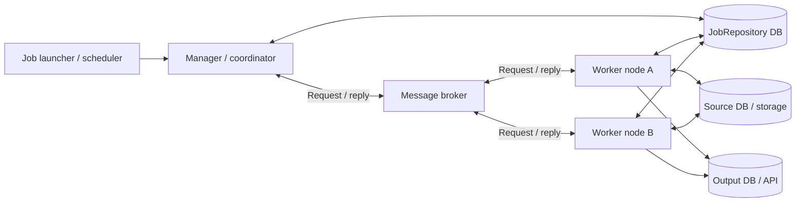
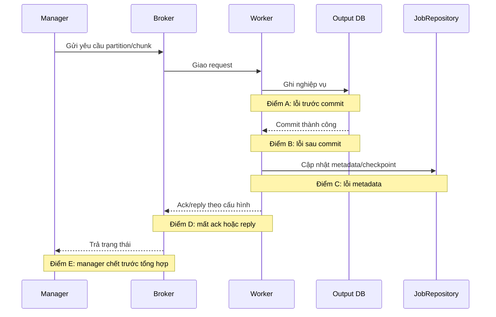

# Checklist production: Đã thử network và node failure trong Spring Batch chưa?

## 1. Mục tiêu của kiểm thử

Một Spring Batch job xử lý hàng triệu bản ghi có thể chạy đúng trong điều kiện bình thường nhưng thất bại khi **mạng chập chờn, worker mất kết nối, broker chuyển leader, manager bị kill hoặc database tạm thời không truy cập được**. Với workload lớn, nhiều thread, parallel steps, partitioning hay remote chunking, mỗi lỗi này có thể xuất hiện đúng lúc một transaction vừa commit, một message vừa được gửi hoặc một checkpoint chưa kịp lưu.

Trong module **`SPRING_BATCH_SCALING_OPERATIONS`**, chương **Checklist production** yêu cầu chứng minh khả năng chịu lỗi dựa trên **kết quả chạy thử có bằng chứng**. Mục “**Đã thử network và node failure**” chỉ được đánh dấu đạt khi hệ thống đã được thử trong các cửa sổ lỗi quan trọng, có thể xác định trạng thái cuối và khôi phục theo runbook mà không mất dữ liệu hoặc tạo side effect nghiệp vụ ngoài ý muốn.

Mục tiêu cuối cùng là trả lời năm câu hỏi:

1. Khi một kết nối hoặc node mất đột ngột, **job dừng, retry, chờ hay tiếp tục** theo hợp đồng đã định?
2. Nếu lỗi xảy ra sau khi **ghi kết quả** nhưng trước khi **acknowledge message/cập nhật metadata**, có xử lý trùng không?
3. Nếu `JobRepository` còn trạng thái `STARTED` sau khi tiến trình chết, operator khôi phục ra sao?
4. Mức độ suy giảm throughput, thời gian hồi phục và áp lực lên tài nguyên dùng chung có nằm trong ngưỡng được chấp nhận?
5. Có đầy đủ log, metric, `JobExecutionId`, `StepExecutionId`, partition/chunk ID và báo cáo đối soát để chứng minh kết quả không?

Không nên chỉ chứng minh rằng Kubernetes đã tự tạo pod mới hoặc message đã xuất hiện lại trên queue. **Một node sống lại không đồng nghĩa với một batch job có kết quả nghiệp vụ đúng.**

## 2. Bản đồ lỗi theo kiến trúc Spring Batch

Các kiến trúc khác nhau có điểm lỗi khác nhau. Trước khi thực hiện chaos test, cần vẽ luồng của job thật và chỉ rõ ai sở hữu transaction, checkpoint và message acknowledgement.



Sơ đồ biểu diễn **remote partitioning**; một số deployment dùng polling trạng thái repository thay cho reply channel. Trong **remote chunking**, manager thường đọc item và gửi chunk dữ liệu tới worker, vì vậy đường truyền giữa manager và broker còn nằm trên luồng dữ liệu chính. Với **multi-threaded step** và **parallel steps**, nhiều luồng cùng JVM chia sẻ rủi ro node chết; các kết nối DB/API vẫn là điểm lỗi bên ngoài.

| Thành phần bị lỗi | Triệu chứng cần thử | Rủi ro thực chất |
|---|---|---|
| Worker JVM/pod/node | Worker biến mất đang giữa chunk hoặc partition | Chunk bị xử lý lại, partition treo, kết quả đã commit nhưng không có reply |
| Manager JVM/node | Job mất coordinator trong khi worker vẫn chạy | Trạng thái job còn `STARTED`, nhiều manager cùng cố nhận lại job |
| Broker hoặc request channel | Request không đến, ack bị mất, reply không về | Giao lại message, timeout giả, trễ hoặc lặp chỉ thị thực thi |
| `JobRepository` DB | Không ghi được checkpoint, transaction metadata thất bại | Job chưa thể xác định trạng thái mới dù dữ liệu đích có thể đã ghi |
| Source DB/object storage | Reader timeout, mất phiên hoặc thay đổi snapshot | Bỏ sót item, retry đọc sai vị trí, phân vùng mất ổn định |
| Output DB | Writer timeout ngay sát commit | Client không biết transaction đã thành công hay chưa; có nguy cơ ghi lặp |
| API downstream | DNS lỗi, connection reset, 429/503, timeout | Retry storm, side effect từ request đã được downstream áp dụng |
| Network giữa các zone | Một số worker còn truy cập được DB, số khác không | Partial failure và các trạng thái khó phân biệt hơn mất toàn bộ dịch vụ |

**Mất mạng một chiều**, độ trễ rất cao và mạng bị chia cắt (*network partition*) cũng cần thử: chúng có thể tạo tình huống tệ hơn lỗi kết nối bị từ chối ngay, vì manager nghĩ worker đã chết trong khi worker vẫn đang ghi dữ liệu.

## 3. Định nghĩa đạt trước khi thử: các bất biến phải bảo toàn

Không có một cấu hình retry duy nhất phù hợp mọi job. Hãy định nghĩa trước các bất biến và thước đo chấp nhận cho nghiệp vụ cụ thể.

### 3.1. Tính đúng của dữ liệu

Với tập đầu vào cố định, định nghĩa:

- `N`: số bản ghi hợp lệ, **duy nhất** dự kiến xử lý.
- `S`: số bản ghi nghiệp vụ đã được ghi/áp dụng thành công, đếm theo khóa duy nhất.
- `Q`: số bản ghi được phân loại lỗi và đưa vào quarantine/skip **theo chính sách đã phê duyệt**.
- `U`: số bản ghi chưa được xử lý/đối soát xong.

Điều kiện đóng chiến dịch thành công thường là:

\[
N = S + Q, \qquad U = 0, \qquad DuplicateSideEffects = 0
\]

Không cộng trực tiếp `readCount` hoặc `writeCount` của mọi lần `JobExecution`: retry, rollback và restart khiến những counter này **không nhất thiết là số thực thể nghiệp vụ duy nhất**. Thay vào đó, đối soát bằng business key, watermark hoặc manifest đã cố định. `Q` chỉ được chấp nhận nếu nghiệp vụ cho phép skip có bằng chứng; với nghiệp vụ không được mất một giao dịch nào thì `Q` phải bằng 0.

### 3.2. Tính phục hồi và trạng thái

Các tiêu chí chấp nhận đề xuất:

| Tiêu chí | Điều kiện PASS cần quy định trước test |
|---|---|
| Không mất dữ liệu | 100% bản ghi trong manifest có trạng thái cuối hoặc lý do tồn đọng minh bạch |
| Không side effect trùng | Unique business key, version/CAS hoặc idempotency token chứng minh không nhân đôi nghiệp vụ |
| Restart hợp lệ | Sau recover/restart, partition thất bại được tiếp tục theo checkpoint ổn định; partition đã hoàn tất không bị áp dụng lại ngoài dự kiến |
| Không job chạy song song ngoài ý muốn | Không có hai active coordinator thực hiện cùng một `JobInstance` nếu hệ thống không cho phép |
| Lỗi có giới hạn | Retry, backoff, circuit breaker/timeout và DLQ được áp dụng; không có vòng lặp vô hạn |
| Khả năng quan sát | Tìm được nguyên nhân, node lỗi, `JobExecutionId`, `StepExecutionId`, lỗi đầu tiên, thời điểm phục hồi |
| RTO và backlog | Hoàn thành khôi phục trong RTO/SLO được thống nhất với nghiệp vụ |
| Không làm sập tải chính | Pool, CPU, broker lag và latency downstream giữ trong ngưỡng vận hành |

**RPO/RTO phải do sản phẩm quy định:** với batch tài chính có thể yêu cầu không mất kết quả đã chấp nhận, còn một job phân tích được tái tính từ snapshot có thể chấp nhận chạy lại cả kỳ. Đừng tự gán một ngưỡng chung như “phải hồi phục sau 30 giây” cho mọi hệ thống.

## 4. Chuẩn bị môi trường kiểm thử lỗi

Thử trong staging hoặc môi trường kiểm thử cách ly **có kiến trúc tương đương production** về loại broker, phiên bản ứng dụng, transaction manager, số replica, connection pool, timeout và cấu hình restart. Dữ liệu nên là dữ liệu giả lập/ẩn danh, có checksum và khóa nghiệp vụ để đối soát.

Trước khi tiêm lỗi, ghi lại:

1. **Version/runtime:** Spring Batch, Spring Framework/Boot, JDK, broker, driver DB, image manager/worker; tránh test một version rồi triển khai version khác.
2. **Topology:** bao nhiêu manager và worker, ở node/zone nào, queue/topic nào, DB metadata nằm ở đâu, nguồn và đích có replication/failover không.
3. **Đầu vào bất biến:** snapshot hoặc manifest, số lượng item, range partition, hash của payload mẫu; phân biệt dữ liệu đưa vào test với dữ liệu do tải ngoài sinh ra.
4. **Cấu hình thời gian:** connect timeout, socket/read timeout, broker heartbeat, transaction timeout, retry count, backoff, poll interval, job timeout, shutdown grace period.
5. **Mức tải:** số thread, partition, chunk size, `gridSize`, broker prefetch, `DataSource` pool và giới hạn downstream.
6. **Cơ chế phát hiện lỗi:** alert job `STARTED` quá lâu, stale worker heartbeat, consumer lag, retry exhausted và số record chưa đối soát.
7. **Điểm phục hồi:** script/runbook để khởi động lại worker, phục hồi kết nối, kiểm tra repository và restart đúng `JobInstance`.

Nên chạy tối thiểu một baseline thành công không có lỗi, rồi lặp lại cùng manifest dưới các điều kiện lỗi. Nếu baseline đã không chính xác, kết quả chaos test không có giá trị chứng minh.

### Mẫu phiếu kiểm thử

```yaml
testId: NET-WORKER-03
scenario: worker_lost_after_business_commit_before_ack
environment: staging-isolated
jobName: dailySettlementJob
jobInstanceKey: "businessDate=2026-11-20"
inputManifest: manifest-sha256-illustrative
injectionPoint: after_commit_before_ack
expectedBehavior:
  - worker_or_manager_detects_failure
  - no_duplicate_business_effect
  - execution_can_be_recovered_or_restarted
  - all_input_ids_accounted_for
evidence:
  - job_execution_and_step_execution_ids
  - broker_delivery_history
  - output_unique_key_count
  - before_after_dashboards
result: PENDING
```

Đây là schema minh họa cho báo cáo kiểm thử nội bộ, **không phải** schema YAML cấu hình Spring Batch.

## 5. Ma trận sự cố tối thiểu phải chạy

Mỗi dòng cần có test ID, cách gây lỗi, thời điểm tiêm lỗi, hành vi kỳ vọng và kết quả đối soát. Các test dưới đây có thể được tự động hóa bằng test harness, Toxiproxy, Chaos Mesh, network policy hoặc failure injection hook. Không chạy lệnh phá kết nối trên production khi chưa có quy trình change được phê duyệt.

| ID | Kịch bản tiêm lỗi | Chứng minh PASS |
|---|---|---|
| N01 | Chặn kết nối **worker → source DB** trước lần đọc đầu | Timeout hữu hạn; retry/backoff hoặc fail rõ; không mất cursor/partition |
| N02 | Reset kết nối source DB **sau khi đã đọc** nhưng trước checkpoint | Reader restart đọc lại đúng tập dữ liệu, không bỏ sót item |
| N03 | Chặn **worker → output DB** trước khi transaction commit | Rollback hoặc trạng thái chưa xác nhận được xử lý đúng, không ghi nửa chunk |
| N04 | Cắt kết nối output DB **đúng lúc commit/ack trả về** | Trạng thái mơ hồ được đối soát bằng business key, không ghi lặp |
| N05 | Chặn **worker → JobRepository** sau khi side effect nghiệp vụ xong | Phát hiện metadata chưa đồng bộ; recover/restart không nhân đôi dữ liệu |
| N06 | Chặn **manager ↔ broker** khi phát yêu cầu partition/chunk | Request không bị coi là hoàn tất nếu chưa có xác nhận; hệ thống phục hồi hoặc fail rõ ràng |
| N07 | Mất **reply/ack** sau khi worker đã hoàn tất | Manager không kết luận sai kết quả chỉ vì mất reply; redelivery không gây side effect trùng |
| N08 | Tạo độ trễ lớn/packet loss giữa manager và worker | Timeout, retry budget và backpressure có giới hạn; không tràn thread/pool |
| N09 | Broker restart/failover đúng khi có request chưa ack | Sau broker hồi phục, không mất công việc; xử lý lại có idempotency |
| N10 | Kill **worker** giữa read/process/write | Chunk chưa commit được xử lý lại; trạng thái và dữ liệu cuối đúng |
| N11 | Kill **worker** sau commit nhưng trước ack/reply | Một hoặc nhiều lần giao vật lý vẫn chỉ tạo một kết quả nghiệp vụ |
| N12 | Kill **manager** khi nhiều partition còn `STARTED` | Có runbook xác định execution orphan, khôi phục và restart đúng cách |
| N13 | Kill **manager** sau khi mọi worker hoàn tất nhưng chưa tổng hợp | Không tạo job/campaign trùng hoặc phát lại tất cả partition vô cớ |
| N14 | Worker node bị drain/redeploy với graceful shutdown | Trạng thái stop/complete đúng trong grace period, có kế hoạch nếu vượt thời hạn |
| N15 | Mất một availability zone/nhóm worker | Phần còn lại tiếp tục nếu thiết kế hỗ trợ; failed partition được nhận lại có kiểm soát |
| N16 | JobRepository DB mất kết nối và hồi phục | Không có trạng thái “thành công giả”; metadata được đối chiếu trước restart |
| N17 | API downstream chậm hoặc trả 429/503 trên nhiều worker | Retry storm bị chặn bằng jitter, quota, circuit/backpressure; SLA tải chính được giữ |
| N18 | Network split khiến **worker vẫn chạy** nhưng manager hết thấy heartbeat | Ngăn double ownership/side effect; khi kết nối lại có quy trình hòa giải trạng thái |

Chỉ đánh dấu **PASS** khi vừa kiểm tra hành vi của hệ thống **vừa** đối soát dữ liệu cuối. Một test vẫn `FAILED` hoặc không có bằng chứng phải được ghi lại là chưa đạt, không bỏ qua vì sau đó chạy lại bằng tay thành công.

## 6. Tiêm lỗi đúng thời điểm mới kiểm tra được tính an toàn

Thử kill ngẫu nhiên một pod là cần thiết nhưng **chưa đủ**. Với batch, các cửa sổ lỗi phụ thuộc transaction và message acknowledgement mới là nơi xuất hiện dữ liệu trùng/mất.



**Điểm A:** transaction chưa commit, dữ liệu cần rollback và được xử lý lại theo chính sách. Nếu có REST call bên ngoài trước commit, side effect của REST vẫn có thể tồn tại và phải được chống trùng.

**Điểm B:** DB đã commit nhưng ack/reply có thể chưa xảy ra. Sau redelivery, worker **có thể gặp lại cùng bản ghi**. Muốn an toàn, writer cần khóa unique theo nghiệp vụ, upsert có điều kiện, trạng thái/version hợp lệ hoặc outbox.

**Điểm C:** `JobRepository` không đồng bộ với tiến độ dữ liệu đích. Khi repository và business DB ở hai nguồn transaction khác nhau, không có bảo đảm atomic giữa chúng nếu hệ thống không thiết kế đặc biệt. Phải đối soát kết quả và checkpoint trước khi recover.

**Điểm D:** broker có thể giao lại request do ack không về, dù worker đã xử lý thành công. Bản thân ack không chứng minh exactly-once side effect; dedup là trách nhiệm của nghiệp vụ và/hoặc giao thức.

**Điểm E:** worker đã xử lý xong nhưng manager chưa ghi nhận đầy đủ. Khi manager sống lại, không được phát lại vô điều kiện mọi partition/chunk từ đầu.

Muốn tiêm lỗi có tính lặp lại, thêm *test-only fault hook* ở các điểm này hoặc dùng proxy có thể ngắt kết nối theo sự kiện. Hook chỉ được bật trong test profile, không ghi thêm cờ điều khiển nguy hiểm vào production runtime.

## 7. Kịch bản node failure: worker biến mất

Trong multi-threaded step, một JVM chết khiến toàn bộ thread trong tiến trình đó biến mất. Với remote partitioning, chỉ một số `StepExecution` có thể bị ảnh hưởng; manager và worker khác vẫn hoạt động. Cách phục hồi phụ thuộc trạng thái repository và công nghệ message transport.

Quy trình thử:

1. Tạo manifest 20.000 item có business key duy nhất, nhiều partition đủ để workload vẫn đang chạy khi tiêm lỗi.
2. Chạy job và ghi `JobExecutionId`, `StepExecutionId`, partition name của worker dự định bị kill.
3. Gây lỗi ở ba cửa sổ riêng biệt: **trước commit chunk**, **sau commit chunk**, và **sau worker hoàn thành nhưng trước reply/ack**.
4. Theo dõi manager phát hiện lỗi bằng gì: timeout, reply channel, polling `JobRepository` hay broker redelivery.
5. Khôi phục worker; nếu job còn ở trạng thái không restart được, thực hiện runbook xử lý execution orphan theo đúng phiên bản.
6. Đối soát manifest với output unique key, bản ghi skip, outbox và audit. Không chỉ nhìn trạng thái `COMPLETED` của job.

Đối với **remote partitioning**, mỗi worker phải nhận đúng partition context, reader chạy theo range/file/tenant ổn định, và tên partition phải giữ nguyên khi restart cùng `JobInstance`. Với **remote chunking**, cần bảo đảm chunk request có correlation ID và consumer idempotent; manager là nơi đọc dữ liệu, nên manager bị lỗi có thể tác động tới việc chia chunk và checkpoint của reader.

**Không coi “broker giao một message tới một consumer mỗi lần” là bảo đảm nghiệp vụ chỉ thực hiện đúng một lần.** Khi worker chết sau commit, broker có thể redeliver cùng thông điệp và writer phải chịu được điều đó.

### Ví dụ câu lệnh trên cluster staging

Trong Kubernetes, chỉ nhắm đúng pod worker của test job, ghi nhận tên pod thực và thời điểm trước khi thực hiện:

```bash
# Chỉ thực hiện trên kube-context và namespace staging đã xác nhận.
kubectl --context staging --namespace batch-test get pods -l app=batch-worker

# Thay <worker-pod> bằng tên pod thực tế thuộc workload kiểm thử.
kubectl --context staging --namespace batch-test delete pod <worker-pod> --grace-period=0 --force
```

Đây là mẫu thao tác mô phỏng mất node đột ngột trong môi trường cách ly. Cần dùng selector/label và namespace đã kiểm tra; `delete pod` có thể khiến controller tự tạo pod mới. Lệnh này **không tự kiểm chứng dữ liệu đúng** và không mô phỏng mọi kiểu lỗi node vật lý. Để thử rolling/drain graceful, thực hiện test riêng với shutdown hook, termination grace period và thời gian thực tế để commit chunk.

## 8. Kịch bản node failure: manager chết và `JobExecution` bị treo

Một lần dừng job có kiểm soát khác căn bản với kill đột ngột:

- Với **graceful stop**, `JobOperator.stop(...)` gửi yêu cầu dừng; framework ghi nhận trạng thái khi quyền điều khiển quay lại vùng mã có thể dừng an toàn. Yêu cầu stop không phải ngắt ngay một lời gọi JDBC/HTTP đang treo.
- Với **JVM crash, OOM hoặc kill cưỡng bức**, framework có thể **không kịp** cập nhật trạng thái `JobExecution`/`StepExecution`; các execution có thể còn `STARTED` dù không còn tiến trình chạy.

Theo tài liệu Spring Batch 6, `JobOperator` có thao tác **`recover(jobExecution)`** giúp phục hồi execution sau khi tiến trình chết bất thường, trước khi **`restart(...)`** nếu phù hợp. Với Spring Batch 5.x hoặc cấu hình không cung cấp API này, phải theo cơ chế vận hành và hướng dẫn của phiên bản đang dùng; tuyệt đối không tự sửa status bằng SQL chỉ để bỏ chặn restart mà chưa xác định worker còn sống, checkpoint có hợp lệ và dữ liệu đã commit tới đâu.

Quy trình trong runbook manager failure:

1. Xác thực **không còn manager cũ đang thực thi** cùng job; tránh hai coordinator tranh nhau khởi động lại một `JobInstance`.
2. Kiểm tra broker và worker còn xử lý không, đặc biệt khi chỉ manager mất network chứ worker vẫn ghi DB.
3. Lấy trạng thái `JobExecution`, từng `StepExecution`, thời điểm cập nhật cuối, exit message và watermark/manifest.
4. Đối soát business output với bước cuối đã commit; quyết định recover, restart hay điều tra trước dựa trên tính toàn vẹn.
5. Dùng `JobOperator.recover(...)`/`restart(...)` **nếu phiên bản và điều kiện cho phép**; theo dõi kết quả qua một lần job execution mới thuộc đúng job instance cần restart.
6. Kiểm tra không phát sinh thêm partition ngoài manifest và không có duplicate side effect.

Không dùng job parameter mới chỉ để chạy vượt qua một execution `STARTED` bị treo: làm vậy có thể tạo `JobInstance` mới và xử lý lại toàn bộ dữ liệu trong khi worker cũ vẫn hoạt động.

## 9. Kịch bản network failure: broker, repository, nguồn và đích

### 9.1. Broker disconnect hoặc failover

Đo ba mốc: *request chưa publish thành công*, *request đã được broker nhận nhưng chưa được worker ack*, và *worker đã hoàn tất nhưng reply không tới manager*. Với RabbitMQ cần hiểu publisher confirm và consumer ack; với Kafka cần hiểu producer acknowledgment, consumer offset commit và transaction nếu dùng. Mỗi thao tác xác nhận chỉ bảo đảm **một ranh giới cụ thể**, không đồng nghĩa output DB đã commit.

Nếu request/rpc timeout, cần có giới hạn thời gian và cơ chế xác minh trạng thái `StepExecution` trước khi gửi lại. Không tạo vòng lặp dead-letter/replay vô hạn đối với partition/chunk request lỗi. Với remote chunking, message thường chứa dữ liệu chunk; broker cần đáp ứng durability và backpressure theo thiết kế, còn consumer phải an toàn khi nhận lặp.

### 9.2. `JobRepository` không truy cập được

`JobRepository` là thành phần quan trọng của restart và điều phối. Khi repository DB ngắt kết nối, worker có thể thất bại lúc tạo/cập nhật `StepExecution`, `ExecutionContext` hoặc trạng thái kết thúc. Không coi business DB đã ghi xong là đủ để báo job hoàn tất.

Kiểm tra transaction boundary, pool connection, timeout và cơ chế phục hồi metadata sau khi DB sống lại. Khi manager và worker dùng chung repository, cần bảo đảm chúng cùng schema và cấu hình tương thích. Hệ thống cần ghi nhận rõ **stale metadata** thay vì hiển thị `COMPLETED` từ trạng thái cache không xác thực.

### 9.3. Network tới source DB hoặc object storage

Một reader có thể đã lấy dữ liệu ra khỏi nguồn nhưng chưa commit chunk, hoặc đã tăng cursor trong bộ nhớ rồi mới ném exception. Khi retry `read()`, reader có thể bỏ qua bản ghi nếu hợp đồng reader không đảm bảo phát lại an toàn. Thử fault giữa hai lần đọc và ngay khi `read()` thất bại; kiểm tra tất cả item bằng business key sau restart.

Với object storage, chú ý pre-signed URL hết hạn, object bị thay đổi trong lúc chạy, pagination continuation token và tính ổn định của manifest. Không thay đổi partition range/file list của một `JobInstance` đang restart.

### 9.4. Network tới output DB hoặc API

Các trường hợp **timeout không rõ kết quả** phải được xử lý bằng quy tắc idempotency. Ví dụ, API thanh toán có thể đã chấp nhận yêu cầu rồi đóng kết nối trước khi trả response; gọi lại không có idempotency key sẽ tạo nguy cơ giao dịch lặp. Với DB, sử dụng unique constraint theo business key, `INSERT ... ON CONFLICT`/upsert có điều kiện hoặc version check tùy quy tắc nghiệp vụ.

Không đặt HTTP call không thể rollback ngay trước transaction commit rồi cho rằng Spring Batch rollback đủ để hoàn tác tác dụng bên ngoài. Nếu cần phát sự kiện sang broker sau khi ghi DB, cân nhắc **transactional outbox** để có thể retry publish an toàn; consumer vẫn cần dedup.

## 10. Kiểm thử retry, backoff và bảo vệ tài nguyên

Khả năng chịu lỗi không có nghĩa **retry mãi mãi**. Trong hệ thống partitioning, 20 worker cùng mất kết nối API có thể gây hàng nghìn request retry trong vài giây khi downstream vừa hồi phục.

| Cấu hình | Cần kiểm thử gì | Dấu hiệu bất thường |
|---|---|---|
| Connect/read timeout | Sau bao lâu thread thoát khỏi lời gọi bị treo? | Worker giữ connection vô thời hạn |
| Retry count và tổng budget | Tối đa bao nhiêu lượt gọi thực tế qua cả step/client/broker? | Retry lồng nhau nhân số request |
| Exponential backoff + jitter | Worker có phân tán thời điểm gọi lại không? | Nhiều worker retry đồng nhịp |
| Connection pool | Khi DB mất, thread có chiếm hết connection slot? | Pool wait và saturation làm chậm job khác |
| Broker prefetch / consumer concurrency | Message tồn đọng có tăng có kiểm soát? | Hàng triệu request được nhận mà không có khả năng xử lý |
| Circuit breaker / fail-fast | Lỗi hạ tầng kéo dài có dừng đúng lúc? | Retry storm, disk/log/queue tăng vô hạn |
| DLQ/quarantine | Message vượt ngưỡng có giữ nguyên dấu vết, không lặp vô hạn? | Poison item được gửi lại liên tục |

Ví dụ giả định: 12 partition hoạt động song song, mỗi partition có 1 HTTP client thử tối đa 3 request trong một lần xử lý; step bên ngoài thử tối đa 4 lượt. Nếu cả hai tầng đều kích hoạt, **một item lỗi có thể tạo tới 12 HTTP request**. Vì vậy dashboard cần đo **request thực tới downstream** chứ không chỉ counter retry của Spring Batch.

Đặt giới hạn retry theo loại lỗi: timeout/503 có thể retry với backoff; input sai schema, validation fail hoặc lỗi phân quyền xác định nên fail/skip theo quy tắc. Tính toán thời gian retry tối đa và so sánh với batch SLA và thời gian còn lại trước cửa sổ vận hành tiếp theo.

## 11. Kiểm tra trạng thái và đối soát bằng SQL

Với Spring Batch sử dụng **JDBC JobRepository** và schema metadata mặc định tương ứng phiên bản, có thể bắt đầu từ truy vấn đọc thông tin sau. Tên bảng/prefix/schema có thể đã được tùy biến; đây là ví dụ để operator điều chỉnh cho môi trường thực.

```sql
-- Tất cả execution của một job instance đang điều tra.
SELECT JOB_EXECUTION_ID, JOB_INSTANCE_ID, STATUS, EXIT_CODE,
       START_TIME, END_TIME, LAST_UPDATED
FROM BATCH_JOB_EXECUTION
WHERE JOB_INSTANCE_ID = :job_instance_id
ORDER BY JOB_EXECUTION_ID DESC;

-- Các step/partition trong một lần thực thi.
SELECT STEP_EXECUTION_ID, JOB_EXECUTION_ID, STEP_NAME, STATUS,
       READ_COUNT, WRITE_COUNT, COMMIT_COUNT, ROLLBACK_COUNT,
       START_TIME, END_TIME, LAST_UPDATED
FROM BATCH_STEP_EXECUTION
WHERE JOB_EXECUTION_ID = :job_execution_id
ORDER BY STEP_NAME, STEP_EXECUTION_ID;
```

Đừng dựa vào mỗi `STATUS`: `STARTED` sau crash có thể là trạng thái lưu cuối cùng, không phải bằng chứng tiến trình còn sống. Cần kiểm tra worker/process, broker delivery và business output trước khi chọn thao tác recover/restart.

Đối soát đầu ra nên sử dụng bảng nghiệp vụ hoặc outbox có **khóa định danh duy nhất**. Ví dụ PostgreSQL minh họa:

```sql
-- Một logical item đã được ghi mấy lần trong kết quả của kỳ chạy?
SELECT period_id, business_id, COUNT(*) AS versions
FROM settlement_result
WHERE period_id = :period_id
GROUP BY period_id, business_id
HAVING COUNT(*) > 1;

-- Tổng số thực thể duy nhất đã ghi thành công.
SELECT COUNT(DISTINCT business_id) AS unique_success
FROM settlement_result
WHERE period_id = :period_id AND status = 'SUCCESS';
```

`COUNT(*) > 1` chỉ có nghĩa duplicate nếu mô hình dữ liệu quy định mỗi `(period_id, business_id)` phải có đúng một dòng; nếu bảng lưu nhiều version hợp lệ, hãy điều chỉnh câu truy vấn theo khóa nghiệp vụ. Đối soát bổ sung bằng manifest left join sẽ chỉ ra **item bị thiếu**, kể cả khi không có duplicate.

Một số job dùng **resourceless repository** cho bài toán nhẹ. Cơ chế đó không phù hợp để chứng minh restart bền vững sau khi mất node nếu metadata không được lưu. Trong triển khai cần restart/remote partitioning, phải xác nhận repository thật sự persistence và truy cập được từ các worker có liên quan.

## 12. Runbook chuẩn cho từng lần thử lỗi

### Trước khi gây lỗi

1. Chọn đúng cluster/namespace/tenant kiểm thử; kiểm tra có thể khôi phục dịch vụ và dữ liệu.
2. Khóa input manifest, job parameters định danh `JobInstance`, số lượng expected, checksum và business key.
3. Ghi trạng thái các pod, queue/topic lag, connection pool, `JobRepository` và các metric của baseline.
4. Đặt cửa sổ tiêm lỗi: trước read, trước commit, sau commit, trước reply/ack hoặc trong lúc restart.
5. Xác định **người quan sát**, cách rollback thay đổi mạng và giới hạn thời gian dừng test nếu ảnh hưởng tới hệ thống khác.

### Trong khi gây lỗi

1. Ghi chính xác timestamp bắt đầu/kết thúc, node/service/connection bị ảnh hưởng, fault type và thời lượng.
2. Thu thập `JobExecutionId`, `StepExecutionId`, partition/chunk ID, correlation ID, exception và retry count.
3. Theo dõi trạng thái job, queue backlog, redelivery, throughput và tài nguyên; đánh dấu nếu xuất hiện vòng lặp retry hoặc nhiều coordinator.
4. Dừng tiêm lỗi theo thời gian kịch bản; không tiếp tục kéo dài chỉ vì chưa nhìn thấy kết quả mong muốn.

### Sau khi khôi phục kết nối hoặc node

1. Xác nhận mọi dependency cần thiết đã healthy và worker cũ không còn chạy nếu định restart cùng công việc.
2. Đọc trạng thái repository và kiểm tra business output trước khi quyết định restart.
3. Recover/restart execution bằng API/runbook phù hợp phiên bản; không tự tạo `JobInstance` mới hoặc sửa DB metadata thủ công để né lỗi.
4. Theo dõi cho tới trạng thái cuối và chạy đối soát bằng manifest, unique key, số lỗi được phép, checksum và audit.
5. Lưu bằng chứng, so sánh RTO, throughput, rollback, retry storm và tác động tới workload chính với tiêu chí PASS.

### Mẫu bảng kết quả kiểm thử

| Test ID | Fault window | Kết quả job | Sai lệch dữ liệu | Recovery | Kết luận |
|---|---|---|---|---|---|
| N10 | Worker chết trước commit | FAILED rồi restart thành công | 0 item mất, 0 side effect trùng | Trong RTO | PASS nếu có evidence |
| N11 | Worker chết sau commit | Request được giao lại | 0 side effect trùng nhờ idempotency | Trong RTO | PASS nếu có evidence |
| N12 | Manager chết giữa job | `STARTED` cần điều tra | Chưa đối soát | Chưa recover | **PENDING**, chưa đạt |

Các dòng trên **minh họa cách ghi nhận**, không phải kết quả đã chạy của hệ thống. Trạng thái `PENDING` phải giữ nguyên cho tới khi có log và đối soát cuối.

## 13. Metric, log và alert đủ để điều tra sự cố phân tán

| Nhóm | Thu thập | Dùng để quyết định |
|---|---|---|
| Job | `jobExecutionId`, status, elapsed time, last update, exit message | Job thật sự chạy hay metadata đã stale? |
| Step/partition | `stepExecutionId`, partition name, read/write/skip/rollback counts | Phần nào lỗi, có skew hay bỏ sót? |
| Broker | Publish confirm, consumer ack, redelivery count, queue/topic lag, DLQ | Lỗi giao request, ack hay xử lý? |
| Worker | Worker ID, pod UID, node, restart count, thread pool, CPU, memory | Worker crash, OOM, bị evict hay chỉ mất mạng? |
| DB/source/output | Pool saturation, p95/p99 latency, transaction rollback, lock wait | Retry có làm tài nguyên chung nghẽn? |
| Downstream | HTTP status, latency, timeout, idempotency key, rate limit | Side effect đã xảy ra và có đang bị gọi trùng? |
| Đối soát | Expected unique IDs, success, quarantine, missing, duplicate | Điều kiện đóng job/campaign đã đạt chưa? |

Nên có một dashboard theo `jobName` và `jobExecutionId`, cho phép drill-down tới partition/worker và correlation ID. Tránh gắn business ID nhạy cảm hoặc hàng triệu partition ID làm label Prometheus có cardinality quá lớn; các định danh chi tiết có thể nằm trong structured log/tracing với quy định bảo mật và retention phù hợp.

Alert gợi ý: `JobExecution` ở `STARTED` nhưng không có hoạt động/heartbeat sau ngưỡng đo được; một partition có thời gian gấp nhiều lần median; retry exhausted tăng mạnh; broker DLQ tăng; pool gần cạn; output reconciliation phát hiện thiếu hoặc duplicate. Ngưỡng cụ thể phải theo SLA và hành vi baseline, không sao chép tùy ý giữa các job.

## 14. Những anti-pattern khiến test có vẻ PASS nhưng production vẫn hỏng

**Chỉ test pod tự khởi động lại:** Kubernetes replacement không bảo đảm checkpoint an toàn. Cần đối soát output sau khi toàn bộ job hoàn tất.

**Chỉ ngắt kết nối trước khi bắt đầu ghi:** bỏ sót cửa sổ *commit thành công nhưng mất acknowledgement*. Đây là cửa sổ quyết định có nhân đôi side effect hay không.

**Mọi lỗi đều retry vô hạn:** chặn được job `FAILED` nhưng gây retry storm, treo batch và làm quá tải DB/API. Cần timeout, retry budget và điểm chuyển sang fail/quarantine.

**Dùng `readCount == writeCount` để kết luận không mất dữ liệu:** khi có skip/filter, restart, rollback, nhiều partition hoặc ghi theo upsert, counter không bằng tập business ID duy nhất.

**Cố ý tạo job parameters mới để tránh execution treo:** có thể tạo thêm `JobInstance` xử lý cùng dữ liệu, khiến cả hai luồng cùng ghi.

**Tự cập nhật `BATCH_JOB_EXECUTION.STATUS` bằng SQL khi còn worker sống:** manager mới có thể xem đây là job thất bại trong khi worker cũ vẫn tiếp tục ghi. Phải làm rõ quyền sở hữu và trạng thái thực tế trước khi recover.

**Không cố định partition manifest:** restart sau node failure tính lại range theo `MAX(id)` mới có thể làm một phần dữ liệu bị lặp hoặc bỏ sót.

**Dùng side effect trực tiếp trong `ItemProcessor` mà không có idempotency:** rollback chunk không hoàn tác API đã được gọi; worker redelivery có thể gọi lại.

**Đo một loại failure duy nhất:** network split, slow network, abrupt crash và graceful shutdown cần được thử riêng; chúng tạo ra các trạng thái khác nhau.

## 15. Tình huống thực hành: 8 worker đối soát đơn hàng

Hệ thống xử lý 2 triệu đơn hàng mỗi đêm theo remote partitioning: manager phát 32 partition qua RabbitMQ, 8 worker đọc dữ liệu từ PostgreSQL, ghi kết quả vào một database đích khác. Mỗi partition có `ExecutionContext` chứa `fromId`, `toIdExclusive`, kỳ đối soát và tên partition ổn định.

Thử lần lượt ba tình huống:

1. **Worker A bị kill sau 70% partition:** đánh dấu checkpoint cuối, xác định partition nào phải xử lý lại. Xác nhận số order unique không mất.
2. **Worker B đã commit 100 đơn hàng nhưng mất reply:** broker có thể giao lại yêu cầu; writer dùng unique key `(settlement_date, order_id)` nên không tạo hai kết quả nghiệp vụ. Kiểm tra cả counter duplicate/dedup.
3. **Manager mất kết nối JobRepository khi worker còn chạy:** không khởi chạy manager khác ngay. Xác minh worker đã thực hiện gì, khôi phục kết nối, đọc `StepExecution`, sau đó mới quyết định recover/restart.

Giả sử 2 triệu order đều hợp lệ, tiêu chí đối soát là:

```text
Input unique orders:          2,000,000
Output unique results:        2,000,000
Missing business IDs:                 0
Unapproved duplicate effects:        0
Unresolved partition states:         0
Recovery duration:           <= RTO đã thỏa thuận
```

Đây là **kỳ vọng ví dụ**, không phải số liệu chạy thật. Nếu output có đủ 2 triệu ID nhưng 50 API thanh toán đã bị gọi hai lần, chiến dịch vẫn **FAIL** vì nghiệp vụ có duplicate side effect ngoài DB.

## 16. Checklist sign-off trước khi go-live

Đánh dấu `[x]` chỉ khi có `testId`, phiên bản, thời điểm, log/metric, người kiểm tra và kết quả đối soát. Nếu một dòng chưa thử, ghi rõ `PENDING` và ảnh hưởng tới quyết định phát hành.

- [ ] Đã chụp baseline và manifest/expected output cho cùng workload được kiểm thử.
- [ ] Đã thử ngắt kết nối source DB, output DB, JobRepository, broker và downstream tại các điểm xử lý khác nhau.
- [ ] Đã thử worker crash **trước** và **sau** transaction commit, kể cả mất reply/ack.
- [ ] Đã thử manager crash/không truy cập được repository, bao gồm execution còn `STARTED`.
- [ ] Đã thử network latency cao, packet loss và split khiến một bên tưởng node kia đã chết.
- [ ] Đã thử broker failover/redelivery, trường hợp request trùng và việc nhận lại có kiểm soát.
- [ ] Đã xác nhận retry/backoff, timeout, pool, concurrency và DLQ không tạo retry storm.
- [ ] Đã kiểm tra partition context, checkpoint và tập dữ liệu không thay đổi khi restart cùng `JobInstance`.
- [ ] Đã kiểm chứng idempotency của output DB **và** side effect ngoài DB.
- [ ] Đã thực hiện runbook recover/restart đúng phiên bản Spring Batch và xác minh không có coordinator/worker cũ cùng xử lý.
- [ ] Đã đối soát toàn bộ business ID, trạng thái quarantine/skip, duplicate và unresolved item.
- [ ] Đã chứng minh RTO, tải tài nguyên và tác động lên workload chính trong phạm vi đã phê duyệt.
- [ ] Đã lưu evidence để người khác có thể tái hiện, điều tra và phê duyệt kết quả.

**Kết luận sign-off:** “Đã thử network và node failure” chỉ đạt khi **các lỗi được tiêm có kiểm soát, trạng thái có thể phục hồi, dữ liệu nghiệp vụ được đối soát và thời gian khôi phục nằm trong cam kết**. Retry, restart và hạ tầng HA giúp hệ thống vận hành ổn định hơn, nhưng tính đúng của side effect vẫn cần được chứng minh bằng thiết kế idempotency và kết quả kiểm thử.

## Tài liệu tham khảo

- [Spring Batch — Scaling and Parallel Processing](https://docs.spring.io/spring-batch/reference/scalability.html): lựa chọn multi-threaded step, remote chunking và partitioning.
- [Spring Batch — Advanced Metadata Usage](https://docs.spring.io/spring-batch/reference/job/advanced-meta-data.html): graceful stop, recovery sau crash và thao tác với `JobOperator` (kiểm tra theo phiên bản).
- [Spring Batch — Configuring a Job](https://docs.spring.io/spring-batch/reference/job/configuring-job.html): `JobInstance`, restartability và `JobRepository`.
- [Spring Batch — Configuring a Step](https://docs.spring.io/spring-batch/reference/step/chunk-oriented-processing.html): chunk transaction và xử lý theo item.
