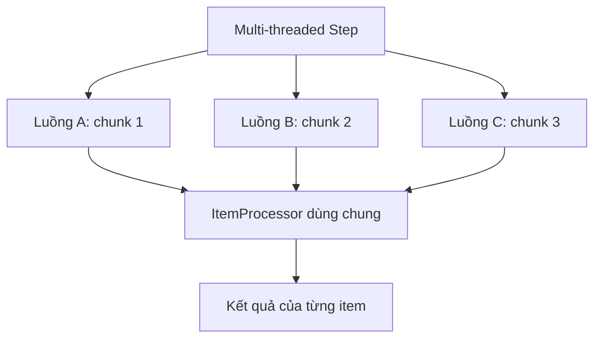

# Thread-safe `ItemProcessor` trong Spring Batch

Trong Spring Batch, `ItemProcessor<I, O>` chuyển đổi, kiểm tra hoặc lọc từng item giữa bước đọc và bước ghi. Khi một step chạy tuần tự, một processor có trạng thái có thể trông như hoạt động đúng. Nhưng khi bật **multi-threaded step**, nhiều luồng có thể gọi `process(...)` **đồng thời trên cùng một instance processor**. Các lỗi tranh chấp dữ liệu lúc này dễ tạo ra kết quả sai mà job vẫn báo `COMPLETED`.

Bài học thuộc chương **An toàn luồng** của **SPRING_BATCH_SCALING_OPERATIONS**: mở rộng Spring Batch cho workload dữ liệu lớn bằng multi-threaded step, parallel steps, partitioning và các mô hình phân tán. Mục tiêu ở đây là thiết kế processor đúng khi chạy đồng thời, nhận diện rủi ro với retry/restart, kiểm thử tính đúng đắn và biết khi nào cần đo hiệu năng trước khi tăng số luồng.

## 1. Hiểu phạm vi chia sẻ của `ItemProcessor`

Hợp đồng chính của Spring Batch rất gọn:

```java
public interface ItemProcessor<I, O> {
    O process(I item) throws Exception;
}
```

- Nhận một item kiểu `I` và trả về kết quả kiểu `O`.
- Trả về `null` để **lọc** item: item đó không đi đến writer. Đây không phải lỗi và không có nghĩa là skip.
- Ném exception khi không thể xử lý. Step sẽ fail, skip hoặc retry tùy cấu hình fault tolerance.

Một `Step` thường được tạo với một đối tượng processor và tái sử dụng đối tượng đó cho nhiều item. Khi cấu hình `TaskExecutor` cho step xử lý theo chunk, các chunk có thể được thực thi đồng thời. Do vậy, hai lời gọi `process` có thể chồng lấn thời gian, cùng truy cập field, cache hay dependency của processor.



Sơ đồ thể hiện **cùng một processor được gọi từ các luồng khác nhau**, không có nghĩa Spring Batch luôn bảo đảm item được đọc hoặc ghi theo thứ tự đầu vào. Với multi-threaded step, thứ tự xử lý và thứ tự commit có thể thay đổi.

**Thread-safe** nghĩa là khi nhiều luồng đồng thời dùng processor, mỗi item vẫn nhận kết quả hợp lệ theo quy tắc nghiệp vụ, không có race condition, dữ liệu rò rỉ từ item khác hoặc trạng thái trung gian bị nhìn thấy sai. Đây là yêu cầu về **tính đúng đắn khi chạy đồng thời**; không đồng nghĩa processor tự động có retry/restart an toàn hoặc toàn bộ step đã thread-safe.

### Một singleton có phải là một processor cho mỗi luồng?

Không. Bean singleton của Spring được chia sẻ; `ItemProcessor` không tự tạo bản sao cho từng thread. `@StepScope` tạo bean theo **`StepExecution`**, không có nghĩa tạo một bean riêng cho từng luồng xử lý chunk trong cùng `StepExecution`. Trong partitioning, các partition có thể có `StepExecution` riêng, nhưng vẫn phải xác định chính xác phạm vi chia sẻ và cách context được truyền sang các luồng trước khi dựa vào scope để bảo vệ trạng thái.

## 2. Nhận diện shared mutable state

Rủi ro chính nằm ở trạng thái **vừa được chia sẻ vừa bị thay đổi**: field ghi lại item gần nhất, bộ đếm, collection, cache, formatter không an toàn luồng, đối tượng trả về bị tái sử dụng hoặc dependency bên ngoài có trạng thái.

Ví dụ **không an toàn**:

```java
public class UnsafeOrderProcessor implements ItemProcessor<Order, Invoice> {
    private String lastOrderId;
    private long processedCount;

    @Override
    public Invoice process(Order item) {
        lastOrderId = item.id();
        processedCount++; // Phép đọc - cộng - ghi không nguyên tử
        return new Invoice(lastOrderId, item.amount());
    }
}
```

Giả sử luồng A ghi `lastOrderId = "A"` rồi tạm dừng; luồng B ghi `lastOrderId = "B"`; khi A chạy tiếp, hóa đơn của A có thể mang ID `B`. Phép `processedCount++` cũng có thể làm mất lượt tăng khi hai luồng cùng đọc một giá trị cũ. Thêm `volatile` không sửa được thao tác tăng không nguyên tử và cũng không biến toàn bộ chuỗi đọc/ghi thành một giao dịch.

Các dấu hiệu thường gặp:

| Dấu hiệu trong processor | Rủi ro khi xử lý đồng thời | Hướng xử lý |
| --- | --- | --- |
| Field `currentItem`, `lastResult`, biến tạm được cập nhật trong `process` | Item này đọc dữ liệu của item khác | Chuyển thành biến cục bộ trong phương thức |
| `ArrayList`, `HashMap`, `StringBuilder` dùng chung và có ghi | Race condition, mất dữ liệu, cấu trúc không nhất quán | Không giữ trạng thái item trong field; nếu thật sự cần chia sẻ, dùng cơ chế đồng bộ phù hợp |
| `processedCount++`, tổng tiền tích lũy | Kết quả đếm/tổng sai | Tránh tích lũy trong processor; metric kỹ thuật có thể dùng atomic/`LongAdder` |
| `SimpleDateFormat` dùng chung | Dữ liệu định dạng ngày có thể sai khi gọi đồng thời | Dùng `DateTimeFormatter` bất biến hoặc tạo đối tượng cục bộ |
| Cache và client dùng chung nhưng không rõ hợp đồng thread safety | Trạng thái cache/client bị hỏng, kết quả không nhất quán | Kiểm tra tài liệu dependency; dùng cache/client phù hợp cho concurrent access |
| Processor sửa trực tiếp item đầu vào có thể bị tái sử dụng | Tác dụng phụ giữa các bước/lần gọi | Ưu tiên đầu vào bất biến và trả về đối tượng kết quả mới |

## 3. Thiết kế ưu tiên: processor không giữ trạng thái

Cách dễ kiểm tra nhất là biến `process` thành phép biến đổi dựa trên **tham số đầu vào, cấu hình bất biến và dependency an toàn luồng**. Mỗi lần gọi có biến cục bộ riêng; không có field nào được sửa khi xử lý item.

```java
import java.math.BigDecimal;
import org.springframework.batch.item.ItemProcessor;

record Order(String id, BigDecimal amount, BigDecimal discount) {}
record Invoice(String orderId, BigDecimal netAmount) {}

public final class OrderToInvoiceProcessor
        implements ItemProcessor<Order, Invoice> {

    @Override
    public Invoice process(Order item) {
        // Các record và BigDecimal trong ví dụ là bất biến.
        BigDecimal net = item.amount().subtract(item.discount());
        if (net.signum() < 0) {
            throw new IllegalArgumentException(
                    "Discount exceeds amount for order " + item.id());
        }
        return new Invoice(item.id(), net);
    }
}
```

Nếu hai luồng xử lý đơn A và B cùng lúc, `net` của mỗi lời gọi tồn tại trên stack thực thi riêng, còn `Invoice` là đối tượng kết quả riêng. Không có shared mutable state để hai lời gọi giành quyền ghi.

Một processor không có field vẫn có thể **không thread-safe** nếu nó gọi một service có trạng thái thay đổi không được bảo vệ, dùng static mutable field hoặc sửa input chung. Chỉ nhìn vào class processor là chưa đủ; phải lần theo các dependency mà `process` sử dụng.

### Các quy tắc thực hành

1. Giữ cấu hình dưới dạng `final` và chỉ đọc trong `process`; đối tượng cấu hình cũng nên bất biến.
2. Đưa dữ liệu trung gian thành biến cục bộ, tạo output mới; hạn chế sửa input.
3. Thiết kế dependency được chia sẻ có hợp đồng thread-safe rõ ràng, nhất là formatter, cache, mapper, client HTTP/DB và các processor con.
4. Không dùng `ThreadLocal` làm nơi lưu trạng thái nghiệp vụ hoặc checkpoint. Luồng trong pool được tái sử dụng; retry/restart không nhất thiết chạy trên cùng luồng.
5. Nếu cần lưu trạng thái nghiệp vụ giữa các item, cân nhắc đổi kiến trúc: tổng hợp ở writer/database theo khóa hoặc partition rõ ràng, thay vì cập nhật field của processor.

## 4. Khi thực sự cần trạng thái dùng chung

Không phải mọi trạng thái dùng chung đều sai. Vấn đề là **mục đích** và **tính nhất quán** của trạng thái đó.

| Nhu cầu | Phương án phù hợp | Giới hạn cần nhớ |
| --- | --- | --- |
| Đếm số lần gọi để quan sát tải | `LongAdder` hoặc meter thread-safe | Đếm lần gọi, không phải số item đã commit; retry có thể làm số đếm tăng lại |
| Cờ bật/tắt xử lý được cập nhật từ luồng khác | `AtomicBoolean` hoặc trạng thái đồng bộ | Chỉ bảo đảm thao tác cờ, không bảo đảm nhất quán nhiều field liên quan |
| Cache dữ liệu tra cứu | Cache concurrent có chính sách giới hạn kích thước/thời gian sống | Cần xử lý stale data, lỗi tải dữ liệu và nguy cơ tải lại khi retry |
| Biến đổi nhiều field theo một quy tắc nguyên tử | Lock hoặc đối tượng trạng thái bất biến cập nhật bằng CAS | Lock có thể gây tranh chấp và triệt tiêu lợi ích tăng số luồng |
| Tổng tiền, số dư, cấp số thứ tự nghiệp vụ | Cập nhật giao dịch trong DB, constraint/locking hoặc một bước tổng hợp riêng | `AtomicLong` trên một JVM không bảo vệ nhiều process/pod và không rollback cùng transaction DB |

Ví dụ một bộ đếm **chỉ dùng cho telemetry**:

```java
import java.util.concurrent.atomic.LongAdder;

public class CountingProcessor implements ItemProcessor<Order, Invoice> {
    private final LongAdder attempts = new LongAdder();
    private final OrderToInvoiceProcessor delegate =
            new OrderToInvoiceProcessor();

    @Override
    public Invoice process(Order item) throws Exception {
        attempts.increment(); // Đếm mỗi lần process được gọi, kể cả retry
        return delegate.process(item);
    }

    public long attempts() {
        return attempts.sum(); // Snapshot không phải transaction nghiệp vụ
    }
}
```

`LongAdder` hỗ trợ cập nhật đồng thời với mức tranh chấp thấp; `sum()` khi đang có luồng cập nhật không nhất thiết là snapshot nguyên tử tuyệt đối. Tuyệt đối không suy ra `attempts` là số item **đã ghi thành công**. Đối với thống kê nghiệp vụ, ưu tiên dữ liệu commit từ writer/DB và metadata chính thức của `StepExecution`, đồng thời hiểu rõ các trường hợp rollback/retry.

Một `synchronized` bao quanh toàn bộ `process` có thể ngăn race của một instance, nhưng khiến các lời gọi thực tế chạy lần lượt. Nếu processor là nút thắt CPU hoặc I/O thì cách này thường loại bỏ lợi ích của multi-threading. Chỉ khóa phần trạng thái thật sự cần đồng bộ, đo mức tranh chấp, hoặc thiết kế lại để bỏ shared state.

## 5. Dùng processor an toàn trong multi-threaded step

Đoạn cấu hình dưới đây minh họa API thông dụng của Spring Batch 5.x với step xử lý chunk và thread pool có giới hạn. Các bean `reader` và `writer` phải được chọn/thiết kế theo hợp đồng đồng thời tương ứng; processor an toàn **không đủ** để kết luận toàn step an toàn.

```java
@Bean
public ThreadPoolTaskExecutor batchTaskExecutor() {
    ThreadPoolTaskExecutor executor = new ThreadPoolTaskExecutor();
    executor.setCorePoolSize(4);
    executor.setMaxPoolSize(4);
    executor.setQueueCapacity(8);
    executor.setThreadNamePrefix("batch-worker-");
    executor.initialize();
    return executor;
}

@Bean
public Step transformStep(
        JobRepository jobRepository,
        PlatformTransactionManager transactionManager,
        ItemReader<Order> reader,
        ItemWriter<Invoice> writer,
        ItemProcessor<Order, Invoice> processor,
        @Qualifier("batchTaskExecutor") TaskExecutor taskExecutor) {

    return new StepBuilder("transformStep", jobRepository)
            .<Order, Invoice>chunk(100, transactionManager)
            .reader(reader)
            .processor(processor)
            .writer(writer)
            .taskExecutor(taskExecutor)
            .build();
}
```

Các kiểu `Step`, `StepBuilder`, `JobRepository`, `PlatformTransactionManager`, `ItemReader`, `ItemWriter`, `ItemProcessor`, `ThreadPoolTaskExecutor`, `TaskExecutor`, `@Bean` và `@Qualifier` cần import tương ứng từ Spring Batch/Spring Framework. Đây là ví dụ phần cấu hình step; để chạy thực tế còn cần các bean reader, writer, processor, job và hạ tầng repository/transaction manager.

Tăng `corePoolSize` từ 4 lên 16 **không mặc nhiên làm job nhanh gấp bốn lần**. Cần xem chi phí CPU của `process`, số kết nối database, giới hạn API downstream, lock, khả năng đọc/ghi và kích cỡ chunk. Đặc biệt, một reader có trạng thái không an toàn có thể tạo item trùng hoặc bỏ sót khi bị đọc đồng thời; một writer không thread-safe có thể ghi sai dù processor hoàn toàn thuần.

**So sánh các mô hình scale:**

| Mô hình | Tác động tới processor | Câu hỏi cần kiểm tra |
| --- | --- | --- |
| Multi-threaded step | Các lời gọi của cùng step có thể chạy đồng thời trên cùng processor | Processor và dependency có shared mutable state không? Reader/writer có an toàn không? |
| Parallel steps | Các step khác nhau chạy đồng thời; có thể dùng chung bean singleton nếu cấu hình như vậy | Có chia sẻ processor/service/cache giữa các step không? |
| Local partitioning | Mỗi partition có `StepExecution` riêng; các worker có thể ở cùng JVM | Scope của bean thực tế là gì? Dữ liệu partition có tách biệt không? |
| Remote partitioning hoặc remote chunking | Work được phân tán qua process/host khác nhau | Trạng thái trong bộ nhớ không được chia sẻ giữa các process; idempotency và trạng thái bên ngoài đã đủ chặt chưa? |

Không nên dùng synchronized hoặc counter JVM để giải quyết bài toán nhất quán giữa nhiều worker phân tán. Cần khóa hoặc giao dịch ở nơi trạng thái thực sự được lưu, thường là database hay một dịch vụ lưu trữ có cơ chế điều phối phù hợp.

## 6. Thread safety khác retry safety và restart safety

Spring Batch xử lý theo **chunk transaction**. Một item có thể được `process` lại khi retry hoặc khi chunk rollback và được xử lý lại; sau khi job restart, các item chưa được commit thành công có thể đi qua processor lần nữa tùy cấu hình reader, checkpoint và transaction. Vì vậy không được giả định `process` sẽ chỉ chạy đúng một lần cho mỗi ID.

Xét processor sau:

```java
public Invoice process(Order order) {
    paymentGateway.charge(order.id(), order.amount());
    return new Invoice(order.id(), order.amount());
}
```

Giả sử gọi cổng thanh toán thành công, nhưng transaction ghi invoice thất bại. Retry có thể gọi `charge` lần nữa, tạo giao dịch thanh toán trùng. Kể cả `paymentGateway` thread-safe, **logic nghiệp vụ này vẫn không an toàn khi retry/restart**.

Để xử lý đúng:

- Ưu tiên processor chỉ **tính toán/kiểm tra/lọc**; chuyển tác dụng phụ ra nơi có chiến lược commit rõ ràng.
- Với tác dụng phụ bắt buộc ra hệ thống ngoài, dùng **idempotency key ổn định** (ví dụ mã nghiệp vụ duy nhất), unique constraint, deduplication hoặc outbox/transactional messaging phù hợp. Chính sách còn tùy bảo đảm của hệ thống nhận.
- Tránh dùng đồng hồ, bộ sinh số ngẫu nhiên, thứ tự thread hoặc mutable cache làm nguồn quyết định nghiệp vụ nếu một item phải cho kết quả ổn định qua retry.
- Không cập nhật `ExecutionContext` theo từng item từ nhiều thread mà không thiết kế đồng bộ/checkpoint rõ ràng. State đặt trong memory của processor cũng không tự được Spring Batch lưu để restart.
- Với `CompositeItemProcessor`, decorator hoặc processor gọi service bên ngoài, **toàn bộ chuỗi delegate** phải chịu được đồng thời và các lần gọi lại.

Phân biệt ba tiêu chí:

| Tiêu chí | Câu hỏi kiểm chứng |
| --- | --- |
| Thread-safe | Hai lời gọi `process(A)` và `process(B)` chạy đồng thời có tạo output đúng, không tranh chấp trạng thái không? |
| Retry-safe | `process(A)` chạy lại sau lỗi có sinh thêm tác dụng phụ hoặc kết quả sai không? |
| Restart-safe | Sau process chết và job chạy lại, item còn lại có được xử lý đúng với checkpoint và trạng thái bên ngoài không? |

Ba tiêu chí hỗ trợ nhau nhưng không thay thế nhau.

## 7. Kiểm chứng trước khi tăng concurrency

### Kiểm thử chức năng và concurrency

1. **Unit test tuần tự:** cùng đầu vào cho cùng output; input không bị sửa; xác minh `null` là lọc và exception dùng đúng quy tắc nghiệp vụ.
2. **Test gọi đồng thời trên cùng instance:** tạo 8–16 task cùng dùng **một** processor, truyền item có ID và dữ liệu khác nhau; cho các lời gọi chồng lấn bằng `CountDownLatch`, đối chiếu toàn bộ output với hàm tham chiếu và kiểm tra không đổi chéo ID. Lặp dưới tải đủ lớn để tăng cơ hội phát hiện race, nhưng không coi test stress là bằng chứng tuyệt đối không có race.
3. **Test dependency:** nếu processor có cache, mapper hoặc client dùng chung, mock/stub có thể chặn ở điểm gọi để buộc các luồng tương tác đồng thời. Kiểm tra giới hạn kết nối, timeout và xử lý lỗi.
4. **Integration test multi-threaded step:** dùng reader/writer phù hợp, xử lý tập item có ID duy nhất; so khớp tập ID đầu ra, số lượng, tổng giá trị, số item filter/skip và trạng thái commit với kỳ vọng. Không chỉ nhìn `BatchStatus.COMPLETED`.
5. **Test fault tolerance và restart:** chèn lỗi có kiểm soát ở processor/writer, thử retry/rollback, restart từ `JobRepository` rồi kiểm tra không có trùng tác dụng phụ, không mất item và số liệu cuối chính xác.

Ví dụ một assertion có giá trị cao: với 10.000 input ID duy nhất, trong đó 200 item bị filter theo quy tắc rõ ràng, dữ liệu đầu ra phải có **đúng 9.800 ID dự kiến, không trùng**, bất kể thứ tự hoàn tất giữa các luồng. Nếu cần giữ thứ tự, phải thiết kế và kiểm thử cơ chế sắp thứ tự riêng; multi-threaded step không phải hợp đồng bảo đảm thứ tự đầu vào.

### Đo hiệu năng cùng với tính đúng đắn

Chạy baseline tuần tự rồi đo ở 2, 4, 8 luồng trên **cùng dữ liệu, cùng hạ tầng và chính sách commit**. Theo dõi throughput (item/giây), thời gian job, CPU, heap/GC, độ dài hàng đợi, thread pool, thời gian chờ lock/DB connection, p95/p99 latency dịch vụ ngoài, retry/rollback và số lượng record chính xác sau commit.

Nếu tăng luồng nhưng throughput đứng yên hoặc lỗi timeout tăng, có thể nút thắt nằm ở reader, writer, pool kết nối, downstream rate limit hay synchronization trong processor. Khi đó thêm luồng thường tăng tranh chấp. Cân nhắc partitioning với khóa phân vùng độc lập hoặc thay đổi kiến trúc I/O theo nhu cầu và số đo thực tế.

## 8. Checklist rà soát `ItemProcessor` trước khi đưa vào production

- [ ] `process` không ghi vào field chứa trạng thái của item hiện tại hay tái sử dụng output mutable.
- [ ] Các field cấu hình là bất biến sau khởi tạo; dependency dùng chung có hợp đồng thread-safe.
- [ ] Không nhầm `@StepScope` với một processor riêng cho mỗi worker thread.
- [ ] Không dựa vào thứ tự xử lý, thứ tự commit hoặc tên thread để tính kết quả nghiệp vụ.
- [ ] Counter/cache dùng chung có cơ chế đồng bộ và giới hạn tài nguyên; số đếm telemetry không bị nhầm với commit count.
- [ ] Processor chịu được retry/rollback/restart; tác dụng phụ bên ngoài có biện pháp idempotency nếu bắt buộc.
- [ ] Reader, writer và hạ tầng DB/API cũng đã được đánh giá về concurrency và transaction.
- [ ] Test đồng thời kiểm tra **tập kết quả và giá trị**, test restart kiểm tra **tác dụng phụ**; benchmark đo cả tính đúng đắn lẫn hiệu năng.

**Nguyên tắc áp dụng:** bắt đầu bằng processor không trạng thái, kiểm tra mọi dependency, tách trạng thái nghiệp vụ ra khỏi vòng đời của một thread/JVM và chỉ tăng concurrency khi số đo xác nhận có lợi. Đây là nền tảng để multi-threaded step, parallel steps và partitioning xử lý workload lớn mà vẫn duy trì kết quả chính xác.
