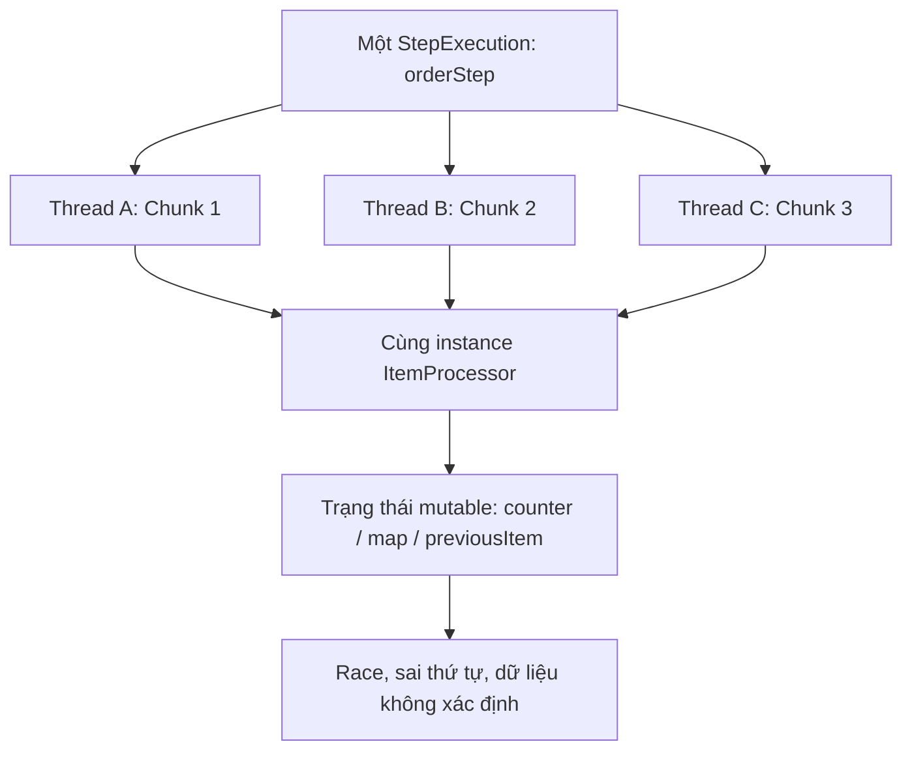
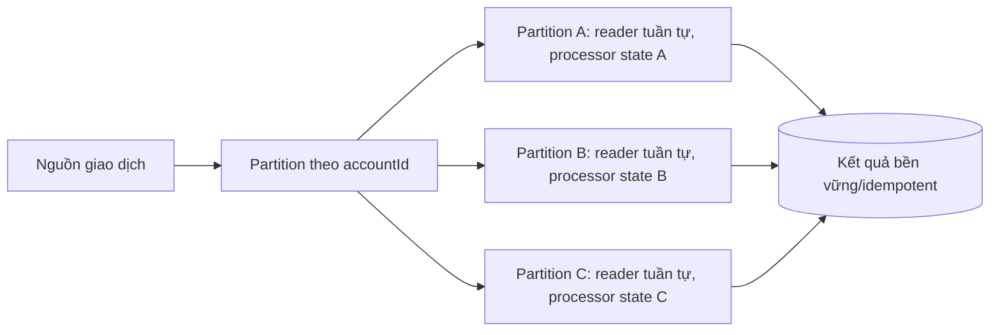

# Stateful processor và đồng bộ hóa trong Spring Batch

## 1. Vì sao ItemProcessor có trạng thái trở nên nguy hiểm khi scaling?

Trong Spring Batch, `ItemProcessor<I, O>` nhận một item, xử lý và trả về item kết quả hoặc `null` nếu muốn lọc item. Ở job đơn luồng, một processor chứa biến đếm, bộ nhớ đệm hoặc trạng thái tính toán có thể có vẻ hoạt động đúng trong nhiều tháng. Khi chuyển sang **multi-threaded step**, các chunk có thể được xử lý bởi những thread khác nhau và cùng gọi một instance processor. Các cập nhật vào trạng thái dùng chung khi đó có nguy cơ gây **race condition**, mất dữ liệu, kết quả không xác định và lỗi khó tái hiện.

Chủ đề **“Stateful processor và đồng bộ hóa”** nằm trong chương **An toàn luồng** của module `SPRING_BATCH_SCALING_OPERATIONS`. Mục tiêu lớn của module là mở rộng Spring Batch cho workload dữ liệu lớn qua multi-threaded step, parallel steps, partitioning và các mô hình phân tán. Khi lựa chọn kiến trúc, chúng ta phải kiểm tra tính đúng đắn, thread safety, retry/restart, nút thắt tài nguyên và cách vận hành job, chứ không chỉ tăng số thread hay worker.

Ví dụ: job đọc hai triệu đơn hàng và gán số thứ tự xử lý. Trong cấu hình ban đầu, processor tăng một biến `long nextSequence` mỗi lần xử lý. Khi thêm tám thread, hai thread có thể đọc cùng giá trị trước khi cập nhật, tạo số thứ tự trùng. Thậm chí nếu sửa bằng `AtomicLong`, thứ tự theo ID đơn hàng vẫn không được bảo đảm và giá trị có thể tăng thừa khi retry/rollback. Đây là hai vấn đề khác nhau: **an toàn thao tác đồng thời** và **đúng đắn nghiệp vụ qua transaction/restart**.

Sau bài này, bạn có thể:

- Nhận diện trạng thái mutable, cách một processor được chia sẻ giữa các thread và các race condition thường gặp.
- Biết giới hạn của `@StepScope`, `synchronized`, lock, `Atomic*`, concurrent collection và `ThreadLocal`.
- Ưu tiên processor stateless; khi bắt buộc có trạng thái thì chọn phạm vi sở hữu và cơ chế đồng bộ phù hợp.
- Thiết kế kết quả an toàn với retry, restart, phân vùng và nhiều JVM.
- Đo bottleneck và kiểm thử tính đúng đắn trước khi đưa multi-threaded step vào production.

## 2. Stateful processor là gì?

Một processor **stateless về mặt xử lý item** sử dụng đầu vào và những phụ thuộc đọc an toàn để tạo kết quả, không sửa trạng thái dùng chung phụ thuộc vào lịch chạy của các thread. Ví dụ chuyển đổi tiền tệ từ số tiền và tỷ giá đã có trong item, dùng `BigDecimal` và trả về một đối tượng mới.

Một processor **stateful** giữ thông tin có thể thay đổi qua các lần gọi `process()`:

| Loại trạng thái | Ví dụ | Rủi ro khi cùng instance chạy nhiều thread |
| --- | --- | --- |
| Bộ đếm mutable | `processedCount++`, `sequence++` | Lost update, thứ tự gán không xác định, sai sau retry. |
| Tập hợp tích lũy | `ArrayList` các item đã xử lý, `HashMap` tổng theo khách hàng | Race khi thêm/sửa, hỏng cấu trúc dữ liệu, tổng sai. |
| Cache thay đổi | `HashMap<String, Price>` được điền khi xử lý | Truy cập thiếu đồng bộ; dữ liệu cũ hoặc load trùng. |
| Trạng thái thuật toán | `previousItem`, running balance, cửa sổ thời gian | Phụ thuộc thứ tự item; các chunk có thể đến không theo thứ tự. |
| Đối tượng cộng tác mutable | `SimpleDateFormat` dùng chung, client/buffer không thread-safe | Trạng thái nội bộ bị tranh chấp dù processor không có biến tự viết. |
| Side effect ngoài JVM | Ghi DB, gọi API thanh toán, gửi email trong `process()` | Retry/restart có thể gây tác động lặp; lock cục bộ không giải quyết. |

**Stateful không đồng nghĩa luôn sai.** Một processor có trạng thái chỉ đọc, bất biến sau khi khởi tạo, hoặc được sở hữu duy nhất bởi một luồng có thể an toàn. Vấn đề xuất hiện khi có **trạng thái mutable truy cập đồng thời** hoặc **trạng thái không thể khôi phục đúng sau lỗi**.

### 2.1. Ví dụ processor stateless nên ưu tiên

```java
import java.math.BigDecimal;
import java.math.RoundingMode;
import org.springframework.batch.item.ItemProcessor;

record RawOrder(long id, BigDecimal amount, BigDecimal exchangeRate) {}
record NormalizedOrder(long id, BigDecimal convertedAmount) {}

public final class NormalizeOrderProcessor
        implements ItemProcessor<RawOrder, NormalizedOrder> {

    @Override
    public NormalizedOrder process(RawOrder order) {
        BigDecimal converted = order.amount()
                .multiply(order.exchangeRate())
                .setScale(2, RoundingMode.HALF_UP);

        return new NormalizedOrder(order.id(), converted);
    }
}
```

Phương thức này dùng biến cục bộ `converted`, không giữ lịch sử giữa các item, không sửa `order` và không dùng state mutable của processor. Bản ghi `record` và `BigDecimal` là những value object thích hợp; bảo đảm phụ thuộc/đầu vào khác của ứng dụng cũng an toàn nếu mở rộng ví dụ.

Kết quả không phụ thuộc thứ tự các lần gọi `process()`. Nếu Spring Batch xử lý cùng item thêm một lần do retry, phép tính thuần này vẫn cho cùng kết quả.

## 3. ItemProcessor được chia sẻ như thế nào?

Với **multi-threaded step**, một `TaskExecutor` cho phép những chunk của **cùng StepExecution** chạy đồng thời. Các thành phần reader, processor và writer được đăng ký trong step thường có thể bị nhiều thread gọi; mức độ thực tế còn phụ thuộc cấu hình framework và cách các component hoạt động.



**Điểm đặc biệt quan trọng:** `@StepScope` tạo một bean theo **StepExecution**, không phải một bean cho từng thread hoặc từng chunk. Khi cả ba thread cùng xử lý một `StepExecution`, processor `@StepScope` vẫn có thể là **cùng một instance** phía sau scoped proxy. Vì vậy, chỉ thêm `@StepScope` không chữa được race condition trong multi-threaded step.

Trong **local partitioning**, mỗi partition thường có một worker `StepExecution` riêng; bean `@StepScope` được tạo cho từng StepExecution. Nếu mỗi worker step chạy tuần tự trong partition, trạng thái riêng của processor có thể cô lập giữa partition. Tuy nhiên, nếu chính worker step còn được cấu hình chạy nhiều thread, processor của partition đó lại có nguy cơ bị chia sẻ đồng thời. Với **remote partitioning**, mỗi worker JVM xử lý partition riêng; dữ liệu chung ở DB hoặc API vẫn cần cơ chế nhất quán xuyên tiến trình.

| Scope/cấu hình | Điều đảm bảo | Điều không đảm bảo |
| --- | --- | --- |
| Singleton bean (mặc định) | Một bean Spring dùng lại trong container. | Không thread-safe tự động. |
| `@StepScope` | Một bean theo `StepExecution`, có thể inject context của step. | Không phải một instance mỗi thread/chunk; không tự bảo vệ biến mutable. |
| `@JobScope` | Một bean theo `JobExecution`. | Có thể bị nhiều step/thread của job truy cập; không bảo đảm an toàn đồng thời. |
| Prototype scope | Tạo instance mới mỗi lần container được yêu cầu cung cấp bean. | Không mặc định tạo lại mỗi lần `process()` nếu đã inject vào một step lâu sống. |
| Processor stateless | Không có state mutable phụ thuộc lịch thực thi item. | Các dependency, reader/writer và hệ thống đích vẫn phải được kiểm tra. |

**Phạm vi thread safety phải bao trùm toàn pipeline.** Processor thuần vẫn chưa đủ nếu reader có cursor không thread-safe, writer chia sẻ buffer mutable, listener sửa `ExecutionContext` không an toàn hoặc DB bị cập nhật trùng.

## 4. Race condition: mất cập nhật và thao tác kiểm tra rồi thực hiện

### 4.1. `++` không phải thao tác nguyên tử

```java
import org.springframework.batch.item.ItemProcessor;

public final class UnsafeSequenceProcessor
        implements ItemProcessor<RawOrder, Long> {

    private long sequence = 0;

    @Override
    public Long process(RawOrder item) {
        return ++sequence; // Race condition khi nhiều thread cùng gọi.
    }
}
```

Về mặt logic, `++sequence` tương đương **đọc → cộng một → ghi**. Hai thread có thể xảy ra xen kẽ:

| Thời điểm | Thread A | Thread B | `sequence` |
| --- | --- | --- | ---: |
| t0 | — | — | 10 |
| t1 | Đọc 10 | — | 10 |
| t2 | — | Đọc 10 | 10 |
| t3 | Tính 11, ghi 11 | — | 11 |
| t4 | — | Tính 11, ghi 11 | 11 |

Hai item được cấp cùng số 11 và một cập nhật bị mất. Thêm `volatile` chỉ giúp về tính hiển thị/happens-before phù hợp với ngữ nghĩa volatile, **không biến phép tăng gồm nhiều thao tác thành nguyên tử**.

### 4.2. Check-then-act cũng không an toàn

```java
// Sai nếu seenIds là HashSet dùng chung và có nhiều thread:
if (!seenIds.contains(item.id())) {
    seenIds.add(item.id());
    return transform(item);
}
return null;
```

Hai thread có thể cùng thấy ID "chưa tồn tại", rồi đều thực hiện `transform()`. Đổi `HashSet` thành concurrent set chỉ giúp từng phương thức an toàn; chuỗi `contains()` rồi `add()` vẫn có race. Có thể dùng:

```java
Set<Long> seenIds = ConcurrentHashMap.newKeySet();
boolean firstSeenInThisJvm = seenIds.add(item.id());
```

`add()` là thao tác kiểm tra-và-thêm nguyên tử ở phạm vi cấu trúc này. Tuy vậy, set là state trong RAM: khi worker restart, khi có nhiều JVM hoặc khi transaction rollback, nó **không đại diện cho deduplication nghiệp vụ đáng tin cậy**. Nếu cần bảo đảm bản ghi duy nhất xuyên retry và restart, dùng khóa unique/idempotency trong database hoặc cơ chế bền vững tương đương.

## 5. Các kỹ thuật đồng bộ và giới hạn của chúng

### 5.1. `synchronized` và `ReentrantLock`

Với một trạng thái mutable nhỏ mà **bắt buộc** dùng chung trong một JVM, có thể đặt toàn bộ thao tác cần nguyên tử trong critical section.

```java
import org.springframework.batch.item.ItemProcessor;

public final class LockedSequenceProcessor
        implements ItemProcessor<RawOrder, Long> {

    private long nextSequence;

    @Override
    public synchronized Long process(RawOrder item) {
        return ++nextSequence;
    }
}
```

Ví dụ trên ngăn hai thread tăng counter đồng thời trên **cùng instance**. Nhưng tất cả các lần gọi `process()` của instance đó phải chờ nhau; vì vậy khả năng scaling processor giảm mạnh. Counter cũng không được rollback khi transaction fail và không còn sau khi JVM dừng.

Nếu chỉ một đoạn nhỏ phải khóa, giữ critical section ngắn:

```java
private final Object sequenceLock = new Object();
private long nextSequence;

public Long process(RawOrder item) {
    // Phần tính toán độc lập không cần khóa.
    validate(item);
    long value;
    synchronized (sequenceLock) {
        value = ++nextSequence;
    }
    return value;
}
```

Đây là đoạn minh họa bên trong lớp có `validate(...)`; nó giải quyết race của counter trong JVM nhưng vẫn có vấn đề về thứ tự, retry và restart. Nếu cần thao tác có timeout/có thể ngắt, `ReentrantLock` hỗ trợ `tryLock`; phải luôn `unlock()` trong `finally`. Không giữ lock khi gọi API chậm hoặc thực hiện I/O lâu nếu có thể thiết kế lại.

### 5.2. `AtomicLong` và các lớp atomic

```java
import java.util.concurrent.atomic.AtomicLong;

private final AtomicLong processed = new AtomicLong();

public void observeProcessedItem() {
    processed.incrementAndGet();
}
```

`incrementAndGet()` cập nhật một biến nguyên tử trong JVM, thích hợp cho một số phép đo hoặc định danh kỹ thuật tạm thời. Nhưng:

- Đếm "số lần processor được gọi" **khác** "số item đã commit thành công"; retry có thể gọi lại processor.
- Atomic không khôi phục trạng thái sau restart, cũng không bảo đảm số tăng tuần tự theo thứ tự input khi nhiều thread chạy.
- Atomic cho một biến không tự biến quy tắc gồm nhiều biến hoặc nhiều lời gọi API thành một transaction nguyên tử.
- `LongAdder` có thể phù hợp khi nhiều thread chỉ tăng metric và đọc tổng gần thời gian thực, nhưng không phù hợp làm bộ phát ID tuần tự có ngữ nghĩa nghiệp vụ.

Khi cần số thứ tự bền vững, hãy xem xét sequence/identity được cấp bởi database, hoặc dùng khóa và giao dịch phù hợp. Nếu yêu cầu **thứ tự đúng theo đầu vào**, sequence DB cấp theo thời điểm xử lý vẫn không đủ; cần quyết định thứ tự theo khóa input hoặc bước sắp xếp tuần tự có kiểm soát.

### 5.3. `ConcurrentHashMap` và cập nhật nguyên tử theo khóa

`ConcurrentHashMap` hỗ trợ thao tác concurrent theo khóa, nhưng vẫn cần hiểu chính xác ngữ nghĩa. Ví dụ chỉ dùng để thống kê số item theo nhóm trong RAM:

```java
import java.util.concurrent.ConcurrentHashMap;
import java.util.concurrent.atomic.LongAdder;

private final ConcurrentHashMap<String, LongAdder> counts =
        new ConcurrentHashMap<>();

public void record(String category) {
    counts.computeIfAbsent(category, ignored -> new LongAdder())
          .increment();
}
```

Đây là metric trong tiến trình; không dùng nó làm số dư tài khoản, hạn mức tiền hay trạng thái được hứa sẽ phục hồi chính xác sau crash. Các thao tác `compute`/`merge` cũng có quy tắc thực thi, đồng bộ theo khóa và rủi ro khi mapping function có side effect. Tránh gọi dịch vụ ngoài hoặc cập nhật DB trong mapping function: các lần gọi sau hoặc retry nghiệp vụ có thể lặp tác động, trong khi computation giữ khóa nội bộ làm tăng tranh chấp. Hãy giữ mapping function ngắn và thuần khi có thể.

### 5.4. `ThreadLocal` không phải checkpoint

`ThreadLocal` tách dữ liệu theo Java thread; nó có thể hữu ích cho scratch buffer tạm thời, nhưng thread pool tái sử dụng thread giữa nhiều chunk và thậm chí giữa nhiều job. Nếu không gọi `remove()` đúng lúc, trạng thái cũ có thể "rò" sang item/chunk sau.

Quan trọng hơn, một item có thể được xử lý lại trên **thread khác** sau retry/restart, và trạng thái `ThreadLocal` không được Spring Batch lưu vào `JobRepository`. Không dùng `ThreadLocal` để nhớ "đã xử lý item nào" hoặc làm nguồn dữ liệu nghiệp vụ.

### 5.5. Tổng hợp lựa chọn

| Kỹ thuật | Phạm vi an toàn | Chi phí/giới hạn chính | Trường hợp phù hợp |
| --- | --- | --- | --- |
| Stateless/immutable processor | Nhiều thread/JVM nếu phụ thuộc cũng an toàn và dữ liệu đầu vào phù hợp. | Có thể phải chuyển logic trạng thái sang nơi khác. | **Mặc định nên chọn.** |
| `synchronized` / `Lock` | Một instance/JVM. | Tranh chấp lock, giảm song song; không tự khôi phục sau crash. | Trạng thái tạm nhỏ không gắn correctness nghiệp vụ. |
| `Atomic*` / `LongAdder` | Một instance/JVM. | Chỉ bảo vệ một số thao tác trên một số biến; không là transaction nghiệp vụ. | Counters/metrics hay trạng thái kỹ thuật ngắn hạn. |
| Concurrent collections | Một JVM; các thao tác được đặc tả thread-safe. | Composite operations có thể vẫn race; memory, retry, restart. | Cache và chỉ số dùng chung không đòi hỏi tính bền vững. |
| `@StepScope` + partitioning | Cô lập trạng thái giữa các StepExecution. | Không an toàn nếu một partition vẫn có nhiều thread; phải quản lý checkpoint. | Trạng thái riêng cho từng partition. |
| DB unique constraint / atomic update | Theo tính chất transaction và isolation của database. | I/O, contention, deadlock, thiết kế transaction. | Trạng thái nghiệp vụ bền vững, dedup xuyên JVM/restart. |
| Một luồng xử lý có thứ tự | Phạm vi tuần tự xác định theo contract. | Giới hạn throughput. | Logic chạy tổng tích lũy theo thứ tự không thể song song. |

## 6. Ví dụ cấu hình multi-threaded step và điểm cần kiểm tra

Một cấu hình phổ biến với Spring Batch 5.x:

```java
import org.springframework.batch.core.Step;
import org.springframework.batch.core.repository.JobRepository;
import org.springframework.batch.core.step.builder.StepBuilder;
import org.springframework.batch.item.ItemReader;
import org.springframework.batch.item.ItemWriter;
import org.springframework.batch.item.ItemProcessor;
import org.springframework.context.annotation.Bean;
import org.springframework.core.task.TaskExecutor;
import org.springframework.scheduling.concurrent.ThreadPoolTaskExecutor;
import org.springframework.transaction.PlatformTransactionManager;

@Bean
TaskExecutor batchTaskExecutor() {
    ThreadPoolTaskExecutor executor = new ThreadPoolTaskExecutor();
    executor.setCorePoolSize(4);
    executor.setMaxPoolSize(4);
    executor.setQueueCapacity(16);
    executor.setThreadNamePrefix("orders-step-");
    executor.initialize();
    return executor;
}

@Bean
Step ordersStep(
        JobRepository jobRepository,
        PlatformTransactionManager transactionManager,
        ItemReader<RawOrder> reader,
        ItemProcessor<RawOrder, NormalizedOrder> processor,
        ItemWriter<NormalizedOrder> writer,
        TaskExecutor batchTaskExecutor) {

    return new StepBuilder("ordersStep", jobRepository)
            .<RawOrder, NormalizedOrder>chunk(100, transactionManager)
            .reader(reader)
            .processor(processor)
            .writer(writer)
            .taskExecutor(batchTaskExecutor)
            .build();
}
```

Đoạn này minh họa wiring, **chưa đủ để chạy an toàn chỉ vì có bốn thread**. Trước khi bật trong production, phải xác minh:

1. `reader` có cho phép nhiều thread gọi `read()` cùng lúc không? Một số reader stateful không thread-safe. Nếu dùng wrapper đồng bộ hóa reader, phần đọc có thể trở thành nút thắt; đồng thời cần kiểm tra restart semantics vì thứ tự và checkpoint thay đổi.
2. `processor` và mọi dependency có thuần hoặc thread-safe không? Kiểm tra cả cache, formatter, map, listener, client SDK.
3. `writer` có tránh shared mutable buffer, tránh ghi trùng và xử lý rollback hợp lý không?
4. Một item được retry hoặc các chunk hoàn tất khác thứ tự có ảnh hưởng kết quả nghiệp vụ không?
5. `JobRepository` và `ExecutionContext` có được dùng như thiết kế framework không? Không tự sửa cùng một giá trị context từ nhiều thread trong `process()` rồi kỳ vọng checkpoint nhất quán.
6. Thread pool, connection pool, DB và downstream có đủ tài nguyên không? Bốn thread không đồng nghĩa throughput tăng bốn lần.

Trong Spring Batch có những thay đổi API/concurrency theo phiên bản; hãy đối chiếu tài liệu tương ứng với dependency của ứng dụng khi dùng cấu hình thực tế. Cách làm an toàn là bắt đầu từ processor thuần, bật số thread nhỏ và đo cả kết quả lẫn tài nguyên.

## 7. Bài toán khó: running balance, dedup và thứ tự

### 7.1. Running balance theo tài khoản

Giả sử muốn tính số dư sau từng giao dịch:

```text
account=A, txn=1, delta=+100  => balance=100
account=A, txn=2, delta=-30   => balance=70
account=A, txn=3, delta=+10   => balance=80
```

Nếu processor có `Map<AccountId, Balance>` và mỗi thread tự lấy-sửa-ghi, dù thay `HashMap` bằng `ConcurrentHashMap` cũng chưa chắc đúng:

- Từng thao tác `get`/`put` riêng rẽ không bảo đảm toàn bộ phép lấy-sửa-ghi nguyên tử.
- Dùng `compute` khóa theo key có thể bảo đảm một phép cập nhật trong JVM, nhưng **không** bảo đảm transaction thứ 1 được xử lý trước thứ 2.
- Retry chunk có thể áp dụng `delta` lần hai; restart hoặc scale ra hai JVM có thể tạo số dư lệch.

Nếu yêu cầu là **số dư cuối theo tổng các delta giao hoán**, có thể cân nhắc gom nhóm/aggregation trong DB hoặc tính tổng theo các partition độc lập rồi merge kết quả bằng bước riêng đã thiết kế tính đúng. Nếu yêu cầu **số dư sau mỗi giao dịch theo thứ tự sự kiện**, phải bảo toàn thứ tự theo từng tài khoản, ví dụ route tất cả giao dịch của một account đến cùng một partition và xử lý tuần tự theo `(eventTime, transactionId)` trong partition. Partition này không nên chạy thêm multi-threaded step phá thứ tự.

### 7.2. Deduplication nghiệp vụ xuyên retry/restart

Ví dụ, processor gửi HTTP request tạo hóa đơn rồi đánh dấu ID vào một `ConcurrentHashMap` để ngăn gửi lại. Nếu service đã tạo hóa đơn nhưng worker chết trước khi ghi checkpoint, lần restart sẽ gọi lại. Cache trong RAM bị mất và lock không có tác dụng trên request đã gửi.

Một chiến lược vững hơn:

1. Chọn **idempotency key ổn định**, ví dụ `invoiceId + businessVersion`, không dựa vào thread ID hoặc một biến counter trong RAM.
2. Gửi key cho API nếu API hỗ trợ idempotency hoặc lưu trạng thái yêu cầu trong bảng nghiệp vụ có khóa unique.
3. Nếu cần phối hợp ghi DB và gửi sự kiện, xem xét **transactional outbox**; tách việc phát sự kiện khỏi `ItemProcessor` khi phù hợp.
4. Khi retry, kiểm tra trạng thái nghiệp vụ đã commit; không giả định processor được gọi đúng một lần cho mỗi item.

Những điểm này quan trọng ngay cả ở job đơn luồng. Concurrency chỉ làm lỗi xảy ra thường xuyên hơn và khó tìm hơn.

### 7.3. Khi nào dùng partitioning để cô lập trạng thái?



Partitioning giúp mỗi `StepExecution` có `ExecutionContext` và processor theo `@StepScope` riêng. Tuy nhiên, phải bảo đảm **một khóa nghiệp vụ không rơi vào hai partition** và thứ tự trong partition thực sự đáp ứng nghiệp vụ. Khi restart, tên partition, phân chia input, snapshot/cutoff và trạng thái đọc phải ổn định. Trạng thái tạm trong processor không tự động trở thành checkpoint bền vững chỉ vì bean có `@StepScope`.

## 8. Retry, rollback và restart: đồng bộ chỉ giải quyết một phần

Xét hai tình huống:

**Tình huống A — rollback:** `process(item)` tăng `AtomicLong`, sau đó `ItemWriter` lỗi và chunk rollback. DB có thể rollback tác động ghi, nhưng counter trong RAM **không tự giảm**. Khi retry, counter tăng lần nữa. Vì vậy số đếm trong processor không phải số item nghiệp vụ đã commit.

**Tình huống B — restart:** processor giữ `HashMap` tổng theo khách hàng. Worker xử lý xong vài chunk, JVM chết. Metadata Spring Batch có thể lưu checkpoint reader và step, nhưng không mặc định serialize toàn bộ field của processor. Nếu map không được khôi phục nhất quán với kết quả đã ghi, job restart cho kết quả sai.

Spring Batch cung cấp `ExecutionContext` và cơ chế `ItemStream` cho trạng thái cần lưu checkpoint, nhưng cần hiểu:

- Trạng thái được lưu vào repository tại thời điểm commit do framework điều phối; các cập nhật mutable trong RAM **không tự đồng bộ với commit của DB nghiệp vụ**.
- `ExecutionContext` không phải distributed cache hoặc counter concurrency tự động; không cập nhật các giá trị chồng lấn từ nhiều thread mà không có thiết kế nhất quán rõ ràng.
- Nếu trạng thái xử lý có tính chất giao dịch hoặc cần chia sẻ giữa nhiều JVM, **database nghiệp vụ với transaction/unique constraint** hoặc một nơi lưu trữ bền vững được quản lý phù hợp thường là lựa chọn tốt hơn.
- Cần xác định retry xảy ra ở `ItemReader`, `ItemProcessor` hay `ItemWriter`, và skip có làm thay đổi số lượng item được đưa vào phép tính không.

Một tiêu chí quan trọng là **idempotency**: xử lý lại cùng item hoặc chunk không tạo tác động nghiệp vụ ngoài ý muốn. Trong một số thuật toán cần thứ tự, chỉ idempotency là chưa đủ; còn phải kiểm soát thứ tự áp dụng và phiên bản dữ liệu.

## 9. Đo tác động đồng bộ hóa lên throughput

Thêm `synchronized` có thể sửa lỗi race nhưng lại biến processor thành điểm nghẽn. Ví dụ giả định processor cần 12 ms CPU cho mỗi item và thêm 3 ms trong critical section chung:

```text
Trong 1 thread: khoảng 15 ms/item ~ 67 item/giây.

Nếu phần 3 ms phải tuần tự hóa toàn cục, trần lý thuyết
riêng của critical section là khoảng 1 / 0,003 ~ 333 item/giây,
cho dù tăng rất nhiều thread.

Thực tế throughput còn bị giới hạn bởi CPU, DB, thread scheduling,
GC, reader/writer và lock contention.
```

Số liệu trên chỉ minh họa; không phải benchmark Spring Batch. Cần đo trong điều kiện của ứng dụng:

| Chỉ số | Điều có thể phát hiện |
| --- | --- |
| Job/Step duration, item/s | Có cải thiện end-to-end sau tăng concurrency không? |
| Processor time p50/p95/p99 | Hàm xử lý thực sự nhanh hơn hay hàng đợi lock tăng? |
| Thread state, blocked time, lock contention | Có quá nhiều thread chờ cùng một monitor/lock không? |
| CPU, allocation, GC | Tăng thread có gây contention hoặc memory pressure không? |
| DB pool active/pending, query/commit latency | Nút thắt dịch sang database hoặc connection pool? |
| Retry/rollback/skip count, duplicate keys | Correctness có giảm khi tăng tải không? |
| Thời gian từng partition, độ lệch khối lượng | Một partition có làm cả job chờ không? |

Quy trình đo hữu ích:

1. Chạy baseline một thread với dữ liệu đại diện, ghi thời gian và đối soát output.
2. Kiểm tra processor/reader/writer theo thread-safety contract trước khi bật thread pool.
3. Thử 2, 4 rồi 8 thread (nếu tài nguyên cho phép) trên **cùng snapshot input**, giữ các cấu hình khác nhất quán.
4. Đo kết quả sai/trùng/thất bại/retry song song với throughput và CPU/DB/lock.
5. Nếu throughput đứng yên trong khi blocked time tăng, thu hẹp critical section, loại bỏ trạng thái hoặc chuyển sang phân vùng theo khóa; không tiếp tục tăng thread mù quáng.

## 10. Kiểm thử để bắt lỗi concurrency và restart

Một bài test đơn luồng chạy xanh không chứng minh processor an toàn khi nhiều luồng đồng thời. Cần kiểm tra hai nhóm: **thuộc tính xử lý** (kết quả đúng bất kể interleaving) và **khả năng hồi phục** (retry/restart không làm sai trạng thái).

| Tình huống | Cách thử | Kết quả mong đợi |
| --- | --- | --- |
| Nhiều thread gọi cùng processor | Cho hàng trăm item chạy với executor có concurrency cố định; cố ý làm tăng khả năng xen kẽ. | Không mất item, không dữ liệu trùng ngoài dự kiến. |
| Cùng khóa nghiệp vụ trên nhiều chunk | Sinh nhiều item chung `accountId` xen kẽ. | Tính toán phù hợp contract về thứ tự và khóa. |
| Kiểm tra-và-thêm cache | Cho hai thread cùng đến một ID tại thời điểm gần nhau. | Không dựa vào `contains` rồi `add` riêng rẽ; kết quả nhất quán. |
| Retry của processor/writer | Inject lỗi tạm thời khiến một chunk được thử lại. | Không tính hai lần hiệu ứng nghiệp vụ đã commit. |
| Kill JVM giữa commit và checkpoint | Mô phỏng restart trên JobInstance hợp lệ. | Output idempotent, reader/partition restart đúng. |
| Partition khác tốc độ, chạy nhiều JVM | Làm một partition/API chậm bất thường. | Không phụ thuộc thứ tự hoàn thành; không mất/trùng dữ liệu. |
| Thay đổi số worker | Chạy 1/2/4/8 worker trên cùng input. | Tất cả lần chạy có cùng kết quả nghiệp vụ, performance được đo. |

### 10.1. Ví dụ test khả năng tái hiện race

Đoạn ví dụ JUnit dưới đây chỉ chứng minh **một thao tác counter** được tăng đủ lần khi nhiều thread gọi. Nó không thay cho kiểm thử JobRepository, transaction, reader/writer hoặc restart thật:

```java
import static org.junit.jupiter.api.Assertions.assertEquals;
import java.util.ArrayList;
import java.util.List;
import java.util.concurrent.CountDownLatch;
import java.util.concurrent.ExecutorService;
import java.util.concurrent.Executors;
import java.util.concurrent.Future;
import java.util.concurrent.TimeUnit;
import java.util.concurrent.atomic.AtomicInteger;
import org.junit.jupiter.api.Test;

class AtomicCounterConcurrencyTest {
    @Test
    void incrementsAreNotLost() throws Exception {
        AtomicInteger counter = new AtomicInteger();
        int workers = 8;
        int incrementsPerWorker = 10_000;
        CountDownLatch start = new CountDownLatch(1);
        ExecutorService pool = Executors.newFixedThreadPool(workers);
        List<Future<?>> tasks = new ArrayList<>();
        try {
            for (int i = 0; i < workers; i++) {
                tasks.add(pool.submit(() -> {
                    try {
                        start.await();
                        for (int j = 0; j < incrementsPerWorker; j++) {
                            counter.incrementAndGet();
                        }
                    } catch (InterruptedException e) {
                        Thread.currentThread().interrupt();
                    }
                }));
            }
            start.countDown();
            pool.shutdown();
            if (!pool.awaitTermination(30, TimeUnit.SECONDS)) {
                throw new AssertionError("Workers did not finish");
            }
            for (Future<?> task : tasks) {
                task.get(); // Bộc lộ exception trong tác vụ cho test.
            }
            assertEquals(workers * incrementsPerWorker, counter.get());
        } finally {
            pool.shutdownNow();
        }
    }
}
```

Với implementation không đồng bộ, race có thể không lộ ở mọi lần chạy; không nên viết test chỉ kỳ vọng thỉnh thoảng fail. Ưu tiên invariant và test tích hợp theo luồng thực của Spring Batch: **số output hợp lệ, khóa unique, tổng nghiệp vụ, thứ tự cần thiết và kết quả sau restart**. Có thể dùng barrier/latch để chủ động kích hoạt những interleaving nguy hiểm, thêm repeated runs và fault injection trên môi trường kiểm thử.

## 11. Checklist trước khi đưa stateful processor vào production

- [ ] Đã liệt kê mọi field mutable của processor và dependency được chia sẻ; xác định thread/partition/JVM nào có thể truy cập.
- [ ] Đã chứng minh vì sao cần giữ trạng thái; đã xem xét chuyển processor sang stateless/immutable.
- [ ] Nếu dùng `@StepScope`, đã hiểu một StepExecution có thể chạy nhiều thread khi multi-threaded step bật.
- [ ] Nếu dùng lock/atomic/concurrent collection, đã xác định rõ **thao tác nguyên tử thực sự**, giới hạn mỗi JVM, rủi ro lock contention.
- [ ] Với dữ liệu phụ thuộc thứ tự, đã có chiến lược bảo toàn thứ tự theo khóa hoặc xử lý tuần tự cần thiết.
- [ ] Không dùng counter/cache/`ThreadLocal` trong RAM làm nguồn chân lý của dữ liệu nghiệp vụ xuyên retry/restart.
- [ ] Đã áp dụng unique constraint/idempotency key hoặc transaction phù hợp cho side effect cần bền vững.
- [ ] Reader, writer, listener và `ExecutionContext` đã được kiểm tra riêng theo hợp đồng đồng thời.
- [ ] Đã kiểm thử retry, rollback, crash và restart với nhiều chunk/partition.
- [ ] Đã đo baseline và so sánh throughput, blocked time, CPU, DB pool, lỗi/trùng với nhiều mức concurrency.
- [ ] Có metric/log để truy vết `jobExecutionId`, `stepExecutionId`, partition, item key và lỗi mà không ghi payload nhạy cảm.

## 12. Cách lựa chọn trong dự án thực

Nếu processor chỉ chuyển đổi/validate item, **viết stateless** là phương án đầu tiên. Nếu trạng thái chỉ phục vụ monitoring, dùng metrics thread-safe và coi số liệu thu được là quan sát, không dùng làm checkpoint nghiệp vụ. Nếu phải cập nhật trạng thái nghiệp vụ bền vững, đưa cập nhật đó vào transaction/idempotency phù hợp ở tầng lưu trữ. Nếu logic cần thứ tự theo một khóa, cân nhắc partition theo khóa đó và xử lý tuần tự bên trong partition. Nếu logic cần thứ tự toàn cục, đôi khi chấp nhận một đoạn tuần tự hoặc tách riêng bước sắp xếp/tổng hợp có kiểm soát sẽ đúng hơn cố đồng bộ một processor chia sẻ.

**Đồng bộ hóa làm cho một số thao tác concurrent an toàn, nhưng không tự giải quyết transaction, thứ tự, retry hay restart.** Mở rộng Spring Batch đáng tin cậy phải giữ đồng thời hai cam kết: kết quả nghiệp vụ không đổi và hiệu năng được chứng minh bằng số liệu.

### Tài liệu tham khảo

- [Spring Batch Reference — Scaling and Parallel Processing](https://docs.spring.io/spring-batch/reference/scalability.html)
- [Spring Batch Reference — Item Processing](https://docs.spring.io/spring-batch/reference/processor.html)
- [Spring Batch Reference — Step Scope](https://docs.spring.io/spring-batch/reference/step/late-binding.html)
- [Spring Batch Reference — ItemStream](https://docs.spring.io/spring-batch/reference/readers-and-writers/item-stream.html)
- [Spring Batch Reference — Retry Logic](https://docs.spring.io/spring-batch/reference/step/chunk-oriented-processing/retry-logic.html)
- [Java API — ConcurrentHashMap](https://docs.oracle.com/en/java/javase/21/docs/api/java.base/java/util/concurrent/ConcurrentHashMap.html)
