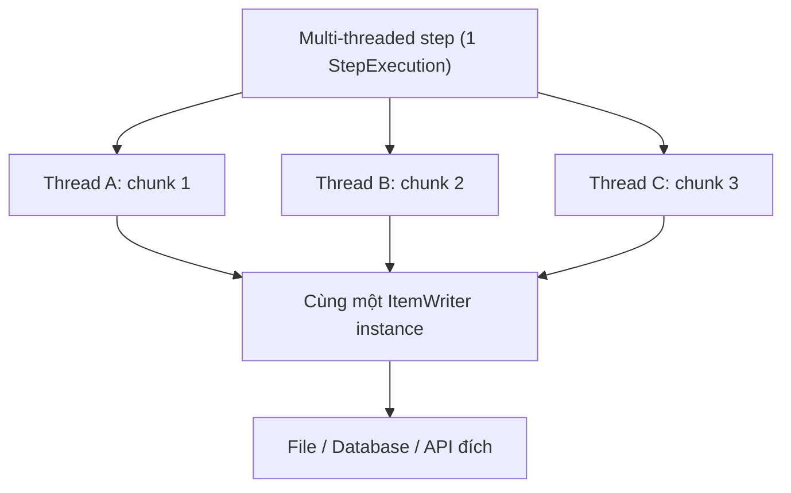
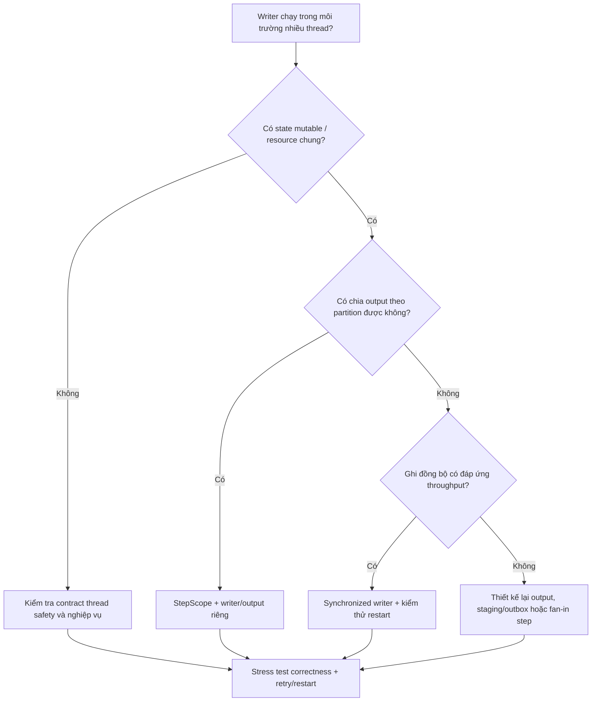

# Writer không an toàn khi dùng nhiều thread trong Spring Batch

Khi một Spring Batch job chuyển từ chạy tuần tự sang **multi-threaded step**, nhiều chunk có thể gọi cùng một `ItemWriter` tại những thời điểm chồng lấn. Writer hoạt động đúng với một thread chưa chắc hoạt động đúng khi nhiều thread cùng ghi: dòng bị mất, file bị hỏng, biến đếm sai, cập nhật trùng hoặc trạng thái checkpoint không còn phản ánh dữ liệu đã ghi.

Bài này thuộc chương **An toàn luồng** của module `SPRING_BATCH_SCALING_OPERATIONS`. Để mở rộng các workload lớn bằng multi-threaded step, parallel steps, partitioning hoặc worker phân tán, ta cần phân biệt **thread safety**, **tính đúng của transaction**, **idempotency** và **khả năng restart**; đo nút thắt thực tế trước khi chọn cách sửa và mức song song.

## 1. Vấn đề xuất hiện khi nào?

`ItemWriter<T>` nhận một `Chunk<? extends T>` và thực hiện thao tác ghi. Trong Spring Batch 5.x, phương thức chính có chữ ký:

```java
void write(Chunk<? extends T> chunk) throws Exception;
```

Ở step tuần tự, thông thường chỉ một chunk được ghi tại một thời điểm. Với **multi-threaded step**, executor có thể xử lý nhiều chunk đồng thời trong **cùng một `StepExecution`**. Nếu step dùng cùng một writer instance, các lời gọi `write(...)` có thể chạy chồng lên nhau.



**Điểm cần phân biệt:** trong **local partitioning**, manager tạo nhiều `StepExecution` worker, mỗi partition có `ExecutionContext` riêng. Khi writer được tạo bằng `@StepScope`, mỗi worker `StepExecution` nhận một instance riêng. Trái lại, `@StepScope` của một **multi-threaded step không partition** chỉ tạo một instance **cho cả step execution**, không tạo một writer cho mỗi thread.

| Mô hình | Đơn vị chia việc | Writer có thể bị chia sẻ khi nào? |
| --- | --- | --- |
| Step tuần tự | Một chunk tại một thời điểm | Thường không có ghi đồng thời trong cùng step |
| Multi-threaded step | Nhiều chunk trong một `StepExecution` | Các thread cùng gọi một writer |
| Parallel steps | Nhiều step độc lập | Nếu các step cùng tham chiếu singleton writer hoặc cùng tài nguyên đích |
| Local partitioning | Mỗi partition là một `StepExecution` | Nếu dùng singleton writer, hoặc nhiều instance ghi chung file/record |
| Remote partitioning | Các worker ở nhiều process/máy | Có thể không chia sẻ Java object nhưng vẫn tranh chấp cùng DB, file hoặc API |

Vì thế, câu hỏi “writer có thread-safe không?” cần xét **cả instance trong JVM lẫn tài nguyên đích dùng chung**.

## 2. Ba loại lỗi thường bị trộn lẫn

| Vấn đề | Bản chất | Triệu chứng |
| --- | --- | --- |
| **Java thread safety** | Nhiều thread truy cập trạng thái mutable mà không đồng bộ | Mất cập nhật, hỏng bộ đệm, race condition |
| **Transaction/concurrency correctness** | Các transaction hoặc thao tác ngoài DB không được phối hợp | Lost update, lock conflict, ghi một phần, đảo thứ tự |
| **Restart và idempotency** | Cùng bản ghi/side effect có thể được thực thi lại | Duplicate event, ghi file trùng, thanh toán hai lần |

Một writer **thread-safe** có thể vẫn tạo side effect trùng nếu message được gửi trước khi transaction DB rollback. Ngược lại, một câu `UPDATE` idempotent chưa khiến biến `ArrayList` dùng chung trở nên thread-safe. Cần kiểm tra từng tầng riêng.

## 3. Ví dụ writer không an toàn: bộ đếm và danh sách dùng chung

Giả sử muốn ghi log nghiệp vụ theo thứ tự nhận chunk:

```java
import java.util.ArrayList;
import java.util.List;

import org.springframework.batch.item.Chunk;
import org.springframework.batch.item.ItemWriter;

record Invoice(long id, long amount) {}

public final class UnsafeAuditWriter implements ItemWriter<Invoice> {

    private final List<String> writtenLines = new ArrayList<>();
    private long nextSequence = 0;

    @Override
    public void write(Chunk<? extends Invoice> chunk) {
        for (Invoice invoice : chunk) {
            long sequence = ++nextSequence;
            writtenLines.add(sequence + "," + invoice.id());
        }
    }

    public List<String> snapshot() {
        return List.copyOf(writtenLines);
    }
}
```

Code trên có ít nhất ba lỗi trong môi trường concurrent:

1. `++nextSequence` là thao tác đọc–cộng–ghi, **không atomic**. Hai thread có thể cùng đọc cùng một giá trị rồi phát ra sequence trùng.
2. `ArrayList` không hỗ trợ nhiều thread cùng `add` mà không có cơ chế đồng bộ. Dữ liệu có thể mất hoặc cấu trúc bên trong không còn nhất quán.
3. `snapshot()` chạy trong lúc writer đang sửa danh sách cũng có nguy cơ đọc một trạng thái không nhất quán.

Ngay cả khi thay `nextSequence` bằng `AtomicLong` và danh sách bằng collection concurrent, thứ tự các dòng thu được **vẫn phụ thuộc lịch chạy thread**, không nhất thiết bằng thứ tự `id` đầu vào. Nếu nghiệp vụ yêu cầu thứ tự tăng dần toàn cục, phải thiết kế lại cách tổ chức đầu ra.

Ví dụ tương tự trong thực tế là một writer giữ `StringBuilder`, `BufferedWriter`, con trỏ file, batch buffer hoặc bộ đếm chung trong field; nhiều thread gọi `write` sẽ cùng sửa các field đó.

## 4. Writer nào cần thận trọng?

Không thể kết luận một writer thread-safe chỉ bằng tên lớp. Phải đọc hợp đồng công khai của implementation, xem field nào mutable, lifecycle nào giữ trạng thái và có delegate nào bên dưới.

| Loại writer | Rủi ro chính khi dùng chung | Hướng kiểm tra/xử lý |
| --- | --- | --- |
| `FlatFileItemWriter` | Buffer, vị trí file, restart state, tài nguyên file chung | Xem như stateful; ưu tiên file riêng theo partition hoặc đồng bộ ghi và kiểm thử restart |
| Custom writer có `List`, `Map`, counter, buffer | Race khi cập nhật state | Loại bỏ shared mutable state, dùng đồng bộ đúng phạm vi hoặc instance riêng |
| `JdbcBatchItemWriter` | Implementation được thiết kế thread-safe sau khi cấu hình xong; vẫn có rủi ro từ SQL/DB | Không mutate cấu hình khi chạy; kiểm tra lock, idempotency và transaction |
| Writer gọi REST/message broker | HTTP client có thể thread-safe, nhưng side effect chưa chắc idempotent | Idempotency key, retry/backoff, giới hạn concurrency, outbox nếu phù hợp |
| `CompositeItemWriter` | Phụ thuộc các delegate và tài nguyên mà chúng truy cập | Kiểm tra từng delegate; composite không tự giải quyết race trong delegate |
| Writer dùng `ItemStream` | `open/update/close` và `ExecutionContext` có state checkpoint | Xác định rõ ai sở hữu state và cách restart; kiểm thử failure |

**Ví dụ quan trọng:** `JdbcBatchItemWriter` thường có thể được dùng bởi nhiều thread **sau khi đã cấu hình đầy đủ**, nhưng không có nghĩa hai transaction cập nhật cùng một dòng DB luôn an toàn về nghiệp vụ. Thread safety của Java object và tính đúng khi tranh chấp SQL là hai điều khác nhau.

## 5. Dấu hiệu nhận biết writer có race condition

Các lỗi concurrency thường không xuất hiện trong thử nghiệm với một thread. Khi tăng từ 1 lên 4 hoặc 8 thread, có thể gặp:

- File xuất có số dòng ít hơn input hoặc một vài dòng bị dính vào nhau.
- ID/sequence trùng hoặc thiếu dù `JobExecution` vẫn báo `COMPLETED`.
- Kết quả không ổn định: chạy lại cùng dataset nhưng hash/số lượng/thứ tự đầu ra khác nhau.
- `NullPointerException`, `ConcurrentModificationException` hoặc lỗi I/O xuất hiện ngẫu nhiên.
- `WRITE_COUNT` của Spring Batch không khớp dữ liệu nghiệp vụ thực sự đã commit ở đích.
- Restart sinh dòng trùng hoặc ghi đè file đã hoàn tất của một partition khác.
- Ghi vào API bên ngoài bị gửi lặp sau rollback, timeout hoặc retry.

**Không phải dấu hiệu nào cũng chứng minh nguyên nhân là Java race.** DB trigger, isolation level, dữ liệu nguồn thay đổi, đọc trùng chunk, transaction rollback và định tuyến partition sai cũng có thể gây triệu chứng tương tự. Phải dùng kiểm tra bất biến dữ liệu và quan sát theo `StepExecution` để khoanh vùng.

## 6. Cách 1: dùng writer vốn an toàn để gọi đồng thời

Với nhu cầu cập nhật database, `JdbcBatchItemWriter` là một lựa chọn phổ biến. Sau khi dựng bean xong, tránh thay đổi cấu hình writer trong lúc job chạy; cho từng chunk thực thi trong transaction do Spring Batch quản lý.

Ví dụ dùng Spring Batch 5.x với các `Invoice` chỉ mang `id`, và cột `processed` trong bảng `invoices`:

```java
import javax.sql.DataSource;

import org.springframework.batch.item.database.JdbcBatchItemWriter;
import org.springframework.batch.item.database.builder.JdbcBatchItemWriterBuilder;
import org.springframework.context.annotation.Bean;
import org.springframework.context.annotation.Configuration;
import org.springframework.jdbc.core.namedparam.MapSqlParameterSource;

@Configuration
class InvoiceWriterConfiguration {

    @Bean
    JdbcBatchItemWriter<Invoice> invoiceJdbcWriter(DataSource dataSource) {
        return new JdbcBatchItemWriterBuilder<Invoice>()
                .dataSource(dataSource)
                .sql("""
                     UPDATE invoices
                        SET processed = TRUE
                      WHERE id = :id AND processed = FALSE
                     """)
                .itemSqlParameterSourceProvider(
                        item -> new MapSqlParameterSource("id", item.id()))
                // Cập nhật lại bản ghi đã xử lý có thể ảnh hưởng 0 dòng.
                .assertUpdates(false)
                .build();
    }
}
```

Để ví dụ trên chạy, cơ sở dữ liệu cần có bảng `invoices(id, processed, ...)`; `Invoice` là record đã định nghĩa ở mục 3. Điều kiện `processed = FALSE` giúp thao tác cập nhật dễ chạy lại, nhưng **`assertUpdates(false)` không được dùng để che giấu mọi lỗi 0 dòng trong production**. Nếu nghiệp vụ yêu cầu mỗi lệnh phải cập nhật đúng một bản ghi, hãy định nghĩa rõ tình huống nào được phép 0 dòng và cảnh báo khi có sai lệch.

Một writer JDBC thread-safe **không loại bỏ** các vấn đề sau:

- Hai chunk cùng chọn/ghi một ID do reader hoặc phạm vi partition bị sai.
- Transaction deadlock hay lock wait khi có tranh chấp trên bảng/index.
- Các side effect bên ngoài database bị phát lại sau retry hoặc crash.
- Mất thứ tự ghi toàn cục khi nhiều chunk commit không theo thứ tự đọc.

Vì vậy phải thiết kế câu SQL, uniqueness constraint, transaction và idempotency cùng với Java thread safety.

## 7. Cách 2: đồng bộ các lời gọi write với SynchronizedItemStreamWriter

Khi cần tận dụng writer có sẵn nhưng chưa thread-safe (ví dụ một số writer giữ trạng thái khi xuất file), Spring Batch cung cấp `SynchronizedItemStreamWriter` để **serialize các lời gọi `write(...)`** của delegate.

Ví dụ cấu hình writer ghi CSV trong Spring Batch 5.x:

```java
import org.springframework.batch.item.file.FlatFileItemWriter;
import org.springframework.batch.item.file.builder.FlatFileItemWriterBuilder;
import org.springframework.batch.item.support.SynchronizedItemStreamWriter;
import org.springframework.batch.item.support.builder.SynchronizedItemStreamWriterBuilder;
import org.springframework.beans.factory.annotation.Qualifier;
import org.springframework.context.annotation.Bean;
import org.springframework.context.annotation.Configuration;
import org.springframework.core.io.FileSystemResource;

@Configuration
class InvoiceCsvExportConfiguration {

    @Bean("invoiceCsvDelegate")
    FlatFileItemWriter<Invoice> invoiceCsvDelegate() {
        return new FlatFileItemWriterBuilder<Invoice>()
                .name("invoiceCsvDelegate")
                .resource(new FileSystemResource("output/invoices.csv"))
                .lineAggregator(item -> item.id() + "," + item.amount())
                .build();
    }

    @Bean
    SynchronizedItemStreamWriter<Invoice> invoiceCsvWriter(
            @Qualifier("invoiceCsvDelegate") FlatFileItemWriter<Invoice> delegate) {
        return new SynchronizedItemStreamWriterBuilder<Invoice>()
                .delegate(delegate)
                .build();
    }
}
```

Khi cấu hình step, truyền `invoiceCsvWriter` vào `.writer(...)`; **không truyền đồng thời delegate và wrapper vào các step chạy song song** nếu chúng còn ghi cùng file. Thư mục `output` phải có sẵn hoặc được chuẩn bị trước, và không để hai job instance độc lập cùng ghi đường dẫn đó.

### Giới hạn của việc bọc synchronized writer

Wrapper giải quyết một vấn đề hẹp: **không để hai lời gọi `write(...)` của cùng wrapper thực hiện đồng thời**. Nó có những giới hạn quan trọng:

1. `write(...)` được gọi tuần tự, nên phần ghi vốn là nút thắt **không có speedup theo worker**. Reader/processor có thể vẫn chạy đồng thời nhưng các thread sẽ xếp hàng tại writer.
2. Wrapper không biến writer hoặc side effect thành một giao dịch chung với DB, message broker hay hệ thống file.
3. Với writer stateful có `ItemStream.open/update/close` và lưu checkpoint, phải kiểm tra toàn bộ **lifecycle và restart**. Serialize `write` một mình không chứng minh rằng update state, commit chunk và restart đều nhất quán.
4. Đầu ra vẫn có thể theo thứ tự chunk **hoàn tất trước**, khác thứ tự bản ghi gốc. `synchronized` không tự sắp xếp dữ liệu.
5. Nếu reader dùng chung cũng không thread-safe, bọc writer không sửa được lỗi phía reader.

Đây là cách phù hợp khi muốn bảo vệ một writer chưa an toàn để triển khai có kiểm soát hoặc khi phần reader/processor mới là chi phí lớn, còn ghi rất nhanh. Nếu viết file chiếm hầu hết thời gian, nên chuyển sang thiết kế **mỗi partition một file riêng**.

## 8. Cách 3: writer riêng cho từng partition

Với **partitioning**, mỗi partition sở hữu một `StepExecution` và `ExecutionContext` riêng. Dùng `@StepScope` để tạo writer theo từng `StepExecution`, đồng thời chọn tài nguyên đầu ra **không trùng nhau**.

Ví dụ manager đưa trường `outputFile` vào context:

```java
// Bên trong Partitioner: mỗi key gắn với đường dẫn riêng và ổn định.
ExecutionContext context = new ExecutionContext();
context.putString("outputFile", "output/run-42/invoices-p003.csv");
partitions.put("p003", context);
```

Bean writer lấy đường dẫn từ context:

```java
import org.springframework.batch.core.configuration.annotation.StepScope;
import org.springframework.batch.item.file.FlatFileItemWriter;
import org.springframework.batch.item.file.builder.FlatFileItemWriterBuilder;
import org.springframework.beans.factory.annotation.Value;
import org.springframework.context.annotation.Bean;
import org.springframework.context.annotation.Configuration;
import org.springframework.core.io.FileSystemResource;

@Configuration
class InvoicePartitionWriterConfiguration {

    @Bean
    @StepScope
    FlatFileItemWriter<Invoice> invoicePartitionFileWriter(
            @Value("#{stepExecutionContext['outputFile']}") String outputFile) {
        return new FlatFileItemWriterBuilder<Invoice>()
                .name("invoicePartitionFileWriter")
                .resource(new FileSystemResource(outputFile))
                .lineAggregator(item -> item.id() + "," + item.amount())
                .build();
    }
}
```

Giả sử có `p000`, `p001`, `p002` và `p003`, mỗi context phải dùng đường dẫn khác nhau:

```text
output/run-42/invoices-p000.csv
output/run-42/invoices-p001.csv
output/run-42/invoices-p002.csv
output/run-42/invoices-p003.csv
```

**Vì sao an toàn hơn?** Mỗi partition có writer instance và file riêng, nên các thread không tranh chấp cùng bộ đệm và con trỏ file. Sau khi các worker hoàn tất, một step tổng hợp riêng có thể ghép file theo thứ tự xác định; tránh cho nhiều partition tự append vào cùng một file đích.

Các điều kiện triển khai:

- Tên file cần **duy nhất giữa các partition và giữa các job instance chạy đồng thời**, nhưng giữ **ổn định khi restart cùng job instance**.
- Đảm bảo thư mục tồn tại và có quyền ghi trước khi mở file.
- Không dựa vào `Thread.currentThread().getName()` để đặt tên file: thread có thể được tái sử dụng hoặc thay đổi sau restart.
- Không sinh random filename mỗi lần `write`/restart nếu không có mapping bền vững tới partition gốc.
- `@StepScope` chỉ cô lập instance theo `StepExecution`. Nếu trong **một partition step** lại chạy nhiều thread cùng lúc, writer scoped đó vẫn có thể nhận ghi đồng thời.
- Nếu worker nằm ở các máy khác nhau, địa chỉ file cần phù hợp với hệ thống lưu trữ và khả năng truy cập của step tổng hợp.

Lưu ý: ghi file không tự rollback khi transaction DB rollback. Dù mỗi partition có file riêng, vẫn phải kiểm tra tương thích với checkpoint của `FlatFileItemWriter` và thiết kế khi worker lỗi giữa chừng.

## 9. Cách 4: thay đổi thiết kế để giảm shared mutable state

Nếu writer tự viết có field lưu trạng thái qua các chunk, cân nhắc:

1. **Biến state cục bộ vào `write(...)`** khi không cần chia sẻ giữa các lời gọi; data transformation nên là hàm thuần, không giữ buffer chung.
2. **Dùng writer có tài nguyên độc lập cho từng partition** và context xác định; chọn cách này khi có thể chia vùng dữ liệu/đầu ra.
3. **Sử dụng API đồng thời có hợp đồng rõ** (ví dụ `AtomicLong` cho counter, queue concurrent) nếu thật sự cần state chung; vẫn phải chứng minh thứ tự, transaction và checkpoint đúng.
4. **Serialize khu vực ghi bắt buộc tuần tự** khi không thể loại bỏ tài nguyên chung; đo contention trước khi cho thêm worker.
5. **Dùng cơ chế bền vững cho side effect ngoài DB** như transactional outbox, idempotency key, unique business key và retry có backoff.

Ví dụ thao tác cập nhật một dòng với điều kiện idempotent:

```sql
UPDATE invoices
SET processed = TRUE
WHERE id = :id
  AND processed = FALSE;
```

Nếu nhiều worker có thể xử lý cùng một `id`, phép cập nhật có điều kiện giúp tránh cập nhật trạng thái nhiều lần, nhưng không tự ngăn việc gửi hai email, ghi hai file hoặc tạo hai payment ngoài transaction. Ở những nơi này, cần idempotency gắn với định danh nghiệp vụ bền vững.

## 10. Vì sao synchronized và @StepScope không phải thuốc chữa mọi lỗi?

Ba cơ chế xử lý các phạm vi khác nhau:

| Cơ chế | Đảm bảo chính | Điều không đảm bảo |
| --- | --- | --- |
| `synchronized` quanh `write` | Một critical section của writer tại một thời điểm trong cùng JVM/object | Thứ tự nghiệp vụ, DB rollback, không trùng side effect |
| `@StepScope` | Instance riêng cho mỗi `StepExecution` | Instance riêng cho từng thread của cùng một step execution |
| Partition range không chồng lấn | Hai partition không được giao cùng bản ghi nguồn theo thiết kế | Không có xung đột ở DB table khác, index, file hay API |
| JDBC writer thread-safe | Java implementation có thể được gọi từ nhiều thread theo hợp đồng của lớp | Transaction isolation và nghiệp vụ đúng khi concurrent |
| Unique constraint/idempotency key | Hạn chế một số hiệu ứng trùng tại hệ thống đích | Reader/file buffer sẽ thread-safe |

Một sơ đồ quyết định đơn giản:



## 11. Checkpoint, restart và thứ tự dữ liệu

### 11.1. Ghi thành công chưa chắc đã được checkpoint

Trong chunk-oriented processing, Spring Batch quản lý transaction và lưu trạng thái của reader/writer (nếu thực hiện `ItemStream`) vào `ExecutionContext`. Một external side effect có thể xảy ra trước khi metadata được commit. Khi worker chết và restart, cùng chunk có thể được thực thi lại.

Ví dụ:

```text
Chunk C đọc 100 bản ghi
  -> Writer gửi 100 message ra broker ngoài transaction
  -> Gửi xong, DB transaction rollback
  -> Restart đọc lại chunk C
  -> 100 message có thể bị gửi lần nữa
```

Ngay cả khi writer chỉ có một thread, tình huống này vẫn có thể xảy ra. Khắc phục bằng idempotency ở consumer hoặc cơ chế outbox/transaction phù hợp, tùy mức bảo đảm giao nhận cần thiết.

### 11.2. Không nhầm lẫn giữa thread-safe và giữ nguyên thứ tự

Giả sử chunk chứa các ID:

```text
Chunk A: 1..100
Chunk B: 101..200
Chunk C: 201..300
```

Trong multi-threaded step, `Chunk C` có thể xử lý xong trước `Chunk A`. Synchronized writer sẽ ghi từng chunk một, **nhưng thứ tự các chunk ghi phụ thuộc thời điểm chúng tới lock**. Nếu file phải sắp tăng theo ID, hãy partition và ghép file theo thứ tự, sort sau khi xuất, hoặc chọn mô hình xử lý tuần tự ở chặng yêu cầu order.

### 11.3. Lưu trạng thái writer không đúng có thể gây mất dữ liệu

`FlatFileItemWriter` theo dõi trạng thái đầu ra phục vụ restart; khi nhiều thread ghi/chốt checkpoint trong một `StepExecution`, phải kiểm tra tính nhất quán giữa vị trí file và những chunk đã commit. Không tự động đặt `saveState(false)` chỉ để làm biến mất cảnh báo đồng bộ: điều đó có thể làm job **không thể restart chính xác** từ checkpoint cũ.

Với mô hình phân vùng theo file, hãy bảo đảm output path, partition key và snapshot đầu vào được giữ ổn định trong cùng `JobInstance`. Khi restart, các partition đã hoàn thành thường được bỏ qua theo chính sách mặc định, còn partition lỗi có thể thực thi lại.

## 12. Kiểm chứng thread safety: phải đo kết quả thực, không chỉ nhìn log

Một quy trình kiểm thử gọn nhưng đủ sức phát hiện lỗi:

1. **Chuẩn bị dữ liệu cố định** có N bản ghi duy nhất; lưu danh sách PK/ID làm chuẩn.
2. Chạy baseline với **1 worker** và thu đầu ra/kiểm tra số bản ghi đúng.
3. Lặp lại cùng workload với **2, 4, 8 worker**, nhiều lượt và có dữ liệu/tải đủ lớn để tăng khả năng các lời gọi `write` chồng lấn.
4. Kiểm tra bất biến nghiệp vụ: số dòng, số ID khác nhau, uniqueness, checksum nếu hợp lý, không có file bị hỏng hoặc record thiếu/trùng.
5. Cố tình tạo chậm ở writer/DB hoặc cho chunk có thời gian xử lý khác nhau để bộc lộ race và đảo thứ tự. Không dựa vào một lần chạy thành công.
6. Tạo lỗi/rollback/crash tại các điểm có thể kiểm soát, restart **cùng `JobInstance`** và kiểm tra đầu ra cuối cùng.
7. Thu `StepExecution` status, `READ_COUNT`/`WRITE_COUNT`, `ROLLBACK_COUNT`, throughput, connection wait, lock contention và thời gian chờ writer lock.

Với kết quả lưu vào bảng có business key `invoice_id`, có thể đối chiếu:

```sql
-- Số bản ghi thực sự có kết quả (không thay thế bước xác minh input).
SELECT COUNT(*) AS total_rows,
       COUNT(DISTINCT invoice_id) AS unique_invoices
FROM invoice_export_result
WHERE run_id = :runId;

-- Những invoice bị ghi nhiều hơn một lần.
SELECT invoice_id, COUNT(*) AS occurrences
FROM invoice_export_result
WHERE run_id = :runId
GROUP BY invoice_id
HAVING COUNT(*) > 1;
```

Các truy vấn chỉ là ví dụ kiểm tra nếu hệ thống có bảng kết quả như trên. Muốn phát hiện bản ghi **thiếu**, còn phải đối chiếu tập ID đầu vào chuẩn với tập ID đầu ra, không chỉ so `COUNT(*)`. Nếu bảng đích có unique constraint, duplicate insert có thể bị reject; log và số lần retry lúc đó là tín hiệu quan trọng.

Không coi `JobExecution=COMPLETED` hay `WRITE_COUNT=N` là bằng chứng đủ: counter có thể đếm item đã qua writer, trong khi side effect ngoài transaction chưa bảo đảm tính bền vững và uniqueness.

## 13. Cân bằng thread safety và hiệu năng

Một writer khóa toàn bộ `write` có thể an toàn về mặt truy cập bộ đệm nhưng biến phần ghi thành nút thắt. Hãy đo **thời gian chờ khóa writer** trước và sau khi bọc synchronized.

| Quan sát | Giải thích khả dĩ | Điều chỉnh |
| --- | --- | --- |
| Thêm thread nhưng throughput không tăng, writer lock wait cao | Writer đang serialize mọi chunk | Chia file/output theo partition, tối ưu ghi hoặc giảm thread |
| Writer lock wait thấp, DB CPU và lock wait cao | Nút thắt ở SQL/DB | Index/query/transaction, giảm tranh chấp và pool sizing |
| CPU app bão hòa nhưng writer nhàn | Reader/processor CPU-bound | Tối ưu tính toán, số worker gần CPU hiệu dụng |
| Đầu ra đủ nhưng thứ tự sai | Chunk hoàn tất khác thứ tự đầu vào | Fan-in có sắp xếp hoặc xử lý tuần tự ở chặng order-sensitive |
| Chạy thường đúng, restart sinh duplicate | Side effect không idempotent hoặc checkpoint sai | Outbox/idempotency, kiểm tra `ItemStream` và commit |
| Mỗi partition có writer riêng nhưng file vẫn hỏng | Nhiều partition trỏ cùng resource | Sửa quy tắc tạo output path và cô lập theo partition |

Đối với workload lớn, **song song hóa reader/processor và giữ chặng ghi tuần tự** có thể hợp lý nếu xử lý nặng còn ghi nhẹ. Ngược lại, nếu writer chiếm phần lớn thời gian, cần tách output theo partition hoặc đổi kiến trúc lưu trữ; tăng số thread đơn thuần không giúp vượt qua chặng ghi chung.

## 14. Các tình huống thực tế

### Tình huống A: Xuất hàng triệu bản ghi ra một CSV

Một `FlatFileItemWriter` singleton nhận dữ liệu từ nhiều thread. Sau khi bật executor, thỉnh thoảng thiếu dòng và file không theo thứ tự mong muốn. Nếu chỉ thêm `synchronized`, có thể tránh hai lời gọi `write` chồng nhau nhưng vẫn không bảo đảm thứ tự dữ liệu và cách phục hồi file.

**Hướng triển khai:** chuyển sang partitioning; tạo writer scoped theo từng partition, mỗi partition ghi một file tên ổn định. Cuối job, chạy step tổng hợp có sắp thứ tự rõ ràng và chỉ công bố file kết quả sau khi xác minh đủ partition.

### Tình huống B: Cập nhật trạng thái hàng triệu hóa đơn

Writer sử dụng `JdbcBatchItemWriter` với SQL cập nhật theo PK. Bean có thể an toàn khi gọi đồng thời, nhưng nếu hai worker được chia range chồng nhau, việc cập nhật không độc lập. Ngoài kiểm tra Java thread safety, phải xác minh partition không overlap và dùng ràng buộc DB/idempotency phù hợp.

**Hướng triển khai:** chia primary key range không giao nhau, kiểm tra transaction/DB locks, dùng SQL nhất quán; điều chỉnh concurrency theo JDBC pool và DB capacity.

### Tình huống C: Gửi yêu cầu thanh toán hoặc thông báo qua API

HTTP client có thể được chia sẻ giữa các thread, nhưng timeout khiến client không biết server đã xử lý hay chưa. Retry có thể gửi cùng lệnh thêm lần nữa.

**Hướng triển khai:** đặt idempotency key theo lệnh nghiệp vụ, yêu cầu server đích xử lý lặp an toàn, có circuit breaker/backoff và theo dõi retry. Không dùng synchronized trong JVM như một cơ chế chống gửi trùng xuyên máy hoặc sau restart.

## 15. Tự kiểm tra

**Câu 1.** Một multi-threaded step dùng `@StepScope FlatFileItemWriter`. Vì sao chưa thể kết luận có một writer cho mỗi thread?

**Đáp án:** `@StepScope` tạo instance theo `StepExecution`. Multi-threaded step vẫn chỉ có một `StepExecution` cho các thread xử lý chunk, nên instance đó có thể được chia sẻ.

**Câu 2.** Bọc `SynchronizedItemStreamWriter` có bảo đảm file CSV được sắp theo PK?

**Đáp án:** Không. Nó serialize `write`, nhưng các chunk có thể đến writer theo thứ tự khác với thứ tự đọc. Cần cơ chế sắp xếp hoặc ghép kết quả theo thứ tự xác định.

**Câu 3.** `JdbcBatchItemWriter` được thiết kế thread-safe thì có cần kiểm tra partition overlap, DB lock và retry không?

**Đáp án:** Có. Java thread safety không thay thế transaction correctness, idempotency và thiết kế phân chia công việc.

**Câu 4.** Khi restart job gửi message ngoài DB, người nhận thấy message trùng dù writer chỉ có một thread. Đây nhất thiết là lỗi thread safety?

**Đáp án:** Không. Có thể là lỗi giữa thời điểm gửi side effect và thời điểm commit/checkpoint. Cần idempotency hoặc cơ chế giao nhận có bảo đảm phù hợp.

## 16. Tài liệu đối chiếu

- [Spring Batch Reference — Scaling and Parallel Processing](https://docs.spring.io/spring-batch/reference/scalability.html): kiến trúc multi-threaded step, parallel step và partitioning.
- [Spring Batch Reference — Readers and Writers](https://docs.spring.io/spring-batch/reference/readers-and-writers.html): các implementation của `ItemReader`/`ItemWriter`.
- [Spring Batch API — ItemWriter](https://docs.spring.io/spring-batch/docs/5.2.x/api/org/springframework/batch/item/ItemWriter.html): hợp đồng `write(Chunk<? extends T>)`.
- [Spring Batch API — SynchronizedItemStreamWriter](https://docs.spring.io/spring-batch/docs/5.2.x/api/org/springframework/batch/item/support/SynchronizedItemStreamWriter.html): wrapper đồng bộ ghi.
- [Spring Batch API — JdbcBatchItemWriter](https://docs.spring.io/spring-batch/docs/5.2.x/api/org/springframework/batch/item/database/JdbcBatchItemWriter.html): writer JDBC và điều kiện thread safety sau cấu hình.
- [Spring Batch API — FlatFileItemWriter](https://docs.spring.io/spring-batch/docs/5.2.x/api/org/springframework/batch/item/file/FlatFileItemWriter.html): writer file và trạng thái đầu ra phục vụ restart.

**Ghi nhớ:** trước khi tăng số thread, xác định writer có giữ state mutable hoặc chia sẻ cùng resource không. Chọn writer đáp ứng contract đồng thời, cô lập instance/tài nguyên theo partition, hoặc đồng bộ khu vực ghi khi thật sự cần; sau đó kiểm tra **đủ dữ liệu, không trùng side effect, restart đúng và throughput thực tế**. Thread safety là điều kiện cần để mở rộng Spring Batch an toàn, nhưng phải đi cùng transaction và thiết kế vận hành.
